# Metal 图形 API 绑定

<cite>
**本文引用的文件**
- [README.md](file://README.md)
- [DESIGN.md](file://DESIGN.md)
- [Program.cs](file://samples/SharpMetal.Sample/Program.cs)
- [MTLDevice.cs](file://src/SharpMetal/Metal/MTLDevice.cs)
- [MTLCommandQueue.cs](file://src/SharpMetal/Metal/MTLCommandQueue.cs)
- [MTLCommandBuffer.cs](file://src/SharpMetal/Metal/MTLCommandBuffer.cs)
- [MTLRenderPipeline.cs](file://src/SharpMetal/Metal/MTLRenderPipeline.cs)
- [MTLComputePipeline.cs](file://src/SharpMetal/Metal/MTLComputePipeline.cs)
- [MTLTexture.cs](file://src/SharpMetal/Metal/MTLTexture.cs)
- [MTLBuffer.cs](file://src/SharpMetal/Metal/MTLBuffer.cs)
- [MTLRenderCommandEncoder.cs](file://src/SharpMetal/Metal/MTLRenderCommandEncoder.cs)
- [MTLComputeCommandEncoder.cs](file://src/SharpMetal/Metal/MTLComputeCommandEncoder.cs)
- [MTLBlitCommandEncoder.cs](file://src/SharpMetal/Metal/MTLBlitCommandEncoder.cs)
- [MTLSampler.cs](file://src/SharpMetal/Metal/MTLSampler.cs)
- [MTLDepthStencil.cs](file://src/SharpMetal/Metal/MTLDepthStencil.cs)
- [MTLTypes.cs](file://src/SharpMetal/Metal/MTLTypes.cs)
</cite>

## 目录
1. [简介](#简介)
2. [项目结构](#项目结构)
3. [核心组件](#核心组件)
4. [架构总览](#架构总览)
5. [详细组件分析](#详细组件分析)
6. [依赖关系分析](#依赖关系分析)
7. [性能考虑](#性能考虑)
8. [故障排查指南](#故障排查指南)
9. [结论](#结论)
10. [附录](#附录)

## 简介
本仓库提供面向 .NET 的 Metal 低层绑定，覆盖 Foundation、Metal、MetalFX 与 QuartzCore。通过显式原生资源所有权模型，将 Objective-C 运行时与系统 Metal 框架桥接到托管环境。该绑定支持设备管理、内存分配（缓冲区/纹理）、渲染管线与计算管线配置、命令缓冲与命令编码器工作流，并提供示例程序验证基础能力。

## 项目结构
- src/SharpMetal：运行时绑定实现，包含 Metal、Foundation、ObjectiveCCore、QuartzCore 等模块
- samples/SharpMetal.Sample：可运行的最小示例，演示设备获取与共享缓冲区读写
- docs/：设计说明与验证流程
- eng/：构建与验证脚本

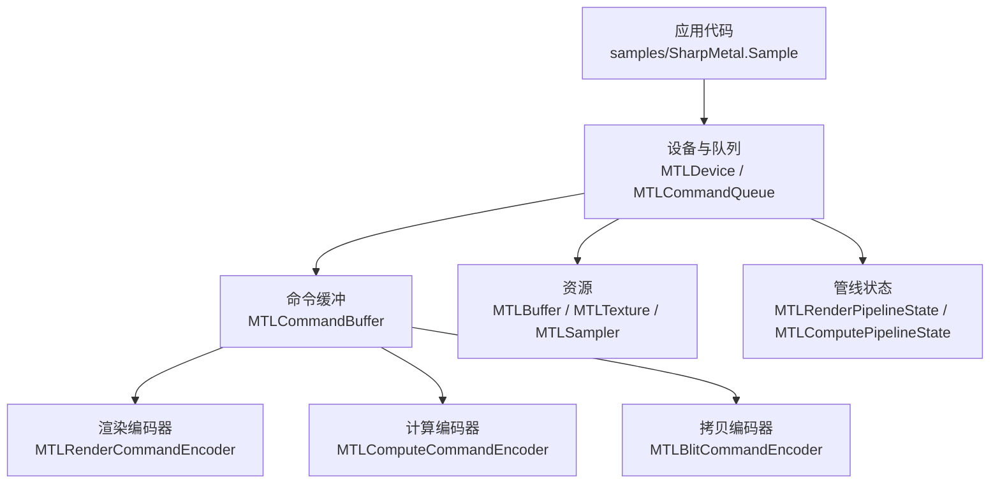

图表来源
- [MTLDevice.cs:305-339](file://src/SharpMetal/Metal/MTLDevice.cs#L305-L339)
- [MTLCommandQueue.cs:44-109](file://src/SharpMetal/Metal/MTLCommandQueue.cs#L44-L109)
- [MTLCommandBuffer.cs:116-268](file://src/SharpMetal/Metal/MTLCommandBuffer.cs#L116-L268)
- [MTLRenderCommandEncoder.cs:126-171](file://src/SharpMetal/Metal/MTLRenderCommandEncoder.cs#L126-L171)
- [MTLComputeCommandEncoder.cs:20-63](file://src/SharpMetal/Metal/MTLComputeCommandEncoder.cs#L20-L63)
- [MTLBlitCommandEncoder.cs:14-35](file://src/SharpMetal/Metal/MTLBlitCommandEncoder.cs#L14-L35)

章节来源
- [README.md:1-23](file://README.md#L1-L23)
- [DESIGN.md:1-12](file://DESIGN.md#L1-L12)

## 核心组件
- 设备（MTLDevice）：系统默认设备创建、功能探测、资源与管线工厂
- 命令队列（MTLCommandQueue）：命令缓冲的生产者
- 命令缓冲（MTLCommandBuffer）：编码与提交执行，呈现可绘制对象
- 渲染管线（MTLRenderPipeline*）：顶点/片段/网格/瓦片阶段配置
- 计算管线（MTLComputePipeline*）：内核函数与线程组参数配置
- 资源：缓冲区（MTLBuffer）、纹理（MTLTexture）、采样器（MTLSampler）、深度模板（MTLDepthStencil*）
- 命令编码器：渲染（MTLRenderCommandEncoder）、计算（MTLComputeCommandEncoder）、拷贝（MTLBlitCommandEncoder）

章节来源
- [MTLDevice.cs:187-339](file://src/SharpMetal/Metal/MTLDevice.cs#L187-L339)
- [MTLCommandQueue.cs:44-109](file://src/SharpMetal/Metal/MTLCommandQueue.cs#L44-L109)
- [MTLCommandBuffer.cs:116-268](file://src/SharpMetal/Metal/MTLCommandBuffer.cs#L116-L268)
- [MTLRenderPipeline.cs:208-629](file://src/SharpMetal/Metal/MTLRenderPipeline.cs#L208-L629)
- [MTLComputePipeline.cs:25-237](file://src/SharpMetal/Metal/MTLComputePipeline.cs#L25-L237)
- [MTLBuffer.cs:6-115](file://src/SharpMetal/Metal/MTLBuffer.cs#L6-L115)
- [MTLTexture.cs:75-440](file://src/SharpMetal/Metal/MTLTexture.cs#L75-L440)
- [MTLSampler.cs:37-187](file://src/SharpMetal/Metal/MTLSampler.cs#L37-L187)
- [MTLDepthStencil.cs:91-164](file://src/SharpMetal/Metal/MTLDepthStencil.cs#L91-L164)

## 架构总览
下图展示从设备到命令缓冲再到各类编码器的典型调用链，以及资源与管线的交互。

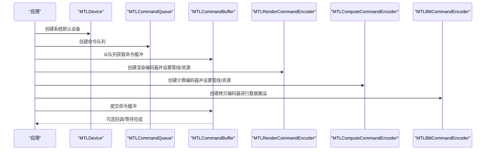

图表来源
- [MTLDevice.cs:305-339](file://src/SharpMetal/Metal/MTLDevice.cs#L305-L339)
- [MTLCommandQueue.cs:44-109](file://src/SharpMetal/Metal/MTLCommandQueue.cs#L44-L109)
- [MTLCommandBuffer.cs:116-268](file://src/SharpMetal/Metal/MTLCommandBuffer.cs#L116-L268)
- [MTLRenderCommandEncoder.cs:126-171](file://src/SharpMetal/Metal/MTLRenderCommandEncoder.cs#L126-L171)
- [MTLComputeCommandEncoder.cs:20-63](file://src/SharpMetal/Metal/MTLComputeCommandEncoder.cs#L20-L63)
- [MTLBlitCommandEncoder.cs:14-35](file://src/SharpMetal/Metal/MTLBlitCommandEncoder.cs#L14-L35)

## 详细组件分析

### 设备管理与资源创建（MTLDevice）
- 设备发现与能力查询：名称、架构、统一内存、最大线程组大小、特性开关（如光线追踪、动态库、采样位置等）
- 资源创建：缓冲区、纹理、采样器、深度模板、堆、事件、栅栏、加速结构、二进制归档、动态库等
- 管线创建：渲染管线状态、计算管线状态（支持反射与选项）
- 命令队列：多种构造方式（默认、描述符、最大缓冲数）

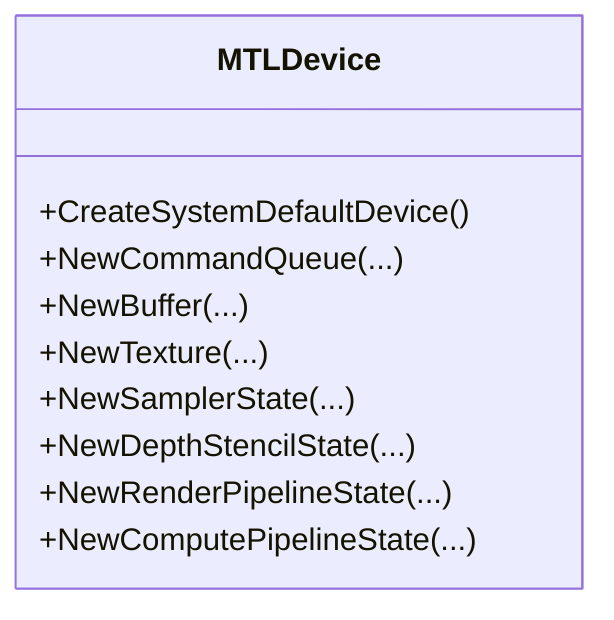

图表来源
- [MTLDevice.cs:305-449](file://src/SharpMetal/Metal/MTLDevice.cs#L305-L449)
- [MTLDevice.cs:451-624](file://src/SharpMetal/Metal/MTLDevice.cs#L451-L624)

章节来源
- [MTLDevice.cs:187-339](file://src/SharpMetal/Metal/MTLDevice.cs#L187-L339)
- [MTLDevice.cs:341-624](file://src/SharpMetal/Metal/MTLDevice.cs#L341-L624)

### 命令缓冲与命令编码器工作流
- 命令队列负责生产命令缓冲；命令缓冲用于编码渲染/计算/拷贝等操作，并提交执行
- 渲染编码器：设置管线、视口、裁剪矩形、顶点/片段/对象/网格/瓦片阶段资源、绘制调用、可见性结果、存储动作、内存屏障、间接命令执行等
- 计算编码器：设置管线、缓冲区/纹理/采样器、线程组/线程网格调度、内存屏障、间接命令执行等
- 拷贝编码器：同步资源、纹理/缓冲区复制、生成mipmap、填充缓冲区、优化内容、计数器采样等

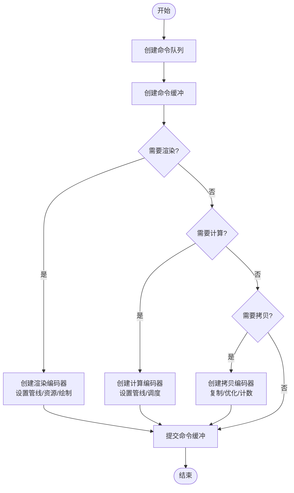

图表来源
- [MTLCommandQueue.cs:44-109](file://src/SharpMetal/Metal/MTLCommandQueue.cs#L44-L109)
- [MTLCommandBuffer.cs:116-268](file://src/SharpMetal/Metal/MTLCommandBuffer.cs#L116-L268)
- [MTLRenderCommandEncoder.cs:126-800](file://src/SharpMetal/Metal/MTLRenderCommandEncoder.cs#L126-L800)
- [MTLComputeCommandEncoder.cs:20-298](file://src/SharpMetal/Metal/MTLComputeCommandEncoder.cs#L20-L298)
- [MTLBlitCommandEncoder.cs:14-217](file://src/SharpMetal/Metal/MTLBlitCommandEncoder.cs#L14-L217)

章节来源
- [MTLCommandBuffer.cs:116-268](file://src/SharpMetal/Metal/MTLCommandBuffer.cs#L116-L268)
- [MTLRenderCommandEncoder.cs:126-800](file://src/SharpMetal/Metal/MTLRenderCommandEncoder.cs#L126-L800)
- [MTLComputeCommandEncoder.cs:20-298](file://src/SharpMetal/Metal/MTLComputeCommandEncoder.cs#L20-L298)
- [MTLBlitCommandEncoder.cs:14-217](file://src/SharpMetal/Metal/MTLBlitCommandEncoder.cs#L14-L217)

### 渲染管线配置（MTLRenderPipeline*）
- 描述符（MTLRenderPipelineDescriptor）：顶点/片段函数、顶点描述、采样数、混合、深度/模板格式、拓扑、细分、预加载库、链接函数、校验模式等
- 颜色附件描述符数组：像素格式、混合因子/操作、写入掩码
- 管线状态（MTLRenderPipelineState）：设备、线程组限制、图像块内存、反射、函数句柄、可见/相交函数表创建等

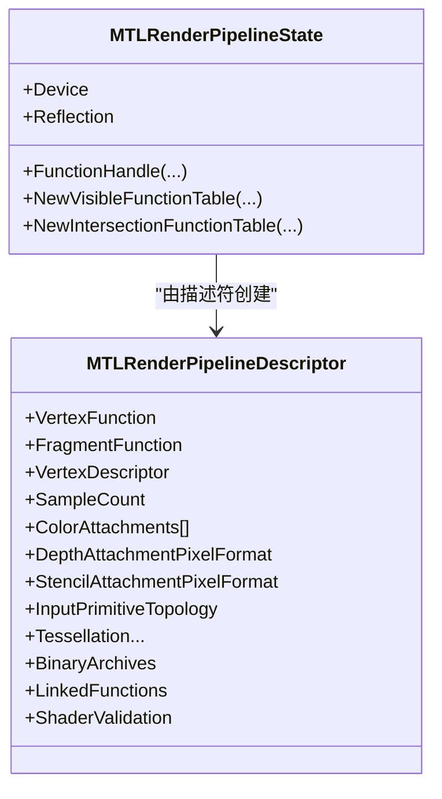

图表来源
- [MTLRenderPipeline.cs:208-629](file://src/SharpMetal/Metal/MTLRenderPipeline.cs#L208-L629)

章节来源
- [MTLRenderPipeline.cs:208-629](file://src/SharpMetal/Metal/MTLRenderPipeline.cs#L208-L629)

### 计算管线配置（MTLComputePipeline*）
- 描述符（MTLComputePipelineDescriptor）：内核函数、线程组尺寸约束、输入描述、缓冲区、预加载库、链接函数、校验模式等
- 管线状态（MTLComputePipelineState）：设备、线程执行宽度、静态线程组内存、反射、函数句柄、可见/相交函数表创建等

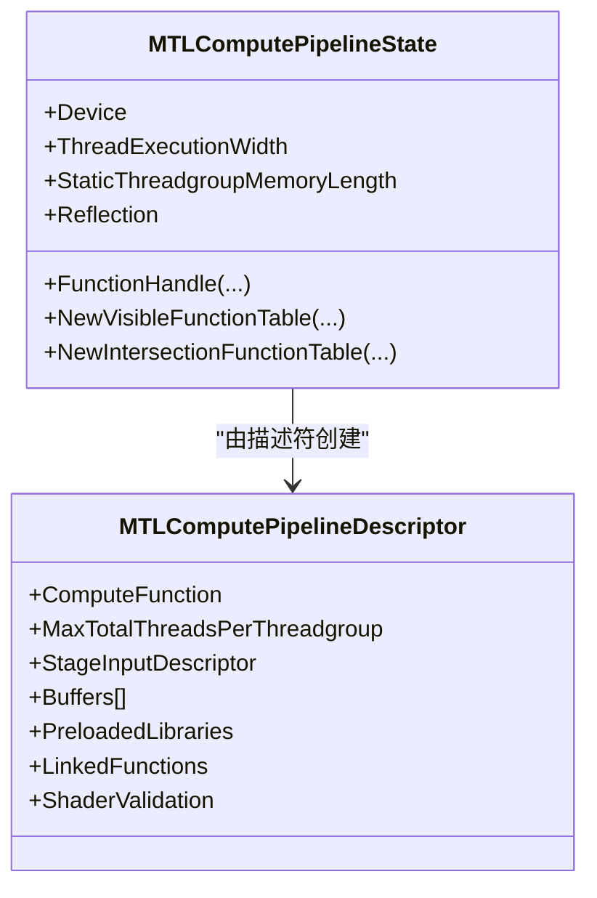

图表来源
- [MTLComputePipeline.cs:25-237](file://src/SharpMetal/Metal/MTLComputePipeline.cs#L25-L237)

章节来源
- [MTLComputePipeline.cs:25-237](file://src/SharpMetal/Metal/MTLComputePipeline.cs#L25-L237)

### 纹理处理（MTLTexture）
- 描述符（MTLTextureDescriptor）：类型、像素格式、宽高深、mipmap、采样数、数组长度、资源选项、CPU缓存模式、存储模式、使用标志、压缩类型、Swizzle、稀疏页大小等
- 纹理对象：属性访问、共享句柄、远程视图、区域读写（GetBytes/ReplaceRegion）、纹理视图、稀疏纹理、压缩类型、GPU资源ID等

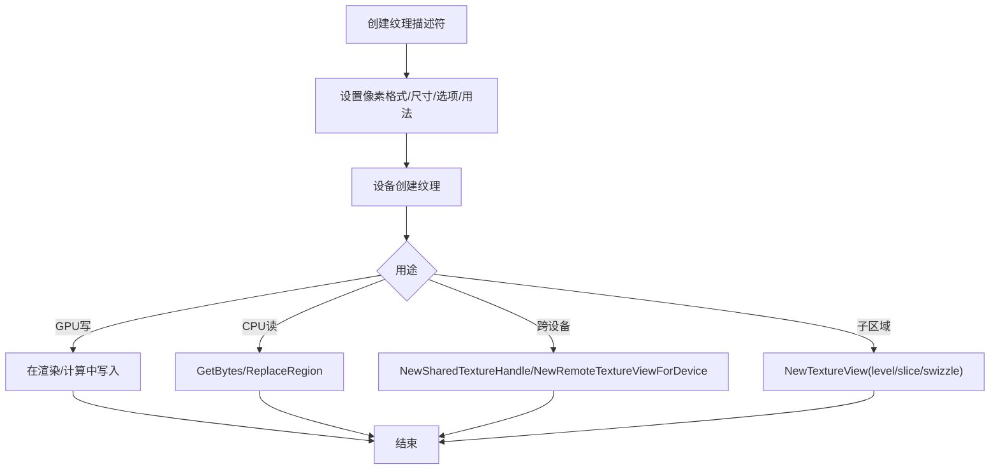

图表来源
- [MTLTexture.cs:75-440](file://src/SharpMetal/Metal/MTLTexture.cs#L75-L440)

章节来源
- [MTLTexture.cs:75-440](file://src/SharpMetal/Metal/MTLTexture.cs#L75-L440)

### 缓冲区与内存（MTLBuffer）
- 缓冲区对象：长度、Contents指针、GPU地址、远端视图、调试标记、从缓冲区创建纹理/张量、对齐与别名化等
- 设备创建缓冲区：长度+选项、带初始数据、稀疏页大小等

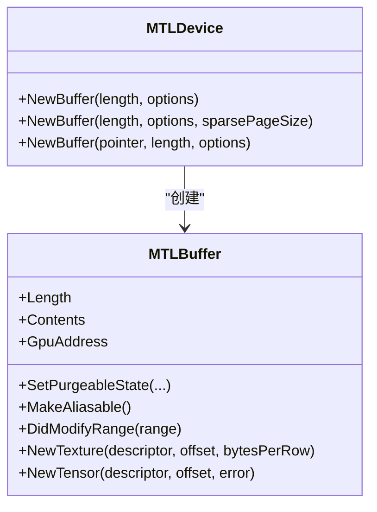

图表来源
- [MTLBuffer.cs:6-115](file://src/SharpMetal/Metal/MTLBuffer.cs#L6-L115)
- [MTLDevice.cs:356-369](file://src/SharpMetal/Metal/MTLDevice.cs#L356-L369)

章节来源
- [MTLBuffer.cs:6-115](file://src/SharpMetal/Metal/MTLBuffer.cs#L6-L115)
- [MTLDevice.cs:356-369](file://src/SharpMetal/Metal/MTLDevice.cs#L356-L369)

### 采样器与深度模板（MTLSampler / MTLDepthStencil）
- 采样器描述符：过滤模式、各向异性、寻址模式、边框色、LOD范围、比较函数、标签等；状态对象用于绑定
- 深度模板描述符：深度比较函数、是否写入、前后脸模板操作、读写掩码；状态对象用于绑定

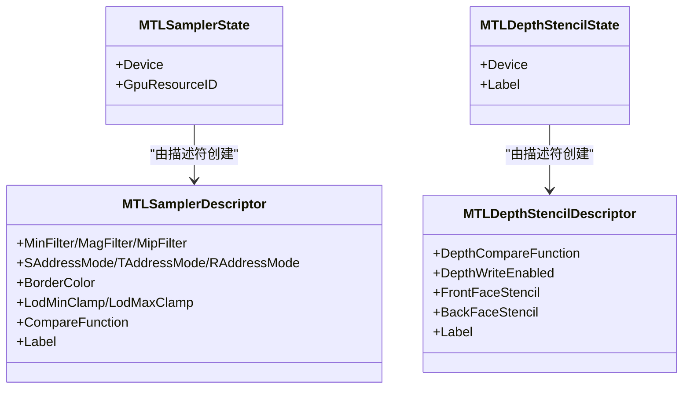

图表来源
- [MTLSampler.cs:37-187](file://src/SharpMetal/Metal/MTLSampler.cs#L37-L187)
- [MTLDepthStencil.cs:91-164](file://src/SharpMetal/Metal/MTLDepthStencil.cs#L91-L164)

章节来源
- [MTLSampler.cs:37-187](file://src/SharpMetal/Metal/MTLSampler.cs#L37-L187)
- [MTLDepthStencil.cs:91-164](file://src/SharpMetal/Metal/MTLDepthStencil.cs#L91-L164)

### 完整渲染循环示例（基于示例程序）
以下流程展示了最小可用的渲染循环骨架（以示例程序为基础），包括平台检查、设备获取、缓冲区分配与读写、资源释放。

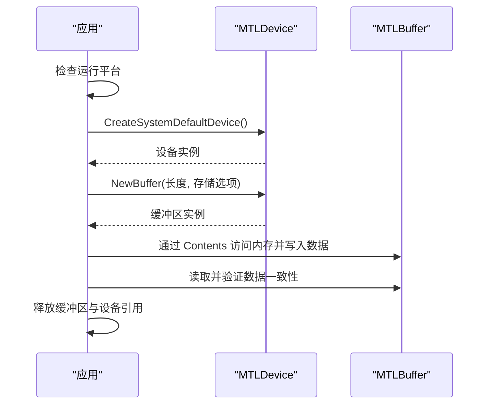

图表来源
- [Program.cs:10-46](file://samples/SharpMetal.Sample/Program.cs#L10-L46)

章节来源
- [Program.cs:10-46](file://samples/SharpMetal.Sample/Program.cs#L10-L46)

## 依赖关系分析
- 设备是资源与管线的根入口，所有命令缓冲来自命令队列，命令缓冲再创建具体编码器
- 渲染/计算/拷贝编码器依赖资源（缓冲区、纹理、采样器）和管线状态
- 类型定义（尺寸、区域、原点等）在各编码器间复用

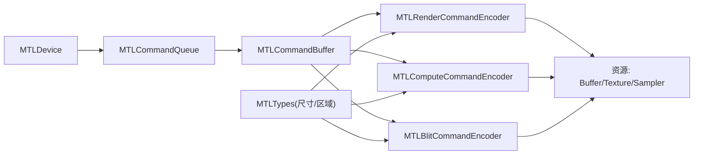

图表来源
- [MTLDevice.cs:305-339](file://src/SharpMetal/Metal/MTLDevice.cs#L305-L339)
- [MTLCommandQueue.cs:44-109](file://src/SharpMetal/Metal/MTLCommandQueue.cs#L44-L109)
- [MTLCommandBuffer.cs:116-268](file://src/SharpMetal/Metal/MTLCommandBuffer.cs#L116-L268)
- [MTLRenderCommandEncoder.cs:126-800](file://src/SharpMetal/Metal/MTLRenderCommandEncoder.cs#L126-L800)
- [MTLComputeCommandEncoder.cs:20-298](file://src/SharpMetal/Metal/MTLComputeCommandEncoder.cs#L20-L298)
- [MTLBlitCommandEncoder.cs:14-217](file://src/SharpMetal/Metal/MTLBlitCommandEncoder.cs#L14-L217)
- [MTLTypes.cs:47-109](file://src/SharpMetal/Metal/MTLTypes.cs#L47-L109)

章节来源
- [MTLTypes.cs:47-109](file://src/SharpMetal/Metal/MTLTypes.cs#L47-L109)

## 性能考虑
- 合理选择存储模式与CPU缓存模式：根据CPU/GPU访问频率与一致性需求配置纹理/缓冲区
- 使用批量与间接命令：利用间接命令缓冲减少主机开销，结合拷贝编码器优化命令缓冲
- 纹理优化：使用 OptimizeContentsForGPUAccess/CPUAccess 在切换访问方向前优化布局
- 内存屏障与同步：在渲染/计算中使用 MemoryBarrier/Fence/Event 控制依赖，避免不必要的全局同步
- 管线复用：尽量重用管线状态与采样器/深度模板状态，减少创建与切换成本
- 资源池与堆：使用堆与资源池减少碎片与分配开销（设备提供堆相关API）
- 计数器采样：使用 CounterSampleBuffer 与 Blit/Render/Compute 编码器中的采样接口定位瓶颈

[本节为通用指导，不直接分析具体文件]

## 故障排查指南
- 平台限制：非Apple平台会阻止原生Metal负载；需在macOS/iOS/macCatalyst上运行
- 设备为空：若设备指针为零，表示无可用Metal设备
- 缓冲区分配失败：共享缓冲区分配或Contents为空时抛出异常
- 命令缓冲错误：通过命令缓冲的错误状态与编码器错误状态定位问题
- 资源未同步：在CPU/GPU之间切换访问前确保同步或使用合适的存储模式
- 调试标记：使用 PushDebugGroup/PopDebugGroup、InsertDebugSignpost 标注关键阶段

章节来源
- [Program.cs:10-46](file://samples/SharpMetal.Sample/Program.cs#L10-L46)
- [MTLCommandBuffer.cs:9-48](file://src/SharpMetal/Metal/MTLCommandBuffer.cs#L9-L48)
- [MTLCommandBuffer.cs:146-193](file://src/SharpMetal/Metal/MTLCommandBuffer.cs#L146-L193)
- [MTLRenderCommandEncoder.cs:153-166](file://src/SharpMetal/Metal/MTLRenderCommandEncoder.cs#L153-L166)
- [MTLComputeCommandEncoder.cs:43-56](file://src/SharpMetal/Metal/MTLComputeCommandEncoder.cs#L43-L56)
- [MTLBlitCommandEncoder.cs:52-60](file://src/SharpMetal/Metal/MTLBlitCommandEncoder.cs#L52-L60)

## 结论
本绑定提供了完整的Metal API映射，涵盖设备、资源、管线、命令缓冲与编码器全链路。通过清晰的描述符与状态对象，开发者可以高效配置渲染与计算任务，并利用拷贝编码器与同步原语保证数据一致性与性能。示例程序验证了基础路径的正确性，可作为进一步复杂场景的起点。

## 附录
- 常用数据结构：MTLOrigin、MTLSize、MTLRegion、CGSize/CGPoint/CGRect 等
- 常见枚举：像素格式、纹理类型、采样模式、比较函数、原语拓扑、存储模式等

章节来源
- [MTLTypes.cs:47-109](file://src/SharpMetal/Metal/MTLTypes.cs#L47-L109)