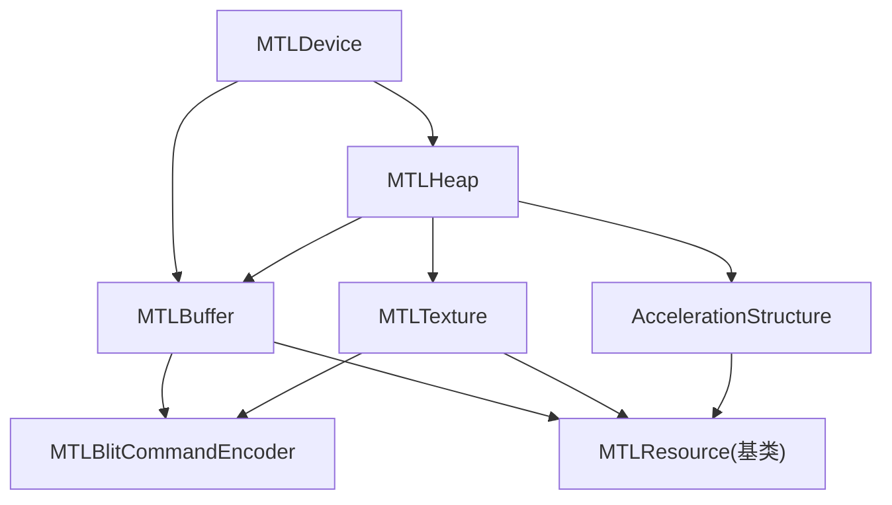
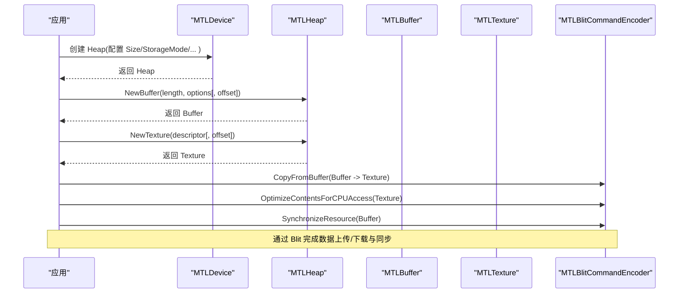
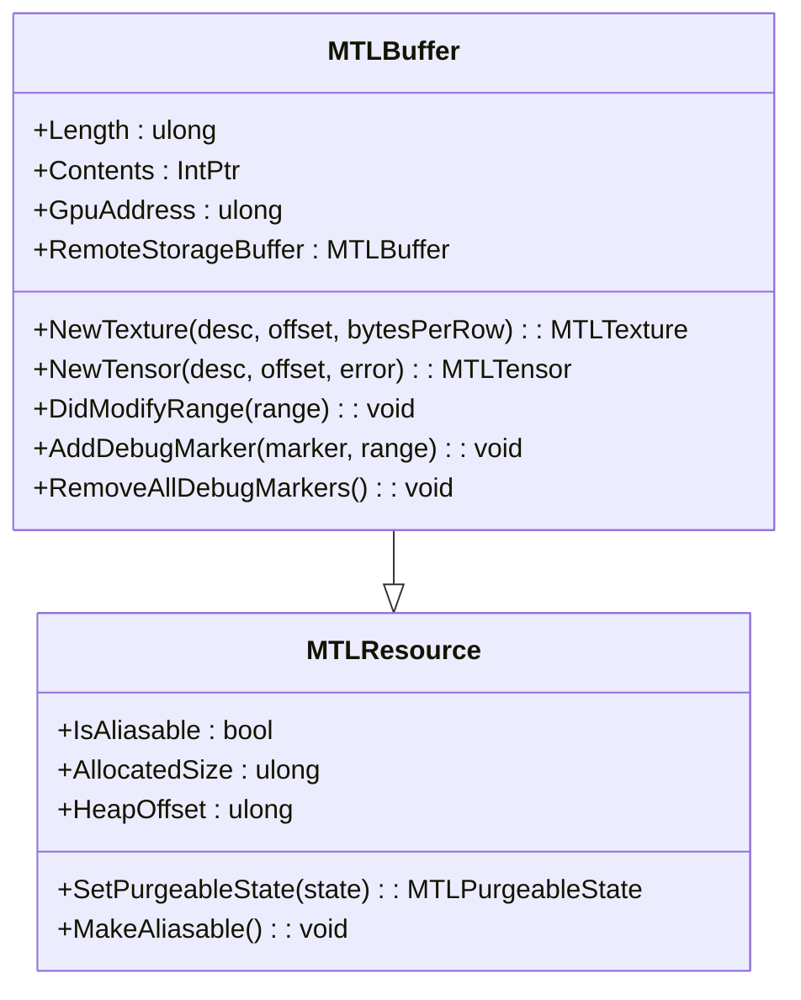
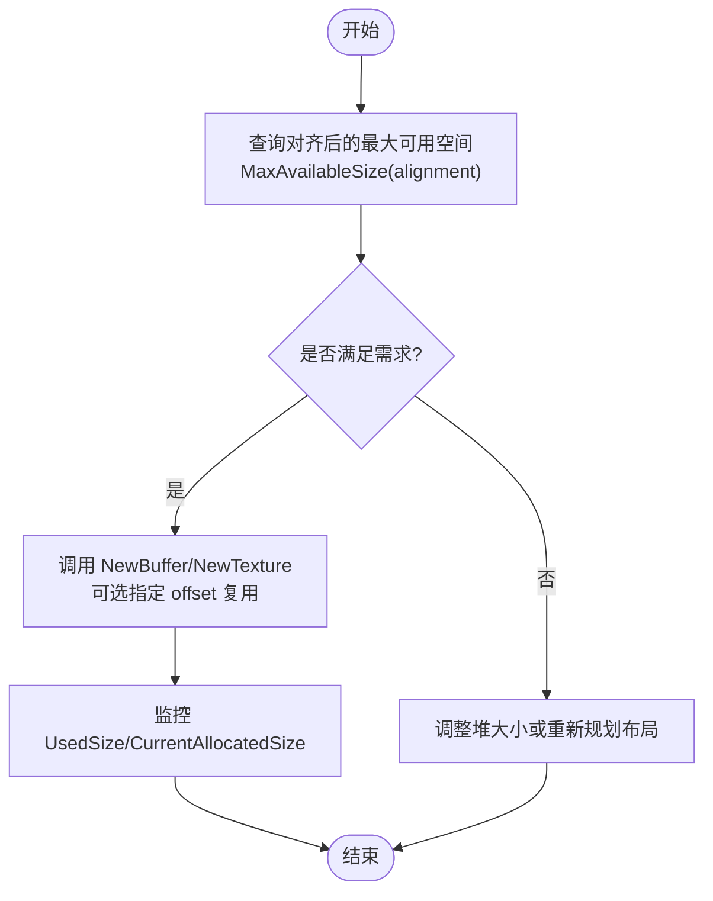
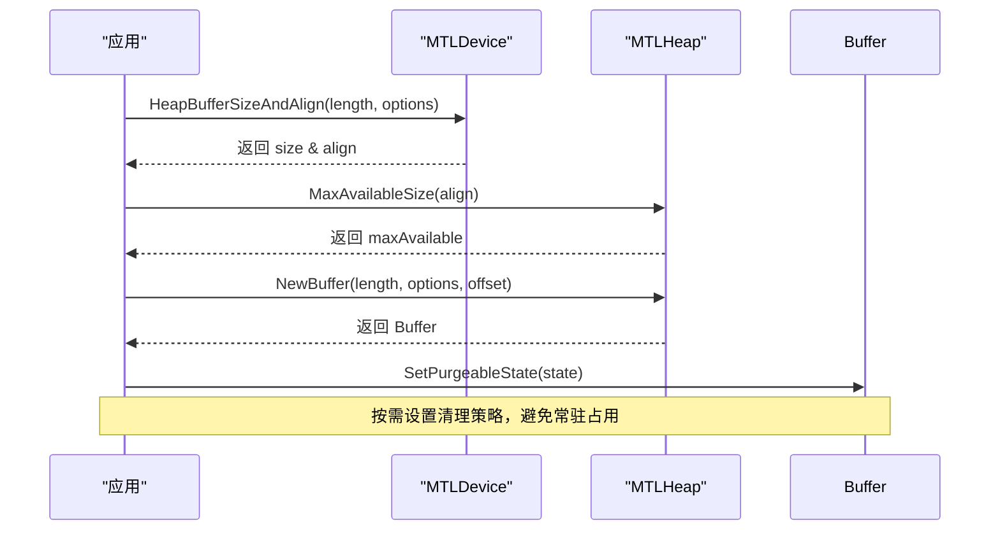
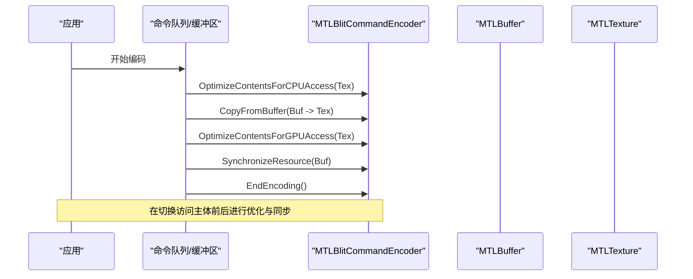
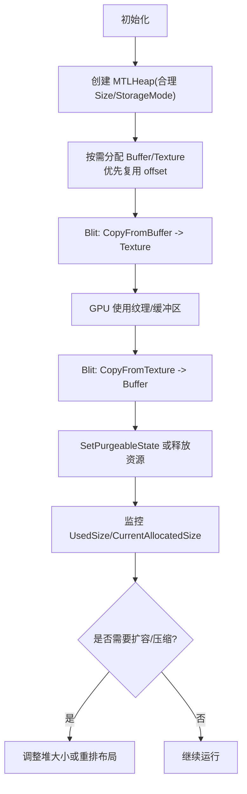
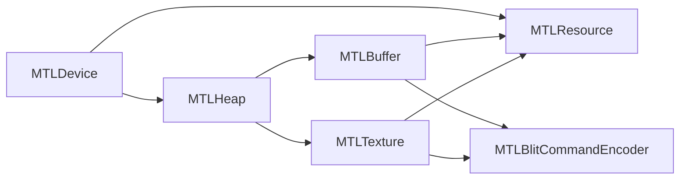

# 内存管理

<cite>
**本文引用的文件**
- [MTLBuffer.cs](file://src/SharpMetal/Metal/MTLBuffer.cs)
- [MTLHeap.cs](file://src/SharpMetal/Metal/MTLHeap.cs)
- [MTLAllocation.cs](file://src/SharpMetal/Metal/MTLAllocation.cs)
- [MTLResource.cs](file://src/SharpMetal/Metal/MTLResource.cs)
- [MTLDevice.cs](file://src/SharpMetal/Metal/MTLDevice.cs)
- [MTLBlitCommandEncoder.cs](file://src/SharpMetal/Metal/MTLBlitCommandEncoder.cs)
</cite>

## 目录
1. [简介](#简介)
2. [项目结构](#项目结构)
3. [核心组件](#核心组件)
4. [架构总览](#架构总览)
5. [详细组件分析](#详细组件分析)
6. [依赖关系分析](#依赖关系分析)
7. [性能考量](#性能考量)
8. [故障排查指南](#故障排查指南)
9. [结论](#结论)
10. [附录](#附录)

## 简介
本文件面向使用 SharpMetal 进行 Metal 图形与计算编程的开发者，系统性阐述内存管理的核心主题：MTLBuffer 缓冲区的创建、访问与管理；CPU-GPU 内存同步策略；MTLHeap 堆内存的分配与优化技巧；资源生命周期管理、内存对齐要求与性能优化方法；以及缓冲区映射、数据上传下载、内存池管理等高级主题。同时提供内存泄漏防护与调试技巧，帮助你在实际项目中构建稳定高效的 GPU 内存子系统。

## 项目结构
SharpMetal 在 Metal 命名空间下提供了对 Apple Metal API 的托管封装。与内存管理直接相关的核心类型包括：
- MTLResource：资源基类，定义缓存模式、存储模式、危险跟踪、可别名化等通用能力
- MTLBuffer：GPU 缓冲区对象，支持内容访问、纹理/张量视图、远程视图、地址查询等
- MTLHeap：堆内存容器，集中分配 Buffer/Texture/AccelerationStructure 等资源，便于统一管理与复用
- MTLDevice：设备入口，负责创建 Heap、Buffer、Texture 等，并提供尺寸与对齐查询
- MTLBlitCommandEncoder：用于资源间拷贝、填充、同步与内容优化的命令编码器

图表来源
- [MTLDevice.cs:341-369](file://src/SharpMetal/Metal/MTLDevice.cs#L341-L369)
- [MTLHeap.cs:124-167](file://src/SharpMetal/Metal/MTLHeap.cs#L124-L167)
- [MTLBuffer.cs:65-88](file://src/SharpMetal/Metal/MTLBuffer.cs#L65-L88)
- [MTLBlitCommandEncoder.cs:52-115](file://src/SharpMetal/Metal/MTLBlitCommandEncoder.cs#L52-L115)

章节来源
- [MTLDevice.cs:341-369](file://src/SharpMetal/Metal/MTLDevice.cs#L341-L369)
- [MTLHeap.cs:124-167](file://src/SharpMetal/Metal/MTLHeap.cs#L124-L167)
- [MTLBuffer.cs:65-88](file://src/SharpMetal/Metal/MTLBuffer.cs#L65-L88)
- [MTLBlitCommandEncoder.cs:52-115](file://src/SharpMetal/Metal/MTLBlitCommandEncoder.cs#L52-L115)

## 核心组件
- MTLResource（资源基类）
  - 暴露 CPU 缓存模式、存储模式、危险跟踪模式、资源选项、是否可别名化、所属 Heap 及偏移、已分配大小、可清理状态等
  - 提供 SetPurgeableState 与 MakeAliasable 等方法，用于内存回收与共享视图
- MTLBuffer（缓冲区）
  - 提供 Length、Contents、GpuAddress、RemoteStorageBuffer、NewTexture/NewTensor、AddDebugMarker/RemoveAllDebugMarkers、DidModifyRange 等
  - 支持从 Buffer 派生纹理或张量视图，便于不同访问语义复用底层内存
- MTLHeap（堆）
  - 通过 MTLHeapDescriptor 配置 Size、StorageMode、CpuCacheMode、SparsePageSize、HazardTrackingMode、ResourceOptions、Type 等
  - 提供 NewBuffer/NewTexture/NewAccelerationStructure 的重载，支持指定 offset 以在同一堆中复用内存
  - 提供 MaxAvailableSize(alignment) 查询最大可用连续空间
- MTLDevice（设备）
  - 提供 NewHeap、NewBuffer、HeapBufferSizeAndAlign、HeapTextureSizeAndAlign 等接口，用于按对齐要求精确分配
  - 提供 SparseTileSize/SparseTileSizeInBytes 等稀疏页相关工具
- MTLBlitCommandEncoder（拷贝/同步）
  - 提供 CopyFromBuffer/CopyFromTexture、FillBuffer、SynchronizeResource/SynchronizeTexture、OptimizeContentsForCPUAccess/OptimizeContentsForGPUAccess 等

章节来源
- [MTLResource.cs:6-48](file://src/SharpMetal/Metal/MTLResource.cs#L6-L48)
- [MTLResource.cs:63-119](file://src/SharpMetal/Metal/MTLResource.cs#L63-L119)
- [MTLBuffer.cs:18-88](file://src/SharpMetal/Metal/MTLBuffer.cs#L18-L88)
- [MTLHeap.cs:13-84](file://src/SharpMetal/Metal/MTLHeap.cs#L13-L84)
- [MTLHeap.cs:86-192](file://src/SharpMetal/Metal/MTLHeap.cs#L86-L192)
- [MTLDevice.cs:341-369](file://src/SharpMetal/Metal/MTLDevice.cs#L341-L369)
- [MTLBlitCommandEncoder.cs:52-115](file://src/SharpMetal/Metal/MTLBlitCommandEncoder.cs#L52-L115)

## 架构总览
下图展示了基于 Heap 的统一内存池与 Buffer/Texture 的生命周期关系，以及与 Blit 命令编码器的交互路径。

图表来源
- [MTLDevice.cs:351-369](file://src/SharpMetal/Metal/MTLDevice.cs#L351-L369)
- [MTLHeap.cs:124-167](file://src/SharpMetal/Metal/MTLHeap.cs#L124-L167)
- [MTLBlitCommandEncoder.cs:62-115](file://src/SharpMetal/Metal/MTLBlitCommandEncoder.cs#L62-L115)

## 详细组件分析

### MTLBuffer 缓冲区：创建、访问与管理
- 创建方式
  - 通过 MTLDevice.NewBuffer 直接创建
  - 通过 MTLHeap.NewBuffer 在堆内分配，支持指定 offset 实现复用
- 访问方式
  - Contents：获取 CPU 可访问指针，用于读写
  - GpuAddress：获取 GPU 侧地址，用于着色器或间接命令引用
  - RemoteStorageBuffer：获取远端存储视图，便于跨设备/进程共享
- 衍生视图
  - NewTexture：将 Buffer 作为纹理数据的后备存储
  - NewTensor：将 Buffer 作为张量数据的后备存储
- 修改通知
  - DidModifyRange：告知系统某段范围被 CPU 修改，触发必要的同步
- 调试标记
  - AddDebugMarker/RemoveAllDebugMarkers：为捕获与诊断添加标记

图表来源
- [MTLBuffer.cs:18-88](file://src/SharpMetal/Metal/MTLBuffer.cs#L18-L88)
- [MTLResource.cs:63-119](file://src/SharpMetal/Metal/MTLResource.cs#L63-L119)

章节来源
- [MTLBuffer.cs:18-88](file://src/SharpMetal/Metal/MTLBuffer.cs#L18-L88)
- [MTLResource.cs:63-119](file://src/SharpMetal/Metal/MTLResource.cs#L63-L119)

### MTLHeap 堆内存：分配与优化
- 描述符配置
  - Size：堆总大小
  - StorageMode/CpuCacheMode/HazardTrackingMode/ResourceOptions：控制存储与缓存行为
  - Type：Automatic/Placement/Sparse，决定堆的类型
  - SparsePageSize/MaxCompatiblePlacementSparsePageSize：稀疏页粒度与兼容性
- 分配接口
  - NewBuffer(length, options[, offset])：在堆中分配 Buffer，offset 允许复用
  - NewTexture(descriptor[, offset])：在堆中分配 Texture，offset 允许复用
  - NewAccelerationStructure(...)：在堆中分配加速结构
- 容量查询
  - MaxAvailableSize(alignment)：按对齐查询最大连续可用空间
- 监控指标
  - UsedSize/CurrentAllocatedSize：当前已用与已分配大小

图表来源
- [MTLHeap.cs:21-84](file://src/SharpMetal/Metal/MTLHeap.cs#L21-L84)
- [MTLHeap.cs:119-167](file://src/SharpMetal/Metal/MTLHeap.cs#L119-L167)

章节来源
- [MTLHeap.cs:21-84](file://src/SharpMetal/Metal/MTLHeap.cs#L21-L84)
- [MTLHeap.cs:119-167](file://src/SharpMetal/Metal/MTLHeap.cs#L119-L167)

### 资源生命周期与内存对齐
- 生命周期
  - 通过 MTLDevice 或 MTLHeap 创建的资源遵循引用计数释放
  - 可通过 SetPurgeableState 设置非易失/易失/清空等状态，配合系统回收策略
- 内存对齐
  - 使用 MTLDevice.HeapBufferSizeAndAlign 与 HeapTextureSizeAndAlign 获取精确的尺寸与对齐
  - 在堆内分配时，结合 MaxAvailableSize(alignment) 确保对齐约束得到满足
- 别名与共享
  - IsAliasable/MakeAliasable：使资源可被多个视图别名化，减少复制开销
  - RemoteStorageBuffer：为跨设备/进程场景提供共享视图

图表来源
- [MTLDevice.cs:341-369](file://src/SharpMetal/Metal/MTLDevice.cs#L341-L369)
- [MTLHeap.cs:119-142](file://src/SharpMetal/Metal/MTLHeap.cs#L119-L142)
- [MTLResource.cs:96-104](file://src/SharpMetal/Metal/MTLResource.cs#L96-L104)

章节来源
- [MTLDevice.cs:341-369](file://src/SharpMetal/Metal/MTLDevice.cs#L341-L369)
- [MTLHeap.cs:119-142](file://src/SharpMetal/Metal/MTLHeap.cs#L119-L142)
- [MTLResource.cs:96-104](file://src/SharpMetal/Metal/MTLResource.cs#L96-L104)

### CPU-GPU 内存同步策略
- 显式同步
  - SynchronizeResource(Synchronization on Buffer/Texture)：在 Blit 命令中同步资源状态
  - SynchronizeTexture(slice, level)：针对纹理切片/层级同步
- 内容优化
  - OptimizeContentsForCPUAccess / OptimizeContentsForGPUAccess：在切换访问主体前优化内部布局
- 数据上传/下载
  - CopyFromBuffer -> Texture：上传 CPU 数据到 GPU 纹理
  - CopyFromTexture -> Buffer：下载 GPU 纹理到 CPU 缓冲区
- 修改通知
  - DidModifyRange：当通过 Contents 写入后，通知系统该范围已变更

图表来源
- [MTLBlitCommandEncoder.cs:52-115](file://src/SharpMetal/Metal/MTLBlitCommandEncoder.cs#L52-L115)
- [MTLBlitCommandEncoder.cs:137-155](file://src/SharpMetal/Metal/MTLBlitCommandEncoder.cs#L137-L155)
- [MTLBuffer.cs:60-63](file://src/SharpMetal/Metal/MTLBuffer.cs#L60-L63)

章节来源
- [MTLBlitCommandEncoder.cs:52-115](file://src/SharpMetal/Metal/MTLBlitCommandEncoder.cs#L52-L115)
- [MTLBlitCommandEncoder.cs:137-155](file://src/SharpMetal/Metal/MTLBlitCommandEncoder.cs#L137-L155)
- [MTLBuffer.cs:60-63](file://src/SharpMetal/Metal/MTLBuffer.cs#L60-L63)

### 缓冲区映射、数据上传下载与内存池管理
- 缓冲区映射
  - 通过 Contents 获取 CPU 指针进行读写，适用于小批量或初始化阶段
  - 对于频繁更新，建议使用 Blit 命令进行异步拷贝，减少 CPU/GPU 同步开销
- 数据上传/下载
  - 使用 Blit 命令编码器进行 Buffer <-> Texture 的拷贝
  - 利用 FillBuffer 快速填充零值或常量
- 内存池管理
  - 使用 MTLHeap 统一管理资源，降低碎片并提高复用率
  - 通过 offset 参数在堆内复用同一块物理内存，实现“对象池”效果
  - 监控 UsedSize/CurrentAllocatedSize，评估堆利用率与扩容时机

图表来源
- [MTLHeap.cs:124-167](file://src/SharpMetal/Metal/MTLHeap.cs#L124-L167)
- [MTLBlitCommandEncoder.cs:62-115](file://src/SharpMetal/Metal/MTLBlitCommandEncoder.cs#L62-L115)
- [MTLResource.cs:96-104](file://src/SharpMetal/Metal/MTLResource.cs#L96-L104)

章节来源
- [MTLHeap.cs:124-167](file://src/SharpMetal/Metal/MTLHeap.cs#L124-L167)
- [MTLBlitCommandEncoder.cs:62-115](file://src/SharpMetal/Metal/MTLBlitCommandEncoder.cs#L62-L115)
- [MTLResource.cs:96-104](file://src/SharpMetal/Metal/MTLResource.cs#L96-L104)

## 依赖关系分析
- MTLDevice 是所有资源的根入口，负责创建 Heap、Buffer、Texture 等，并提供尺寸与对齐查询
- MTLHeap 作为内存池，聚合分配多种资源，提升复用率与内存局部性
- MTLBuffer/MTLTexture 继承自 MTLResource，共享缓存模式、存储模式、危险跟踪、别名化等能力
- MTLBlitCommandEncoder 与资源交互，执行拷贝、填充、同步与内容优化

图表来源
- [MTLDevice.cs:341-369](file://src/SharpMetal/Metal/MTLDevice.cs#L341-L369)
- [MTLHeap.cs:124-167](file://src/SharpMetal/Metal/MTLHeap.cs#L124-L167)
- [MTLResource.cs:63-119](file://src/SharpMetal/Metal/MTLResource.cs#L63-L119)
- [MTLBlitCommandEncoder.cs:52-115](file://src/SharpMetal/Metal/MTLBlitCommandEncoder.cs#L52-L115)

章节来源
- [MTLDevice.cs:341-369](file://src/SharpMetal/Metal/MTLDevice.cs#L341-L369)
- [MTLHeap.cs:124-167](file://src/SharpMetal/Metal/MTLHeap.cs#L124-L167)
- [MTLResource.cs:63-119](file://src/SharpMetal/Metal/MTLResource.cs#L63-L119)
- [MTLBlitCommandEncoder.cs:52-115](file://src/SharpMetal/Metal/MTLBlitCommandEncoder.cs#L52-L115)

## 性能考量
- 存储模式选择
  - Shared/Managed/Private/Memoryless：根据设备特性与访问模式选择合适的存储模式，减少不必要的数据拷贝
- 缓存模式与危险跟踪
  - CpuCacheMode：默认缓存 vs 写合并，影响 CPU 写入性能
  - HazardTrackingMode：Default/Untracked/Tracked，权衡检测开销与稳定性
- 对齐与布局
  - 使用 HeapBufferSizeAndAlign/HeapTextureSizeAndAlign 精确对齐，避免隐式填充导致的浪费
  - 在堆内通过 offset 复用内存，降低碎片与分配开销
- 同步与优化
  - 在切换访问主体前后调用 OptimizeContentsForCPUAccess/OptimizeContentsForGPUAccess
  - 使用 SynchronizeResource/SynchronizeTexture 进行细粒度同步，避免全局屏障
- 稀疏页与大型资源
  - 使用 MTLHeap.Type=Sparse 与合适的 SparsePageSize，降低大纹理/缓冲区的常驻内存占用
  - 借助 SparseTileSize/SparseTileSizeInBytes 进行合理的分块与访问规划

[本节为通用性能建议，不直接分析具体文件]

## 故障排查指南
- 常见错误定位
  - 未正确同步导致的数据竞争：在 CPU/GPU 切换访问前后调用相应的优化与同步方法
  - 对齐不满足导致崩溃：使用 HeapBufferSizeAndAlign/MaxAvailableSize 校验对齐后再分配
  - 内存泄漏：确保资源在不再使用时释放；合理使用 SetPurgeableState 控制生命周期
- 调试技巧
  - 为资源设置 Label，便于在捕获工具中标识
  - 使用 AddDebugMarker/RemoveAllDebugMarkers 为关键操作添加标记
  - 监控 UsedSize/CurrentAllocatedSize，观察堆使用趋势，及时扩容或回收
- 捕获与分析
  - 结合命令编码器的 PushDebugGroup/PopDebugGroup 组织调试信息
  - 使用 Blit 命令中的 FillBuffer/CopyFromBuffer/CopyFromTexture 验证数据流是否正确

章节来源
- [MTLBuffer.cs:75-83](file://src/SharpMetal/Metal/MTLBuffer.cs#L75-L83)
- [MTLHeap.cs:111-117](file://src/SharpMetal/Metal/MTLHeap.cs#L111-L117)
- [MTLBlitCommandEncoder.cs:37-50](file://src/SharpMetal/Metal/MTLBlitCommandEncoder.cs#L37-L50)
- [MTLBlitCommandEncoder.cs:92-115](file://src/SharpMetal/Metal/MTLBlitCommandEncoder.cs#L92-L115)

## 结论
通过 SharpMetal 提供的 MTLResource/MTLBuffer/MTLHeap/MTLDevice/MTLBlitCommandEncoder 等类型，可以构建高效且可控的 GPU 内存子系统。关键在于：
- 使用 MTLHeap 统一管理资源，结合对齐与 offset 实现内存池与复用
- 在 CPU/GPU 切换访问时进行优化与同步，避免数据竞争与性能退化
- 选择合适的存储模式、缓存模式与危险跟踪模式，平衡性能与稳定性
- 通过监控与调试手段持续优化内存使用，防止泄漏与碎片化

[本节为总结性内容，不直接分析具体文件]

## 附录
- 常用 API 路径参考
  - 创建堆与资源：[MTLDevice.cs:341-369](file://src/SharpMetal/Metal/MTLDevice.cs#L341-L369)、[MTLHeap.cs:124-167](file://src/SharpMetal/Metal/MTLHeap.cs#L124-L167)
  - 缓冲区访问与衍生视图：[MTLBuffer.cs:18-88](file://src/SharpMetal/Metal/MTLBuffer.cs#L18-L88)
  - 同步与内容优化：[MTLBlitCommandEncoder.cs:52-115](file://src/SharpMetal/Metal/MTLBlitCommandEncoder.cs#L52-L115)、[MTLBlitCommandEncoder.cs:137-155](file://src/SharpMetal/Metal/MTLBlitCommandEncoder.cs#L137-L155)
  - 资源生命周期与别名化：[MTLResource.cs:63-119](file://src/SharpMetal/Metal/MTLResource.cs#L63-L119)

[本节为参考链接汇总，不直接分析具体文件]