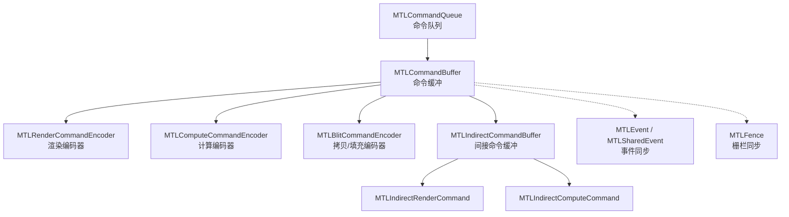
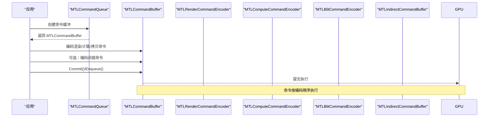
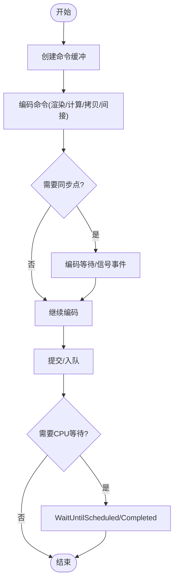
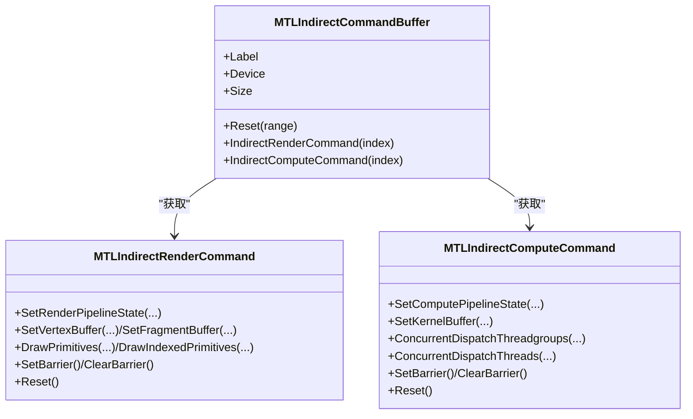
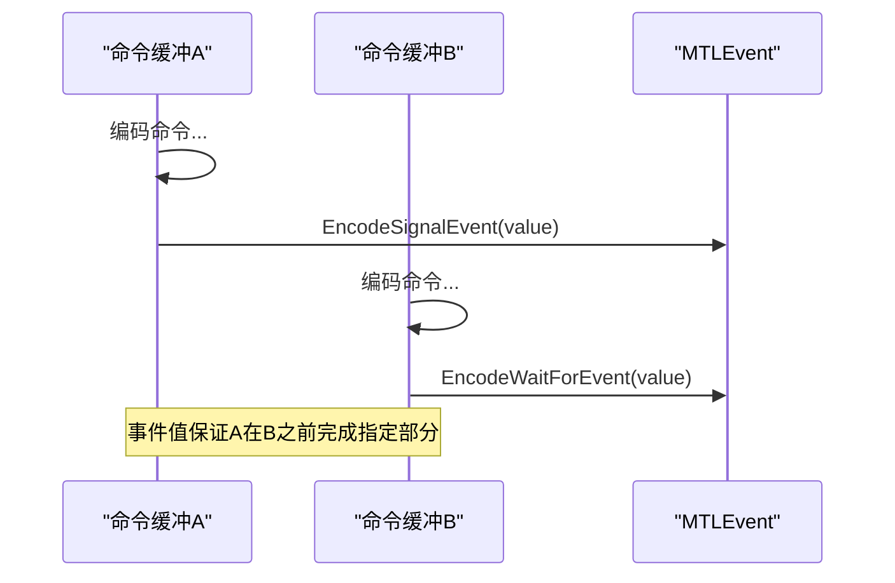
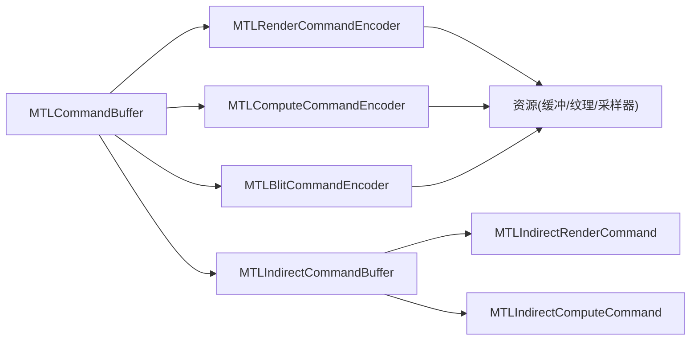

# 命令系统

<cite>
**本文引用的文件**
- [MTLCommandQueue.cs](file://src/SharpMetal/Metal/MTLCommandQueue.cs)
- [MTLCommandBuffer.cs](file://src/SharpMetal/Metal/MTLCommandBuffer.cs)
- [MTLCommandEncoder.cs](file://src/SharpMetal/Metal/MTLCommandEncoder.cs)
- [MTLRenderCommandEncoder.cs](file://src/SharpMetal/Metal/MTLRenderCommandEncoder.cs)
- [MTLComputeCommandEncoder.cs](file://src/SharpMetal/Metal/MTLComputeCommandEncoder.cs)
- [MTLBlitCommandEncoder.cs](file://src/SharpMetal/Metal/MTLBlitCommandEncoder.cs)
- [MTLIndirectCommandBuffer.cs](file://src/SharpMetal/Metal/MTLIndirectCommandBuffer.cs)
- [MTLIndirectCommandEncoder.cs](file://src/SharpMetal/Metal/MTLIndirectCommandEncoder.cs)
- [MTLEvent.cs](file://src/SharpMetal/Metal/MTLEvent.cs)
- [MTLFence.cs](file://src/SharpMetal/Metal/MTLFence.cs)
</cite>

## 目录
1. [简介](#简介)
2. [项目结构](#项目结构)
3. [核心组件](#核心组件)
4. [架构总览](#架构总览)
5. [详细组件分析](#详细组件分析)
6. [依赖关系分析](#依赖关系分析)
7. [性能考虑](#性能考虑)
8. [故障排查指南](#故障排查指南)
9. [结论](#结论)
10. [附录：完整命令编码示例与调试技巧](#附录完整命令编码示例与调试技巧)

## 简介
本文件面向使用 SharpMetal 进行 Metal 编程的开发者，系统化阐述命令系统的核心概念与工作流：命令队列、命令缓冲区、命令编码器如何协作完成 GPU 工作；直接命令与间接命令的区别与适用场景；命令同步、依赖管理与性能优化策略；并提供完整的命令编码流程与调试技巧。内容严格基于仓库中的 C# 绑定实现进行分析与归纳。

## 项目结构
SharpMetal 在 src/SharpMetal/Metal 下提供对 Metal API 的类型化封装，围绕命令系统的关键类型包括：
- 命令队列：MTLCommandQueue
- 命令缓冲：MTLCommandBuffer（含描述符、状态、回调等）
- 命令编码器基类：MTLCommandEncoder
- 具体编码器：MTLRenderCommandEncoder、MTLComputeCommandEncoder、MTLBlitCommandEncoder
- 间接命令：MTLIndirectCommandBuffer、MTLIndirectRenderCommand、MTLIndirectComputeCommand
- 同步原语：MTLEvent、MTLFence

图表来源
- [MTLCommandQueue.cs:44-108](file://src/SharpMetal/Metal/MTLCommandQueue.cs#L44-L108)
- [MTLCommandBuffer.cs:116-319](file://src/SharpMetal/Metal/MTLCommandBuffer.cs#L116-L319)
- [MTLRenderCommandEncoder.cs:126-780](file://src/SharpMetal/Metal/MTLRenderCommandEncoder.cs#L126-L780)
- [MTLComputeCommandEncoder.cs:20-296](file://src/SharpMetal/Metal/MTLComputeCommandEncoder.cs#L20-L296)
- [MTLBlitCommandEncoder.cs:14-215](file://src/SharpMetal/Metal/MTLBlitCommandEncoder.cs#L14-L215)
- [MTLIndirectCommandBuffer.cs:135-218](file://src/SharpMetal/Metal/MTLIndirectCommandBuffer.cs#L135-L218)
- [MTLIndirectCommandEncoder.cs:5-181](file://src/SharpMetal/Metal/MTLIndirectCommandEncoder.cs#L5-L181)
- [MTLEvent.cs:6-108](file://src/SharpMetal/Metal/MTLEvent.cs#L6-L108)
- [MTLFence.cs:6-23](file://src/SharpMetal/Metal/MTLFence.cs#L6-L23)

章节来源
- [MTLCommandQueue.cs:44-108](file://src/SharpMetal/Metal/MTLCommandQueue.cs#L44-L108)
- [MTLCommandBuffer.cs:116-319](file://src/SharpMetal/Metal/MTLCommandBuffer.cs#L116-L319)

## 核心组件
- 命令队列（MTLCommandQueue）
  - 负责创建命令缓冲、管理驻留集、插入调试捕获边界等。
  - 关键能力：创建默认或带描述符的命令缓冲；添加/移除驻留集；设置日志状态与最大缓冲数。
- 命令缓冲（MTLCommandBuffer）
  - 承载一组已编码的命令，支持提交、入队、呈现可绘制对象、等待调度/完成、注册回调、编码各类命令编码器、事件信号/等待、并行渲染编码器、资源状态编码器、加速结构编码器等。
  - 关键能力：Commit/Enqueue/PresentDrawable、WaitUntilScheduled/Completed、AddCompletedHandler/AddScheduledHandler、EncodeWaitForEvent/EncodeSignalEvent。
- 命令编码器（MTLCommandEncoder 及子类）
  - 通用能力：设备访问、标签、调试分组、结束编码。
  - 渲染编码器：设置管线、顶点/片段/对象/网格/瓦片阶段资源、视口/裁剪、绘制调用（直接/间接）、内存屏障、可见性结果、计数器采样等。
  - 计算编码器：设置管线、参数、纹理/采样器、线程组/线程调度、间接调度、内存屏障、栅栏、计数器采样等。
  - 拷贝编码器：资源同步、纹理/缓冲拷贝、Mipmap 生成、缓冲填充、间接命令缓冲操作、计数器采样与解析等。
- 间接命令（MTLIndirectCommandBuffer 及其指令）
  - 将绘制/调度等命令以数据形式写入缓冲，运行时由 GPU 读取并执行，适合批量、动态构建、多线程预构建。
  - 支持继承管线/缓冲绑定、多种命令类型、射线追踪/动态属性步长等特性开关。
- 同步原语（MTLEvent、MTLFence）
  - 事件：可在命令缓冲中等待/信号化，支持共享事件与监听器。
  - 栅栏：在渲染/计算/拷贝阶段更新/等待，用于细粒度阶段同步。

章节来源
- [MTLCommandQueue.cs:44-108](file://src/SharpMetal/Metal/MTLCommandQueue.cs#L44-L108)
- [MTLCommandBuffer.cs:116-319](file://src/SharpMetal/Metal/MTLCommandBuffer.cs#L116-L319)
- [MTLCommandEncoder.cs:20-61](file://src/SharpMetal/Metal/MTLCommandEncoder.cs#L20-L61)
- [MTLRenderCommandEncoder.cs:126-780](file://src/SharpMetal/Metal/MTLRenderCommandEncoder.cs#L126-L780)
- [MTLComputeCommandEncoder.cs:20-296](file://src/SharpMetal/Metal/MTLComputeCommandEncoder.cs#L20-L296)
- [MTLBlitCommandEncoder.cs:14-215](file://src/SharpMetal/Metal/MTLBlitCommandEncoder.cs#L14-L215)
- [MTLIndirectCommandBuffer.cs:26-218](file://src/SharpMetal/Metal/MTLIndirectCommandBuffer.cs#L26-L218)
- [MTLIndirectCommandEncoder.cs:5-181](file://src/SharpMetal/Metal/MTLIndirectCommandEncoder.cs#L5-L181)
- [MTLEvent.cs:6-108](file://src/SharpMetal/Metal/MTLEvent.cs#L6-L108)
- [MTLFence.cs:6-23](file://src/SharpMetal/Metal/MTLFence.cs#L6-L23)

## 架构总览
命令系统从 CPU 侧通过命令队列创建命令缓冲，并在缓冲内编码一系列命令（渲染、计算、拷贝、间接命令等）。命令缓冲提交后交由 GPU 驱动按顺序执行。同步机制通过事件和栅栏确保跨命令/跨阶段的正确读写顺序。

图表来源
- [MTLCommandQueue.cs:56-68](file://src/SharpMetal/Metal/MTLCommandQueue.cs#L56-L68)
- [MTLCommandBuffer.cs:150-218](file://src/SharpMetal/Metal/MTLCommandBuffer.cs#L150-L218)
- [MTLRenderCommandEncoder.cs:548-586](file://src/SharpMetal/Metal/MTLRenderCommandEncoder.cs#L548-L586)
- [MTLComputeCommandEncoder.cs:180-193](file://src/SharpMetal/Metal/MTLComputeCommandEncoder.cs#L180-L193)
- [MTLBlitCommandEncoder.cs:62-115](file://src/SharpMetal/Metal/MTLBlitCommandEncoder.cs#L62-L115)
- [MTLIndirectCommandBuffer.cs:190-198](file://src/SharpMetal/Metal/MTLIndirectCommandBuffer.cs#L190-L198)

## 详细组件分析

### 命令队列（MTLCommandQueue）
- 职责：持有设备引用、创建命令缓冲、管理驻留集、调试捕获边界。
- 关键点：
  - CommandBuffer()/CommandBuffer(descriptor)：创建命令缓冲。
  - Add/RemoveResidencySet(s)：将资源加入/移出驻留集，影响内存驻留策略。
  - InsertDebugCaptureBoundary：为调试工具标记捕获边界。

章节来源
- [MTLCommandQueue.cs:44-108](file://src/SharpMetal/Metal/MTLCommandQueue.cs#L44-L108)

### 命令缓冲（MTLCommandBuffer）
- 生命周期与状态：
  - 状态枚举：未入队、已入队、已提交、已调度、已完成、错误。
  - 错误选项：可选择是否包含编码器执行状态。
- 主要方法：
  - Commit/Enqueue：提交到队列或直接入队。
  - PresentDrawable：呈现帧。
  - WaitUntilScheduled/Completed：CPU 侧等待。
  - AddScheduledHandler/AddCompletedHandler：异步回调。
  - 编码入口：Render/Compute/Blit/ParallelRender/ResourceState/AccelerationStructure 编码器。
  - 同步：EncodeWaitForEvent/EncodeSignalEvent。
  - 调试：Push/PopDebugGroup。

图表来源
- [MTLCommandBuffer.cs:9-48](file://src/SharpMetal/Metal/MTLCommandBuffer.cs#L9-L48)
- [MTLCommandBuffer.cs:150-243](file://src/SharpMetal/Metal/MTLCommandBuffer.cs#L150-L243)
- [MTLCommandBuffer.cs:270-278](file://src/SharpMetal/Metal/MTLCommandBuffer.cs#L270-L278)

章节来源
- [MTLCommandBuffer.cs:9-48](file://src/SharpMetal/Metal/MTLCommandBuffer.cs#L9-L48)
- [MTLCommandBuffer.cs:116-319](file://src/SharpMetal/Metal/MTLCommandBuffer.cs#L116-L319)

### 命令编码器（MTLCommandEncoder 及子类）
- 公共能力：设备、标签、调试分组、结束编码。
- 渲染编码器（MTLRenderCommandEncoder）
  - 管线与资源：设置渲染管线、顶点/片段/对象/网格/瓦片阶段缓冲、纹理、采样器、可见函数表、交叉函数表、加速结构。
  - 视图与裁剪：视口、裁剪矩形、正面绕序、剔除模式、深度裁剪、三角形填充模式。
  - 绘制：DrawPrimitives/Dra wIndexedPrimitives（直接/间接）、DrawPatches/Dra wIndexedPatches（直接/间接）、Mesh 相关绘制。
  - 同步：MemoryBarrier（按作用域/资源）、TextureBarrier、UpdateFence/WaitForFence。
  - 其他：可见性结果模式、存储动作、计数器采样。
- 计算编码器（MTLComputeCommandEncoder）
  - 管线与资源：设置计算管线、字节/缓冲/纹理/采样器、可见/交叉函数表、加速结构。
  - 调度：DispatchThreadgroups/DispatchThreads（直接/间接）、StageInRegion（直接/间接）。
  - 同步：MemoryBarrier（作用域/资源）、UpdateFence/WaitForFence、计数器采样。
- 拷贝编码器（MTLBlitCommandEncoder）
  - 同步：SynchronizeResource/SynchronizeTexture。
  - 拷贝：纹理到纹理/缓冲、缓冲到纹理、Tensor 拷贝、Mipmap 生成、缓冲填充。
  - 间接命令：ResetCommandsInBuffer、CopyIndirectCommandBuffer、OptimizeIndirectCommandBuffer。
  - 计数器：SampleCountersInBuffer、ResolveCounters。

章节来源
- [MTLCommandEncoder.cs:20-61](file://src/SharpMetal/Metal/MTLCommandEncoder.cs#L20-L61)
- [MTLRenderCommandEncoder.cs:126-780](file://src/SharpMetal/Metal/MTLRenderCommandEncoder.cs#L126-L780)
- [MTLComputeCommandEncoder.cs:20-296](file://src/SharpMetal/Metal/MTLComputeCommandEncoder.cs#L20-L296)
- [MTLBlitCommandEncoder.cs:14-215](file://src/SharpMetal/Metal/MTLBlitCommandEncoder.cs#L14-L215)

### 间接命令（MTLIndirectCommandBuffer 与指令）
- 描述符（MTLIndirectCommandBufferDescriptor）
  - 命令类型：Draw、DrawIndexed、DrawPatches、DrawIndexedPatches、ConcurrentDispatch、ConcurrentDispatchThreads、DrawMeshThreadgroups、DrawMeshThreads。
  - 继承：可继承管线状态与缓冲绑定。
  - 绑定上限：顶点/片段/内核/对象/网格等缓冲的最大绑定数量。
  - 特性：支持射线追踪、动态属性步长。
- 间接命令缓冲（MTLIndirectCommandBuffer）
  - 资源属性：缓存模式、存储模式、危险跟踪、堆偏移、分配大小、可别名等。
  - 操作：Reset、获取间接渲染/计算指令、MakeAliasable、SetPurgeableState。
- 间接指令
  - 渲染指令（MTLIndirectRenderCommand）：设置管线、顶点/片段/对象/网格缓冲、绘制调用、屏障、重置。
  - 计算指令（MTLIndirectComputeCommand）：设置管线、内核缓冲、并发调度、屏障、图像块宽度、StageInRegion、重置。

图表来源
- [MTLIndirectCommandBuffer.cs:26-218](file://src/SharpMetal/Metal/MTLIndirectCommandBuffer.cs#L26-L218)
- [MTLIndirectCommandEncoder.cs:5-181](file://src/SharpMetal/Metal/MTLIndirectCommandEncoder.cs#L5-L181)

章节来源
- [MTLIndirectCommandBuffer.cs:26-218](file://src/SharpMetal/Metal/MTLIndirectCommandBuffer.cs#L26-L218)
- [MTLIndirectCommandEncoder.cs:5-181](file://src/SharpMetal/Metal/MTLIndirectCommandEncoder.cs#L5-L181)

### 同步与依赖管理
- 事件（MTLEvent/MTLSharedEvent）
  - 在命令缓冲中编码等待/信号事件，实现跨命令/跨缓冲同步。
  - 共享事件支持监听器回调与超时等待。
- 栅栏（MTLFence）
  - 在渲染/计算/拷贝编码器中更新/等待栅栏，实现阶段级同步。
- 内存屏障
  - 渲染/计算/拷贝编码器均提供 MemoryBarrier，可按作用域（缓冲/纹理/渲染目标）或资源集合进行同步。

图表来源
- [MTLCommandBuffer.cs:235-243](file://src/SharpMetal/Metal/MTLCommandBuffer.cs#L235-L243)
- [MTLEvent.cs:47-108](file://src/SharpMetal/Metal/MTLEvent.cs#L47-L108)

章节来源
- [MTLCommandBuffer.cs:235-243](file://src/SharpMetal/Metal/MTLCommandBuffer.cs#L235-L243)
- [MTLEvent.cs:47-108](file://src/SharpMetal/Metal/MTLEvent.cs#L47-L108)
- [MTLRenderCommandEncoder.cs:593-601](file://src/SharpMetal/Metal/MTLRenderCommandEncoder.cs#L593-L601)
- [MTLComputeCommandEncoder.cs:195-203](file://src/SharpMetal/Metal/MTLComputeCommandEncoder.cs#L195-L203)
- [MTLBlitCommandEncoder.cs:117-125](file://src/SharpMetal/Metal/MTLBlitCommandEncoder.cs#L117-L125)

## 依赖关系分析
- 耦合关系
  - MTLCommandBuffer 依赖 MTLCommandQueue 创建自身，并聚合多种编码器。
  - 各编码器依赖具体资源（缓冲、纹理、采样器、管线等），并通过 MemoryBarrier/Fence/Event 建立依赖。
  - 间接命令缓冲与指令解耦了命令构建与执行时机，降低 CPU 开销。
- 外部依赖
  - ObjectiveC 运行时桥接（ObjectiveCRuntime）用于调用原生 Metal API。
  - Foundation/QuartzCore 类型用于字符串、可绘制对象等。

图表来源
- [MTLCommandBuffer.cs:195-268](file://src/SharpMetal/Metal/MTLCommandBuffer.cs#L195-L268)
- [MTLIndirectCommandBuffer.cs:190-198](file://src/SharpMetal/Metal/MTLIndirectCommandBuffer.cs#L190-L198)

章节来源
- [MTLCommandBuffer.cs:195-268](file://src/SharpMetal/Metal/MTLCommandBuffer.cs#L195-L268)
- [MTLIndirectCommandBuffer.cs:190-198](file://src/SharpMetal/Metal/MTLIndirectCommandBuffer.cs#L190-L198)

## 性能考虑
- 使用间接命令减少 CPU 开销
  - 将大量绘制/调度命令预先写入 MTLIndirectCommandBuffer，并在渲染/计算编码器中以 ExecuteCommandsInBuffer 执行，降低每帧 CPU 编码成本。
  - 利用 CopyIndirectCommandBuffer、OptimizeIndirectCommandBuffer 进行批量复制与优化。
- 合理设置命令缓冲描述符
  - RetainedReferences/ErrorOptions/LogState 根据需求配置，避免不必要的保留与日志开销。
- 最小化同步点
  - 仅在必要时使用 MemoryBarrier/Fence/Event，避免过度同步导致流水线停顿。
- 资源与内存
  - 使用合适的存储模式与缓存模式；合理使用驻留集（ResidencySet）提升热点资源驻留率。
- 并行与批处理
  - 使用 ParallelRenderCommandEncoder 提高多通道渲染效率；合并多次拷贝/填充以减少批次。

[本节为通用指导，不直接分析具体文件]

## 故障排查指南
- 命令缓冲状态检查
  - 通过 Status 判断当前命令缓冲所处阶段（未入队/已入队/已提交/已调度/已完成/错误）。
  - 若 Error 非空，结合 ErrorOptions 查看编码器执行状态，定位问题。
- 回调与等待
  - 使用 AddCompletedHandler/AddScheduledHandler 观察命令生命周期。
  - 使用 WaitUntilScheduled/Completed 进行阻塞式调试（生产环境慎用）。
- 调试信息
  - 使用 PushDebugGroup/PopDebugGroup 组织命令分组。
  - 使用 InsertDebugSignpost 插入时间戳标记。
  - 在队列上 InsertDebugCaptureBoundary 标记捕获范围。
- 同步问题
  - 检查事件值是否正确匹配等待/信号。
  - 确认栅栏更新/等待位置与阶段一致。

章节来源
- [MTLCommandBuffer.cs:146-148](file://src/SharpMetal/Metal/MTLCommandBuffer.cs#L146-L148)
- [MTLCommandBuffer.cs:175-193](file://src/SharpMetal/Metal/MTLCommandBuffer.cs#L175-L193)
- [MTLCommandBuffer.cs:270-278](file://src/SharpMetal/Metal/MTLCommandBuffer.cs#L270-L278)
- [MTLCommandQueue.cs:70-73](file://src/SharpMetal/Metal/MTLCommandQueue.cs#L70-L73)
- [MTLCommandEncoder.cs:39-52](file://src/SharpMetal/Metal/MTLCommandEncoder.cs#L39-L52)

## 结论
SharpMetal 的命令系统围绕命令队列、命令缓冲与命令编码器构建，提供了渲染、计算、拷贝与间接命令的完整能力。通过事件与栅栏可实现精确的同步与依赖管理。合理利用间接命令、最小化同步点、优化资源与内存策略，可显著提升性能。调试方面，借助状态查询、回调、调试分组与捕获边界，能有效定位问题。

[本节为总结性内容，不直接分析具体文件]

## 附录：完整命令编码示例与调试技巧
以下示例步骤基于仓库提供的类型与方法，展示典型命令编码流程与调试实践。为避免泄露实现细节，仅给出路径指引。

- 基本渲染帧流程
  - 创建命令缓冲：参考 [MTLCommandQueue.cs:56-68](file://src/SharpMetal/Metal/MTLCommandQueue.cs#L56-L68)
  - 编码渲染命令：参考 [MTLCommandBuffer.cs:195-198](file://src/SharpMetal/Metal/MTLCommandBuffer.cs#L195-L198)、[MTLRenderCommandEncoder.cs:168-171](file://src/SharpMetal/Metal/MTLRenderCommandEncoder.cs#L168-L171)
  - 设置资源与绘制：参考 [MTLRenderCommandEncoder.cs:173-256](file://src/SharpMetal/Metal/MTLRenderCommandEncoder.cs#L173-L256)、[MTLRenderCommandEncoder.cs:548-586](file://src/SharpMetal/Metal/MTLRenderCommandEncoder.cs#L548-L586)
  - 呈现与提交：参考 [MTLCommandBuffer.cs:160-168](file://src/SharpMetal/Metal/MTLCommandBuffer.cs#L160-L168)、[MTLCommandBuffer.cs:150-158](file://src/SharpMetal/Metal/MTLCommandBuffer.cs#L150-L158)
- 计算任务流程
  - 编码计算命令：参考 [MTLCommandBuffer.cs:200-223](file://src/SharpMetal/Metal/MTLCommandBuffer.cs#L200-L223)、[MTLComputeCommandEncoder.cs:60-63](file://src/SharpMetal/Metal/MTLComputeCommandEncoder.cs#L60-L63)
  - 设置参数与调度：参考 [MTLComputeCommandEncoder.cs:75-103](file://src/SharpMetal/Metal/MTLComputeCommandEncoder.cs#L75-L103)、[MTLComputeCommandEncoder.cs:180-193](file://src/SharpMetal/Metal/MTLComputeCommandEncoder.cs#L180-L193)
  - 同步与提交：参考 [MTLComputeCommandEncoder.cs:195-203](file://src/SharpMetal/Metal/MTLComputeCommandEncoder.cs#L195-L203)、[MTLCommandBuffer.cs:150-158](file://src/SharpMetal/Metal/MTLCommandBuffer.cs#L150-L158)
- 拷贝与预处理
  - 拷贝/填充：参考 [MTLBlitCommandEncoder.cs:62-115](file://src/SharpMetal/Metal/MTLBlitCommandEncoder.cs#L62-L115)
  - 间接命令缓冲优化：参考 [MTLBlitCommandEncoder.cs:157-170](file://src/SharpMetal/Metal/MTLBlitCommandEncoder.cs#L157-L170)
- 间接命令使用
  - 构建间接命令：参考 [MTLIndirectCommandBuffer.cs:190-198](file://src/SharpMetal/Metal/MTLIndirectCommandBuffer.cs#L190-L198)、[MTLIndirectCommandEncoder.cs:41-74](file://src/SharpMetal/Metal/MTLIndirectCommandEncoder.cs#L41-L74)
  - 执行间接命令：参考 [MTLRenderCommandEncoder.cs:758-766](file://src/SharpMetal/Metal/MTLRenderCommandEncoder.cs#L758-L766)、[MTLComputeCommandEncoder.cs:225-233](file://src/SharpMetal/Metal/MTLComputeCommandEncoder.cs#L225-L233)
- 同步与依赖
  - 事件等待/信号：参考 [MTLCommandBuffer.cs:235-243](file://src/SharpMetal/Metal/MTLCommandBuffer.cs#L235-L243)、[MTLEvent.cs:72-80](file://src/SharpMetal/Metal/MTLEvent.cs#L72-L80)
  - 栅栏更新/等待：参考 [MTLRenderCommandEncoder.cs:593-601](file://src/SharpMetal/Metal/MTLRenderCommandEncoder.cs#L593-L601)、[MTLComputeCommandEncoder.cs:195-203](file://src/SharpMetal/Metal/MTLComputeCommandEncoder.cs#L195-L203)、[MTLBlitCommandEncoder.cs:117-125](file://src/SharpMetal/Metal/MTLBlitCommandEncoder.cs#L117-L125)
- 调试技巧
  - 调试分组与标记：参考 [MTLCommandEncoder.cs:39-52](file://src/SharpMetal/Metal/MTLCommandEncoder.cs#L39-L52)、[MTLCommandBuffer.cs:270-278](file://src/SharpMetal/Metal/MTLCommandBuffer.cs#L270-L278)
  - 捕获边界：参考 [MTLCommandQueue.cs:70-73](file://src/SharpMetal/Metal/MTLCommandQueue.cs#L70-L73)
  - 状态与错误：参考 [MTLCommandBuffer.cs:146-148](file://src/SharpMetal/Metal/MTLCommandBuffer.cs#L146-L148)

[本节为实践指引，不直接分析具体文件]