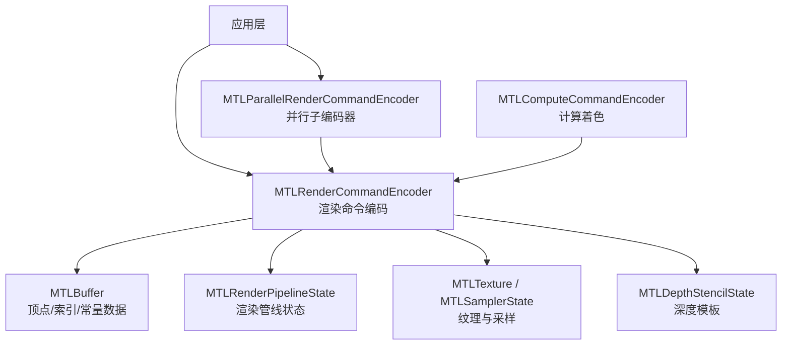
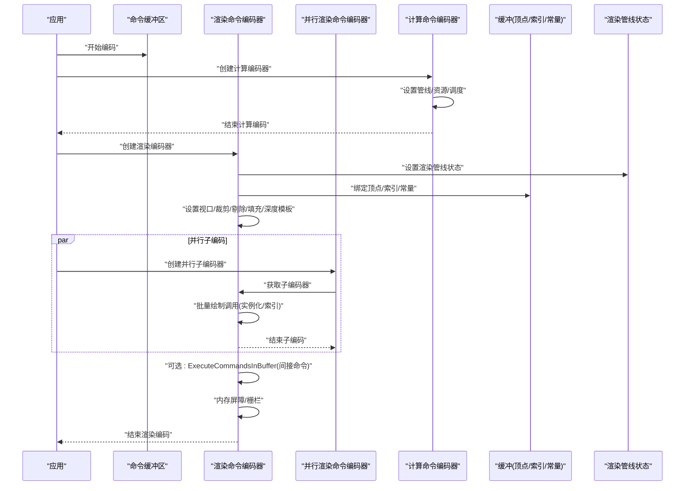
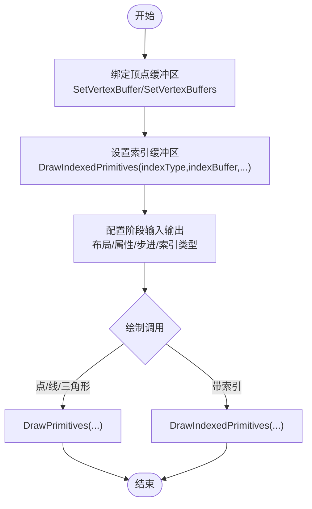
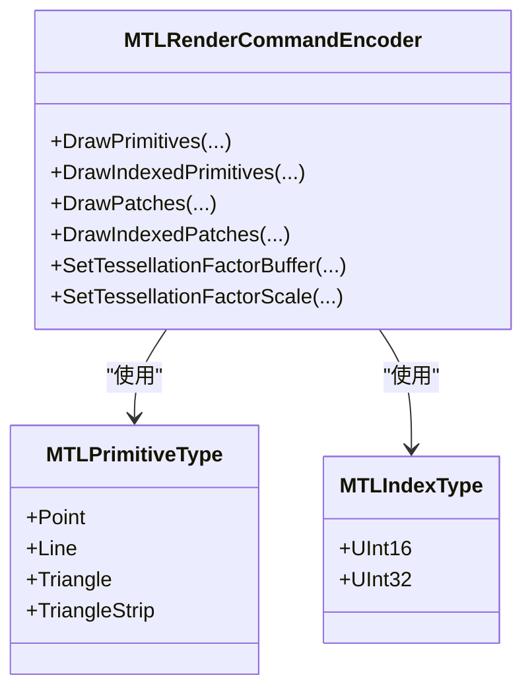
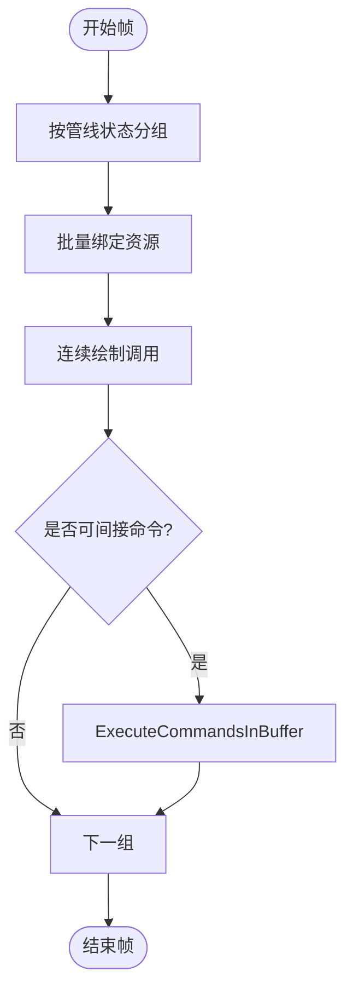
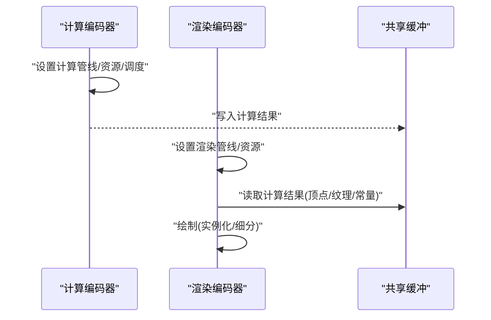
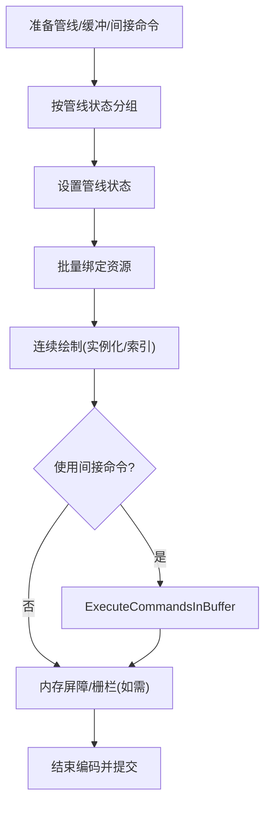
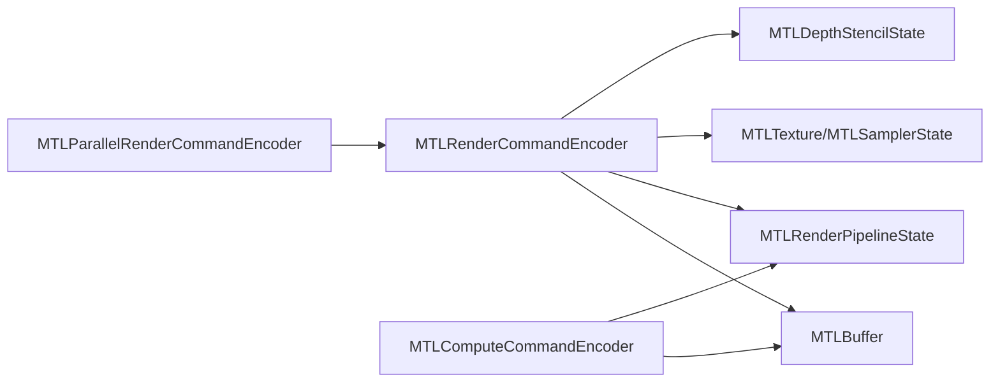

# 渲染命令

<cite>
**本文引用的文件**
- [MTLRenderCommandEncoder.cs](file://src/SharpMetal/Metal/MTLRenderCommandEncoder.cs)
- [MTLParallelRenderCommandEncoder.cs](file://src/SharpMetal/Metal/MTLParallelRenderCommandEncoder.cs)
- [MTLBuffer.cs](file://src/SharpMetal/Metal/MTLBuffer.cs)
- [MTLRenderPipeline.cs](file://src/SharpMetal/Metal/MTLRenderPipeline.cs)
- [MTLComputeCommandEncoder.cs](file://src/SharpMetal/Metal/MTLComputeCommandEncoder.cs)
- [MTLStageInputOutputDescriptor.cs](file://src/SharpMetal/Metal/MTLStageInputOutputDescriptor.cs)
</cite>

## 目录
1. [简介](#简介)
2. [项目结构](#项目结构)
3. [核心组件](#核心组件)
4. [架构总览](#架构总览)
5. [详细组件分析](#详细组件分析)
6. [依赖关系分析](#依赖关系分析)
7. [性能考虑](#性能考虑)
8. [故障排查指南](#故障排查指南)
9. [结论](#结论)
10. [附录](#附录)

## 简介
本文件面向使用 SharpMetal 进行 Metal 渲染的开发者，系统性说明如何编码渲染命令，重点覆盖：
- 顶点缓冲区绑定、索引缓冲区设置与绘制调用编码
- 并行渲染命令编码、批处理优化与状态切换管理
- 高级渲染技术：实例化绘制、几何着色（细分）、计算着色集成
- 绘制调用类型（点、线、三角形）配置、实例化参数与索引类型选择
- 复杂场景下的命令组织策略，减少状态切换开销

## 项目结构
围绕渲染命令的核心代码集中在 Metal 命名空间下，关键文件包括：
- MTLRenderCommandEncoder：封装一次渲染命令编码的所有 API（状态设置、绘制调用、内存屏障等）
- MTLParallelRenderCommandEncoder：提供并行子编码器，用于多线程构建渲染命令
- MTLBuffer：GPU 缓冲资源，承载顶点、索引、常量数据等
- MTLRenderPipeline：描述渲染管线状态（着色器、混合、采样、输入拓扑等）
- MTLComputeCommandEncoder：计算着色命令编码器，可与渲染命令协作完成预处理或后处理
- MTLStageInputOutputDescriptor：定义阶段输入输出布局，包含索引类型与步长步进等



图表来源
- [MTLRenderCommandEncoder.cs:168-586](file://src/SharpMetal/Metal/MTLRenderCommandEncoder.cs#L168-L586)
- [MTLParallelRenderCommandEncoder.cs:16-74](file://src/SharpMetal/Metal/MTLParallelRenderCommandEncoder.cs#L16-L74)
- [MTLBuffer.cs:18-48](file://src/SharpMetal/Metal/MTLBuffer.cs#L18-L48)
- [MTLRenderPipeline.cs:228-336](file://src/SharpMetal/Metal/MTLRenderPipeline.cs#L228-L336)
- [MTLComputeCommandEncoder.cs:60-188](file://src/SharpMetal/Metal/MTLComputeCommandEncoder.cs#L60-L188)

章节来源
- [MTLRenderCommandEncoder.cs:168-586](file://src/SharpMetal/Metal/MTLRenderCommandEncoder.cs#L168-L586)
- [MTLParallelRenderCommandEncoder.cs:16-74](file://src/SharpMetal/Metal/MTLParallelRenderCommandEncoder.cs#L16-L74)
- [MTLBuffer.cs:18-48](file://src/SharpMetal/Metal/MTLBuffer.cs#L18-L48)
- [MTLRenderPipeline.cs:228-336](file://src/SharpMetal/Metal/MTLRenderPipeline.cs#L228-L336)
- [MTLComputeCommandEncoder.cs:60-188](file://src/SharpMetal/Metal/MTLComputeCommandEncoder.cs#L60-L188)

## 核心组件
- 渲染命令编码器（MTLRenderCommandEncoder）
  - 负责设置渲染管线状态、视图口/裁剪矩形、剔除模式、填充模式、深度/模板、可见性结果等
  - 支持顶点/片段/对象/网格/瓦片各阶段的资源绑定（缓冲区、纹理、采样器、函数表、加速结构）
  - 提供多种绘制调用：DrawPrimitives、DrawIndexedPrimitives、DrawPatches、DrawIndexedPatches、Mesh 绘制、瓦片调度等
  - 支持间接绘制与执行预录制命令（ExecuteCommandsInBuffer），便于批处理与动态调度
  - 提供内存屏障、栅栏等待/更新、计数器采样等同步与调试能力

- 并行渲染命令编码器（MTLParallelRenderCommandEncoder）
  - 暴露 RenderCommandEncoder 属性以获取可并行的子编码器
  - 允许在多个线程中同时编码各自独立的渲染子命令，最后合并到主命令缓冲区

- 缓冲资源（MTLBuffer）
  - 作为顶点、索引、常量、间接参数等数据的载体
  - 提供长度、内容访问、修改范围通知、GPU 地址等能力

- 渲染管线（MTLRenderPipeline）
  - 通过描述符配置输入拓扑、混合、采样、深度/模板格式、细分控制、链接函数等
  - 生成不可变的管线状态对象供命令编码器复用

- 计算命令编码器（MTLComputeCommandEncoder）
  - 用于执行 GPU 计算任务，可与渲染命令协同工作（如预处理、后处理、GPGPU 驱动渲染）

章节来源
- [MTLRenderCommandEncoder.cs:168-776](file://src/SharpMetal/Metal/MTLRenderCommandEncoder.cs#L168-L776)
- [MTLParallelRenderCommandEncoder.cs:16-74](file://src/SharpMetal/Metal/MTLParallelRenderCommandEncoder.cs#L16-L74)
- [MTLBuffer.cs:18-48](file://src/SharpMetal/Metal/MTLBuffer.cs#L18-L48)
- [MTLRenderPipeline.cs:228-336](file://src/SharpMetal/Metal/MTLRenderPipeline.cs#L228-L336)
- [MTLComputeCommandEncoder.cs:60-188](file://src/SharpMetal/Metal/MTLComputeCommandEncoder.cs#L60-L188)

## 架构总览
下图展示了一次典型渲染帧的命令编码流程，包括计算预处理、渲染命令编码、以及可能的并行子编码。



图表来源
- [MTLRenderCommandEncoder.cs:168-776](file://src/SharpMetal/Metal/MTLRenderCommandEncoder.cs#L168-L776)
- [MTLParallelRenderCommandEncoder.cs:16-74](file://src/SharpMetal/Metal/MTLParallelRenderCommandEncoder.cs#L16-L74)
- [MTLComputeCommandEncoder.cs:60-188](file://src/SharpMetal/Metal/MTLComputeCommandEncoder.cs#L60-L188)

## 详细组件分析

### 顶点缓冲区绑定与索引缓冲区设置
- 顶点缓冲区
  - 单缓冲绑定：SetVertexBuffer(buffer, offset, index)
  - 批量绑定：SetVertexBuffers(buffers, offsets, range)
  - 偏移更新：SetVertexBufferOffset(offset, index)
  - 字节常量：SetVertexBytes(bytes, length, index)
- 索引缓冲区
  - 在绘制时指定：DrawIndexedPrimitives(..., indexType, indexBuffer, indexBufferOffset, ...)
  - 索引类型：UInt16 或 UInt32（见 MTLIndexType）
- 顶点描述与步进
  - 通过渲染管线描述符中的阶段输入输出描述符配置属性布局、步长步进（每顶点/每实例/每补丁等）



图表来源
- [MTLRenderCommandEncoder.cs:173-191](file://src/SharpMetal/Metal/MTLRenderCommandEncoder.cs#L173-L191)
- [MTLRenderCommandEncoder.cs:548-586](file://src/SharpMetal/Metal/MTLRenderCommandEncoder.cs#L548-L586)
- [MTLStageInputOutputDescriptor.cs:64-68](file://src/SharpMetal/Metal/MTLStageInputOutputDescriptor.cs#L64-L68)
- [MTLStageInputOutputDescriptor.cs:231-259](file://src/SharpMetal/Metal/MTLStageInputOutputDescriptor.cs#L231-L259)

章节来源
- [MTLRenderCommandEncoder.cs:173-191](file://src/SharpMetal/Metal/MTLRenderCommandEncoder.cs#L173-L191)
- [MTLRenderCommandEncoder.cs:548-586](file://src/SharpMetal/Metal/MTLRenderCommandEncoder.cs#L548-L586)
- [MTLStageInputOutputDescriptor.cs:64-68](file://src/SharpMetal/Metal/MTLStageInputOutputDescriptor.cs#L64-L68)
- [MTLStageInputOutputDescriptor.cs:231-259](file://src/SharpMetal/Metal/MTLStageInputOutputDescriptor.cs#L231-L259)

### 绘制调用类型与实例化参数
- 基本绘制
  - DrawPrimitives(primitiveType, vertexStart, vertexCount[, instanceCount])
  - primitiveType 支持：Point、Line、Triangle 等（含 Strip 变体）
- 索引绘制
  - DrawIndexedPrimitives(primitiveType, indexCount, indexType, indexBuffer, indexBufferOffset[, instanceCount])
  - indexType 支持：UInt16、UInt32
- 实例化绘制
  - 通过 instanceCount 与 baseInstance 实现多实例绘制
  - 配合顶点步进（PerInstance）可在顶点阶段读取实例专属数据
- 细分绘制（几何着色）
  - DrawPatches / DrawIndexedPatches 用于曲面细分管线
  - 可结合 SetTessellationFactorBuffer 与 SetTessellationFactorScale 设置细分因子



图表来源
- [MTLRenderCommandEncoder.cs:7-14](file://src/SharpMetal/Metal/MTLRenderCommandEncoder.cs#L7-L14)
- [MTLRenderCommandEncoder.cs:548-631](file://src/SharpMetal/Metal/MTLRenderCommandEncoder.cs#L548-L631)
- [MTLStageInputOutputDescriptor.cs:64-68](file://src/SharpMetal/Metal/MTLStageInputOutputDescriptor.cs#L64-L68)

章节来源
- [MTLRenderCommandEncoder.cs:7-14](file://src/SharpMetal/Metal/MTLRenderCommandEncoder.cs#L7-L14)
- [MTLRenderCommandEncoder.cs:548-631](file://src/SharpMetal/Metal/MTLRenderCommandEncoder.cs#L548-L631)
- [MTLStageInputOutputDescriptor.cs:64-68](file://src/SharpMetal/Metal/MTLStageInputOutputDescriptor.cs#L64-L68)

### 并行渲染命令编码
- 使用 MTLParallelRenderCommandEncoder 创建并行子编码器
- 每个线程获取 RenderCommandEncoder 并独立编码绘制命令
- 所有子编码器结束后，主命令缓冲区将合并执行，提升 CPU 侧编码吞吐

```mermaid
sequenceDiagram
participant Main as "主线程"
participant Par as "并行编码器"
participant Sub as "子编码器"
Main->>Par : "创建并行编码器"
loop 多核线程
Main->>Par : "获取子编码器"
Par-->>Sub : "返回可编码实例"
Sub->>Sub : "设置状态/绑定资源/绘制"
Sub-->>Main : "结束子编码"
end
Main->>Main : "合并并结束主编码"
```

图表来源
- [MTLParallelRenderCommandEncoder.cs:16-74](file://src/SharpMetal/Metal/MTLParallelRenderCommandEncoder.cs#L16-L74)

章节来源
- [MTLParallelRenderCommandEncoder.cs:16-74](file://src/SharpMetal/Metal/MTLParallelRenderCommandEncoder.cs#L16-L74)

### 批处理优化与状态切换管理
- 批处理要点
  - 尽量按渲染目标分组，减少 SetRenderPipelineState 切换次数
  - 将相同材质/管线状态的物体连续绘制，利用实例化减少重复绑定
  - 使用批量缓冲区绑定 SetVertexBuffers/SetFragmentBuffers 减少多次 set 调用
  - 使用 ExecuteCommandsInBuffer 将重复绘制序列打包为间接命令，降低 CPU 开销
- 状态切换管理
  - 先设置管线状态，再一次性绑定所需资源，然后连续绘制
  - 对频繁变化的状态（如视口、裁剪矩形）局部化设置，避免全局抖动
  - 合理使用 UseResource/UseHeaps 声明资源使用意图，帮助驱动优化



图表来源
- [MTLRenderCommandEncoder.cs:758-766](file://src/SharpMetal/Metal/MTLRenderCommandEncoder.cs#L758-L766)
- [MTLRenderCommandEncoder.cs:168-191](file://src/SharpMetal/Metal/MTLRenderCommandEncoder.cs#L168-L191)
- [MTLRenderCommandEncoder.cs:548-586](file://src/SharpMetal/Metal/MTLRenderCommandEncoder.cs#L548-L586)

章节来源
- [MTLRenderCommandEncoder.cs:168-191](file://src/SharpMetal/Metal/MTLRenderCommandEncoder.cs#L168-L191)
- [MTLRenderCommandEncoder.cs:548-586](file://src/SharpMetal/Metal/MTLRenderCommandEncoder.cs#L548-L586)
- [MTLRenderCommandEncoder.cs:758-766](file://src/SharpMetal/Metal/MTLRenderCommandEncoder.cs#L758-L766)

### 高级渲染技术集成
- 实例化绘制
  - 通过 instanceCount 与 baseInstance 控制实例数量与基实例偏移
  - 顶点步进设为 PerInstance，从实例专属缓冲区读取变换矩阵等数据
- 几何着色（细分）
  - 使用 DrawPatches/DrawIndexedPatches 进行曲面细分
  - 配置细分因子缓冲与缩放，控制细分密度
- 计算着色集成
  - 使用 MTLComputeCommandEncoder 执行预处理（如粒子生成、物理模拟）
  - 将计算结果写入缓冲区或纹理，随后在渲染阶段作为顶点/纹理/常量数据使用
  - 通过内存屏障确保读写顺序正确



图表来源
- [MTLComputeCommandEncoder.cs:60-188](file://src/SharpMetal/Metal/MTLComputeCommandEncoder.cs#L60-L188)
- [MTLRenderCommandEncoder.cs:548-631](file://src/SharpMetal/Metal/MTLRenderCommandEncoder.cs#L548-L631)
- [MTLRenderCommandEncoder.cs:768-776](file://src/SharpMetal/Metal/MTLRenderCommandEncoder.cs#L768-L776)

章节来源
- [MTLComputeCommandEncoder.cs:60-188](file://src/SharpMetal/Metal/MTLComputeCommandEncoder.cs#L60-L188)
- [MTLRenderCommandEncoder.cs:548-631](file://src/SharpMetal/Metal/MTLRenderCommandEncoder.cs#L548-L631)
- [MTLRenderCommandEncoder.cs:768-776](file://src/SharpMetal/Metal/MTLRenderCommandEncoder.cs#L768-L776)

### 复杂渲染场景的命令编码示例
以下是一个典型的多物体、多管线、多实例渲染流程的组织方式（概念性步骤，不直接粘贴代码）：
- 准备阶段
  - 创建并缓存渲染管线状态（不同材质/混合/采样配置）
  - 准备顶点/索引/常量缓冲区，必要时准备实例化数据缓冲
  - 可选：准备间接命令缓冲，记录重复绘制序列
- 帧内编码
  - 按管线状态分组，依次设置管线状态
  - 批量绑定顶点/索引/常量/纹理/采样器
  - 设置视口、裁剪矩形、剔除模式、填充模式、深度/模板
  - 对每组物体连续绘制，优先使用实例化与索引绘制
  - 对重复绘制序列使用 ExecuteCommandsInBuffer 执行间接命令
  - 在需要时插入内存屏障或栅栏，保证跨阶段数据一致性
- 结束编码
  - 结束并行子编码（如有）
  - 结束主渲染编码并提交命令缓冲区



图表来源
- [MTLRenderCommandEncoder.cs:168-586](file://src/SharpMetal/Metal/MTLRenderCommandEncoder.cs#L168-L586)
- [MTLRenderCommandEncoder.cs:758-776](file://src/SharpMetal/Metal/MTLRenderCommandEncoder.cs#L758-L776)

## 依赖关系分析
- MTLRenderCommandEncoder 依赖
  - MTLBuffer：顶点、索引、常量、间接参数等数据源
  - MTLRenderPipelineState：不可变管线状态，决定着色器与状态组合
  - MTLTexture/MTLSamplerState：纹理与采样配置
  - MTLDepthStencilState：深度/模板测试与写入
  - MTLVisibleFunctionTable/IntersectionFunctionTable/MTLAccelerationStructure：光线追踪相关
- MTLParallelRenderCommandEncoder 依赖
  - 内部持有 MTLRenderCommandEncoder 子实例，用于并行编码
- MTLComputeCommandEncoder 依赖
  - MTLComputePipelineState、MTLBuffer/Texture/Sampler 等，用于计算任务
- 阶段输入输出描述符
  - 定义索引类型、属性布局、步长步进，影响顶点阶段数据解释



图表来源
- [MTLRenderCommandEncoder.cs:168-776](file://src/SharpMetal/Metal/MTLRenderCommandEncoder.cs#L168-L776)
- [MTLParallelRenderCommandEncoder.cs:16-74](file://src/SharpMetal/Metal/MTLParallelRenderCommandEncoder.cs#L16-L74)
- [MTLComputeCommandEncoder.cs:60-188](file://src/SharpMetal/Metal/MTLComputeCommandEncoder.cs#L60-L188)

章节来源
- [MTLRenderCommandEncoder.cs:168-776](file://src/SharpMetal/Metal/MTLRenderCommandEncoder.cs#L168-L776)
- [MTLParallelRenderCommandEncoder.cs:16-74](file://src/SharpMetal/Metal/MTLParallelRenderCommandEncoder.cs#L16-L74)
- [MTLComputeCommandEncoder.cs:60-188](file://src/SharpMetal/Metal/MTLComputeCommandEncoder.cs#L60-L188)

## 性能考虑
- 减少状态切换
  - 将相同管线状态的绘制集中在一起，避免频繁 SetRenderPipelineState
  - 批量绑定资源，减少多次 set 调用
- 利用实例化与索引
  - 使用实例化绘制减少重复顶点数据与绘制调用
  - 使用索引绘制减少重复顶点引用
- 间接命令与批处理
  - 使用 ExecuteCommandsInBuffer 将重复绘制序列打包，降低 CPU 开销
  - 将大量小物体合并为少数大批次，提高吞吐
- 内存与同步
  - 合理使用 UseResource/UseHeaps 声明资源使用意图
  - 在跨阶段读写时使用 MemoryBarrier/Fence，避免多余同步
- 并行编码
  - 使用并行子编码器在多线程中构建命令，提升 CPU 侧效率

[本节为通用性能建议，不直接分析具体文件]

## 故障排查指南
- 常见问题定位
  - 绘制无输出：检查 SetRenderPipelineState、SetViewport、SetScissorRect、颜色/深度附件配置
  - 顶点数据错误：核对顶点缓冲绑定索引、偏移、步长与属性布局匹配
  - 索引越界：确认索引类型与索引缓冲大小一致，baseVertex/baseInstance 设置正确
  - 同步问题：在计算与渲染之间添加 MemoryBarrier 或使用 Fence 等待
- 调试技巧
  - 使用 PushDebugGroup/PopDebugGroup 标记绘制段
  - 使用 InsertDebugSignpost 插入时间戳
  - 使用 SampleCountersInBuffer 采集性能计数器

章节来源
- [MTLRenderCommandEncoder.cs:153-166](file://src/SharpMetal/Metal/MTLRenderCommandEncoder.cs#L153-L166)
- [MTLRenderCommandEncoder.cs:778-781](file://src/SharpMetal/Metal/MTLRenderCommandEncoder.cs#L778-L781)

## 结论
通过合理组织渲染命令、充分利用实例化与索引绘制、采用并行编码与间接命令批处理，可以显著降低状态切换与 CPU 开销，提升渲染吞吐。结合计算着色进行预处理/后处理，进一步扩展渲染能力。遵循本指南的状态管理与批处理策略，可在复杂场景中保持高效稳定的渲染性能。

[本节为总结性内容，不直接分析具体文件]

## 附录
- 关键枚举与结构参考
  - 绘制类型：Point、Line、Triangle 等（MTLPrimitiveType）
  - 索引类型：UInt16、UInt32（MTLIndexType）
  - 细分绘制：DrawPatches/DrawIndexedPatches
  - 并行编码：MTLParallelRenderCommandEncoder
  - 间接命令：ExecuteCommandsInBuffer
  - 同步：MemoryBarrier、Fence、SampleCountersInBuffer

章节来源
- [MTLRenderCommandEncoder.cs:7-14](file://src/SharpMetal/Metal/MTLRenderCommandEncoder.cs#L7-L14)
- [MTLStageInputOutputDescriptor.cs:64-68](file://src/SharpMetal/Metal/MTLStageInputOutputDescriptor.cs#L64-L68)
- [MTLRenderCommandEncoder.cs:548-631](file://src/SharpMetal/Metal/MTLRenderCommandEncoder.cs#L548-L631)
- [MTLParallelRenderCommandEncoder.cs:16-74](file://src/SharpMetal/Metal/MTLParallelRenderCommandEncoder.cs#L16-L74)
- [MTLRenderCommandEncoder.cs:758-781](file://src/SharpMetal/Metal/MTLRenderCommandEncoder.cs#L758-L781)