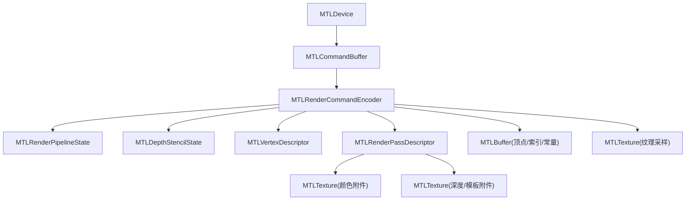
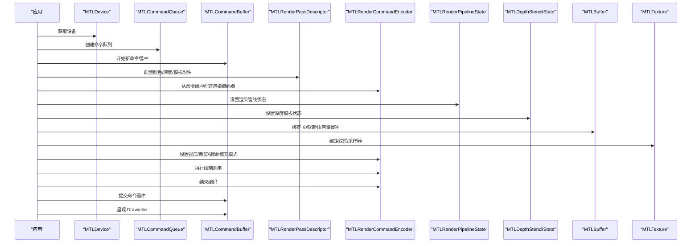
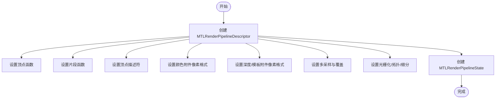
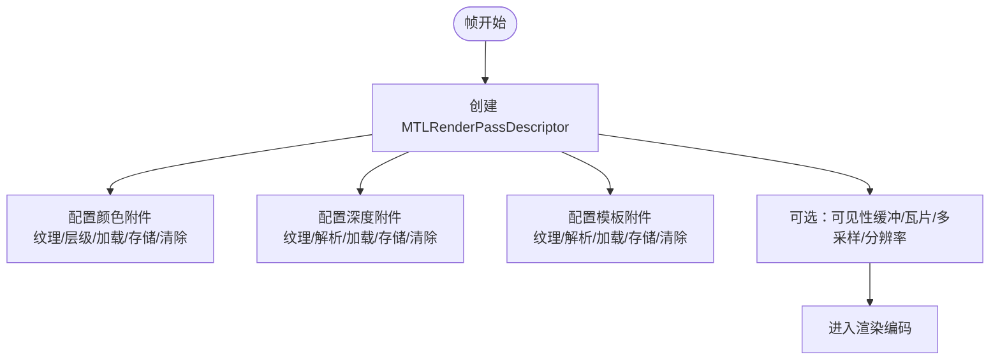
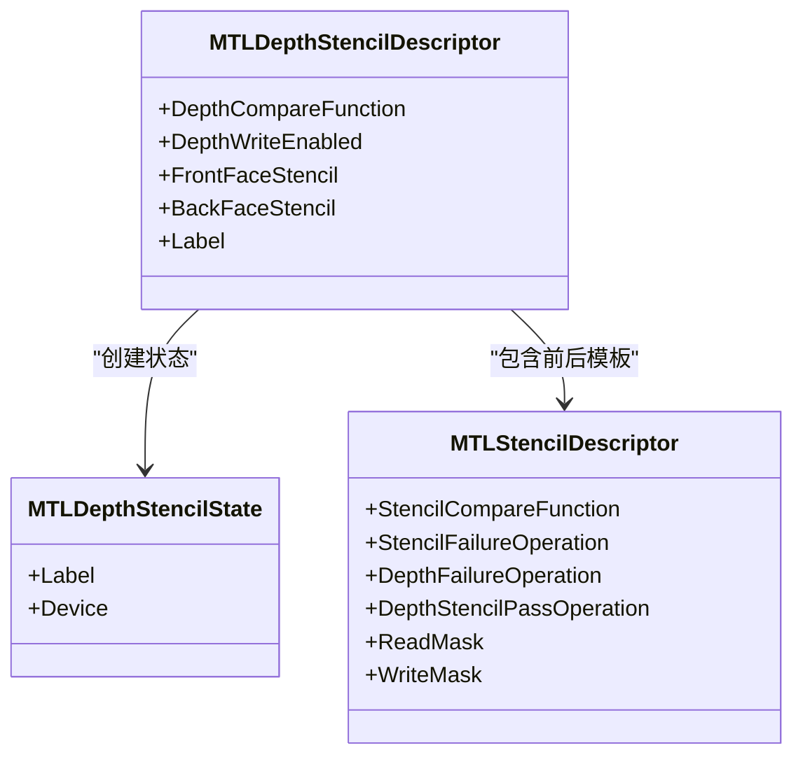
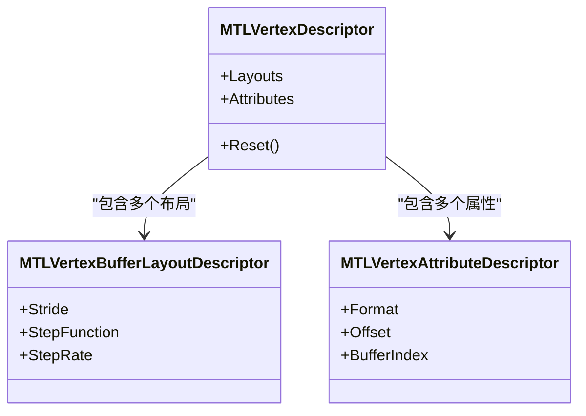
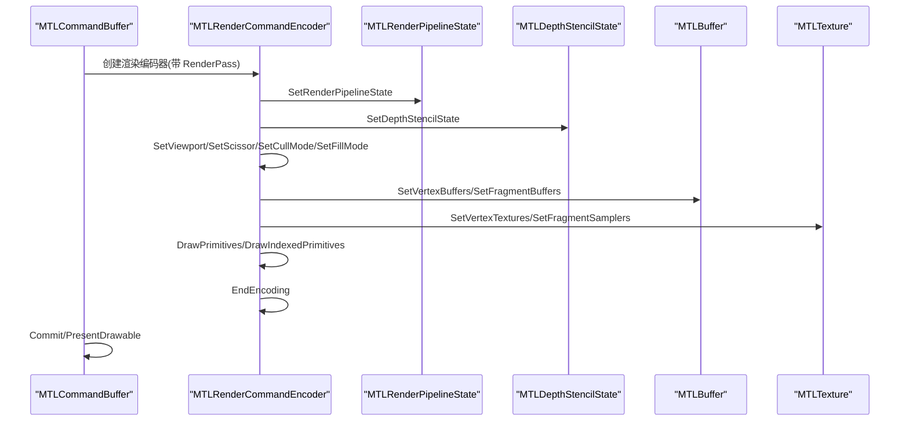
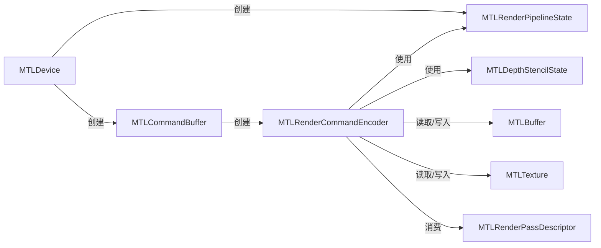

# 渲染管线

<cite>
**本文引用的文件**
- [MTLRenderPipeline.cs](file://src/SharpMetal/Metal/MTLRenderPipeline.cs)
- [MTLRenderCommandEncoder.cs](file://src/SharpMetal/Metal/MTLRenderCommandEncoder.cs)
- [MTLDepthStencil.cs](file://src/SharpMetal/Metal/MTLDepthStencil.cs)
- [MTLVertexDescriptor.cs](file://src/SharpMetal/Metal/MTLVertexDescriptor.cs)
- [MTLRenderPass.cs](file://src/SharpMetal/Metal/MTLRenderPass.cs)
- [MTLDevice.cs](file://src/SharpMetal/Metal/MTLDevice.cs)
- [MTLCommandBuffer.cs](file://src/SharpMetal/Metal/MTLCommandBuffer.cs)
- [MTLTexture.cs](file://src/SharpMetal/Metal/MTLTexture.cs)
- [MTLBuffer.cs](file://src/SharpMetal/Metal/MTLBuffer.cs)
- [Program.cs](file://samples/SharpMetal.Sample/Program.cs)
</cite>

## 目录
1. [简介](#简介)
2. [项目结构](#项目结构)
3. [核心组件](#核心组件)
4. [架构总览](#架构总览)
5. [详细组件分析](#详细组件分析)
6. [依赖关系分析](#依赖关系分析)
7. [性能考虑](#性能考虑)
8. [故障排查指南](#故障排查指南)
9. [结论](#结论)
10. [附录](#附录)

## 简介
本文件面向使用 SharpMetal 进行 Metal 渲染的开发者，系统化说明渲染管线的配置与执行流程，包括：
- 顶点着色器、片段着色器的设置与绑定
- 渲染通道（Render Pass）与颜色/深度/模板附件的配置
- 深度模板状态、顶点描述符的配置方法
- 渲染命令编码、绘制调用与渲染状态管理
- 渲染优化技巧、批处理技术与性能分析工具的使用
- 完整的渲染循环实现要点与示例路径

## 项目结构
SharpMetal 在 src/SharpMetal/Metal 下提供了对 Metal API 的一一映射封装。与渲染管线直接相关的核心类型包括：
- 管线与状态：MTLRenderPipelineState、MTLRenderPipelineDescriptor、MTLDepthStencilState、MTLVertexDescriptor
- 命令编码：MTLRenderCommandEncoder（绘制、状态设置、资源绑定）
- 渲染通道：MTLRenderPassDescriptor 及其附件描述符
- 资源：MTLTexture、MTLBuffer
- 命令缓冲与队列：MTLCommandBuffer、MTLCommandQueue（通过设备创建）
- 设备能力：MTLDevice（用于创建管线、命令缓冲等）

图表来源
- [MTLDevice.cs:187-200](file://src/SharpMetal/Metal/MTLDevice.cs#L187-L200)
- [MTLCommandBuffer.cs:195-198](file://src/SharpMetal/Metal/MTLCommandBuffer.cs#L195-L198)
- [MTLRenderCommandEncoder.cs:168-171](file://src/SharpMetal/Metal/MTLRenderCommandEncoder.cs#L168-L171)
- [MTLRenderPass.cs:636-762](file://src/SharpMetal/Metal/MTLRenderPass.cs#L636-L762)
- [MTLTexture.cs:75-200](file://src/SharpMetal/Metal/MTLTexture.cs#L75-L200)
- [MTLBuffer.cs:1-115](file://src/SharpMetal/Metal/MTLBuffer.cs#L1-L115)

章节来源
- [MTLRenderPipeline.cs:208-492](file://src/SharpMetal/Metal/MTLRenderPipeline.cs#L208-L492)
- [MTLRenderCommandEncoder.cs:126-800](file://src/SharpMetal/Metal/MTLRenderCommandEncoder.cs#L126-L800)
- [MTLDepthStencil.cs:91-163](file://src/SharpMetal/Metal/MTLDepthStencil.cs#L91-L163)
- [MTLVertexDescriptor.cs:221-247](file://src/SharpMetal/Metal/MTLVertexDescriptor.cs#L221-L247)
- [MTLRenderPass.cs:636-762](file://src/SharpMetal/Metal/MTLRenderPass.cs#L636-L762)
- [MTLCommandBuffer.cs:116-200](file://src/SharpMetal/Metal/MTLCommandBuffer.cs#L116-L200)
- [MTLTexture.cs:75-200](file://src/SharpMetal/Metal/MTLTexture.cs#L75-L200)
- [MTLBuffer.cs:1-115](file://src/SharpMetal/Metal/MTLBuffer.cs#L1-L115)

## 核心组件
- MTLRenderPipelineDescriptor / MTLRenderPipelineState
  - 用于声明并构建渲染管线，包含顶点/片段函数、顶点描述符、多采样、混合、光栅化、图元拓扑、细分曲面等选项。
  - 构建后得到不可变的状态对象，可在帧内多次复用。
- MTLRenderCommandEncoder
  - 帧内命令编码器，负责设置管线、视图口、裁剪矩形、剔除、深度偏置、填充模式、各阶段资源绑定、绘制调用、内存屏障、可见性结果等。
- MTLRenderPassDescriptor 及附件
  - 定义每帧的颜色、深度、模板附件的加载/存储行为、多重采样解析、清除值等。
- MTLDepthStencilState
  - 控制深度测试、写入、模板测试与操作。
- MTLVertexDescriptor
  - 描述顶点缓冲区布局与属性格式、偏移、步长与步进函数，供管线装配阶段使用。
- MTLTexture / MTLBuffer
  - 纹理与缓冲区资源，作为渲染输入或输出目标。
- MTLCommandBuffer / MTLCommandQueue
  - 命令缓冲承载渲染命令，提交到队列由 GPU 执行；可呈现 Drawable。

章节来源
- [MTLRenderPipeline.cs:208-492](file://src/SharpMetal/Metal/MTLRenderPipeline.cs#L208-L492)
- [MTLRenderCommandEncoder.cs:168-800](file://src/SharpMetal/Metal/MTLRenderCommandEncoder.cs#L168-L800)
- [MTLRenderPass.cs:636-762](file://src/SharpMetal/Metal/MTLRenderPass.cs#L636-L762)
- [MTLDepthStencil.cs:91-163](file://src/SharpMetal/Metal/MTLDepthStencil.cs#L91-L163)
- [MTLVertexDescriptor.cs:221-247](file://src/SharpMetal/Metal/MTLVertexDescriptor.cs#L221-L247)
- [MTLTexture.cs:75-200](file://src/SharpMetal/Metal/MTLTexture.cs#L75-L200)
- [MTLBuffer.cs:1-115](file://src/SharpMetal/Metal/MTLBuffer.cs#L1-L115)
- [MTLCommandBuffer.cs:116-200](file://src/SharpMetal/Metal/MTLCommandBuffer.cs#L116-L200)

## 架构总览
下图展示从设备到绘制调用的典型数据与控制流：

图表来源
- [MTLDevice.cs:187-200](file://src/SharpMetal/Metal/MTLDevice.cs#L187-L200)
- [MTLCommandBuffer.cs:195-198](file://src/SharpMetal/Metal/MTLCommandBuffer.cs#L195-L198)
- [MTLRenderPass.cs:636-762](file://src/SharpMetal/Metal/MTLRenderPass.cs#L636-L762)
- [MTLRenderCommandEncoder.cs:168-800](file://src/SharpMetal/Metal/MTLRenderCommandEncoder.cs#L168-L800)

## 详细组件分析

### 渲染管线配置（顶点/片段着色器、顶点描述符、多采样、混合、光栅化）
- 使用 MTLRenderPipelineDescriptor 设置：
  - 顶点函数、片段函数
  - 顶点描述符（MTLVertexDescriptor）
  - 颜色附件像素格式、深度/模板附件像素格式
  - 多采样（SampleCount/RasterSampleCount）、AlphaToCoverage/AlphaToOne
  - 光栅化开关、图元拓扑、细分曲面相关参数
  - 顶点/片段缓冲描述数组、二进制归档、预加载库、链接函数、调用栈深度、着色器验证等
- 通过设备创建 MTLRenderPipelineState，并在渲染循环中复用。

图表来源
- [MTLRenderPipeline.cs:208-492](file://src/SharpMetal/Metal/MTLRenderPipeline.cs#L208-L492)
- [MTLVertexDescriptor.cs:221-247](file://src/SharpMetal/Metal/MTLVertexDescriptor.cs#L221-L247)

章节来源
- [MTLRenderPipeline.cs:208-492](file://src/SharpMetal/Metal/MTLRenderPipeline.cs#L208-L492)
- [MTLVertexDescriptor.cs:221-247](file://src/SharpMetal/Metal/MTLVertexDescriptor.cs#L221-L247)

### 渲染通道与附件（颜色/深度/模板、加载/存储、多重采样解析）
- 使用 MTLRenderPassDescriptor 配置：
  - 颜色附件数组：纹理、层级/切片/深度平面、解析纹理、加载/存储动作、存储选项、清除颜色
  - 深度附件：纹理、解析纹理、加载/存储动作、清除深度、深度解析过滤
  - 模板附件：纹理、解析纹理、加载/存储动作、清除模板、模板解析过滤
  - 其他：可见性结果缓冲、渲染目标数组长度、图像块大小、线程组内存、瓦片尺寸、默认多重采样计数、分辨率、光栅化速率图等
- 在每帧开始时创建新的渲染通道描述，避免跨帧复用导致的状态不一致。

图表来源
- [MTLRenderPass.cs:636-762](file://src/SharpMetal/Metal/MTLRenderPass.cs#L636-L762)

章节来源
- [MTLRenderPass.cs:636-762](file://src/SharpMetal/Metal/MTLRenderPass.cs#L636-L762)

### 深度模板状态（深度测试、写入、模板操作）
- 使用 MTLDepthStencilDescriptor 配置：
  - 深度比较函数、是否写入深度
  - 正面/背面模板描述：比较函数、失败/深度失败/通过时的操作、读写掩码
- 通过渲染命令编码器设置当前深度模板状态，并在绘制前确保一致。

图表来源
- [MTLDepthStencil.cs:91-163](file://src/SharpMetal/Metal/MTLDepthStencil.cs#L91-L163)

章节来源
- [MTLDepthStencil.cs:91-163](file://src/SharpMetal/Metal/MTLDepthStencil.cs#L91-L163)

### 顶点描述符（缓冲区布局与属性）
- 使用 MTLVertexDescriptor：
  - 布局数组：每个缓冲区的步幅、步进函数、步进率
  - 属性数组：每个属性的格式、偏移、所属缓冲区索引
- 将顶点描述符绑定到渲染管线，使 GPU 能正确解释顶点数据布局。

图表来源
- [MTLVertexDescriptor.cs:221-247](file://src/SharpMetal/Metal/MTLVertexDescriptor.cs#L221-L247)

章节来源
- [MTLVertexDescriptor.cs:221-247](file://src/SharpMetal/Metal/MTLVertexDescriptor.cs#L221-L247)

### 渲染命令编码、绘制调用与状态管理
- 命令缓冲与编码器：
  - 从 MTLCommandBuffer 创建 MTLRenderCommandEncoder，传入 MTLRenderPassDescriptor
  - 设置渲染管线状态、深度模板状态、视口、裁剪矩形、剔除、填充模式、深度偏置
  - 绑定顶点/片段/对象/网格/瓦片阶段的缓冲、纹理、采样器、可见性/相交函数表、加速结构
  - 执行绘制调用：DrawPrimitives、DrawIndexedPrimitives、DrawPatches、DrawMesh* 等
  - 使用 UseResource/UseHeaps 显式声明资源使用，必要时 MemoryBarrier
  - 结束编码并提交命令缓冲，最后呈现 Drawable
- 注意：
  - 同一帧内尽量复用管线状态与深度模板状态，减少状态切换
  - 批量绘制时合并相同状态的绘制批次，降低状态切换开销
  - 合理使用间接命令缓冲与实例化绘制提升吞吐

图表来源
- [MTLCommandBuffer.cs:195-198](file://src/SharpMetal/Metal/MTLCommandBuffer.cs#L195-L198)
- [MTLRenderCommandEncoder.cs:168-800](file://src/SharpMetal/Metal/MTLRenderCommandEncoder.cs#L168-L800)

章节来源
- [MTLRenderCommandEncoder.cs:168-800](file://src/SharpMetal/Metal/MTLRenderCommandEncoder.cs#L168-L800)
- [MTLCommandBuffer.cs:195-198](file://src/SharpMetal/Metal/MTLCommandBuffer.cs#L195-L198)

### 完整渲染循环要点（含示例路径）
- 基本步骤：
  1) 获取设备与命令队列（参考示例中对设备的初始化）
  2) 每帧创建命令缓冲
  3) 创建渲染通道描述并配置附件
  4) 创建渲染编码器，设置管线、深度模板、视口、裁剪、剔除、填充模式
  5) 绑定资源（顶点/索引/常量缓冲、纹理/采样器）
  6) 执行绘制调用（可批处理）
  7) 结束编码，提交命令缓冲，呈现 Drawable
- 示例路径：
  - 设备与共享缓冲的创建与读写校验见 [Program.cs:21-45](file://samples/SharpMetal.Sample/Program.cs#L21-L45)
  - 渲染命令编码器创建见 [MTLCommandBuffer.cs:195-198](file://src/SharpMetal/Metal/MTLCommandBuffer.cs#L195-L198)
  - 渲染通道描述与附件配置见 [MTLRenderPass.cs:636-762](file://src/SharpMetal/Metal/MTLRenderPass.cs#L636-L762)
  - 绘制调用与状态设置见 [MTLRenderCommandEncoder.cs:168-800](file://src/SharpMetal/Metal/MTLRenderCommandEncoder.cs#L168-L800)

章节来源
- [Program.cs:21-45](file://samples/SharpMetal.Sample/Program.cs#L21-L45)
- [MTLCommandBuffer.cs:195-198](file://src/SharpMetal/Metal/MTLCommandBuffer.cs#L195-L198)
- [MTLRenderPass.cs:636-762](file://src/SharpMetal/Metal/MTLRenderPass.cs#L636-L762)
- [MTLRenderCommandEncoder.cs:168-800](file://src/SharpMetal/Metal/MTLRenderCommandEncoder.cs#L168-L800)

## 依赖关系分析
- 低耦合高内聚：
  - 管线状态（MTLRenderPipelineState）与命令编码器（MTLRenderCommandEncoder）解耦，便于复用
  - 渲染通道（MTLRenderPassDescriptor）仅描述每帧附件生命周期，不持有资源所有权
  - 资源（MTLTexture/MTLBuffer）通过引用传递，配合 UseResource/UseHeaps 明确使用期
- 外部依赖：
  - 设备（MTLDevice）提供命令缓冲、管线、资源创建能力
  - 命令缓冲（MTLCommandBuffer）协调编码器与队列，负责提交与呈现

图表来源
- [MTLDevice.cs:187-200](file://src/SharpMetal/Metal/MTLDevice.cs#L187-L200)
- [MTLCommandBuffer.cs:195-198](file://src/SharpMetal/Metal/MTLCommandBuffer.cs#L195-L198)
- [MTLRenderCommandEncoder.cs:168-800](file://src/SharpMetal/Metal/MTLRenderCommandEncoder.cs#L168-L800)
- [MTLRenderPass.cs:636-762](file://src/SharpMetal/Metal/MTLRenderPass.cs#L636-L762)

章节来源
- [MTLDevice.cs:187-200](file://src/SharpMetal/Metal/MTLDevice.cs#L187-L200)
- [MTLCommandBuffer.cs:195-198](file://src/SharpMetal/Metal/MTLCommandBuffer.cs#L195-L198)
- [MTLRenderCommandEncoder.cs:168-800](file://src/SharpMetal/Metal/MTLRenderCommandEncoder.cs#L168-L800)
- [MTLRenderPass.cs:636-762](file://src/SharpMetal/Metal/MTLRenderPass.cs#L636-L762)

## 性能考虑
- 批处理与状态最小化
  - 将相同管线状态与资源绑定的绘制合并为一批，减少 SetRenderPipelineState、SetDepthStencilState、SetVertexBuffers、SetFragmentTextures 等状态切换次数
  - 使用实例化绘制与索引绘制减少重复顶点数据
- 资源使用声明
  - 使用 UseResource/UseResources/UseHeap/UseHeaps 显式声明资源使用范围，帮助驱动优化内存访问与缓存
  - 在需要时插入 MemoryBarrier 保证读写顺序
- 多重采样与解析
  - 合理设置 DefaultRasterSampleCount 与 ResolveTexture，避免不必要的 MSAA 开销
- 瓦片渲染与光栅化速率图
  - 根据场景复杂度配置 TileWidth/TileHeight 与 RasterizationRateMap，平衡带宽与计算
- 可见性与剔除
  - 启用 CullMode、DepthClipMode，减少无效片元处理
- 调试与分析
  - 使用 InsertDebugSignpost、PushDebugGroup/PopDebugGroup 标记关键段
  - 利用 SampleCountersInBuffer 采集计数器，结合系统工具（如 Instruments）分析 GPU/CPU 瓶颈

[本节为通用指导，不直接分析具体文件]

## 故障排查指南
- 常见问题定位
  - 管线构建失败：检查顶点/片段函数、顶点描述符、附件像素格式是否匹配
  - 绘制无输出：确认颜色附件纹理已创建且设置为 RenderTarget，LoadAction/StoreAction 正确
  - 深度/模板异常：检查 DepthCompareFunction、DepthWriteEnabled、模板操作是否正确
  - 资源越界或崩溃：核对缓冲区长度、偏移、步幅与属性偏移一致性
- 建议手段
  - 使用 Label 为管线、命令缓冲、编码器命名，便于日志追踪
  - 使用 ErrorOptions 与 CommandBuffer 错误信息辅助定位
  - 逐步缩小问题范围：先绘制简单图元，再逐步增加复杂逻辑

章节来源
- [MTLCommandBuffer.cs:116-200](file://src/SharpMetal/Metal/MTLCommandBuffer.cs#L116-L200)
- [MTLRenderCommandEncoder.cs:168-800](file://src/SharpMetal/Metal/MTLRenderCommandEncoder.cs#L168-L800)
- [MTLRenderPass.cs:636-762](file://src/SharpMetal/Metal/MTLRenderPass.cs#L636-L762)

## 结论
SharpMetal 对 Metal 渲染管线提供了完整而清晰的封装。通过合理组织管线状态、渲染通道与资源绑定，并结合批处理、显式资源使用声明与调试工具，可以在保证正确性的同时获得良好的性能表现。建议在工程中将管线与状态对象持久化复用，仅在必要时切换状态，最大化减少命令编码开销。

[本节为总结性内容，不直接分析具体文件]

## 附录
- 关键 API 路径速查
  - 渲染管线描述与状态：[MTLRenderPipeline.cs:208-492](file://src/SharpMetal/Metal/MTLRenderPipeline.cs#L208-L492)
  - 渲染命令编码器与绘制：[MTLRenderCommandEncoder.cs:168-800](file://src/SharpMetal/Metal/MTLRenderCommandEncoder.cs#L168-L800)
  - 深度模板状态：[MTLDepthStencil.cs:91-163](file://src/SharpMetal/Metal/MTLDepthStencil.cs#L91-L163)
  - 顶点描述符：[MTLVertexDescriptor.cs:221-247](file://src/SharpMetal/Metal/MTLVertexDescriptor.cs#L221-L247)
  - 渲染通道与附件：[MTLRenderPass.cs:636-762](file://src/SharpMetal/Metal/MTLRenderPass.cs#L636-L762)
  - 命令缓冲与编码器创建：[MTLCommandBuffer.cs:195-198](file://src/SharpMetal/Metal/MTLCommandBuffer.cs#L195-L198)
  - 纹理与缓冲资源：[MTLTexture.cs:75-200](file://src/SharpMetal/Metal/MTLTexture.cs#L75-L200), [MTLBuffer.cs:1-115](file://src/SharpMetal/Metal/MTLBuffer.cs#L1-L115)
  - 示例程序入口：[Program.cs:21-45](file://samples/SharpMetal.Sample/Program.cs#L21-L45)