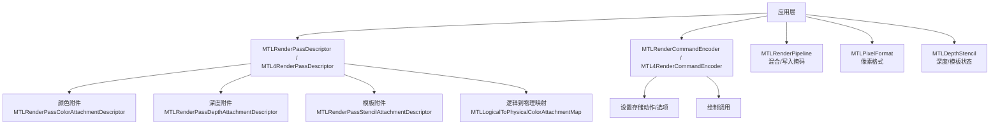
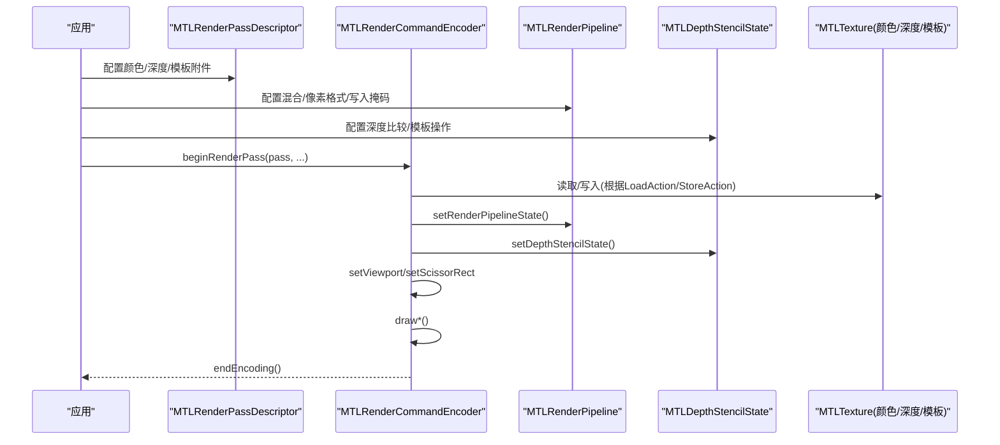
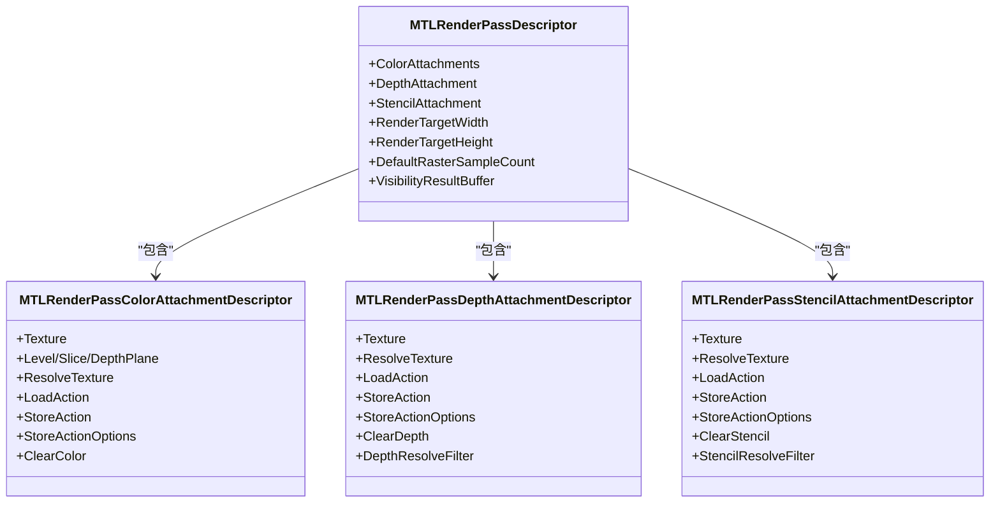
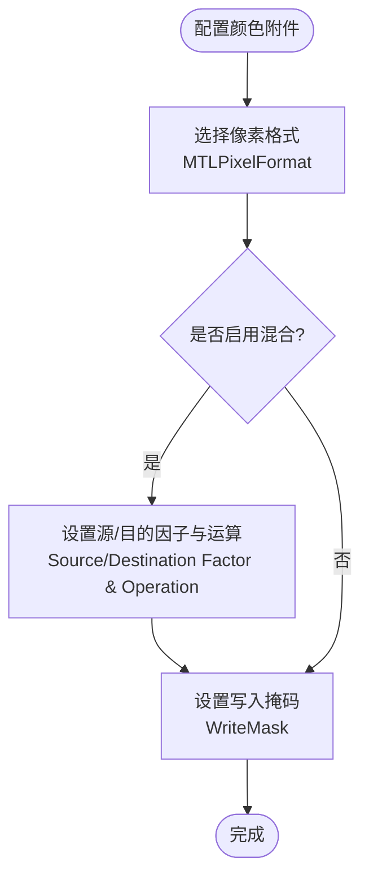
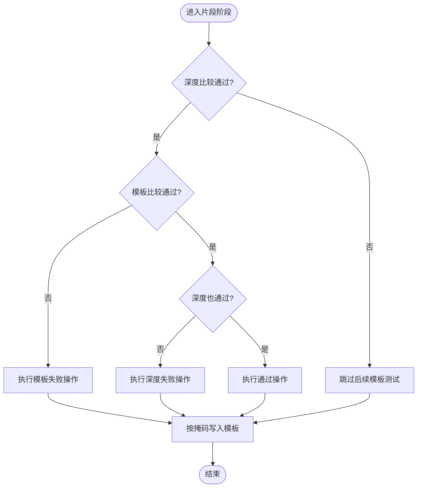
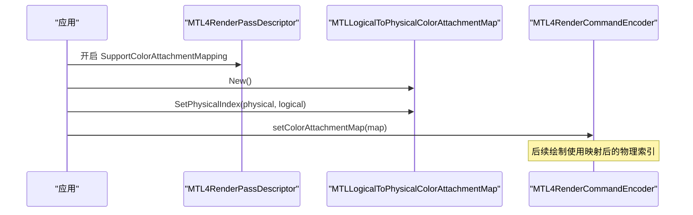
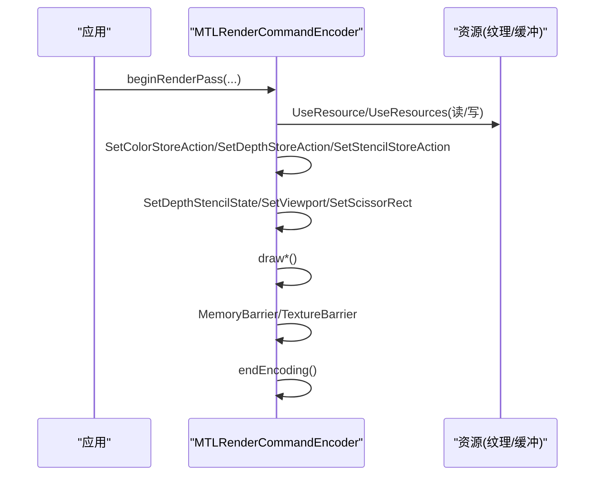
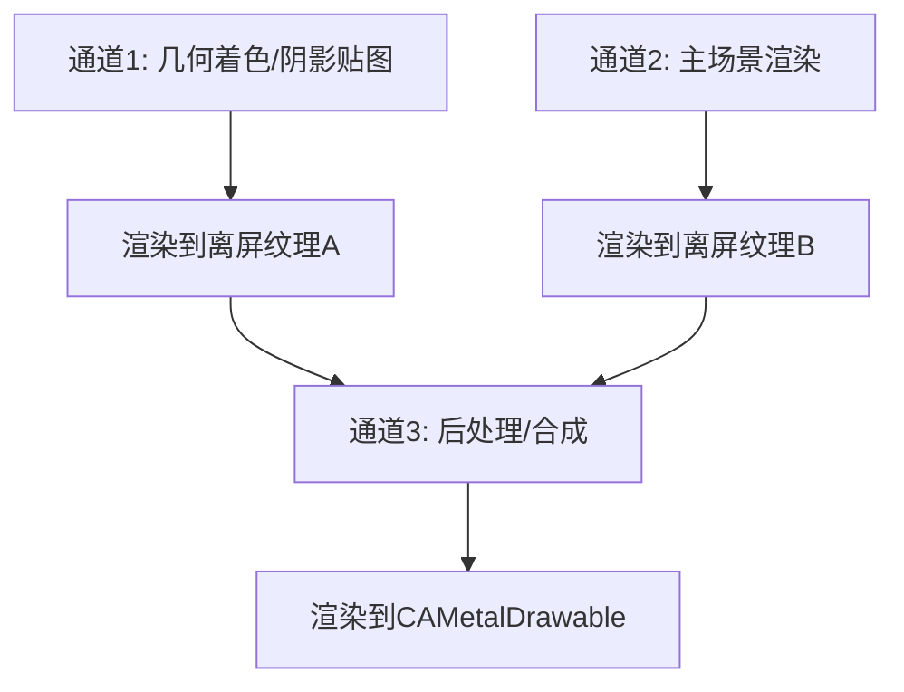
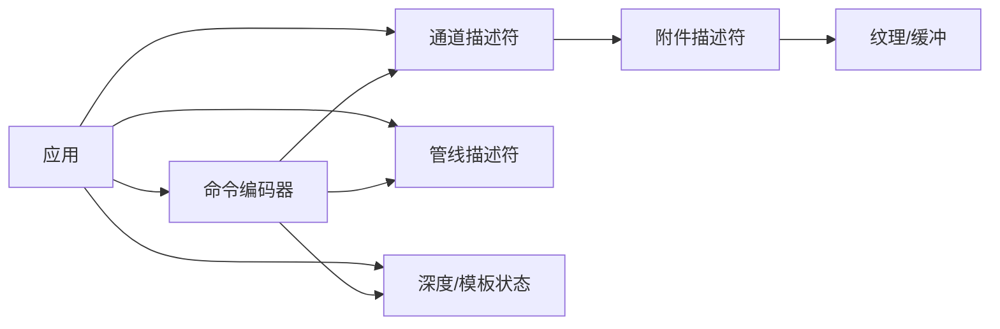

# 渲染通道

<cite>
**本文引用的文件**
- [MTLRenderPass.cs](file://src/SharpMetal/Metal/MTLRenderPass.cs)
- [MTL4RenderPass.cs](file://src/SharpMetal/Metal/MTL4RenderPass.cs)
- [MTLPixelFormat.cs](file://src/SharpMetal/Metal/MTLPixelFormat.cs)
- [MTLDepthStencil.cs](file://src/SharpMetal/Metal/MTLDepthStencil.cs)
- [MTLLogicalToPhysicalColorAttachmentMap.cs](file://src/SharpMetal/Metal/MTLLogicalToPhysicalColorAttachmentMap.cs)
- [MTLRenderCommandEncoder.cs](file://src/SharpMetal/Metal/MTLRenderCommandEncoder.cs)
- [MTL4RenderCommandEncoder.cs](file://src/SharpMetal/Metal/MTL4RenderCommandEncoder.cs)
- [MTLRenderPipeline.cs](file://src/SharpMetal/Metal/MTLRenderPipeline.cs)
</cite>

## 目录
1. [简介](#简介)
2. [项目结构](#项目结构)
3. [核心组件](#核心组件)
4. [架构总览](#架构总览)
5. [详细组件分析](#详细组件分析)
6. [依赖关系分析](#依赖关系分析)
7. [性能注意事项](#性能注意事项)
8. [故障排查指南](#故障排查指南)
9. [结论](#结论)
10. [附录](#附录)

## 简介
本文件围绕 SharpMetal 中的“渲染通道”主题，系统性说明如何配置 MTLRenderPassDescriptor（及 MTL4RenderPassDescriptor），包括颜色附件、深度/模板附件的设置；解释多重渲染目标、深度模板测试、逻辑到物理颜色附件映射的配置方法；阐述渲染通道的开始与结束、资源状态管理；并给出多通道渲染与离屏渲染的实现模式。重点覆盖颜色附件像素格式、混合状态配置，以及深度比较函数与模板操作配置，并提供复杂场景的通道配置示例。

## 项目结构
与渲染通道直接相关的代码集中在 Metal 命名空间下的若干类型中：
- 渲染通道描述符：MTLRenderPassDescriptor、MTL4RenderPassDescriptor
- 附件描述符：颜色/深度/模板附件及其数组
- 像素格式枚举：MTLPixelFormat
- 深度/模板状态：MTLDepthStencilDescriptor、MTLStencilDescriptor、MTLCompareFunction、MTLStencilOperation
- 逻辑到物理颜色附件映射：MTLLogicalToPhysicalColorAttachmentMap
- 渲染命令编码器：MTLRenderCommandEncoder、MTL4RenderCommandEncoder
- 渲染管线与混合：MTLRenderPipelineColorAttachmentDescriptor、MTLBlendFactor、MTLBlendOperation、MTLColorWriteMask

图表来源
- [MTLRenderPass.cs:636-762](file://src/SharpMetal/Metal/MTLRenderPass.cs#L636-L762)
- [MTL4RenderPass.cs:6-160](file://src/SharpMetal/Metal/MTL4RenderPass.cs#L6-L160)
- [MTLRenderCommandEncoder.cs:398-426](file://src/SharpMetal/Metal/MTLRenderCommandEncoder.cs#L398-L426)
- [MTL4RenderCommandEncoder.cs:27-46](file://src/SharpMetal/Metal/MTL4RenderCommandEncoder.cs#L27-L46)
- [MTLRenderPipeline.cs:87-170](file://src/SharpMetal/Metal/MTLRenderPipeline.cs#L87-L170)
- [MTLPixelFormat.cs:3-144](file://src/SharpMetal/Metal/MTLPixelFormat.cs#L3-L144)
- [MTLDepthStencil.cs:6-163](file://src/SharpMetal/Metal/MTLDepthStencil.cs#L6-L163)

章节来源
- [MTLRenderPass.cs:636-762](file://src/SharpMetal/Metal/MTLRenderPass.cs#L636-L762)
- [MTL4RenderPass.cs:6-160](file://src/SharpMetal/Metal/MTL4RenderPass.cs#L6-L160)

## 核心组件
- 渲染通道描述符
  - MTLRenderPassDescriptor：提供颜色附件数组、深度/模板附件、视见结果缓冲、渲染目标尺寸、默认采样数、栅格化率图等属性与方法。
  - MTL4RenderPassDescriptor：在基础能力上扩展了可见性结果类型、支持颜色附件映射开关等。
- 附件描述符
  - 颜色附件：纹理、层级/切片/深度平面、解析纹理、加载/存储动作、存储选项、清除颜色。
  - 深度附件：纹理、解析纹理、加载/存储动作、存储选项、清除深度、多重采样深度解析过滤。
  - 模板附件：纹理、解析纹理、加载/存储动作、存储选项、清除模板值、多重采样模板解析过滤。
- 像素格式
  - MTLPixelFormat 定义了所有可用的颜色/深度/模板像素格式，用于创建纹理或配置管线附件。
- 深度/模板状态
  - MTLDepthStencilDescriptor：深度比较函数、是否写深度、前后表面模板描述。
  - MTLStencilDescriptor：模板比较函数、三种模板操作（失败/深度失败/通过）、读写掩码。
- 逻辑到物理颜色附件映射
  - MTLLogicalToPhysicalColorAttachmentMap：将逻辑索引映射到物理索引，配合支持该特性的编码器使用。
- 渲染命令编码器
  - MTLRenderCommandEncoder：设置存储动作/选项、深度/模板状态、视口、裁剪矩形、绘制调用、资源使用与屏障等。
  - MTL4RenderCommandEncoder：新增支持颜色附件映射、深度测试边界等能力。
- 渲染管线混合
  - MTLRenderPipelineColorAttachmentDescriptor：每个颜色附件的像素格式、混合开关、RGB/Alpha 源/目的因子、运算、写入掩码。

章节来源
- [MTLRenderPass.cs:6-762](file://src/SharpMetal/Metal/MTLRenderPass.cs#L6-L762)
- [MTL4RenderPass.cs:6-160](file://src/SharpMetal/Metal/MTL4RenderPass.cs#L6-L160)
- [MTLPixelFormat.cs:3-144](file://src/SharpMetal/Metal/MTLPixelFormat.cs#L3-L144)
- [MTLDepthStencil.cs:6-163](file://src/SharpMetal/Metal/MTLDepthStencil.cs#L6-L163)
- [MTLLogicalToPhysicalColorAttachmentMap.cs:5-53](file://src/SharpMetal/Metal/MTLLogicalToPhysicalColorAttachmentMap.cs#L5-L53)
- [MTLRenderCommandEncoder.cs:126-800](file://src/SharpMetal/Metal/MTLRenderCommandEncoder.cs#L126-L800)
- [MTL4RenderCommandEncoder.cs:15-291](file://src/SharpMetal/Metal/MTL4RenderCommandEncoder.cs#L15-L291)
- [MTLRenderPipeline.cs:6-170](file://src/SharpMetal/Metal/MTLRenderPipeline.cs#L6-L170)

## 架构总览
下图展示了从应用层到 Metal 驱动的关键交互路径，涵盖通道描述、附件绑定、状态设置、绘制执行与资源生命周期。

图表来源
- [MTLRenderPass.cs:636-762](file://src/SharpMetal/Metal/MTLRenderPass.cs#L636-L762)
- [MTLRenderCommandEncoder.cs:378-426](file://src/SharpMetal/Metal/MTLRenderCommandEncoder.cs#L378-L426)
- [MTLRenderPipeline.cs:87-170](file://src/SharpMetal/Metal/MTLRenderPipeline.cs#L87-L170)
- [MTLDepthStencil.cs:91-163](file://src/SharpMetal/Metal/MTLDepthStencil.cs#L91-L163)

## 详细组件分析

### 渲染通道描述符与附件配置
- 颜色附件
  - 通过 ColorAttachments 数组为每个逻辑索引设置纹理、层级/切片/深度平面、解析纹理、加载/存储动作、存储选项与清除颜色。
  - 多重渲染目标：为多个索引分别配置不同的纹理与混合参数（混合参数在管线附件描述中设置）。
- 深度/模板附件
  - 深度附件：可设置清除深度值与多重采样深度解析过滤。
  - 模板附件：可设置清除模板值与多重采样模板解析过滤。
  - 两者均支持解析纹理以进行多重采样抗锯齿后处理。
- 通用属性
  - 渲染目标数组长度、图像块采样长度、线程组内存长度、瓦片宽高、默认采样数、渲染目标宽高、栅格化率图、可见性结果缓冲等。

图表来源
- [MTLRenderPass.cs:60-510](file://src/SharpMetal/Metal/MTLRenderPass.cs#L60-L510)
- [MTLRenderPass.cs:636-762](file://src/SharpMetal/Metal/MTLRenderPass.cs#L636-L762)

章节来源
- [MTLRenderPass.cs:60-510](file://src/SharpMetal/Metal/MTLRenderPass.cs#L60-L510)
- [MTLRenderPass.cs:636-762](file://src/SharpMetal/Metal/MTLRenderPass.cs#L636-L762)

### 像素格式与混合状态
- 像素格式
  - 颜色附件常用格式：RGBA8Unorm、BGRA8Unorm、RGB10A2Unorm、HDR 格式等。
  - 深度/模板格式：Depth16Unorm、Depth24UnormStencil8、Depth32Float、Depth32FloatStencil8、Stencil8 等。
- 混合状态
  - 每个颜色附件可独立启用混合，设置 RGB/Alpha 的源/目的因子与运算，控制写入掩码（R/G/B/A）。
  - 混合常量可通过编码器的 SetBlendColor 设置。

图表来源
- [MTLPixelFormat.cs:3-144](file://src/SharpMetal/Metal/MTLPixelFormat.cs#L3-L144)
- [MTLRenderPipeline.cs:87-170](file://src/SharpMetal/Metal/MTLRenderPipeline.cs#L87-L170)
- [MTLRenderCommandEncoder.cs:373-376](file://src/SharpMetal/Metal/MTLRenderCommandEncoder.cs#L373-L376)

章节来源
- [MTLPixelFormat.cs:3-144](file://src/SharpMetal/Metal/MTLPixelFormat.cs#L3-L144)
- [MTLRenderPipeline.cs:87-170](file://src/SharpMetal/Metal/MTLRenderPipeline.cs#L87-L170)
- [MTLRenderCommandEncoder.cs:373-376](file://src/SharpMetal/Metal/MTLRenderCommandEncoder.cs#L373-L376)

### 深度模板测试与模板操作
- 深度比较函数
  - Never/Less/Equal/LessEqual/Greater/NotEqual/GreaterEqual/Always。
- 模板操作
  - 模板比较函数、模板失败/深度失败/通过时的操作（Keep/Zero/Replace/IncrementClamp/DecrementClamp/Invert/IncrementWrap/DecrementWrap）。
  - 读写掩码控制模板值的位级访问。
- 深度写入
  - 可控制是否允许片段阶段写入深度缓冲。

图表来源
- [MTLDepthStencil.cs:6-163](file://src/SharpMetal/Metal/MTLDepthStencil.cs#L6-L163)

章节来源
- [MTLDepthStencil.cs:6-163](file://src/SharpMetal/Metal/MTLDepthStencil.cs#L6-L163)

### 逻辑到物理颜色附件映射
- 当平台/设备支持时，可使用 MTLLogicalToPhysicalColorAttachmentMap 将逻辑索引映射到物理索引，优化硬件对多颜色附件的处理。
- 通过 MTL4RenderCommandEncoder.SetColorAttachmentMap 设置映射；若不支持会抛出异常。
- MTL4RenderPassDescriptor 提供 SupportColorAttachmentMapping 开关以启用相关特性。

图表来源
- [MTL4RenderPass.cs:94-114](file://src/SharpMetal/Metal/MTL4RenderPass.cs#L94-L114)
- [MTLLogicalToPhysicalColorAttachmentMap.cs:14-42](file://src/SharpMetal/Metal/MTLLogicalToPhysicalColorAttachmentMap.cs#L14-L42)
- [MTL4RenderCommandEncoder.cs:27-46](file://src/SharpMetal/Metal/MTL4RenderCommandEncoder.cs#L27-L46)

章节来源
- [MTL4RenderPass.cs:94-114](file://src/SharpMetal/Metal/MTL4RenderPass.cs#L94-L114)
- [MTLLogicalToPhysicalColorAttachmentMap.cs:14-42](file://src/SharpMetal/Metal/MTLLogicalToPhysicalColorAttachmentMap.cs#L14-L42)
- [MTL4RenderCommandEncoder.cs:27-46](file://src/SharpMetal/Metal/MTL4RenderCommandEncoder.cs#L27-L46)

### 渲染通道开始、结束与资源状态管理
- 开始/结束
  - 通过命令编码器 beginRenderPass/endEncoding 管理通道生命周期。
- 存储动作与选项
  - 可在通道内动态设置颜色/深度/模板的 StoreAction 与 StoreActionOptions（如自定义样本位置）。
- 资源使用与屏障
  - UseResource/UseResources/UseHeap 声明资源使用意图；MemoryBarrier/TextureBarrier 控制同步。
  - UpdateFence/WaitForFence 实现跨阶段同步。

图表来源
- [MTLRenderCommandEncoder.cs:398-426](file://src/SharpMetal/Metal/MTLRenderCommandEncoder.cs#L398-L426)
- [MTLRenderCommandEncoder.cs:588-601](file://src/SharpMetal/Metal/MTLRenderCommandEncoder.cs#L588-L601)
- [MTLRenderCommandEncoder.cs:718-776](file://src/SharpMetal/Metal/MTLRenderCommandEncoder.cs#L718-L776)

章节来源
- [MTLRenderCommandEncoder.cs:398-426](file://src/SharpMetal/Metal/MTLRenderCommandEncoder.cs#L398-L426)
- [MTLRenderCommandEncoder.cs:588-601](file://src/SharpMetal/Metal/MTLRenderCommandEncoder.cs#L588-L601)
- [MTLRenderCommandEncoder.cs:718-776](file://src/SharpMetal/Metal/MTLRenderCommandEncoder.cs#L718-L776)

### 多通道渲染与离屏渲染
- 多通道渲染
  - 在同一帧中多次 beginRenderPass/endEncoding，每通道配置不同的颜色/深度/模板附件与管线状态，实现前向/后向、阴影、反射、屏幕后处理等。
- 离屏渲染
  - 将颜色/深度/模板附件指向离屏纹理（非 CAMetalDrawable），完成后再将该纹理作为后续阶段的输入（例如作为纹理采样）。
- 多重采样
  - 使用多重采样纹理作为附件，并通过 ResolveTexture 与 StoreActionOptions 指定解析策略。

[此图为概念流程，不直接映射具体源码]

### 复杂渲染场景的通道配置示例
以下示例以步骤形式说明如何组合上述能力，构建一个典型的多通道渲染流程（不包含具体代码内容）：
- 准备阶段
  - 创建颜色附件纹理（如 RGBA8Unorm/BGRA8Unorm）与深度/模板附件（如 Depth24UnormStencil8）。
  - 配置管线：为每个颜色附件设置像素格式、混合开关、源/目的因子、运算与写入掩码。
  - 配置深度/模板状态：设置深度比较函数、是否写深度、模板比较函数与操作。
- 通道1：阴影贴图
  - 设置颜色附件为空或不写，深度附件为阴影贴图纹理，LoadAction=Clear，StoreAction=Store。
  - 设置深度比较为 LessEqual，关闭模板测试。
  - 绘制阴影几何体。
- 通道2：主场景
  - 颜色附件为主显示纹理，启用混合（如透明叠加），深度附件为场景深度，模板附件可选。
  - 设置视口/裁剪矩形，绘制场景几何体。
- 通道3：后处理
  - 颜色附件为最终输出（CAMetalDrawable），采样通道2的颜色/深度纹理进行效果处理。
  - 根据需要设置存储选项（如自定义样本位置）与混合。

章节来源
- [MTLRenderPass.cs:60-510](file://src/SharpMetal/Metal/MTLRenderPass.cs#L60-L510)
- [MTLRenderPipeline.cs:87-170](file://src/SharpMetal/Metal/MTLRenderPipeline.cs#L87-L170)
- [MTLDepthStencil.cs:91-163](file://src/SharpMetal/Metal/MTLDepthStencil.cs#L91-L163)

## 依赖关系分析
- 低耦合高内聚
  - 通道描述符仅负责描述数据与行为，不持有实际资源；资源由外部纹理对象提供。
  - 命令编码器负责调度与同步，依赖描述符与状态对象。
- 关键依赖链
  - 应用 -> 通道描述符 -> 附件描述符 -> 纹理/缓冲
  - 应用 -> 管线描述符 -> 混合/像素格式
  - 应用 -> 深度/模板状态 -> 比较函数/操作
  - 应用 -> 命令编码器 -> 存储动作/资源使用/绘制
- 潜在循环依赖
  - 无直接循环依赖；各组件通过接口/描述符松耦合协作。

图表来源
- [MTLRenderPass.cs:636-762](file://src/SharpMetal/Metal/MTLRenderPass.cs#L636-L762)
- [MTLRenderCommandEncoder.cs:378-426](file://src/SharpMetal/Metal/MTLRenderCommandEncoder.cs#L378-L426)
- [MTLRenderPipeline.cs:87-170](file://src/SharpMetal/Metal/MTLRenderPipeline.cs#L87-L170)
- [MTLDepthStencil.cs:91-163](file://src/SharpMetal/Metal/MTLDepthStencil.cs#L91-L163)

章节来源
- [MTLRenderPass.cs:636-762](file://src/SharpMetal/Metal/MTLRenderPass.cs#L636-L762)
- [MTLRenderCommandEncoder.cs:378-426](file://src/SharpMetal/Metal/MTLRenderCommandEncoder.cs#L378-L426)
- [MTLRenderPipeline.cs:87-170](file://src/SharpMetal/Metal/MTLRenderPipeline.cs#L87-L170)
- [MTLDepthStencil.cs:91-163](file://src/SharpMetal/Metal/MTLDepthStencil.cs#L91-L163)

## 性能注意事项
- 选择合适的像素格式：HDR 场景使用浮点格式（如 RGBA16Float/RGBA32Float），常规场景使用 Unorm 格式以减少带宽。
- 合理使用多重采样：仅在需要时使用，注意解析成本；利用 StoreActionOptions 自定义样本位置以提升质量。
- 最小化状态切换：批量设置管线与状态，减少 beginRenderPass 次数。
- 显式资源使用：UseResource/UseResources 明确读写意图，避免隐式同步开销。
- 使用可见性结果缓冲：结合 VisibilityResultMode 优化剔除与绘制调用。

[本节为通用指导，不直接分析具体文件]

## 故障排查指南
- 颜色附件映射异常
  - 检查 MTL4RenderCommandEncoder.SupportsColorAttachmentMapping；若返回 false，不应调用 setColorAttachmentMap。
  - 参考：[MTL4RenderCommandEncoder.cs:27-46](file://src/SharpMetal/Metal/MTL4RenderCommandEncoder.cs#L27-L46)
- 存储动作未生效
  - 确认在通道内正确调用 SetColorStoreAction/SetDepthStoreAction/SetStencilStoreAction。
  - 参考：[MTLRenderCommandEncoder.cs:398-426](file://src/SharpMetal/Metal/MTLRenderCommandEncoder.cs#L398-L426)
- 深度/模板测试不符合预期
  - 检查 DepthCompareFunction、FrontFaceStencil/BackFaceStencil 的操作与掩码。
  - 参考：[MTLDepthStencil.cs:91-163](file://src/SharpMetal/Metal/MTLDepthStencil.cs#L91-L163)
- 多重采样解析问题
  - 确保 ResolveTexture 与 StoreActionOptions 设置一致，并验证 DepthResolveFilter/StencilResolveFilter。
  - 参考：[MTLRenderPass.cs:358-362](file://src/SharpMetal/Metal/MTLRenderPass.cs#L358-L362)、[MTLRenderPass.cs:478-482](file://src/SharpMetal/Metal/MTLRenderPass.cs#L478-L482)

章节来源
- [MTL4RenderCommandEncoder.cs:27-46](file://src/SharpMetal/Metal/MTL4RenderCommandEncoder.cs#L27-L46)
- [MTLRenderCommandEncoder.cs:398-426](file://src/SharpMetal/Metal/MTLRenderCommandEncoder.cs#L398-L426)
- [MTLDepthStencil.cs:91-163](file://src/SharpMetal/Metal/MTLDepthStencil.cs#L91-L163)
- [MTLRenderPass.cs:358-362](file://src/SharpMetal/Metal/MTLRenderPass.cs#L358-L362)
- [MTLRenderPass.cs:478-482](file://src/SharpMetal/Metal/MTLRenderPass.cs#L478-L482)

## 结论
SharpMetal 提供了完整的渲染通道抽象与配套状态/附件描述符，能够灵活配置颜色/深度/模板附件、混合与像素格式，并支持逻辑到物理颜色附件映射、多重采样解析、资源状态管理与同步。通过合理组织多通道渲染与离屏渲染，可实现复杂的现代图形管线。遵循本文的配置要点与最佳实践，有助于提升渲染效率与稳定性。

[本节为总结，不直接分析具体文件]

## 附录
- 常用像素格式速查
  - 颜色：RGBA8Unorm、BGRA8Unorm、RGB10A2Unorm、RGBA16Float、RGBA32Float
  - 深度/模板：Depth16Unorm、Depth24UnormStencil8、Depth32Float、Depth32FloatStencil8、Stencil8
  - 参考：[MTLPixelFormat.cs:3-144](file://src/SharpMetal/Metal/MTLPixelFormat.cs#L3-L144)
- 混合因子与运算
  - 因子：Zero、One、SourceColor、OneMinusSourceColor、SourceAlpha、OneMinusSourceAlpha、DestinationColor、OneMinusDestinationColor、DestinationAlpha、OneMinusDestinationAlpha、BlendColor、OneMinusBlendColor、BlendAlpha、OneMinusBlendAlpha、Source1Color、OneMinusSource1Color、Source1Alpha、OneMinusSource1Alpha、Unspecialized
  - 运算：Add、Subtract、ReverseSubtract、Min、Max、Unspecialized
  - 参考：[MTLRenderPipeline.cs:6-49](file://src/SharpMetal/Metal/MTLRenderPipeline.cs#L6-L49)

章节来源
- [MTLPixelFormat.cs:3-144](file://src/SharpMetal/Metal/MTLPixelFormat.cs#L3-L144)
- [MTLRenderPipeline.cs:6-49](file://src/SharpMetal/Metal/MTLRenderPipeline.cs#L6-L49)