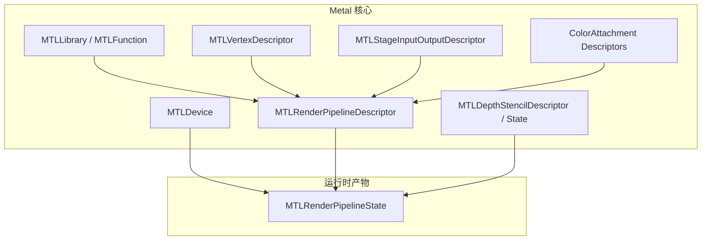
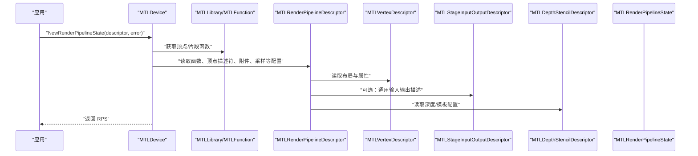
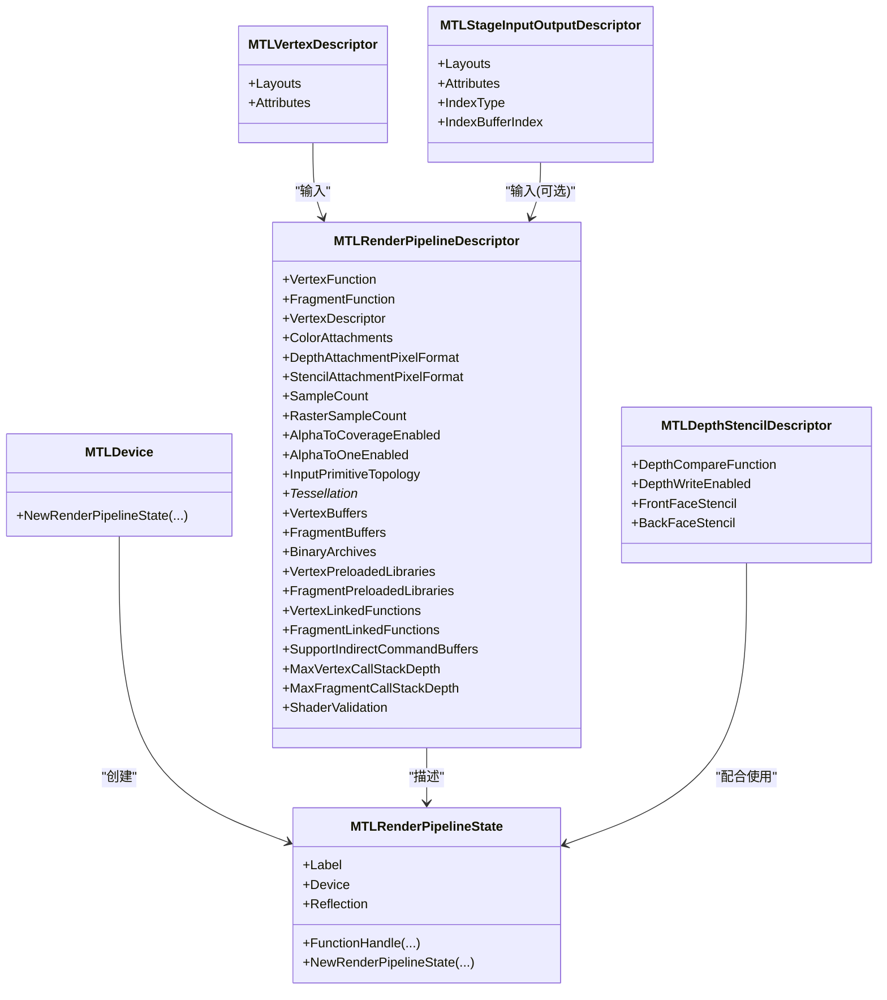

# 管线配置

<cite>
**本文引用的文件**
- [MTLRenderPipeline.cs](file://src/SharpMetal/Metal/MTLRenderPipeline.cs)
- [MTLVertexDescriptor.cs](file://src/SharpMetal/Metal/MTLVertexDescriptor.cs)
- [MTLStageInputOutputDescriptor.cs](file://src/SharpMetal/Metal/MTLStageInputOutputDescriptor.cs)
- [MTLFunctionDescriptor.cs](file://src/SharpMetal/Metal/MTLFunctionDescriptor.cs)
- [MTLDepthStencil.cs](file://src/SharpMetal/Metal/MTLDepthStencil.cs)
- [MTLDevice.cs](file://src/SharpMetal/Metal/MTLDevice.cs)
- [Program.cs](file://samples/SharpMetal.Sample/Program.cs)
</cite>

## 目录
1. [简介](#简介)
2. [项目结构](#项目结构)
3. [核心组件](#核心组件)
4. [架构总览](#架构总览)
5. [详细组件分析](#详细组件分析)
6. [依赖关系分析](#依赖关系分析)
7. [性能考虑](#性能考虑)
8. [故障排查指南](#故障排查指南)
9. [结论](#结论)
10. [附录：不同渲染场景的管线配置示例](#附录不同渲染场景的管线配置示例)

## 简介
本文件聚焦于 SharpMetal 中 Metal 渲染管线的创建与配置，围绕 MTLRenderPipelineState 的构建过程展开，涵盖着色器函数绑定、输入布局定义（顶点描述符与阶段输入输出描述符）、颜色附件与深度模板附件配置、采样数与光栅化采样数、Alpha 覆盖等高级特性。同时给出管线状态缓存、复用与性能优化策略，并提供多种渲染场景的配置思路。

## 项目结构
本仓库在 src/SharpMetal/Metal 下提供了完整的 Metal API 托管封装，包括渲染管线、顶点描述符、阶段输入输出描述符、函数描述符、深度模板状态以及设备接口等关键类型。示例程序位于 samples/SharpMetal.Sample/Program.cs，用于验证设备与缓冲的基本能力。

图表来源
- [MTLDevice.cs:431-439](file://src/SharpMetal/Metal/MTLDevice.cs#L431-L439)
- [MTLRenderPipeline.cs:208-492](file://src/SharpMetal/Metal/MTLRenderPipeline.cs#L208-L492)
- [MTLVertexDescriptor.cs:221-245](file://src/SharpMetal/Metal/MTLVertexDescriptor.cs#L221-L245)
- [MTLStageInputOutputDescriptor.cs:231-271](file://src/SharpMetal/Metal/MTLStageInputOutputDescriptor.cs#L231-L271)
- [MTLDepthStencil.cs:91-163](file://src/SharpMetal/Metal/MTLDepthStencil.cs#L91-L163)

章节来源
- [Program.cs:21-45](file://samples/SharpMetal.Sample/Program.cs#L21-L45)

## 核心组件
- MTLRenderPipelineDescriptor：描述一个渲染管线的全部静态配置，包括顶点/片段函数、顶点描述符、颜色附件、深度/模板附件格式、采样数、光栅化采样数、Alpha 覆盖/ToOne、图元拓扑、细分相关设置、缓冲区绑定、二进制归档、预加载库、链接函数、调用栈深度、校验模式等。
- MTLVertexDescriptor：定义顶点数据布局（缓冲区步长、步进函数与步进率）和属性（格式、偏移、所属缓冲区索引）。
- MTLStageInputOutputDescriptor：通用阶段输入输出描述符，支持更广泛的步进函数（含网格线程位置），并包含索引类型与索引缓冲区索引。
- MTLFunctionDescriptor：指定要编译或绑定的着色器函数名称、特化名、常量值、选项与二进制归档。
- MTLDepthStencilDescriptor/State：深度比较、写入控制、前后背面模板操作与掩码。
- MTLDevice：提供创建渲染管线状态的入口方法，支持带选项与反射信息的变体。

章节来源
- [MTLRenderPipeline.cs:208-492](file://src/SharpMetal/Metal/MTLRenderPipeline.cs#L208-L492)
- [MTLVertexDescriptor.cs:73-245](file://src/SharpMetal/Metal/MTLVertexDescriptor.cs#L73-L245)
- [MTLStageInputOutputDescriptor.cs:83-271](file://src/SharpMetal/Metal/MTLStageInputOutputDescriptor.cs#L83-L271)
- [MTLFunctionDescriptor.cs:14-66](file://src/SharpMetal/Metal/MTLFunctionDescriptor.cs#L14-L66)
- [MTLDepthStencil.cs:30-163](file://src/SharpMetal/Metal/MTLDepthStencil.cs#L30-L163)
- [MTLDevice.cs:431-439](file://src/SharpMetal/Metal/MTLDevice.cs#L431-L439)

## 架构总览
下图展示了从设备到渲染管线状态的创建流程，以及各描述对象之间的依赖关系。

图表来源
- [MTLDevice.cs:431-439](file://src/SharpMetal/Metal/MTLDevice.cs#L431-L439)
- [MTLRenderPipeline.cs:208-492](file://src/SharpMetal/Metal/MTLRenderPipeline.cs#L208-L492)
- [MTLVertexDescriptor.cs:221-245](file://src/SharpMetal/Metal/MTLVertexDescriptor.cs#L221-L245)
- [MTLStageInputOutputDescriptor.cs:231-271](file://src/SharpMetal/Metal/MTLStageInputOutputDescriptor.cs#L231-L271)
- [MTLDepthStencil.cs:91-163](file://src/SharpMetal/Metal/MTLDepthStencil.cs#L91-L163)

## 详细组件分析

### 渲染管线描述符（MTLRenderPipelineDescriptor）
- 着色器函数绑定
  - 顶点函数：通过 VertexFunction 设置。
  - 片段函数：通过 FragmentFunction 设置。
- 输入布局定义
  - 顶点描述符：通过 VertexDescriptor 设置，内部包含缓冲区布局与属性数组。
  - 阶段输入输出描述符：可用于更通用的输入输出描述（如索引类型、索引缓冲区索引）。
- 输出混合状态
  - 颜色附件：通过 ColorAttachments 数组为每个颜色目标设置像素格式、混合开关、RGB/Alpha 源/目的因子、运算方式、写掩码。
- 深度模板附件
  - 深度附件像素格式：DepthAttachmentPixelFormat。
  - 模板附件像素格式：StencilAttachmentPixelFormat。
- 采样与高级特性
  - 采样数：SampleCount。
  - 光栅化采样数：RasterSampleCount。
  - Alpha 覆盖：AlphaToCoverageEnabled。
  - Alpha ToOne：AlphaToOneEnabled。
  - 栅格化启用：RasterizationEnabled。
- 其他重要属性
  - 输入图元拓扑：InputPrimitiveTopology。
  - 细分相关：TessellationPartitionMode、MaxTessellationFactor、TessellationFactorScaleEnabled、TessellationFactorFormat、TessellationControlPointIndexType、TessellationFactorStepFunction、TessellationOutputWindingOrder。
  - 缓冲区绑定：VertexBuffers、FragmentBuffers。
  - 间接命令缓冲支持：SupportIndirectCommandBuffers。
  - 二进制归档与预加载库：BinaryArchives、VertexPreloadedLibraries、FragmentPreloadedLibraries。
  - 链接函数：VertexLinkedFunctions、FragmentLinkedFunctions。
  - 动态二进制函数支持：SupportAddingVertex/FragmentBinaryFunctions。
  - 调用栈深度限制：MaxVertexCallStackDepth、MaxFragmentCallStackDepth。
  - 着色器校验：ShaderValidation。

章节来源
- [MTLRenderPipeline.cs:208-492](file://src/SharpMetal/Metal/MTLRenderPipeline.cs#L208-L492)

### 顶点描述符（MTLVertexDescriptor）
- 缓冲区布局（Layouts）
  - Stride：缓冲区步长。
  - StepFunction：步进函数（常数、每顶点、每实例、每补丁、每补丁控制点）。
  - StepRate：步进速率。
- 属性（Attributes）
  - Format：顶点属性数据类型（浮点、整数、归一化等）。
  - Offset：属性在缓冲区中的偏移。
  - BufferIndex：该属性来自哪个缓冲区索引。

章节来源
- [MTLVertexDescriptor.cs:73-245](file://src/SharpMetal/Metal/MTLVertexDescriptor.cs#L73-L245)

### 阶段输入输出描述符（MTLStageInputOutputDescriptor）
- 通用输入输出描述
  - Layouts：缓冲区布局数组（Stride、StepFunction、StepRate）。
  - Attributes：属性数组（Format、Offset、BufferIndex）。
  - IndexType：索引类型（UInt16/UInt32）。
  - IndexBufferIndex：索引缓冲区索引。
- 与顶点描述符的区别
  - 提供更丰富的步进函数（包含网格线程位置），适用于更广泛的阶段输入输出场景。

章节来源
- [MTLStageInputOutputDescriptor.cs:83-271](file://src/SharpMetal/Metal/MTLStageInputOutputDescriptor.cs#L83-L271)

### 函数描述符（MTLFunctionDescriptor）
- Name/SpecializedName：基础函数名与特化名。
- ConstantValues：函数常量值（用于编译期常量）。
- Options：编译选项（如编译为二进制、存储脚本、失败策略等）。
- BinaryArchives：二进制归档集合，用于加速管线创建。

章节来源
- [MTLFunctionDescriptor.cs:14-66](file://src/SharpMetal/Metal/MTLFunctionDescriptor.cs#L14-L66)

### 深度模板状态（MTLDepthStencilDescriptor/State）
- 深度比较函数：DepthCompareFunction。
- 深度写入：DepthWriteEnabled。
- 模板操作：FrontFaceStencil 与 BackFaceStencil，包含比较函数、失败/穿透操作、读写掩码。
- 标签：Label。

章节来源
- [MTLDepthStencil.cs:30-163](file://src/SharpMetal/Metal/MTLDepthStencil.cs#L30-L163)

### 管线状态创建（MTLDevice.NewRenderPipelineState）
- 基本创建：传入 MTLRenderPipelineDescriptor 与错误引用，返回 MTLRenderPipelineState。
- 带选项与反射：可附加 MTLPipelineOption 与反射指针，便于调试与诊断。
- 其他管线：还提供 Tile 与 Mesh 渲染管线状态创建入口。

章节来源
- [MTLDevice.cs:431-439](file://src/SharpMetal/Metal/MTLDevice.cs#L431-L439)

### 管线状态对象（MTLRenderPipelineState）
- 基本信息：Label、Device、最大线程组大小、是否支持间接命令缓冲等。
- 反射：Reflection，用于查询绑定与参数信息。
- 函数句柄：FunctionHandle 系列方法，按阶段获取函数句柄。
- 可见/相交函数表：NewVisibleFunctionTable、NewIntersectionFunctionTable。
- 衍生管线：NewRenderPipelineState（基于附加二进制函数或二进制函数描述符）。

章节来源
- [MTLRenderPipeline.cs:530-629](file://src/SharpMetal/Metal/MTLRenderPipeline.cs#L530-L629)

## 依赖关系分析
- 设备（MTLDevice）是管线状态创建的入口，负责将描述符转换为 GPU 可执行的管线状态。
- 描述符（MTLRenderPipelineDescriptor）聚合了所有静态配置，依赖函数、顶点描述符、颜色附件、深度模板格式等。
- 顶点描述符与阶段输入输出描述符共同定义了输入数据的布局与步进行为。
- 深度模板状态独立于管线状态，但在渲染时与管线配合工作。

图表来源
- [MTLDevice.cs:431-439](file://src/SharpMetal/Metal/MTLDevice.cs#L431-L439)
- [MTLRenderPipeline.cs:208-492](file://src/SharpMetal/Metal/MTLRenderPipeline.cs#L208-L492)
- [MTLVertexDescriptor.cs:221-245](file://src/SharpMetal/Metal/MTLVertexDescriptor.cs#L221-L245)
- [MTLStageInputOutputDescriptor.cs:231-271](file://src/SharpMetal/Metal/MTLStageInputOutputDescriptor.cs#L231-L271)
- [MTLDepthStencil.cs:91-163](file://src/SharpMetal/Metal/MTLDepthStencil.cs#L91-L163)

## 性能考虑
- 管线状态缓存与复用
  - 使用 BinaryArchives 与 PreloadedLibraries：在管线描述符中提供二进制归档与预加载库，减少编译与链接开销。
  - 使用 LinkedFunctions：将常用函数链接进管线，避免重复查找与编译。
  - 复用 MTLRenderPipelineState：同一套配置在不同绘制调用间复用，避免频繁创建。
- 采样与光栅化
  - SampleCount 与 RasterSampleCount：合理设置多重采样；注意设备对 MSAA 的支持（可通过设备能力查询）。
  - AlphaToCoverageEnabled：用于透明边缘抗锯齿，降低逐片元 alpha 混合成本。
- 调用栈深度与校验
  - MaxVertexCallStackDepth、MaxFragmentCallStackDepth：限制递归深度，防止过度消耗资源。
  - ShaderValidation：开启或关闭校验以平衡调试与性能。
- 间接命令缓冲
  - SupportIndirectCommandBuffers：若启用，可在批量绘制中减少 CPU-GPU 同步开销。
- 图元拓扑与细分
  - InputPrimitiveTopology 与细分相关属性：根据几何复杂度调整，避免不必要的细分开销。

章节来源
- [MTLRenderPipeline.cs:208-492](file://src/SharpMetal/Metal/MTLRenderPipeline.cs#L208-L492)
- [MTLDevice.cs:431-439](file://src/SharpMetal/Metal/MTLDevice.cs#L431-L439)

## 故障排查指南
- 管线创建失败
  - 检查 MTLRenderPipelineDescriptor 的必填项：顶点/片段函数、颜色附件像素格式、深度/模板附件格式（如需）。
  - 确认顶点描述符的属性格式与偏移与缓冲区数据一致。
  - 检查函数名称与特化名是否正确，常量值是否匹配。
- 混合与透明度问题
  - 确认颜色附件的 BlendingEnabled、Source/Destination 因子与运算方式。
  - 检查 WriteMask 是否允许写入所需通道。
- 深度测试异常
  - 确认 DepthCompareFunction 与 DepthWriteEnabled 的设置是否符合预期。
  - 模板操作与掩码是否与期望一致。
- 采样相关问题
  - 确认 SampleCount/RasterSampleCount 的设备支持情况。
  - 检查纹理与帧缓冲的像素格式与采样数兼容性。

章节来源
- [MTLRenderPipeline.cs:208-492](file://src/SharpMetal/Metal/MTLRenderPipeline.cs#L208-L492)
- [MTLDepthStencil.cs:91-163](file://src/SharpMetal/Metal/MTLDepthStencil.cs#L91-L163)
- [MTLDevice.cs:431-439](file://src/SharpMetal/Metal/MTLDevice.cs#L431-L439)

## 结论
SharpMetal 对 Metal 渲染管线的封装完整且层次清晰：通过 MTLRenderPipelineDescriptor 集中管理管线静态配置，结合 MTLVertexDescriptor 与 MTLStageInputOutputDescriptor 精确描述输入数据布局，使用颜色附件与深度模板附件完成输出与深度测试配置。借助设备提供的 NewRenderPipelineState 接口，可将配置转化为可复用的 MTLRenderPipelineState。通过二进制归档、预加载库、链接函数与合理的采样/校验设置，可实现高效的管线创建与运行性能。

## 附录：不同渲染场景的管线配置示例
以下为常见渲染场景的配置要点（不展示代码内容，仅说明应设置的属性与步骤）：

- 标准正向渲染（无多重采样）
  - 设置顶点/片段函数。
  - 配置顶点描述符：缓冲区布局与属性（格式、偏移、缓冲区索引）。
  - 颜色附件：设置像素格式、混合开关、RGB/Alpha 因子与运算、写掩码。
  - 深度附件：设置深度像素格式，配置深度比较与写入。
  - 采样数：SampleCount=1，光栅化采样数：RasterSampleCount=1。
  - Alpha 覆盖：按需启用。

- 多重采样抗锯齿（MSAA）
  - 颜色附件像素格式需支持 MSAA。
  - 设置 SampleCount 与 RasterSampleCount 为相同值（如 4）。
  - 确保设备支持对应采样数。
  - 最终解析至非 MSAA 纹理进行后续处理或显示。

- 透明叠加（Alpha 混合）
  - 颜色附件启用混合，设置合适的源/目的因子与运算。
  - 可启用 AlphaToCoverage 改善边缘质量。
  - 深度写入通常关闭或按场景调整。

- 后处理（全屏四边形）
  - 顶点描述符可简化为固定顶点或最小属性。
  - 片段函数执行采样与效果计算。
  - 颜色附件为目标纹理像素格式。
  - 无需深度测试时可关闭深度写入。

- 粒子系统（PerInstance 步进）
  - 顶点描述符中设置 StepFunction=PerInstance，StepRate 根据需要设置。
  - 属性中包含位置、速度、生命周期等 per-instance 数据。
  - 混合与 Alpha 覆盖常用于粒子融合效果。

- 阴影映射（深度只渲染）
  - 仅设置深度附件像素格式，关闭颜色附件写入。
  - 深度比较设置为 LessEqual 或相应策略。
  - 片段函数可省略或仅输出深度。

- 延迟渲染（多颜色目标）
  - 配置多个颜色附件，分别表示法线、材质、深度等。
  - 每个附件独立设置像素格式、混合与写掩码。
  - 深度附件用于深度测试。

- 屏幕空间效果（SSAO/SSR）
  - 管线关注片段阶段的纹理采样与计算。
  - 颜色附件为目标 G-Buffer 或中间结果。
  - 深度附件用于视差或遮挡判断。

- 体积渲染（Raymarching）
  - 管线可能禁用光栅化或采用特殊图元拓扑。
  - 片段函数执行步进与累积。
  - 混合策略通常为累加或最大值混合。

- 几何着色/细分曲面
  - 设置 TessellationPartitionMode、MaxTessellationFactor、TessellationFactorFormat 等。
  - 顶点/细分/着色阶段函数正确链接。
  - 输入图元拓扑与输出绕序符合预期。

- 计算辅助渲染（Compute+Render）
  - 先使用计算管线预处理数据（如粒子更新）。
  - 再使用渲染管线进行绘制，复用已更新的缓冲区。

以上示例均基于 SharpMetal 暴露的描述符与设备接口进行配置，实际实现时需结合具体数据结构与着色器语义进行调整。