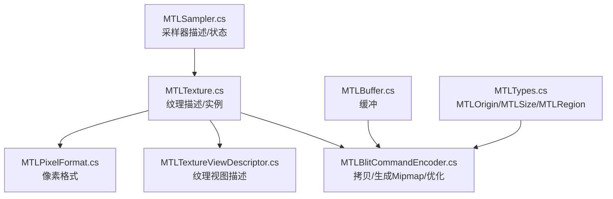
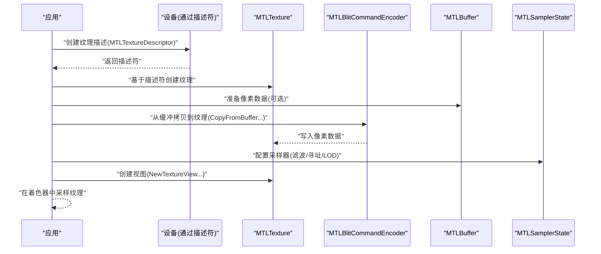
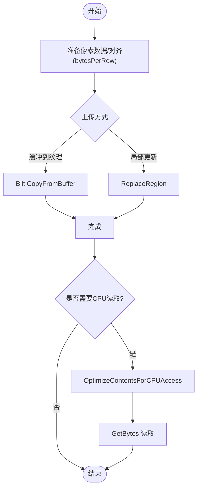
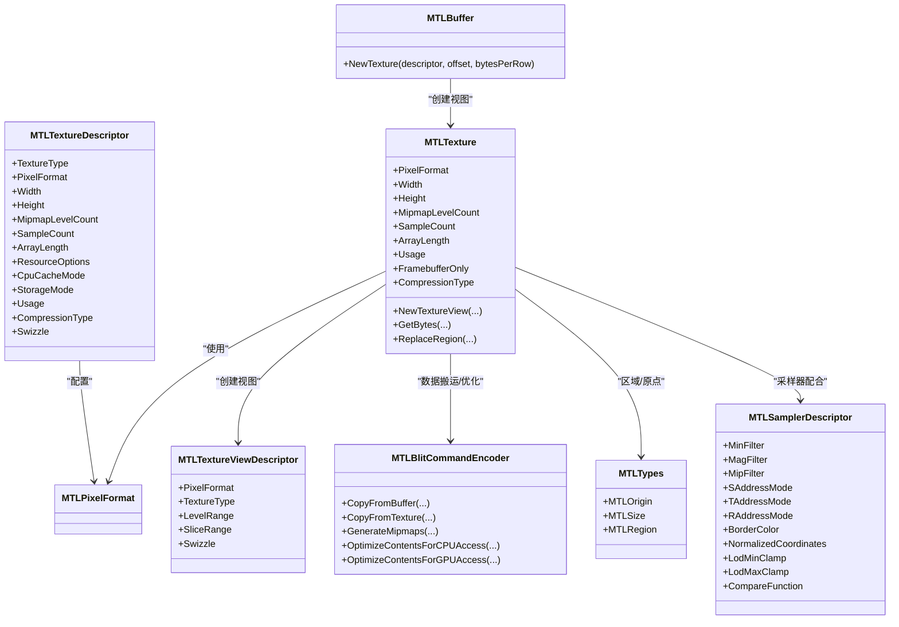

# 纹理处理

<cite>
**本文引用的文件**
- [MTLTexture.cs](file://src/SharpMetal/Metal/MTLTexture.cs)
- [MTLPixelFormat.cs](file://src/SharpMetal/Metal/MTLPixelFormat.cs)
- [MTLSampler.cs](file://src/SharpMetal/Metal/MTLSampler.cs)
- [MTLTextureViewDescriptor.cs](file://src/SharpMetal/Metal/MTLTextureViewDescriptor.cs)
- [MTLBlitCommandEncoder.cs](file://src/SharpMetal/Metal/MTLBlitCommandEncoder.cs)
- [MTLBuffer.cs](file://src/SharpMetal/Metal/MTLBuffer.cs)
- [MTLTypes.cs](file://src/SharpMetal/Metal/MTLTypes.cs)
</cite>

## 目录
1. [简介](#简介)
2. [项目结构](#项目结构)
3. [核心组件](#核心组件)
4. [架构总览](#架构总览)
5. [详细组件分析](#详细组件分析)
6. [依赖关系分析](#依赖关系分析)
7. [性能考虑](#性能考虑)
8. [故障排查指南](#故障排查指南)
9. [结论](#结论)
10. [附录](#附录)

## 简介
本文件围绕 SharpMetal 中的 Metal 纹理处理进行系统化说明，覆盖 MTLTexture 的创建、像素格式选择与配置、数据上传/更新/读取、采样器配置、纹理视图管理、压缩纹理、多级渐远（mipmap）、渲染目标纹理等主题。文档同时给出典型工作流程与最佳实践，帮助开发者在 C# 绑定层高效使用 Metal 纹理能力。

## 项目结构
与纹理处理直接相关的核心类型分布在以下文件中：
- 纹理描述与实例：MTLTexture.cs
- 像素格式枚举：MTLPixelFormat.cs
- 采样器描述与状态：MTLSampler.cs
- 纹理视图描述：MTLTextureViewDescriptor.cs
- 纹理拷贝/生成 mipmap/优化接口：MTLBlitCommandEncoder.cs
- 缓冲与从缓冲创建纹理：MTLBuffer.cs
- 几何与区域类型：MTLTypes.cs

图表来源
- [MTLTexture.cs:75-240](file://src/SharpMetal/Metal/MTLTexture.cs#L75-L240)
- [MTLPixelFormat.cs:3-144](file://src/SharpMetal/Metal/MTLPixelFormat.cs#L3-L144)
- [MTLSampler.cs:37-185](file://src/SharpMetal/Metal/MTLSampler.cs#L37-L185)
- [MTLTextureViewDescriptor.cs:6-57](file://src/SharpMetal/Metal/MTLTextureViewDescriptor.cs#L6-L57)
- [MTLBlitCommandEncoder.cs:14-215](file://src/SharpMetal/Metal/MTLBlitCommandEncoder.cs#L14-L215)
- [MTLBuffer.cs:66-68](file://src/SharpMetal/Metal/MTLBuffer.cs#L66-L68)
- [MTLTypes.cs:47-94](file://src/SharpMetal/Metal/MTLTypes.cs#L47-L94)

章节来源
- [MTLTexture.cs:75-240](file://src/SharpMetal/Metal/MTLTexture.cs#L75-L240)
- [MTLPixelFormat.cs:3-144](file://src/SharpMetal/Metal/MTLPixelFormat.cs#L3-L144)
- [MTLSampler.cs:37-185](file://src/SharpMetal/Metal/MTLSampler.cs#L37-L185)
- [MTLTextureViewDescriptor.cs:6-57](file://src/SharpMetal/Metal/MTLTextureViewDescriptor.cs#L6-L57)
- [MTLBlitCommandEncoder.cs:14-215](file://src/SharpMetal/Metal/MTLBlitCommandEncoder.cs#L14-L215)
- [MTLBuffer.cs:66-68](file://src/SharpMetal/Metal/MTLBuffer.cs#L66-L68)
- [MTLTypes.cs:47-94](file://src/SharpMetal/Metal/MTLTypes.cs#L47-L94)

## 核心组件
- 纹理描述与实例
  - MTLTextureDescriptor：用于声明纹理类型、像素格式、宽高深、mipmap 级数、采样数、数组长度、存储模式、CPU 缓存模式、用途、压缩类型、通道置换等。提供便捷工厂方法创建 2D/Cube/Buffer 纹理描述。
  - MTLTexture：纹理实例，暴露尺寸、格式、用途、是否帧缓冲专用、共享句柄、视图创建、数据读写（GetBytes/ReplaceRegion）等。
- 像素格式
  - MTLPixelFormat：涵盖通用 RGBA/RG/R 系列、浮点格式、深度/模板、BC/PVRTC/ETC2/ASTC 压缩格式、HDR LDR 变体等。
- 采样器
  - MTLSamplerDescriptor/MTLSamplerState：定义最小/放大滤波、mipmap 滤波、各向异性、寻址模式、边框色、坐标归一化、LOD 限制、比较函数等。
- 纹理视图
  - MTLTextureViewDescriptor：指定视图的像素格式、纹理类型、mipmap 级别范围、切片范围、通道置换。
- 数据搬运与优化
  - MTLBlitCommandEncoder：支持 Buffer→Texture、Texture→Buffer、Texture→Texture 拷贝；生成 mipmap；按 CPU/GPU 访问优化内容；同步资源；计数器统计等。
- 缓冲与纹理视图
  - MTLBuffer：可从缓冲创建纹理视图（NewTexture），配合 offset/bytesPerRow 实现零拷贝或子区域映射。
- 几何与区域
  - MTLOrigin/MTLSize/MTLRegion：用于指定拷贝/替换的区域与起始位置。

章节来源
- [MTLTexture.cs:75-240](file://src/SharpMetal/Metal/MTLTexture.cs#L75-L240)
- [MTLTexture.cs:242-438](file://src/SharpMetal/Metal/MTLTexture.cs#L242-L438)
- [MTLPixelFormat.cs:3-144](file://src/SharpMetal/Metal/MTLPixelFormat.cs#L3-L144)
- [MTLSampler.cs:6-185](file://src/SharpMetal/Metal/MTLSampler.cs#L6-L185)
- [MTLTextureViewDescriptor.cs:6-57](file://src/SharpMetal/Metal/MTLTextureViewDescriptor.cs#L6-L57)
- [MTLBlitCommandEncoder.cs:14-215](file://src/SharpMetal/Metal/MTLBlitCommandEncoder.cs#L14-L215)
- [MTLBuffer.cs:66-68](file://src/SharpMetal/Metal/MTLBuffer.cs#L66-L68)
- [MTLTypes.cs:47-94](file://src/SharpMetal/Metal/MTLTypes.cs#L47-L94)

## 架构总览
下图展示了纹理从“描述→创建→数据上传→采样/渲染”的典型路径，以及关键 API 的协作关系。

图表来源
- [MTLTexture.cs:75-240](file://src/SharpMetal/Metal/MTLTexture.cs#L75-L240)
- [MTLBlitCommandEncoder.cs:62-90](file://src/SharpMetal/Metal/MTLBlitCommandEncoder.cs#L62-L90)
- [MTLSampler.cs:37-185](file://src/SharpMetal/Metal/MTLSampler.cs#L37-L185)
- [MTLTextureViewDescriptor.cs:6-57](file://src/SharpMetal/Metal/MTLTextureViewDescriptor.cs#L6-L57)

## 详细组件分析

### 纹理创建与格式配置
- 纹理描述
  - 使用 MTLTextureDescriptor 设置 TextureType、PixelFormat、Width/Height/Depth、MipmapLevelCount、SampleCount、ArrayLength、StorageMode、CpuCacheMode、Usage、CompressionType、Swizzle 等。
  - 便捷工厂：Texture2DDescriptor、TextureCubeDescriptor、TextureBufferDescriptor。
- 纹理实例
  - MTLTexture 暴露 PixelFormat、Width/Height/Depth、MipmapLevelCount、SampleCount、ArrayLength、Usage、FramebufferOnly、CompressionType、AllowGPUOptimizedContents 等属性。
- 像素格式选择要点
  - 显示/UI：常用 BGRA8Unorm / RGBA8UnormsRGB。
  - HDR/高动态：RGBA16Float、RGB10A2Unorm、RG11B10Float、RGB9E5Float。
  - 深度/模板：Depth24UnormStencil8、Depth32FloatStencil8、Stencil8。
  - 压缩纹理：BC*、PVRTC*、ETC2*、ASTC*（含 LDR/HDR）。
  - 单通道/双通道：R8/R16/R32、RG8/RG16/RG32 等。
- 用途与存储
  - Usage 可组合 ShaderRead/ShaderWrite/RenderTarget/PixelFormatView/ShaderAtomic。
  - StorageMode/CpuCacheMode 影响内存布局与 CPU 访问效率。
  - AllowGPUOptimizedContents 允许 GPU 内部重排以提升采样/渲染效率。

章节来源
- [MTLTexture.cs:75-240](file://src/SharpMetal/Metal/MTLTexture.cs#L75-L240)
- [MTLTexture.cs:242-438](file://src/SharpMetal/Metal/MTLTexture.cs#L242-L438)
- [MTLPixelFormat.cs:3-144](file://src/SharpMetal/Metal/MTLPixelFormat.cs#L3-L144)

### 数据上传、更新与读取
- 从缓冲上传
  - 使用 MTLBlitCommandEncoder.CopyFromBuffer(...) 将缓冲数据拷贝到纹理，支持 bytesPerRow/bytesPerImage 对齐与源偏移。
- 从纹理读取
  - MTLTexture.GetBytes(...) 将纹理数据读回缓冲（需确保纹理非仅帧缓冲且已优化为 CPU 访问）。
- 局部更新
  - MTLTexture.ReplaceRegion(...) 对指定 region/level/slice 进行局部替换，适合增量更新。
- 区域与原点
  - 使用 MTLOrigin/MTLSize/MTLRegion 精确指定拷贝/替换区域。
- 建议
  - 批量上传：尽量合并多次小更新为一次大块拷贝。
  - 对齐：bytesPerRow 应满足硬件要求，避免额外转换开销。
  - 预取/优化：在 CPU 读取前调用 OptimizeContentsForCPUAccess，在 GPU 使用前调用 OptimizeContentsForGPUAccess。

图表来源
- [MTLBlitCommandEncoder.cs:62-75](file://src/SharpMetal/Metal/MTLBlitCommandEncoder.cs#L62-L75)
- [MTLTexture.cs:347-365](file://src/SharpMetal/Metal/MTLTexture.cs#L347-L365)
- [MTLTypes.cs:47-94](file://src/SharpMetal/Metal/MTLTypes.cs#L47-L94)
- [MTLBlitCommandEncoder.cs:137-155](file://src/SharpMetal/Metal/MTLBlitCommandEncoder.cs#L137-L155)

章节来源
- [MTLBlitCommandEncoder.cs:62-90](file://src/SharpMetal/Metal/MTLBlitCommandEncoder.cs#L62-L90)
- [MTLTexture.cs:347-365](file://src/SharpMetal/Metal/MTLTexture.cs#L347-L365)
- [MTLTypes.cs:47-94](file://src/SharpMetal/Metal/MTLTypes.cs#L47-L94)
- [MTLBlitCommandEncoder.cs:137-155](file://src/SharpMetal/Metal/MTLBlitCommandEncoder.cs#L137-L155)

### 纹理采样器配置
- 滤波与 mipmap
  - MinFilter/MagFilter 控制缩小/放大滤波（Nearest/Linear）。
  - MipFilter 控制 mipmap 采样滤波（NotMipmapped/Nearest/Linear）。
- 寻址模式
  - S/T/R AddressMode：ClampToEdge、Repeat、MirrorRepeat、ClampToZero、ClampToBorderColor 等。
- 边框色
  - BorderColor：TransparentBlack/OpaqueBlack/OpaqueWhite。
- 坐标与 LOD
  - NormalizedCoordinates 控制坐标是否归一化。
  - LodMinClamp/LodMaxClamp 限制使用的 mipmap 级别。
  - LodAverage 控制 LOD 平均计算。
- 比较函数
  - CompareFunction 用于深度/阴影等比较采样。
- 其他
  - MaxAnisotropy 控制各向异性过滤强度。
  - SupportArgumentBuffers 指示是否支持参数缓冲。

章节来源
- [MTLSampler.cs:6-185](file://src/SharpMetal/Metal/MTLSampler.cs#L6-L185)

### 纹理视图管理
- 视图描述
  - MTLTextureViewDescriptor 可指定视图的 PixelFormat、TextureType、LevelRange、SliceRange、Swizzle。
- 创建视图
  - MTLTexture.NewTextureView(...) 支持多种重载：
    - 仅指定像素格式
    - 指定像素格式+纹理类型+级别/切片范围
    - 指定像素格式+纹理类型+级别/切片范围+通道置换
- 用途
  - 同一底层纹理以不同视图呈现给不同阶段（如只读视图、不同格式视图、部分级别/切片视图）。
  - 结合 Swizzle 可在不复制数据的情况下重排通道顺序。

章节来源
- [MTLTextureViewDescriptor.cs:6-57](file://src/SharpMetal/Metal/MTLTextureViewDescriptor.cs#L6-L57)
- [MTLTexture.cs:367-385](file://src/SharpMetal/Metal/MTLTexture.cs#L367-L385)

### 纹理压缩与多级渐远（mipmap）
- 压缩格式
  - 通过 MTLPixelFormat 选择 BC*/PVRTC*/ETC2*/ASTC* 等压缩格式，显著降低显存占用与带宽。
  - 注意平台/设备支持差异，必要时做回退策略。
- 压缩类型
  - MTLTextureDescriptor.CompressionType 可设置为 Lossless/Lossy。
- 多级渐远
  - 在描述中设置 MipmapLevelCount > 1，并在 Blit 中使用 GenerateMipmaps 自动生成各级 mipmap。
  - 采样器需启用合适的 MipFilter 与 LOD 限制以获得最佳效果。

章节来源
- [MTLPixelFormat.cs:61-134](file://src/SharpMetal/Metal/MTLPixelFormat.cs#L61-L134)
- [MTLTexture.cs:167-171](file://src/SharpMetal/Metal/MTLTexture.cs#L167-L171)
- [MTLBlitCommandEncoder.cs:87-90](file://src/SharpMetal/Metal/MTLBlitCommandEncoder.cs#L87-L90)
- [MTLSampler.cs:57-61](file://src/SharpMetal/Metal/MTLSampler.cs#L57-L61)

### 渲染目标纹理
- 用途标记
  - 在 MTLTextureDescriptor.Usage 中设置 RenderTarget，表示该纹理作为渲染输出。
- 帧缓冲专用
  - FramebufferOnly 指示纹理仅用于帧缓冲，不可被 CPU 直接访问，通常用于离屏渲染/多重采样。
- 多重采样
  - SampleCount > 1 时创建多重采样纹理，最终可通过 resolve 操作（由上层渲染管线负责）解析到可读纹理。
- 注意事项
  - 帧缓冲专用纹理不能用于 CPU 读取；如需读取，请解析到非帧缓冲专用纹理或使用其他方案。

章节来源
- [MTLTexture.cs:155-159](file://src/SharpMetal/Metal/MTLTexture.cs#L155-L159)
- [MTLTexture.cs:315-316](file://src/SharpMetal/Metal/MTLTexture.cs#L315-L316)
- [MTLTexture.cs:119-123](file://src/SharpMetal/Metal/MTLTexture.cs#L119-L123)

### 从缓冲创建纹理视图
- 场景
  - 当已有线性缓冲数据（例如视频帧、图像块），可使用 MTLBuffer.NewTexture(descriptor, offset, bytesPerRow) 直接创建纹理视图，避免额外拷贝。
- 优势
  - 零拷贝或低拷贝成本，减少内存占用与带宽压力。
- 约束
  - 需要保证缓冲内存布局与纹理描述一致（像素格式、字节行对齐、偏移等）。

章节来源
- [MTLBuffer.cs:66-68](file://src/SharpMetal/Metal/MTLBuffer.cs#L66-L68)

## 依赖关系分析
- MTLTexture 依赖
  - 像素格式：MTLPixelFormat
  - 采样器：MTLSampler（用于着色器采样）
  - 视图描述：MTLTextureViewDescriptor
  - 数据搬运：MTLBlitCommandEncoder
  - 几何类型：MTLTypes（MTLOrigin/MTLSize/MTLRegion）
- 耦合与内聚
  - 纹理描述与实例高度内聚，职责清晰。
  - 采样器独立于纹理实例，便于复用。
  - 视图描述与纹理实例解耦，支持多视图复用同一底层纹理。
  - Blit 编码器与纹理/缓冲解耦，提供通用数据搬运能力。

图表来源
- [MTLTexture.cs:75-240](file://src/SharpMetal/Metal/MTLTexture.cs#L75-L240)
- [MTLTexture.cs:242-438](file://src/SharpMetal/Metal/MTLTexture.cs#L242-L438)
- [MTLPixelFormat.cs:3-144](file://src/SharpMetal/Metal/MTLPixelFormat.cs#L3-L144)
- [MTLSampler.cs:37-185](file://src/SharpMetal/Metal/MTLSampler.cs#L37-L185)
- [MTLTextureViewDescriptor.cs:6-57](file://src/SharpMetal/Metal/MTLTextureViewDescriptor.cs#L6-L57)
- [MTLBlitCommandEncoder.cs:14-215](file://src/SharpMetal/Metal/MTLBlitCommandEncoder.cs#L14-L215)
- [MTLBuffer.cs:66-68](file://src/SharpMetal/Metal/MTLBuffer.cs#L66-L68)
- [MTLTypes.cs:47-94](file://src/SharpMetal/Metal/MTLTypes.cs#L47-L94)

## 性能考虑
- 像素格式
  - 优先使用压缩格式（ASTC/BC/ETC2/PVRTC）以降低显存与带宽；根据设备能力选择合适粒度与 HDR/LDR 变体。
  - 对于高频采样的纹理，适当提高位宽（如 RGBA16Float）可减少精度损失与重采样抖动。
- 存储与缓存
  - 合理设置 StorageMode 与 CpuCacheMode；频繁 CPU 读取时开启 CPU 优化并在使用后恢复。
  - 使用 AllowGPUOptimizedContents 让 GPU 内部重排以提升采样/渲染效率。
- 数据搬运
  - 批量上传：合并多次小更新为大块拷贝，减少命令提交次数。
  - 对齐：确保 bytesPerRow 满足硬件对齐要求，避免隐式转换。
  - 局部更新：使用 ReplaceRegion 仅更新变化区域。
- mipmap 与采样
  - 正确设置 MipmapLevelCount 并调用 GenerateMipmaps；采样器启用合适的 MipFilter 与 LOD 限制。
  - 各向异性过滤在高斜视角下提升质量，但需权衡性能。
- 渲染目标
  - 帧缓冲专用纹理不可 CPU 读取；如需读取，先解析到非帧缓冲专用纹理。
  - 多重采样纹理在渲染后需 resolve 到可读纹理。

[本节为通用指导，不直接分析具体文件]

## 故障排查指南
- 无法从纹理读取数据
  - 检查纹理是否为 FramebufferOnly；若是，则不可 CPU 读取。
  - 在读取前调用 OptimizeContentsForCPUAccess。
- 采样异常或黑边
  - 检查采样器的寻址模式与边框色设置；确认纹理坐标是否归一化。
  - 若使用了 mipmap，确认已生成并设置了正确的 MipFilter。
- 内存不足或崩溃
  - 检查像素格式与尺寸是否超出设备上限；尝试压缩格式或降低分辨率。
  - 避免重复创建大量未释放的纹理/视图。
- 数据错位或拉伸
  - 核对 bytesPerRow/bytesPerImage 与像素格式一致性；确保 Region/Origin 设置正确。
- 渲染目标不可用
  - 确认 Usage 包含 RenderTarget；多重采样纹理需在渲染后解析。

章节来源
- [MTLTexture.cs:315-316](file://src/SharpMetal/Metal/MTLTexture.cs#L315-L316)
- [MTLBlitCommandEncoder.cs:137-155](file://src/SharpMetal/Metal/MTLBlitCommandEncoder.cs#L137-L155)
- [MTLSampler.cs:69-109](file://src/SharpMetal/Metal/MTLSampler.cs#L69-L109)
- [MTLBlitCommandEncoder.cs:87-90](file://src/SharpMetal/Metal/MTLBlitCommandEncoder.cs#L87-L90)
- [MTLTypes.cs:47-94](file://src/SharpMetal/Metal/MTLTypes.cs#L47-L94)

## 结论
SharpMetal 在 C# 层提供了完整的 Metal 纹理处理能力：从描述与创建、像素格式与用途配置、数据上传/更新/读取、采样器与视图管理，到压缩纹理与 mipmap、渲染目标纹理等。遵循本文的工作流程与最佳实践，可以在保证画质的前提下获得良好的性能与稳定性。

[本节为总结性内容，不直接分析具体文件]

## 附录
- 常见工作流
  - 创建纹理描述 → 设置像素格式/尺寸/mipmap/用途 → 创建纹理 → 缓冲数据上传（Blit）→ 生成 mipmap（可选）→ 配置采样器 → 创建视图（可选）→ 在着色器中采样。
- 参考路径
  - 纹理描述与实例：[MTLTexture.cs:75-240](file://src/SharpMetal/Metal/MTLTexture.cs#L75-L240)、[MTLTexture.cs:242-438](file://src/SharpMetal/Metal/MTLTexture.cs#L242-L438)
  - 像素格式：[MTLPixelFormat.cs:3-144](file://src/SharpMetal/Metal/MTLPixelFormat.cs#L3-L144)
  - 采样器：[MTLSampler.cs:6-185](file://src/SharpMetal/Metal/MTLSampler.cs#L6-L185)
  - 纹理视图：[MTLTextureViewDescriptor.cs:6-57](file://src/SharpMetal/Metal/MTLTextureViewDescriptor.cs#L6-L57)、[MTLTexture.cs:367-385](file://src/SharpMetal/Metal/MTLTexture.cs#L367-L385)
  - 数据搬运与优化：[MTLBlitCommandEncoder.cs:62-90](file://src/SharpMetal/Metal/MTLBlitCommandEncoder.cs#L62-L90)、[MTLBlitCommandEncoder.cs:137-155](file://src/SharpMetal/Metal/MTLBlitCommandEncoder.cs#L137-L155)
  - 缓冲创建纹理视图：[MTLBuffer.cs:66-68](file://src/SharpMetal/Metal/MTLBuffer.cs#L66-L68)
  - 区域与原点：[MTLTypes.cs:47-94](file://src/SharpMetal/Metal/MTLTypes.cs#L47-L94)