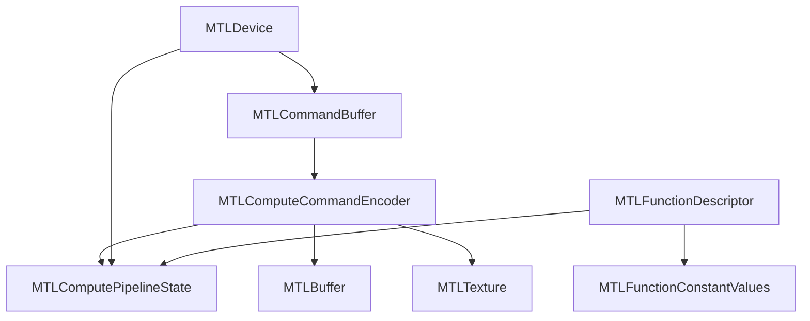
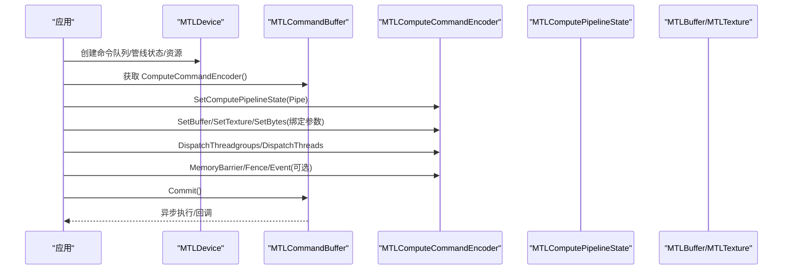
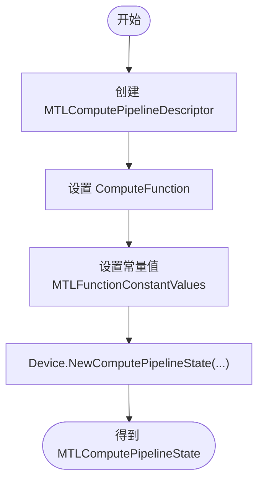
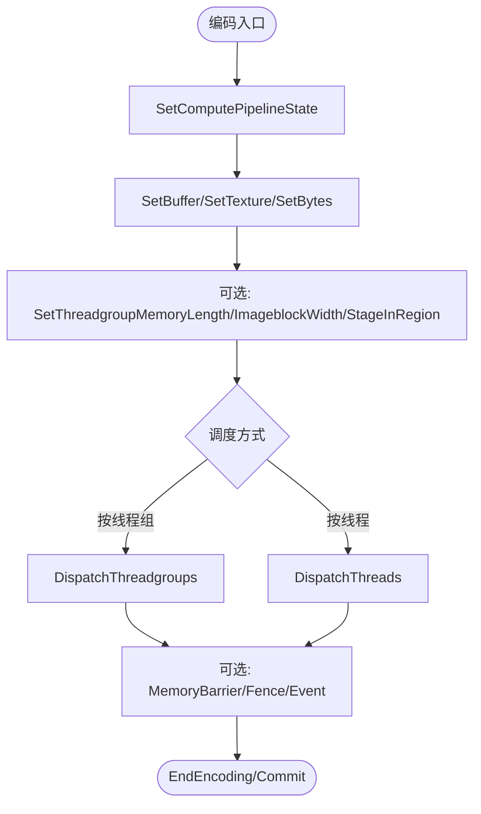
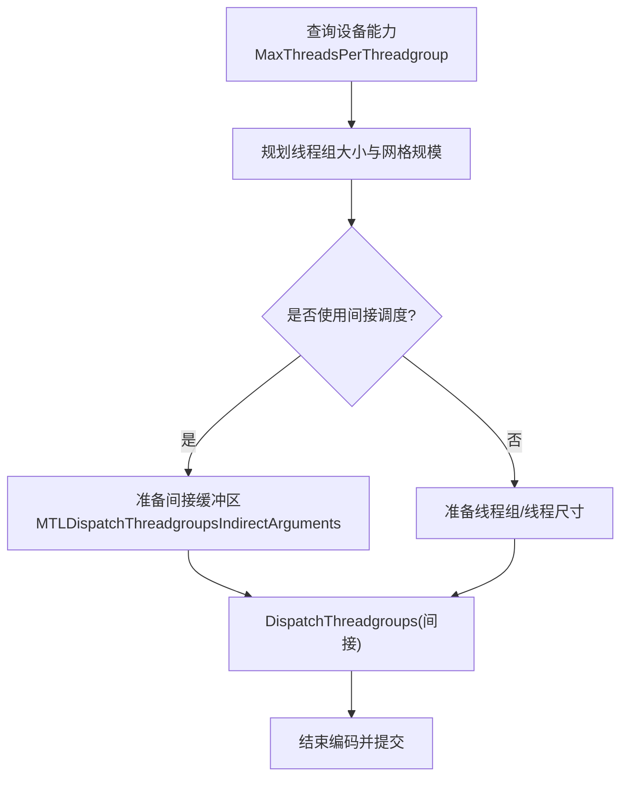
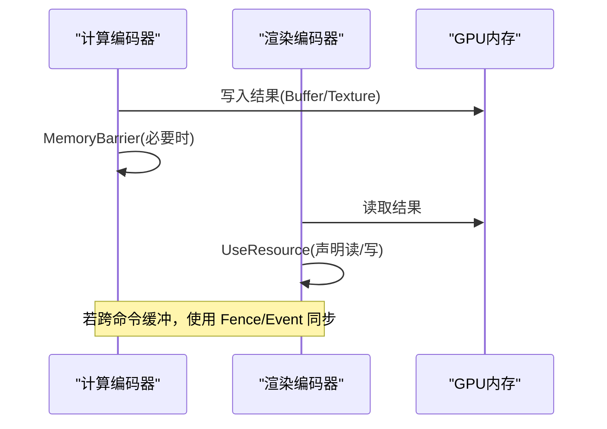
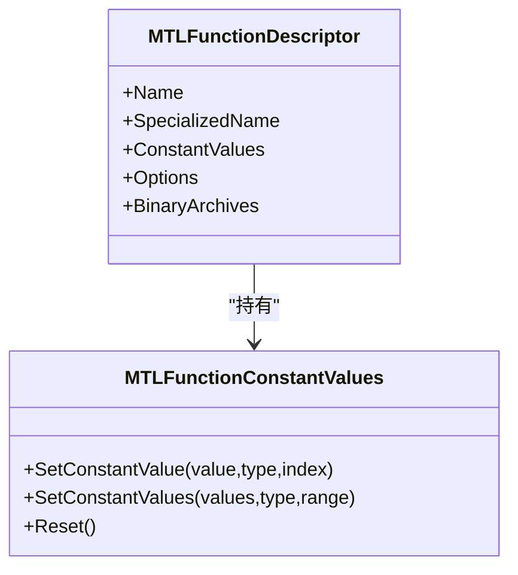
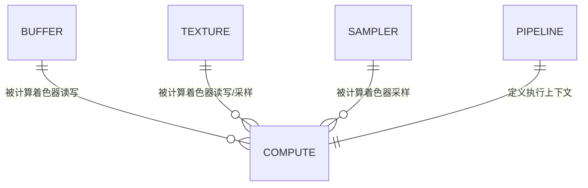
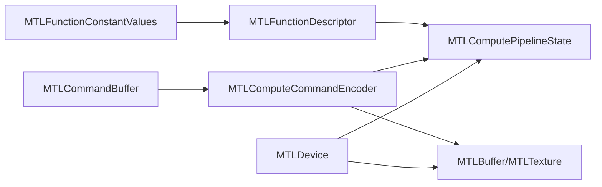
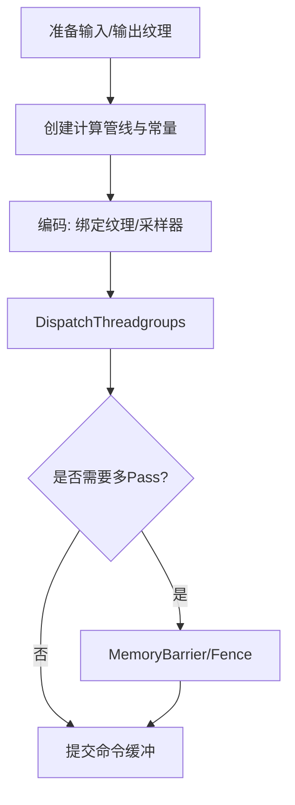

# 计算管线

<cite>
**本文引用的文件**
- [MTLComputeCommandEncoder.cs](file://src/SharpMetal/Metal/MTLComputeCommandEncoder.cs)
- [MTLComputePipeline.cs](file://src/SharpMetal/Metal/MTLComputePipeline.cs)
- [MTLFunctionConstantValues.cs](file://src/SharpMetal/Metal/MTLFunctionConstantValues.cs)
- [MTLBuffer.cs](file://src/SharpMetal/Metal/MTLBuffer.cs)
- [MTLTexture.cs](file://src/SharpMetal/Metal/MTLTexture.cs)
- [MTLDevice.cs](file://src/SharpMetal/Metal/MTLDevice.cs)
- [MTLCommandBuffer.cs](file://src/SharpMetal/Metal/MTLCommandBuffer.cs)
- [MTLFunctionDescriptor.cs](file://src/SharpMetal/Metal/MTLFunctionDescriptor.cs)
- [Program.cs](file://samples/SharpMetal.Sample/Program.cs)
</cite>

## 目录
1. [简介](#简介)
2. [项目结构](#项目结构)
3. [核心组件](#核心组件)
4. [架构总览](#架构总览)
5. [详细组件分析](#详细组件分析)
6. [依赖关系分析](#依赖关系分析)
7. [性能考量](#性能考量)
8. [故障排查指南](#故障排查指南)
9. [结论](#结论)
10. [附录](#附录)

## 简介
本文件面向使用 SharpMetal 进行 Metal 计算管线开发的工程师，系统阐述以下内容：
- 计算管道的配置过程：如何创建并绑定计算着色器函数、设置常量值与参数缓冲区。
- 命令编码与工作负载分发：线程组配置、DispatchThreadgroups/DispatchThreads 的使用、间接调度与阶段区域（Stage In Region）。
- 计算与渲染的协作：数据共享、资源可见性、同步机制（内存屏障、栅栏、事件）。
- GPGPU 编程模式与优化：并行粒度、内存访问模式、吞吐与延迟优化技巧。
- 应用场景示例：科学计算、图像处理等典型工作流的组织方式。

## 项目结构
SharpMetal 在 src/SharpMetal/Metal 下提供对 Metal API 的一一映射封装，涵盖设备、命令缓冲、编码器、管线状态、资源类型等。计算管线相关的关键类包括：
- 设备与管线：MTLDevice、MTLComputePipelineState、MTLComputePipelineDescriptor、MTLComputePipelineReflection
- 命令与编码器：MTLCommandBuffer、MTLComputeCommandEncoder
- 资源与数据：MTLBuffer、MTLTexture、MTLSamplerState
- 函数与常量：MTLLibrary/MTLFunction、MTLFunctionDescriptor、MTLFunctionConstantValues
- 辅助类型：MTLSize、MTLRegion、MTLFence、MTLEvent 等

图表来源
- [MTLDevice.cs:326-454](file://src/SharpMetal/Metal/MTLDevice.cs#L326-L454)
- [MTLCommandBuffer.cs:195-223](file://src/SharpMetal/Metal/MTLCommandBuffer.cs#L195-L223)
- [MTLComputeCommandEncoder.cs:60-193](file://src/SharpMetal/Metal/MTLComputeCommandEncoder.cs#L60-L193)
- [MTLComputePipeline.cs:25-235](file://src/SharpMetal/Metal/MTLComputePipeline.cs#L25-L235)
- [MTLFunctionDescriptor.cs:14-66](file://src/SharpMetal/Metal/MTLFunctionDescriptor.cs#L14-L66)
- [MTLFunctionConstantValues.cs:6-41](file://src/SharpMetal/Metal/MTLFunctionConstantValues.cs#L6-L41)

章节来源
- [MTLDevice.cs:326-454](file://src/SharpMetal/Metal/MTLDevice.cs#L326-L454)
- [MTLCommandBuffer.cs:195-223](file://src/SharpMetal/Metal/MTLCommandBuffer.cs#L195-L223)
- [MTLComputeCommandEncoder.cs:60-193](file://src/SharpMetal/Metal/MTLComputeCommandEncoder.cs#L60-L193)
- [MTLComputePipeline.cs:25-235](file://src/SharpMetal/Metal/MTLComputePipeline.cs#L25-L235)
- [MTLFunctionDescriptor.cs:14-66](file://src/SharpMetal/Metal/MTLFunctionDescriptor.cs#L14-L66)
- [MTLFunctionConstantValues.cs:6-41](file://src/SharpMetal/Metal/MTLFunctionConstantValues.cs#L6-L41)

## 核心组件
- MTLDevice：创建命令队列、管线状态、资源（Buffer/Texture/Sampler）、库与函数句柄等。
- MTLCommandBuffer：承载一组命令，支持提交、呈现、等待完成、添加回调等。
- MTLComputeCommandEncoder：设置管线、绑定资源、设置常量、编码调度指令、插入同步点。
- MTLComputePipelineState：编译后的计算管线状态，包含线程执行宽度、静态线程组内存等信息。
- MTLComputePipelineDescriptor：描述计算管线（函数、输入输出、最大线程数、库链接等）。
- MTLFunctionDescriptor + MTLFunctionConstantValues：指定要绑定的函数名及常量值。
- MTLBuffer / MTLTexture：GPU 可访问的数据容器，用于读写、采样或作为纹理视图。

章节来源
- [MTLDevice.cs:326-454](file://src/SharpMetal/Metal/MTLDevice.cs#L326-L454)
- [MTLCommandBuffer.cs:116-223](file://src/SharpMetal/Metal/MTLCommandBuffer.cs#L116-L223)
- [MTLComputeCommandEncoder.cs:20-193](file://src/SharpMetal/Metal/MTLComputeCommandEncoder.cs#L20-L193)
- [MTLComputePipeline.cs:25-235](file://src/SharpMetal/Metal/MTLComputePipeline.cs#L25-L235)
- [MTLFunctionDescriptor.cs:14-66](file://src/SharpMetal/Metal/MTLFunctionDescriptor.cs#L14-L66)
- [MTLFunctionConstantValues.cs:6-41](file://src/SharpMetal/Metal/MTLFunctionConstantValues.cs#L6-L41)
- [MTLBuffer.cs:6-113](file://src/SharpMetal/Metal/MTLBuffer.cs#L6-L113)
- [MTLTexture.cs:75-438](file://src/SharpMetal/Metal/MTLTexture.cs#L75-L438)

## 架构总览
下图展示从设备到命令编码再到调度的完整流程，以及资源与管线状态的交互关系。

图表来源
- [MTLDevice.cs:326-454](file://src/SharpMetal/Metal/MTLDevice.cs#L326-L454)
- [MTLCommandBuffer.cs:195-223](file://src/SharpMetal/Metal/MTLCommandBuffer.cs#L195-L223)
- [MTLComputeCommandEncoder.cs:60-193](file://src/SharpMetal/Metal/MTLComputeCommandEncoder.cs#L60-L193)

## 详细组件分析

### 计算管线配置与函数绑定
- 通过 MTLComputePipelineDescriptor 指定 computeFunction、最大线程数、输入输出描述、库链接等。
- 通过 MTLFunctionDescriptor 指定函数名、特殊化名称与常量值（MTLFunctionConstantValues）。
- 使用 MTLDevice.NewComputePipelineState(...) 生成 MTLComputePipelineState。
- 反射信息（MTLComputePipelineReflection）可用于枚举绑定与参数布局，便于动态绑定。

图表来源
- [MTLComputePipeline.cs:25-149](file://src/SharpMetal/Metal/MTLComputePipeline.cs#L25-L149)
- [MTLFunctionDescriptor.cs:14-66](file://src/SharpMetal/Metal/MTLFunctionDescriptor.cs#L14-L66)
- [MTLFunctionConstantValues.cs:6-41](file://src/SharpMetal/Metal/MTLFunctionConstantValues.cs#L6-L41)
- [MTLDevice.cs:441-454](file://src/SharpMetal/Metal/MTLDevice.cs#L441-L454)

章节来源
- [MTLComputePipeline.cs:25-149](file://src/SharpMetal/Metal/MTLComputePipeline.cs#L25-L149)
- [MTLFunctionDescriptor.cs:14-66](file://src/SharpMetal/Metal/MTLFunctionDescriptor.cs#L14-L66)
- [MTLFunctionConstantValues.cs:6-41](file://src/SharpMetal/Metal/MTLFunctionConstantValues.cs#L6-L41)
- [MTLDevice.cs:441-454](file://src/SharpMetal/Metal/MTLDevice.cs#L441-L454)

### 命令编码与资源绑定
- 在 MTLComputeCommandEncoder 上设置管线状态后，依次绑定 Buffer/Texture/Sampler 与字节常量。
- 支持批量绑定（SetBuffers/SetTextures/SetSamplerStates），减少调用开销。
- 支持设置线程组内存长度、图像块尺寸、阶段区域（Stage In Region）等高级特性。

图表来源
- [MTLComputeCommandEncoder.cs:60-193](file://src/SharpMetal/Metal/MTLComputeCommandEncoder.cs#L60-L193)

章节来源
- [MTLComputeCommandEncoder.cs:60-193](file://src/SharpMetal/Metal/MTLComputeCommandEncoder.cs#L60-L193)

### 线程组配置与工作负载分发
- 线程组大小受设备能力限制，可通过 MTLDevice.MaxThreadsPerThreadgroup 查询。
- 使用 DispatchThreadgroups 指定网格中的线程组数量与每组线程数；或使用 DispatchThreads 直接指定全局线程网格。
- 支持间接调度（Indirect Buffer）以在 GPU 侧生成调度参数，降低 CPU 开销。
- 对于图像类任务，可使用 Stage In Region 将纹理分块加载到共享内存，提升局部性。

图表来源
- [MTLDevice.cs:206-207](file://src/SharpMetal/Metal/MTLDevice.cs#L206-L207)
- [MTLComputeCommandEncoder.cs:180-193](file://src/SharpMetal/Metal/MTLComputeCommandEncoder.cs#L180-L193)
- [MTLComputeCommandEncoder.cs:8-18](file://src/SharpMetal/Metal/MTLComputeCommandEncoder.cs#L8-L18)

章节来源
- [MTLDevice.cs:206-207](file://src/SharpMetal/Metal/MTLDevice.cs#L206-L207)
- [MTLComputeCommandEncoder.cs:180-193](file://src/SharpMetal/Metal/MTLComputeCommandEncoder.cs#L180-L193)
- [MTLComputeCommandEncoder.cs:8-18](file://src/SharpMetal/Metal/MTLComputeCommandEncoder.cs#L8-L18)

### 计算与渲染的协作、数据共享与同步
- 数据共享：Buffer/Texture 可在计算与渲染阶段共同使用，需确保正确的 Usage 与可见性。
- 同步机制：
  - 内存屏障：MemoryBarrier(scope) 或 MemoryBarrier(resources, count)。
  - 栅栏：UpdateFence/WaitForFence 实现跨命令缓冲同步。
  - 事件：EncodeSignalEvent/EncodeWaitForEvent 实现更细粒度的同步。
- 资源可见性：UseResource/UseResources 显式声明资源使用意图，帮助驱动优化。

图表来源
- [MTLComputeCommandEncoder.cs:205-243](file://src/SharpMetal/Metal/MTLComputeCommandEncoder.cs#L205-L243)
- [MTLCommandBuffer.cs:235-243](file://src/SharpMetal/Metal/MTLCommandBuffer.cs#L235-L243)

章节来源
- [MTLComputeCommandEncoder.cs:205-243](file://src/SharpMetal/Metal/MTLComputeCommandEncoder.cs#L205-L243)
- [MTLCommandBuffer.cs:235-243](file://src/SharpMetal/Metal/MTLCommandBuffer.cs#L235-L243)

### 常量值设置与函数参数
- 常量值：通过 MTLFunctionDescriptor.ConstantValues 设置编译期常量，支持按索引或名称设置。
- 运行时参数：通过 SetBytes/SetBuffer/SetTexture 在编码时绑定运行期参数。
- 反射：MTLComputePipelineReflection 可枚举绑定与参数，便于自动生成绑定代码。

图表来源
- [MTLFunctionDescriptor.cs:14-66](file://src/SharpMetal/Metal/MTLFunctionDescriptor.cs#L14-L66)
- [MTLFunctionConstantValues.cs:6-41](file://src/SharpMetal/Metal/MTLFunctionConstantValues.cs#L6-L41)

章节来源
- [MTLFunctionDescriptor.cs:14-66](file://src/SharpMetal/Metal/MTLFunctionDescriptor.cs#L14-L66)
- [MTLFunctionConstantValues.cs:6-41](file://src/SharpMetal/Metal/MTLFunctionConstantValues.cs#L6-L41)

### 资源模型与数据流
- Buffer：线性内存，适合数组、结构体、统一变量等。
- Texture：多维数据与采样，适合图像、体积数据、纹理图集等。
- Sampler：采样器状态，控制纹理采样行为。
- 视图与子区域：TextureView、Region、Slice 等用于局部访问与格式转换。

图表来源
- [MTLBuffer.cs:6-113](file://src/SharpMetal/Metal/MTLBuffer.cs#L6-L113)
- [MTLTexture.cs:75-438](file://src/SharpMetal/Metal/MTLTexture.cs#L75-L438)
- [MTLComputeCommandEncoder.cs:60-193](file://src/SharpMetal/Metal/MTLComputeCommandEncoder.cs#L60-L193)

章节来源
- [MTLBuffer.cs:6-113](file://src/SharpMetal/Metal/MTLBuffer.cs#L6-L113)
- [MTLTexture.cs:75-438](file://src/SharpMetal/Metal/MTLTexture.cs#L75-L438)
- [MTLComputeCommandEncoder.cs:60-193](file://src/SharpMetal/Metal/MTLComputeCommandEncoder.cs#L60-L193)

## 依赖关系分析
- MTLDevice 是资源与管线状态的工厂，提供 NewComputePipelineState、NewBuffer、NewTexture 等。
- MTLCommandBuffer 负责编排命令，ComputeCommandEncoder 在其内部编码具体操作。
- MTLComputeCommandEncoder 依赖管线状态与资源对象，最终由命令缓冲提交执行。
- MTLFunctionDescriptor 与 MTLFunctionConstantValues 参与管线构建阶段的常量注入。

图表来源
- [MTLDevice.cs:326-454](file://src/SharpMetal/Metal/MTLDevice.cs#L326-L454)
- [MTLCommandBuffer.cs:195-223](file://src/SharpMetal/Metal/MTLCommandBuffer.cs#L195-L223)
- [MTLComputeCommandEncoder.cs:60-193](file://src/SharpMetal/Metal/MTLComputeCommandEncoder.cs#L60-L193)
- [MTLComputePipeline.cs:25-235](file://src/SharpMetal/Metal/MTLComputePipeline.cs#L25-L235)
- [MTLFunctionDescriptor.cs:14-66](file://src/SharpMetal/Metal/MTLFunctionDescriptor.cs#L14-L66)
- [MTLFunctionConstantValues.cs:6-41](file://src/SharpMetal/Metal/MTLFunctionConstantValues.cs#L6-L41)

章节来源
- [MTLDevice.cs:326-454](file://src/SharpMetal/Metal/MTLDevice.cs#L326-L454)
- [MTLCommandBuffer.cs:195-223](file://src/SharpMetal/Metal/MTLCommandBuffer.cs#L195-L223)
- [MTLComputeCommandEncoder.cs:60-193](file://src/SharpMetal/Metal/MTLComputeCommandEncoder.cs#L60-L193)
- [MTLComputePipeline.cs:25-235](file://src/SharpMetal/Metal/MTLComputePipeline.cs#L25-L235)
- [MTLFunctionDescriptor.cs:14-66](file://src/SharpMetal/Metal/MTLFunctionDescriptor.cs#L14-L66)
- [MTLFunctionConstantValues.cs:6-41](file://src/SharpMetal/Metal/MTLFunctionConstantValues.cs#L6-L41)

## 性能考量
- 线程组大小与执行宽度：尽量匹配设备的 ThreadExecutionWidth，避免碎片化。
- 内存访问模式：合并访问、减少分支发散、利用共享内存缓存热点数据。
- 批量化与间接调度：使用 SetBuffers/SetTextures 批量绑定，使用间接缓冲区减少 CPU 调用。
- 资源生命周期与可见性：合理设置 Usage 与 UseResource，减少不必要的同步。
- 常量与参数分离：将频繁变化的参数放入 Buffer/Texture，将稳定常量放入 ConstantValues。
- 测量与调优：使用计数器采样（SampleCountersInBuffer）与日志（LogState）定位瓶颈。

[本节为通用指导，不直接分析具体文件]

## 故障排查指南
- 常见错误与状态：
  - 命令缓冲错误：MTLCommandBufferError（如 OutOfMemory、InvalidResource、PageFault）。
  - 编码器错误状态：MTLCommandEncoderErrorState（Unknown/Completed/Affected/Pending/Faulted）。
- 调试手段：
  - 使用 PushDebugGroup/PopDebugGroup 与 InsertDebugSignpost 标记关键步骤。
  - 检查资源可见性与同步点是否正确插入。
  - 使用日志与计数器采样定位热点与瓶颈。
- 示例参考：
  - 基础设备与共享缓冲读写验证可参考示例程序，确保平台与 ABI 正确。

章节来源
- [MTLCommandBuffer.cs:9-48](file://src/SharpMetal/Metal/MTLCommandBuffer.cs#L9-L48)
- [MTLCommandBuffer.cs:98-113](file://src/SharpMetal/Metal/MTLCommandBuffer.cs#L98-L113)
- [MTLComputeCommandEncoder.cs:43-56](file://src/SharpMetal/Metal/MTLComputeCommandEncoder.cs#L43-L56)
- [Program.cs:10-45](file://samples/SharpMetal.Sample/Program.cs#L10-L45)

## 结论
SharpMetal 提供了对 Metal 计算管线的完整封装，覆盖从管线配置、命令编码到资源绑定与同步的全流程。借助 MTLComputePipelineState、MTLComputeCommandEncoder、MTLBuffer/MTLTexture 等核心类型，开发者可以高效实现 GPGPU 算法，并在科学计算与图像处理等领域获得高性能。建议结合反射与计数器采样进行自动化绑定与性能调优，同时遵循内存访问与同步的最佳实践以获得稳定高效的计算流水线。

[本节为总结，不直接分析具体文件]

## 附录

### 典型工作流：图像处理（卷积/滤波）
- 准备输入纹理与输出纹理，设置合适的像素格式与 Usage。
- 创建计算管线，设置常量（如核大小、归一化系数）。
- 编码阶段：绑定输入/输出纹理与采样器，设置线程组大小，DispatchThreadgroups。
- 如需多 pass，插入内存屏障或栅栏以确保数据一致性。
- 提交命令缓冲并呈现结果。

[此图为概念性流程图，不直接对应具体源码文件]

### 典型工作流：科学计算（矩阵乘法）
- 将矩阵数据组织为 Buffer 或 Texture，选择合适的存储模式与对齐。
- 设计线程组划分策略，使每个线程处理一个或多个元素。
- 使用共享内存缓存行/列片段以减少全局内存访问。
- 使用间接调度批量处理多个矩阵对，降低 CPU 开销。
- 使用计数器采样评估带宽与占用率，调整线程组大小与内存访问模式。

[此图为概念性流程图，不直接对应具体源码文件]