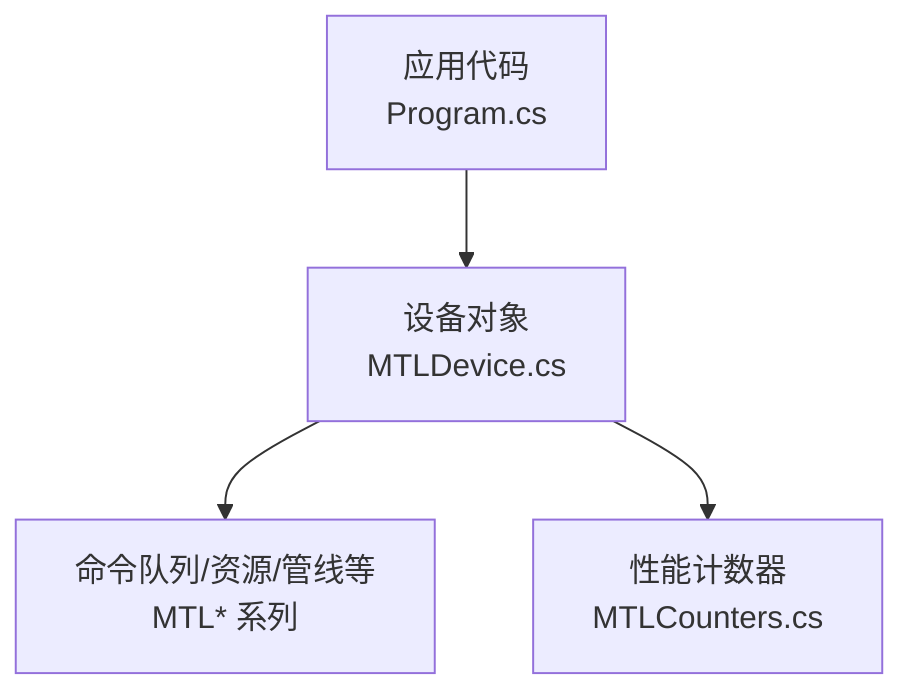
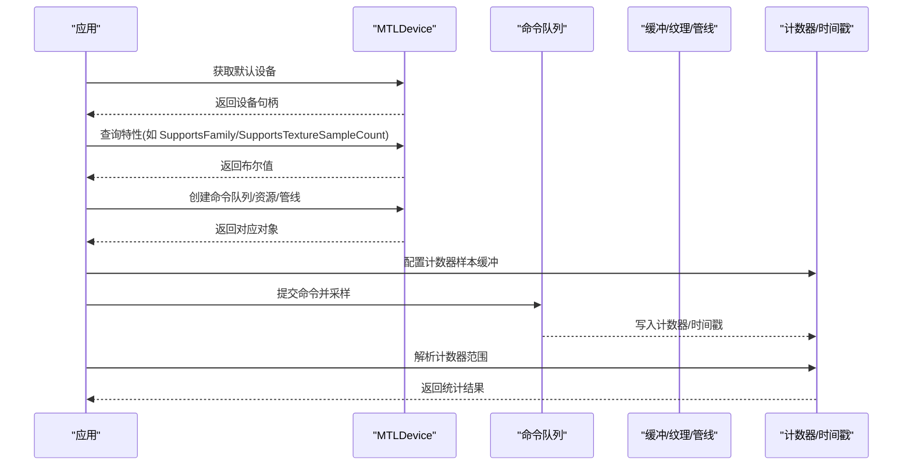
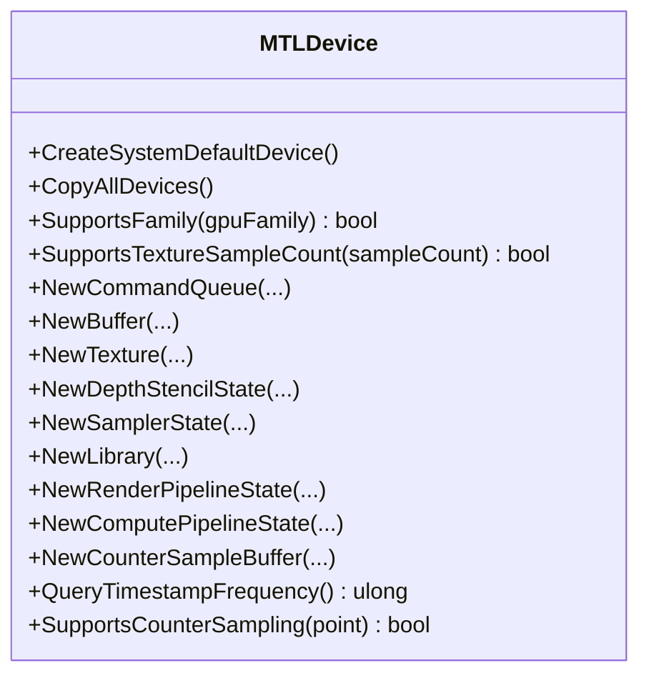
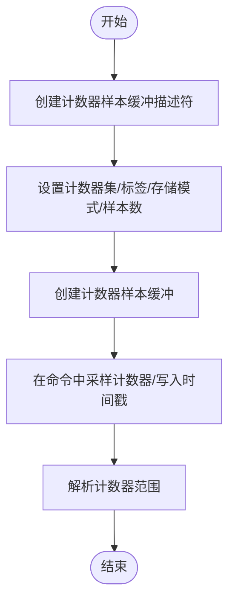
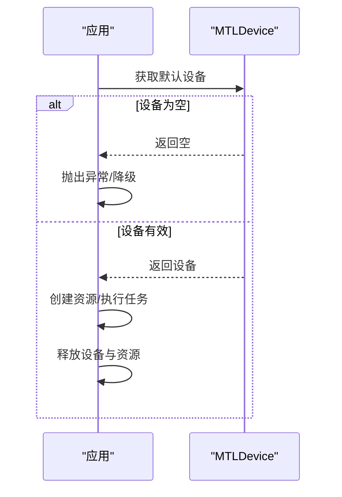
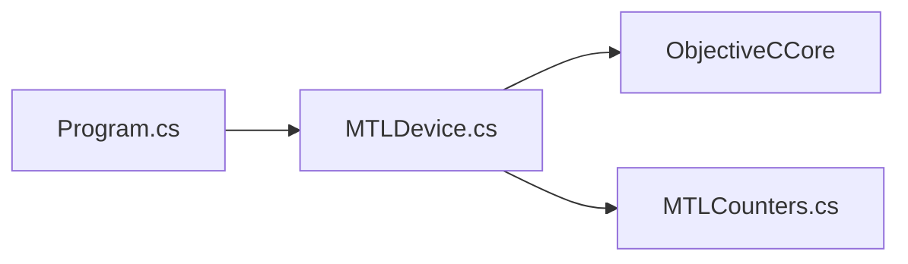

# 设备管理

<cite>
**本文引用的文件**
- [MTLDevice.cs](file://src/SharpMetal/Metal/MTLDevice.cs)
- [MTLCounters.cs](file://src/SharpMetal/Metal/MTLCounters.cs)
- [Program.cs](file://samples/SharpMetal.Sample/Program.cs)
</cite>

## 目录
1. [简介](#简介)
2. [项目结构](#项目结构)
3. [核心组件](#核心组件)
4. [架构总览](#架构总览)
5. [详细组件分析](#详细组件分析)
6. [依赖关系分析](#依赖关系分析)
7. [性能考量](#性能考量)
8. [故障排查指南](#故障排查指南)
9. [结论](#结论)
10. [附录](#附录)

## 简介
本章节面向使用 SharpMetal 进行 Metal 设备管理的开发者，聚焦 MTLDevice 在 GPU 设备发现、特性查询、性能计数器支持等方面的能力，并给出设备生命周期管理、错误处理与性能监控的最佳实践。文档同时提供基于示例工程的设备初始化流程说明与常见问题解决方案。

## 项目结构
- 设备相关 API 集中在 src/SharpMetal/Metal 目录，其中 MTLDevice.cs 是设备管理的核心入口。
- 性能计数器相关类型与描述符位于 MTLCounters.cs。
- 示例工程 samples/SharpMetal.Sample/Program.cs 展示了如何获取默认设备、创建共享缓冲区并进行读写验证。

图表来源
- [Program.cs:21-45](file://samples/SharpMetal.Sample/Program.cs#L21-L45)
- [MTLDevice.cs:187-319](file://src/SharpMetal/Metal/MTLDevice.cs#L187-L319)
- [MTLCounters.cs:69-135](file://src/SharpMetal/Metal/MTLCounters.cs#L69-L135)

章节来源
- [Program.cs:1-49](file://samples/SharpMetal.Sample/Program.cs#L1-L49)
- [MTLDevice.cs:1-851](file://src/SharpMetal/Metal/MTLDevice.cs#L1-L851)
- [MTLCounters.cs:1-137](file://src/SharpMetal/Metal/MTLCounters.cs#L1-L137)

## 核心组件
- MTLDevice：封装底层 Metal 设备，提供设备发现（默认设备、全部设备）、特性查询（GPU 家族、纹理采样、压缩、动态库、光线追踪等）、资源创建（缓冲、纹理、深度模板状态、采样器、库、管线、堆、事件、栅栏等）以及性能计数与时间戳采样能力。
- MTLCounterSampleBufferDescriptor / MTLCounterSampleBuffer / MTLCounterSet / MTLCounter：用于配置和采集性能计数器数据，支持按范围解析结果。
- 示例 Program.cs：演示获取默认设备、创建共享缓冲区、写入与回读校验，并在 finally 中释放原生资源。

章节来源
- [MTLDevice.cs:187-319](file://src/SharpMetal/Metal/MTLDevice.cs#L187-L319)
- [MTLCounters.cs:69-135](file://src/SharpMetal/Metal/MTLCounters.cs#L69-L135)
- [Program.cs:21-45](file://samples/SharpMetal.Sample/Program.cs#L21-L45)

## 架构总览
下图展示从应用到设备的调用路径，包括设备发现、能力检查、资源创建与性能计数的关键节点。

图表来源
- [MTLDevice.cs:305-319](file://src/SharpMetal/Metal/MTLDevice.cs#L305-L319)
- [MTLDevice.cs:456-463](file://src/SharpMetal/Metal/MTLDevice.cs#L456-L463)
- [MTLDevice.cs:326-339](file://src/SharpMetal/Metal/MTLDevice.cs#L326-L339)
- [MTLCounters.cs:69-135](file://src/SharpMetal/Metal/MTLCounters.cs#L69-L135)

## 详细组件分析

### MTLDevice：设备发现与特性查询
- 设备发现
  - 获取系统默认设备：通过静态方法创建默认设备实例。
  - 枚举所有设备：复制当前系统中的全部设备列表。
- 特性查询
  - GPU 家族支持：检测是否支持指定 GPU 家族。
  - 纹理采样支持：检测是否支持特定 MSAA 采样数。
  - 其他特性：如 32 位浮点滤波、MSAA、纹理 LOD 查询、BC 纹理压缩、拉模型插值、着色器重心坐标、动态库、渲染动态库、稀疏放置、光线追踪、函数指针、顶点放大计数、栅格化速率映射等。
- 资源与管线创建
  - 命令队列：支持无参、带描述符、带最大命令缓冲数量三种方式创建。
  - 内存与资源：缓冲、纹理、共享纹理、深度模板状态、采样器、堆、间接命令缓冲、事件、栅栏等。
  - 库与管线：默认库、URL/数据源库、源码编译、 stitched 库；渲染/计算管线状态创建。
- 性能与时间戳
  - 计数器集合：获取设备支持的计数器集合。
  - 计数器样本缓冲：创建计数器样本缓冲，用于在命令中采样。
  - 时间戳采样：支持 CPU/GPU 时间戳采样与频率查询。
  - 采样点支持：检测是否支持特定采样点。

图表来源
- [MTLDevice.cs:305-319](file://src/SharpMetal/Metal/MTLDevice.cs#L305-L319)
- [MTLDevice.cs:456-463](file://src/SharpMetal/Metal/MTLDevice.cs#L456-L463)
- [MTLDevice.cs:326-339](file://src/SharpMetal/Metal/MTLDevice.cs#L326-L339)
- [MTLDevice.cs:356-454](file://src/SharpMetal/Metal/MTLDevice.cs#L356-L454)
- [MTLDevice.cs:571-599](file://src/SharpMetal/Metal/MTLDevice.cs#L571-L599)
- [MTLDevice.cs:696-699](file://src/SharpMetal/Metal/MTLDevice.cs#L696-L699)

章节来源
- [MTLDevice.cs:187-319](file://src/SharpMetal/Metal/MTLDevice.cs#L187-L319)
- [MTLDevice.cs:326-454](file://src/SharpMetal/Metal/MTLDevice.cs#L326-L454)
- [MTLDevice.cs:456-463](file://src/SharpMetal/Metal/MTLDevice.cs#L456-L463)
- [MTLDevice.cs:571-599](file://src/SharpMetal/Metal/MTLDevice.cs#L571-L599)
- [MTLDevice.cs:696-699](file://src/SharpMetal/Metal/MTLDevice.cs#L696-L699)

### 性能计数器与时间戳
- 计数器集合与计数器
  - 通过设备获取计数器集合，再枚举其中的计数器名称。
- 计数器样本缓冲
  - 使用描述符设置计数器集、标签、存储模式与样本数量。
  - 在命令编码器中采样计数器，并在完成后解析指定范围的计数器结果。
- 时间戳
  - 设备提供时间戳频率查询，可在命令中写入时间戳以测量执行耗时。

图表来源
- [MTLCounters.cs:69-135](file://src/SharpMetal/Metal/MTLCounters.cs#L69-L135)
- [MTLDevice.cs:571-599](file://src/SharpMetal/Metal/MTLDevice.cs#L571-L599)
- [MTLDevice.cs:696-699](file://src/SharpMetal/Metal/MTLDevice.cs#L696-L699)

章节来源
- [MTLCounters.cs:69-135](file://src/SharpMetal/Metal/MTLCounters.cs#L69-L135)
- [MTLDevice.cs:571-599](file://src/SharpMetal/Metal/MTLDevice.cs#L571-L599)
- [MTLDevice.cs:696-699](file://src/SharpMetal/Metal/MTLDevice.cs#L696-L699)

### 设备生命周期管理与错误处理
- 生命周期
  - 获取默认设备后，应在不再需要时释放其原生指针，避免内存泄漏。
  - 示例程序在 finally 块中释放了设备与缓冲的原生指针，确保资源回收。
- 错误处理
  - 设备为空：当默认设备为 null 时应抛出异常或采取降级策略。
  - 资源分配失败：创建缓冲/纹理/管线等失败时需检查返回值并处理错误。
  - 平台限制：非 Apple 平台将阻止原生 Metal 工作负载，应提前检测并提示。

图表来源
- [Program.cs:21-45](file://samples/SharpMetal.Sample/Program.cs#L21-L45)

章节来源
- [Program.cs:16-45](file://samples/SharpMetal.Sample/Program.cs#L16-L45)

### 实际设备初始化流程（基于示例）
- 步骤概览
  - 平台检测：仅在 Apple 主机上运行原生 Metal 工作负载。
  - 获取默认设备：若为空则报错。
  - 创建共享缓冲：分配足够大小并进行读写验证。
  - 释放资源：在 finally 中释放原生指针。
- 参考路径
  - 设备获取与缓冲创建：[Program.cs:21-38](file://samples/SharpMetal.Sample/Program.cs#L21-L38)
  - 资源释放：[Program.cs:41-45](file://samples/SharpMetal.Sample/Program.cs#L41-L45)

章节来源
- [Program.cs:16-45](file://samples/SharpMetal.Sample/Program.cs#L16-L45)

## 依赖关系分析
- MTLDevice 依赖 ObjectiveC 运行时进行消息发送，访问系统 Metal 框架。
- 性能计数器模块依赖 MTLDevice 提供的计数器集合与样本缓冲创建能力。
- 示例程序依赖 MTLDevice 与 ObjectiveC 运行时进行资源管理与释放。

图表来源
- [Program.cs:1-49](file://samples/SharpMetal.Sample/Program.cs#L1-L49)
- [MTLDevice.cs:1-851](file://src/SharpMetal/Metal/MTLDevice.cs#L1-L851)
- [MTLCounters.cs:1-137](file://src/SharpMetal/Metal/MTLCounters.cs#L1-L137)

章节来源
- [Program.cs:1-49](file://samples/SharpMetal.Sample/Program.cs#L1-L49)
- [MTLDevice.cs:1-851](file://src/SharpMetal/Metal/MTLDevice.cs#L1-L851)
- [MTLCounters.cs:1-137](file://src/SharpMetal/Metal/MTLCounters.cs#L1-L137)

## 性能考量
- 设备能力前置检查
  - 在创建管线或启用高级特性前，先查询设备是否支持相应功能（如 GPU 家族、纹理采样数、动态库、光线追踪等），以避免运行时失败。
- 计数器采样与时间戳
  - 合理使用计数器样本缓冲的样本数量，避免过大导致内存压力。
  - 使用时间戳频率进行精确计时，结合命令编码器的采样点选择合适粒度。
- 资源复用与对齐
  - 利用设备提供的最小对齐信息（线性纹理、纹理缓冲）优化内存布局，减少浪费。
- 并发编译
  - 根据设备最大并发编译任务数与是否最大化并发编译的配置，调整编译策略以提升吞吐。

## 故障排查指南
- 无法获取默认设备
  - 检查是否在 Apple 主机环境运行；若非 Apple 平台，原生 Metal 工作负载将被阻止。
  - 若设备为空，抛出异常或采用降级逻辑。
- 共享缓冲读写不一致
  - 确认缓冲创建成功且 Contents 不为空；对数据进行一致性校验，必要时刷新或同步。
- 平台 ABI 不匹配
  - 示例中对 MTLSize 的 ABI 进行检查，若不匹配会抛出异常；需确保目标平台与构建配置一致。
- 性能计数器解析失败
  - 检查计数器样本缓冲的描述符是否正确设置（计数器集、存储模式、样本数）。
  - 确保在命令中正确采样并在完成后解析指定范围。

章节来源
- [Program.cs:12-19](file://samples/SharpMetal.Sample/Program.cs#L12-L19)
- [Program.cs:21-38](file://samples/SharpMetal.Sample/Program.cs#L21-L38)
- [MTLCounters.cs:69-135](file://src/SharpMetal/Metal/MTLCounters.cs#L69-L135)

## 结论
SharpMetal 的 MTLDevice 提供了完整的设备发现、特性查询、资源创建与性能监控能力。通过合理的设备能力检查、资源生命周期管理与性能计数器使用，可以在不同设备上稳定高效地运行 Metal 工作负载。建议在生产环境中结合设备特性进行自适应渲染/计算策略，并持续监控性能指标以优化体验。

## 附录
- 常用设备特性查询参考
  - GPU 家族支持：[MTLDevice.cs:456-459](file://src/SharpMetal/Metal/MTLDevice.cs#L456-L459)
  - 纹理采样支持：[MTLDevice.cs:461-463](file://src/SharpMetal/Metal/MTLDevice.cs#L461-L463)
  - 动态库支持：[MTLDevice.cs:281-283](file://src/SharpMetal/Metal/MTLDevice.cs#L281-L283)
  - 光线追踪支持：[MTLDevice.cs:287-295](file://src/SharpMetal/Metal/MTLDevice.cs#L287-L295)
- 性能计数器与时间戳参考
  - 计数器样本缓冲描述符：[MTLCounters.cs:69-112](file://src/SharpMetal/Metal/MTLCounters.cs#L69-L112)
  - 计数器样本缓冲解析：[MTLCounters.cs:114-135](file://src/SharpMetal/Metal/MTLCounters.cs#L114-L135)
  - 时间戳频率查询：[MTLDevice.cs:696-699](file://src/SharpMetal/Metal/MTLDevice.cs#L696-L699)
- 设备初始化示例参考
  - 获取默认设备与缓冲读写：[Program.cs:21-38](file://samples/SharpMetal.Sample/Program.cs#L21-L38)
  - 资源释放：[Program.cs:41-45](file://samples/SharpMetal.Sample/Program.cs#L41-L45)