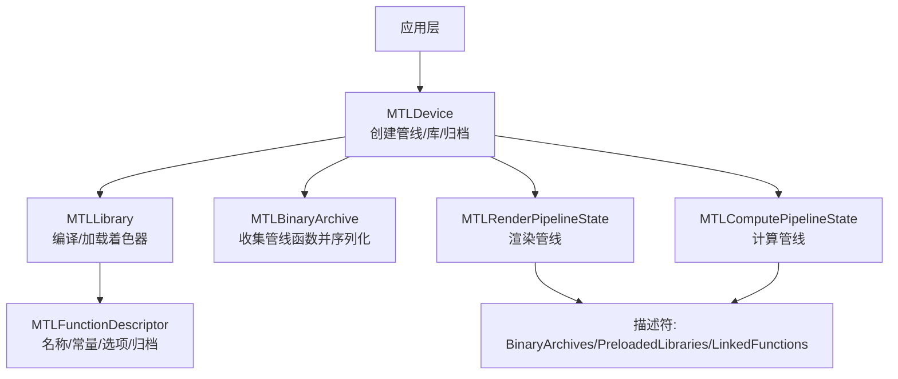
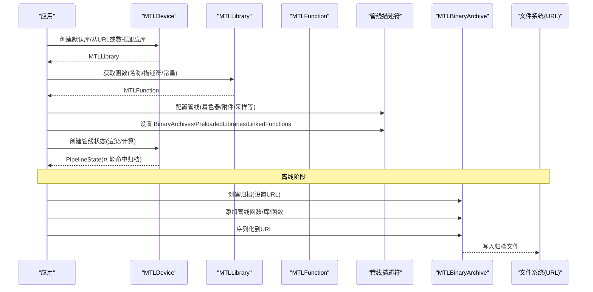
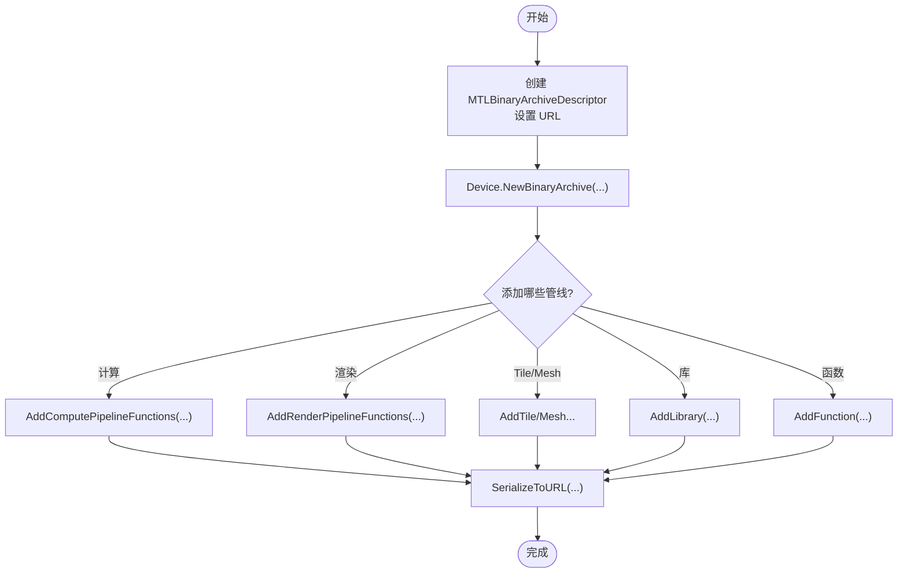
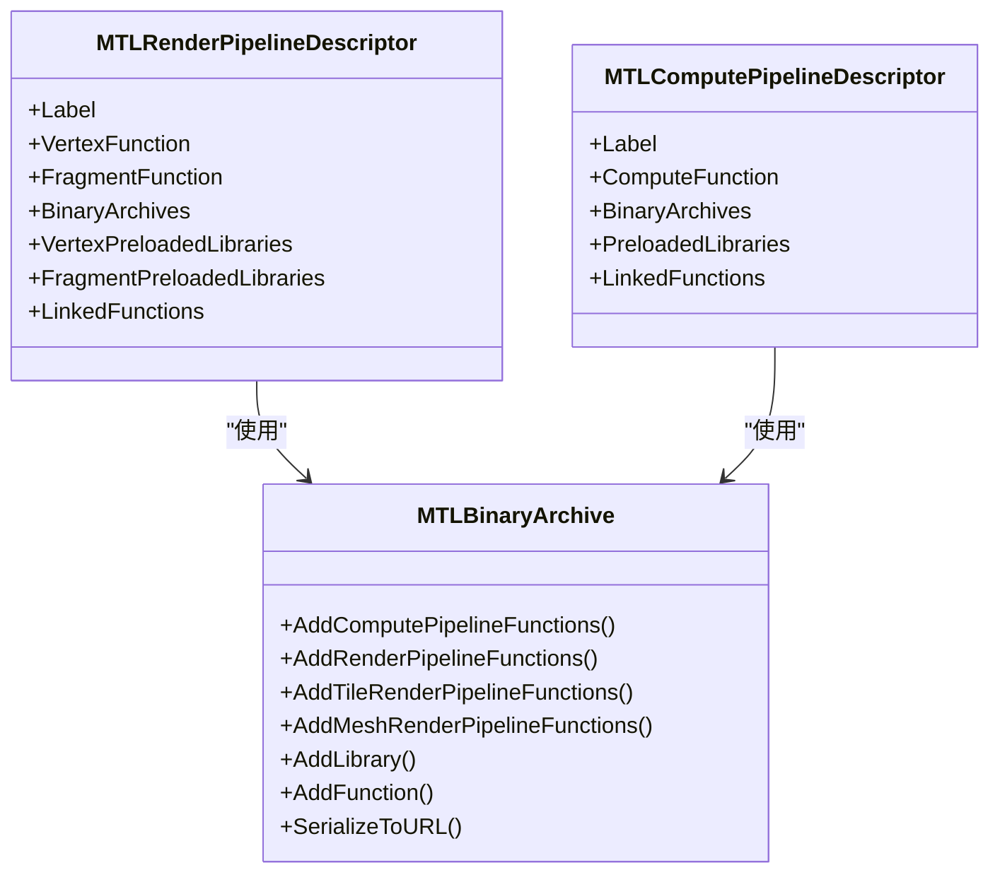
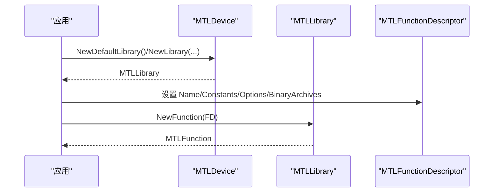
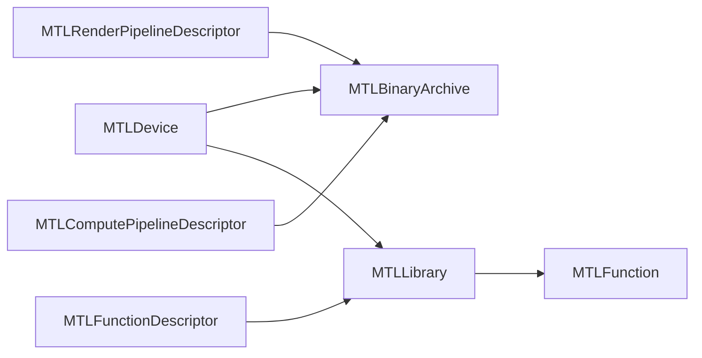

# 二进制归档

<cite>
**本文引用的文件**
- [MTLBinaryArchive.cs](file://src/SharpMetal/Metal/MTLBinaryArchive.cs)
- [MTLDevice.cs](file://src/SharpMetal/Metal/MTLDevice.cs)
- [MTLLibrary.cs](file://src/SharpMetal/Metal/MTLLibrary.cs)
- [MTLFunctionDescriptor.cs](file://src/SharpMetal/Metal/MTLFunctionDescriptor.cs)
- [MTLRenderPipeline.cs](file://src/SharpMetal/Metal/MTLRenderPipeline.cs)
- [MTLComputePipeline.cs](file://src/SharpMetal/Metal/MTLComputePipeline.cs)
- [README.md](file://README.md)
</cite>

## 目录
1. [简介](#简介)
2. [项目结构](#项目结构)
3. [核心组件](#核心组件)
4. [架构总览](#架构总览)
5. [详细组件分析](#详细组件分析)
6. [依赖关系分析](#依赖关系分析)
7. [性能与优化](#性能与优化)
8. [故障排查指南](#故障排查指南)
9. [结论](#结论)
10. [附录](#附录)

## 简介
本文件聚焦于 SharpMetal 中 Metal 二进制归档（Binary Archive）能力，围绕着色器库、管线状态的预编译与归档流程展开，说明如何创建、加载与管理归档文件，并给出跨平台兼容性、版本控制与部署优化的实践建议。同时提供归档文件大小优化、加载性能提升与调试方法，以及大型项目的资源管理最佳实践。

## 项目结构
该仓库为 .NET 对 Apple 系统框架的底层绑定，包含 Foundation、Metal、MetalFX、QuartzCore 等命名空间。与二进制归档直接相关的代码集中在 src/SharpMetal/Metal 目录下，核心类型包括：
- MTLBinaryArchive / MTLBinaryArchiveDescriptor：用于构建和序列化二进制归档
- MTLLibrary / MTLCompileOptions / MTLFunction / MTLFunctionDescriptor：用于着色器编译、函数描述与选项配置
- MTLDevice：设备入口，提供创建默认库、管线状态与二进制归档的能力
- MTLRenderPipeline / MTLComputePipeline：渲染与计算管线，支持在描述符中注入二进制归档以加速启动

图表来源
- [MTLDevice.cs:401-429](file://src/SharpMetal/Metal/MTLDevice.cs#L401-L429)
- [MTLDevice.cs:606-609](file://src/SharpMetal/Metal/MTLDevice.cs#L606-L609)
- [MTLBinaryArchive.cs:15-95](file://src/SharpMetal/Metal/MTLBinaryArchive.cs#L15-L95)
- [MTLLibrary.cs:221-397](file://src/SharpMetal/Metal/MTLLibrary.cs#L221-L397)
- [MTLRenderPipeline.cs:208-492](file://src/SharpMetal/Metal/MTLRenderPipeline.cs#L208-L492)
- [MTLComputePipeline.cs:25-149](file://src/SharpMetal/Metal/MTLComputePipeline.cs#L25-L149)

章节来源
- [README.md:1-23](file://README.md#L1-L23)

## 核心组件
- MTLBinaryArchive / MTLBinaryArchiveDescriptor
  - 通过 Device.NewBinaryArchive 创建
  - 支持添加计算/渲染/Tile/Mesh 管线函数、链接库或单个函数
  - 支持将已收集的管线函数序列化为 URL（归档文件）
- MTLLibrary / MTLCompileOptions / MTLFunction / MTLFunctionDescriptor
  - 从源或数据创建库，设置语言版本、数学模式、优化级别、符号可见性等
  - 通过函数描述符指定名称、常量、选项与可附加的二进制归档
- MTLDevice
  - 提供 NewDefaultLibrary/NewLibrary 加载库
  - 提供 NewRenderPipelineState/NewComputePipelineState 创建管线
  - 提供 NewBinaryArchive 创建归档对象
- 管线描述符（渲染/计算）
  - 均暴露 BinaryArchives、PreloadedLibraries、LinkedFunctions 等属性，用于在管线创建时注入预编译内容

章节来源
- [MTLBinaryArchive.cs:15-95](file://src/SharpMetal/Metal/MTLBinaryArchive.cs#L15-L95)
- [MTLLibrary.cs:221-397](file://src/SharpMetal/Metal/MTLLibrary.cs#L221-L397)
- [MTLDevice.cs:401-429](file://src/SharpMetal/Metal/MTLDevice.cs#L401-L429)
- [MTLDevice.cs:606-609](file://src/SharpMetal/Metal/MTLDevice.cs#L606-L609)
- [MTLRenderPipeline.cs:208-492](file://src/SharpMetal/Metal/MTLRenderPipeline.cs#L208-L492)
- [MTLComputePipeline.cs:25-149](file://src/SharpMetal/Metal/MTLComputePipeline.cs#L25-L149)
- [MTLFunctionDescriptor.cs:6-66](file://src/SharpMetal/Metal/MTLFunctionDescriptor.cs#L6-L66)

## 架构总览
下图展示了“预编译管线 → 归档 → 运行时加载”的整体流程，涵盖渲染与计算两种管线类型。

图表来源
- [MTLDevice.cs:401-429](file://src/SharpMetal/Metal/MTLDevice.cs#L401-L429)
- [MTLDevice.cs:431-454](file://src/SharpMetal/Metal/MTLDevice.cs#L431-L454)
- [MTLDevice.cs:606-609](file://src/SharpMetal/Metal/MTLDevice.cs#L606-L609)
- [MTLBinaryArchive.cs:15-95](file://src/SharpMetal/Metal/MTLBinaryArchive.cs#L15-L95)
- [MTLRenderPipeline.cs:208-492](file://src/SharpMetal/Metal/MTLRenderPipeline.cs#L208-L492)
- [MTLComputePipeline.cs:25-149](file://src/SharpMetal/Metal/MTLComputePipeline.cs#L25-L149)

## 详细组件分析

### 二进制归档创建与序列化
- 创建归档对象
  - 通过 MTLDevice.NewBinaryArchive(MTLBinaryArchiveDescriptor, ref NSError) 创建
  - 描述符支持设置目标 URL（归档输出路径）
- 向归档添加内容
  - AddComputePipelineFunctions：添加计算管线函数
  - AddRenderPipelineFunctions：添加渲染管线函数
  - AddTileRenderPipelineFunctions / AddMeshRenderPipelineFunctions：添加 Tile/Mesh 管线函数
  - AddLibrary：添加 stitched 库描述符
  - AddFunction：添加单个函数（配合函数描述符与库）
- 序列化
  - SerializeToURL：将已收集的管线函数集合持久化到 URL（归档文件）

图表来源
- [MTLDevice.cs:606-609](file://src/SharpMetal/Metal/MTLDevice.cs#L606-L609)
- [MTLBinaryArchive.cs:15-95](file://src/SharpMetal/Metal/MTLBinaryArchive.cs#L15-L95)

章节来源
- [MTLBinaryArchive.cs:15-95](file://src/SharpMetal/Metal/MTLBinaryArchive.cs#L15-L95)
- [MTLDevice.cs:606-609](file://src/SharpMetal/Metal/MTLDevice.cs#L606-L609)

### 管线状态预编译与归档注入
- 渲染管线
  - MTLRenderPipelineDescriptor 暴露 BinaryArchives、Vertex/Fragment PreloadedLibraries、LinkedFunctions 等属性，可在创建管线状态前注入预编译内容
- 计算管线
  - MTLComputePipelineDescriptor 同样暴露 BinaryArchives、PreloadedLibraries、LinkedFunctions 等属性
- 管线创建
  - 通过 MTLDevice.NewRenderPipelineState / NewComputePipelineState 创建，若存在匹配的归档条目，可显著减少首次编译开销

图表来源
- [MTLRenderPipeline.cs:208-492](file://src/SharpMetal/Metal/MTLRenderPipeline.cs#L208-L492)
- [MTLComputePipeline.cs:25-149](file://src/SharpMetal/Metal/MTLComputePipeline.cs#L25-L149)
- [MTLBinaryArchive.cs:15-95](file://src/SharpMetal/Metal/MTLBinaryArchive.cs#L15-L95)

章节来源
- [MTLRenderPipeline.cs:208-492](file://src/SharpMetal/Metal/MTLRenderPipeline.cs#L208-L492)
- [MTLComputePipeline.cs:25-149](file://src/SharpMetal/Metal/MTLComputePipeline.cs#L25-L149)

### 着色器库与函数描述
- 库的创建与加载
  - 通过 MTLDevice.NewDefaultLibrary / NewLibrary(NSURL/NSData/Source/Stitched) 创建或加载库
- 函数描述
  - MTLFunctionDescriptor 支持 Name/SpecializedName/ConstantValues/Options/BinaryArchives
  - Options 包含 CompileToBinary、StoreFunctionInMetalScript、FailOnBinaryArchiveMiss 等标志
- 编译选项
  - MTLCompileOptions 支持 LanguageVersion、MathMode、OptimizationLevel、SymbolVisibility、Logging 等

图表来源
- [MTLDevice.cs:401-429](file://src/SharpMetal/Metal/MTLDevice.cs#L401-L429)
- [MTLLibrary.cs:347-397](file://src/SharpMetal/Metal/MTLLibrary.cs#L347-L397)
- [MTLFunctionDescriptor.cs:6-66](file://src/SharpMetal/Metal/MTLFunctionDescriptor.cs#L6-L66)
- [MTLLibrary.cs:221-345](file://src/SharpMetal/Metal/MTLLibrary.cs#L221-L345)

章节来源
- [MTLLibrary.cs:221-397](file://src/SharpMetal/Metal/MTLLibrary.cs#L221-L397)
- [MTLFunctionDescriptor.cs:6-66](file://src/SharpMetal/Metal/MTLFunctionDescriptor.cs#L6-L66)
- [MTLDevice.cs:401-429](file://src/SharpMetal/Metal/MTLDevice.cs#L401-L429)

### 运行时加载与回退策略
- 管线创建时若启用 FailOnBinaryArchiveMiss（通过 FunctionOptions 或管线选项），当归档缺失时会触发失败回调或错误，便于在开发期发现问题
- 推荐策略：生产环境优先尝试从归档加载；若失败则回退到在线编译（需确保功能可用）

章节来源
- [MTLFunctionDescriptor.cs:6-66](file://src/SharpMetal/Metal/MTLFunctionDescriptor.cs#L6-L66)
- [MTLDevice.cs:50-57](file://src/SharpMetal/Metal/MTLDevice.cs#L50-L57)

## 依赖关系分析
- MTLBinaryArchive 依赖 MTLDevice 进行创建，依赖 NSURL 作为序列化目标
- 管线描述符（渲染/计算）依赖 MTLBinaryArchive 以注入预编译内容
- MTLLibrary 与 MTLFunctionDescriptor 共同决定函数的编译与选项
- 所有操作最终由 Objective-C 运行时桥接到系统 Metal 框架

图表来源
- [MTLDevice.cs:401-429](file://src/SharpMetal/Metal/MTLDevice.cs#L401-L429)
- [MTLDevice.cs:606-609](file://src/SharpMetal/Metal/MTLDevice.cs#L606-L609)
- [MTLBinaryArchive.cs:15-95](file://src/SharpMetal/Metal/MTLBinaryArchive.cs#L15-L95)
- [MTLRenderPipeline.cs:208-492](file://src/SharpMetal/Metal/MTLRenderPipeline.cs#L208-L492)
- [MTLComputePipeline.cs:25-149](file://src/SharpMetal/Metal/MTLComputePipeline.cs#L25-L149)
- [MTLLibrary.cs:221-397](file://src/SharpMetal/Metal/MTLLibrary.cs#L221-L397)

章节来源
- [MTLDevice.cs:401-429](file://src/SharpMetal/Metal/MTLDevice.cs#L401-L429)
- [MTLBinaryArchive.cs:15-95](file://src/SharpMetal/Metal/MTLBinaryArchive.cs#L15-L95)
- [MTLRenderPipeline.cs:208-492](file://src/SharpMetal/Metal/MTLRenderPipeline.cs#L208-L492)
- [MTLComputePipeline.cs:25-149](file://src/SharpMetal/Metal/MTLComputePipeline.cs#L25-L149)
- [MTLLibrary.cs:221-397](file://src/SharpMetal/Metal/MTLLibrary.cs#L221-L397)

## 性能与优化
- 归档大小优化
  - 使用 MTLCompileOptions.OptimizationLevel 选择 Size 优化以减少体积
  - 合理设置 MTLCompileOptions.LanguageVersion 与 MathMode，避免不必要的特性引入
  - 仅归档必要的管线函数与库，避免冗余
- 加载性能提升
  - 在管线描述符中设置 BinaryArchives/PreloadedLibraries，使首次运行直接命中归档
  - 使用 LinkedFunctions 分组管理函数，减少链接开销
  - 利用 FunctionDescriptor.Options.CompileToBinary 生成二进制函数，结合归档进一步降低启动时间
- 并发与缓存
  - 根据设备能力调整 ShouldMaximizeConcurrentCompilation 与 MaximumConcurrentCompilationTaskCount，平衡编译吞吐与内存占用
  - 将常用管线与函数集中归档，减少 I/O 次数

章节来源
- [MTLLibrary.cs:221-345](file://src/SharpMetal/Metal/MTLLibrary.cs#L221-L345)
- [MTLFunctionDescriptor.cs:6-66](file://src/SharpMetal/Metal/MTLFunctionDescriptor.cs#L6-L66)
- [MTLDevice.cs:297-303](file://src/SharpMetal/Metal/MTLDevice.cs#L297-L303)
- [MTLRenderPipeline.cs:208-492](file://src/SharpMetal/Metal/MTLRenderPipeline.cs#L208-L492)
- [MTLComputePipeline.cs:25-149](file://src/SharpMetal/Metal/MTLComputePipeline.cs#L25-L149)

## 故障排查指南
- 常见错误
  - MTLBinaryArchiveError.InvalidFile：归档文件格式不合法或损坏
  - MTLBinaryArchiveError.UnexpectedElement：归档中包含非预期元素
  - MTLBinaryArchiveError.CompilationFailure：管线函数编译失败
  - MTLBinaryArchiveError.InternalError：内部错误
- 定位步骤
  - 检查 MTLBinaryArchiveDescriptor.Url 是否指向有效且可写的路径
  - 确认添加到归档的管线函数/库是否与运行时一致（名称、常量、选项）
  - 使用 FunctionDescriptor.Options.FailOnBinaryArchiveMiss 在开发期快速发现缺失
  - 开启 MTLCompileOptions.Logging 以获取更多编译信息
- 回退策略
  - 捕获 NSError，若归档加载失败则回退到在线编译路径，保证可用性

章节来源
- [MTLBinaryArchive.cs:6-13](file://src/SharpMetal/Metal/MTLBinaryArchive.cs#L6-L13)
- [MTLBinaryArchive.cs:75-83](file://src/SharpMetal/Metal/MTLBinaryArchive.cs#L75-L83)
- [MTLFunctionDescriptor.cs:6-66](file://src/SharpMetal/Metal/MTLFunctionDescriptor.cs#L6-L66)
- [MTLLibrary.cs:221-345](file://src/SharpMetal/Metal/MTLLibrary.cs#L221-L345)

## 结论
通过 SharpMetal 提供的 MTLBinaryArchive 及相关 API，可以在离线阶段将着色器与管线状态预编译并归档，从而显著降低运行时首次加载延迟。结合管线描述符中的 BinaryArchives/PreloadedLibraries/LinkedFunctions，可实现细粒度的资源管理与性能调优。在生产环境中，建议采用“归档优先、在线编译回退”的策略，并通过日志与错误码快速定位问题。对于大型项目，应建立统一的归档构建流水线与版本化管理机制，确保不同 GPU 家族与系统版本的兼容性与稳定性。

## 附录
- 跨平台兼容性
  - 本项目为 .NET 绑定，需在 Apple 主机上运行并使用系统 Metal 框架
  - 针对不同 GPU 家族（如 AppleX、CommonX、Metal3/4）可通过设备能力检测与差异化构建策略实现兼容
- 版本控制与部署
  - 将归档文件纳入版本管理，按 GPU 家族与系统版本分目录组织
  - 在应用启动时检测设备能力并选择对应归档
- 大型项目资源管理最佳实践
  - 模块化管线：按场景/模块划分管线与函数，分别归档
  - 增量构建：仅重新编译变更的着色器并更新对应归档
  - 监控与度量：统计归档命中率与编译耗时，持续优化