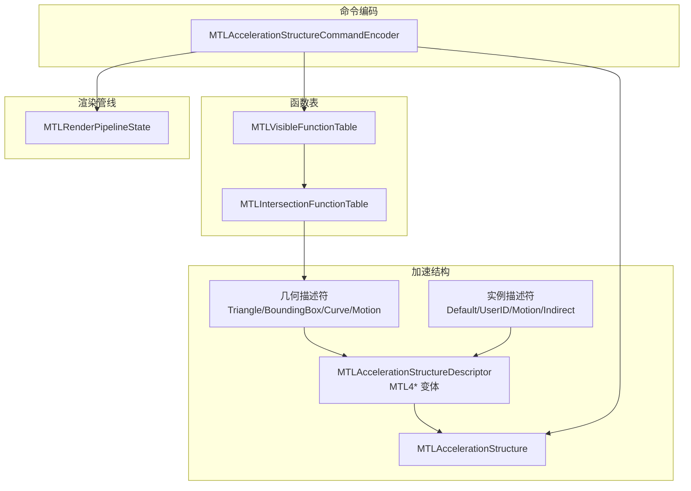
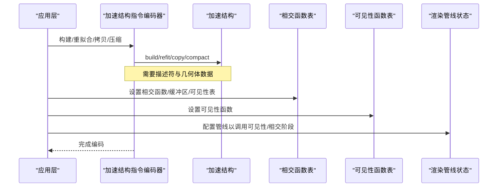
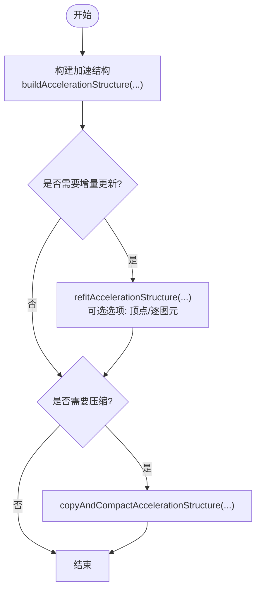
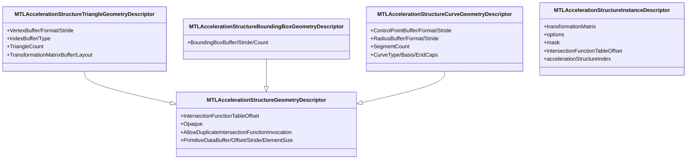
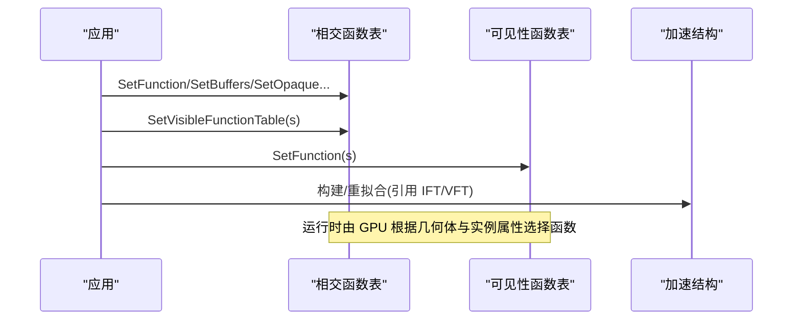
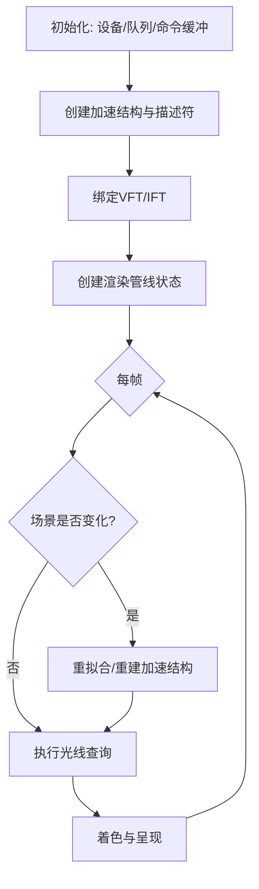
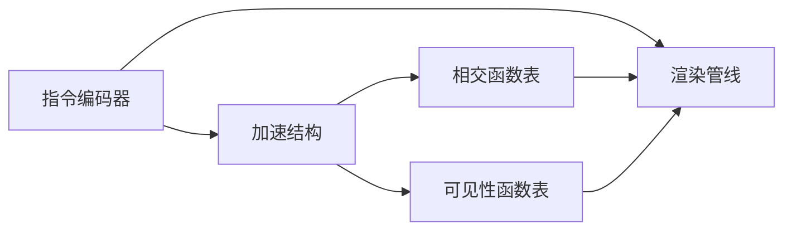

# 光线追踪

<cite>
**本文引用的文件**
- [MTLAccelerationStructure.cs](file://src/SharpMetal/Metal/MTLAccelerationStructure.cs)
- [MTL4AccelerationStructure.cs](file://src/SharpMetal/Metal/MTL4AccelerationStructure.cs)
- [MTLAccelerationStructureCommandEncoder.cs](file://src/SharpMetal/Metal/MTLAccelerationStructureCommandEncoder.cs)
- [MTLVisibleFunctionTable.cs](file://src/SharpMetal/Metal/MTLVisibleFunctionTable.cs)
- [MTLIntersectionFunctionTable.cs](file://src/SharpMetal/Metal/MTLIntersectionFunctionTable.cs)
- [MTLAccelerationStructureTypes.cs](file://src/SharpMetal/Metal/MTLAccelerationStructureTypes.cs)
- [MTLRenderPipeline.cs](file://src/SharpMetal/Metal/MTLRenderPipeline.cs)
</cite>

## 目录
1. [简介](#简介)
2. [项目结构](#项目结构)
3. [核心组件](#核心组件)
4. [架构总览](#架构总览)
5. [详细组件分析](#详细组件分析)
6. [依赖关系分析](#依赖关系分析)
7. [性能考虑](#性能考虑)
8. [故障排查指南](#故障排查指南)
9. [结论](#结论)
10. [附录](#附录)

## 简介
本文件面向使用 SharpMetal 进行 Metal 光线追踪的开发者，系统性说明加速结构的构建、维护与查询方法；解释可见性函数表（VFT）与相交函数表（IFT）的配置和使用；阐述光线追踪命令编码、光线生成与着色器交互；并提供性能优化、内存管理与调试技巧，以及一个可落地的实时光线追踪应用实现示例。

## 项目结构
本项目在 src/SharpMetal/Metal 下提供了完整的 Metal 光线追踪托管 API 封装，包括：
- 加速结构与几何描述符：用于定义三角形、包围盒、曲线、运动学等几何体及实例化信息
- 指令编码器：用于构建、重拟合、拷贝与压缩加速结构
- 函数表：可见性函数表与相交函数表，用于将 GPU 函数绑定到加速结构查询路径
- 类型与数据结构：紧凑矩阵、轴对齐包围盒、变换分量等基础类型



图表来源
- [MTLAccelerationStructure.cs:7-136](file://src/SharpMetal/Metal/MTLAccelerationStructure.cs#L7-L136)
- [MTL4AccelerationStructure.cs:20-148](file://src/SharpMetal/Metal/MTL4AccelerationStructure.cs#L20-L148)
- [MTLVisibleFunctionTable.cs:6-104](file://src/SharpMetal/Metal/MTLVisibleFunctionTable.cs#L6-L104)
- [MTLIntersectionFunctionTable.cs:7-176](file://src/SharpMetal/Metal/MTLIntersectionFunctionTable.cs#L7-L176)
- [MTLAccelerationStructureCommandEncoder.cs:6-141](file://src/SharpMetal/Metal/MTLAccelerationStructureCommandEncoder.cs#L6-L141)
- [MTLRenderPipeline.cs:87-200](file://src/SharpMetal/Metal/MTLRenderPipeline.cs#L87-L200)

章节来源
- [MTLAccelerationStructure.cs:7-136](file://src/SharpMetal/Metal/MTLAccelerationStructure.cs#L7-L136)
- [MTL4AccelerationStructure.cs:20-148](file://src/SharpMetal/Metal/MTL4AccelerationStructure.cs#L20-L148)
- [MTLVisibleFunctionTable.cs:6-104](file://src/SharpMetal/Metal/MTLVisibleFunctionTable.cs#L6-L104)
- [MTLIntersectionFunctionTable.cs:7-176](file://src/SharpMetal/Metal/MTLIntersectionFunctionTable.cs#L7-L176)
- [MTLAccelerationStructureCommandEncoder.cs:6-141](file://src/SharpMetal/Metal/MTLAccelerationStructureCommandEncoder.cs#L6-L141)
- [MTLRenderPipeline.cs:87-200](file://src/SharpMetal/Metal/MTLRenderPipeline.cs#L87-L200)

## 核心组件
- 加速结构描述符与几何体
  - 支持三角形、包围盒、曲线及其运动学版本，提供顶点/索引/原始数据缓冲、变换矩阵缓冲、元素大小与步长等配置项
  - 支持实例化描述符：默认、用户 ID、运动、间接等模式，包含变换、掩码、相交函数表偏移、加速结构索引等
- 指令编码器
  - 构建/重拟合/拷贝/压缩加速结构
  - 写入紧凑尺寸、栅栏同步、资源/堆声明、计数器采样
- 函数表
  - 可见性函数表：设置可见性阶段调用的函数句柄
  - 相交函数表：设置相交阶段可调用的函数或内置 opaque 相交函数，并支持可见性函数表作为子表
- 类型与数据结构
  - 紧凑浮点向量、矩阵、轴对齐包围盒、分量式变换等

章节来源
- [MTLAccelerationStructure.cs:138-800](file://src/SharpMetal/Metal/MTLAccelerationStructure.cs#L138-L800)
- [MTL4AccelerationStructure.cs:150-798](file://src/SharpMetal/Metal/MTL4AccelerationStructure.cs#L150-L798)
- [MTLAccelerationStructureCommandEncoder.cs:50-141](file://src/SharpMetal/Metal/MTLAccelerationStructureCommandEncoder.cs#L50-L141)
- [MTLVisibleFunctionTable.cs:6-104](file://src/SharpMetal/Metal/MTLVisibleFunctionTable.cs#L6-L104)
- [MTLIntersectionFunctionTable.cs:7-176](file://src/SharpMetal/Metal/MTLIntersectionFunctionTable.cs#L7-L176)
- [MTLAccelerationStructureTypes.cs:7-45](file://src/SharpMetal/Metal/MTLAccelerationStructureTypes.cs#L7-L45)

## 架构总览
下图展示了从几何数据到加速结构构建、再到光线查询与着色器交互的整体流程。



图表来源
- [MTLAccelerationStructureCommandEncoder.cs:50-141](file://src/SharpMetal/Metal/MTLAccelerationStructureCommandEncoder.cs#L50-L141)
- [MTLIntersectionFunctionTable.cs:100-176](file://src/SharpMetal/Metal/MTLIntersectionFunctionTable.cs#L100-L176)
- [MTLVisibleFunctionTable.cs:76-104](file://src/SharpMetal/Metal/MTLVisibleFunctionTable.cs#L76-L104)
- [MTLRenderPipeline.cs:87-200](file://src/SharpMetal/Metal/MTLRenderPipeline.cs#L87-L200)

## 详细组件分析

### 加速结构构建与维护
- 构建加速结构
  - 通过指令编码器的构建接口传入加速结构对象、描述符、暂存缓冲与偏移，完成底层 BVH/AS 的构建
  - 描述符包含几何体集合、实例化信息与运动学参数
- 重拟合与更新
  - 支持基于源加速结构与描述符生成目标加速结构，可选择仅更新顶点数据或逐图元数据
  - 适合动态场景中的增量更新
- 拷贝与压缩
  - 支持直接拷贝与“拷贝+压缩”两种模式，后者可在保持语义不变的前提下减少占用
- 紧凑尺寸写入
  - 可将实际紧凑后的尺寸写回 CPU 侧缓冲，便于后续分配或复用



图表来源
- [MTLAccelerationStructureCommandEncoder.cs:50-83](file://src/SharpMetal/Metal/MTLAccelerationStructureCommandEncoder.cs#L50-L83)

章节来源
- [MTLAccelerationStructureCommandEncoder.cs:50-83](file://src/SharpMetal/Metal/MTLAccelerationStructureCommandEncoder.cs#L50-L83)
- [MTLAccelerationStructureCommandEncoder.cs:85-141](file://src/SharpMetal/Metal/MTLAccelerationStructureCommandEncoder.cs#L85-L141)
- [MTLAccelerationStructure.cs:7-136](file://src/SharpMetal/Metal/MTLAccelerationStructure.cs#L7-L136)
- [MTL4AccelerationStructure.cs:20-148](file://src/SharpMetal/Metal/MTL4AccelerationStructure.cs#L20-L148)

### 几何体与实例化描述
- 几何体
  - 三角形：顶点缓冲、索引缓冲、三角形数量、变换矩阵缓冲与布局
  - 包围盒：包围盒缓冲、步长、数量
  - 曲线：控制点缓冲、半径缓冲、段数、曲线类型/基函数/端盖
  - 运动学：多帧顶点/包围盒/控制点缓冲，起止时间、边界模式、关键帧计数
- 实例化
  - 实例描述符类型：默认、用户 ID、运动、间接、间接运动
  - 每个实例包含变换矩阵、选项（剔除/正面朝向/不透明标记）、掩码、相交函数表偏移、加速结构索引
  - 运动实例额外包含运动变换起始索引、数量、起止边界模式与时间范围



图表来源
- [MTLAccelerationStructure.cs:138-800](file://src/SharpMetal/Metal/MTLAccelerationStructure.cs#L138-L800)
- [MTLAccelerationStructure.cs:74-136](file://src/SharpMetal/Metal/MTLAccelerationStructure.cs#L74-L136)

章节来源
- [MTLAccelerationStructure.cs:138-800](file://src/SharpMetal/Metal/MTLAccelerationStructure.cs#L138-L800)
- [MTLAccelerationStructure.cs:74-136](file://src/SharpMetal/Metal/MTLAccelerationStructure.cs#L74-L136)
- [MTL4AccelerationStructure.cs:150-798](file://src/SharpMetal/Metal/MTL4AccelerationStructure.cs#L150-L798)

### 可见性函数表（VFT）与相交函数表（IFT）
- 可见性函数表
  - 通过描述符设置函数数量，运行时为每个槽位设置函数句柄
  - 用于可见性阶段（如阴影、反射、折射等）的调度
- 相交函数表
  - 支持设置自定义相交函数或内置 opaque 相交函数（三角形/曲线）
  - 支持设置缓冲区数组与偏移，用于传递每图元数据
  - 支持嵌入可见性函数表，形成多级函数表结构
  - 相交签名枚举涵盖实例化、世界空间数据、实例/图元运动、扩展限制、最大层级、曲线数据、相交函数缓冲、用户数据等



图表来源
- [MTLIntersectionFunctionTable.cs:100-176](file://src/SharpMetal/Metal/MTLIntersectionFunctionTable.cs#L100-L176)
- [MTLVisibleFunctionTable.cs:76-104](file://src/SharpMetal/Metal/MTLVisibleFunctionTable.cs#L76-L104)

章节来源
- [MTLIntersectionFunctionTable.cs:7-176](file://src/SharpMetal/Metal/MTLIntersectionFunctionTable.cs#L7-L176)
- [MTLVisibleFunctionTable.cs:6-104](file://src/SharpMetal/Metal/MTLVisibleFunctionTable.cs#L6-L104)

### 光线追踪命令编码、光线生成与着色器交互
- 命令编码
  - 使用加速结构指令编码器执行构建、重拟合、拷贝、压缩等操作
  - 支持插入调试分组与标记、栅栏等待/更新、资源/堆声明、计数器采样
- 光线生成与着色器交互
  - 通过渲染管线状态配置可见性/相交阶段的入口函数
  - 在管线中绑定可见性函数表与相交函数表，使 GPU 在执行光线查询时能正确调度函数
  - 几何体描述符中的相交函数表偏移与实例描述符中的偏移共同决定调用路径

```mermaid
sequenceDiagram
participant App as "应用"
participant Enc as "指令编码器"
participant RP as "渲染管线"
participant VFT as "可见性函数表"
participant IFT as "相交函数表"
App->>RP : 创建/配置管线(绑定可见性/相交阶段)
App->>VFT : 设置可见性函数
App->>IFT : 设置相交函数/缓冲区/可见性表
App->>Enc : 编码构建/重拟合/拷贝/压缩
Enc-->>App : 完成编码
Note over RP,VFT,IFT : 光线查询时按描述符与实例偏移选择函数
```

图表来源
- [MTLAccelerationStructureCommandEncoder.cs:50-141](file://src/SharpMetal/Metal/MTLAccelerationStructureCommandEncoder.cs#L50-L141)
- [MTLRenderPipeline.cs:87-200](file://src/SharpMetal/Metal/MTLRenderPipeline.cs#L87-L200)
- [MTLVisibleFunctionTable.cs:76-104](file://src/SharpMetal/Metal/MTLVisibleFunctionTable.cs#L76-L104)
- [MTLIntersectionFunctionTable.cs:100-176](file://src/SharpMetal/Metal/MTLIntersectionFunctionTable.cs#L100-L176)

章节来源
- [MTLAccelerationStructureCommandEncoder.cs:50-141](file://src/SharpMetal/Metal/MTLAccelerationStructureCommandEncoder.cs#L50-L141)
- [MTLRenderPipeline.cs:87-200](file://src/SharpMetal/Metal/MTLRenderPipeline.cs#L87-L200)

### 实时光线追踪应用实现示例
以下是一个最小化的工作流，展示如何从零搭建一个实时光线追踪渲染循环的关键步骤（概念性流程，非代码片段）：
- 初始化
  - 创建设备、命令队列、命令缓冲区
  - 创建加速结构对象与描述符，填充几何体与实例数据
  - 创建可见性函数表与相交函数表，绑定函数句柄与缓冲区
  - 创建渲染管线状态，配置可见性与相交阶段入口
- 每帧更新
  - 若场景变化，使用指令编码器对加速结构进行重拟合或重建
  - 编码光线追踪命令（构建/重拟合/拷贝/压缩），必要时写入紧凑尺寸
  - 提交命令缓冲区并呈现
- 着色器交互
  - 在可见性/相交阶段读取实例掩码、用户 ID、变换矩阵等
  - 返回命中结果供后续着色阶段使用



[此图为概念流程图，不直接映射具体源码文件]

## 依赖关系分析
- 组件耦合
  - 指令编码器强依赖加速结构描述符与几何体描述符，负责将 CPU 侧配置下发至 GPU
  - 相交函数表与可见性函数表被几何体与实例描述符通过偏移引用，形成解耦的函数调度机制
  - 渲染管线状态与函数表结合，确保光线查询阶段能正确调用函数
- 外部依赖
  - Objective-C 运行时桥接：所有托管类型通过 ObjectiveCRuntime 调用原生 API
  - 资源与内存管理：依赖 MTLBuffer、MTLHeap、MTLAllocation 等资源抽象



图表来源
- [MTLAccelerationStructureCommandEncoder.cs:50-141](file://src/SharpMetal/Metal/MTLAccelerationStructureCommandEncoder.cs#L50-L141)
- [MTLIntersectionFunctionTable.cs:100-176](file://src/SharpMetal/Metal/MTLIntersectionFunctionTable.cs#L100-L176)
- [MTLVisibleFunctionTable.cs:76-104](file://src/SharpMetal/Metal/MTLVisibleFunctionTable.cs#L76-L104)
- [MTLRenderPipeline.cs:87-200](file://src/SharpMetal/Metal/MTLRenderPipeline.cs#L87-L200)

章节来源
- [MTLAccelerationStructureCommandEncoder.cs:50-141](file://src/SharpMetal/Metal/MTLAccelerationStructureCommandEncoder.cs#L50-L141)
- [MTLIntersectionFunctionTable.cs:100-176](file://src/SharpMetal/Metal/MTLIntersectionFunctionTable.cs#L100-L176)
- [MTLVisibleFunctionTable.cs:76-104](file://src/SharpMetal/Metal/MTLVisibleFunctionTable.cs#L76-L104)
- [MTLRenderPipeline.cs:87-200](file://src/SharpMetal/Metal/MTLRenderPipeline.cs#L87-L200)

## 性能考虑
- 构建与更新策略
  - 静态场景优先使用构建，动态场景优先使用重拟合以减少开销
  - 合理设置加速结构使用标志（如快速构建、快速相交、最小内存）以平衡构建时间与查询性能
- 函数表与几何体
  - 尽量复用相交函数与可见性函数，减少函数表槽位压力
  - 使用合适的实例掩码与不透明标记，避免不必要的求交
- 内存与资源
  - 使用紧凑尺寸写入与“拷贝+压缩”降低显存占用
  - 合理使用堆与资源别名，减少重复分配
- 同步与测量
  - 使用栅栏保证构建/重拟合完成后才进行查询
  - 使用计数器采样评估构建/查询阶段耗时

[本节为通用指导，不直接分析具体文件]

## 故障排查指南
- 常见问题定位
  - 构建失败：检查描述符中的几何体缓冲、步长、元素大小与数量是否正确
  - 查询无命中：确认实例掩码、不透明标记、相交函数表偏移与可见性函数表绑定是否正确
  - 性能退化：检查是否频繁重建而非重拟合，是否未启用压缩或使用了过大的暂存缓冲
- 调试手段
  - 使用指令编码器的调试分组与标记，定位问题阶段
  - 使用栅栏等待与计数器采样，量化各阶段耗时
  - 逐步简化几何体与函数表，隔离问题来源

章节来源
- [MTLAccelerationStructureCommandEncoder.cs:30-48](file://src/SharpMetal/Metal/MTLAccelerationStructureCommandEncoder.cs#L30-L48)
- [MTLAccelerationStructureCommandEncoder.cs:85-141](file://src/SharpMetal/Metal/MTLAccelerationStructureCommandEncoder.cs#L85-L141)

## 结论
SharpMetal 的光线追踪 API 围绕加速结构、函数表与指令编码器构建了清晰的职责划分：描述符定义几何与实例，函数表绑定 GPU 函数，指令编码器负责执行构建与维护。配合渲染管线状态，可实现高效的光线查询与着色器交互。遵循本文的流程与优化建议，可以在实时应用中稳定地集成光线追踪能力。

## 附录
- 常用数据结构参考
  - 紧凑矩阵与向量：紧凑浮点向量、矩阵、轴对齐包围盒、分量式变换
  - 实例描述符：默认、用户 ID、运动、间接等模式
- 典型工作流清单
  - 创建并配置几何体与实例描述符
  - 创建并绑定可见性/相交函数表
  - 创建渲染管线状态并绑定函数表
  - 编码构建/重拟合/拷贝/压缩命令
  - 提交命令缓冲区并呈现

章节来源
- [MTLAccelerationStructureTypes.cs:7-45](file://src/SharpMetal/Metal/MTLAccelerationStructureTypes.cs#L7-L45)
- [MTLAccelerationStructure.cs:74-136](file://src/SharpMetal/Metal/MTLAccelerationStructure.cs#L74-L136)
- [MTLAccelerationStructureCommandEncoder.cs:50-141](file://src/SharpMetal/Metal/MTLAccelerationStructureCommandEncoder.cs#L50-L141)