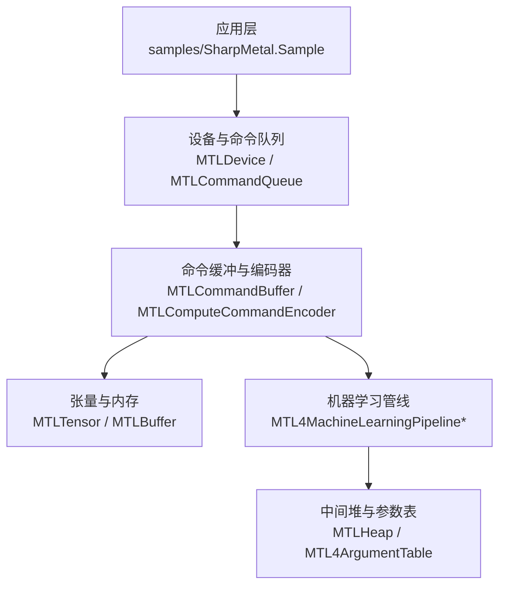
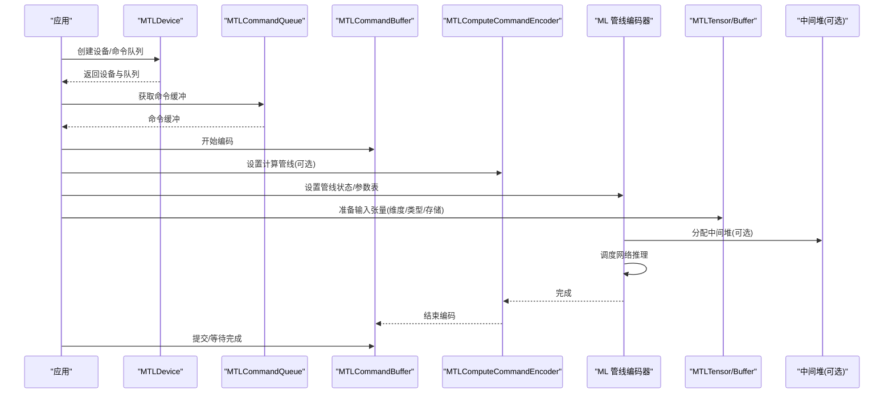
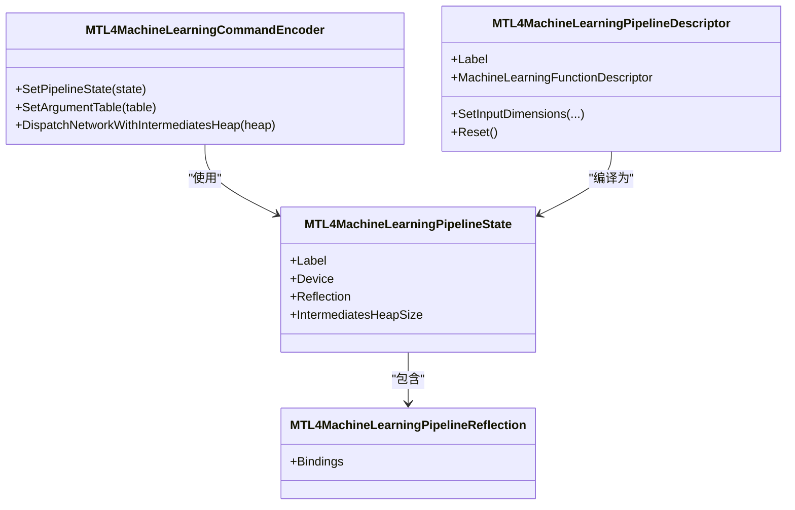
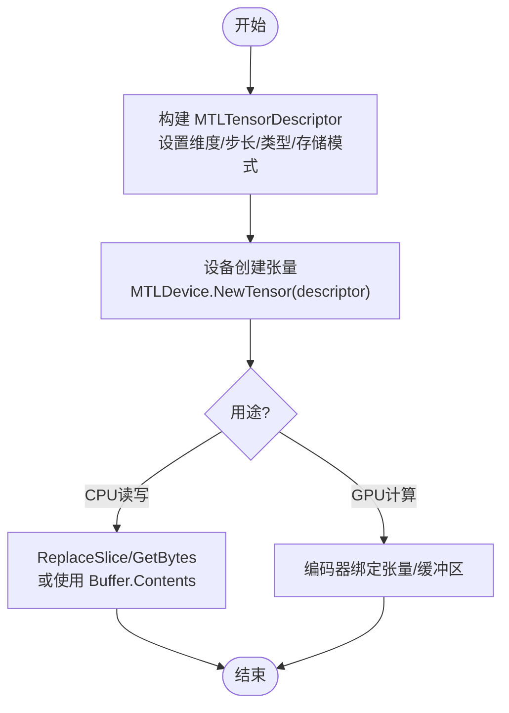
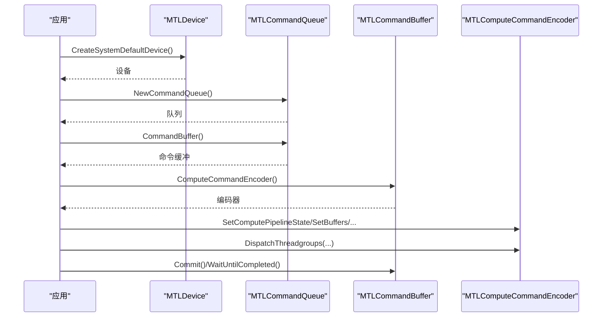
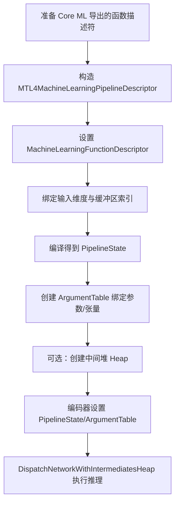
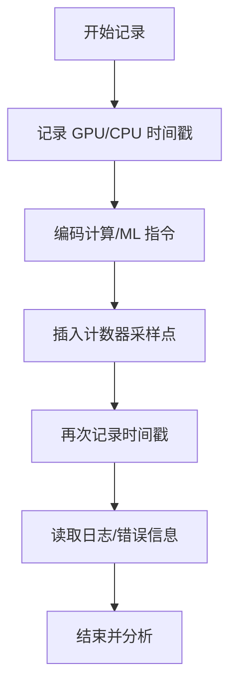
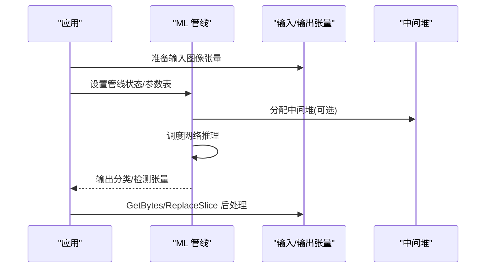
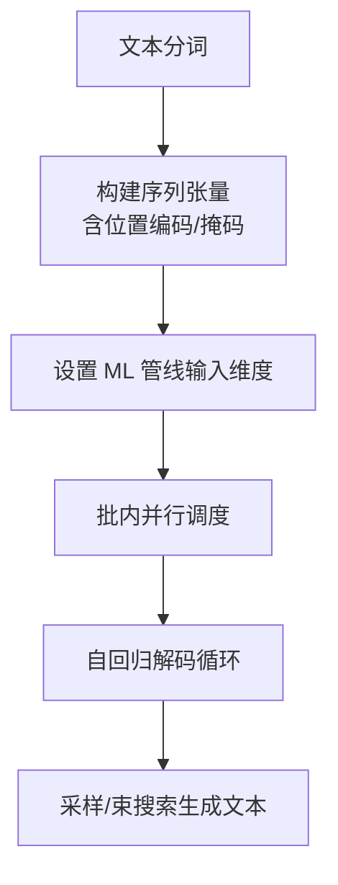
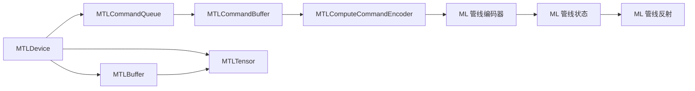

# 机器学习管道

<cite>
**本文引用的文件**
- [README.md](file://README.md)
- [DESIGN.md](file://DESIGN.md)
- [MTL4MachineLearningPipeline.cs](file://src/SharpMetal/Metal/MTL4MachineLearningPipeline.cs)
- [MTLTensor.cs](file://src/SharpMetal/Metal/MTLTensor.cs)
- [MTLDevice.cs](file://src/SharpMetal/Metal/MTLDevice.cs)
- [MTLComputeCommandEncoder.cs](file://src/SharpMetal/Metal/MTLComputeCommandEncoder.cs)
- [MTLBuffer.cs](file://src/SharpMetal/Metal/MTLBuffer.cs)
- [MTLCommandQueue.cs](file://src/SharpMetal/Metal/MTLCommandQueue.cs)
- [MTLCommandBuffer.cs](file://src/SharpMetal/Metal/MTLCommandBuffer.cs)
- [Program.cs](file://samples/SharpMetal.Sample/Program.cs)
</cite>

## 目录
1. [简介](#简介)
2. [项目结构](#项目结构)
3. [核心组件](#核心组件)
4. [架构总览](#架构总览)
5. [详细组件分析](#详细组件分析)
6. [依赖关系分析](#依赖关系分析)
7. [性能考量](#性能考量)
8. [故障排查指南](#故障排查指南)
9. [结论](#结论)
10. [附录](#附录)

## 简介
本文件面向在 Apple 平台使用 .NET 进行 GPU 加速机器学习推理的开发者，基于 SharpMetal 提供的 Metal 绑定，系统阐述机器学习管道的配置与执行流程、张量数据处理、模型加载与执行优化、与 Core ML 框架的集成方式、性能监控与调试方法，以及深度学习模型在 GPU 上的部署与优化技巧。内容同时提供图像识别、自然语言处理等典型应用场景的实践指引。

## 项目结构
仓库采用分层组织：
- src/SharpMetal：运行时绑定（Foundation、Metal、QuartzCore、ObjectiveCCore 等）
- samples/SharpMetal.Sample：可运行的示例程序
- docs/：设计与验证文档
- eng/：自动化验证脚本

图表来源
- [Program.cs:10-45](file://samples/SharpMetal.Sample/Program.cs#L10-L45)
- [MTLDevice.cs:306-339](file://src/SharpMetal/Metal/MTLDevice.cs#L306-L339)
- [MTLCommandQueue.cs:44-109](file://src/SharpMetal/Metal/MTLCommandQueue.cs#L44-L109)
- [MTLCommandBuffer.cs:116-223](file://src/SharpMetal/Metal/MTLCommandBuffer.cs#L116-L223)
- [MTLComputeCommandEncoder.cs:20-298](file://src/SharpMetal/Metal/MTLComputeCommandEncoder.cs#L20-L298)
- [MTL4MachineLearningPipeline.cs:6-127](file://src/SharpMetal/Metal/MTL4MachineLearningPipeline.cs#L6-L127)
- [MTLTensor.cs:6-198](file://src/SharpMetal/Metal/MTLTensor.cs#L6-L198)
- [MTLBuffer.cs:6-115](file://src/SharpMetal/Metal/MTLBuffer.cs#L6-L115)

章节来源
- [README.md:1-23](file://README.md#L1-L23)
- [DESIGN.md:1-12](file://DESIGN.md#L1-L12)

## 核心组件
- 设备与资源创建：通过 MTLDevice 获取默认设备并创建命令队列、缓冲区、纹理、库和管线状态。
- 命令流：MTLCommandQueue 管理命令缓冲；MTLCommandBuffer 承载具体编码；编码器负责设置管线、参数、调度计算或渲染。
- 张量抽象：MTLTensor 及其描述符 MTLTensorDescriptor、维度 MTLTensorExtents，用于统一表达多维数据布局、数据类型与存储模式。
- 机器学习管线：MTL4MachineLearningPipelineDescriptor/State/Reflection/CommandEncoder 提供网络级推理的专用接口，支持输入维度绑定、参数表与中间堆分配。

章节来源
- [MTLDevice.cs:306-449](file://src/SharpMetal/Metal/MTLDevice.cs#L306-L449)
- [MTLCommandQueue.cs:44-109](file://src/SharpMetal/Metal/MTLCommandQueue.cs#L44-L109)
- [MTLCommandBuffer.cs:116-223](file://src/SharpMetal/Metal/MTLCommandBuffer.cs#L116-L223)
- [MTLComputeCommandEncoder.cs:20-298](file://src/SharpMetal/Metal/MTLComputeCommandEncoder.cs#L20-L298)
- [MTLTensor.cs:6-198](file://src/SharpMetal/Metal/MTLTensor.cs#L6-L198)
- [MTL4MachineLearningPipeline.cs:6-127](file://src/SharpMetal/Metal/MTL4MachineLearningPipeline.cs#L6-L127)

## 架构总览
下图展示从应用到 GPU 执行的端到端路径，包括机器学习管线与张量数据流转。

图表来源
- [MTLDevice.cs:306-339](file://src/SharpMetal/Metal/MTLDevice.cs#L306-L339)
- [MTLCommandQueue.cs:44-109](file://src/SharpMetal/Metal/MTLCommandQueue.cs#L44-L109)
- [MTLCommandBuffer.cs:116-223](file://src/SharpMetal/Metal/MTLCommandBuffer.cs#L116-L223)
- [MTLComputeCommandEncoder.cs:20-298](file://src/SharpMetal/Metal/MTLComputeCommandEncoder.cs#L20-L298)
- [MTL4MachineLearningPipeline.cs:77-127](file://src/SharpMetal/Metal/MTL4MachineLearningPipeline.cs#L77-L127)
- [MTLTensor.cs:67-198](file://src/SharpMetal/Metal/MTLTensor.cs#L67-L198)

## 详细组件分析

### 机器学习管线组件
- 描述符：MTL4MachineLearningPipelineDescriptor
  - 设置标签、机器学习函数描述符、输入维度绑定（按 bufferIndex 或范围）。
- 反射：MTL4MachineLearningPipelineReflection
  - 暴露 bindings，便于动态检查参数与张量布局。
- 状态：MTL4MachineLearningPipelineState
  - 关联设备、标签、反射信息，提供中间堆大小查询。
- 编码器：MTL4MachineLearningCommandEncoder
  - 设置管线状态、参数表，并通过中间堆调度网络推理。

图表来源
- [MTL4MachineLearningPipeline.cs:6-127](file://src/SharpMetal/Metal/MTL4MachineLearningPipeline.cs#L6-L127)

章节来源
- [MTL4MachineLearningPipeline.cs:6-127](file://src/SharpMetal/Metal/MTL4MachineLearningPipeline.cs#L6-L127)

### 张量与内存
- 数据类型与用途：MTLTensorDataType、MTLTensorUsage（Compute/Render/MachineLearning），用于声明张量的语义与访问方式。
- 维度与步长：MTLTensorExtents 表示 rank 与各维 extent；MTLTensorDescriptor 组合 Dimensions、Strides、DataType、Usage、ResourceOptions、CpuCacheMode、StorageMode、HazardTrackingMode。
- 张量对象：MTLTensor 提供 Device、Label、GpuResourceID、Buffer、BufferOffset、Strides、Dimensions、DataType、Usage，以及 ReplaceSlice/GetBytes 实现 CPU/GPU 间数据交换。
- 缓冲区：MTLBuffer 提供 Contents、Length、StorageMode、CpuCacheMode、NewTensor 等能力，支持将连续内存作为张量视图。

图表来源
- [MTLTensor.cs:6-198](file://src/SharpMetal/Metal/MTLTensor.cs#L6-L198)
- [MTLBuffer.cs:6-115](file://src/SharpMetal/Metal/MTLBuffer.cs#L6-L115)
- [MTLDevice.cs:706-714](file://src/SharpMetal/Metal/MTLDevice.cs#L706-L714)

章节来源
- [MTLTensor.cs:6-198](file://src/SharpMetal/Metal/MTLTensor.cs#L6-L198)
- [MTLBuffer.cs:6-115](file://src/SharpMetal/Metal/MTLBuffer.cs#L6-L115)
- [MTLDevice.cs:706-714](file://src/SharpMetal/Metal/MTLDevice.cs#L706-L714)

### 命令流与执行
- 设备与队列：MTLDevice.CreateSystemDefaultDevice 获取设备；NewCommandQueue 创建队列。
- 命令缓冲：MTLCommandBuffer 提供 ComputeCommandEncoder、BlitCommandEncoder、事件/时间戳、日志等。
- 编码器：MTLComputeCommandEncoder 支持设置管线、缓冲区/纹理/采样器、线程组调度、内存屏障、计数器采样等。

图表来源
- [MTLDevice.cs:306-339](file://src/SharpMetal/Metal/MTLDevice.cs#L306-L339)
- [MTLCommandQueue.cs:44-109](file://src/SharpMetal/Metal/MTLCommandQueue.cs#L44-L109)
- [MTLCommandBuffer.cs:116-223](file://src/SharpMetal/Metal/MTLCommandBuffer.cs#L116-L223)
- [MTLComputeCommandEncoder.cs:20-298](file://src/SharpMetal/Metal/MTLComputeCommandEncoder.cs#L20-L298)

章节来源
- [MTLDevice.cs:306-339](file://src/SharpMetal/Metal/MTLDevice.cs#L306-L339)
- [MTLCommandQueue.cs:44-109](file://src/SharpMetal/Metal/MTLCommandQueue.cs#L44-L109)
- [MTLCommandBuffer.cs:116-223](file://src/SharpMetal/Metal/MTLCommandBuffer.cs#L116-L223)
- [MTLComputeCommandEncoder.cs:20-298](file://src/SharpMetal/Metal/MTLComputeCommandEncoder.cs#L20-L298)

### 与 Core ML 的集成
- 机器学习管线描述符中的 MachineLearningFunctionDescriptor 指向由 Core ML 导出的 Metal 内核函数集合，用于执行网络前向。
- 通过 SetInputDimensions 将输入张量维度与缓冲区索引绑定，使运行时能正确解析张量布局。
- 使用 MTL4MachineLearningCommandEncoder.DispatchNetworkWithIntermediatesHeap 指定中间结果堆以优化内存复用。

图表来源
- [MTL4MachineLearningPipeline.cs:16-58](file://src/SharpMetal/Metal/MTL4MachineLearningPipeline.cs#L16-L58)
- [MTL4MachineLearningPipeline.cs:99-127](file://src/SharpMetal/Metal/MTL4MachineLearningPipeline.cs#L99-L127)

章节来源
- [MTL4MachineLearningPipeline.cs:16-58](file://src/SharpMetal/Metal/MTL4MachineLearningPipeline.cs#L16-L58)
- [MTL4MachineLearningPipeline.cs:99-127](file://src/SharpMetal/Metal/MTL4MachineLearningPipeline.cs#L99-L127)

### 性能监控与调试
- 命令缓冲时间戳：KernelStartTime/KernelEndTime、GPUStartTime/GPUEndTime 可用于评估内核执行耗时。
- 计数器采样：MTLComputeCommandEncoder.SampleCountersInBuffer 可在关键位置插入计数器采样点，结合设备计数器集进行分析。
- 日志与捕获：MTLCommandQueue/MTLCommandBuffer 支持 LogState 与调试边界；编码器支持 Push/PopDebugGroup、InsertDebugSignpost。
- 错误诊断：MTLCommandBuffer.Error 与状态枚举帮助定位超时、缺页、设备移除等问题。

图表来源
- [MTLCommandBuffer.cs:136-148](file://src/SharpMetal/Metal/MTLCommandBuffer.cs#L136-L148)
- [MTLCommandBuffer.cs:146-148](file://src/SharpMetal/Metal/MTLCommandBuffer.cs#L146-L148)
- [MTLComputeCommandEncoder.cs:245-248](file://src/SharpMetal/Metal/MTLComputeCommandEncoder.cs#L245-L248)
- [MTLCommandQueue.cs:24-28](file://src/SharpMetal/Metal/MTLCommandQueue.cs#L24-L28)

章节来源
- [MTLCommandBuffer.cs:136-148](file://src/SharpMetal/Metal/MTLCommandBuffer.cs#L136-L148)
- [MTLComputeCommandEncoder.cs:245-248](file://src/SharpMetal/Metal/MTLComputeCommandEncoder.cs#L245-L248)
- [MTLCommandQueue.cs:24-28](file://src/SharpMetal/Metal/MTLCommandQueue.cs#L24-L28)

### 实际应用示例

#### 图像识别（CNN）
- 输入预处理：将图像像素转换为 MTLTensorDescriptor 指定的数据类型（如 Float16/BFloat16）、维度（NCHW/NHWC）与存储模式（统一内存或 GPU 专用）。
- 模型加载：使用 Core ML 导出的 Metal 函数描述符构建机器学习管线，绑定输入维度与缓冲区索引。
- 推理执行：通过参数表绑定权重与激活，必要时分配中间堆以减少内存碎片。
- 输出后处理：读取输出张量，进行归一化、阈值化、类别映射等。

图表来源
- [MTL4MachineLearningPipeline.cs:77-127](file://src/SharpMetal/Metal/MTL4MachineLearningPipeline.cs#L77-L127)
- [MTLTensor.cs:174-182](file://src/SharpMetal/Metal/MTLTensor.cs#L174-L182)

#### 自然语言处理（Transformer/RNN）
- 词元序列：将文本转为整数序列，填充/截断至固定长度，封装为张量。
- 注意力与掩码：利用张量步长与维度描述控制掩码矩阵布局，避免不必要的拷贝。
- 批处理：通过批量维度与并行调度提升吞吐；合理使用中间堆缓存 KV 状态。
- 解码策略：自回归生成时，增量更新上下文张量，减少重复计算。

图表来源
- [MTLTensor.cs:67-198](file://src/SharpMetal/Metal/MTLTensor.cs#L67-L198)
- [MTL4MachineLearningPipeline.cs:16-58](file://src/SharpMetal/Metal/MTL4MachineLearningPipeline.cs#L16-L58)

## 依赖关系分析
- 设备依赖：所有资源（缓冲区、纹理、库、管线）均依附于 MTLDevice。
- 命令流依赖：命令缓冲来自命令队列；编码器来自命令缓冲；机器学习编码器依赖管线状态与参数表。
- 张量依赖：张量可由设备直接创建，也可由缓冲区派生视图；其生命周期需与命令缓冲同步。
- 外部依赖：Core ML 导出的 Metal 函数通过机器学习函数描述符接入。

图表来源
- [MTLDevice.cs:306-449](file://src/SharpMetal/Metal/MTLDevice.cs#L306-L449)
- [MTLCommandQueue.cs:44-109](file://src/SharpMetal/Metal/MTLCommandQueue.cs#L44-L109)
- [MTLCommandBuffer.cs:116-223](file://src/SharpMetal/Metal/MTLCommandBuffer.cs#L116-L223)
- [MTLComputeCommandEncoder.cs:20-298](file://src/SharpMetal/Metal/MTLComputeCommandEncoder.cs#L20-L298)
- [MTL4MachineLearningPipeline.cs:6-127](file://src/SharpMetal/Metal/MTL4MachineLearningPipeline.cs#L6-L127)
- [MTLTensor.cs:67-198](file://src/SharpMetal/Metal/MTLTensor.cs#L67-L198)
- [MTLBuffer.cs:6-115](file://src/SharpMetal/Metal/MTLBuffer.cs#L6-L115)

章节来源
- [MTLDevice.cs:306-449](file://src/SharpMetal/Metal/MTLDevice.cs#L306-L449)
- [MTLCommandQueue.cs:44-109](file://src/SharpMetal/Metal/MTLCommandQueue.cs#L44-L109)
- [MTLCommandBuffer.cs:116-223](file://src/SharpMetal/Metal/MTLCommandBuffer.cs#L116-L223)
- [MTLComputeCommandEncoder.cs:20-298](file://src/SharpMetal/Metal/MTLComputeCommandEncoder.cs#L20-L298)
- [MTL4MachineLearningPipeline.cs:6-127](file://src/SharpMetal/Metal/MTL4MachineLearningPipeline.cs#L6-L127)
- [MTLTensor.cs:67-198](file://src/SharpMetal/Metal/MTLTensor.cs#L67-L198)
- [MTLBuffer.cs:6-115](file://src/SharpMetal/Metal/MTLBuffer.cs#L6-L115)

## 性能考量
- 内存与存储模式
  - 根据访问路径选择 StorageMode 与 CpuCacheMode，减少跨域拷贝；对频繁读写的张量优先使用共享内存。
  - 合理设置 ResourceOptions 与 HazardTrackingMode，平衡一致性与开销。
- 张量布局
  - 对齐步长与维度，避免非连续访问；尽量使用连续内存块以降低带宽压力。
- 批处理与并行
  - 增大 Batch 维度并结合并发调度；注意线程组大小与设备 MaxThreadsPerThreadgroup 限制。
- 中间堆复用
  - 对多阶段网络，复用中间堆降低分配/释放成本；依据 IntermediatesHeapSize 预估容量。
- 计时与计数
  - 使用命令缓冲时间戳与计数器采样定位瓶颈；结合日志与调试标记精确定位热点。

[本节为通用指导，不直接分析具体文件]

## 故障排查指南
- 平台与 ABI
  - 示例程序在运行前会校验目标平台与 ABI；若不在 Apple 平台或 ABI 不匹配，将阻止原生执行。
- 常见错误
  - 命令缓冲错误：Timeout/PageFault/OutOfMemory/InvalidResource 等，结合 Error 属性与日志定位。
  - 张量错误：InvalidDescriptor/InternalError，检查维度、步长、数据类型与存储模式是否一致。
- 调试手段
  - 使用 Push/PopDebugGroup、InsertDebugSignpost 标注关键阶段；开启 LogState 收集日志。
  - 通过 SampleCountersInBuffer 插入计数器采样点，分析 GPU 利用率与带宽。

章节来源
- [Program.cs:10-45](file://samples/SharpMetal.Sample/Program.cs#L10-L45)
- [MTLCommandBuffer.cs:146-148](file://src/SharpMetal/Metal/MTLCommandBuffer.cs#L146-L148)
- [MTLComputeCommandEncoder.cs:245-248](file://src/SharpMetal/Metal/MTLComputeCommandEncoder.cs#L245-L248)
- [MTLCommandQueue.cs:24-28](file://src/SharpMetal/Metal/MTLCommandQueue.cs#L24-L28)

## 结论
SharpMetal 提供了完整的 Metal 低层绑定，使得在 .NET 中构建高性能机器学习推理管道成为可能。借助 MTL4MachineLearningPipeline 系列接口，开发者可以无缝对接 Core ML 导出的模型，并通过张量抽象、命令流与性能监控工具链，实现高效的 GPU 推理。结合合理的内存布局、批处理与中间堆复用策略，可在图像识别与自然语言处理等任务中获得稳定且可扩展的性能表现。

## 附录
- 快速上手
  - 参考示例程序了解设备初始化、缓冲区读写与基本命令流。
- 最佳实践清单
  - 明确张量数据类型与存储模式；对齐维度与步长；使用中间堆；启用计时与计数器；谨慎管理资源生命周期。

[本节为补充说明，不直接分析具体文件]