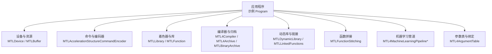
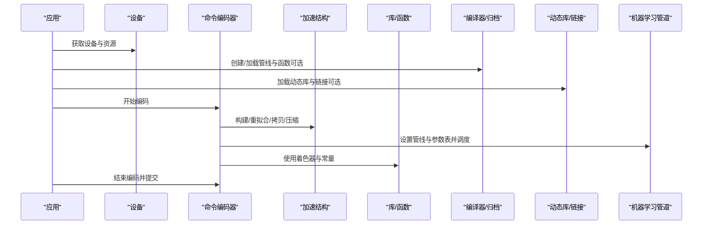
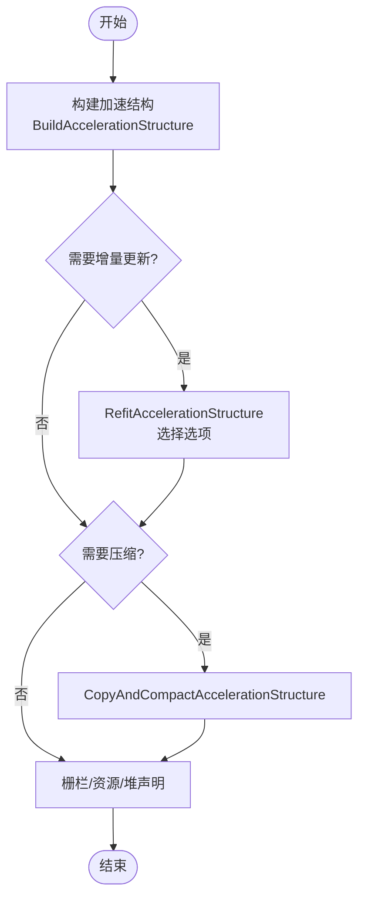
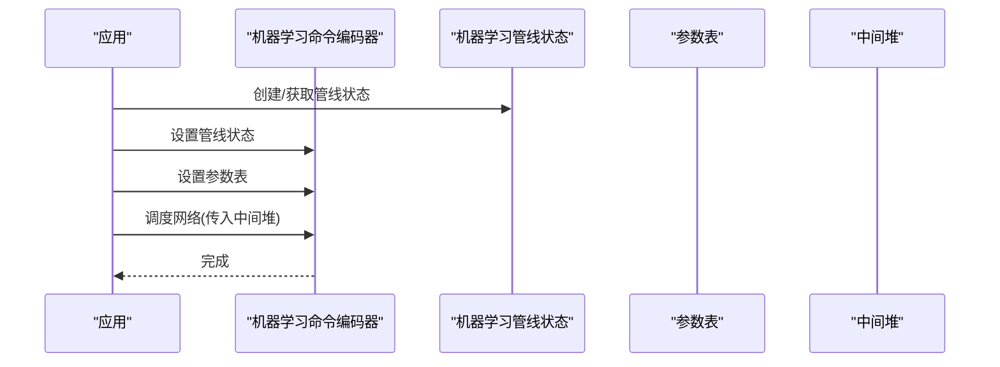
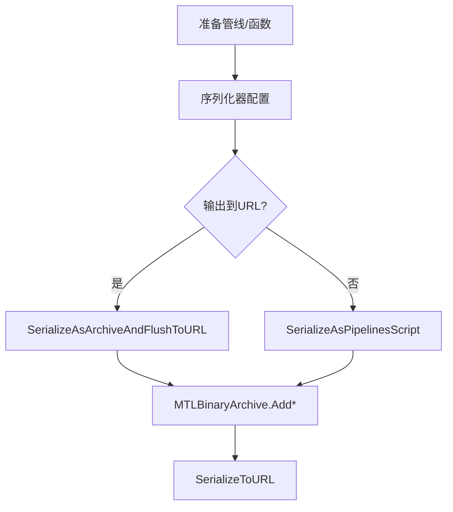
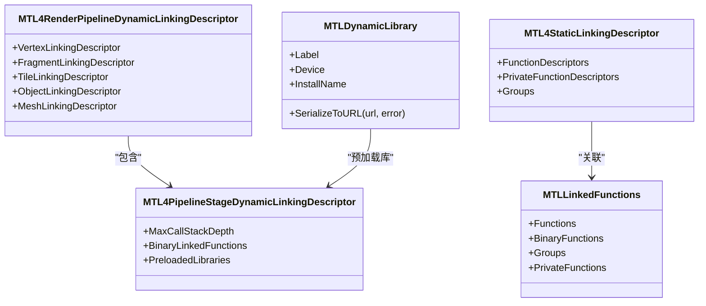
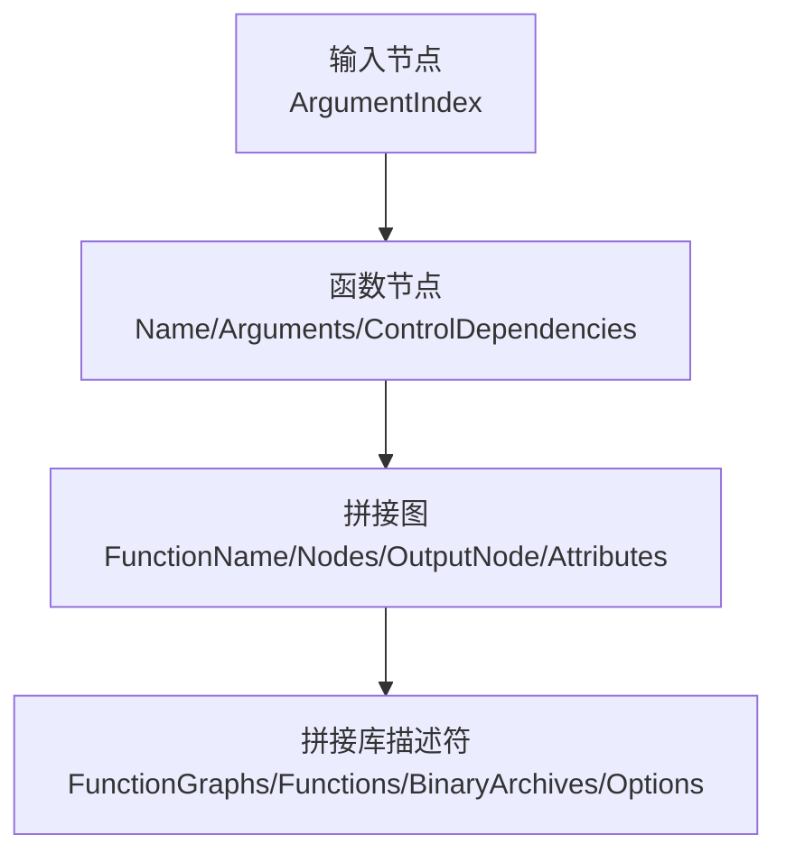
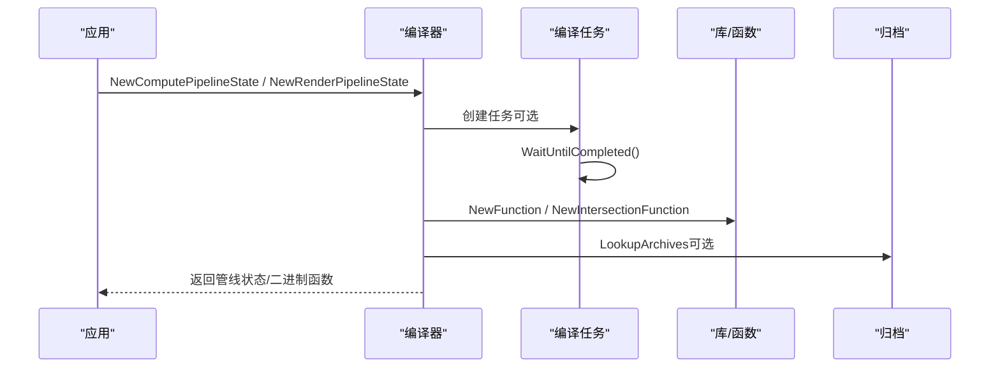
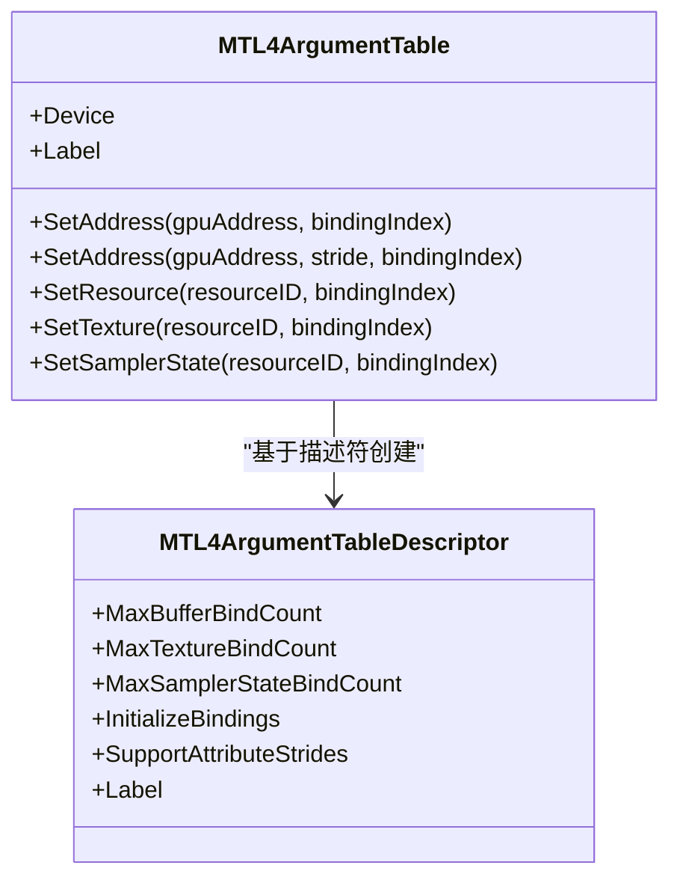
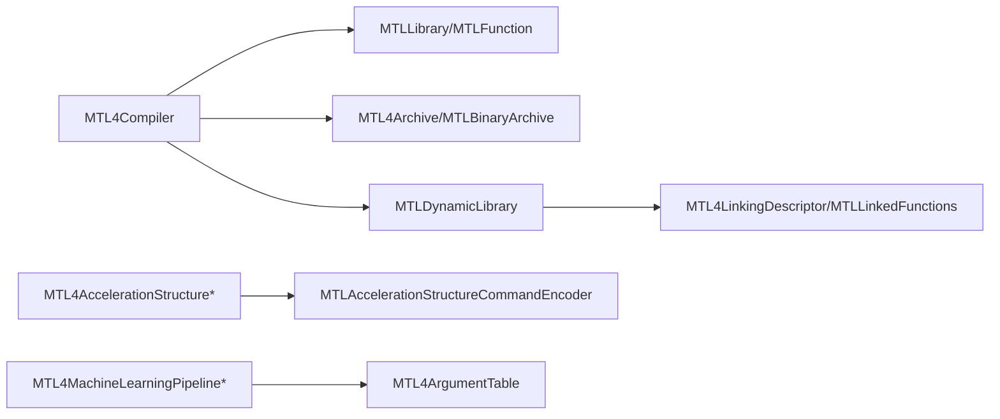

# 高级特性

<cite>
**本文引用的文件**
- [README.md](file://README.md)
- [DESIGN.md](file://DESIGN.md)
- [Program.cs](file://samples/SharpMetal.Sample/Program.cs)
- [MTL4AccelerationStructure.cs](file://src/SharpMetal/Metal/MTL4AccelerationStructure.cs)
- [MTLAccelerationStructureCommandEncoder.cs](file://src/SharpMetal/Metal/MTLAccelerationStructureCommandEncoder.cs)
- [MTLFunctionDescriptor.cs](file://src/SharpMetal/Metal/MTLFunctionDescriptor.cs)
- [MTLLibrary.cs](file://src/SharpMetal/Metal/MTLLibrary.cs)
- [MTL4BinaryFunction.cs](file://src/SharpMetal/Metal/MTL4BinaryFunction.cs)
- [MTL4Compiler.cs](file://src/SharpMetal/Metal/MTL4Compiler.cs)
- [MTL4Archive.cs](file://src/SharpMetal/Metal/MTL4Archive.cs)
- [MTLBinaryArchive.cs](file://src/SharpMetal/Metal/MTLBinaryArchive.cs)
- [MTLDynamicLibrary.cs](file://src/SharpMetal/Metal/MTLDynamicLibrary.cs)
- [MTLFunctionStitching.cs](file://src/SharpMetal/Metal/MTLFunctionStitching.cs)
- [MTLLinkedFunctions.cs](file://src/SharpMetal/Metal/MTLLinkedFunctions.cs)
- [MTL4LinkingDescriptor.cs](file://src/SharpMetal/Metal/MTL4LinkingDescriptor.cs)
- [MTL4ArgumentTable.cs](file://src/SharpMetal/Metal/MTL4ArgumentTable.cs)
- [MTL4MachineLearningPipeline.cs](file://src/SharpMetal/Metal/MTL4MachineLearningPipeline.cs)
</cite>

## 目录
1. [简介](#简介)
2. [项目结构](#项目结构)
3. [核心组件](#核心组件)
4. [架构总览](#架构总览)
5. [详细组件分析](#详细组件分析)
6. [依赖关系分析](#依赖关系分析)
7. [性能考量](#性能考量)
8. [故障排查指南](#故障排查指南)
9. [结论](#结论)
10. [附录](#附录)

## 简介
本文件聚焦 SharpMetal 中 Metal 的高级特性，覆盖加速结构构建与光线追踪、机器学习管道、二进制归档、动态库加载、函数拼接与链接、运行时编译等现代图形技术。同时提供性能分析与调试工具使用建议，以及复杂图形应用的高级优化技巧与最佳实践。内容基于仓库中的实际类型与方法映射，确保可追溯与可验证。

## 项目结构
- src/SharpMetal/Metal：包含大量对 Apple Metal API 的 C# 绑定，涵盖管线、命令编码、资源、库与编译器相关类型。
- samples/SharpMetal.Sample：最小可运行示例，演示设备获取与共享缓冲读写。
- docs/：设计说明与验证流程。
- eng/：自动化验证脚本。

**图示来源**
- [Program.cs:10-45](file://samples/SharpMetal.Sample/Program.cs#L10-L45)
- [MTLAccelerationStructureCommandEncoder.cs:50-83](file://src/SharpMetal/Metal/MTLAccelerationStructureCommandEncoder.cs#L50-L83)
- [MTLLibrary.cs:347-399](file://src/SharpMetal/Metal/MTLLibrary.cs#L347-L399)
- [MTL4Compiler.cs:86-163](file://src/SharpMetal/Metal/MTL4Compiler.cs#L86-L163)
- [MTL4Archive.cs:12-58](file://src/SharpMetal/Metal/MTL4Archive.cs#L12-L58)
- [MTLBinaryArchive.cs:36-95](file://src/SharpMetal/Metal/MTLBinaryArchive.cs#L36-L95)
- [MTLDynamicLibrary.cs:16-42](file://src/SharpMetal/Metal/MTLDynamicLibrary.cs#L16-L42)
- [MTLFunctionStitching.cs:117-211](file://src/SharpMetal/Metal/MTLFunctionStitching.cs#L117-L211)
- [MTL4MachineLearningPipeline.cs:6-125](file://src/SharpMetal/Metal/MTL4MachineLearningPipeline.cs#L6-L125)
- [MTL4ArgumentTable.cs:6-111](file://src/SharpMetal/Metal/MTL4ArgumentTable.cs#L6-L111)

**章节来源**
- [README.md:1-23](file://README.md#L1-L23)
- [DESIGN.md:1-12](file://DESIGN.md#L1-L12)
- [Program.cs:10-45](file://samples/SharpMetal.Sample/Program.cs#L10-L45)

## 核心组件
- 加速结构与光线追踪
  - 描述符族：基础几何、三角形、包围盒、曲线及其运动变体，实例化描述符与间接实例描述符，支持顶点/索引/控制点/半径等多缓冲配置与变换矩阵布局。
  - 构建与更新：通过命令编码器执行构建、重拟合、拷贝与压缩，并支持写入紧凑大小、栅栏同步与资源/堆声明。
- 机器学习管道
  - 描述符、反射与状态对象；命令编码器设置管线与参数表，并使用中间堆调度网络推理。
- 二进制归档与序列化
  - 管线数据序列化器与归档对象，支持将管线或函数集序列化为归档或脚本，便于离线预编译与分发。
- 动态库加载与链接
  - 动态库创建、安装名、序列化；静态/动态链接描述符，按阶段（顶点/片段/网格等）注入二进制函数与预加载库。
- 函数拼接与现代管线
  - 以图形式组合节点与输入，生成拼接库；结合链接函数实现模块化管线组装。
- 运行时编译与任务
  - 编译器接口提供管线状态、二进制函数、动态库的创建；任务选项支持查找归档、异步等待完成。

**章节来源**
- [MTL4AccelerationStructure.cs:7-796](file://src/SharpMetal/Metal/MTL4AccelerationStructure.cs#L7-L796)
- [MTLAccelerationStructureCommandEncoder.cs:6-141](file://src/SharpMetal/Metal/MTLAccelerationStructureCommandEncoder.cs#L6-L141)
- [MTL4MachineLearningPipeline.cs:6-125](file://src/SharpMetal/Metal/MTL4MachineLearningPipeline.cs#L6-L125)
- [MTL4Archive.cs:6-101](file://src/SharpMetal/Metal/MTL4Archive.cs#L6-L101)
- [MTLBinaryArchive.cs:6-95](file://src/SharpMetal/Metal/MTLBinaryArchive.cs#L6-L95)
- [MTLDynamicLibrary.cs:6-42](file://src/SharpMetal/Metal/MTLDynamicLibrary.cs#L6-L42)
- [MTL4LinkingDescriptor.cs:6-107](file://src/SharpMetal/Metal/MTL4LinkingDescriptor.cs#L6-L107)
- [MTLFunctionStitching.cs:6-211](file://src/SharpMetal/Metal/MTLFunctionStitching.cs#L6-L211)
- [MTL4Compiler.cs:6-163](file://src/SharpMetal/Metal/MTL4Compiler.cs#L6-L163)

## 架构总览
下图展示从应用到 GPU 的关键路径：应用通过设备与命令队列组织工作，使用命令编码器提交加速结构构建、渲染/计算任务；着色器与管线由库与编译器管理；归档与动态库用于跨进程/跨版本复用；函数拼接与链接实现模块化管线；机器学习管道在专用命令编码器中调度。

**图示来源**
- [MTLAccelerationStructureCommandEncoder.cs:50-83](file://src/SharpMetal/Metal/MTLAccelerationStructureCommandEncoder.cs#L50-L83)
- [MTL4MachineLearningPipeline.cs:99-125](file://src/SharpMetal/Metal/MTL4MachineLearningPipeline.cs#L99-L125)
- [MTL4Compiler.cs:100-148](file://src/SharpMetal/Metal/MTL4Compiler.cs#L100-L148)
- [MTLDynamicLibrary.cs:16-42](file://src/SharpMetal/Metal/MTLDynamicLibrary.cs#L16-L42)
- [MTLLibrary.cs:347-399](file://src/SharpMetal/Metal/MTLLibrary.cs#L347-L399)

## 详细组件分析

### 加速结构构建与光线追踪
- 几何描述符族
  - 三角形、包围盒、曲线及对应“运动”变体，支持多缓冲、步长、格式、段数、端盖、基类型等细粒度配置。
  - 实例描述符支持直接实例与间接实例（含最大计数缓冲），并提供运动变换缓冲与布局。
- 构建与更新
  - 构建：指定目标加速结构、描述符、暂存缓冲与偏移。
  - 重拟合：从源结构更新为新的描述符，输出至目标结构，支持选项（如仅更新顶点数据或逐图元数据）。
  - 拷贝与压缩：复制结构并写入紧凑尺寸，便于传输与存储。
  - 同步与资源：支持栅栏更新/等待、显式资源与堆声明，以及计数器采样。

**图示来源**
- [MTLAccelerationStructureCommandEncoder.cs:50-83](file://src/SharpMetal/Metal/MTLAccelerationStructureCommandEncoder.cs#L50-L83)
- [MTLAccelerationStructureCommandEncoder.cs:85-118](file://src/SharpMetal/Metal/MTLAccelerationStructureCommandEncoder.cs#L85-L118)

**章节来源**
- [MTL4AccelerationStructure.cs:7-796](file://src/SharpMetal/Metal/MTL4AccelerationStructure.cs#L7-L796)
- [MTLAccelerationStructureCommandEncoder.cs:6-141](file://src/SharpMetal/Metal/MTLAccelerationStructureCommandEncoder.cs#L6-L141)

### 机器学习管道
- 描述符与反射
  - 设置标签、机器学习函数描述符、输入维度（按缓冲索引或范围）、重置。
  - 反射暴露绑定信息，便于动态绑定与校验。
- 状态与命令
  - 状态对象提供标签、设备、反射与中间堆大小。
  - 命令编码器设置管线与参数表，并通过中间堆调度网络。

**图示来源**
- [MTL4MachineLearningPipeline.cs:6-125](file://src/SharpMetal/Metal/MTL4MachineLearningPipeline.cs#L6-L125)

**章节来源**
- [MTL4MachineLearningPipeline.cs:6-125](file://src/SharpMetal/Metal/MTL4MachineLearningPipeline.cs#L6-L125)

### 二进制归档与序列化
- 管线数据序列化器
  - 配置捕获描述符或二进制；可将管线数据序列化为归档并刷新到 URL，或生成管线脚本。
- 二进制归档
  - 添加各类管线函数（计算、渲染、瓦片、网格）与拼接库；序列化到 URL；也可添加单个函数。

**图示来源**
- [MTL4Archive.cs:60-101](file://src/SharpMetal/Metal/MTL4Archive.cs#L60-L101)
- [MTLBinaryArchive.cs:36-95](file://src/SharpMetal/Metal/MTLBinaryArchive.cs#L36-L95)

**章节来源**
- [MTL4Archive.cs:6-101](file://src/SharpMetal/Metal/MTL4Archive.cs#L6-L101)
- [MTLBinaryArchive.cs:6-95](file://src/SharpMetal/Metal/MTLBinaryArchive.cs#L6-L95)

### 动态库加载与链接
- 动态库
  - 创建动态库（从库或 URL），设置标签与安装名，序列化到 URL。
- 静态/动态链接
  - 静态链接描述符：函数描述符、私有函数、分组。
  - 阶段动态链接描述符：最大调用栈深度、二进制链接函数、预加载库。
  - 渲染管线阶段动态链接：顶点/片段/瓦片/对象/网格各阶段的链接描述符。
- 链接函数集合
  - 提供函数、二进制函数、分组与私有函数的集合能力。

**图示来源**
- [MTLDynamicLibrary.cs:16-42](file://src/SharpMetal/Metal/MTLDynamicLibrary.cs#L16-L42)
- [MTL4LinkingDescriptor.cs:6-107](file://src/SharpMetal/Metal/MTL4LinkingDescriptor.cs#L6-L107)
- [MTLLinkedFunctions.cs:6-50](file://src/SharpMetal/Metal/MTLLinkedFunctions.cs#L6-L50)

**章节来源**
- [MTLDynamicLibrary.cs:6-42](file://src/SharpMetal/Metal/MTLDynamicLibrary.cs#L6-L42)
- [MTL4LinkingDescriptor.cs:6-107](file://src/SharpMetal/Metal/MTL4LinkingDescriptor.cs#L6-L107)
- [MTLLinkedFunctions.cs:6-50](file://src/SharpMetal/Metal/MTLLinkedFunctions.cs#L6-L50)

### 函数拼接与现代管线
- 拼接图与节点
  - 输入节点绑定参数索引；函数节点定义名称、参数与控制依赖；图定义函数名、节点集合、输出节点与属性。
- 拼接库描述符
  - 函数图、函数列表、二进制归档与选项（如失败策略、脚本存储）。

**图示来源**
- [MTLFunctionStitching.cs:13-211](file://src/SharpMetal/Metal/MTLFunctionStitching.cs#L13-L211)

**章节来源**
- [MTLFunctionStitching.cs:6-211](file://src/SharpMetal/Metal/MTLFunctionStitching.cs#L6-L211)

### 运行时编译与任务
- 编译器
  - 创建库、动态库、管线状态、二进制函数与机器学习管线状态；支持通过描述符与动态链接描述符定制。
- 任务与选项
  - 任务状态机（已计划/编译中/完成），等待完成；任务选项支持查找归档。
- 函数与库
  - 函数描述符支持名称、特化名称、常量值、选项与二进制归档；库提供函数发现与创建。

**图示来源**
- [MTL4Compiler.cs:14-163](file://src/SharpMetal/Metal/MTL4Compiler.cs#L14-L163)
- [MTLFunctionDescriptor.cs:14-123](file://src/SharpMetal/Metal/MTLFunctionDescriptor.cs#L14-L123)
- [MTLLibrary.cs:347-399](file://src/SharpMetal/Metal/MTLLibrary.cs#L347-L399)

**章节来源**
- [MTL4Compiler.cs:6-163](file://src/SharpMetal/Metal/MTL4Compiler.cs#L6-L163)
- [MTLFunctionDescriptor.cs:6-123](file://src/SharpMetal/Metal/MTLFunctionDescriptor.cs#L6-L123)
- [MTLLibrary.cs:6-399](file://src/SharpMetal/Metal/MTLLibrary.cs#L6-L399)

### 参数表与绑定
- 参数表描述符
  - 最大绑定数量（缓冲/纹理/采样器）、是否初始化绑定、是否支持属性步长、标签。
- 参数表
  - 设置地址（支持属性步长）、资源、纹理、采样器绑定索引。

**图示来源**
- [MTL4ArgumentTable.cs:6-111](file://src/SharpMetal/Metal/MTL4ArgumentTable.cs#L6-L111)

**章节来源**
- [MTL4ArgumentTable.cs:6-111](file://src/SharpMetal/Metal/MTL4ArgumentTable.cs#L6-L111)

## 依赖关系分析
- 低耦合高内聚
  - 每个高级特性以独立描述符/状态/编码器封装，降低耦合度；通过统一设备与命令上下文进行协作。
- 关键依赖链
  - 编译器依赖库与函数描述符；归档依赖序列化器；动态库与链接描述符参与管线创建；加速结构命令编码器依赖描述符与缓冲区。
- 外部依赖
  - 所有绑定均依赖 ObjectiveC 运行时与系统框架；示例程序在 Apple 平台运行。

**图示来源**
- [MTL4Compiler.cs:86-163](file://src/SharpMetal/Metal/MTL4Compiler.cs#L86-L163)
- [MTLLibrary.cs:347-399](file://src/SharpMetal/Metal/MTLLibrary.cs#L347-L399)
- [MTL4Archive.cs:12-58](file://src/SharpMetal/Metal/MTL4Archive.cs#L12-L58)
- [MTLBinaryArchive.cs:36-95](file://src/SharpMetal/Metal/MTLBinaryArchive.cs#L36-L95)
- [MTLDynamicLibrary.cs:16-42](file://src/SharpMetal/Metal/MTLDynamicLibrary.cs#L16-L42)
- [MTL4LinkingDescriptor.cs:6-107](file://src/SharpMetal/Metal/MTL4LinkingDescriptor.cs#L6-L107)
- [MTLLinkedFunctions.cs:6-50](file://src/SharpMetal/Metal/MTLLinkedFunctions.cs#L6-L50)
- [MTL4AccelerationStructure.cs:7-796](file://src/SharpMetal/Metal/MTL4AccelerationStructure.cs#L7-L796)
- [MTLAccelerationStructureCommandEncoder.cs:50-83](file://src/SharpMetal/Metal/MTLAccelerationStructureCommandEncoder.cs#L50-L83)
- [MTL4MachineLearningPipeline.cs:6-125](file://src/SharpMetal/Metal/MTL4MachineLearningPipeline.cs#L6-L125)
- [MTL4ArgumentTable.cs:6-111](file://src/SharpMetal/Metal/MTL4ArgumentTable.cs#L6-L111)

**章节来源**
- [DESIGN.md:1-12](file://DESIGN.md#L1-L12)
- [Program.cs:10-45](file://samples/SharpMetal.Sample/Program.cs#L10-L45)

## 性能考量
- 加速结构
  - 优先使用重拟合与压缩减少重建成本；合理设置暂存缓冲大小与偏移；利用栅栏与资源/堆声明避免同步开销。
- 机器学习管道
  - 复用管线状态与参数表；根据中间堆大小规划内存；批量设置输入维度以减少状态切换。
- 二进制归档与动态库
  - 离线预编译与归档分发；按需加载动态库；使用链接描述符减少重复编译。
- 函数拼接与链接
  - 将通用逻辑拆分为可拼接单元；通过控制依赖优化分支；结合二进制归档提升启动速度。
- 运行时编译
  - 使用任务等待与查找归档降低首次编译延迟；谨慎开启日志与严格模式。

[本节为通用指导，不直接分析具体文件]

## 故障排查指南
- 平台与 ABI
  - 示例程序检查平台与 ABI 一致性；若不在 Apple 平台，将阻止原生负载。
- 错误码与异常
  - 动态库错误：无效文件、编译失败、未解析安装名、依赖加载失败、不支持。
  - 二进制归档错误：无效文件、意外元素、编译失败、内部错误。
  - 库错误：不支持、内部错误、编译失败/警告、函数未找到、文件未找到。
- 调试与诊断
  - 命令编码器支持调试组与调试标记；可插入采样点与计数器采样。
  - 函数与库提供标签与名称，便于定位问题。

**章节来源**
- [Program.cs:10-45](file://samples/SharpMetal.Sample/Program.cs#L10-L45)
- [MTLDynamicLibrary.cs:6-42](file://src/SharpMetal/Metal/MTLDynamicLibrary.cs#L6-L42)
- [MTLBinaryArchive.cs:6-95](file://src/SharpMetal/Metal/MTLBinaryArchive.cs#L6-L95)
- [MTLLibrary.cs:69-77](file://src/SharpMetal/Metal/MTLLibrary.cs#L69-L77)
- [MTLAccelerationStructureCommandEncoder.cs:35-48](file://src/SharpMetal/Metal/MTLAccelerationStructureCommandEncoder.cs#L35-L48)
- [MTLAccelerationStructureCommandEncoder.cs:115-118](file://src/SharpMetal/Metal/MTLAccelerationStructureCommandEncoder.cs#L115-L118)

## 结论
SharpMetal 提供了完整的 Metal 高级特性绑定，覆盖加速结构、机器学习、归档、动态库、函数拼接与运行时编译等现代图形技术。通过描述符、状态与命令编码器的清晰分层，开发者可在保持高性能的同时获得灵活的管线编排能力。结合归档与动态库可实现跨版本复用与按需加载；函数拼接与链接则有助于模块化与可维护性。建议在工程实践中优先采用离线预编译与归档、合理使用重拟合与压缩、并利用调试与计数器进行性能调优。

## 附录
- 快速参考
  - 加速结构构建：构建/重拟合/拷贝/压缩/栅栏/资源与堆声明。
  - 机器学习管道：描述符/反射/状态/命令编码器/中间堆。
  - 归档与序列化：序列化器/归档/URL 输出。
  - 动态库与链接：动态库/静态与阶段动态链接/链接函数集合。
  - 函数拼接：输入节点/函数节点/拼接图/拼接库描述符。
  - 运行时编译：编译器/任务/选项/函数与库。

[本节为概览性内容，不直接分析具体文件]