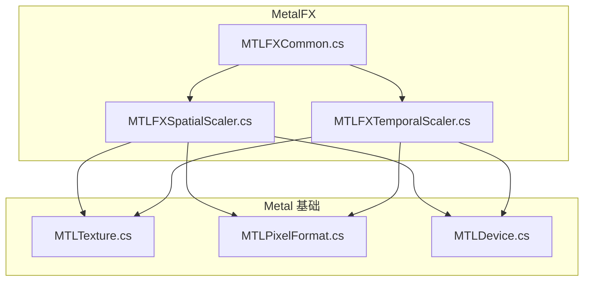
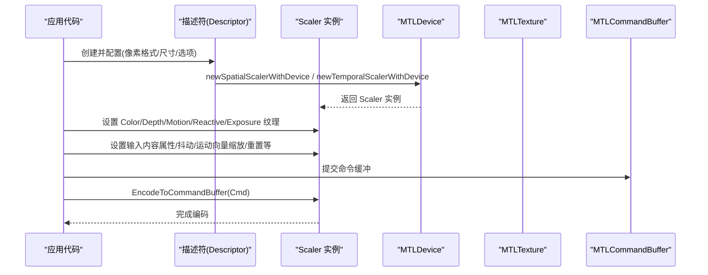
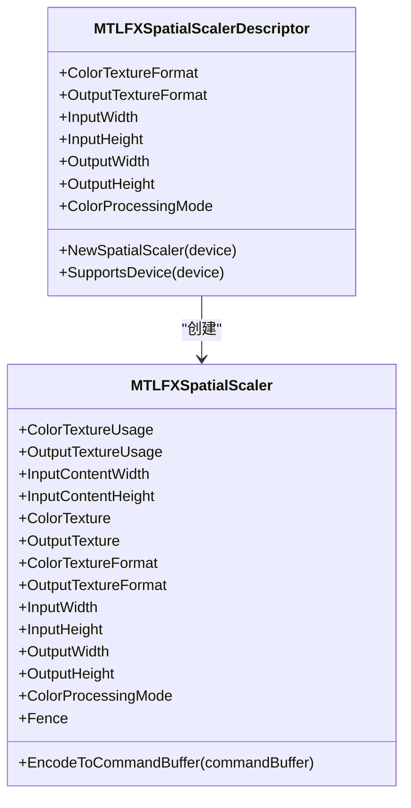
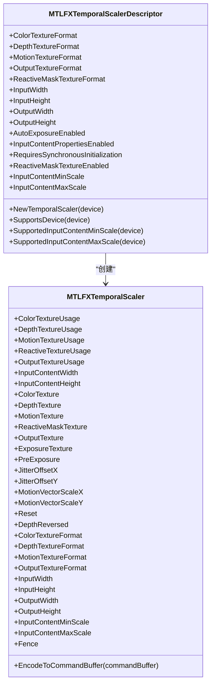
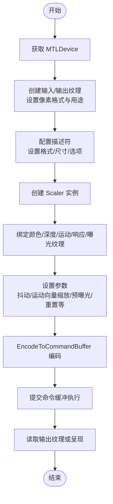
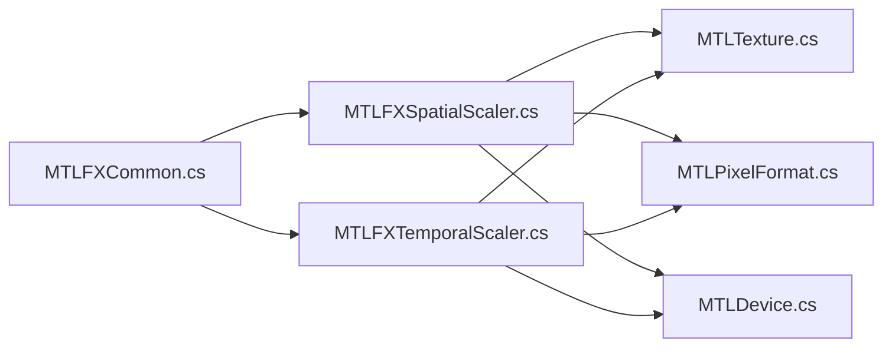

# MetalFX 图像处理

<cite>
**本文引用的文件**
- [MTLFXCommon.cs](file://src/SharpMetal/MetalFX/MTLFXCommon.cs)
- [MTLFXSpatialScaler.cs](file://src/SharpMetal/MetalFX/MTLFXSpatialScaler.cs)
- [MTLFXTemporalScaler.cs](file://src/SharpMetal/MetalFX/MTLFXTemporalScaler.cs)
- [MTLTexture.cs](file://src/SharpMetal/Metal/MTLTexture.cs)
- [MTLPixelFormat.cs](file://src/SharpMetal/Metal/MTLPixelFormat.cs)
- [MTLDevice.cs](file://src/SharpMetal/Metal/MTLDevice.cs)
</cite>

## 目录
1. [简介](#简介)
2. [项目结构](#项目结构)
3. [核心组件](#核心组件)
4. [架构总览](#架构总览)
5. [详细组件分析](#详细组件分析)
6. [依赖关系分析](#依赖关系分析)
7. [性能考虑](#性能考虑)
8. [故障排查指南](#故障排查指南)
9. [结论](#结论)
10. [附录](#附录)

## 简介
本文件面向使用 SharpMetal 的开发者，系统性说明 MetalFX 在该项目中的封装与用法，重点覆盖：
- 空间图像缩放（Spatial Scaling）与时间图像插值（Temporal Upscaling）的原理与应用场景
- MTLFXSpatialScaler 与 MTLFXTemporalScaler 的配置参数、生命周期与调用流程
- 完整的图像处理工作流示例：输入准备、处理执行、结果输出
- 性能优化技巧与最佳实践
- 与其他 Metal 组件（设备、纹理、命令缓冲等）的集成方式

## 项目结构
本项目将 MetalFX 相关类型集中在 src/SharpMetal/MetalFX 目录下，并通过 ObjectiveC 运行时桥接到系统框架。核心文件包括：
- MTLFXCommon.cs：定义与 MetalFX 交互所需的 Objective-C 选择器常量
- MTLFXSpatialScaler.cs：空间缩放描述符与实例
- MTLFXTemporalScaler.cs：时间插值描述符与实例
- 其他 Metal 基础类型（纹理、像素格式、设备等）用于数据绑定与资源管理

图表来源
- [MTLFXCommon.cs:6-83](file://src/SharpMetal/MetalFX/MTLFXCommon.cs#L6-L83)
- [MTLFXSpatialScaler.cs:13-76](file://src/SharpMetal/MetalFX/MTLFXSpatialScaler.cs#L13-L76)
- [MTLFXTemporalScaler.cs:6-127](file://src/SharpMetal/MetalFX/MTLFXTemporalScaler.cs#L6-L127)
- [MTLTexture.cs:75-200](file://src/SharpMetal/Metal/MTLTexture.cs#L75-L200)
- [MTLPixelFormat.cs:3-144](file://src/SharpMetal/Metal/MTLPixelFormat.cs#L3-L144)
- [MTLDevice.cs:187-200](file://src/SharpMetal/Metal/MTLDevice.cs#L187-L200)

章节来源
- [MTLFXCommon.cs:6-83](file://src/SharpMetal/MetalFX/MTLFXCommon.cs#L6-L83)
- [MTLFXSpatialScaler.cs:13-76](file://src/SharpMetal/MetalFX/MTLFXSpatialScaler.cs#L13-L76)
- [MTLFXTemporalScaler.cs:6-127](file://src/SharpMetal/MetalFX/MTLFXTemporalScaler.cs#L6-L127)

## 核心组件
- 选择器常量（MTLFXSelector）：集中声明与 MetalFX 对象交互所需的 Objective-C 方法名，供描述符与实例通过运行时消息调用。
- 空间缩放（MTLFXSpatialScalerDescriptor / MTLFXSpatialScaler）：负责单帧内基于像素的空间上采样/下采样，支持颜色处理模式、输入输出尺寸与纹理格式配置。
- 时间插值（MTLFXTemporalScalerDescriptor / MTLFXTemporalScaler）：在多帧间利用深度、运动矢量、响应掩码、曝光等信息进行高质量上采样，支持抖动偏移、运动向量缩放、重置标志等。

章节来源
- [MTLFXCommon.cs:6-83](file://src/SharpMetal/MetalFX/MTLFXCommon.cs#L6-L83)
- [MTLFXSpatialScaler.cs:6-167](file://src/SharpMetal/MetalFX/MTLFXSpatialScaler.cs#L6-L167)
- [MTLFXTemporalScaler.cs:6-314](file://src/SharpMetal/MetalFX/MTLFXTemporalScaler.cs#L6-L314)

## 架构总览
下图展示了从应用层到 MetalFX 再到 Metal 资源的整体调用关系。应用创建并配置描述符，生成对应的 Scaler 实例，设置纹理与参数后编码至命令缓冲执行。

图表来源
- [MTLFXSpatialScaler.cs:63-66](file://src/SharpMetal/MetalFX/MTLFXSpatialScaler.cs#L63-L66)
- [MTLFXTemporalScaler.cs:104-107](file://src/SharpMetal/MetalFX/MTLFXTemporalScaler.cs#L104-L107)
- [MTLFXSpatialScaler.cs:159-162](file://src/SharpMetal/MetalFX/MTLFXSpatialScaler.cs#L159-L162)
- [MTLFXTemporalScaler.cs:306-309](file://src/SharpMetal/MetalFX/MTLFXTemporalScaler.cs#L306-L309)
- [MTLTexture.cs:75-200](file://src/SharpMetal/Metal/MTLTexture.cs#L75-L200)

## 详细组件分析

### 空间图像缩放（MTLFXSpatialScaler）
- 算法原理与应用场景
  - 空间缩放针对单帧图像进行像素级重采样，适用于需要即时分辨率调整的场景，如 UI 缩放、预览渲染、离线批处理等。
  - 支持多种颜色处理模式以适配不同色彩空间与 HDR 管线。
- 关键配置项
  - 描述符：颜色纹理格式、输出纹理格式、输入宽高、输出宽高、颜色处理模式。
  - 实例：颜色/输出纹理、输入内容宽高、颜色处理模式、栅栏（同步）、编码入口。
- 使用方法
  - 通过描述符创建 Scaler 实例，设置输入/输出纹理及尺寸，最后编码到命令缓冲执行。

图表来源
- [MTLFXSpatialScaler.cs:13-76](file://src/SharpMetal/MetalFX/MTLFXSpatialScaler.cs#L13-L76)
- [MTLFXSpatialScaler.cs:78-167](file://src/SharpMetal/MetalFX/MTLFXSpatialScaler.cs#L78-L167)

章节来源
- [MTLFXSpatialScaler.cs:6-167](file://src/SharpMetal/MetalFX/MTLFXSpatialScaler.cs#L6-L167)

### 时间图像插值（MTLFXTemporalScaler）
- 算法原理与应用场景
  - 时间插值利用多帧信息（深度、运动矢量、响应掩码、曝光）进行跨帧重建与上采样，常用于实时渲染中提升有效分辨率与画质稳定性。
  - 通过抖动偏移与运动向量缩放控制重建质量与稳定性。
- 关键配置项
  - 描述符：颜色/深度/运动/输出/响应掩码纹理格式；输入/输出宽高；自动曝光、输入内容属性、同步初始化、响应掩码启用；输入内容最小/最大缩放。
  - 实例：各纹理引用与格式、输入内容宽高、预曝光、抖动偏移、运动向量缩放、重置标志、深度方向、栅栏、编码入口。
- 使用方法
  - 配置描述符后创建实例，逐帧提供颜色、深度、运动矢量、响应掩码与曝光纹理，必要时更新抖动与运动向量缩放，最后编码执行。

图表来源
- [MTLFXTemporalScaler.cs:6-127](file://src/SharpMetal/MetalFX/MTLFXTemporalScaler.cs#L6-L127)
- [MTLFXTemporalScaler.cs:129-314](file://src/SharpMetal/MetalFX/MTLFXTemporalScaler.cs#L129-L314)

章节来源
- [MTLFXTemporalScaler.cs:6-314](file://src/SharpMetal/MetalFX/MTLFXTemporalScaler.cs#L6-L314)

### 工作流程示例（完整步骤）
以下流程展示如何使用 MetalFX 完成一次“输入准备 → 处理执行 → 结果输出”的闭环。

图表来源
- [MTLTexture.cs:75-200](file://src/SharpMetal/Metal/MTLTexture.cs#L75-L200)
- [MTLFXSpatialScaler.cs:63-66](file://src/SharpMetal/MetalFX/MTLFXSpatialScaler.cs#L63-L66)
- [MTLFXTemporalScaler.cs:104-107](file://src/SharpMetal/MetalFX/MTLFXTemporalScaler.cs#L104-L107)
- [MTLFXSpatialScaler.cs:159-162](file://src/SharpMetal/MetalFX/MTLFXSpatialScaler.cs#L159-L162)
- [MTLFXTemporalScaler.cs:306-309](file://src/SharpMetal/MetalFX/MTLFXTemporalScaler.cs#L306-L309)

章节来源
- [MTLTexture.cs:75-200](file://src/SharpMetal/Metal/MTLTexture.cs#L75-L200)
- [MTLFXSpatialScaler.cs:63-66](file://src/SharpMetal/MetalFX/MTLFXSpatialScaler.cs#L63-L66)
- [MTLFXTemporalScaler.cs:104-107](file://src/SharpMetal/MetalFX/MTLFXTemporalScaler.cs#L104-L107)
- [MTLFXSpatialScaler.cs:159-162](file://src/SharpMetal/MetalFX/MTLFXSpatialScaler.cs#L159-L162)
- [MTLFXTemporalScaler.cs:306-309](file://src/SharpMetal/MetalFX/MTLFXTemporalScaler.cs#L306-L309)

## 依赖关系分析
- 耦合与内聚
  - MTLFXCommon 作为选择器中心，降低对具体 Objective-C 方法名的散落依赖，提高内聚性。
  - 描述符与实例分别承担“配置”和“运行期状态”，职责清晰，内聚良好。
- 直接/间接依赖
  - Scaler 依赖 MTLDevice 创建实例，依赖 MTLTexture 进行数据读写，依赖 MTLPixelFormat 指定像素格式。
  - 时间插值额外依赖深度、运动矢量、响应掩码与曝光纹理，形成更复杂的输入图。
- 外部集成点
  - 通过 ObjectiveCRuntime 的消息机制与系统 MetalFX 框架交互。
  - 与 Metal 命令缓冲、栅栏等同步原语协作，确保正确的执行顺序。

图表来源
- [MTLFXCommon.cs:6-83](file://src/SharpMetal/MetalFX/MTLFXCommon.cs#L6-L83)
- [MTLFXSpatialScaler.cs:13-167](file://src/SharpMetal/MetalFX/MTLFXSpatialScaler.cs#L13-L167)
- [MTLFXTemporalScaler.cs:6-314](file://src/SharpMetal/MetalFX/MTLFXTemporalScaler.cs#L6-L314)
- [MTLTexture.cs:75-200](file://src/SharpMetal/Metal/MTLTexture.cs#L75-L200)
- [MTLPixelFormat.cs:3-144](file://src/SharpMetal/Metal/MTLPixelFormat.cs#L3-L144)
- [MTLDevice.cs:187-200](file://src/SharpMetal/Metal/MTLDevice.cs#L187-L200)

章节来源
- [MTLFXCommon.cs:6-83](file://src/SharpMetal/MetalFX/MTLFXCommon.cs#L6-L83)
- [MTLFXSpatialScaler.cs:13-167](file://src/SharpMetal/MetalFX/MTLFXSpatialScaler.cs#L13-L167)
- [MTLFXTemporalScaler.cs:6-314](file://src/SharpMetal/MetalFX/MTLFXTemporalScaler.cs#L6-L314)

## 性能考虑
- 纹理格式与用途
  - 选择合适的像素格式（如 HDR 场景使用浮点格式），并确保纹理用途（着色器读/写、渲染目标）与管线一致，避免不必要的拷贝与转换。
- 输入内容属性与缩放范围
  - 合理设置输入内容最小/最大缩放，有助于时间插值稳定重建并减少过冲。
- 抖动与运动向量缩放
  - 为时间插值设置合适的抖动偏移与运动向量缩放，可改善重建质量与抗闪烁能力。
- 同步与栅栏
  - 使用栅栏（Fence）协调 CPU/GPU 或不同命令缓冲间的依赖，避免多余等待。
- 设备能力检查
  - 通过 SupportsDevice 等方法检测设备支持情况，提前规避不可用路径。

[本节为通用指导，不直接分析具体文件]

## 故障排查指南
- 常见问题定位
  - 设备不支持：调用 SupportsDevice 确认设备能力，避免在不支持的硬件上执行。
  - 纹理格式不匹配：确保描述符与实际纹理格式一致，否则可能导致编码失败或渲染异常。
  - 命令缓冲未提交：确认已正确调用 EncodeToCommandBuffer 并提交命令缓冲。
  - 同步问题：合理使用栅栏与 Reset 标志，确保帧间状态一致性。
- 调试建议
  - 逐步验证：先验证纹理创建与格式，再验证描述符配置，最后验证编码与执行。
  - 日志与断点：在关键步骤（创建、绑定、编码）添加日志，便于快速定位问题。

章节来源
- [MTLFXSpatialScaler.cs:68-71](file://src/SharpMetal/MetalFX/MTLFXSpatialScaler.cs#L68-L71)
- [MTLFXTemporalScaler.cs:109-122](file://src/SharpMetal/MetalFX/MTLFXTemporalScaler.cs#L109-L122)
- [MTLFXSpatialScaler.cs:159-162](file://src/SharpMetal/MetalFX/MTLFXSpatialScaler.cs#L159-L162)
- [MTLFXTemporalScaler.cs:306-309](file://src/SharpMetal/MetalFX/MTLFXTemporalScaler.cs#L306-L309)

## 结论
本仓库为 MetalFX 提供了清晰的 .NET 封装，使开发者能够以类型安全的方式配置与调用空间缩放与时间插值功能。通过描述符与实例分离的设计，结合丰富的纹理与参数接口，能够满足从简单上采样到复杂多帧重建的多样化需求。配合合理的纹理格式选择、参数调优与同步策略，可在保证画质的同时获得良好的性能表现。

[本节为总结性内容，不直接分析具体文件]

## 附录
- 常用像素格式参考：RGBA8、BGRA8、RGB10A2、RG11B10Float、HDR 专用格式等，依据管线与显示设备选择。
- 纹理用途枚举：ShaderRead、ShaderWrite、RenderTarget、PixelFormatView、ShaderAtomic，按需组合。
- 设备族与特性：可通过设备查询能力，决定启用哪些高级特性（如 HDR、特定压缩格式）。

[本节为补充信息，不直接分析具体文件]