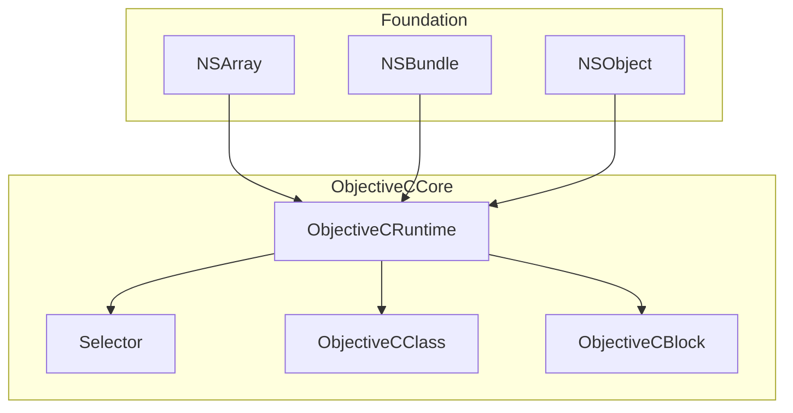
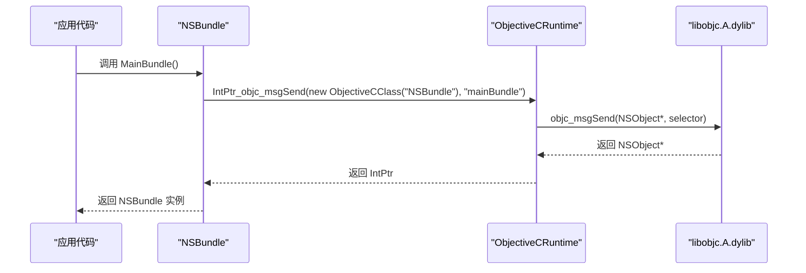
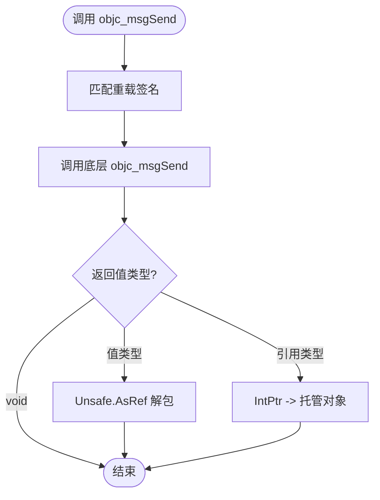
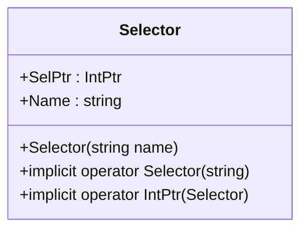
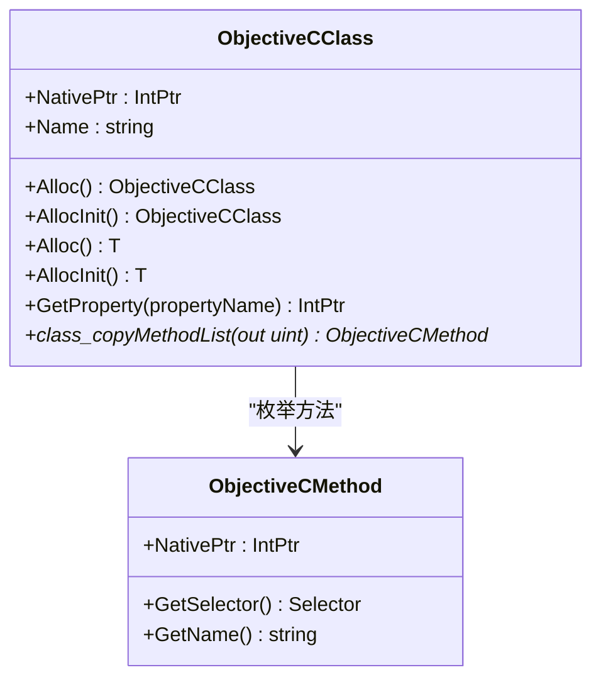
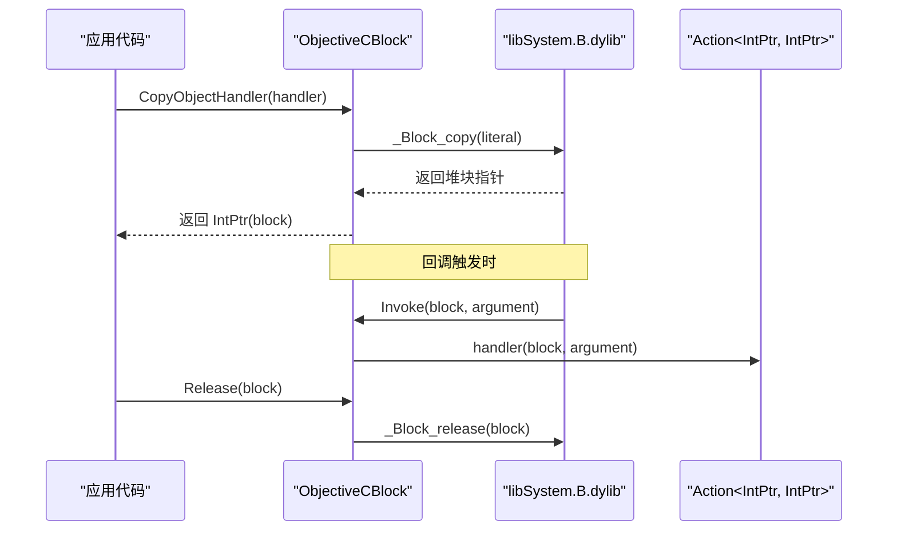
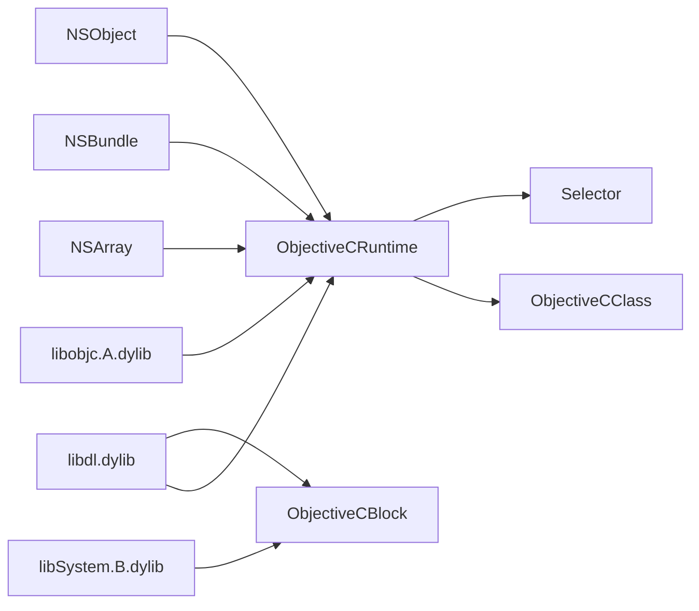

# Objective-C 运行时核心

<cite>
**本文引用的文件**
- [ObjectiveCRuntime.cs](file://src/SharpMetal/ObjectiveCCore/ObjectiveCRuntime.cs)
- [ObjectiveCClass.cs](file://src/SharpMetal/ObjectiveCCore/ObjectiveCClass.cs)
- [Selector.cs](file://src/SharpMetal/ObjectiveCCore/Selector.cs)
- [ObjectiveCBlock.cs](file://src/SharpMetal/ObjectiveCCore/ObjectiveCBlock.cs)
- [NSObject.cs](file://src/SharpMetal/Foundation/NSObject.cs)
- [NSArray.cs](file://src/SharpMetal/Foundation/NSArray.cs)
- [NSBundle.cs](file://src/SharpMetal/Foundation/NSBundle.cs)
</cite>

## 目录
1. [简介](#简介)
2. [项目结构](#项目结构)
3. [核心组件](#核心组件)
4. [架构总览](#架构总览)
5. [详细组件分析](#详细组件分析)
6. [依赖关系分析](#依赖关系分析)
7. [性能考虑](#性能考虑)
8. [故障排查指南](#故障排查指南)
9. [结论](#结论)
10. [附录：高级自定义绑定示例与最佳实践](#附录：高级自定义绑定示例与最佳实践)

## 简介
本仓库的 Objective-C 运行时核心提供了在 .NET（C#）中调用 Objective-C 运行时能力的基础设施，包括：
- 消息传递机制：通过大量重载的 objc_msgSend 封装，支持不同参数和返回值类型。
- 动态类型系统：基于 Selector 选择器与 ObjectiveCClass 的动态类查找、方法枚举与属性访问。
- 运行时反射：获取类名、方法列表、属性信息等。
- 块对象支持：ObjectiveCBlock 将 C# 回调桥接到 Objective-C Block，用于异步回调等场景。
- 内存管理：retain/release/retainCount 等基础生命周期操作。

该核心被 Foundation 层（如 NSArray、NSBundle、NSError 等）广泛使用，以构建更高层的托管 API。

## 项目结构
ObjectiveCCore 位于 src/SharpMetal/ObjectiveCCore，包含四个关键文件：
- ObjectiveCRuntime.cs：底层运行时入口，提供 objc_msgSend 系列 P/Invoke、类/方法/属性查询、框架链接等。
- Selector.cs：选择器的创建、名称获取与隐式转换。
- ObjectiveCClass.cs：对 Objective-C 类的动态操作（获取类、分配实例、枚举方法、属性访问）。
- ObjectiveCBlock.cs：Objective-C Block 的轻量桥接实现，用于将 C# Action<IntPtr, IntPtr> 作为回调传递给 Metal 等框架。

Foundation 层（如 NSArray、NSBundle）则基于这些核心能力进行封装，提供类型安全的 API。

图表来源
- [ObjectiveCRuntime.cs:33-839](file://src/SharpMetal/ObjectiveCCore/ObjectiveCRuntime.cs#L33-L839)
- [Selector.cs:5-43](file://src/SharpMetal/ObjectiveCCore/Selector.cs#L5-L43)
- [ObjectiveCClass.cs:7-87](file://src/SharpMetal/ObjectiveCCore/ObjectiveCClass.cs#L7-L87)
- [ObjectiveCBlock.cs:12-165](file://src/SharpMetal/ObjectiveCCore/ObjectiveCBlock.cs#L12-L165)
- [NSArray.cs:5-64](file://src/SharpMetal/Foundation/NSArray.cs#L5-L64)
- [NSBundle.cs:5-148](file://src/SharpMetal/Foundation/NSBundle.cs#L5-L148)
- [NSObject.cs:34-90](file://src/SharpMetal/Foundation/NSObject.cs#L34-L90)

章节来源
- [ObjectiveCRuntime.cs:33-839](file://src/SharpMetal/ObjectiveCCore/ObjectiveCRuntime.cs#L33-L839)
- [Selector.cs:5-43](file://src/SharpMetal/ObjectiveCCore/Selector.cs#L5-L43)
- [ObjectiveCClass.cs:7-87](file://src/SharpMetal/ObjectiveCCore/ObjectiveCClass.cs#L7-L87)
- [ObjectiveCBlock.cs:12-165](file://src/SharpMetal/ObjectiveCCore/ObjectiveCBlock.cs#L12-L165)
- [NSArray.cs:5-64](file://src/SharpMetal/Foundation/NSArray.cs#L5-L64)
- [NSBundle.cs:5-148](file://src/SharpMetal/Foundation/NSBundle.cs#L5-L148)
- [NSObject.cs:34-90](file://src/SharpMetal/Foundation/NSObject.cs#L34-L90)

## 核心组件
- 消息传递（objc_msgSend）：提供多种签名重载，覆盖常见数值、指针、结构体、字符串等参数与返回类型；同时提供 stret 变体处理大结构体返回。
- 选择器（Selector）：封装 sel_getUid/sel_getName，提供字符串到选择器的映射与名称读取。
- 动态类（ObjectiveCClass）：封装 objc_getClass/class_getName/class_copyMethodList/class_getProperty 等，支持 Alloc/AllocInit 及方法枚举。
- 块对象（ObjectiveCBlock）：构造 NativeBlockLiteral，设置描述符与回调，复制为堆块并释放，用于 Metal 回调等异步场景。
- 内存管理：retain/release/retainCount 等基础操作，配合上层对象的引用计数管理。

章节来源
- [ObjectiveCRuntime.cs:33-839](file://src/SharpMetal/ObjectiveCCore/ObjectiveCRuntime.cs#L33-L839)
- [Selector.cs:5-43](file://src/SharpMetal/ObjectiveCCore/Selector.cs#L5-L43)
- [ObjectiveCClass.cs:7-87](file://src/SharpMetal/ObjectiveCCore/ObjectiveCClass.cs#L7-L87)
- [ObjectiveCBlock.cs:12-165](file://src/SharpMetal/ObjectiveCCore/ObjectiveCBlock.cs#L12-L165)

## 架构总览
整体架构分为三层：
- 运行时层（ObjectiveCCore）：直接对接 libobjc.A.dylib，暴露消息发送、类/方法/属性查询、块对象桥接等能力。
- 基础类型层（Foundation）：基于运行时层构建常用 Foundation 类型的托管封装（如 NSArray、NSBundle、NSError）。
- 应用层：使用 Foundation 层提供的类型安全 API 完成业务逻辑。

图表来源
- [NSBundle.cs:63-66](file://src/SharpMetal/Foundation/NSBundle.cs#L63-L66)
- [ObjectiveCRuntime.cs:118-134](file://src/SharpMetal/ObjectiveCCore/ObjectiveCRuntime.cs#L118-L134)
- [ObjectiveCClass.cs:30-40](file://src/SharpMetal/ObjectiveCCore/ObjectiveCClass.cs#L30-L40)

## 详细组件分析

### 消息传递机制（objc_msgSend）
- 设计要点：
  - 通过大量重载适配不同参数数量与类型，减少装箱/拆箱开销。
  - 针对结构体返回使用 stret 变体，避免栈拷贝问题。
  - 提供泛型版本 objc_msgSend<T> 用于值类型返回，内部通过 Unsafe.AsRef 高效转换。
- 典型流程：
  - 调用方传入 receiver（对象指针）与 selector（选择器），以及若干参数。
  - 运行时根据签名选择对应重载，最终调用底层 objc_msgSend。
  - 返回值按类型解包或转换为托管类型。

图表来源
- [ObjectiveCRuntime.cs:784-807](file://src/SharpMetal/ObjectiveCCore/ObjectiveCRuntime.cs#L784-L807)
- [ObjectiveCRuntime.cs:118-134](file://src/SharpMetal/ObjectiveCCore/ObjectiveCRuntime.cs#L118-L134)

章节来源
- [ObjectiveCRuntime.cs:784-807](file://src/SharpMetal/ObjectiveCCore/ObjectiveCRuntime.cs#L784-L807)
- [ObjectiveCRuntime.cs:118-134](file://src/SharpMetal/ObjectiveCCore/ObjectiveCRuntime.cs#L118-L134)

### 选择器管理与缓存（Selector）
- 功能：
  - 通过 sel_getUid 获取或创建选择器，保证同名选择器唯一。
  - 提供 Name 属性读取选择器对应的字符串名。
  - 支持从 string 隐式转换为 Selector，简化调用。
- 缓存策略：
  - 选择器本身由运行时维护唯一性，无需额外缓存。
  - 建议在静态字段中复用 Selector 实例以减少重复创建。

图表来源
- [Selector.cs:5-43](file://src/SharpMetal/ObjectiveCCore/Selector.cs#L5-L43)

章节来源
- [Selector.cs:5-43](file://src/SharpMetal/ObjectiveCCore/Selector.cs#L5-L43)

### 动态类操作（ObjectiveCClass）
- 功能：
  - 通过 objc_getClass 获取类指针，支持按名称查找。
  - 提供 Alloc/AllocInit 创建实例，支持泛型 Alloc<T>/AllocInit<T> 用于值类型。
  - 支持 class_copyMethodList 枚举方法，method_getName 获取方法选择器。
  - 支持 class_getProperty 获取属性信息。
- 错误处理：
  - 当类不存在时输出日志提示（Console.WriteLine）。
  - 建议上层捕获并抛出异常以便统一错误处理。

图表来源
- [ObjectiveCClass.cs:7-87](file://src/SharpMetal/ObjectiveCCore/ObjectiveCClass.cs#L7-L87)

章节来源
- [ObjectiveCClass.cs:7-87](file://src/SharpMetal/ObjectiveCCore/ObjectiveCClass.cs#L7-L87)

### 块对象支持（ObjectiveCBlock）
- 功能：
  - 构造 NativeBlockLiteral，设置 isa、flags、invoke、descriptor、context。
  - 使用 _Block_copy 复制到堆，确保回调跨作用域有效。
  - 提供 CopyObjectHandler(Action<IntPtr, IntPtr>) 将 C# 回调包装为 Block。
  - 提供 Release(IntPtr) 释放块对象，防止内存泄漏。
- 回调机制：
  - InvokeObjectHandler 从上下文取出 GCHandle 并调用原始 Action。
  - CopyHelper/DisposeHelper 负责上下文的生命周期管理。

图表来源
- [ObjectiveCBlock.cs:23-53](file://src/SharpMetal/ObjectiveCCore/ObjectiveCBlock.cs#L23-L53)
- [ObjectiveCBlock.cs:55-97](file://src/SharpMetal/ObjectiveCCore/ObjectiveCBlock.cs#L55-L97)
- [ObjectiveCBlock.cs:99-114](file://src/SharpMetal/ObjectiveCCore/ObjectiveCBlock.cs#L99-L114)
- [ObjectiveCBlock.cs:133-143](file://src/SharpMetal/ObjectiveCCore/ObjectiveCBlock.cs#L133-L143)

章节来源
- [ObjectiveCBlock.cs:23-53](file://src/SharpMetal/ObjectiveCCore/ObjectiveCBlock.cs#L23-L53)
- [ObjectiveCBlock.cs:55-97](file://src/SharpMetal/ObjectiveCCore/ObjectiveCBlock.cs#L55-L97)
- [ObjectiveCBlock.cs:99-114](file://src/SharpMetal/ObjectiveCCore/ObjectiveCBlock.cs#L99-L114)
- [ObjectiveCBlock.cs:133-143](file://src/SharpMetal/ObjectiveCCore/ObjectiveCBlock.cs#L133-L143)

### 运行时反射与属性访问
- 反射能力：
  - class_getName 获取类名。
  - class_copyMethodList 枚举方法列表。
  - method_getName 获取方法选择器。
  - class_getProperty 获取属性描述。
- 属性访问：
  - GetProperty 将属性名转为 UTF-8 字节数组后调用 class_getProperty。
  - 上层可结合 runtime 进一步读取属性元数据（如 getter/setter 选择器）。

章节来源
- [ObjectiveCRuntime.cs:68-81](file://src/SharpMetal/ObjectiveCCore/ObjectiveCRuntime.cs#L68-L81)
- [ObjectiveCClass.cs:42-52](file://src/SharpMetal/ObjectiveCCore/ObjectiveCClass.cs#L42-L52)

## 依赖关系分析
- ObjectiveCRuntime 依赖 libobjc.A.dylib 与 libdl.dylib（dlopen/dlsym）。
- Selector 依赖 libobjc.A.dylib（sel_getUid/sel_getName）。
- ObjectiveCClass 依赖 ObjectiveCRuntime 提供的运行时函数。
- ObjectiveCBlock 依赖 libSystem.B.dylib（_Block_copy/_Block_release）与 libdl.dylib（dlopen/dlsym）。
- Foundation 层（NSArray、NSBundle、NSObject）依赖 ObjectiveCCore。

图表来源
- [ObjectiveCRuntime.cs:37-75](file://src/SharpMetal/ObjectiveCCore/ObjectiveCRuntime.cs#L37-L75)
- [Selector.cs:7-11](file://src/SharpMetal/ObjectiveCCore/Selector.cs#L7-L11)
- [ObjectiveCBlock.cs:116-143](file://src/SharpMetal/ObjectiveCCore/ObjectiveCBlock.cs#L116-L143)
- [NSArray.cs:5-64](file://src/SharpMetal/Foundation/NSArray.cs#L5-L64)
- [NSBundle.cs:5-148](file://src/SharpMetal/Foundation/NSBundle.cs#L5-L148)
- [NSObject.cs:34-90](file://src/SharpMetal/Foundation/NSObject.cs#L34-L90)

章节来源
- [ObjectiveCRuntime.cs:37-75](file://src/SharpMetal/ObjectiveCCore/ObjectiveCRuntime.cs#L37-L75)
- [Selector.cs:7-11](file://src/SharpMetal/ObjectiveCCore/Selector.cs#L7-L11)
- [ObjectiveCBlock.cs:116-143](file://src/SharpMetal/ObjectiveCCore/ObjectiveCBlock.cs#L116-L143)
- [NSArray.cs:5-64](file://src/SharpMetal/Foundation/NSArray.cs#L5-L64)
- [NSBundle.cs:5-148](file://src/SharpMetal/Foundation/NSBundle.cs#L5-L148)
- [NSObject.cs:34-90](file://src/SharpMetal/Foundation/NSObject.cs#L34-L90)

## 性能考虑
- 选择器复用：将 Selector 声明为 static readonly，避免重复创建。
- 消息发送优化：
  - 优先使用具体重载的 objc_msgSend，减少参数装箱。
  - 对于频繁调用的方法，缓存 Selector 与类指针。
- 块对象生命周期：
  - 使用 CopyObjectHandler 将回调复制到堆，确保异步回调安全。
  - 及时调用 Release 释放块对象，避免内存泄漏。
- 结构体返回：
  - 使用 objc_msgSend_stret 处理大结构体返回，避免栈溢出与拷贝开销。
- 框架链接：
  - 使用 LinkMetal/LinkCoreGraphics/LinkAppKit/LinkMetalKit 按需加载框架，减少启动开销。

[本节为通用性能指导，不直接分析具体文件]

## 故障排查指南
- 类未找到：
  - 现象：ObjectiveCClass 构造函数中获取类指针为零。
  - 处理：检查类名是否正确，确认框架已加载（如使用 LinkMetal）。
  - 参考：[ObjectiveCClass.cs:30-40](file://src/SharpMetal/ObjectiveCCore/ObjectiveCClass.cs#L30-L40)
- 选择器无效：
  - 现象：Selector 构造失败或 Name 为空。
  - 处理：确认方法名拼写正确，检查运行时是否支持该方法。
  - 参考：[Selector.cs:20-30](file://src/SharpMetal/ObjectiveCCore/Selector.cs#L20-L30)
- 块对象崩溃：
  - 现象：回调触发时 PAC 故障或空引用。
  - 处理：确保使用 CopyObjectHandler 复制块，并在完成后调用 Release。
  - 参考：[ObjectiveCBlock.cs:23-53](file://src/SharpMetal/ObjectiveCCore/ObjectiveCBlock.cs#L23-L53)
- 内存泄漏：
  - 现象：应用长时间运行后内存持续增长。
  - 处理：检查 retain/release 配对，确保块对象与对象生命周期正确管理。
  - 参考：[ObjectiveCRuntime.cs:769-782](file://src/SharpMetal/ObjectiveCCore/ObjectiveCRuntime.cs#L769-L782)

章节来源
- [ObjectiveCClass.cs:30-40](file://src/SharpMetal/ObjectiveCCore/ObjectiveCClass.cs#L30-L40)
- [Selector.cs:20-30](file://src/SharpMetal/ObjectiveCCore/Selector.cs#L20-L30)
- [ObjectiveCBlock.cs:23-53](file://src/SharpMetal/ObjectiveCCore/ObjectiveCBlock.cs#L23-L53)
- [ObjectiveCRuntime.cs:769-782](file://src/SharpMetal/ObjectiveCCore/ObjectiveCRuntime.cs#L769-L782)

## 结论
Objective-C 运行时核心为 SharpMetal 提供了强大的动态调用能力，通过消息传递、动态类操作、块对象桥接与反射机制，使得 .NET 应用能够无缝集成 Objective-C 生态。Foundation 层在此基础上构建了类型安全的 API，提升了易用性与可维护性。在实际使用中，应关注选择器复用、消息发送优化、块对象生命周期管理与内存控制，以获得更好的性能与稳定性。

[本节为总结性内容，不直接分析具体文件]

## 附录：高级自定义绑定示例与最佳实践

### 示例：动态创建类并添加方法
- 步骤：
  - 使用 objc_allocateClassPair 创建新类。
  - 使用 class_addMethod 添加方法实现。
  - 使用 objc_registerClassPair 注册类。
  - 通过 Alloc/AllocInit 创建实例并调用方法。
- 参考路径：
  - [ObjectiveCRuntime.cs:44-51](file://src/SharpMetal/ObjectiveCCore/ObjectiveCRuntime.cs#L44-L51)
  - [ObjectiveCClass.cs:54-65](file://src/SharpMetal/ObjectiveCCore/ObjectiveCClass.cs#L54-L65)

### 示例：枚举类方法并调用
- 步骤：
  - 使用 class_copyMethodList 获取方法列表。
  - 遍历方法，使用 method_getName 获取选择器。
  - 通过 objc_msgSend 调用目标方法。
- 参考路径：
  - [ObjectiveCClass.cs:80-83](file://src/SharpMetal/ObjectiveCCore/ObjectiveCClass.cs#L80-L83)
  - [ObjectiveCRuntime.cs:77-81](file://src/SharpMetal/ObjectiveCCore/ObjectiveCRuntime.cs#L77-L81)

### 示例：属性访问与元数据读取
- 步骤：
  - 使用 class_getProperty 获取属性描述。
  - 使用 property_copyAttributeValue 读取属性特性（如 nonatomic、strong）。
  - 根据 getter/setter 选择器调用相应方法。
- 参考路径：
  - [ObjectiveCRuntime.cs:68-75](file://src/SharpMetal/ObjectiveCCore/ObjectiveCRuntime.cs#L68-L75)
  - [ObjectiveCClass.cs:42-52](file://src/SharpMetal/ObjectiveCCore/ObjectiveCClass.cs#L42-L52)

### 最佳实践
- 选择器与类指针缓存：
  - 将 Selector 与 ObjectiveCClass 实例声明为 static readonly，减少重复创建。
  - 参考：[NSArray.cs:54-64](file://src/SharpMetal/Foundation/NSArray.cs#L54-L64)
- 块对象生命周期管理：
  - 使用 CopyObjectHandler 创建块，并在完成后调用 Release。
  - 参考：[ObjectiveCBlock.cs:23-53](file://src/SharpMetal/ObjectiveCCore/ObjectiveCBlock.cs#L23-L53)
- 错误处理与日志：
  - 在关键路径添加日志与异常抛出，便于定位问题。
  - 参考：[ObjectiveCClass.cs:34-37](file://src/SharpMetal/ObjectiveCCore/ObjectiveCClass.cs#L34-L37)
- 框架按需加载：
  - 使用 LinkMetal/LinkCoreGraphics/LinkAppKit/LinkMetalKit 延迟加载框架，减少启动时间。
  - 参考：[ObjectiveCRuntime.cs:814-832](file://src/SharpMetal/ObjectiveCCore/ObjectiveCRuntime.cs#L814-L832)

章节来源
- [ObjectiveCRuntime.cs:44-51](file://src/SharpMetal/ObjectiveCCore/ObjectiveCRuntime.cs#L44-L51)
- [ObjectiveCClass.cs:54-65](file://src/SharpMetal/ObjectiveCCore/ObjectiveCClass.cs#L54-L65)
- [ObjectiveCClass.cs:80-83](file://src/SharpMetal/ObjectiveCCore/ObjectiveCClass.cs#L80-L83)
- [ObjectiveCRuntime.cs:77-81](file://src/SharpMetal/ObjectiveCCore/ObjectiveCRuntime.cs#L77-L81)
- [ObjectiveCRuntime.cs:68-75](file://src/SharpMetal/ObjectiveCCore/ObjectiveCRuntime.cs#L68-L75)
- [ObjectiveCClass.cs:42-52](file://src/SharpMetal/ObjectiveCCore/ObjectiveCClass.cs#L42-L52)
- [NSArray.cs:54-64](file://src/SharpMetal/Foundation/NSArray.cs#L54-L64)
- [ObjectiveCBlock.cs:23-53](file://src/SharpMetal/ObjectiveCCore/ObjectiveCBlock.cs#L23-L53)
- [ObjectiveCClass.cs:34-37](file://src/SharpMetal/ObjectiveCCore/ObjectiveCClass.cs#L34-L37)
- [ObjectiveCRuntime.cs:814-832](file://src/SharpMetal/ObjectiveCCore/ObjectiveCRuntime.cs#L814-L832)