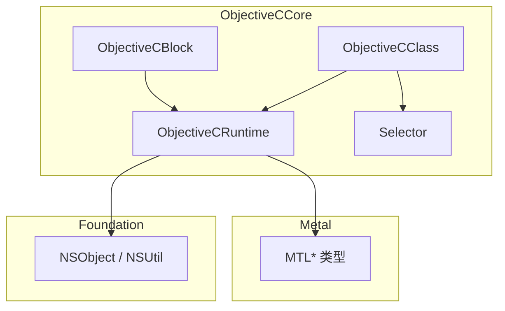
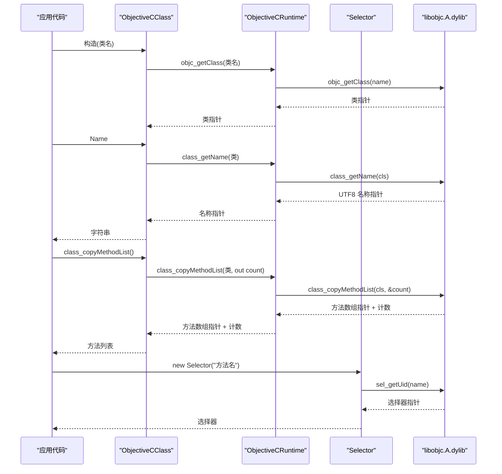
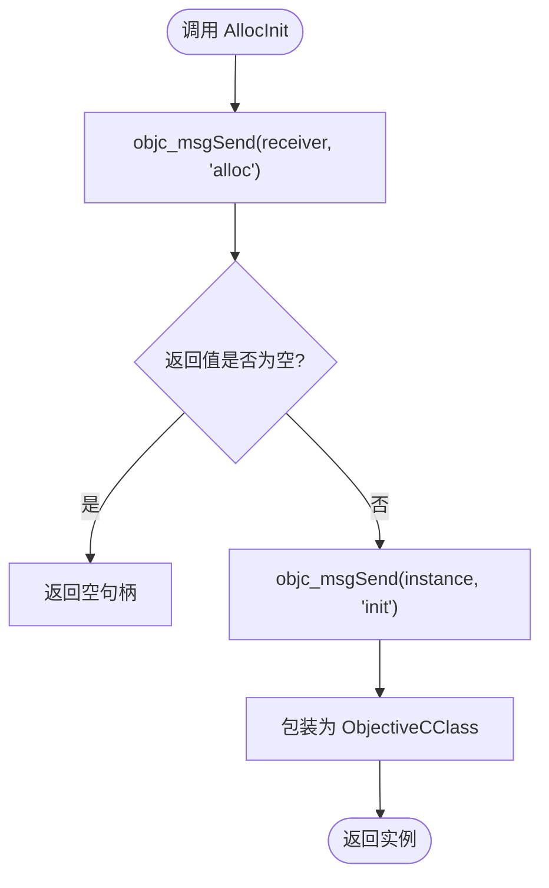
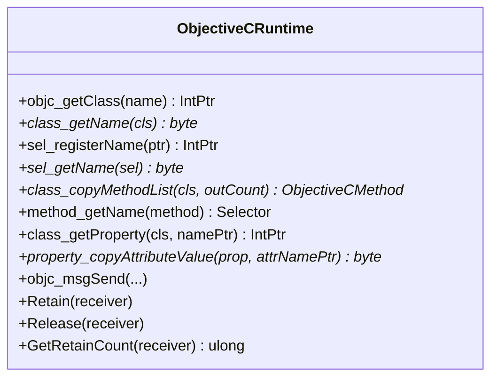
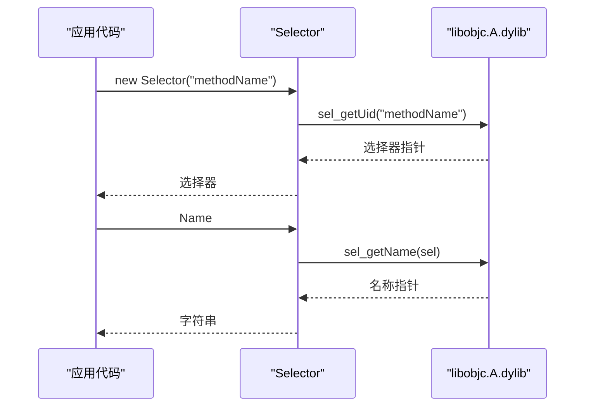
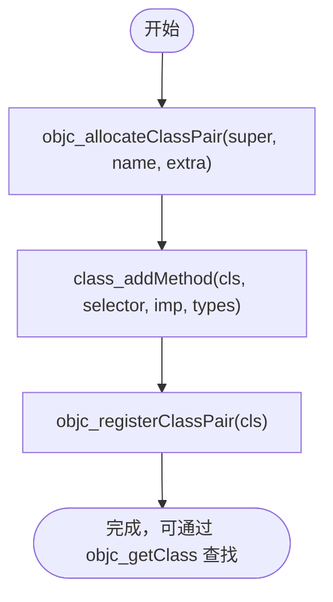
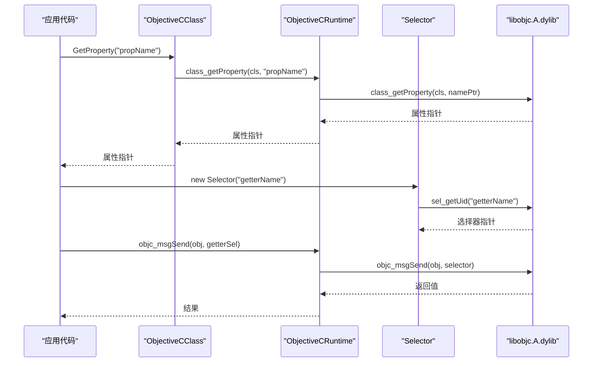
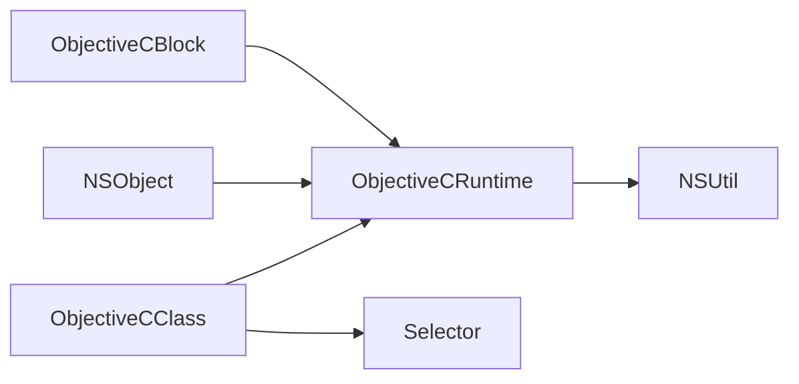

# 动态类操作

<cite>
**本文引用的文件**
- [ObjectiveCClass.cs](file://src/SharpMetal/ObjectiveCCore/ObjectiveCClass.cs)
- [ObjectiveCRuntime.cs](file://src/SharpMetal/ObjectiveCCore/ObjectiveCRuntime.cs)
- [Selector.cs](file://src/SharpMetal/ObjectiveCCore/Selector.cs)
- [NSObject.cs](file://src/SharpMetal/Foundation/NSObject.cs)
- [ObjectiveCBlock.cs](file://src/SharpMetal/ObjectiveCCore/ObjectiveCBlock.cs)
- [Program.cs](file://samples/SharpMetal.Sample/Program.cs)
</cite>

## 目录
1. [简介](#简介)
2. [项目结构](#项目结构)
3. [核心组件](#核心组件)
4. [架构总览](#架构总览)
5. [详细组件分析](#详细组件分析)
6. [依赖关系分析](#依赖关系分析)
7. [性能考量](#性能考量)
8. [故障排查指南](#故障排查指南)
9. [结论](#结论)
10. [附录](#附录)

## 简介
本文件聚焦于 SharpMetal 中 Objective-C 运行时（ObjC Runtime）的动态类操作能力，围绕 ObjectiveCClass 结构体展开，系统阐述：
- 类的发现与查询：通过 class_getName、objc_getClass 等原生方法的托管封装。
- 方法列表的获取与遍历：通过 class_copyMethodList、method_getName 等。
- 动态类创建流程：基于 objc_allocateClassPair 与 objc_registerClassPair 的使用说明与注意事项。
- 属性访问与方法调用的动态绑定机制：通过 Selector 与 objc_msgSend 系列重载实现。
- 自定义类创建与扩展的实践示例与最佳实践。
- 性能优化建议与常见陷阱规避。

## 项目结构
本项目将 ObjC 运行时封装在 ObjectiveCCore 命名空间下，提供对底层 libobjc.A.dylib 的 P/Invoke 调用；Foundation 层提供基础类型与工具；Metal 层使用这些能力进行 GPU 资源交互。动态类操作的核心集中在 ObjectiveCClass、ObjectiveCRuntime、Selector 三个文件中。

图表来源
- [ObjectiveCClass.cs:18-87](file://src/SharpMetal/ObjectiveCCore/ObjectiveCClass.cs#L18-L87)
- [ObjectiveCRuntime.cs:33-81](file://src/SharpMetal/ObjectiveCCore/ObjectiveCRuntime.cs#L33-L81)
- [Selector.cs:5-43](file://src/SharpMetal/ObjectiveCCore/Selector.cs#L5-L43)
- [NSObject.cs:34-90](file://src/SharpMetal/Foundation/NSObject.cs#L34-L90)

章节来源
- [ObjectiveCClass.cs:18-87](file://src/SharpMetal/ObjectiveCCore/ObjectiveCClass.cs#L18-L87)
- [ObjectiveCRuntime.cs:33-81](file://src/SharpMetal/ObjectiveCCore/ObjectiveCRuntime.cs#L33-L81)
- [Selector.cs:5-43](file://src/SharpMetal/ObjectiveCCore/Selector.cs#L5-L43)
- [NSObject.cs:34-90](file://src/SharpMetal/Foundation/NSObject.cs#L34-L90)

## 核心组件
- ObjectiveCClass：表示一个 Objective-C 类句柄，支持按名称查找类、获取类名、分配实例、枚举方法列表、获取属性描述等。
- ObjectiveCRuntime：集中声明对 libobjc.A.dylib 的原生函数导入，包括类/方法/属性查询、消息发送、内存管理、选择器注册等。
- Selector：封装选择器（方法名）的句柄，支持从字符串构造、获取原始指针与名称。
- NSObject：基础对象包装，提供哈希、描述、相等性判断、响应能力检查等通用能力。
- ObjectiveCBlock：用于在托管代码与 ObjC Block 之间桥接回调，避免直接传递 C# 委托导致的崩溃。

章节来源
- [ObjectiveCClass.cs:7-87](file://src/SharpMetal/ObjectiveCCore/ObjectiveCClass.cs#L7-L87)
- [ObjectiveCRuntime.cs:33-81](file://src/SharpMetal/ObjectiveCCore/ObjectiveCRuntime.cs#L33-L81)
- [Selector.cs:5-43](file://src/SharpMetal/ObjectiveCCore/Selector.cs#L5-L43)
- [NSObject.cs:48-90](file://src/SharpMetal/Foundation/NSObject.cs#L48-L90)
- [ObjectiveCBlock.cs:12-165](file://src/SharpMetal/ObjectiveCCore/ObjectiveCBlock.cs#L12-L165)

## 架构总览
下图展示了动态类操作的关键路径：通过 ObjectiveCClass 暴露的高层 API 调用 ObjectiveCRuntime 中的 P/Invoke，最终进入 libobjc.A.dylib 完成类/方法/属性的动态查询与消息分发。

图表来源
- [ObjectiveCClass.cs:23-82](file://src/SharpMetal/ObjectiveCCore/ObjectiveCClass.cs#L23-L82)
- [ObjectiveCRuntime.cs:40-81](file://src/SharpMetal/ObjectiveCCore/ObjectiveCRuntime.cs#L40-L81)
- [Selector.cs:20-39](file://src/SharpMetal/ObjectiveCCore/Selector.cs#L20-L39)

## 详细组件分析

### ObjectiveCClass 结构体
- 功能概述
  - 类发现：通过构造函数以类名字符串调用 objc_getClass 获取类句柄。
  - 类名查询：Name 属性调用 class_getName 并转换为 UTF-8 字符串。
  - 属性访问：GetProperty 通过 class_getProperty 获取属性元数据指针。
  - 实例分配：Alloc/AllocInit 通过 objc_msgSend 调用 alloc/init。
  - 泛型分配：Alloc<T>/AllocInit<T> 用于值类型原地分配。
  - 方法列表：class_copyMethodList 返回方法数组指针与数量，配合 method_getName 可遍历方法名。
- 关键实现要点
  - 使用 unsafe 指针与栈上缓冲区减少 GC 压力。
  - 通过静态 Selector 常量缓存常用选择器（如 alloc、init）。
  - 错误处理：当类或选择器为空时输出诊断信息。

图表来源
- [ObjectiveCClass.cs:60-65](file://src/SharpMetal/ObjectiveCCore/ObjectiveCClass.cs#L60-L65)
- [ObjectiveCRuntime.cs:118-131](file://src/SharpMetal/ObjectiveCCore/ObjectiveCRuntime.cs#L118-L131)

章节来源
- [ObjectiveCClass.cs:18-87](file://src/SharpMetal/ObjectiveCCore/ObjectiveCClass.cs#L18-L87)

### ObjectiveCRuntime 原生方法封装
- 类与选择器
  - objc_getClass：根据类名获取类指针。
  - class_getName：获取类的 UTF-8 名称。
  - sel_registerName/sel_getName：注册与查询选择器。
- 方法与属性
  - class_copyMethodList：获取类的方法列表。
  - method_getName：从方法指针获取选择器。
  - class_getProperty：获取属性描述。
  - property_copyAttributeValue：读取属性特性（如 getter/setter 名称）。
- 消息发送
  - 大量 objc_msgSend 重载覆盖不同参数与返回类型，便于在托管层安全调用 ObjC 方法。
- 内存管理
  - Retain/Release/GetRetainCount：引用计数管理。
  - Free：释放由 runtime 分配的内存（例如方法列表）。

图表来源
- [ObjectiveCRuntime.cs:40-81](file://src/SharpMetal/ObjectiveCCore/ObjectiveCRuntime.cs#L40-L81)
- [ObjectiveCRuntime.cs:769-800](file://src/SharpMetal/ObjectiveCCore/ObjectiveCRuntime.cs#L769-L800)

章节来源
- [ObjectiveCRuntime.cs:40-81](file://src/SharpMetal/ObjectiveCCore/ObjectiveCRuntime.cs#L40-L81)
- [ObjectiveCRuntime.cs:769-800](file://src/SharpMetal/ObjectiveCCore/ObjectiveCRuntime.cs#L769-L800)

### Selector 选择器封装
- 作用：将方法名映射为稳定的选择器句柄，供消息发送使用。
- 关键点：
  - 通过 sel_getUid 获取或创建选择器。
  - 支持从字符串隐式转换到 Selector。
  - 提供 Name 属性以便调试与日志。

图表来源
- [Selector.cs:20-39](file://src/SharpMetal/ObjectiveCCore/Selector.cs#L20-L39)

章节来源
- [Selector.cs:5-43](file://src/SharpMetal/ObjectiveCCore/Selector.cs#L5-L43)

### 动态类创建过程（objc_allocateClassPair 与 objc_registerClassPair）
- 流程说明
  - 使用 objc_allocateClassPair(superclass, className, extraBytes) 创建一个未注册的类对（类与元类），预留额外字节用于存储自定义 ivar。
  - 使用 class_addMethod 向新类添加方法实现（imp）与方法签名（types）。
  - 使用 objc_registerClassPair 注册该类对，使其可在运行时被 objc_getClass 找到。
- 注意事项
  - 必须在同一进程生命周期内确保只注册一次同名类。
  - 方法签名 types 必须与实现一致，否则会导致运行时崩溃。
  - 若需要存储自定义字段，extraBytes 需正确设置并在 C++/C 侧对齐。
- 在本仓库中的可用性
  - ObjectiveCRuntime 已声明 objc_allocateClassPair、class_addMethod、objc_registerClassPair，可直接调用。
  - 建议在高层封装中提供安全的创建与注册 API，统一处理错误与重复注册检测。

图表来源
- [ObjectiveCRuntime.cs:43-51](file://src/SharpMetal/ObjectiveCCore/ObjectiveCRuntime.cs#L43-L51)

章节来源
- [ObjectiveCRuntime.cs:43-51](file://src/SharpMetal/ObjectiveCCore/ObjectiveCRuntime.cs#L43-L51)

### 属性访问与方法调用的动态绑定机制
- 属性访问
  - 通过 class_getProperty 获取属性描述，再使用 property_copyAttributeValue 读取 getter/setter 名称或其他特性。
  - 结合 Selector 与 objc_msgSend 动态调用 getter/setter。
- 方法调用
  - 使用 Selector 作为方法标识，调用对应的 objc_msgSend 重载，传入接收者与参数。
  - 对于复杂参数（结构体、指针、布尔值等），使用匹配的 overload 以避免类型不匹配。
- 响应能力检查
  - 通过 NSObject.RespondsToSelector 判断对象是否实现了某方法，再进行调用，提高鲁棒性。

图表来源
- [ObjectiveCClass.cs:42-52](file://src/SharpMetal/ObjectiveCCore/ObjectiveCClass.cs#L42-L52)
- [ObjectiveCRuntime.cs:68-78](file://src/SharpMetal/ObjectiveCCore/ObjectiveCRuntime.cs#L68-L78)
- [Selector.cs:20-39](file://src/SharpMetal/ObjectiveCCore/Selector.cs#L20-L39)

章节来源
- [ObjectiveCClass.cs:42-52](file://src/SharpMetal/ObjectiveCCore/ObjectiveCClass.cs#L42-L52)
- [ObjectiveCRuntime.cs:68-78](file://src/SharpMetal/ObjectiveCCore/ObjectiveCRuntime.cs#L68-L78)
- [Selector.cs:20-39](file://src/SharpMetal/ObjectiveCCore/Selector.cs#L20-L39)

### 实际示例：自定义类创建与扩展
- 目标：动态创建一个继承自 NSObject 的新类，添加一个方法并注册，然后实例化并调用。
- 步骤
  1. 调用 objc_allocateClassPair(NSObject, "MyDynamicClass", 0)。
  2. 定义 C/C++ 实现函数作为 imp，并通过 class_addMethod 添加到新类。
  3. 调用 objc_registerClassPair 注册类。
  4. 使用 objc_getClass("MyDynamicClass") 获取类句柄。
  5. 使用 Alloc/AllocInit 创建实例，再通过 objc_msgSend 调用方法。
- 参考位置
  - 类创建与注册：[ObjectiveCRuntime.cs:43-51](file://src/SharpMetal/ObjectiveCCore/ObjectiveCRuntime.cs#L43-L51)
  - 类查找与消息发送：[ObjectiveCClass.cs:30-65](file://src/SharpMetal/ObjectiveCCore/ObjectiveCClass.cs#L30-L65)
  - 选择器构造：[Selector.cs:20-39](file://src/SharpMetal/ObjectiveCCore/Selector.cs#L20-L39)

章节来源
- [ObjectiveCRuntime.cs:43-51](file://src/SharpMetal/ObjectiveCCore/ObjectiveCRuntime.cs#L43-L51)
- [ObjectiveCClass.cs:30-65](file://src/SharpMetal/ObjectiveCCore/ObjectiveCClass.cs#L30-L65)
- [Selector.cs:20-39](file://src/SharpMetal/ObjectiveCCore/Selector.cs#L20-L39)

## 依赖关系分析
- ObjectiveCClass 依赖 ObjectiveCRuntime 提供的 P/Invoke 方法，以及 Selector 作为方法标识。
- ObjectiveCRuntime 依赖 libobjc.A.dylib 的原生符号，同时依赖 Foundation 的 NSUtil 进行字符串转换。
- NSObject 依赖 ObjectiveCRuntime 的消息发送能力，提供通用行为。
- ObjectiveCBlock 独立于动态类操作，但同样依赖 libSystem.B.dylib 与 libdl.dylib 进行 Block 管理与符号解析。

图表来源
- [ObjectiveCClass.cs:18-87](file://src/SharpMetal/ObjectiveCCore/ObjectiveCClass.cs#L18-L87)
- [ObjectiveCRuntime.cs:33-81](file://src/SharpMetal/ObjectiveCCore/ObjectiveCRuntime.cs#L33-L81)
- [NSObject.cs:48-90](file://src/SharpMetal/Foundation/NSObject.cs#L48-L90)
- [ObjectiveCBlock.cs:12-165](file://src/SharpMetal/ObjectiveCCore/ObjectiveCBlock.cs#L12-L165)

章节来源
- [ObjectiveCClass.cs:18-87](file://src/SharpMetal/ObjectiveCCore/ObjectiveCClass.cs#L18-L87)
- [ObjectiveCRuntime.cs:33-81](file://src/SharpMetal/ObjectiveCCore/ObjectiveCRuntime.cs#L33-L81)
- [NSObject.cs:48-90](file://src/SharpMetal/Foundation/NSObject.cs#L48-L90)
- [ObjectiveCBlock.cs:12-165](file://src/SharpMetal/ObjectiveCCore/ObjectiveCBlock.cs#L12-L165)

## 性能考量
- 选择器缓存：Selector 内部通过 sel_getUid 保证唯一性与复用，避免重复创建开销。
- 方法列表遍历：class_copyMethodList 返回的数组需在完成后释放（通常由 runtime 管理的 free 或通过 ObjectiveCRuntime.Free 释放），避免内存泄漏。
- 消息发送开销：频繁调用 objc_msgSend 会产生一定开销，建议批量处理或在热点路径减少跨边界调用次数。
- 字符串转换：class_getName 返回的 UTF-8 指针应尽快转换为托管字符串并释放，避免长时间持有原生指针。
- 泛型分配：Alloc<T>/AllocInit<T> 适用于值类型，避免额外的装箱与 GC 压力。
- Block 回调：使用 ObjectiveCBlock 包装托管回调，避免 PAC 崩溃与内存问题。

章节来源
- [ObjectiveCClass.cs:60-82](file://src/SharpMetal/ObjectiveCCore/ObjectiveCClass.cs#L60-L82)
- [ObjectiveCRuntime.cs:769-800](file://src/SharpMetal/ObjectiveCCore/ObjectiveCRuntime.cs#L769-L800)
- [ObjectiveCBlock.cs:23-53](file://src/SharpMetal/ObjectiveCCore/ObjectiveCBlock.cs#L23-L53)

## 故障排查指南
- 类查找失败
  - 现象：objc_getClass 返回空指针。
  - 排查：确认类名拼写与大小写；确认类已在模块中加载；检查是否有重复注册导致冲突。
  - 参考：[ObjectiveCClass.cs:30-40](file://src/SharpMetal/ObjectiveCCore/ObjectiveCClass.cs#L30-L40)
- 选择器无效
  - 现象：sel_getUid 返回空指针或消息发送崩溃。
  - 排查：确认方法名存在且签名匹配；使用 RespondsToSelector 先检查响应能力。
  - 参考：[Selector.cs:20-39](file://src/SharpMetal/ObjectiveCCore/Selector.cs#L20-L39)
  - 参考：[NSObject.cs:70-79](file://src/SharpMetal/Foundation/NSObject.cs#L70-L79)
- 方法列表未释放
  - 现象：内存持续增长。
  - 排查：确保在遍历完成后释放 class_copyMethodList 返回的数组。
  - 参考：[ObjectiveCRuntime.cs:80-81](file://src/SharpMetal/ObjectiveCCore/ObjectiveCRuntime.cs#L80-L81)
- Block 回调崩溃
  - 现象：PAC 错误或崩溃。
  - 排查：不要直接传递 C# 委托给 ObjC；使用 ObjectiveCBlock.CopyObjectHandler 包装回调。
  - 参考：[ObjectiveCBlock.cs:23-53](file://src/SharpMetal/ObjectiveCCore/ObjectiveCBlock.cs#L23-L53)
- 平台限制
  - 现象：在非 Apple 平台运行受限。
  - 排查：检查平台兼容性；示例程序包含平台检查逻辑。
  - 参考：[Program.cs:16-20](file://samples/SharpMetal.Sample/Program.cs#L16-L20)

章节来源
- [ObjectiveCClass.cs:30-40](file://src/SharpMetal/ObjectiveCCore/ObjectiveCClass.cs#L30-L40)
- [Selector.cs:20-39](file://src/SharpMetal/ObjectiveCCore/Selector.cs#L20-L39)
- [NSObject.cs:70-79](file://src/SharpMetal/Foundation/NSObject.cs#L70-L79)
- [ObjectiveCRuntime.cs:80-81](file://src/SharpMetal/ObjectiveCCore/ObjectiveCRuntime.cs#L80-L81)
- [ObjectiveCBlock.cs:23-53](file://src/SharpMetal/ObjectiveCCore/ObjectiveCBlock.cs#L23-L53)
- [Program.cs:16-20](file://samples/SharpMetal.Sample/Program.cs#L16-L20)

## 结论
SharpMetal 的 ObjectiveCCore 提供了完整的动态类操作能力，涵盖类发现、查询、方法枚举、属性访问与消息发送。通过 ObjectiveCClass、ObjectiveCRuntime 与 Selector 的协作，开发者可以在托管层安全高效地操控 Objective-C 运行时。动态类创建流程清晰且可扩展，适合高级场景下的类扩展与插件化设计。遵循性能优化建议与故障排查指南，可有效提升稳定性与效率。

## 附录
- 常用原生方法对照
  - class_getName：获取类名
  - objc_getClass：按名称获取类
  - class_copyMethodList：获取方法列表
  - method_getName：获取方法选择器
  - class_getProperty：获取属性描述
  - property_copyAttributeValue：读取属性特性
  - objc_allocateClassPair：创建未注册类对
  - class_addMethod：添加方法
  - objc_registerClassPair：注册类对
  - objc_msgSend：消息发送
- 相关实现位置
  - [ObjectiveCRuntime.cs:40-81](file://src/SharpMetal/ObjectiveCCore/ObjectiveCRuntime.cs#L40-L81)
  - [ObjectiveCClass.cs:23-82](file://src/SharpMetal/ObjectiveCCore/ObjectiveCClass.cs#L23-L82)
  - [Selector.cs:20-39](file://src/SharpMetal/ObjectiveCCore/Selector.cs#L20-L39)