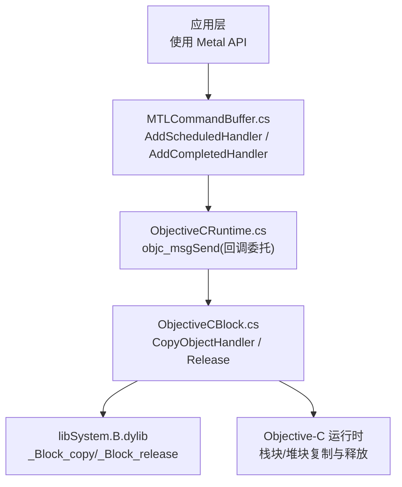
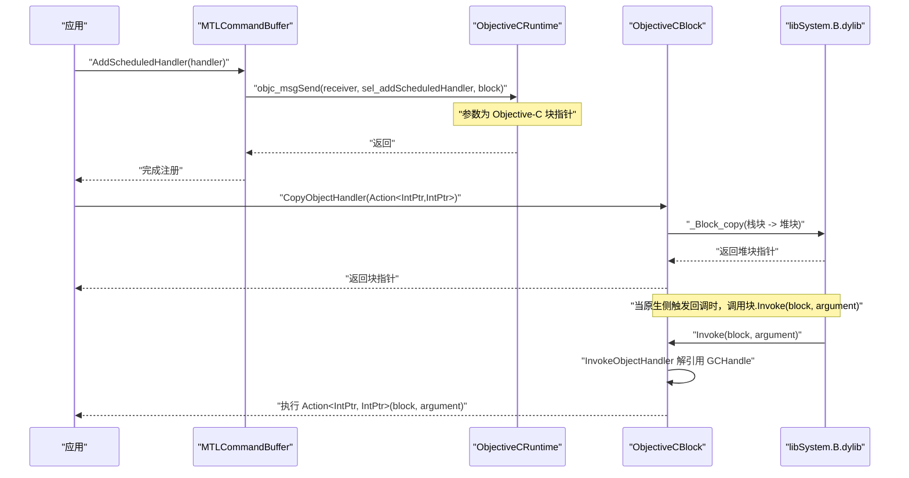
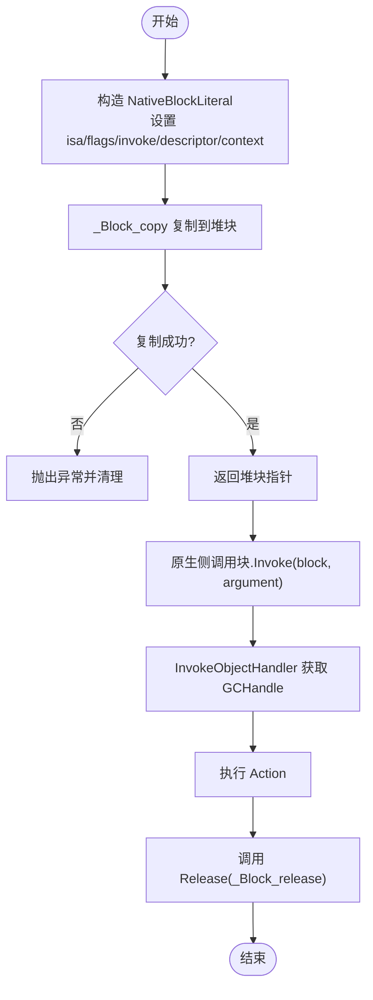
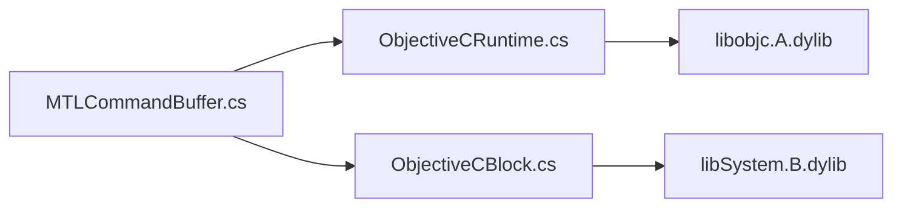

# 块对象支持

<cite>
**本文引用的文件**
- [ObjectiveCBlock.cs](file://src/SharpMetal/ObjectiveCCore/ObjectiveCBlock.cs)
- [ObjectiveCRuntime.cs](file://src/SharpMetal/ObjectiveCCore/ObjectiveCRuntime.cs)
- [ObjectiveCClass.cs](file://src/SharpMetal/ObjectiveCCore/ObjectiveCClass.cs)
- [MTLCommandBuffer.cs](file://src/SharpMetal/Metal/MTLCommandBuffer.cs)
</cite>

## 目录
1. [简介](#简介)
2. [项目结构](#项目结构)
3. [核心组件](#核心组件)
4. [架构总览](#架构总览)
5. [详细组件分析](#详细组件分析)
6. [依赖关系分析](#依赖关系分析)
7. [性能考虑](#性能考虑)
8. [故障排查指南](#故障排查指南)
9. [结论](#结论)
10. [附录：使用示例与最佳实践](#附录使用示例与最佳实践)

## 简介
本文件围绕 SharpMetal 中的“块对象（Objective-C Block）”支持进行系统化说明，重点解释 ObjectiveCBlock 的设计与实现、块对象的创建/调用/生命周期管理、与委托的映射与转换机制、在不同平台上的兼容性与差异处理，并提供回调与事件处理的实际使用建议、性能考量与内存管理最佳实践。

## 项目结构
与块对象相关的代码集中在 ObjectiveCCore 命名空间，并通过 Metal 层的回调接口暴露给上层 API。关键文件包括：
- ObjectiveCBlock.cs：构建并管理 Objective-C Block 的底层实现，负责将 C# 回调桥接到原生块对象。
- ObjectiveCRuntime.cs：提供 Objective-C Runtime 的互操作封装，包含大量 objc_msgSend 重载以及 Retain/Release 等基础能力。
- ObjectiveCClass.cs：对 Objective-C 类、方法、选择器的轻量封装。
- MTLCommandBuffer.cs：定义命令缓冲区的回调委托类型（如 MTLCommandBufferHandler），并在 AddScheduledHandler/AddCompletedHandler 等方法中通过运行时调用原生 API 注册回调。

图表来源
- [MTLCommandBuffer.cs:185-193](file://src/SharpMetal/Metal/MTLCommandBuffer.cs#L185-L193)
- [ObjectiveCRuntime.cs:764-767](file://src/SharpMetal/ObjectiveCCore/ObjectiveCRuntime.cs#L764-L767)
- [ObjectiveCBlock.cs:23-53](file://src/SharpMetal/ObjectiveCCore/ObjectiveCBlock.cs#L23-L53)

章节来源
- [ObjectiveCBlock.cs:1-167](file://src/SharpMetal/ObjectiveCCore/ObjectiveCBlock.cs#L1-L167)
- [ObjectiveCRuntime.cs:1-839](file://src/SharpMetal/ObjectiveCCore/ObjectiveCRuntime.cs#L1-L839)
- [ObjectiveCClass.cs:1-89](file://src/SharpMetal/ObjectiveCCore/ObjectiveCClass.cs#L1-L89)
- [MTLCommandBuffer.cs:1-321](file://src/SharpMetal/Metal/MTLCommandBuffer.cs#L1-L321)

## 核心组件
- ObjectiveCBlock：最小化的 Objective-C 块桥接器，用于为异步 Metal 回调构造可被原生调用的块对象。它通过 GCHandle 持有 C# 回调，并在块复制/释放时正确管理托管资源。
- ObjectiveCRuntime：提供 Objective-C 运行时函数封装，尤其是 objc_msgSend 的大量重载，使 C# 能直接调用 ObjC 方法与属性；同时提供 Retain/Release 等内存管理工具。
- ObjectiveCClass：对 Objective-C 类和方法列表的轻量访问封装。
- MTLCommandBuffer：定义命令缓冲区的回调委托类型，并在 AddScheduledHandler/AddCompletedHandler 中通过运行时调用原生 API 注册回调。

章节来源
- [ObjectiveCBlock.cs:7-53](file://src/SharpMetal/ObjectiveCCore/ObjectiveCBlock.cs#L7-L53)
- [ObjectiveCRuntime.cs:33-800](file://src/SharpMetal/ObjectiveCCore/ObjectiveCRuntime.cs#L33-L800)
- [ObjectiveCClass.cs:7-89](file://src/SharpMetal/ObjectiveCCore/ObjectiveCClass.cs#L7-L89)
- [MTLCommandBuffer.cs:56-193](file://src/SharpMetal/Metal/MTLCommandBuffer.cs#L56-L193)

## 架构总览
下图展示了从 C# 到 Objective-C 块的完整调用链：应用层通过 Metal API 注册回调，底层通过 ObjectiveCRuntime 调用 objc_msgSend，最终由 ObjectiveCBlock 构造的块对象在原生侧触发时回调到 C# 的 Action<IntPtr, IntPtr>。

图表来源
- [MTLCommandBuffer.cs:185-193](file://src/SharpMetal/Metal/MTLCommandBuffer.cs#L185-L193)
- [ObjectiveCRuntime.cs:764-767](file://src/SharpMetal/ObjectiveCCore/ObjectiveCRuntime.cs#L764-L767)
- [ObjectiveCBlock.cs:23-69](file://src/SharpMetal/ObjectiveCCore/ObjectiveCBlock.cs#L23-L69)
- [ObjectiveCBlock.cs:133-137](file://src/SharpMetal/ObjectiveCCore/ObjectiveCBlock.cs#L133-L137)

## 详细组件分析

### ObjectiveCBlock：块对象的生命周期与回调桥接
- 设计要点
  - 使用 NativeBlockLiteral 和 NativeBlockDescriptor 描述一个最小的 Objective-C 块布局，设置 isa、flags、invoke、descriptor 与 context。
  - 通过 _NSConcreteStackBlock 作为栈块基类型，并使用 _Block_copy 复制到堆上，确保块在原生侧安全持有。
  - 使用 GCHandle 将 C# 回调（Action<IntPtr, IntPtr>）封送到托管堆，避免 GC 回收导致悬垂指针。
  - 自定义 CopyHelper/DisposeHelper 以在块复制/释放时复制/释放 GCHandle，保证托管资源与原生块同步生命周期。
  - 通过签名描述 v16@?0@8\0 表示 arm64 下 void (^)(id) 的块签名，满足原生期望。
- 关键流程
  - 创建：CopyObjectHandler 初始化 NativeBlockLiteral，分配 GCHandle，调用 _Block_copy 得到堆块，随后释放栈上的临时 GCHandle。
  - 调用：原生侧调用 InvokeObjectHandler，从块上下文取回 GCHandle，恢复 Action 并执行。
  - 释放：Release 调用 _Block_release 释放堆块；DisposeHelper 在块销毁时释放托管端 GCHandle。
- 复杂度与性能
  - 创建与释放均为 O(1)。
  - 回调路径涉及一次 GCHandle 解引用与一次委托调用，开销较低。
  - 注意避免频繁创建/释放块，应复用或缓存合适的块实例。

图表来源
- [ObjectiveCBlock.cs:23-53](file://src/SharpMetal/ObjectiveCCore/ObjectiveCBlock.cs#L23-L53)
- [ObjectiveCBlock.cs:55-97](file://src/SharpMetal/ObjectiveCCore/ObjectiveCBlock.cs#L55-L97)
- [ObjectiveCBlock.cs:133-137](file://src/SharpMetal/ObjectiveCCore/ObjectiveCBlock.cs#L133-L137)

章节来源
- [ObjectiveCBlock.cs:14-167](file://src/SharpMetal/ObjectiveCCore/ObjectiveCBlock.cs#L14-L167)

### ObjectiveCRuntime：运行时互操作与委托传递
- 作用
  - 提供 objc_msgSend 的大量重载，允许 C# 直接调用 ObjC 方法与属性。
  - 针对回调场景，提供接收委托类型的 objc_msgSend 重载（例如 MTLCommandBufferHandler、MTLLogHandler），以便将托管回调转换为原生块。
  - 提供 Retain/Release/GetRetainCount 等内存管理工具。
- 与块的关系
  - 当上层调用 AddScheduledHandler/AddCompletedHandler 时，传入的是委托；运行时将其视为原生块参数传递给 ObjC 方法。
  - 对于需要显式管理的块，可通过 ObjectiveCBlock.CopyObjectHandler 构造后手动传递，并在合适时机调用 Release。

章节来源
- [ObjectiveCRuntime.cs:33-800](file://src/SharpMetal/ObjectiveCCore/ObjectiveCRuntime.cs#L33-L800)

### MTLCommandBuffer：回调委托与注册点
- 回调委托
  - 定义了 MTLCommandBufferHandler 委托，用于命令缓冲区的调度/完成回调。
- 注册方法
  - AddScheduledHandler/AddCompletedHandler 通过 objc_msgSend 将委托作为块参数传给原生 API。
- 注意事项
  - 若使用 ObjectiveCBlock 构造的块，需在不再需要时调用 Release，以避免内存泄漏。
  - 委托由运行时自动包装为块时，需遵循系统对块生命周期的约定；通常由系统持有至回调完成。

章节来源
- [MTLCommandBuffer.cs:56-193](file://src/SharpMetal/Metal/MTLCommandBuffer.cs#L56-L193)

### ObjectiveCClass：类与方法访问
- 提供 ObjectiveCClass 与 ObjectiveCMethod 的轻量封装，便于动态查询类名、方法列表等。
- 在块对象场景中主要用于辅助调试与元数据访问。

章节来源
- [ObjectiveCClass.cs:7-89](file://src/SharpMetal/ObjectiveCCore/ObjectiveCClass.cs#L7-L89)

## 依赖关系分析
- ObjectiveCBlock 依赖 libSystem.B.dylib 的 _Block_copy/_Block_release，以及 _NSConcreteStackBlock 符号解析。
- ObjectiveCRuntime 依赖 libobjc.A.dylib 的 objc_* 系列函数，尤其是 objc_msgSend。
- MTLCommandBuffer 通过 ObjectiveCRuntime 间接依赖上述原生库。
- 三者形成清晰的层次：应用层 -> Metal API -> 运行时 -> 原生库。

图表来源
- [MTLCommandBuffer.cs:185-193](file://src/SharpMetal/Metal/MTLCommandBuffer.cs#L185-L193)
- [ObjectiveCRuntime.cs:33-800](file://src/SharpMetal/ObjectiveCCore/ObjectiveCRuntime.cs#L33-L800)
- [ObjectiveCBlock.cs:116-137](file://src/SharpMetal/ObjectiveCCore/ObjectiveCBlock.cs#L116-L137)

章节来源
- [ObjectiveCBlock.cs:116-137](file://src/SharpMetal/ObjectiveCCore/ObjectiveCBlock.cs#L116-L137)
- [ObjectiveCRuntime.cs:33-800](file://src/SharpMetal/ObjectiveCCore/ObjectiveCRuntime.cs#L33-L800)
- [MTLCommandBuffer.cs:185-193](file://src/SharpMetal/Metal/MTLCommandBuffer.cs#L185-L193)

## 性能考虑
- 块创建与复制
  - 每次 CopyObjectHandler 都会进行一次 _Block_copy，应避免在热路径中频繁创建块。
  - 推荐策略：在初始化阶段创建并缓存常用块，或在同一生命周期内复用。
- 回调开销
  - 回调路径包含一次 GCHandle 解引用与委托调用，整体开销低，但需注意不要在回调中进行昂贵操作。
- 内存管理
  - 使用 ObjectiveCBlock 创建的块必须显式 Release，否则会导致内存泄漏。
  - 委托由运行时自动包装的情况，遵循系统块生命周期约定即可。
- 平台差异
  - 签名 v16@?0@8\0 针对 arm64；在其他 ABI 上可能需要调整签名与布局。当前实现主要面向 Apple 平台（macOS/iOS/Mac Catalyst）。

[本节为通用性能指导，不直接分析具体文件]

## 故障排查指南
- PAC 崩溃（addFeedbackHandler/addPresentedHandler 等）
  - 现象：直接将原始 C# 函数指针作为块传递会引发 PAC faults。
  - 原因：原生块要求特定的布局与调用约定，不能直接用非块函数指针。
  - 解决：使用 ObjectiveCBlock.CopyObjectHandler 构造合法块后再传递。
- 符号解析失败
  - 现象：无法打开 libSystem.B.dylib 或解析 _NSConcreteStackBlock。
  - 原因：运行环境缺少必要库或权限问题。
  - 解决：确保在支持的 Apple 平台上运行，并检查动态库加载权限。
- 内存泄漏
  - 现象：进程内存持续增长。
  - 原因：未调用 ObjectiveCBlock.Release 释放块。
  - 解决：在块不再需要时立即释放；或使用 try/finally 确保释放。
- 回调未触发
  - 现象：注册的回调从未执行。
  - 可能原因：块生命周期过短被释放；或原生侧未持有块。
  - 解决：确保块在回调期间有效；必要时延长块生命周期或改用运行时自动包装的委托方式。

章节来源
- [ObjectiveCBlock.cs:7-11](file://src/SharpMetal/ObjectiveCCore/ObjectiveCBlock.cs#L7-L11)
- [ObjectiveCBlock.cs:116-131](file://src/SharpMetal/ObjectiveCCore/ObjectiveCBlock.cs#L116-L131)
- [ObjectiveCBlock.cs:47-53](file://src/SharpMetal/ObjectiveCCore/ObjectiveCBlock.cs#L47-L53)

## 结论
SharpMetal 通过 ObjectiveCBlock 提供了稳定且高效的 Objective-C 块桥接能力，使得 C# 能够安全地参与 Metal 的异步回调体系。结合 ObjectiveCRuntime 的运行时互操作与 MTLCommandBuffer 的回调注册点，开发者可以在不同平台上以一致的方式处理回调与事件。遵循本文的内存管理与性能建议，可以显著降低崩溃与泄漏风险，提升整体稳定性。

[本节为总结性内容，不直接分析具体文件]

## 附录：使用示例与最佳实践

- 回调函数与事件处理
  - 使用 MTLCommandBuffer.AddScheduledHandler/AddCompletedHandler 注册回调。
  - 若需显式控制块生命周期，使用 ObjectiveCBlock.CopyObjectHandler 构造块，并在完成后调用 Release。
  - 参考路径：
    - [MTLCommandBuffer.cs:185-193](file://src/SharpMetal/Metal/MTLCommandBuffer.cs#L185-L193)
    - [ObjectiveCBlock.cs:23-53](file://src/SharpMetal/ObjectiveCCore/ObjectiveCBlock.cs#L23-L53)

- 委托与块的映射
  - 运行时会将委托作为块参数传递给 objc_msgSend；对于需要跨边界持久化的块，建议使用 CopyObjectHandler 构造并管理其生命周期。
  - 参考路径：
    - [ObjectiveCRuntime.cs:764-767](file://src/SharpMetal/ObjectiveCCore/ObjectiveCRuntime.cs#L764-L767)
    - [ObjectiveCBlock.cs:55-97](file://src/SharpMetal/ObjectiveCCore/ObjectiveCBlock.cs#L55-L97)

- 平台兼容性
  - 当前实现针对 Apple 平台（macOS/iOS/Mac Catalyst），依赖 libSystem.B.dylib 与 libobjc.A.dylib。
  - 在非 Apple 平台将受限；建议在启动时检测平台并给出明确提示。
  - 参考路径：
    - [ObjectiveCBlock.cs:116-131](file://src/SharpMetal/ObjectiveCCore/ObjectiveCBlock.cs#L116-L131)
    - [ObjectiveCRuntime.cs:33-57](file://src/SharpMetal/ObjectiveCCore/ObjectiveCRuntime.cs#L33-L57)

- 内存管理最佳实践
  - 始终配对：创建块后在使用结束时调用 Release。
  - 避免在回调中捕获大对象；必要时仅捕获轻量句柄。
  - 使用 try/finally 确保释放，防止异常路径下的泄漏。
  - 参考路径：
    - [ObjectiveCBlock.cs:47-53](file://src/SharpMetal/ObjectiveCCore/ObjectiveCBlock.cs#L47-L53)
    - [ObjectiveCBlock.cs:86-97](file://src/SharpMetal/ObjectiveCCore/ObjectiveCBlock.cs#L86-L97)

- 性能优化建议
  - 减少块创建频率，尽量复用或缓存。
  - 在回调中避免阻塞与重计算，必要时切换到后台线程。
  - 监控内存增长，定位未释放的块。
  - 参考路径：
    - [ObjectiveCBlock.cs:23-53](file://src/SharpMetal/ObjectiveCCore/ObjectiveCBlock.cs#L23-L53)
    - [ObjectiveCBlock.cs:133-137](file://src/SharpMetal/ObjectiveCCore/ObjectiveCBlock.cs#L133-L137)