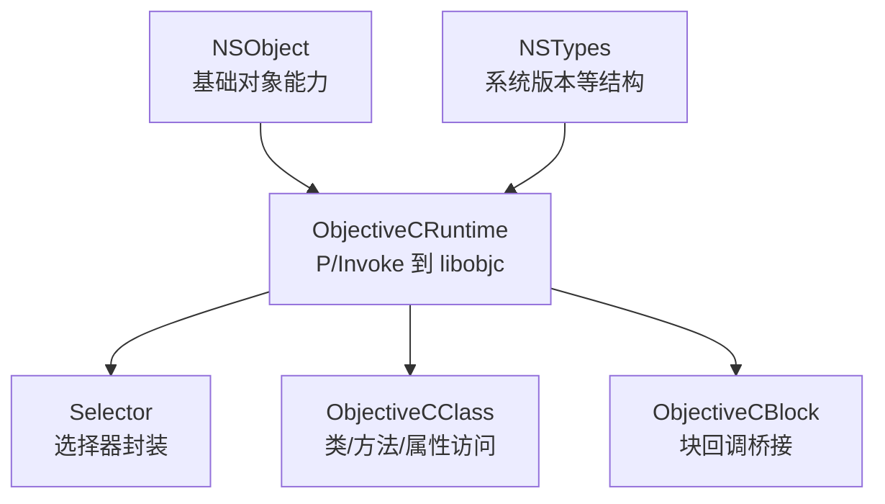
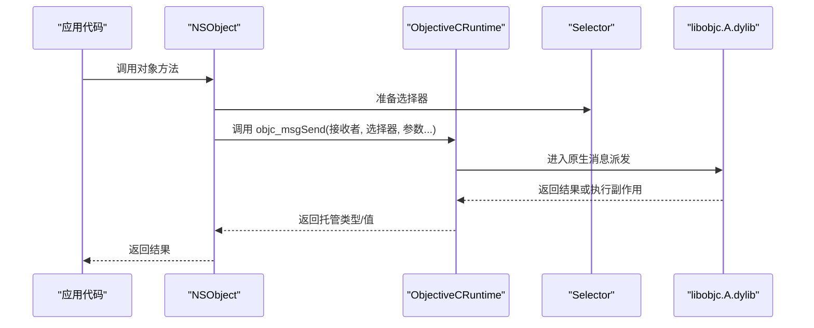
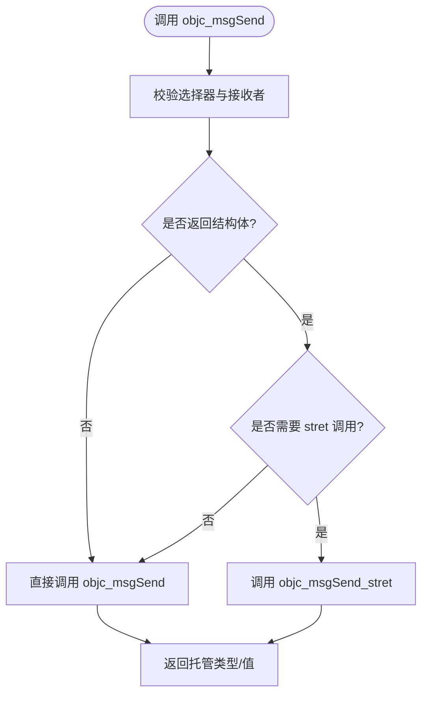
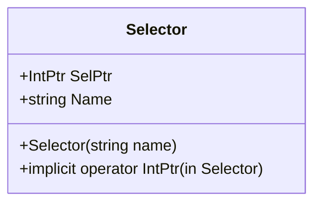
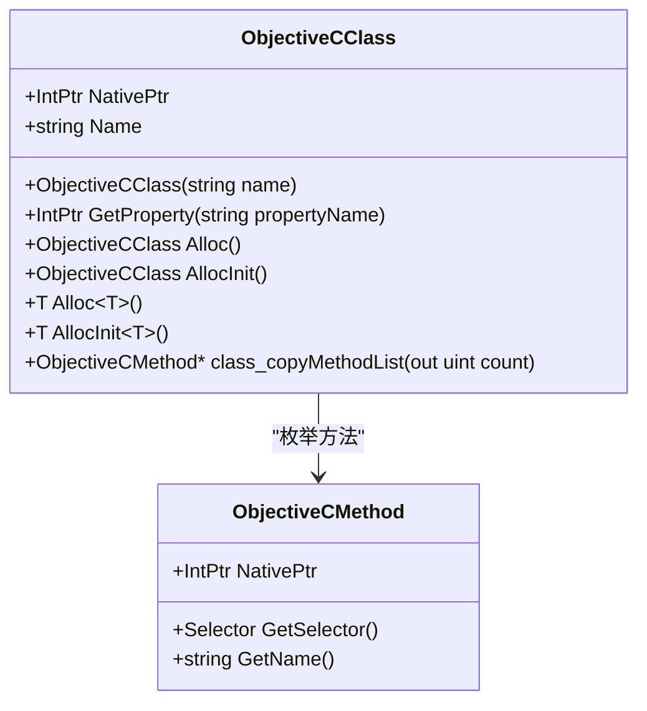
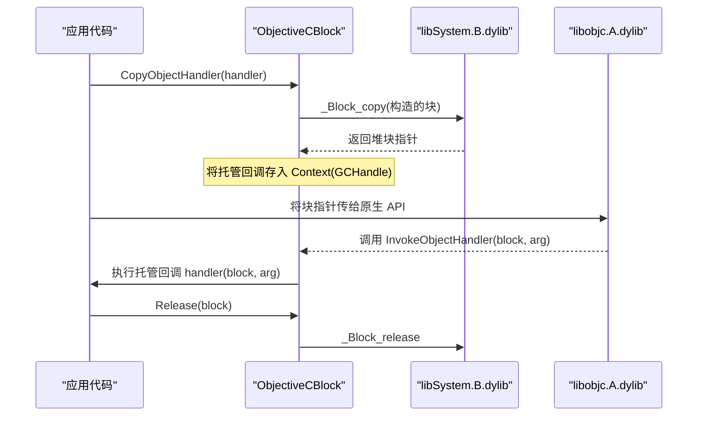
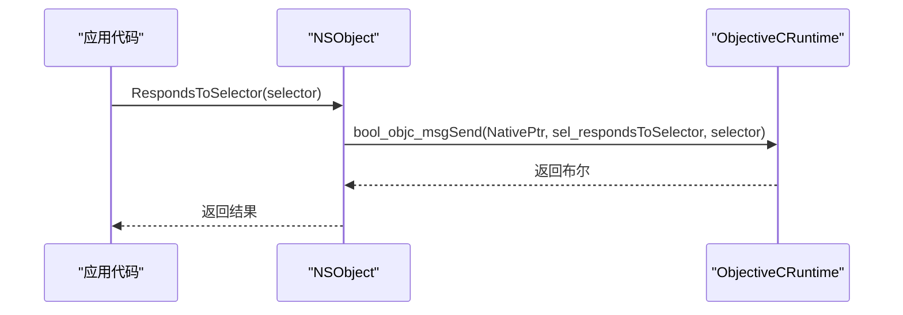
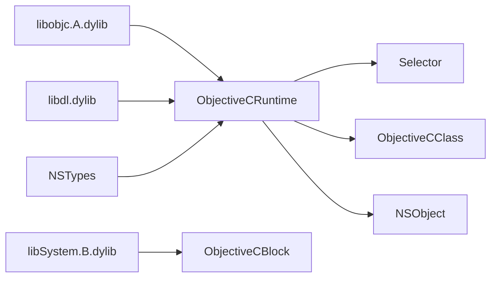

# 运行时引擎

<cite>
**本文引用的文件**
- [ObjectiveCRuntime.cs](file://src/SharpMetal/ObjectiveCCore/ObjectiveCRuntime.cs)
- [ObjectiveCClass.cs](file://src/SharpMetal/ObjectiveCCore/ObjectiveCClass.cs)
- [Selector.cs](file://src/SharpMetal/ObjectiveCCore/Selector.cs)
- [ObjectiveCBlock.cs](file://src/SharpMetal/ObjectiveCCore/ObjectiveCBlock.cs)
- [NSObject.cs](file://src/SharpMetal/Foundation/NSObject.cs)
- [NSTypes.cs](file://src/SharpMetal/Foundation/NSTypes.cs)
</cite>

## 目录
1. [简介](#简介)
2. [项目结构](#项目结构)
3. [核心组件](#核心组件)
4. [架构总览](#架构总览)
5. [详细组件分析](#详细组件分析)
6. [依赖关系分析](#依赖关系分析)
7. [性能考量](#性能考量)
8. [故障排查指南](#故障排查指南)
9. [结论](#结论)
10. [附录](#附录)

## 简介
本文件面向需要深入理解 SharpMetal 中 Objective-C 运行时引擎的开发者，重点解释 ObjectiveCRuntime 类的核心能力：消息传递机制、动态类型系统、运行时反射能力；详述 objc_msgSend 系列方法的重载实现与封送策略；说明内存管理相关的 Retain、Release、GetRetainCount 的实现细节；阐述通过 LibraryImport 调用原生 Objective-C 运行时库的技术要点；并提供性能优化技巧与最佳实践建议。

## 项目结构
该运行时引擎位于 src/SharpMetal/ObjectiveCCore 命名空间下，围绕 ObjectiveCRuntime 提供对 libobjc.A.dylib 的 P/Invoke 封装，并通过 Selector、ObjectiveCClass、ObjectiveCBlock 等类型完成消息分发、类元数据访问与块（block）回调桥接。Foundation 层 NSObject 等类型在此基础上构建更高层的抽象。

图表来源
- [ObjectiveCRuntime.cs:33-800](file://src/SharpMetal/ObjectiveCCore/ObjectiveCRuntime.cs#L33-L800)
- [Selector.cs:5-45](file://src/SharpMetal/ObjectiveCCore/Selector.cs#L5-L45)
- [ObjectiveCClass.cs:7-89](file://src/SharpMetal/ObjectiveCCore/ObjectiveCClass.cs#L7-L89)
- [ObjectiveCBlock.cs:12-167](file://src/SharpMetal/ObjectiveCCore/ObjectiveCBlock.cs#L12-L167)
- [NSObject.cs:48-92](file://src/SharpMetal/Foundation/NSObject.cs#L48-L92)
- [NSTypes.cs:5-12](file://src/SharpMetal/Foundation/NSTypes.cs#L5-L12)

章节来源
- [ObjectiveCRuntime.cs:33-800](file://src/SharpMetal/ObjectiveCCore/ObjectiveCRuntime.cs#L33-L800)
- [Selector.cs:5-45](file://src/SharpMetal/ObjectiveCCore/Selector.cs#L5-L45)
- [ObjectiveCClass.cs:7-89](file://src/SharpMetal/ObjectiveCCore/ObjectiveCClass.cs#L7-L89)
- [ObjectiveCBlock.cs:12-167](file://src/SharpMetal/ObjectiveCCore/ObjectiveCBlock.cs#L12-L167)
- [NSObject.cs:48-92](file://src/SharpMetal/Foundation/NSObject.cs#L48-L92)
- [NSTypes.cs:5-12](file://src/SharpMetal/Foundation/NSTypes.cs#L5-L12)

## 核心组件
- ObjectiveCRuntime：集中声明对 Objective-C 运行时的 P/Invoke 入口，包括类查找、方法列表枚举、属性查询、字符串/数值/结构体封送以及大量 objc_msgSend 重载，用于将托管调用映射到原生消息发送。
- Selector：封装选择器，支持从字符串创建并获取名称，隐式转换为 IntPtr 以便传入消息。
- ObjectiveCClass：封装类指针，提供类名读取、属性查询、方法列表枚举、实例分配与初始化等能力。
- ObjectiveCBlock：构造并管理 Objective-C block，将托管回调安全地传递给原生 API（如 Metal 回调）。
- NSObject：在运行时基础上暴露常用对象能力（哈希、描述、相等性判断、响应检查等）。

章节来源
- [ObjectiveCRuntime.cs:33-800](file://src/SharpMetal/ObjectiveCCore/ObjectiveCRuntime.cs#L33-L800)
- [Selector.cs:5-45](file://src/SharpMetal/ObjectiveCCore/Selector.cs#L5-L45)
- [ObjectiveCClass.cs:7-89](file://src/SharpMetal/ObjectiveCCore/ObjectiveCClass.cs#L7-L89)
- [ObjectiveCBlock.cs:12-167](file://src/SharpMetal/ObjectiveCCore/ObjectiveCBlock.cs#L12-L167)
- [NSObject.cs:48-92](file://src/SharpMetal/Foundation/NSObject.cs#L48-L92)

## 架构总览
下图展示了从托管代码到原生 Objective-C 运行时的关键路径：Selector 作为消息目标标识，ObjectiveCClass 提供类级操作，ObjectiveCRuntime 负责底层 P/Invoke 与消息派发，NSObject 在顶层提供面向对象语义。

图表来源
- [NSObject.cs:54-79](file://src/SharpMetal/Foundation/NSObject.cs#L54-L79)
- [ObjectiveCRuntime.cs:118-768](file://src/SharpMetal/ObjectiveCCore/ObjectiveCRuntime.cs#L118-L768)
- [Selector.cs:20-42](file://src/SharpMetal/ObjectiveCCore/Selector.cs#L20-L42)

## 详细组件分析

### ObjectiveCRuntime：消息传递与封送
- 消息派发：通过大量 objc_msgSend 重载覆盖不同参数个数、类型与返回值类型，确保与 Objective-C 方法签名匹配。例如：
  - 无参/单参/多参整数、浮点、布尔、指针、结构体（如 NSRange、MTLSize、CGRect、CGSize、MTLClearColor 等）
  - 字符串参数使用 StringMarshalling.Utf8 进行封送
  - 返回值为 struct 时通过泛型重载以 Unsafe.AsRef 方式转换
- 运行时反射：提供 class_getName、class_copyMethodList、method_getName、class_getProperty、property_copyAttributeValue 等，用于枚举方法与属性信息。
- 类与选择器：提供 objc_getClass、sel_registerName/sel_getName、objc_allocateClassPair/class_addMethod/objc_registerClassPair 等，支持动态类创建与方法注入。
- 内存管理：提供 Retain、Release、GetRetainCount，内部通过 sel_retain、sel_release、sel_retainCount 选择器调用。
- 结构体返回：提供 objc_msgSend_stret 用于某些平台/ABI 下的结构体返回场景。

图表来源
- [ObjectiveCRuntime.cs:118-768](file://src/SharpMetal/ObjectiveCCore/ObjectiveCRuntime.cs#L118-L768)
- [ObjectiveCRuntime.cs:760-782](file://src/SharpMetal/ObjectiveCCore/ObjectiveCRuntime.cs#L760-L782)

章节来源
- [ObjectiveCRuntime.cs:33-800](file://src/SharpMetal/ObjectiveCCore/ObjectiveCRuntime.cs#L33-L800)

### Selector：选择器封装
- 通过 sel_getUid 从字符串创建选择器，支持 Name 属性读取原始名称。
- 提供隐式转换至 IntPtr，便于直接传入 P/Invoke。

图表来源
- [Selector.cs:5-45](file://src/SharpMetal/ObjectiveCCore/Selector.cs#L5-L45)

章节来源
- [Selector.cs:5-45](file://src/SharpMetal/ObjectiveCCore/Selector.cs#L5-L45)

### ObjectiveCClass：类与实例操作
- 类名读取：class_getName
- 属性查询：class_getProperty + property_copyAttributeValue
- 方法枚举：class_copyMethodList + method_getName
- 实例分配与初始化：通过 alloc/init 消息创建实例
- 泛型分配：Alloc<T>/AllocInit<T> 用于值类型包装

图表来源
- [ObjectiveCClass.cs:7-89](file://src/SharpMetal/ObjectiveCCore/ObjectiveCClass.cs#L7-L89)
- [ObjectiveCRuntime.cs:68-82](file://src/SharpMetal/ObjectiveCCore/ObjectiveCRuntime.cs#L68-L82)

章节来源
- [ObjectiveCClass.cs:7-89](file://src/SharpMetal/ObjectiveCCore/ObjectiveCClass.cs#L7-L89)
- [ObjectiveCRuntime.cs:68-82](file://src/SharpMetal/ObjectiveCCore/ObjectiveCRuntime.cs#L68-L82)

### ObjectiveCBlock：块回调桥接
- 目的：将托管 Action<IntPtr, IntPtr> 回调安全地转换为 Objective-C block，供原生 API（如 Metal 反馈/呈现回调）调用。
- 关键点：
  - 手动构造 NativeBlockLiteral，设置 isa、flags、invoke、descriptor、context
  - 使用 _Block_copy/_Block_release 管理生命周期
  - 通过 CopyHelper/DisposeHelper 复制/释放 GCHandle，避免托管对象被 GC 回收
  - 通过 dlopen/dlsym 解析 _NSConcreteStackBlock 符号
- 适用场景：需要向原生传递回调函数指针且由原生持有生命周期的情况。

图表来源
- [ObjectiveCBlock.cs:23-53](file://src/SharpMetal/ObjectiveCCore/ObjectiveCBlock.cs#L23-L53)
- [ObjectiveCBlock.cs:55-97](file://src/SharpMetal/ObjectiveCCore/ObjectiveCBlock.cs#L55-L97)
- [ObjectiveCBlock.cs:99-143](file://src/SharpMetal/ObjectiveCCore/ObjectiveCBlock.cs#L99-L143)

章节来源
- [ObjectiveCBlock.cs:12-167](file://src/SharpMetal/ObjectiveCCore/ObjectiveCBlock.cs#L12-L167)

### NSObject：基础对象能力
- 基于 ObjectiveCRuntime 暴露常用方法：hash、description、debugDescription、isEqual、isKindOfClass、respondsToSelector。
- 这些方法通过 objc_msgSend 调用原生实现，体现运行时反射与消息派发能力。

图表来源
- [NSObject.cs:70-79](file://src/SharpMetal/Foundation/NSObject.cs#L70-L79)
- [ObjectiveCRuntime.cs:137-139](file://src/SharpMetal/ObjectiveCCore/ObjectiveCRuntime.cs#L137-L139)

章节来源
- [NSObject.cs:48-92](file://src/SharpMetal/Foundation/NSObject.cs#L48-L92)

## 依赖关系分析
- ObjectiveCRuntime 依赖 libobjc.A.dylib 与 libdl.dylib（dlopen），并通过 LibraryImport 静态绑定。
- Selector 依赖 /usr/lib/libobjc.A.dylib 中的选择器 API。
- ObjectiveCBlock 依赖 libSystem.B.dylib（_Block_*）与 libdl.dylib（dlopen/dlsym）。
- NSObject 依赖 ObjectiveCRuntime 提供的消息派发能力。
- NSTypes 提供跨平台结构定义（如 NSOperatingSystemVersion）。

图表来源
- [ObjectiveCRuntime.cs:37-82](file://src/SharpMetal/ObjectiveCCore/ObjectiveCRuntime.cs#L37-L82)
- [Selector.cs:7-11](file://src/SharpMetal/ObjectiveCCore/Selector.cs#L7-L11)
- [ObjectiveCBlock.cs:116-143](file://src/SharpMetal/ObjectiveCCore/ObjectiveCBlock.cs#L116-L143)
- [NSObject.cs:54-79](file://src/SharpMetal/Foundation/NSObject.cs#L54-L79)
- [NSTypes.cs:5-12](file://src/SharpMetal/Foundation/NSTypes.cs#L5-L12)

章节来源
- [ObjectiveCRuntime.cs:37-82](file://src/SharpMetal/ObjectiveCCore/ObjectiveCRuntime.cs#L37-L82)
- [Selector.cs:7-11](file://src/SharpMetal/ObjectiveCCore/Selector.cs#L7-L11)
- [ObjectiveCBlock.cs:116-143](file://src/SharpMetal/ObjectiveCCore/ObjectiveCBlock.cs#L116-L143)
- [NSObject.cs:54-79](file://src/SharpMetal/Foundation/NSObject.cs#L54-L79)
- [NSTypes.cs:5-12](file://src/SharpMetal/Foundation/NSTypes.cs#L5-L12)

## 性能考量
- 减少 P/Invoke 开销：
  - 复用 Selector 实例，避免重复创建选择器。
  - 批量调用时尽量合并参数，减少跨边界次数。
- 合理使用结构体封送：
  - 对于频繁调用的简单结构体（如 NSRange、MTLSize），优先使用值类型封送，避免额外分配。
  - 对字符串参数使用 UTF-8 封送，避免中间编码转换。
- 避免不必要的反射：
  - 缓存类名、属性名与方法列表，减少运行时查询。
- 块回调优化：
  - 仅在必要时创建块，并在完成后及时 Release，避免内存泄漏。
  - 将托管回调捕获为轻量委托，避免闭包捕获大对象。
- 线程安全：
  - 注意多线程环境下对同一对象的并发消息发送，必要时加锁或使用队列串行化。

[本节为通用指导，不直接分析具体文件]

## 故障排查指南
- 选择器为空或未找到：
  - 检查 Selector 构造是否成功，确认名称拼写与大小写。
  - 参考错误输出定位失败的选择器。
- 类未找到：
  - 确认类名正确，且在当前进程已加载。
  - 使用 objc_getClass 返回空指针时记录日志。
- 块回调崩溃：
  - 确保通过 CopyObjectHandler 创建块，并在不再使用时调用 Release。
  - 检查上下文 GCHandle 是否正确释放，避免双重释放或悬挂引用。
- 结构体返回异常：
  - 某些平台/ABI 需要使用 objc_msgSend_stret，确认调用路径正确。
- 内存泄漏：
  - 跟踪 Retain/Release 配对，确保每个 retain 都有对应的 release。
  - 使用工具（如 Allocations/Leaks）辅助定位。

章节来源
- [Selector.cs:20-30](file://src/SharpMetal/ObjectiveCCore/Selector.cs#L20-L30)
- [ObjectiveCClass.cs:30-40](file://src/SharpMetal/ObjectiveCCore/ObjectiveCClass.cs#L30-L40)
- [ObjectiveCBlock.cs:23-53](file://src/SharpMetal/ObjectiveCCore/ObjectiveCBlock.cs#L23-L53)
- [ObjectiveCRuntime.cs:760-782](file://src/SharpMetal/ObjectiveCCore/ObjectiveCRuntime.cs#L760-L782)

## 结论
SharpMetal 的 Objective-C 运行时引擎通过 ObjectiveCRuntime 提供了完整而高效的 P/Invoke 桥接，覆盖消息派发、动态类型、反射与内存管理等核心能力。配合 Selector、ObjectiveCClass、ObjectiveCBlock 与 NSObject，开发者可以在 .NET 中以接近原生的性能与灵活性调用 Objective-C 与 Metal API。遵循本文的性能优化与最佳实践，可进一步提升稳定性与效率。

[本节为总结性内容，不直接分析具体文件]

## 附录

### objc_msgSend 重载分类与用途
- 基本类型：int、long、float、double、bool、byte、short、ushort、uint、ulong
- 指针与对象：IntPtr、自定义结构体（如 NSRange、MTLSize、CGRect、CGSize、MTLClearColor、MTLRegion 等）
- 字符串：UTF-8 封送
- 结构体返回：通过泛型重载与 stret 调用处理
- 回调：支持委托/块回调（通过 ObjectiveCBlock）

章节来源
- [ObjectiveCRuntime.cs:118-768](file://src/SharpMetal/ObjectiveCCore/ObjectiveCRuntime.cs#L118-L768)

### 内存管理要点
- Retain/Release 配对：确保每个对象的生命周期正确管理。
- GetRetainCount：用于调试与验证引用计数变化。
- 块生命周期：通过 _Block_copy/_Block_release 管理，避免托管对象被 GC 回收。

章节来源
- [ObjectiveCRuntime.cs:769-782](file://src/SharpMetal/ObjectiveCCore/ObjectiveCRuntime.cs#L769-L782)
- [ObjectiveCBlock.cs:23-53](file://src/SharpMetal/ObjectiveCCore/ObjectiveCBlock.cs#L23-L53)