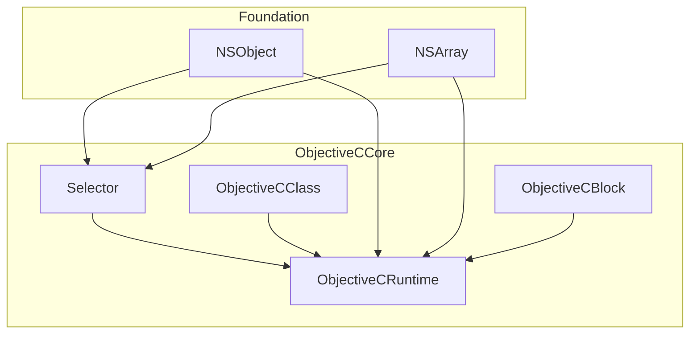
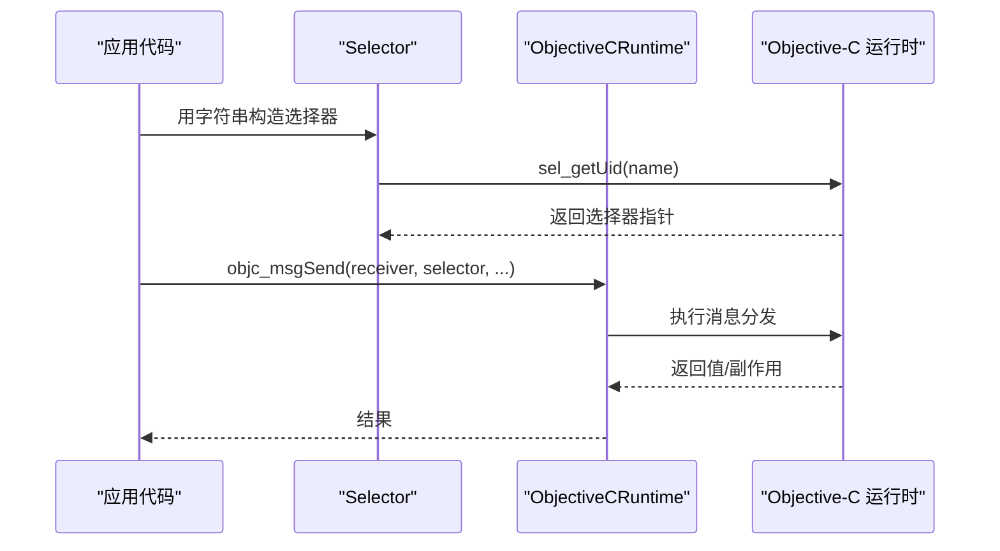
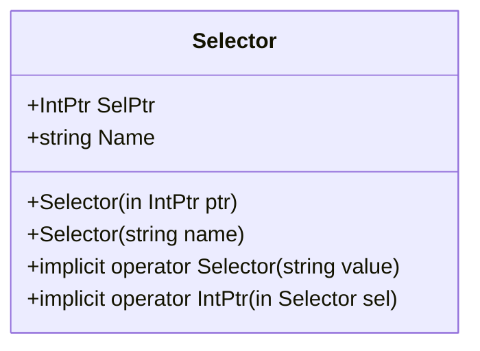
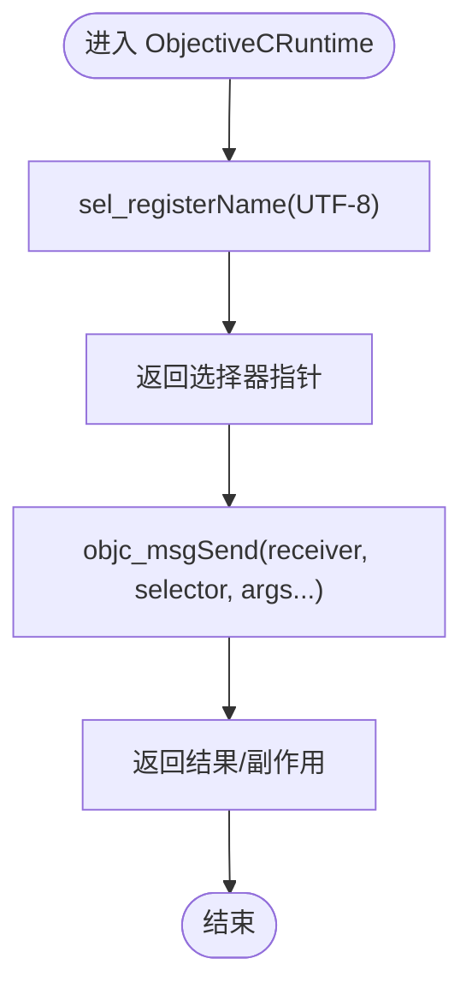
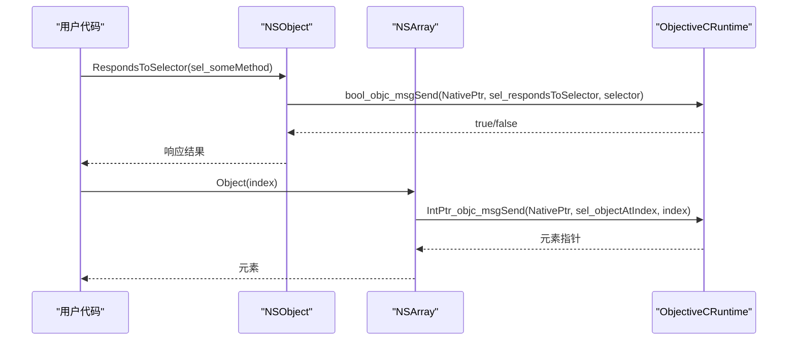
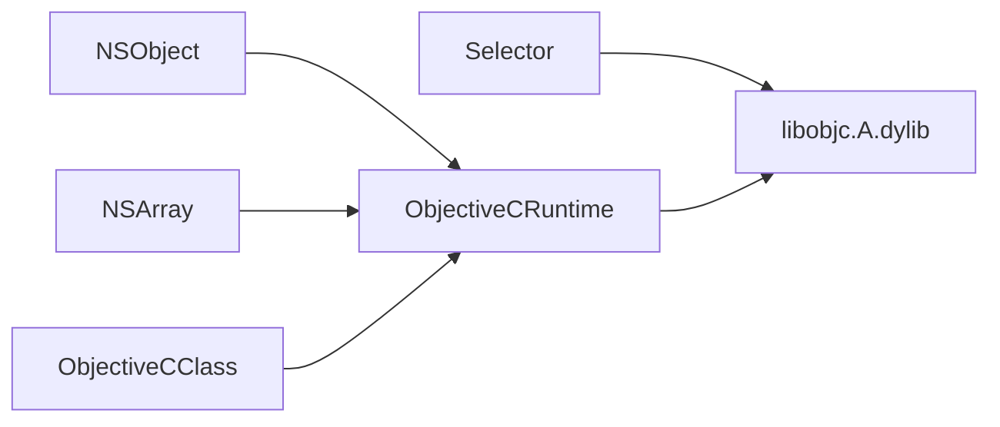

# 选择器管理

<cite>
**本文引用的文件**
- [Selector.cs](file://src/SharpMetal/ObjectiveCCore/Selector.cs)
- [ObjectiveCRuntime.cs](file://src/SharpMetal/ObjectiveCCore/ObjectiveCRuntime.cs)
- [NSObject.cs](file://src/SharpMetal/Foundation/NSObject.cs)
- [NSArray.cs](file://src/SharpMetal/Foundation/NSArray.cs)
- [ObjectiveCClass.cs](file://src/SharpMetal/ObjectiveCCore/ObjectiveCClass.cs)
- [Program.cs](file://samples/SharpMetal.Sample/Program.cs)
</cite>

## 目录
1. [简介](#简介)
2. [项目结构](#项目结构)
3. [核心组件](#核心组件)
4. [架构总览](#架构总览)
5. [详细组件分析](#详细组件分析)
6. [依赖关系分析](#依赖关系分析)
7. [性能考虑](#性能考虑)
8. [故障排查指南](#故障排查指南)
9. [结论](#结论)
10. [附录：使用示例与最佳实践](#附录：使用示例与最佳实践)

## 简介
本文件聚焦于 SharpMetal 中 Objective-C 选择器（Selector）的管理机制，围绕 Selector 结构体的设计、创建、缓存与生命周期展开，解释其与原生运行时 API 的交互方式，并说明选择器在消息传递中的关键作用。文档同时提供性能优化建议、错误处理策略以及可复用的使用模式，帮助读者在 C# 层安全高效地使用 Objective-C 运行时能力。

## 项目结构
与选择器相关的代码主要位于 ObjectiveCCore 与 Foundation 两个命名空间：
- ObjectiveCCore：定义 Selector、ObjectiveCRuntime、ObjectiveCClass、ObjectiveCBlock 等底层桥接能力。
- Foundation：基于 ObjectiveCCore 暴露更高层的 NSObject、NSArray 等类型，内部大量通过 Selector 调用 Objective-C 方法。

图表来源
- [Selector.cs:5-43](file://src/SharpMetal/ObjectiveCCore/Selector.cs#L5-L43)
- [ObjectiveCRuntime.cs:33-82](file://src/SharpMetal/ObjectiveCCore/ObjectiveCRuntime.cs#L33-L82)
- [NSObject.cs:48-90](file://src/SharpMetal/Foundation/NSObject.cs#L48-L90)
- [NSArray.cs:5-64](file://src/SharpMetal/Foundation/NSArray.cs#L5-L64)

章节来源
- [Selector.cs:5-43](file://src/SharpMetal/ObjectiveCCore/Selector.cs#L5-L43)
- [ObjectiveCRuntime.cs:33-82](file://src/SharpMetal/ObjectiveCCore/ObjectiveCRuntime.cs#L33-L82)
- [NSObject.cs:48-90](file://src/SharpMetal/Foundation/NSObject.cs#L48-L90)
- [NSArray.cs:5-64](file://src/SharpMetal/Foundation/NSArray.cs#L5-L64)

## 核心组件
- Selector：对 Objective-C 选择器的轻量封装，持有底层指针，支持从字符串构造、获取名称、隐式转换到 IntPtr。
- ObjectiveCRuntime：集中声明与 Objective-C 运行时的互操作函数，包括 sel_registerName、sel_getName、objc_msgSend 系列重载、内存管理与类/方法反射相关 API。
- NSObject：基础对象抽象，展示如何通过 Selector 调用常见 Objective-C 方法（如 hash、description、respondsToSelector:）。
- NSArray：集合类型的包装，演示将 Selector 作为静态常量复用，减少重复创建开销。
- ObjectiveCClass：类级别的包装，展示如何分配、初始化对象及枚举方法列表，并通过 Selector 进行消息发送。

章节来源
- [Selector.cs:5-43](file://src/SharpMetal/ObjectiveCCore/Selector.cs#L5-L43)
- [ObjectiveCRuntime.cs:33-82](file://src/SharpMetal/ObjectiveCCore/ObjectiveCRuntime.cs#L33-L82)
- [NSObject.cs:48-90](file://src/SharpMetal/Foundation/NSObject.cs#L48-L90)
- [NSArray.cs:5-64](file://src/SharpMetal/Foundation/NSArray.cs#L5-L64)
- [ObjectiveCClass.cs:7-87](file://src/SharpMetal/ObjectiveCCore/ObjectiveCClass.cs#L7-L87)

## 架构总览
选择器在 SharpMetal 中扮演“方法标识符”的角色。所有对 Objective-C 对象的调用最终都通过 objc_msgSend 系列函数完成，而该函数的第二个参数即为 Selector。Selector 的创建通常由字符串经运行时注册或查找得到；其名称可通过运行时查询获得。

图表来源
- [Selector.cs:20-30](file://src/SharpMetal/ObjectiveCCore/Selector.cs#L20-L30)
- [ObjectiveCRuntime.cs:118-134](file://src/SharpMetal/ObjectiveCCore/ObjectiveCRuntime.cs#L118-L134)

## 详细组件分析

### Selector 结构体设计与实现
- 职责：封装 Objective-C 选择器指针，提供字符串到选择器的构造、选择器名称读取、与 IntPtr 的双向隐式转换。
- 创建路径：
  - 通过字符串构造时，调用 libobjc 的 sel_getUid 获取或注册选择器。
  - 也可通过已有 IntPtr 直接构造。
- 名称访问：
  - 通过 sel_getName 获取选择器对应的 C 字符串，再转换为托管字符串。
- 隐式转换：
  - 允许 string -> Selector 和 Selector -> IntPtr，简化调用点写法。

图表来源
- [Selector.cs:5-43](file://src/SharpMetal/ObjectiveCCore/Selector.cs#L5-L43)

章节来源
- [Selector.cs:5-43](file://src/SharpMetal/ObjectiveCCore/Selector.cs#L5-L43)

### ObjectiveCRuntime 中的原生 API 封装
- 选择器注册与查询：
  - sel_registerName：以 UTF-8 字节指针形式注册选择器，返回选择器指针。
  - sel_getName：根据选择器指针返回对应的 C 字符串。
- 消息发送：
  - 提供大量 objc_msgSend 重载，覆盖不同返回值与参数组合，便于在不同场景下调用 Objective-C 方法。
- 内存与类/方法反射：
  - Retain/Release/GetRetainCount：用于引用计数管理。
  - objc_getClass、class_addMethod、method_getName、class_copyMethodList：用于动态类与方法操作。

图表来源
- [ObjectiveCRuntime.cs:56-60](file://src/SharpMetal/ObjectiveCCore/ObjectiveCRuntime.cs#L56-L60)
- [ObjectiveCRuntime.cs:118-134](file://src/SharpMetal/ObjectiveCCore/ObjectiveCRuntime.cs#L118-L134)

章节来源
- [ObjectiveCRuntime.cs:56-60](file://src/SharpMetal/ObjectiveCCore/ObjectiveCRuntime.cs#L56-L60)
- [ObjectiveCRuntime.cs:118-134](file://src/SharpMetal/ObjectiveCCore/ObjectiveCRuntime.cs#L118-L134)

### 选择器的字符串表示与内部存储
- 字符串表示：
  - 通过 Selector.Name 属性读取，底层调用 sel_getName 并将 C 字符串转为托管字符串。
- 内部存储：
  - Selector 仅保存一个 IntPtr 指向运行时中的选择器对象；不维护额外缓存表。
- 注意事项：
  - 同一字符串多次构造 Selector 会复用运行时中的唯一选择器实例（由 sel_getUid 保证），因此 Selector 本身是无状态且可共享的。

章节来源
- [Selector.cs:32-39](file://src/SharpMetal/ObjectiveCCore/Selector.cs#L32-L39)
- [Selector.cs:20-30](file://src/SharpMetal/ObjectiveCCore/Selector.cs#L20-L30)

### 选择器在消息传递中的作用与重要性
- 角色：
  - 选择器是 Objective-C 消息分发的键，objc_msgSend 通过选择器定位目标方法实现。
- 使用位置：
  - 所有对 NSObject、NSArray、MTL* 等类型的调用均通过 ObjectiveCRuntime 提供的 objc_msgSend 重载完成，其中包含 Selector 或 IntPtr 形式的选择器。
- 影响：
  - 选择器的正确性与稳定性直接影响消息能否成功派发；错误的选择器会导致运行时异常或崩溃。

章节来源
- [ObjectiveCRuntime.cs:118-134](file://src/SharpMetal/ObjectiveCCore/ObjectiveCRuntime.cs#L118-L134)
- [NSObject.cs:54-79](file://src/SharpMetal/Foundation/NSObject.cs#L54-L79)
- [NSArray.cs:13-49](file://src/SharpMetal/Foundation/NSArray.cs#L13-L49)

### 选择器的创建、缓存与生命周期管理
- 创建：
  - 通过字符串构造 Selector，内部调用 sel_getUid 获取或注册选择器。
  - 也可直接从 IntPtr 构造。
- 缓存：
  - 当前 Selector 未维护显式缓存；但得益于运行时保证同名选择器唯一性，重复构造开销极低。
  - 推荐在类级别以 static readonly 形式声明常用选择器，避免重复构造。
- 生命周期：
  - Selector 本身无托管资源，无需释放；其生命周期由运行时管理。
  - 与之相对的 Objective-C 对象需遵循 Retain/Release 规则，确保内存安全。

章节来源
- [Selector.cs:15-30](file://src/SharpMetal/ObjectiveCCore/Selector.cs#L15-L30)
- [ObjectiveCRuntime.cs:769-782](file://src/SharpMetal/ObjectiveCCore/ObjectiveCRuntime.cs#L769-L782)

### 典型使用模式与示例
- 在 NSObject 上检查响应能力：
  - 使用 RespondsToSelector(selector) 判断对象是否实现某方法。
- 在 NSArray 上访问元素：
  - 通过静态 Selector 常量调用 objectAtIndex: 等方法。
- 在 ObjectiveCClass 上分配与初始化：
  - 使用 Alloc/AllocInit 配合 sel_alloc/sel_init 完成对象创建。

图表来源
- [NSObject.cs:70-79](file://src/SharpMetal/Foundation/NSObject.cs#L70-L79)
- [NSArray.cs:19-25](file://src/SharpMetal/Foundation/NSArray.cs#L19-L25)

章节来源
- [NSObject.cs:70-79](file://src/SharpMetal/Foundation/NSObject.cs#L70-L79)
- [NSArray.cs:19-25](file://src/SharpMetal/Foundation/NSArray.cs#L19-L25)
- [ObjectiveCClass.cs:54-78](file://src/SharpMetal/ObjectiveCCore/ObjectiveCClass.cs#L54-L78)

## 依赖关系分析
- Selector 依赖 Objective-C 运行时库（libobjc.A.dylib）提供的 sel_getUid、sel_getName。
- ObjectiveCRuntime 集中声明了与运行时的互操作函数，被 Foundation 与 Metal 各层广泛使用。
- NSObject、NSArray、ObjectiveCClass 等上层类型通过 Selector 与 ObjectiveCRuntime 协作完成消息发送与对象管理。

图表来源
- [Selector.cs:7-11](file://src/SharpMetal/ObjectiveCCore/Selector.cs#L7-L11)
- [ObjectiveCRuntime.cs:33-82](file://src/SharpMetal/ObjectiveCCore/ObjectiveCRuntime.cs#L33-L82)

章节来源
- [Selector.cs:7-11](file://src/SharpMetal/ObjectiveCCore/Selector.cs#L7-L11)
- [ObjectiveCRuntime.cs:33-82](file://src/SharpMetal/ObjectiveCCore/ObjectiveCRuntime.cs#L33-L82)

## 性能考虑
- 选择器重用：
  - 将常用选择器声明为 static readonly，避免每次调用时重复构造。
- 避免频繁字符串转换：
  - 尽量使用已缓存的选择器，而非在热点路径中反复通过字符串构造。
- 消息发送成本：
  - objc_msgSend 是热路径，应尽量减少不必要的调用次数，合并参数、批量处理数据。
- 内存管理：
  - 对 Objective-C 对象严格遵循 Retain/Release，避免泄漏或过早释放。
- 平台与 ABI：
  - 确保托管结构与原生 ABI 一致（例如 MTLSize 大小校验），否则可能导致崩溃或数据错乱。

[本节为通用指导，不直接分析具体文件]

## 故障排查指南
- 选择器为空：
  - 若 Selector.SelPtr 为 IntPtr.Zero，后续消息发送可能失败。应在构造后检查返回值，必要时记录日志。
- 平台限制：
  - 某些功能仅在 Apple 平台上可用，需在运行前检测平台并给出明确提示。
- 资源释放：
  - 对于通过 ObjectiveC 分配的句柄（如设备、缓冲区），应在 finally 块中调用 Release，确保资源回收。
- 调试信息：
  - 利用 Description/DebugDescription 输出对象信息，辅助定位问题。

章节来源
- [Selector.cs:24-29](file://src/SharpMetal/ObjectiveCCore/Selector.cs#L24-L29)
- [Program.cs:16-20](file://samples/SharpMetal.Sample/Program.cs#L16-L20)
- [Program.cs:41-45](file://samples/SharpMetal.Sample/Program.cs#L41-L45)
- [NSObject.cs:54-58](file://src/SharpMetal/Foundation/NSObject.cs#L54-L58)

## 结论
SharpMetal 通过 Selector 将 C# 与 Objective-C 运行时紧密连接，实现了高效的消息传递机制。Selector 的设计简洁且与运行时深度集成，结合 ObjectiveCRuntime 提供的丰富 API，能够安全地调用 Objective-C 方法。实践中应重视选择器的重用、消息发送的性能与内存管理的规范性，以获得稳定高效的跨语言互操作体验。

[本节为总结，不直接分析具体文件]

## 附录：使用示例与最佳实践
- 创建并使用选择器：
  - 通过字符串构造 Selector，并在需要时通过 ObjectiveCRuntime 的消息发送函数调用目标方法。
  - 参考路径：[Selector.cs:20-30](file://src/SharpMetal/ObjectiveCCore/Selector.cs#L20-L30)、[ObjectiveCRuntime.cs:118-134](file://src/SharpMetal/ObjectiveCCore/ObjectiveCRuntime.cs#L118-L134)
- 在对象上检查方法与响应能力：
  - 使用 NSObject.RespondsToSelector 判断对象是否实现某方法，再进行调用。
  - 参考路径：[NSObject.cs:70-79](file://src/SharpMetal/Foundation/NSObject.cs#L70-L79)
- 集合操作示例：
  - 通过 NSArray 的静态选择器常量访问元素，避免重复构造。
  - 参考路径：[NSArray.cs:54-63](file://src/SharpMetal/Foundation/NSArray.cs#L54-L63)
- 类分配与初始化：
  - 使用 ObjectiveCClass.Alloc/AllocInit 完成对象创建，并通过 sel_alloc/sel_init 进行初始化。
  - 参考路径：[ObjectiveCClass.cs:54-78](file://src/SharpMetal/ObjectiveCCore/ObjectiveCClass.cs#L54-L78)
- 平台与资源管理：
  - 在示例程序中检测平台并释放资源，确保健壮性。
  - 参考路径：[Program.cs:16-20](file://samples/SharpMetal.Sample/Program.cs#L16-L20)、[Program.cs:41-45](file://samples/SharpMetal.Sample/Program.cs#L41-L45)

[本节为示例指引，不直接分析具体文件]