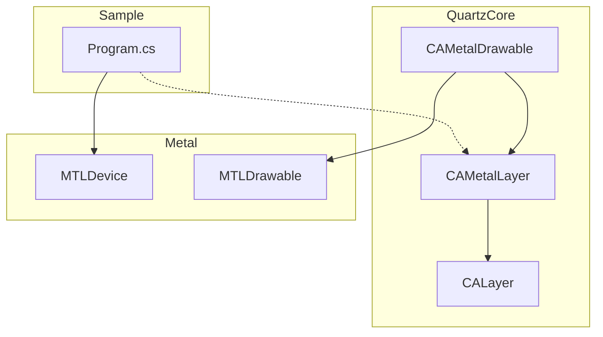
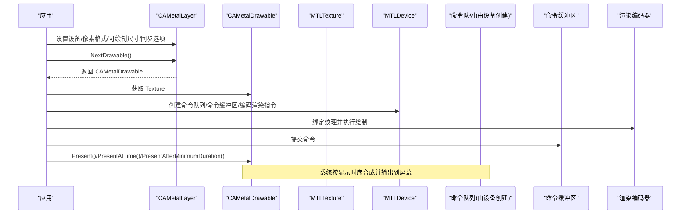
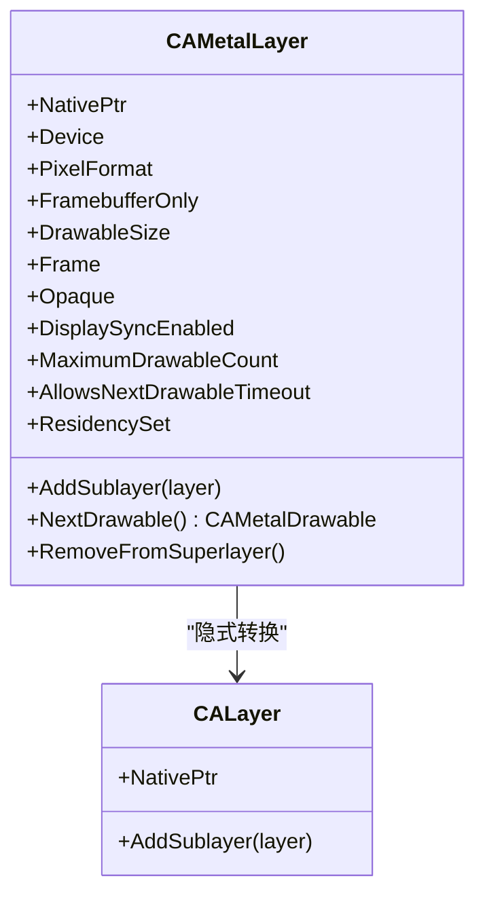
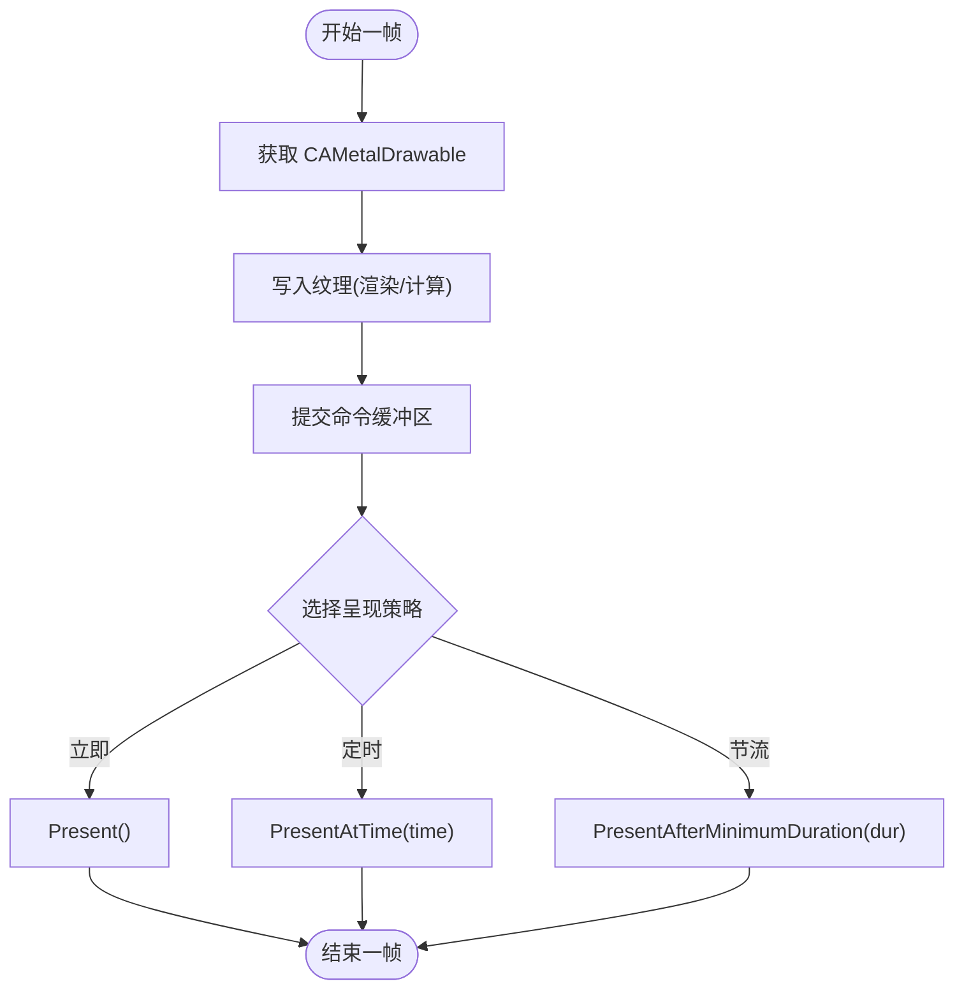
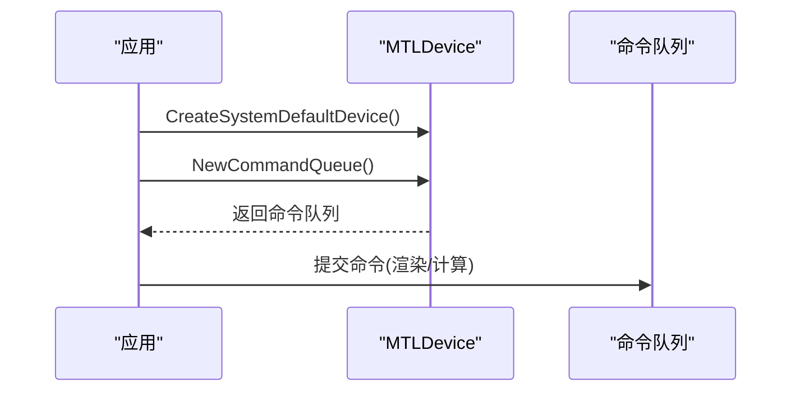
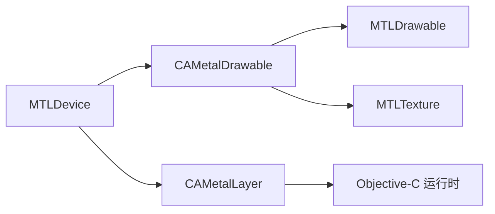

# QuartzCore 显示框架集成

<cite>
**本文引用的文件**
- [CAMetalLayer.cs](file://src/SharpMetal/QuartzCore/CAMetalLayer.cs)
- [CAMetalDrawable.cs](file://src/SharpMetal/QuartzCore/CAMetalDrawable.cs)
- [CALayer.cs](file://src/SharpMetal/QuartzCore/CALayer.cs)
- [MTLDrawable.cs](file://src/SharpMetal/Metal/MTLDrawable.cs)
- [MTLDevice.cs](file://src/SharpMetal/Metal/MTLDevice.cs)
- [Program.cs](file://samples/SharpMetal.Sample/Program.cs)
</cite>

## 目录
1. [简介](#简介)
2. [项目结构](#项目结构)
3. [核心组件](#核心组件)
4. [架构总览](#架构总览)
5. [详细组件分析](#详细组件分析)
6. [依赖关系分析](#依赖关系分析)
7. [性能与帧率控制](#性能与帧率控制)
8. [故障排查指南](#故障排查指南)
9. [结论](#结论)
10. [附录：UI 集成最佳实践](#附录ui-集成最佳实践)

## 简介
本文面向在 .NET（通过 SharpMetal）中集成 Apple 显示与渲染的开发者，聚焦于 QuartzCore 显示框架与 Metal 的协作方式。重点包括：
- CAMetalLayer 的作用、关键属性与配置方法（设备、像素格式、可绘制尺寸、刷新同步等）
- CAMetalDrawable 的生命周期管理与绘制呈现流程
- 将 Metal 渲染结果呈现到屏幕的完整 UI 集成模式
- 多线程渲染与帧率控制策略
- 与 UIKit/AppKit 集成的注意事项与最佳实践

本仓库提供了对 QuartzCore 和 Metal 的低层绑定，便于在托管代码中直接调用系统框架能力进行高性能图形渲染与显示。

## 项目结构
本项目采用分层组织：
- src/SharpMetal/QuartzCore：封装 QuartzCore 中的图层与可绘制对象（CAMetalLayer、CAMetalDrawable、CALayer）
- src/SharpMetal/Metal：封装 Metal 设备、命令队列、纹理、缓冲、可绘制对象等
- samples/SharpMetal.Sample：最小化示例，验证 Metal 设备与共享缓冲读写
- Foundation/ObjectiveCCore：底层 Objective-C 互操作与基础类型

图表来源
- [CAMetalLayer.cs:7-133](file://src/SharpMetal/QuartzCore/CAMetalLayer.cs#L7-L133)
- [CAMetalDrawable.cs:11-69](file://src/SharpMetal/QuartzCore/CAMetalDrawable.cs#L11-L69)
- [CALayer.cs:5-19](file://src/SharpMetal/QuartzCore/CALayer.cs#L5-L19)
- [MTLDevice.cs:187-334](file://src/SharpMetal/Metal/MTLDevice.cs#L187-L334)
- [MTLDrawable.cs:6-38](file://src/SharpMetal/Metal/MTLDrawable.cs#L6-L38)
- [Program.cs:10-46](file://samples/SharpMetal.Sample/Program.cs#L10-L46)

章节来源
- [README.md:1-23](file://README.md#L1-L23)

## 核心组件
- CAMetalLayer：表示一个支持 Metal 的 Core Animation 图层，负责管理可绘制对象（drawable）的创建与呈现，提供像素格式、最大可绘制数量、是否仅帧缓冲、显示同步等关键属性。
- CAMetalDrawable：代表一帧的可绘制内容，包含关联的纹理、ID、呈现时间戳，以及多种呈现方式（立即、定时、最短时长）。
- MTLDrawable：Metal 层的通用可绘制抽象，与 CAMetalDrawable 可相互转换，用于更通用的 Metal 管线。
- CALayer：基础图层接口，CAMetalLayer 可隐式转换为 CALayer 以加入视图层级。
- MTLDevice：Metal 设备入口，用于创建命令队列、资源、管线等。

章节来源
- [CAMetalLayer.cs:17-86](file://src/SharpMetal/QuartzCore/CAMetalLayer.cs#L17-L86)
- [CAMetalDrawable.cs:19-59](file://src/SharpMetal/QuartzCore/CAMetalDrawable.cs#L19-L59)
- [MTLDrawable.cs:6-38](file://src/SharpMetal/Metal/MTLDrawable.cs#L6-L38)
- [CALayer.cs:5-19](file://src/SharpMetal/QuartzCore/CALayer.cs#L5-L19)
- [MTLDevice.cs:305-334](file://src/SharpMetal/Metal/MTLDevice.cs#L305-L334)

## 架构总览
下图展示了从应用层到 QuartzCore 与 Metal 的渲染与呈现路径，包括图层配置、获取 drawable、写入纹理、提交并呈现的流程。

图表来源
- [CAMetalLayer.cs:17-79](file://src/SharpMetal/QuartzCore/CAMetalLayer.cs#L17-L79)
- [CAMetalDrawable.cs:19-39](file://src/SharpMetal/QuartzCore/CAMetalDrawable.cs#L19-L39)
- [MTLDevice.cs:326-334](file://src/SharpMetal/Metal/MTLDevice.cs#L326-L334)
- [MTLDrawable.cs:16-29](file://src/SharpMetal/Metal/MTLDrawable.cs#L16-L29)

## 详细组件分析

### CAMetalLayer：显示图层的配置与控制
- 设备与像素格式
  - Device：指定使用的 Metal 设备，确保与后续资源一致
  - PixelFormat：设置像素格式，需与渲染目标纹理匹配
- 可绘制尺寸与分辨率适配
  - DrawableSize：决定每帧可绘制纹理的尺寸，通常根据窗口/屏幕分辨率与缩放因子计算
  - Frame：图层几何信息，影响布局与合成
- 刷新同步与缓冲池
  - DisplaySyncEnabled：开启后与系统显示刷新同步，避免撕裂
  - MaximumDrawableCount：控制待呈现缓冲数量，平衡延迟与吞吐
  - AllowsNextDrawableTimeout：允许等待下一帧超时，避免阻塞
- 可见性与生命周期
  - Opaque：告知合成器透明度信息，优化合成
  - AddSublayer/RemoveFromSuperlayer：参与图层树管理
- 可绘制对象获取
  - NextDrawable：获取当前帧的可绘制对象，用于写入纹理并提交呈现

图表来源
- [CAMetalLayer.cs:7-133](file://src/SharpMetal/QuartzCore/CAMetalLayer.cs#L7-L133)
- [CALayer.cs:5-19](file://src/SharpMetal/QuartzCore/CALayer.cs#L5-L19)

章节来源
- [CAMetalLayer.cs:17-86](file://src/SharpMetal/QuartzCore/CAMetalLayer.cs#L17-L86)

### CAMetalDrawable：单帧可绘制对象的生命周期
- 基本属性
  - Layer：所属的 CAMetalLayer
  - Texture：当前帧的渲染目标纹理
  - PresentedTime/DrawableID：时间戳与唯一标识，可用于性能统计或调试
- 呈现方式
  - Present()：尽快呈现
  - PresentAtTime(presentationTime)：在指定时间点呈现，用于精确同步
  - PresentAfterMinimumDuration(duration)：至少持续一段时间后呈现，用于节流
- 回调机制
  - AddPresentedHandler(handler)：注册呈现完成回调，用于后续处理或下一帧调度
- 与 Metal 的互操作
  - 可隐式转换为 MTLDrawable，以便在通用 Metal 管线中使用

图表来源
- [CAMetalDrawable.cs:19-59](file://src/SharpMetal/QuartzCore/CAMetalDrawable.cs#L19-L59)
- [MTLDrawable.cs:16-29](file://src/SharpMetal/Metal/MTLDrawable.cs#L16-L29)

章节来源
- [CAMetalDrawable.cs:19-59](file://src/SharpMetal/QuartzCore/CAMetalDrawable.cs#L19-L59)

### 与 Metal 设备的协作
- 设备初始化与命令队列
  - 使用 MTLDevice.CreateSystemDefaultDevice() 获取默认设备
  - 通过 NewCommandQueue() 创建命令队列，用于提交渲染/计算任务
- 资源创建
  - 使用 NewBuffer/NewTexture 等 API 创建渲染所需资源
- 示例参考
  - Program.cs 展示了设备获取与共享缓冲读写的基本流程，可作为扩展为渲染循环的基础

图表来源
- [MTLDevice.cs:305-334](file://src/SharpMetal/Metal/MTLDevice.cs#L305-L334)
- [Program.cs:21-46](file://samples/SharpMetal.Sample/Program.cs#L21-L46)

章节来源
- [MTLDevice.cs:305-334](file://src/SharpMetal/Metal/MTLDevice.cs#L305-L334)
- [Program.cs:21-46](file://samples/SharpMetal.Sample/Program.cs#L21-L46)

## 依赖关系分析
- CAMetalLayer 依赖 Objective-C 运行时进行消息转发，暴露的属性与方法均通过 Selector 调用系统实现
- CAMetalDrawable 既属于 QuartzCore，又与 Metal 的 MTLDrawable 互通，形成跨框架桥接
- 渲染流程中，CAMetalDrawable.Texture 作为渲染目标，需要与 Metal 管线配合
- 设备与命令队列来自 MTLDevice，是资源与命令的源头

图表来源
- [CAMetalLayer.cs:109-133](file://src/SharpMetal/QuartzCore/CAMetalLayer.cs#L109-L133)
- [CAMetalDrawable.cs:57-69](file://src/SharpMetal/QuartzCore/CAMetalDrawable.cs#L57-L69)
- [MTLDevice.cs:305-334](file://src/SharpMetal/Metal/MTLDevice.cs#L305-L334)

章节来源
- [CAMetalLayer.cs:109-133](file://src/SharpMetal/QuartzCore/CAMetalLayer.cs#L109-L133)
- [CAMetalDrawable.cs:57-69](file://src/SharpMetal/QuartzCore/CAMetalDrawable.cs#L57-L69)
- [MTLDevice.cs:305-334](file://src/SharpMetal/Metal/MTLDevice.cs#L305-L334)

## 性能与帧率控制
- 显示同步
  - 启用 DisplaySyncEnabled 可与系统 VSync 对齐，减少撕裂与卡顿
  - 使用 PresentAtTime 精确控制呈现时机，适合固定时间步长或音频同步场景
- 缓冲池大小
  - MaximumDrawableCount 越大，GPU/CPU 并行度越高，但内存占用与延迟也增加；一般 2-3 较均衡
- 超时与节流
  - AllowsNextDrawableTimeout 避免长时间阻塞；结合 PresentAfterMinimumDuration 可实现最低帧率限制
- 线程模型
  - 建议在专用渲染线程上执行 Metal 命令提交，主线程负责 UI 更新与呈现调度
  - 使用命令队列与命令缓冲区的异步特性，避免主线程阻塞
- 分辨率适配
  - 根据屏幕缩放与窗口尺寸设置 DrawableSize，保证清晰度与性能平衡
- 资源复用
  - 重用命令缓冲区、管线状态与纹理，减少分配开销

[本节为通用指导，不直接分析具体文件]

## 故障排查指南
- 无 Metal 设备
  - 检查平台与设备可用性，确保在 Apple 主机环境运行
  - 参考示例中对设备空指针的检查与错误提示
- 共享缓冲读写失败
  - 确认缓冲创建成功且 Contents 非空
  - 校验数据一致性，必要时添加断言或日志
- 呈现异常
  - 检查像素格式与纹理格式是否匹配
  - 确认已正确提交命令缓冲区并调用呈现方法
  - 若出现卡顿，调整 MaximumDrawableCount 或禁用/启用显示同步进行测试

章节来源
- [Program.cs:21-46](file://samples/SharpMetal.Sample/Program.cs#L21-L46)

## 结论
通过 SharpMetal 提供的 QuartzCore 与 Metal 绑定，可以在 .NET 应用中高效地进行 GPU 渲染与显示。CAMetalLayer 负责图层与可绘制对象的管理，CAMetalDrawable 提供单帧的呈现能力，二者与 MTLDevice/MTLDrawable 协同工作，构成完整的渲染与显示链路。合理配置像素格式、可绘制尺寸、同步与缓冲池参数，并结合多线程与帧率控制策略，可获得稳定流畅的视觉效果。

[本节为总结性内容，不直接分析具体文件]

## 附录：UI 集成最佳实践
- 与 UIKit/AppKit 集成
  - 将 CAMetalLayer 添加到视图层级（如 UIView.layer 或 NSView.layer），并通过其属性控制渲染行为
  - 在视图生命周期中设置设备、像素格式与可绘制尺寸，并在尺寸变化时重新配置
- 呈现时机
  - 使用 DisplaySyncEnabled 与 PresentAtTime 实现与显示刷新同步
  - 使用 PresentAfterMinimumDuration 实现最低帧率限制，避免过度渲染
- 回调与调度
  - 利用 AddPresentedHandler 在呈现完成后触发下一帧逻辑，避免忙轮询
- 资源与线程
  - 在渲染线程创建与提交命令，主线程仅做轻量调度与 UI 更新
  - 复用命令缓冲区、管线状态与纹理，降低分配与编译开销
- 分辨率与缩放
  - 根据屏幕缩放因子与窗口尺寸计算 DrawableSize，兼顾清晰度与性能
- 调试与诊断
  - 记录 PresentedTime 与 DrawableID，辅助定位丢帧与卡顿问题
  - 通过 ResidencySet（Metal 26+）跟踪可绘制纹理驻留，优化内存使用

[本节为通用指导，不直接分析具体文件]