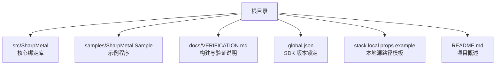
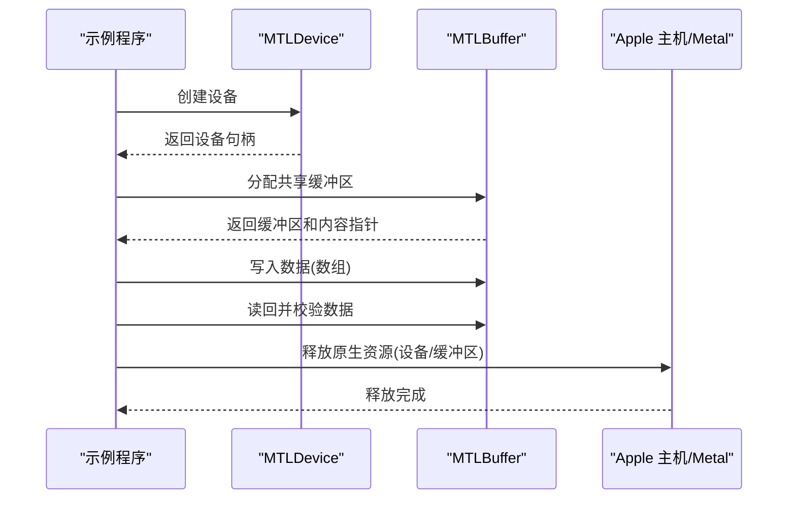
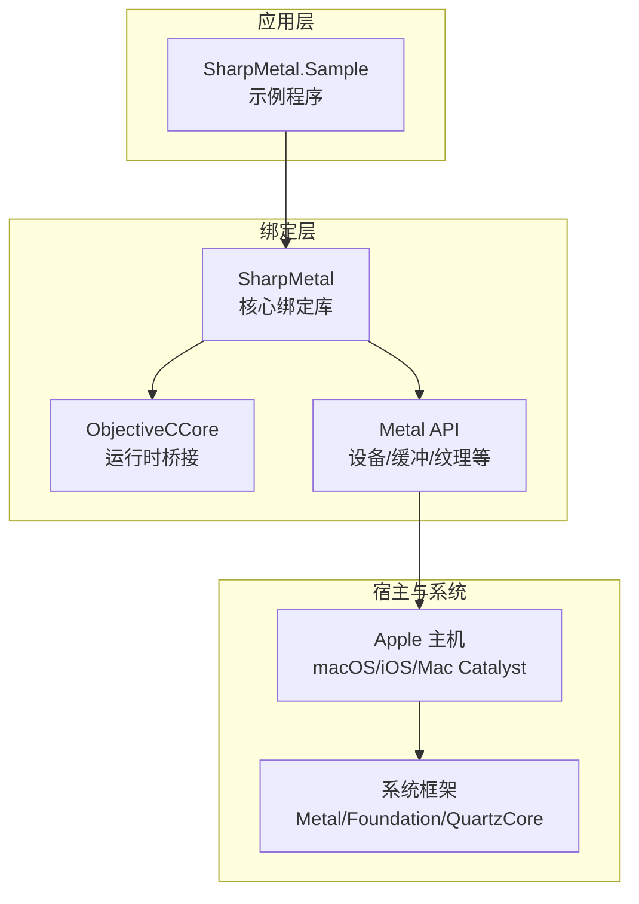
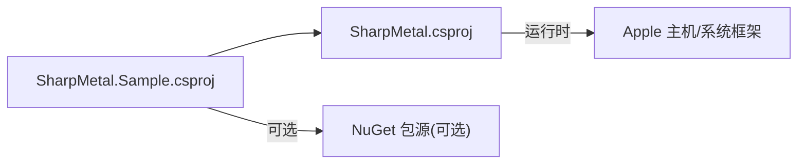

# 快速开始

<cite>
**本文引用的文件**
- [README.md](file://README.md)
- [global.json](file://global.json)
- [stack.local.props.example](file://stack.local.props.example)
- [docs/VERIFICATION.md](file://docs/VERIFICATION.md)
- [samples/SharpMetal.Sample/Program.cs](file://samples/SharpMetal.Sample/Program.cs)
- [samples/SharpMetal.Sample/SharpMetal.Sample.csproj](file://samples/SharpMetal.Sample/SharpMetal.Sample.csproj)
- [src/SharpMetal/SharpMetal.csproj](file://src/SharpMetal/SharpMetal.csproj)
- [DESIGN.md](file://DESIGN.md)
</cite>

## 目录
1. [简介](#简介)
2. [项目结构](#项目结构)
3. [环境要求与安装](#环境要求与安装)
4. [本地属性配置](#本地属性配置)
5. [构建与运行第一个示例](#构建与运行第一个示例)
6. [基本使用示例：设备、内存与 GPU 操作](#基本使用示例设备内存与-gpu-操作)
7. [架构概览](#架构概览)
8. [依赖关系分析](#依赖关系分析)
9. [性能注意事项](#性能注意事项)
10. [故障排除指南](#故障排除指南)
11. [结论](#结论)

## 简介
本指南帮助你在最短时间内成功运行 SharpMetal 的第一个程序。你将了解如何安装 .NET SDK、准备开发环境、配置本地属性文件，并运行示例程序以验证 Metal 设备创建、共享缓冲区分配与读写。该示例会明确区分“托管 ABI 通过”和“原生 Metal 执行需要 Apple 主机”的边界，便于在 Windows 上完成托管层验证，并在 macOS/iOS 上执行完整 Metal 工作负载。

## 项目结构
- src/SharpMetal：核心绑定库（Objective-C/Metal/MetalFX/QuartzCore）
- samples/SharpMetal.Sample：可运行的示例程序
- docs/VERIFICATION.md：权威构建、测试、打包与平台验证命令
- global.json：锁定 .NET SDK 版本
- stack.local.props.example：本地源引用路径模板
- README.md：仓库概述与入门指引

**图表来源**
- [README.md:1-23](file://README.md#L1-L23)
- [global.json:1-8](file://global.json#L1-L8)
- [stack.local.props.example:1-12](file://stack.local.props.example#L1-L12)
- [docs/VERIFICATION.md:1-103](file://docs/VERIFICATION.md#L1-L103)

**章节来源**
- [README.md:1-23](file://README.md#L1-L23)

## 环境要求与安装
- 操作系统：
  - 托管层可在任意平台构建；原生 Metal 执行需要 Apple 主机（macOS、iOS、Mac Catalyst）。
- .NET SDK：
  - 使用由 global.json 锁定的 .NET 10 SDK。
- 目标框架：
  - 示例与库均针对 net10.0。
- 平台：
  - 建议 x64 或 ARM64；示例工程允许不安全块以访问原生指针。

关键依据：
- global.json 指定了 .NET SDK 版本与回滚策略。
- 示例工程 TargetFramework 为 net10.0，并启用 AllowUnsafeBlocks。
- 文档明确指出托管绑定独立于宿主平台，但原生 Metal 执行需要匹配的 Apple 主机。

**章节来源**
- [global.json:1-8](file://global.json#L1-L8)
- [samples/SharpMetal.Sample/SharpMetal.Sample.csproj:1-6](file://samples/SharpMetal.Sample/SharpMetal.Sample.csproj#L1-L6)
- [docs/VERIFICATION.md:1-12](file://docs/VERIFICATION.md#L1-L12)

## 本地属性配置
- 复制模板到本地配置文件：
  - 将 stack.local.props.example 复制为 stack.local.props。
  - 如需以 Source 模式消费源码依赖，调整相关路径（例如 SharpMathRoot、SharpGPURoot 等）。
- 参考模式：
  - StackReferenceMode=Source：从本地源码引用依赖。
  - StackReferenceMode=Package：从 NuGet 包引用依赖（需显式提供 feed）。
- 注意：
  - 不要提交包含本机绝对路径的本地配置；仅保留可移植模板。

**章节来源**
- [stack.local.props.example:1-12](file://stack.local.props.example#L1-L12)
- [docs/VERIFICATION.md:3-8](file://docs/VERIFICATION.md#L3-L8)
- [DESIGN.md:5-12](file://DESIGN.md#L5-L12)

## 构建与运行第一个示例
以下命令用于在仓库根目录下构建并运行示例。若使用 Source 模式，请确保已正确设置 stack.local.props。

- 构建库（Debug/Release，x64）：
  - dotnet build src/SharpMetal/SharpMetal.csproj -c Debug -p:Platform=x64
  - dotnet build src/SharpMetal/SharpMetal.csproj -c Release -p:Platform=x64
- 运行示例：
  - dotnet run --project samples/SharpMetal.Sample/SharpMetal.Sample.csproj -c Release -p:Platform=x64

说明：
- 在 Windows 上，示例会输出“托管 ABI 通过”，并提示“BLOCKED_PLATFORM (Apple host required)”以表明原生 Metal 工作负载被阻止。
- 在 macOS/iOS 上，示例将尝试创建设备、分配共享缓冲区并进行读写校验。

**章节来源**
- [docs/VERIFICATION.md:13-33](file://docs/VERIFICATION.md#L13-L33)
- [samples/SharpMetal.Sample/Program.cs:1-49](file://samples/SharpMetal.Sample/Program.cs#L1-L49)

## 基本使用示例：设备、内存与 GPU 操作
下面的步骤展示了如何在示例中完成基础 Metal 操作：创建设备、分配共享内存、写入数据并读回校验。

- 创建设备：
  - 调用系统默认设备工厂方法获取 MTLDevice。
  - 检查 NativePtr 是否有效，避免空设备。
- 分配内存：
  - 使用 NewBuffer 分配共享存储模式的缓冲区。
  - 检查 NativePtr 与 Contents 是否有效。
- 写入与读回：
  - 通过 Contents 获取底层指针并以 Span<int> 进行读写。
  - 写入序列值后逐元素校验一致性。
- 资源释放：
  - 在 finally 块中显式释放 Objective-C 对象引用，确保原生资源生命周期可控。

**图表来源**
- [samples/SharpMetal.Sample/Program.cs:21-45](file://samples/SharpMetal.Sample/Program.cs#L21-L45)

**章节来源**
- [samples/SharpMetal.Sample/Program.cs:1-49](file://samples/SharpMetal.Sample/Program.cs#L1-L49)

## 架构概览
SharpMetal 提供对 Apple 原生框架的低层绑定，包括 Foundation、Metal、MetalFX 与 QuartzCore。示例程序通过托管代码调用这些绑定，最终与 Apple 主机上的 Metal 系统框架交互。

**图表来源**
- [src/SharpMetal/SharpMetal.csproj:1-47](file://src/SharpMetal/SharpMetal.csproj#L1-L47)
- [samples/SharpMetal.Sample/SharpMetal.Sample.csproj:1-6](file://samples/SharpMetal.Sample/SharpMetal.Sample.csproj#L1-L6)
- [docs/VERIFICATION.md:1-12](file://docs/VERIFICATION.md#L1-L12)

## 依赖关系分析
- 示例工程依赖 SharpMetal 库，可通过 Source 或 Package 模式引入。
- 库本身不直接声明外部 NuGet 依赖，主要依赖 Apple 系统框架（由宿主提供）。
- 构建时通过 Platform 与 Configuration 控制编译选项与优化级别。

**图表来源**
- [samples/SharpMetal.Sample/SharpMetal.Sample.csproj:1-6](file://samples/SharpMetal.Sample/SharpMetal.Sample.csproj#L1-L6)
- [src/SharpMetal/SharpMetal.csproj:1-47](file://src/SharpMetal/SharpMetal.csproj#L1-L47)

**章节来源**
- [samples/SharpMetal.Sample/SharpMetal.Sample.csproj:1-6](file://samples/SharpMetal.Sample/SharpMetal.Sample.csproj#L1-L6)
- [src/SharpMetal/SharpMetal.csproj:1-47](file://src/SharpMetal/SharpMetal.csproj#L1-L47)

## 性能注意事项
- 共享缓冲区适合 CPU/GPU 间频繁交换数据的场景；在高吞吐渲染或计算管线中，应结合命令队列、编码器和同步原语进行优化。
- 合理选择存储模式与缓存策略，减少不必要的内存拷贝。
- 在示例基础上扩展时，注意显式管理原生资源的生命周期，避免泄漏。

[本节为通用指导，不直接分析具体文件]

## 故障排除指南
- 非 Apple 平台运行：
  - 现象：示例输出“BLOCKED_PLATFORM (Apple host required)”。
  - 原因：当前平台不支持原生 Metal 执行。
  - 处理：在 macOS/iOS/Mac Catalyst 上运行以获得完整 Metal 能力；或在 Windows 上仅验证托管 ABI。
- 无可用 Metal 设备：
  - 现象：创建设备失败或 NativePtr 为空。
  - 处理：确认宿主具备 Metal 支持且驱动可用。
- 共享缓冲区分配失败：
  - 现象：NewBuffer 返回空或 Contents 为空。
  - 处理：检查请求大小与存储模式；确认宿主内存与权限。
- 数据读回不一致：
  - 现象：写回校验失败。
  - 处理：确认写入范围与步长；检查并发访问与同步。
- 构建错误：
  - 现象：SDK 版本不匹配或目标框架错误。
  - 处理：安装 global.json 指定的 .NET 10 SDK；确保 TargetFramework 为 net10.0。
- Source 模式依赖缺失：
  - 现象：无法解析本地依赖路径。
  - 处理：编辑 stack.local.props 中的依赖根路径；确保对应仓库存在。

**章节来源**
- [samples/SharpMetal.Sample/Program.cs:12-45](file://samples/SharpMetal.Sample/Program.cs#L12-L45)
- [docs/VERIFICATION.md:13-33](file://docs/VERIFICATION.md#L13-L33)
- [global.json:1-8](file://global.json#L1-L8)

## 结论
按照本指南完成 .NET SDK 安装、本地属性配置与示例运行后，你可以在 Windows 上验证托管 ABI，并在 Apple 主机上执行完整的 Metal 工作负载。示例演示了设备创建、共享缓冲区分配与读写校验，是理解 SharpMetal 资源管理与原生边界的起点。后续可在该基础上扩展更复杂的图形与计算任务。