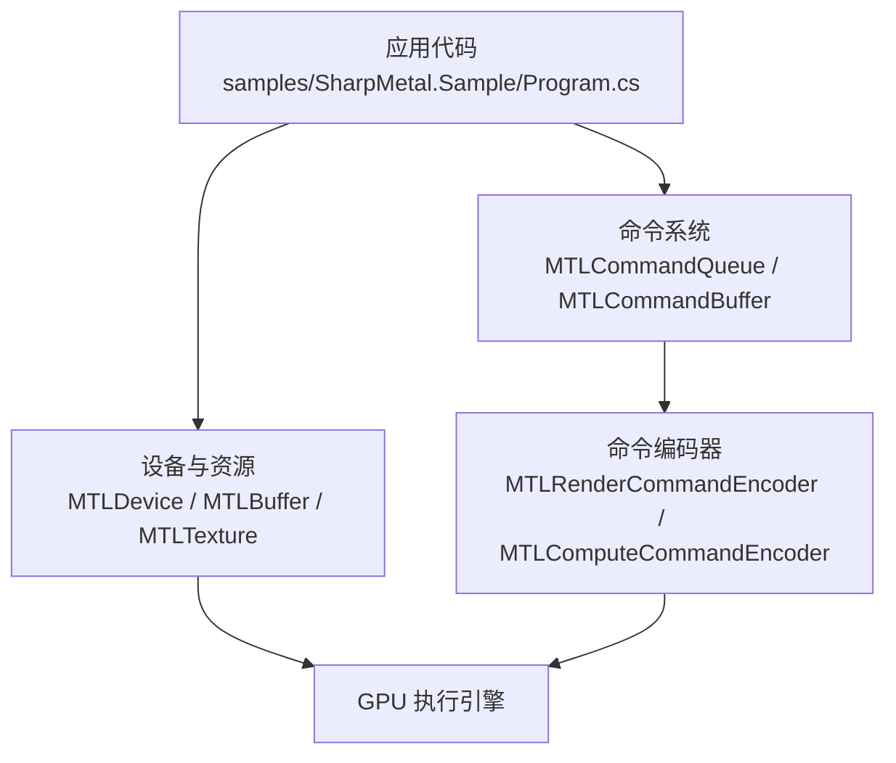
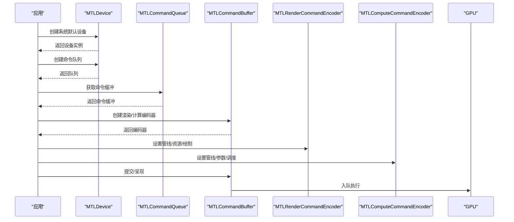
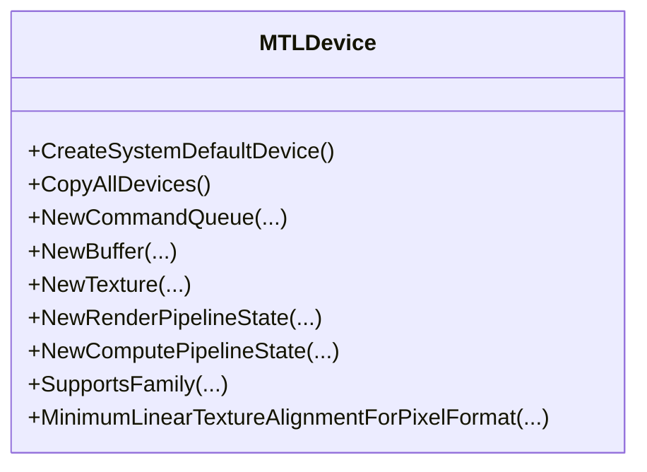
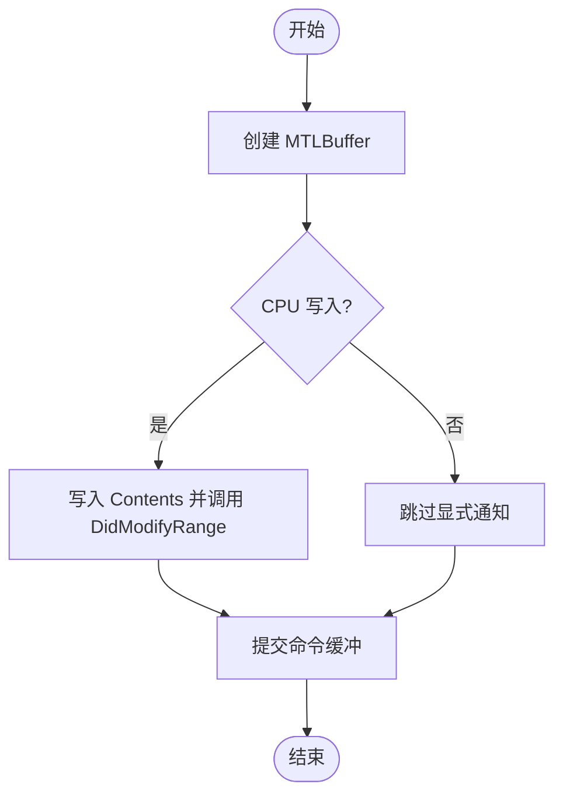
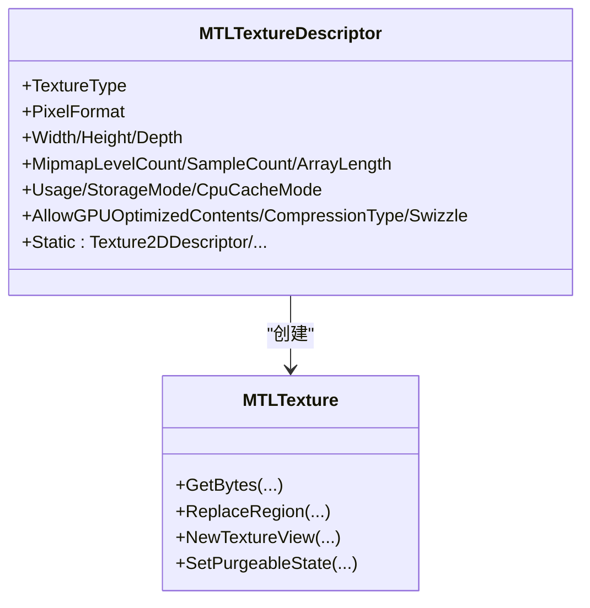
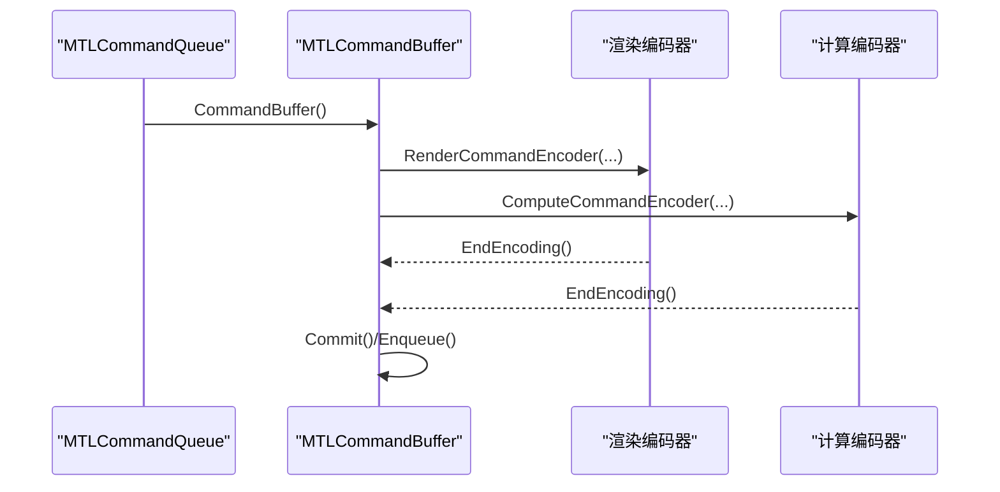
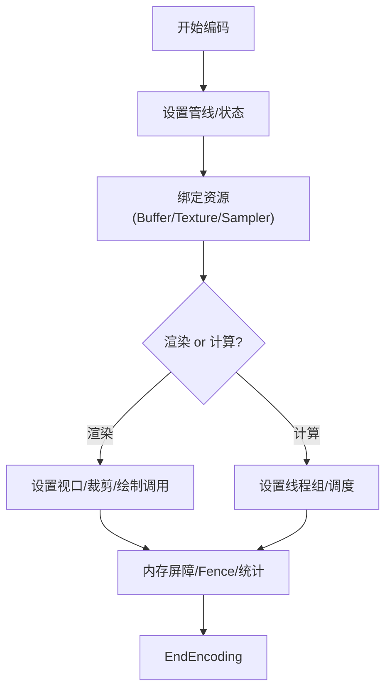
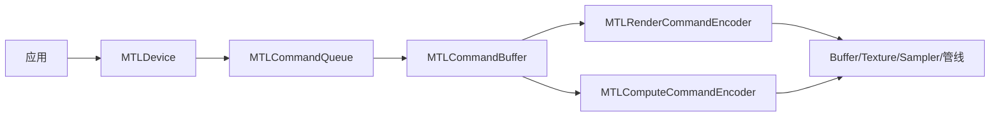
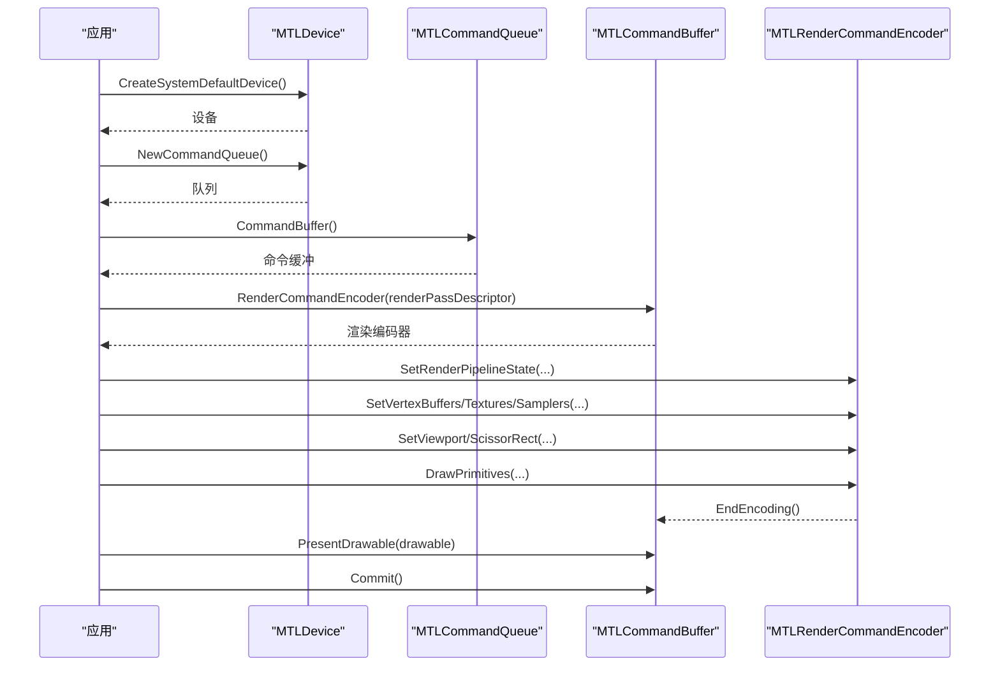

# Metal API 概念

<cite>
**本文引用的文件**
- [README.md](file://README.md)
- [DESIGN.md](file://DESIGN.md)
- [MTLDevice.cs](file://src/SharpMetal/Metal/MTLDevice.cs)
- [MTLBuffer.cs](file://src/SharpMetal/Metal/MTLBuffer.cs)
- [MTLTexture.cs](file://src/SharpMetal/Metal/MTLTexture.cs)
- [MTLCommandQueue.cs](file://src/SharpMetal/Metal/MTLCommandQueue.cs)
- [MTLCommandBuffer.cs](file://src/SharpMetal/Metal/MTLCommandBuffer.cs)
- [MTLRenderCommandEncoder.cs](file://src/SharpMetal/Metal/MTLRenderCommandEncoder.cs)
- [MTLComputeCommandEncoder.cs](file://src/SharpMetal/Metal/MTLComputeCommandEncoder.cs)
- [Program.cs](file://samples/SharpMetal.Sample/Program.cs)
</cite>

## 目录
1. [简介](#简介)
2. [项目结构](#项目结构)
3. [核心组件](#核心组件)
4. [架构总览](#架构总览)
5. [详细组件分析](#详细组件分析)
6. [依赖关系分析](#依赖关系分析)
7. [性能考量](#性能考量)
8. [故障排查指南](#故障排查指南)
9. [结论](#结论)
10. [附录：从设备初始化到基本渲染的完整流程](#附录从设备初始化到基本渲染的完整流程)

## 简介
本文件面向希望在 .NET 环境下使用 SharpMetal 进行图形与计算编程的开发者，系统阐述 Metal 的核心概念在 SharpMetal 中的映射与实践要点。内容覆盖设备管理、内存模型、纹理系统、命令队列与命令缓冲、命令编码器（渲染与计算）以及 CPU/GPU 同步机制与数据传输优化。文末提供从设备初始化到基本渲染操作的端到端流程指引与最佳实践建议。

## 项目结构
SharpMetal 将 Objective-C 与 Metal 绑定为 .NET 类型，位于 src/SharpMetal/Metal；基础类型与运行时桥接位于 Foundation 与 ObjectiveCCore；QuartzCore 用于显示相关类型；示例工程位于 samples/SharpMetal.Sample。构建与运行需要 Apple 宿主环境（macOS/iOS/macCatalyst）。

图表来源
- [Program.cs:21-38](file://samples/SharpMetal.Sample/Program.cs#L21-L38)
- [MTLDevice.cs:305-339](file://src/SharpMetal/Metal/MTLDevice.cs#L305-L339)
- [MTLCommandQueue.cs:44-68](file://src/SharpMetal/Metal/MTLCommandQueue.cs#L44-L68)
- [MTLCommandBuffer.cs:150-218](file://src/SharpMetal/Metal/MTLCommandBuffer.cs#L150-L218)

章节来源
- [README.md:1-23](file://README.md#L1-L23)
- [DESIGN.md:1-12](file://DESIGN.md#L1-L12)

## 核心组件
- 设备（MTLDevice）：发现系统默认设备、枚举所有设备、查询特性（如统一内存、最大线程组大小、支持的像素格式等），并创建命令队列、缓冲区、纹理、管线状态等。
- 缓冲区（MTLBuffer）：GPU/CPU 共享或专用存储的连续内存块，支持直接访问 Contents、范围修改通知、可别名化、远程视图等。
- 纹理（MTLTexture）：多维图像数据载体，支持多种维度、采样数、压缩、稀疏、共享句柄、视图复用、区域读写等。
- 命令队列（MTLCommandQueue）：承载命令缓冲的有序队列，可配置日志与最大缓冲数量。
- 命令缓冲（MTLCommandBuffer）：一次提交的工作单元，包含渲染/计算/Blit 等编码器，支持回调、时间戳、事件等待/信号、并行渲染编码器等。
- 命令编码器：
  - 渲染编码器（MTLRenderCommandEncoder）：设置管线、顶点/片段/对象/网格阶段资源、视口/裁剪、绘制调用、可见性统计、内存屏障等。
  - 计算编码器（MTLComputeCommandEncoder）：设置管线、参数、纹理/采样器、线程组调度、内存屏障、间接调度等。

章节来源
- [MTLDevice.cs:187-339](file://src/SharpMetal/Metal/MTLDevice.cs#L187-L339)
- [MTLBuffer.cs:6-113](file://src/SharpMetal/Metal/MTLBuffer.cs#L6-L113)
- [MTLTexture.cs:7-438](file://src/SharpMetal/Metal/MTLTexture.cs#L7-L438)
- [MTLCommandQueue.cs:6-108](file://src/SharpMetal/Metal/MTLCommandQueue.cs#L6-L108)
- [MTLCommandBuffer.cs:9-321](file://src/SharpMetal/Metal/MTLCommandBuffer.cs#L9-L321)
- [MTLRenderCommandEncoder.cs:7-800](file://src/SharpMetal/Metal/MTLRenderCommandEncoder.cs#L7-L800)
- [MTLComputeCommandEncoder.cs:7-298](file://src/SharpMetal/Metal/MTLComputeCommandEncoder.cs#L7-L298)

## 架构总览
下图展示了从设备初始化到提交渲染/计算任务的典型调用链。

图表来源
- [MTLDevice.cs:305-339](file://src/SharpMetal/Metal/MTLDevice.cs#L305-L339)
- [MTLCommandQueue.cs:44-68](file://src/SharpMetal/Metal/MTLCommandQueue.cs#L44-L68)
- [MTLCommandBuffer.cs:150-218](file://src/SharpMetal/Metal/MTLCommandBuffer.cs#L150-L218)
- [MTLRenderCommandEncoder.cs:168-586](file://src/SharpMetal/Metal/MTLRenderCommandEncoder.cs#L168-L586)
- [MTLComputeCommandEncoder.cs:60-193](file://src/SharpMetal/Metal/MTLComputeCommandEncoder.cs#L60-L193)

## 详细组件分析

### 设备管理（MTLDevice）
- 设备发现与特性查询
  - 获取系统默认设备与全部设备列表。
  - 查询统一内存、最大线程组大小、位置、传输速率、是否支持特定像素格式、读写纹理层级、参数缓冲层级、MSAA、BCTexture 压缩、函数指针、光线追踪、动态库、二进制归档、加速结构等能力。
  - 查询最小对齐（线性纹理、纹理缓冲）、稀疏瓦片尺寸、计数器采样频率等。
- 资源与管线创建
  - 创建命令队列（支持描述符与最大缓冲数）。
  - 创建缓冲区（长度+选项、带初始指针、稀疏页大小）。
  - 创建纹理（普通/共享/基于 IOSurface）。
  - 创建深度模板状态、采样器状态、库（默认/URL/数据/源码/缝合）、渲染/计算管线状态（含反射选项）。
  - 创建堆、间接命令缓冲、共享事件、IO 命令队列/文件句柄、计数采样缓冲、动态库、二进制归档、加速结构、命令分配器/队列/缓冲（MTL4 系列）等。
- 关键方法路径参考
  - 设备创建与枚举：[MTLDevice.cs:305-319](file://src/SharpMetal/Metal/MTLDevice.cs#L305-L319)
  - 命令队列创建：[MTLDevice.cs:326-339](file://src/SharpMetal/Metal/MTLDevice.cs#L326-L339)
  - 缓冲区创建：[MTLDevice.cs:356-369](file://src/SharpMetal/Metal/MTLDevice.cs#L356-L369)
  - 纹理创建：[MTLDevice.cs:376-394](file://src/SharpMetal/Metal/MTLDevice.cs#L376-L394)
  - 管线状态创建：[MTLDevice.cs:431-454](file://src/SharpMetal/Metal/MTLDevice.cs#L431-L454)

图表来源
- [MTLDevice.cs:187-454](file://src/SharpMetal/Metal/MTLDevice.cs#L187-L454)

章节来源
- [MTLDevice.cs:187-719](file://src/SharpMetal/Metal/MTLDevice.cs#L187-L719)

### 内存模型（MTLBuffer）
- 存储模式与缓存策略
  - 通过 StorageMode、CpuCacheMode、ResourceOptions 控制 CPU/GPU 访问语义与缓存行为。
- 生命周期与同步
  - 通过 Contents 直接读写共享内存；写入后调用 DidModifyRange 通知驱动更新。
  - 支持 SetPurgeableState 进行可回收内存管理；MakeAliasable 允许与其他资源别名以节省内存。
- 高级能力
  - 从 Buffer 派生 Texture/Tensor；获取 GpuAddress；创建远程视图供其他设备访问。
- 关键方法路径参考
  - 属性与同步：[MTLBuffer.cs:18-63](file://src/SharpMetal/Metal/MTLBuffer.cs#L18-L63)
  - 衍生与调试标记：[MTLBuffer.cs:65-83](file://src/SharpMetal/Metal/MTLBuffer.cs#L65-L83)
  - 远程视图与地址：[MTLBuffer.cs:85-113](file://src/SharpMetal/Metal/MTLBuffer.cs#L85-L113)

图表来源
- [MTLBuffer.cs:44-63](file://src/SharpMetal/Metal/MTLBuffer.cs#L44-L63)
- [MTLCommandBuffer.cs:150-158](file://src/SharpMetal/Metal/MTLCommandBuffer.cs#L150-L158)

章节来源
- [MTLBuffer.cs:6-113](file://src/SharpMetal/Metal/MTLBuffer.cs#L6-L113)

### 纹理系统（MTLTexture）
- 类型与格式
  - 支持 1D/2D/3D、数组、多重采样、立方体、纹理缓冲等类型；像素格式由 MTLPixelFormat 指定。
- 使用方式与优化
  - Usage 声明用途（ShaderRead/Write、RenderTarget、Atomic、PixelFormatView）。
  - AllowGPUOptimizedContents 启用 GPU 优化布局；CompressionType 控制压缩；Swizzle 通道重排。
  - 支持 Sparse 纹理与稀疏页大小；支持共享句柄跨进程/设备共享。
- 数据操作
  - GetBytes/ReplaceRegion 按区域读取/写入；NewTextureView 复用底层数据并以不同视角访问。
- 关键方法路径参考
  - 描述符与静态构造：[MTLTexture.cs:75-240](file://src/SharpMetal/Metal/MTLTexture.cs#L75-L240)
  - 纹理属性与视图：[MTLTexture.cs:242-385](file://src/SharpMetal/Metal/MTLTexture.cs#L242-L385)

图表来源
- [MTLTexture.cs:75-240](file://src/SharpMetal/Metal/MTLTexture.cs#L75-L240)
- [MTLTexture.cs:242-385](file://src/SharpMetal/Metal/MTLTexture.cs#L242-L385)

章节来源
- [MTLTexture.cs:7-438](file://src/SharpMetal/Metal/MTLTexture.cs#L7-L438)

### 命令队列与命令缓冲
- 命令队列（MTLCommandQueue）
  - 可配置 Label、LogState、MaxCommandBufferCount；从队列获取命令缓冲。
- 命令缓冲（MTLCommandBuffer）
  - 生命周期：创建 -> 编码 -> 提交/入队 -> 可选等待/回调 -> 完成。
  - 编码器工厂：渲染、计算、Blit、并行渲染、资源状态、加速结构等。
  - 同步：WaitUntilScheduled/Completed、AddScheduledHandler/AddCompletedHandler、事件等待/信号。
  - 调试：PushDebugGroup/PopDebugGroup、错误选项、日志容器。
- 关键方法路径参考
  - 队列：[MTLCommandQueue.cs:44-68](file://src/SharpMetal/Metal/MTLCommandQueue.cs#L44-L68)
  - 缓冲：[MTLCommandBuffer.cs:116-218](file://src/SharpMetal/Metal/MTLCommandBuffer.cs#L116-L218)

图表来源
- [MTLCommandQueue.cs:44-68](file://src/SharpMetal/Metal/MTLCommandQueue.cs#L44-L68)
- [MTLCommandBuffer.cs:150-218](file://src/SharpMetal/Metal/MTLCommandBuffer.cs#L150-L218)

章节来源
- [MTLCommandQueue.cs:6-108](file://src/SharpMetal/Metal/MTLCommandQueue.cs#L6-L108)
- [MTLCommandBuffer.cs:9-321](file://src/SharpMetal/Metal/MTLCommandBuffer.cs#L9-L321)

### 命令编码器（渲染与计算）
- 渲染编码器（MTLRenderCommandEncoder）
  - 管线与状态：SetRenderPipelineState、SetDepthStencilState、SetFrontFacingWinding、CullMode、FillMode、Scissor/Viewport 等。
  - 资源绑定：顶点/片段/对象/网格阶段的 Buffer、Texture、Sampler、可见/相交函数表、加速结构等。
  - 绘制调用：DrawPrimitives、DrawIndexedPrimitives、DrawPatches、Mesh 绘制、间接绘制。
  - 同步与统计：MemoryBarrier、UseResource(s)、Fence 更新/等待、可见性结果、计数器采样。
- 计算编码器（MTLComputeCommandEncoder）
  - 管线与参数：SetComputePipelineState、SetBytes/SetBuffer(s)/SetTexture(s)/SetSamplerState(s)。
  - 调度：DispatchThreadgroups/DispatchThreads、间接调度、StageIn Region、Imageblock 尺寸。
  - 同步：MemoryBarrier、UseResource(s)、Fence 更新/等待、计数器采样。
- 关键方法路径参考
  - 渲染：[MTLRenderCommandEncoder.cs:168-781](file://src/SharpMetal/Metal/MTLRenderCommandEncoder.cs#L168-L781)
  - 计算：[MTLComputeCommandEncoder.cs:60-248](file://src/SharpMetal/Metal/MTLComputeCommandEncoder.cs#L60-L248)

图表来源
- [MTLRenderCommandEncoder.cs:168-781](file://src/SharpMetal/Metal/MTLRenderCommandEncoder.cs#L168-L781)
- [MTLComputeCommandEncoder.cs:60-248](file://src/SharpMetal/Metal/MTLComputeCommandEncoder.cs#L60-L248)

章节来源
- [MTLRenderCommandEncoder.cs:7-800](file://src/SharpMetal/Metal/MTLRenderCommandEncoder.cs#L7-L800)
- [MTLComputeCommandEncoder.cs:7-298](file://src/SharpMetal/Metal/MTLComputeCommandEncoder.cs#L7-L298)

### CPU/GPU 同步与数据传输优化
- 共享内存与显式同步
  - 使用 ResourceStorageModeShared 的 Buffer/Texture 可在 CPU 侧直接读写；写入后需调用 DidModifyRange 或在命令中通过 MemoryBarrier/UseResource 确保一致性。
- 异步与延迟
  - 利用命令缓冲的回调（AddScheduledHandler/AddCompletedHandler）与 WaitUntilScheduled/Completed 实现非阻塞流水线。
- 批量与间接命令
  - 使用 IndirectCommandBuffer 减少 CPU 开销；合理使用 UseResource/UseHeaps 精确声明资源使用范围以减少状态切换。
- 纹理优化
  - 根据用途设置 Usage、AllowGPUOptimizedContents、CompressionType；使用 NewTextureView 避免重复分配；必要时采用 Sparse 纹理降低驻留内存。
- 关键方法路径参考
  - 缓冲区同步：[MTLBuffer.cs:44-63](file://src/SharpMetal/Metal/MTLBuffer.cs#L44-L63)
  - 纹理区域读写：[MTLTexture.cs:347-365](file://src/SharpMetal/Metal/MTLTexture.cs#L347-L365)
  - 渲染内存屏障：[MTLRenderCommandEncoder.cs:768-776](file://src/SharpMetal/Metal/MTLRenderCommandEncoder.cs#L768-L776)
  - 计算内存屏障：[MTLComputeCommandEncoder.cs:235-243](file://src/SharpMetal/Metal/MTLComputeCommandEncoder.cs#L235-L243)
  - 命令缓冲回调与等待：[MTLCommandBuffer.cs:185-183](file://src/SharpMetal/Metal/MTLCommandBuffer.cs#L185-L183)

章节来源
- [MTLBuffer.cs:44-63](file://src/SharpMetal/Metal/MTLBuffer.cs#L44-L63)
- [MTLTexture.cs:347-365](file://src/SharpMetal/Metal/MTLTexture.cs#L347-L365)
- [MTLRenderCommandEncoder.cs:768-776](file://src/SharpMetal/Metal/MTLRenderCommandEncoder.cs#L768-L776)
- [MTLComputeCommandEncoder.cs:235-243](file://src/SharpMetal/Metal/MTLComputeCommandEncoder.cs#L235-L243)
- [MTLCommandBuffer.cs:185-183](file://src/SharpMetal/Metal/MTLCommandBuffer.cs#L185-L183)

## 依赖关系分析
- 模块耦合
  - 应用层依赖 MTLDevice 创建资源与命令队列；命令缓冲聚合各类编码器；编码器依赖资源（Buffer/Texture/Sampler/管线）。
- 外部依赖
  - 通过 ObjectiveCRuntime 调用原生 Objective-C 方法；依赖 Metal.framework 与 QuartzCore（用于呈现 Drawable）。
- 潜在循环
  - 当前结构为单向依赖，未见明显循环引用。

图表来源
- [Program.cs:21-38](file://samples/SharpMetal.Sample/Program.cs#L21-L38)
- [MTLDevice.cs:305-339](file://src/SharpMetal/Metal/MTLDevice.cs#L305-L339)
- [MTLCommandQueue.cs:44-68](file://src/SharpMetal/Metal/MTLCommandQueue.cs#L44-L68)
- [MTLCommandBuffer.cs:150-218](file://src/SharpMetal/Metal/MTLCommandBuffer.cs#L150-L218)

章节来源
- [Program.cs:21-38](file://samples/SharpMetal.Sample/Program.cs#L21-L38)
- [MTLDevice.cs:305-339](file://src/SharpMetal/Metal/MTLDevice.cs#L305-L339)
- [MTLCommandQueue.cs:44-68](file://src/SharpMetal/Metal/MTLCommandQueue.cs#L44-L68)
- [MTLCommandBuffer.cs:150-218](file://src/SharpMetal/Metal/MTLCommandBuffer.cs#L150-L218)

## 性能考量
- 资源复用与池化
  - 重用命令缓冲、管线状态、采样器与纹理视图；使用 NewTextureView 避免重复分配。
- 正确的内存同步
  - 共享内存写入后调用 DidModifyRange；渲染/计算间使用 MemoryBarrier/UseResource 明确依赖边界。
- 减少状态切换
  - 批量设置资源与状态；使用 UseResources/UseHeaps 一次性声明；尽量合并绘制调用。
- 选择合适的存储模式
  - 频繁 CPU 读写的资源使用 Shared；仅 GPU 写入的资源使用 Private/Managed 以获得更好吞吐。
- 纹理优化
  - 启用 AllowGPUOptimizedContents；按需开启压缩；使用合适的 Usage；对大纹理考虑 Sparse。
- 命令级优化
  - 使用 IndirectCommandBuffer 降低 CPU 开销；合理设置 MaxCommandBufferCount；利用回调与事件实现异步流水线。
- 测量与调优
  - 使用计数器采样（CounterSampleBuffer）与时间戳（QueryTimestampFrequency）定位瓶颈。

[本节为通用指导，不直接分析具体文件]

## 故障排查指南
- 平台限制
  - 仅在 Apple 宿主（macOS/iOS/macCatalyst）上运行；否则将阻止原生 Metal 工作负载。
- 常见错误
  - 无可用设备：检查 CreateSystemDefaultDevice 返回值。
  - 共享缓冲区分配失败：检查 NewBuffer 与 Contents 是否为空。
  - 命令缓冲错误：检查 Status/Error 与 ErrorOptions（可启用 EncoderExecutionStatus）。
  - 同步问题：确认 DidModifyRange 与 MemoryBarrier/UseResource 的使用时机。
- 调试技巧
  - 使用 PushDebugGroup/PopDebugGroup 与 AddDebugMarker 标注关键段；使用 InsertDebugSignpost 插入探针。
  - 使用 Logs 与 LogState 收集诊断信息。
- 关键方法路径参考
  - 平台检查与设备创建：[Program.cs:16-27](file://samples/SharpMetal.Sample/Program.cs#L16-L27)
  - 命令缓冲错误与回调：[MTLCommandBuffer.cs:146-193](file://src/SharpMetal/Metal/MTLCommandBuffer.cs#L146-L193)
  - 调试标记与分组：[MTLCommandBuffer.cs:270-278](file://src/SharpMetal/Metal/MTLCommandBuffer.cs#L270-L278)

章节来源
- [Program.cs:16-27](file://samples/SharpMetal.Sample/Program.cs#L16-L27)
- [MTLCommandBuffer.cs:146-193](file://src/SharpMetal/Metal/MTLCommandBuffer.cs#L146-L193)
- [MTLCommandBuffer.cs:270-278](file://src/SharpMetal/Metal/MTLCommandBuffer.cs#L270-L278)

## 结论
SharpMetal 将 Metal 的设备、内存、纹理与命令系统以 .NET 友好的形式暴露，使开发者能够在 .NET 生态中高效构建高性能图形与计算应用。遵循正确的资源生命周期、同步策略与性能优化实践，可以充分发挥现代 GPU 的潜力。建议在复杂场景中结合计数器与时间戳进行持续度量与迭代优化。

[本节为总结性内容，不直接分析具体文件]

## 附录：从设备初始化到基本渲染的完整流程
以下流程展示从设备初始化到提交渲染任务的关键步骤与对应 API 路径。实际渲染还需准备顶点/索引缓冲、纹理、管线状态与着色器库，此处聚焦命令流。

图表来源
- [MTLDevice.cs:305-339](file://src/SharpMetal/Metal/MTLDevice.cs#L305-L339)
- [MTLCommandQueue.cs:44-68](file://src/SharpMetal/Metal/MTLCommandQueue.cs#L44-L68)
- [MTLCommandBuffer.cs:150-218](file://src/SharpMetal/Metal/MTLCommandBuffer.cs#L150-L218)
- [MTLRenderCommandEncoder.cs:168-586](file://src/SharpMetal/Metal/MTLRenderCommandEncoder.cs#L168-L586)

章节来源
- [Program.cs:21-38](file://samples/SharpMetal.Sample/Program.cs#L21-L38)
- [MTLDevice.cs:305-339](file://src/SharpMetal/Metal/MTLDevice.cs#L305-L339)
- [MTLCommandQueue.cs:44-68](file://src/SharpMetal/Metal/MTLCommandQueue.cs#L44-L68)
- [MTLCommandBuffer.cs:150-218](file://src/SharpMetal/Metal/MTLCommandBuffer.cs#L150-L218)
- [MTLRenderCommandEncoder.cs:168-586](file://src/SharpMetal/Metal/MTLRenderCommandEncoder.cs#L168-L586)