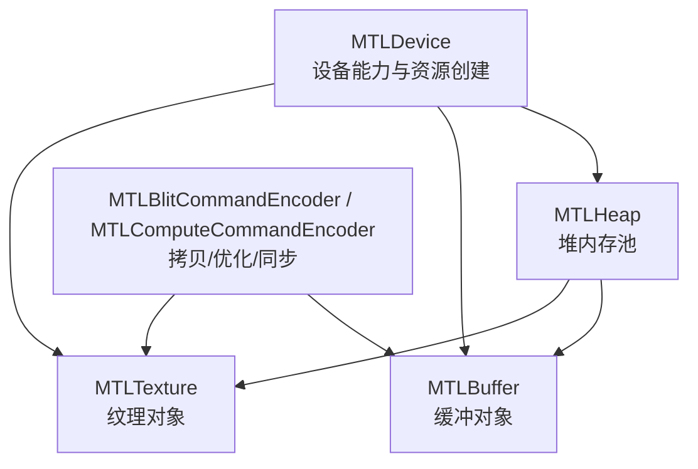
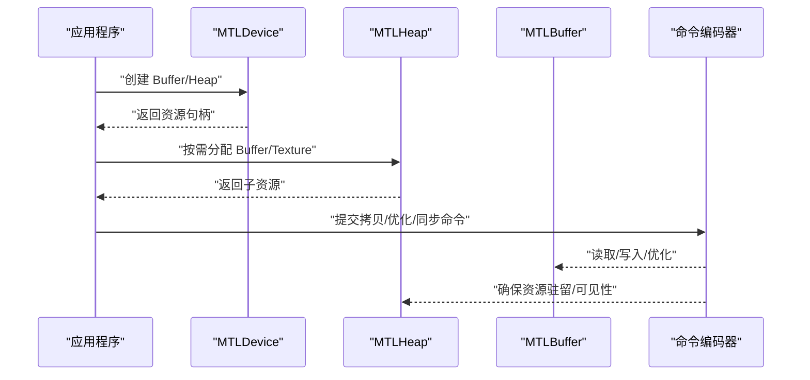
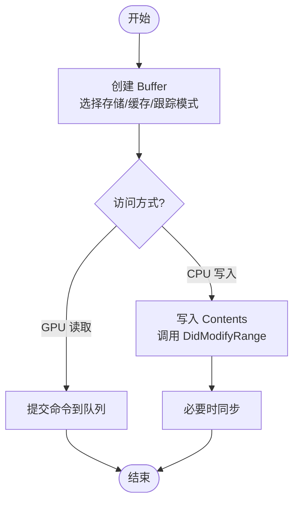
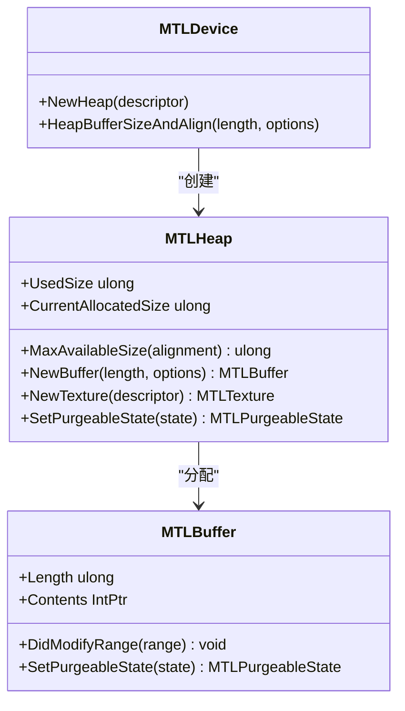
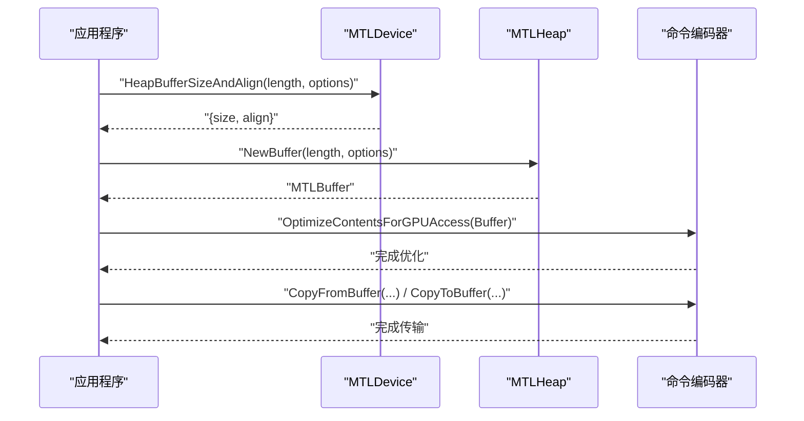
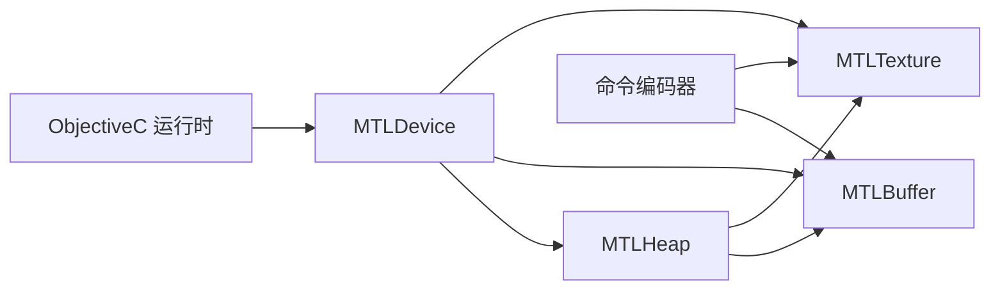

# 内存模型

<cite>
**本文引用的文件**
- [MTLBuffer.cs](file://src/SharpMetal/Metal/MTLBuffer.cs)
- [MTLHeap.cs](file://src/SharpMetal/Metal/MTLHeap.cs)
- [MTLResource.cs](file://src/SharpMetal/Metal/MTLResource.cs)
- [MTLDevice.cs](file://src/SharpMetal/Metal/MTLDevice.cs)
- [MTLBlitCommandEncoder.cs](file://src/SharpMetal/Metal/MTLBlitCommandEncoder.cs)
- [MTLComputeCommandEncoder.cs](file://src/SharpMetal/Metal/MTLComputeCommandEncoder.cs)
- [Program.cs](file://samples/SharpMetal.Sample/Program.cs)
</cite>

## 目录
1. [简介](#简介)
2. [项目结构](#项目结构)
3. [核心组件](#核心组件)
4. [架构总览](#架构总览)
5. [详细组件分析](#详细组件分析)
6. [依赖关系分析](#依赖关系分析)
7. [性能考虑](#性能考虑)
8. [故障排查指南](#故障排查指南)
9. [结论](#结论)
10. [附录：代码示例与最佳实践](#附录代码示例与最佳实践)

## 简介
本文件面向使用 SharpMetal 的开发者，系统化阐述 Metal 内存模型在 SharpMetal 中的实现与使用方式。内容涵盖：
- GPU 内存与 CPU 内存的区别、统一内存架构（UMA）的工作原理
- MTLBuffer 的创建、访问与同步机制
- 资源选项（存储模式、CPU 缓存模式、危险跟踪模式）的选择策略
- MTLHeap 堆内存管理的优势、使用场景与优化方法
- 内存对齐要求、缓存策略与数据传输优化技术
- 完整的缓冲区创建、数据上传下载、内存映射与同步流程说明
- 内存使用最佳实践与性能调优建议

## 项目结构
SharpMetal 将 Metal API 以 C# 结构体形式暴露，并通过 Objective-C 运行时桥接到系统 Metal 框架。与内存管理直接相关的核心类型位于 src/SharpMetal/Metal 目录下：
- MTLDevice：设备能力查询、资源创建入口（包括 Buffer、Texture、Heap 等）
- MTLResource：通用资源基类，定义存储模式、缓存模式、危险跟踪模式、可回收状态等
- MTLBuffer：GPU/CPU 共享或独立的缓冲对象，提供 Contents 指针、长度、对齐、同步接口
- MTLHeap：集中式内存池，支持批量分配 Buffer/Texture/AccelerationStructure，并具备对齐与容量管理能力
- MTLBlitCommandEncoder / MTLComputeCommandEncoder：负责数据拷贝、优化、屏障与同步

图表来源
- [MTLDevice.cs:341-369](file://src/SharpMetal/Metal/MTLDevice.cs#L341-L369)
- [MTLHeap.cs:119-167](file://src/SharpMetal/Metal/MTLHeap.cs#L119-L167)
- [MTLBuffer.cs:18-49](file://src/SharpMetal/Metal/MTLBuffer.cs#L18-L49)
- [MTLBlitCommandEncoder.cs:52-155](file://src/SharpMetal/Metal/MTLBlitCommandEncoder.cs#L52-L155)
- [MTLComputeCommandEncoder.cs:60-243](file://src/SharpMetal/Metal/MTLComputeCommandEncoder.cs#L60-L243)

章节来源
- [MTLDevice.cs:187-369](file://src/SharpMetal/Metal/MTLDevice.cs#L187-L369)
- [MTLHeap.cs:6-167](file://src/SharpMetal/Metal/MTLHeap.cs#L6-L167)
- [MTLBuffer.cs:6-49](file://src/SharpMetal/Metal/MTLBuffer.cs#L6-L49)
- [MTLBlitCommandEncoder.cs:14-155](file://src/SharpMetal/Metal/MTLBlitCommandEncoder.cs#L14-L155)
- [MTLComputeCommandEncoder.cs:20-243](file://src/SharpMetal/Metal/MTLComputeCommandEncoder.cs#L20-L243)

## 核心组件
- MTLResource：定义所有资源的通用属性与行为，包括：
  - 存储模式（Shared/Managed/Private/Memoryless）
  - CPU 缓存模式（DefaultCache/WriteCombined）
  - 危险跟踪模式（Default/Untracked/Tracked）
  - 可回收状态（KeepCurrent/NonVolatile/Volatile/Empty）
  - 是否可别名化、所属堆、堆偏移、已分配大小等
- MTLBuffer：具体缓冲资源，提供：
  - 长度、Contents 指针（用于 CPU 直接读写）、GpuAddress
  - 从 Buffer 创建 Texture/Tensor 视图
  - 标记修改范围 DidModifyRange、设置可回收状态
- MTLHeap：堆内存池，提供：
  - 最大可用尺寸查询（按对齐）
  - 在堆内分配 Buffer/Texture/AccelerationStructure
  - 堆级可回收状态控制
- MTLDevice：设备能力与资源创建入口，包括：
  - 是否统一内存 HasUnifiedMemory
  - 推荐工作集大小、最大传输速率等
  - 创建 Buffer、Heap、Texture 等

章节来源
- [MTLResource.cs:6-119](file://src/SharpMetal/Metal/MTLResource.cs#L6-L119)
- [MTLBuffer.cs:6-49](file://src/SharpMetal/Metal/MTLBuffer.cs#L6-L49)
- [MTLHeap.cs:6-167](file://src/SharpMetal/Metal/MTLHeap.cs#L6-L167)
- [MTLDevice.cs:229-369](file://src/SharpMetal/Metal/MTLDevice.cs#L229-L369)

## 架构总览
下图展示了 SharpMetal 中内存相关的主要交互路径：应用通过 MTLDevice 创建资源；MTLHeap 作为集中式内存池统一管理资源分配；命令编码器负责数据拷贝、优化与同步。

图表来源
- [MTLDevice.cs:341-369](file://src/SharpMetal/Metal/MTLDevice.cs#L341-L369)
- [MTLHeap.cs:119-167](file://src/SharpMetal/Metal/MTLHeap.cs#L119-L167)
- [MTLBlitCommandEncoder.cs:52-155](file://src/SharpMetal/Metal/MTLBlitCommandEncoder.cs#L52-L155)
- [MTLComputeCommandEncoder.cs:205-243](file://src/SharpMetal/Metal/MTLComputeCommandEncoder.cs#L205-L243)

## 详细组件分析

### MTLBuffer：缓冲对象的创建、访问与同步
- 创建
  - 通过 MTLDevice.NewBuffer 指定长度与资源选项（存储模式、缓存模式、危险跟踪模式）
  - 也可通过 MTLHeap.NewBuffer 在堆内分配，便于统一管理与对齐
- 访问
  - 使用 Contents 获取 CPU 可访问的指针，进行读写
  - 使用 GpuAddress 在 GPU 侧引用
  - 可通过 NewTexture/NewTensor 从 Buffer 派生视图
- 同步
  - 对 Managed 存储模式的 Buffer，在 CPU 写入后调用 DidModifyRange 通知驱动
  - 使用 SetPurgeableState 控制可回收状态（如 Volatile/Empty）
  - 通过命令编码器的 SynchronizeResource/SynchronizeTexture 进行显式同步

图表来源
- [MTLDevice.cs:356-369](file://src/SharpMetal/Metal/MTLDevice.cs#L356-L369)
- [MTLHeap.cs:124-142](file://src/SharpMetal/Metal/MTLHeap.cs#L124-L142)
- [MTLBuffer.cs:18-63](file://src/SharpMetal/Metal/MTLBuffer.cs#L18-L63)
- [MTLBlitCommandEncoder.cs:52-59](file://src/SharpMetal/Metal/MTLBlitCommandEncoder.cs#L52-L59)

章节来源
- [MTLBuffer.cs:18-63](file://src/SharpMetal/Metal/MTLBuffer.cs#L18-L63)
- [MTLDevice.cs:356-369](file://src/SharpMetal/Metal/MTLDevice.cs#L356-L369)
- [MTLHeap.cs:124-142](file://src/SharpMetal/Metal/MTLHeap.cs#L124-L142)
- [MTLBlitCommandEncoder.cs:52-59](file://src/SharpMetal/Metal/MTLBlitCommandEncoder.cs#L52-L59)

### MTLHeap：堆内存管理的优势与使用场景
- 优势
  - 集中管理：一次分配大块内存，多次分配小资源，减少碎片
  - 对齐控制：通过 MaxAvailableSize(alignment) 保证对齐约束
  - 复用与回收：SetPurgeableState 控制堆的可回收状态，降低峰值内存占用
- 使用场景
  - 大量同生命周期资源（如帧间临时缓冲、渲染附件）
  - 需要严格对齐的几何/索引数据
  - 动态增长的数据结构（如粒子系统、实例化数据）
- 操作
  - 通过 MTLDevice.NewHeap 创建堆
  - 通过 MTLHeap.NewBuffer/NewTexture/NewAccelerationStructure 分配子资源
  - 监控 UsedSize/CurrentAllocatedSize 评估利用率

图表来源
- [MTLDevice.cs:341-354](file://src/SharpMetal/Metal/MTLDevice.cs#L341-L354)
- [MTLHeap.cs:119-167](file://src/SharpMetal/Metal/MTLHeap.cs#L119-L167)
- [MTLBuffer.cs:18-63](file://src/SharpMetal/Metal/MTLBuffer.cs#L18-L63)

章节来源
- [MTLDevice.cs:341-354](file://src/SharpMetal/Metal/MTLDevice.cs#L341-L354)
- [MTLHeap.cs:119-167](file://src/SharpMetal/Metal/MTLHeap.cs#L119-L167)
- [MTLBuffer.cs:18-63](file://src/SharpMetal/Metal/MTLBuffer.cs#L18-L63)

### 资源选项与存储模式选择策略
- 存储模式（StorageMode）
  - Shared：CPU/GPU 共享内存，适合频繁双向访问
  - Managed：由驱动管理一致性，CPU 写入后需 DidModifyRange
  - Private：仅 GPU 可访问，适合只写中间结果
  - Memoryless：无持久内存，适合渲染附件（如颜色/深度缓冲）
- CPU 缓存模式（CPUCacheMode）
  - DefaultCache：默认缓存策略
  - WriteCombined：合并写入，适合一次性写入的大块数据
- 危险跟踪模式（HazardTrackingMode）
  - Default/Untracked/Tracked：根据读写冲突检测需求选择

章节来源
- [MTLResource.cs:14-48](file://src/SharpMetal/Metal/MTLResource.cs#L14-L48)
- [MTLBuffer.cs:24-33](file://src/SharpMetal/Metal/MTLBuffer.cs#L24-L33)
- [MTLHeap.cs:27-57](file://src/SharpMetal/Metal/MTLHeap.cs#L27-L57)

### 内存对齐、缓存策略与数据传输优化
- 对齐
  - 使用 MTLDevice.HeapBufferSizeAndAlign 计算 Buffer 的对齐与大小
  - 使用 MTLHeap.MaxAvailableSize(alignment) 查询满足对齐的最大可用空间
- 缓存
  - 对频繁读写的共享数据使用 Shared + DefaultCache
  - 对一次性写入的大块数据使用 WriteCombined 以减少缓存污染
- 数据传输优化
  - 使用 MTLBlitCommandEncoder 的 CopyFromBuffer/ToBuffer、OptimizeContentsForGPUAccess/CPUAccess
  - 合理使用 MTLComputeCommandEncoder 的 UseResource/UseResources 声明资源使用意图
  - 使用 MemoryBarrier 控制跨阶段/跨资源的可见性

图表来源
- [MTLDevice.cs:341-349](file://src/SharpMetal/Metal/MTLDevice.cs#L341-L349)
- [MTLHeap.cs:119-142](file://src/SharpMetal/Metal/MTLHeap.cs#L119-L142)
- [MTLBlitCommandEncoder.cs:62-155](file://src/SharpMetal/Metal/MTLBlitCommandEncoder.cs#L62-L155)

章节来源
- [MTLDevice.cs:341-349](file://src/SharpMetal/Metal/MTLDevice.cs#L341-L349)
- [MTLHeap.cs:119-142](file://src/SharpMetal/Metal/MTLHeap.cs#L119-L142)
- [MTLBlitCommandEncoder.cs:62-155](file://src/SharpMetal/Metal/MTLBlitCommandEncoder.cs#L62-L155)

### 统一内存架构（UMA）与设备能力
- 统一内存
  - 通过 MTLDevice.HasUnifiedMemory 判断设备是否支持 UMA
  - 在 UMA 设备上，Shared 存储模式通常更高效，减少显存复制
- 设备能力
  - RecommendedMaxWorkingSetSize：建议的工作集大小，指导资源总量规划
  - MaxTransferRate：最大传输速率，影响带宽密集型任务的性能预期

章节来源
- [MTLDevice.cs:229-237](file://src/SharpMetal/Metal/MTLDevice.cs#L229-L237)

## 依赖关系分析
- MTLDevice 是资源创建的根节点，依赖 ObjectiveC 运行时调用系统 Metal 框架
- MTLHeap 依赖 MTLDevice 提供的对齐与容量信息，为子资源提供集中式内存管理
- MTLBuffer/MTLTexture 依赖 MTLResource 的通用属性与行为
- 命令编码器（Blit/Compute）依赖资源对象执行拷贝、优化与同步

图表来源
- [MTLDevice.cs:305-369](file://src/SharpMetal/Metal/MTLDevice.cs#L305-L369)
- [MTLHeap.cs:119-167](file://src/SharpMetal/Metal/MTLHeap.cs#L119-L167)
- [MTLBuffer.cs:18-63](file://src/SharpMetal/Metal/MTLBuffer.cs#L18-L63)
- [MTLBlitCommandEncoder.cs:52-155](file://src/SharpMetal/Metal/MTLBlitCommandEncoder.cs#L52-L155)
- [MTLComputeCommandEncoder.cs:205-243](file://src/SharpMetal/Metal/MTLComputeCommandEncoder.cs#L205-L243)

章节来源
- [MTLDevice.cs:305-369](file://src/SharpMetal/Metal/MTLDevice.cs#L305-L369)
- [MTLHeap.cs:119-167](file://src/SharpMetal/Metal/MTLHeap.cs#L119-L167)
- [MTLBuffer.cs:18-63](file://src/SharpMetal/Metal/MTLBuffer.cs#L18-L63)
- [MTLBlitCommandEncoder.cs:52-155](file://src/SharpMetal/Metal/MTLBlitCommandEncoder.cs#L52-L155)
- [MTLComputeCommandEncoder.cs:205-243](file://src/SharpMetal/Metal/MTLComputeCommandEncoder.cs#L205-L243)

## 性能考虑
- 存储模式选择
  - 频繁 CPU/GPU 双向访问：Shared
  - 仅 GPU 写入：Private
  - 渲染附件：Memoryless
- 缓存模式选择
  - 一次性写入大数据：WriteCombined
  - 重复读取：DefaultCache
- 对齐与布局
  - 使用 HeapBufferSizeAndAlign 精确计算对齐，避免浪费与未对齐访问
  - 在堆内分配时，优先使用 MaxAvailableSize 保证对齐
- 数据传输
  - 批量拷贝优于多次小拷贝
  - 使用 OptimizeContentsForGPUAccess/CPUAccess 减少不一致开销
- 同步与可见性
  - 谨慎使用 MemoryBarrier，仅在必要时限制并行度
  - 使用 UseResource/UseResources 明确资源使用意图，帮助驱动优化

[本节为通用性能指导，不直接分析具体文件]

## 故障排查指南
- 常见问题
  - 共享缓冲区分配失败：检查设备是否存在、资源选项是否合理
  - 数据不一致：确认对 Managed 存储模式调用 DidModifyRange
  - 对齐错误：使用 HeapBufferSizeAndAlign 重新计算 size/align
  - 性能下降：检查是否过度同步或频繁切换存储模式
- 调试手段
  - 使用命令编码器的 PushDebugGroup/PopDebugGroup 标记关键路径
  - 使用 InsertDebugSignpost 插入诊断点
  - 监控堆的 UsedSize/CurrentAllocatedSize 评估内存压力

章节来源
- [MTLBlitCommandEncoder.cs:37-50](file://src/SharpMetal/Metal/MTLBlitCommandEncoder.cs#L37-L50)
- [MTLComputeCommandEncoder.cs:43-56](file://src/SharpMetal/Metal/MTLComputeCommandEncoder.cs#L43-L56)
- [MTLHeap.cs:111-117](file://src/SharpMetal/Metal/MTLHeap.cs#L111-L117)

## 结论
SharpMetal 将 Metal 内存模型以清晰的 C# 结构体暴露，使开发者能够高效地管理 GPU 与 CPU 内存。通过合理选择存储模式、缓存模式与对齐策略，并结合 MTLHeap 的集中式内存管理，可以显著提升内存利用率和吞吐。命令编码器提供的拷贝、优化与同步接口，为跨阶段数据一致性与性能提供了保障。遵循本文的最佳实践与调优建议，可在不同平台上获得稳定且高效的内存管理效果。

[本节为总结性内容，不直接分析具体文件]

## 附录：代码示例与最佳实践

### 示例：创建共享缓冲区并进行读写
- 步骤
  - 获取默认设备
  - 创建长度为 4096、存储模式为 Shared 的 Buffer
  - 通过 Contents 指针写入数据并验证
  - 释放资源
- 参考路径
  - [Program.cs:21-45](file://samples/SharpMetal.Sample/Program.cs#L21-L45)

章节来源
- [Program.cs:21-45](file://samples/SharpMetal.Sample/Program.cs#L21-L45)

### 示例：在堆中分配缓冲区并优化传输
- 步骤
  - 使用 MTLDevice.HeapBufferSizeAndAlign 计算对齐与大小
  - 创建 MTLHeap 并在其中分配 Buffer
  - 使用命令编码器优化内容与拷贝
- 参考路径
  - [MTLDevice.cs:341-349](file://src/SharpMetal/Metal/MTLDevice.cs#L341-L349)
  - [MTLHeap.cs:119-142](file://src/SharpMetal/Metal/MTLHeap.cs#L119-L142)
  - [MTLBlitCommandEncoder.cs:62-155](file://src/SharpMetal/Metal/MTLBlitCommandEncoder.cs#L62-L155)

章节来源
- [MTLDevice.cs:341-349](file://src/SharpMetal/Metal/MTLDevice.cs#L341-L349)
- [MTLHeap.cs:119-142](file://src/SharpMetal/Metal/MTLHeap.cs#L119-L142)
- [MTLBlitCommandEncoder.cs:62-155](file://src/SharpMetal/Metal/MTLBlitCommandEncoder.cs#L62-L155)

### 示例：CPU 写入 Managed 缓冲区并同步
- 步骤
  - 创建存储模式为 Managed 的 Buffer
  - 写入 Contents 后调用 DidModifyRange
  - 提交命令并使用 SynchronizeResource 确保可见性
- 参考路径
  - [MTLDevice.cs:356-369](file://src/SharpMetal/Metal/MTLDevice.cs#L356-L369)
  - [MTLBuffer.cs:60-63](file://src/SharpMetal/Metal/MTLBuffer.cs#L60-L63)
  - [MTLBlitCommandEncoder.cs:52-59](file://src/SharpMetal/Metal/MTLBlitCommandEncoder.cs#L52-L59)

章节来源
- [MTLDevice.cs:356-369](file://src/SharpMetal/Metal/MTLDevice.cs#L356-L369)
- [MTLBuffer.cs:60-63](file://src/SharpMetal/Metal/MTLBuffer.cs#L60-L63)
- [MTLBlitCommandEncoder.cs:52-59](file://src/SharpMetal/Metal/MTLBlitCommandEncoder.cs#L52-L59)

### 示例：使用 Compute 编码器声明资源使用与屏障
- 步骤
  - 使用 UseResource/UseResources 声明资源使用意图
  - 在关键位置调用 MemoryBarrier 控制可见性
- 参考路径
  - [MTLComputeCommandEncoder.cs:205-243](file://src/SharpMetal/Metal/MTLComputeCommandEncoder.cs#L205-L243)

章节来源
- [MTLComputeCommandEncoder.cs:205-243](file://src/SharpMetal/Metal/MTLComputeCommandEncoder.cs#L205-L243)

### 最佳实践清单
- 优先使用 MTLHeap 集中管理同生命周期资源，减少碎片与对齐问题
- 根据访问模式选择合适的存储模式与缓存模式
- 对 Managed 存储模式务必调用 DidModifyRange 以保持一致性
- 使用命令编码器进行批量拷贝与优化，避免频繁同步
- 监控堆的使用情况，适时调整资源规模与回收策略
- 在 UMA 设备上充分利用 Shared 模式，减少显存复制

[本节为通用最佳实践，不直接分析具体文件]