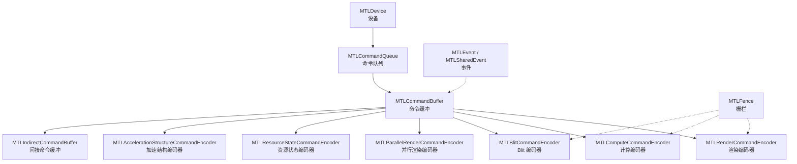
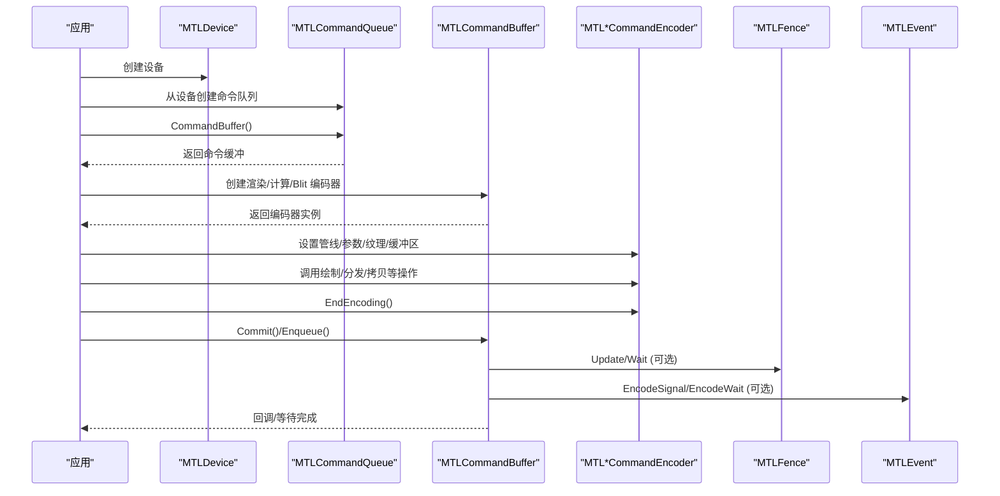
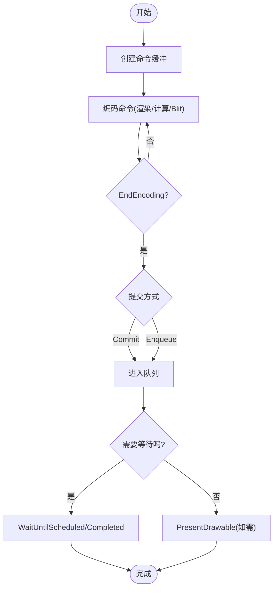
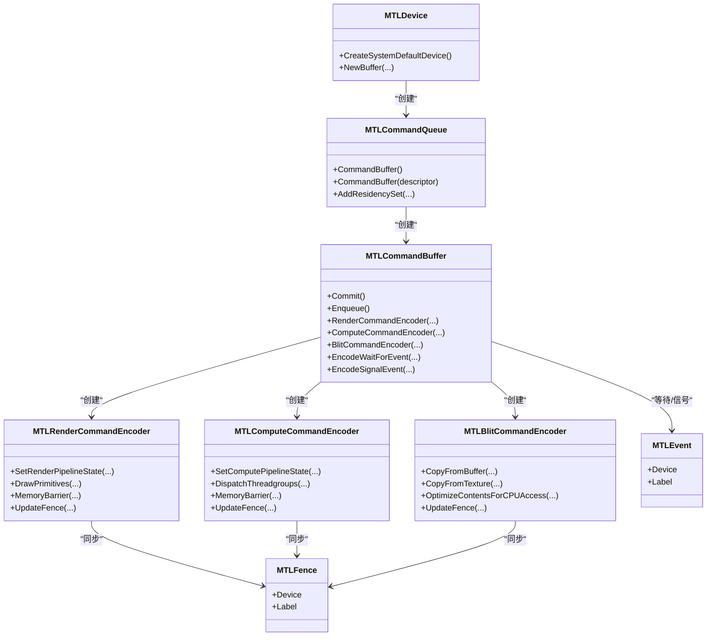

# 命令编码

<cite>
**本文引用的文件**
- [MTLCommandQueue.cs](file://src/SharpMetal/Metal/MTLCommandQueue.cs)
- [MTLCommandBuffer.cs](file://src/SharpMetal/Metal/MTLCommandBuffer.cs)
- [MTLCommandEncoder.cs](file://src/SharpMetal/Metal/MTLCommandEncoder.cs)
- [MTLRenderCommandEncoder.cs](file://src/SharpMetal/Metal/MTLRenderCommandEncoder.cs)
- [MTLComputeCommandEncoder.cs](file://src/SharpMetal/Metal/MTLComputeCommandEncoder.cs)
- [MTLBlitCommandEncoder.cs](file://src/SharpMetal/Metal/MTLBlitCommandEncoder.cs)
- [MTLFence.cs](file://src/SharpMetal/Metal/MTLFence.cs)
- [MTLEvent.cs](file://src/SharpMetal/Metal/MTLEvent.cs)
- [MTLDevice.cs](file://src/SharpMetal/Metal/MTLDevice.cs)
- [Program.cs](file://samples/SharpMetal.Sample/Program.cs)
</cite>

## 目录
1. [简介](#简介)
2. [项目结构](#项目结构)
3. [核心组件](#核心组件)
4. [架构总览](#架构总览)
5. [详细组件分析](#详细组件分析)
6. [依赖关系分析](#依赖关系分析)
7. [性能考虑](#性能考虑)
8. [故障排查指南](#故障排查指南)
9. [结论](#结论)
10. [附录：完整流程示例与最佳实践](#附录完整流程示例与最佳实践)

## 简介
本文件围绕 Metal 命令系统的层次结构与生命周期，系统阐述命令队列、命令缓冲、命令编码器（渲染、计算、Blit）的创建、使用与提交执行过程；说明同步机制（栅栏对象、事件）、错误处理与调试标记；并提供优化策略与并发执行的最佳实践。内容基于 SharpMetal 封装的 Metal API 类型与方法，确保与实际实现一致。

## 项目结构
本仓库中与命令编码直接相关的核心类型位于 src/SharpMetal/Metal 目录下，包括命令队列、命令缓冲、命令编码器以及同步原语等。示例程序位于 samples/SharpMetal.Sample/Program.cs，演示了设备与缓冲的基本使用。

图表来源
- [MTLCommandQueue.cs:44-107](file://src/SharpMetal/Metal/MTLCommandQueue.cs#L44-L107)
- [MTLCommandBuffer.cs:116-319](file://src/SharpMetal/Metal/MTLCommandBuffer.cs#L116-L319)
- [MTLRenderCommandEncoder.cs:126-786](file://src/SharpMetal/Metal/MTLRenderCommandEncoder.cs#L126-L786)
- [MTLComputeCommandEncoder.cs:20-296](file://src/SharpMetal/Metal/MTLComputeCommandEncoder.cs#L20-L296)
- [MTLBlitCommandEncoder.cs:14-215](file://src/SharpMetal/Metal/MTLBlitCommandEncoder.cs#L14-L215)
- [MTLFence.cs:6-23](file://src/SharpMetal/Metal/MTLFence.cs#L6-L23)
- [MTLEvent.cs:6-107](file://src/SharpMetal/Metal/MTLEvent.cs#L6-L107)

章节来源
- [MTLCommandQueue.cs:44-107](file://src/SharpMetal/Metal/MTLCommandQueue.cs#L44-L107)
- [MTLCommandBuffer.cs:116-319](file://src/SharpMetal/Metal/MTLCommandBuffer.cs#L116-L319)
- [MTLRenderCommandEncoder.cs:126-786](file://src/SharpMetal/Metal/MTLRenderCommandEncoder.cs#L126-L786)
- [MTLComputeCommandEncoder.cs:20-296](file://src/SharpMetal/Metal/MTLComputeCommandEncoder.cs#L20-L296)
- [MTLBlitCommandEncoder.cs:14-215](file://src/SharpMetal/Metal/MTLBlitCommandEncoder.cs#L14-L215)
- [MTLFence.cs:6-23](file://src/SharpMetal/Metal/MTLFence.cs#L6-L23)
- [MTLEvent.cs:6-107](file://src/SharpMetal/Metal/MTLEvent.cs#L6-L107)

## 核心组件
- 命令队列（MTLCommandQueue）：从设备创建，用于获取命令缓冲并管理驻留集等。
- 命令缓冲（MTLCommandBuffer）：承载一组已编码的命令，支持提交、呈现可绘制对象、等待完成、添加回调、插入调试组等。
- 命令编码器（MTLCommandEncoder 及其派生）：在命令缓冲中编码具体操作，包括渲染、计算、Blit、资源状态、加速结构等。
- 同步原语：栅栏（MTLFence）与事件（MTLEvent/MTLSharedEvent），用于跨命令或跨设备同步。
- 设备（MTLDevice）：提供创建命令队列、缓冲等资源的能力。

章节来源
- [MTLCommandQueue.cs:44-107](file://src/SharpMetal/Metal/MTLCommandQueue.cs#L44-L107)
- [MTLCommandBuffer.cs:116-319](file://src/SharpMetal/Metal/MTLCommandBuffer.cs#L116-L319)
- [MTLCommandEncoder.cs:20-61](file://src/SharpMetal/Metal/MTLCommandEncoder.cs#L20-L61)
- [MTLFence.cs:6-23](file://src/SharpMetal/Metal/MTLFence.cs#L6-L23)
- [MTLEvent.cs:6-107](file://src/SharpMetal/Metal/MTLEvent.cs#L6-L107)
- [MTLDevice.cs:187-200](file://src/SharpMetal/Metal/MTLDevice.cs#L187-L200)

## 架构总览
命令系统采用“队列—缓冲—编码器”三层结构：
- 命令队列负责调度命令缓冲的生命周期与资源驻留。
- 命令缓冲是命令的容器，持有设备引用、日志、时间戳、状态、错误信息，并负责提交与呈现。
- 命令编码器在缓冲内编码具体工作负载（渲染、计算、Blit、资源状态、加速结构），并通过 EndEncoding 结束编码。

图表来源
- [MTLCommandQueue.cs:44-107](file://src/SharpMetal/Metal/MTLCommandQueue.cs#L44-L107)
- [MTLCommandBuffer.cs:116-319](file://src/SharpMetal/Metal/MTLCommandBuffer.cs#L116-L319)
- [MTLRenderCommandEncoder.cs:126-786](file://src/SharpMetal/Metal/MTLRenderCommandEncoder.cs#L126-L786)
- [MTLComputeCommandEncoder.cs:20-296](file://src/SharpMetal/Metal/MTLComputeCommandEncoder.cs#L20-L296)
- [MTLBlitCommandEncoder.cs:14-215](file://src/SharpMetal/Metal/MTLBlitCommandEncoder.cs#L14-L215)
- [MTLFence.cs:6-23](file://src/SharpMetal/Metal/MTLFence.cs#L6-L23)
- [MTLEvent.cs:6-107](file://src/SharpMetal/Metal/MTLEvent.cs#L6-L107)

## 详细组件分析

### 命令队列（MTLCommandQueue）
- 职责：从设备获取命令缓冲；配置日志与最大缓冲数；管理驻留集（ResidencySet）。
- 关键方法：
  - CommandBuffer()/CommandBuffer(descriptor)：创建命令缓冲。
  - InsertDebugCaptureBoundary()：插入调试捕获边界。
  - Add/Remove ResidencySet(s)：批量管理驻留集。
- 设计要点：队列本身不持有命令，仅作为缓冲的工厂与调度入口。

章节来源
- [MTLCommandQueue.cs:44-107](file://src/SharpMetal/Metal/MTLCommandQueue.cs#L44-L107)

### 命令缓冲（MTLCommandBuffer）
- 职责：承载命令、提交执行、呈现可绘制对象、等待完成、注册回调、记录日志与时间戳、编码各类命令。
- 关键能力：
  - 状态与错误：Status、Error、Logs、GPUStartTime/GPUEndTime。
  - 提交与呈现：Commit()/Enqueue()、PresentDrawable(...)。
  - 等待与回调：WaitUntilScheduled()/WaitUntilCompleted()、AddScheduledHandler/AddCompletedHandler。
  - 编码器创建：Render/Compute/Blit/Parallel Render/Resource State/Acceleration Structure 编码器。
  - 同步：EncodeWaitForEvent/EncodeSignalEvent。
  - 调试：PushDebugGroup/PopDebugGroup。
- 生命周期：
  - 创建后进入未入队状态；提交后进入已提交/已计划/已完成/错误等状态。
  - 可通过回调或等待函数进行同步。

图表来源
- [MTLCommandBuffer.cs:116-319](file://src/SharpMetal/Metal/MTLCommandBuffer.cs#L116-L319)

章节来源
- [MTLCommandBuffer.cs:116-319](file://src/SharpMetal/Metal/MTLCommandBuffer.cs#L116-L319)

### 命令编码器基类（MTLCommandEncoder）
- 通用能力：Label、EndEncoding、InsertDebugSignpost、Push/PopDebugGroup。
- 所有具体编码器均继承此接口语义，保证一致的编码生命周期。

章节来源
- [MTLCommandEncoder.cs:20-61](file://src/SharpMetal/Metal/MTLCommandEncoder.cs#L20-L61)

### 渲染命令编码器（MTLRenderCommandEncoder）
- 适用场景：绘制图元、设置视口/裁剪矩形、绑定顶点/片段/对象/网格阶段数据、深度模板、可见性统计、存储动作、内存屏障、栅栏更新/等待、执行间接命令、采样计数器。
- 关键能力：
  - 管线与阶段：SetRenderPipelineState、各阶段 Set*Bytes/Set*Buffer/Set*Texture/Set*SamplerState。
  - 几何与绘制：DrawPrimitives/DrawIndexedPrimitives、Patch 绘制、Mesh 绘制。
  - 视图与裁剪：Viewport、ScissorRect、FrontFacingWinding、CullMode、DepthClipMode。
  - 同步与屏障：MemoryBarrier、UpdateFence/WaitForFence、TextureBarrier。
  - 高级特性：VisibilityResultMode、ExecuteCommandsInBuffer、UseResource/UseHeap。
- 复杂度与注意事项：
  - 大量 Set* 调用应在绘制前集中设置，减少状态切换。
  - 合理使用 UseResource/UseHeap 显式声明资源使用范围，避免隐式屏障带来的开销。

章节来源
- [MTLRenderCommandEncoder.cs:126-786](file://src/SharpMetal/Metal/MTLRenderCommandEncoder.cs#L126-L786)

### 计算命令编码器（MTLComputeCommandEncoder）
- 适用场景：通用并行计算、图像处理、数据变换、GPGPU 任务。
- 关键能力：
  - 管线与参数：SetComputePipelineState、SetBytes/SetBuffer/SetTexture/SetSamplerState。
  - 线程组织：DispatchThreadgroups/DispatchThreads、StageInRegion、ImageblockWidth。
  - 同步与屏障：UpdateFence/WaitForFence、MemoryBarrier（按作用域或资源列表）。
  - 间接执行：ExecuteCommandsInBuffer。
  - 计数：SampleCountersInBuffer。
- 复杂度与注意事项：
  - 合理划分线程组大小与网格尺寸，避免过度细分或过大线程组导致调度开销。
  - 使用 MemoryBarrier 精确控制读写顺序，避免不必要的同步。

章节来源
- [MTLComputeCommandEncoder.cs:20-296](file://src/SharpMetal/Metal/MTLComputeCommandEncoder.cs#L20-L296)

### Blit 命令编码器（MTLBlitCommandEncoder）
- 适用场景：缓冲/纹理复制、填充、生成 mipmap、张量拷贝、访问计数器、内容优化、间接命令缓冲操作。
- 关键能力：
  - 同步：SynchronizeResource/SynchronizeTexture。
  - 复制：CopyFromBuffer/ToTexture、CopyFromTexture/ToBuffer、CopyFromTexture/ToTexture、CopyFromTensor。
  - 填充与生成：FillBuffer、GenerateMipmaps。
  - 优化：OptimizeContentsForCPUAccess/GPUAccess。
  - 间接命令：ResetCommandsInBuffer、CopyIndirectCommandBuffer、OptimizeIndirectCommandBuffer。
  - 计数：Get/Reset Texture Access Counters、ResolveCounters。
- 复杂度与注意事项：
  - 大批量复制建议批量化以减少命令数量。
  - 使用 OptimizeContents 在 CPU/GPU 访问前优化布局，降低带宽浪费。

章节来源
- [MTLBlitCommandEncoder.cs:14-215](file://src/SharpMetal/Metal/MTLBlitCommandEncoder.cs#L14-L215)

### 同步机制：栅栏与事件
- 栅栏（MTLFence）：
  - 在渲染/计算/Blit 编码器中通过 UpdateFence/WaitForFence 建立跨命令或跨阶段的同步点。
  - 适用于同一设备内的细粒度同步。
- 事件（MTLEvent/MTLSharedEvent）：
  - 命令缓冲可直接编码等待/信号事件（EncodeWaitForEvent/EncodeSignalEvent）。
  - SharedEvent 支持跨进程/跨设备共享，配合监听器与超时等待。
- 选择建议：
  - 同设备内优先使用栅栏以获得更低延迟。
  - 跨设备/跨进程使用 SharedEvent。

章节来源
- [MTLRenderCommandEncoder.cs:588-601](file://src/SharpMetal/Metal/MTLRenderCommandEncoder.cs#L588-L601)
- [MTLComputeCommandEncoder.cs:195-203](file://src/SharpMetal/Metal/MTLComputeCommandEncoder.cs#L195-L203)
- [MTLBlitCommandEncoder.cs:117-125](file://src/SharpMetal/Metal/MTLBlitCommandEncoder.cs#L117-L125)
- [MTLCommandBuffer.cs:235-243](file://src/SharpMetal/Metal/MTLCommandBuffer.cs#L235-L243)
- [MTLFence.cs:6-23](file://src/SharpMetal/Metal/MTLFence.cs#L6-L23)
- [MTLEvent.cs:6-107](file://src/SharpMetal/Metal/MTLEvent.cs#L6-L107)

## 依赖关系分析
- 命令缓冲依赖命令队列以获取自身上下文；编码器依赖命令缓冲以写入命令。
- 渲染/计算/Blit 编码器分别依赖管线、资源（缓冲/纹理/采样器）、堆与间接命令缓冲。
- 同步原语（栅栏/事件）被编码器与命令缓冲共同使用，形成跨命令/跨设备的依赖链。

图表来源
- [MTLDevice.cs:187-200](file://src/SharpMetal/Metal/MTLDevice.cs#L187-L200)
- [MTLCommandQueue.cs:44-107](file://src/SharpMetal/Metal/MTLCommandQueue.cs#L44-L107)
- [MTLCommandBuffer.cs:116-319](file://src/SharpMetal/Metal/MTLCommandBuffer.cs#L116-L319)
- [MTLRenderCommandEncoder.cs:126-786](file://src/SharpMetal/Metal/MTLRenderCommandEncoder.cs#L126-L786)
- [MTLComputeCommandEncoder.cs:20-296](file://src/SharpMetal/Metal/MTLComputeCommandEncoder.cs#L20-L296)
- [MTLBlitCommandEncoder.cs:14-215](file://src/SharpMetal/Metal/MTLBlitCommandEncoder.cs#L14-L215)
- [MTLFence.cs:6-23](file://src/SharpMetal/Metal/MTLFence.cs#L6-L23)
- [MTLEvent.cs:6-107](file://src/SharpMetal/Metal/MTLEvent.cs#L6-L107)

章节来源
- [MTLCommandQueue.cs:44-107](file://src/SharpMetal/Metal/MTLCommandQueue.cs#L44-L107)
- [MTLCommandBuffer.cs:116-319](file://src/SharpMetal/Metal/MTLCommandBuffer.cs#L116-L319)
- [MTLRenderCommandEncoder.cs:126-786](file://src/SharpMetal/Metal/MTLRenderCommandEncoder.cs#L126-L786)
- [MTLComputeCommandEncoder.cs:20-296](file://src/SharpMetal/Metal/MTLComputeCommandEncoder.cs#L20-L296)
- [MTLBlitCommandEncoder.cs:14-215](file://src/SharpMetal/Metal/MTLBlitCommandEncoder.cs#L14-L215)
- [MTLFence.cs:6-23](file://src/SharpMetal/Metal/MTLFence.cs#L6-L23)
- [MTLEvent.cs:6-107](file://src/SharpMetal/Metal/MTLEvent.cs#L6-L107)

## 性能考虑
- 批量化与合并：
  - 将多次小拷贝合并为一次大拷贝，减少命令数量与调度开销。
  - 使用 ExecuteCommandsInBuffer 执行间接命令缓冲中的命令序列，提升批量效率。
- 资源使用声明：
  - 使用 UseResource/UseResources 明确资源使用范围与阶段，减少隐式屏障。
  - 使用 UseHeap/UseHeaps 管理堆资源的使用阶段。
- 内存与布局优化：
  - 在 CPU/GPU 访问前调用 OptimizeContentsForCPUAccess/GPUAccess，改善缓存命中与带宽利用。
  - 合理设置线程组大小与网格维度，避免过细或过粗导致的调度与寄存器压力问题。
- 同步最小化：
  - 仅在必要时插入 MemoryBarrier/TextureBarrier，避免阻塞流水线。
  - 同设备内优先使用栅栏，跨设备使用 SharedEvent。
- 调试与诊断：
  - 使用 PushDebugGroup/PopDebugGroup 与 InsertDebugSignpost 定位瓶颈。
  - 使用 SampleCountersInBuffer/ResolveCounters 采集性能计数器。

[本节为通用指导，不直接分析具体文件]

## 故障排查指南
- 命令缓冲错误与状态：
  - 检查 Status 与 Error 字段，识别内部错误、超时、缺页、设备移除等。
  - 使用 Logs 与 GPU 时间戳分析执行时序。
- 编码器错误状态：
  - 通过命令缓冲的编码器信息（如 MTLCommandBufferEncoderInfo）查看错误状态。
- 常见原因与对策：
  - 资源未正确绑定或越界：核对索引、偏移、步长与数组长度。
  - 同步不足或过度：审查 MemoryBarrier/TextureBarrier/Fence/Event 的位置与作用域。
  - 呈现时机不当：确保在合适的帧调用 PresentDrawable。
- 调试技巧：
  - 使用调试组与标志点分段隔离问题。
  - 使用 WaitUntilCompleted 与回调定位异步执行异常。

章节来源
- [MTLCommandBuffer.cs:146-149](file://src/SharpMetal/Metal/MTLCommandBuffer.cs#L146-L149)
- [MTLCommandBuffer.cs:175-193](file://src/SharpMetal/Metal/MTLCommandBuffer.cs#L175-L193)
- [MTLCommandBuffer.cs:98-113](file://src/SharpMetal/Metal/MTLCommandBuffer.cs#L98-L113)

## 结论
SharpMetal 对 Metal 命令系统提供了清晰的分层封装：命令队列负责缓冲生命周期，命令缓冲承载并调度命令，命令编码器负责具体工作负载的编码。通过合理的资源声明、最小化同步、批量化命令与调试工具，可以在保证正确性的同时获得高性能。栅栏与事件为跨命令与跨设备同步提供了灵活手段。遵循本文的流程与最佳实践，可有效构建稳定高效的 Metal 渲染与计算管线。

[本节为总结，不直接分析具体文件]

## 附录：完整流程示例与最佳实践

### 典型流程步骤（无代码，仅路径指引）
- 创建设备与命令队列：
  - 参考：[MTLDevice.cs:187-200](file://src/SharpMetal/Metal/MTLDevice.cs#L187-L200)、[MTLCommandQueue.cs:44-107](file://src/SharpMetal/Metal/MTLCommandQueue.cs#L44-L107)
- 创建命令缓冲并提交：
  - 参考：[MTLCommandBuffer.cs:116-319](file://src/SharpMetal/Metal/MTLCommandBuffer.cs#L116-L319)
- 编码渲染命令：
  - 参考：[MTLRenderCommandEncoder.cs:126-786](file://src/SharpMetal/Metal/MTLRenderCommandEncoder.cs#L126-L786)
- 编码计算命令：
  - 参考：[MTLComputeCommandEncoder.cs:20-296](file://src/SharpMetal/Metal/MTLComputeCommandEncoder.cs#L20-L296)
- 编码 Blit 命令：
  - 参考：[MTLBlitCommandEncoder.cs:14-215](file://src/SharpMetal/Metal/MTLBlitCommandEncoder.cs#L14-L215)
- 同步与呈现：
  - 参考：[MTLCommandBuffer.cs:160-193](file://src/SharpMetal/Metal/MTLCommandBuffer.cs#L160-L193)
- 示例程序（设备与缓冲读写）：
  - 参考：[Program.cs:21-45](file://samples/SharpMetal.Sample/Program.cs#L21-L45)

### 并发执行最佳实践
- 多队列并行：
  - 使用多个命令队列并行编码不同工作负载，注意资源竞争与同步点。
- 间接命令缓冲：
  - 使用 MTLIndirectCommandBuffer 预编码命令序列，运行时高效执行。
- 资源驻留集：
  - 使用 AddResidencySet/RemoveResidencySet 管理常驻资源，减少迁移开销。
- 回调与等待：
  - 使用 AddCompletedHandler 与 WaitUntilCompleted 组合，平衡吞吐与延迟。

[本节为实践指导，不直接分析具体文件]