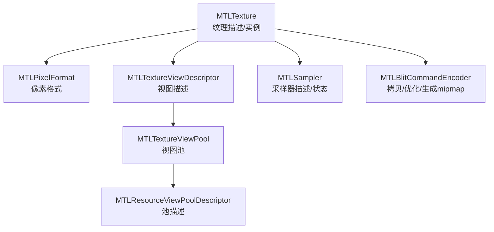
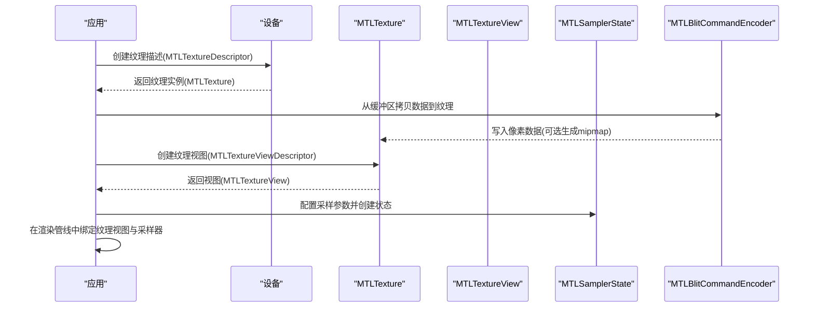
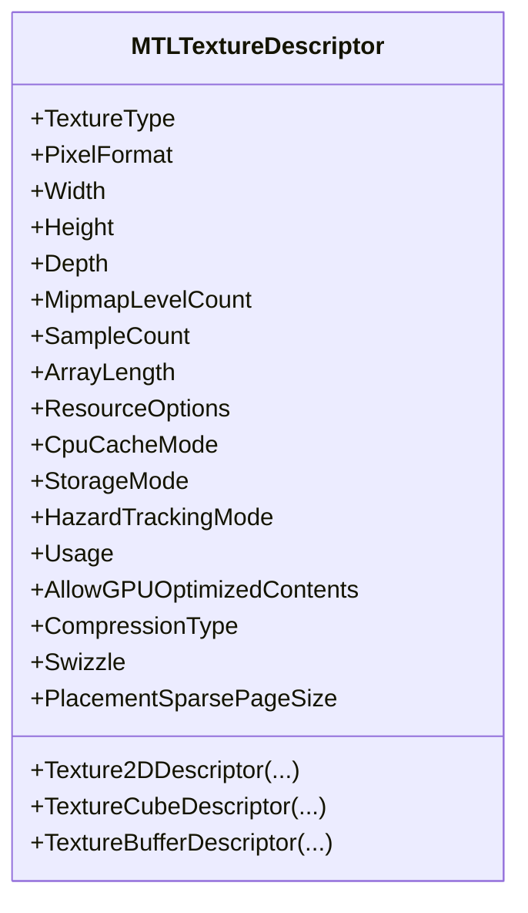
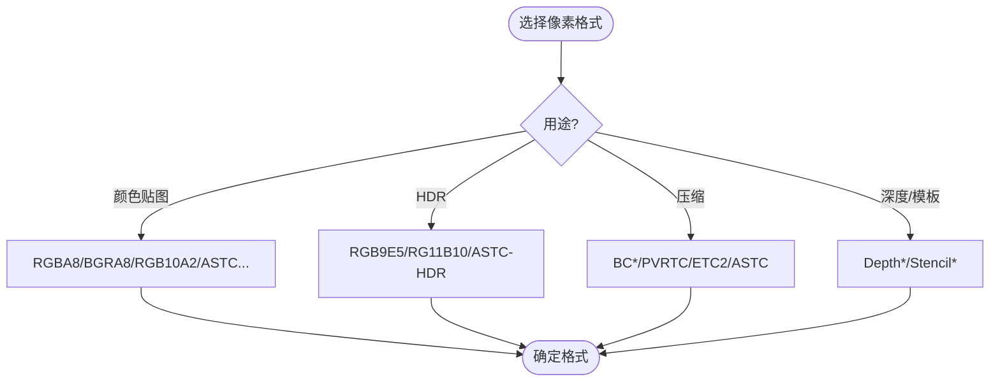
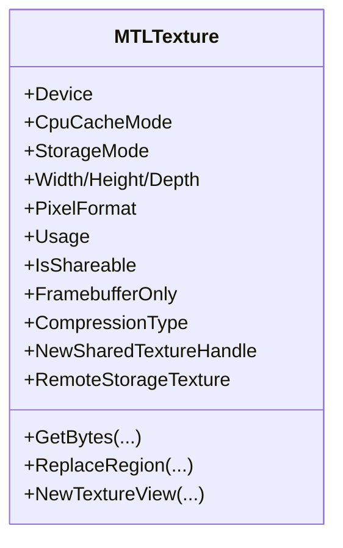
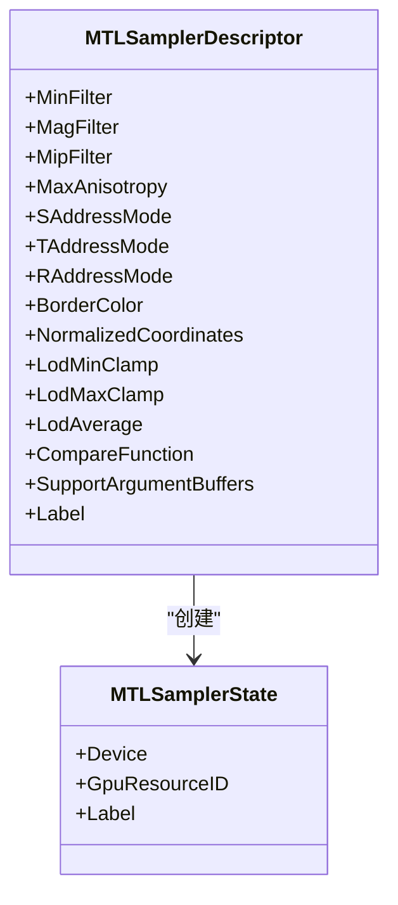
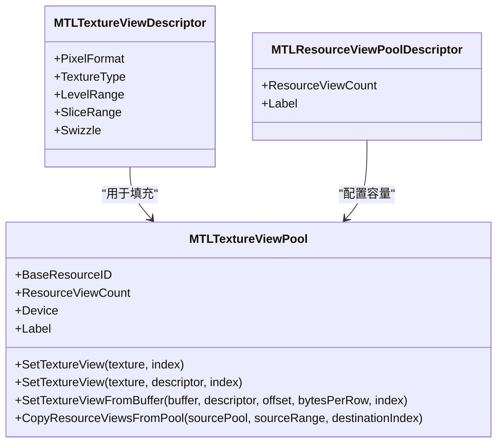
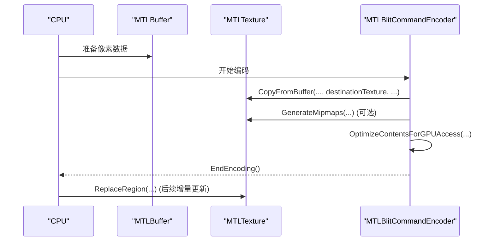
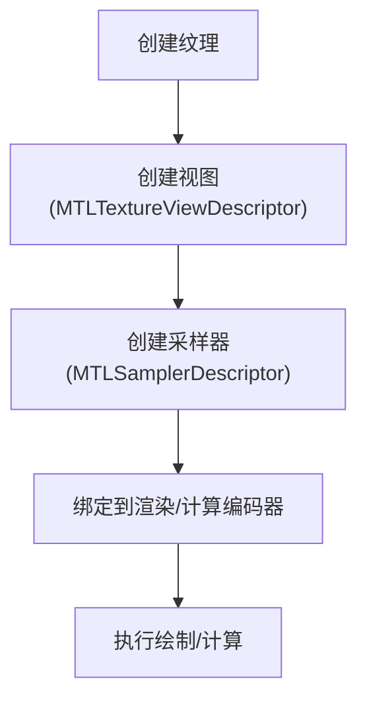
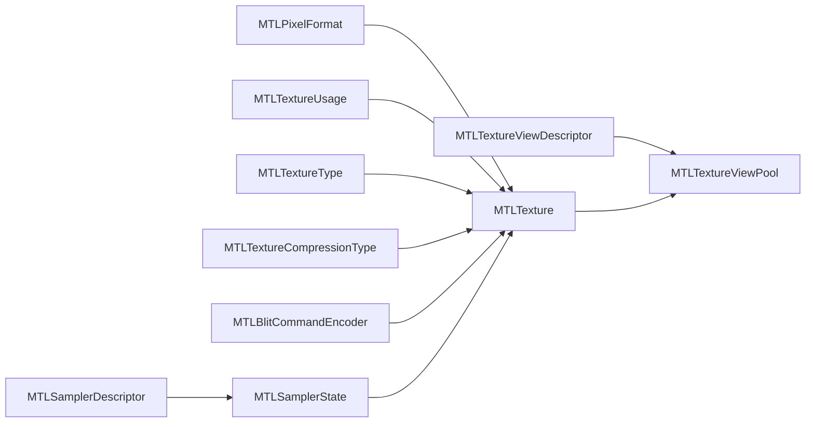

# 纹理系统

<cite>
**本文引用的文件**
- [MTLTexture.cs](file://src/SharpMetal/Metal/MTLTexture.cs)
- [MTLPixelFormat.cs](file://src/SharpMetal/Metal/MTLPixelFormat.cs)
- [MTLTextureViewDescriptor.cs](file://src/SharpMetal/Metal/MTLTextureViewDescriptor.cs)
- [MTLTextureViewPool.cs](file://src/SharpMetal/Metal/MTLTextureViewPool.cs)
- [MTLSampler.cs](file://src/SharpMetal/Metal/MTLSampler.cs)
- [MTLBlitCommandEncoder.cs](file://src/SharpMetal/Metal/MTLBlitCommandEncoder.cs)
- [MTLResourceViewPoolDescriptor.cs](file://src/SharpMetal/Metal/MTLResourceViewPoolDescriptor.cs)
</cite>

## 目录
1. [简介](#简介)
2. [项目结构](#项目结构)
3. [核心组件](#核心组件)
4. [架构总览](#架构总览)
5. [详细组件分析](#详细组件分析)
6. [依赖关系分析](#依赖关系分析)
7. [性能考量](#性能考量)
8. [故障排查指南](#故障排查指南)
9. [结论](#结论)
10. [附录：代码示例路径](#附录代码示例路径)

## 简介
本文件面向使用 SharpMetal 的开发者，系统化阐述 Metal 纹理系统的概念、格式与压缩支持、纹理对象创建与管理、像素格式选择、采样器状态配置、数据上传/下载/更新（含直接内存访问与队列操作）、纹理视图及其池化策略，以及渲染集成与优化实践。文档以仓库中实际类型与方法为依据，提供可追溯的代码片段路径，帮助读者快速定位实现细节。

## 项目结构
围绕纹理系统的关键类型分布在以下文件中：
- 纹理描述与实例：MTLTexture.cs
- 像素格式枚举：MTLPixelFormat.cs
- 纹理视图描述与池：MTLTextureViewDescriptor.cs、MTLTextureViewPool.cs、MTLResourceViewPoolDescriptor.cs
- 采样器描述与状态：MTLSampler.cs
- 纹理数据拷贝与优化：MTLBlitCommandEncoder.cs

图表来源
- [MTLTexture.cs:75-240](file://src/SharpMetal/Metal/MTLTexture.cs#L75-L240)
- [MTLPixelFormat.cs:3-144](file://src/SharpMetal/Metal/MTLPixelFormat.cs#L3-L144)
- [MTLTextureViewDescriptor.cs:6-57](file://src/SharpMetal/Metal/MTLTextureViewDescriptor.cs#L6-L57)
- [MTLTextureViewPool.cs:6-50](file://src/SharpMetal/Metal/MTLTextureViewPool.cs#L6-L50)
- [MTLResourceViewPoolDescriptor.cs:6-33](file://src/SharpMetal/Metal/MTLResourceViewPoolDescriptor.cs#L6-L33)
- [MTLSampler.cs:6-186](file://src/SharpMetal/Metal/MTLSampler.cs#L6-L186)
- [MTLBlitCommandEncoder.cs:6-215](file://src/SharpMetal/Metal/MTLBlitCommandEncoder.cs#L6-L215)

章节来源
- [MTLTexture.cs:75-240](file://src/SharpMetal/Metal/MTLTexture.cs#L75-L240)
- [MTLPixelFormat.cs:3-144](file://src/SharpMetal/Metal/MTLPixelFormat.cs#L3-L144)
- [MTLTextureViewDescriptor.cs:6-57](file://src/SharpMetal/Metal/MTLTextureViewDescriptor.cs#L6-L57)
- [MTLTextureViewPool.cs:6-50](file://src/SharpMetal/Metal/MTLTextureViewPool.cs#L6-L50)
- [MTLResourceViewPoolDescriptor.cs:6-33](file://src/SharpMetal/Metal/MTLResourceViewPoolDescriptor.cs#L6-L33)
- [MTLSampler.cs:6-186](file://src/SharpMetal/Metal/MTLSampler.cs#L6-L186)
- [MTLBlitCommandEncoder.cs:6-215](file://src/SharpMetal/Metal/MTLBlitCommandEncoder.cs#L6-L215)

## 核心组件
- MTLTextureDescriptor：用于声明纹理类型、像素格式、尺寸、mipmap、采样数、数组长度、存储模式、CPU缓存模式、使用标志、压缩类型、通道重映射等。
- MTLTexture：纹理实例，暴露维度、格式、用途、是否帧缓冲专用、共享句柄、远程视图、字节读写接口、视图创建等。
- MTLPixelFormat：涵盖通用、HDR、压缩（BC/PVRTC/ETC2/ASTC）及深度/模板格式。
- MTLSamplerDescriptor / MTLSamplerState：定义过滤、寻址、LOD、比较函数等采样行为。
- MTLTextureViewDescriptor / MTLTextureViewPool：对同一底层纹理的不同“视角”进行复用与批量管理。
- MTLBlitCommandEncoder：负责纹理与缓冲区之间的拷贝、mipmap生成、内容优化、同步与计数器采集。

章节来源
- [MTLTexture.cs:75-240](file://src/SharpMetal/Metal/MTLTexture.cs#L75-L240)
- [MTLTexture.cs:242-438](file://src/SharpMetal/Metal/MTLTexture.cs#L242-L438)
- [MTLPixelFormat.cs:3-144](file://src/SharpMetal/Metal/MTLPixelFormat.cs#L3-L144)
- [MTLSampler.cs:37-186](file://src/SharpMetal/Metal/MTLSampler.cs#L37-L186)
- [MTLTextureViewDescriptor.cs:6-57](file://src/SharpMetal/Metal/MTLTextureViewDescriptor.cs#L6-L57)
- [MTLTextureViewPool.cs:6-50](file://src/SharpMetal/Metal/MTLTextureViewPool.cs#L6-L50)
- [MTLBlitCommandEncoder.cs:52-155](file://src/SharpMetal/Metal/MTLBlitCommandEncoder.cs#L52-L155)

## 架构总览
下图展示了纹理从创建到被着色器使用的关键路径，包括数据上传、视图创建与采样器绑定。

图表来源
- [MTLTexture.cs:75-240](file://src/SharpMetal/Metal/MTLTexture.cs#L75-L240)
- [MTLTexture.cs:367-385](file://src/SharpMetal/Metal/MTLTexture.cs#L367-L385)
- [MTLBlitCommandEncoder.cs:62-100](file://src/SharpMetal/Metal/MTLBlitCommandEncoder.cs#L62-L100)
- [MTLSampler.cs:37-186](file://src/SharpMetal/Metal/MTLSampler.cs#L37-L186)

## 详细组件分析

### 纹理类型与描述
- 纹理类型：1D、1DArray、2D、2DArray、2DMultisample、Cube、CubeArray、3D、2DMultisampleArray、TextureBuffer。
- 描述符属性：像素格式、宽高深、mipmap层级数、采样数、数组长度、资源选项、CPU缓存模式、存储模式、危险跟踪模式、使用标志、GPU优化内容开关、压缩类型、通道重映射、稀疏页大小。
- 便捷构造：提供2D、立方体、缓冲纹理的描述符工厂方法。

图表来源
- [MTLTexture.cs:75-240](file://src/SharpMetal/Metal/MTLTexture.cs#L75-L240)

章节来源
- [MTLTexture.cs:75-240](file://src/SharpMetal/Metal/MTLTexture.cs#L75-L240)

### 像素格式与压缩
- 通用格式：A/R/RG/RGBA 系列，包含 Unorm/Snorm/Uint/Sint/Float 变体；BGRA/BGR 变体；RGB10A2、RG11B10、RGB9E5 等 HDR 格式。
- 压缩格式：BC1-BC7（Apple BC）、PVRTC、ETC2/EAC、ASTC（LDR/HDR）。
- 深度/模板：Depth16Unorm、Depth32Float、Stencil8、Depth24UnormStencil8、Depth32FloatStencil8、X32/X24+Stencil8。

图表来源
- [MTLPixelFormat.cs:3-144](file://src/SharpMetal/Metal/MTLPixelFormat.cs#L3-L144)

章节来源
- [MTLPixelFormat.cs:3-144](file://src/SharpMetal/Metal/MTLPixelFormat.cs#L3-L144)

### 纹理实例与生命周期
- 实例属性：设备、缓存/存储模式、堆信息、尺寸、格式、用途、是否可共享/帧缓冲专用、压缩类型、GPU资源ID、共享句柄、远程视图、通道重映射等。
- 数据访问：GetBytes/ReplaceRegion 支持指定区域、层级、切片与步长；支持多态重载以适应不同内存布局。
- 视图创建：NewTextureView 支持按格式/类型/层级范围/切片范围/通道重映射创建视图。
- 生命周期：通过 Resource/Allocation 语义关联，注意 MakeAliasable、SetPurgeableState 等高级控制。

图表来源
- [MTLTexture.cs:242-438](file://src/SharpMetal/Metal/MTLTexture.cs#L242-L438)

章节来源
- [MTLTexture.cs:242-438](file://src/SharpMetal/Metal/MTLTexture.cs#L242-L438)

### 采样器状态
- 过滤：Min/Mag（Nearest/Linear），Mip（NotMipmapped/Nearest/Linear）。
- 寻址：S/T/R（ClampToEdge、MirrorClampToEdge、Repeat、MirrorRepeat、ClampToZero、ClampToBorderColor）。
- 其他：最大各向异性、边框颜色、归一化坐标、LOD 限制、LOD 平均、比较函数、是否支持参数缓冲。
- 状态对象：由描述符创建，可在渲染管线中重复使用。

图表来源
- [MTLSampler.cs:37-186](file://src/SharpMetal/Metal/MTLSampler.cs#L37-L186)

章节来源
- [MTLSampler.cs:37-186](file://src/SharpMetal/Metal/MTLSampler.cs#L37-L186)

### 纹理视图与视图池
- 视图描述：可指定像素格式、纹理类型、层级范围、切片范围、通道重映射，从而将同一底层纹理以不同“视角”暴露给着色器。
- 视图池：集中管理多个视图的资源ID，支持从缓冲区构建视图、批量复制视图、查询基础资源ID与数量。
- 池描述：设置视图数量与标签。

图表来源
- [MTLTextureViewDescriptor.cs:6-57](file://src/SharpMetal/Metal/MTLTextureViewDescriptor.cs#L6-L57)
- [MTLTextureViewPool.cs:6-50](file://src/SharpMetal/Metal/MTLTextureViewPool.cs#L6-L50)
- [MTLResourceViewPoolDescriptor.cs:6-33](file://src/SharpMetal/Metal/MTLResourceViewPoolDescriptor.cs#L6-L33)

章节来源
- [MTLTextureViewDescriptor.cs:6-57](file://src/SharpMetal/Metal/MTLTextureViewDescriptor.cs#L6-L57)
- [MTLTextureViewPool.cs:6-50](file://src/SharpMetal/Metal/MTLTextureViewPool.cs#L6-L50)
- [MTLResourceViewPoolDescriptor.cs:6-33](file://src/SharpMetal/Metal/MTLResourceViewPoolDescriptor.cs#L6-L33)

### 数据上传、下载与更新
- 直接内存访问：纹理实例提供 GetBytes/ReplaceRegion 系列方法，支持指定 region、level、slice、bytesPerRow、bytesPerImage，适合 CPU 侧读写或局部更新。
- 队列操作模式：通过 MTLBlitCommandEncoder 执行 CopyFromBuffer/CopyFromTexture、GenerateMipmaps、OptimizeContentsFor{CPU,GPU}Access、SynchronizeTexture 等命令，避免 CPU/GPU 同步瓶颈。
- 典型流程：
  - 上传：准备 CPU 缓冲区 -> 编码 Blit 命令 -> CopyFromBuffer -> 提交命令缓冲。
  - 下载：编码 Blit 命令 -> CopyFromTexture -> 提交 -> 等待完成 -> GetBytes。
  - 更新：ReplaceRegion 或 CopyFromBuffer 仅更新子区域。
  - 优化：根据访问方向调用 OptimizeContentsFor{CPU,GPU}Access。

图表来源
- [MTLBlitCommandEncoder.cs:62-100](file://src/SharpMetal/Metal/MTLBlitCommandEncoder.cs#L62-L100)
- [MTLBlitCommandEncoder.cs:137-155](file://src/SharpMetal/Metal/MTLBlitCommandEncoder.cs#L137-L155)
- [MTLTexture.cs:347-365](file://src/SharpMetal/Metal/MTLTexture.cs#L347-L365)

章节来源
- [MTLBlitCommandEncoder.cs:52-155](file://src/SharpMetal/Metal/MTLBlitCommandEncoder.cs#L52-L155)
- [MTLTexture.cs:347-365](file://src/SharpMetal/Metal/MTLTexture.cs#L347-L365)

### 渲染集成
- 纹理视图：通过 NewTextureView 为着色器提供受限的层级/切片/格式视角，便于多重采样、数组纹理或格式转换。
- 采样器：在着色器阶段绑定 MTLSamplerState，决定采样行为（过滤、寻址、LOD、比较函数等）。
- 管线：将纹理视图与采样器绑定至渲染/计算命令编码器，参与着色器采样。

图表来源
- [MTLTexture.cs:367-385](file://src/SharpMetal/Metal/MTLTexture.cs#L367-L385)
- [MTLSampler.cs:37-186](file://src/SharpMetal/Metal/MTLSampler.cs#L37-L186)

章节来源
- [MTLTexture.cs:367-385](file://src/SharpMetal/Metal/MTLTexture.cs#L367-L385)
- [MTLSampler.cs:37-186](file://src/SharpMetal/Metal/MTLSampler.cs#L37-L186)

## 依赖关系分析
- MTLTexture 依赖 MTLPixelFormat、MTLTextureType、MTLTextureUsage、MTLTextureCompressionType 等枚举与结构。
- 纹理视图体系：MTLTextureViewDescriptor 与 MTLTextureViewPool 共同构成视图管理与复用机制。
- 数据通路：MTLBlitCommandEncoder 作为纹理与缓冲区之间的桥梁，提供高效的数据搬运与优化能力。
- 采样器：MTLSamplerDescriptor/State 独立于纹理但与其配合工作，影响着色器采样结果。

图表来源
- [MTLTexture.cs:75-240](file://src/SharpMetal/Metal/MTLTexture.cs#L75-L240)
- [MTLTexture.cs:242-438](file://src/SharpMetal/Metal/MTLTexture.cs#L242-L438)
- [MTLTextureViewDescriptor.cs:6-57](file://src/SharpMetal/Metal/MTLTextureViewDescriptor.cs#L6-L57)
- [MTLTextureViewPool.cs:6-50](file://src/SharpMetal/Metal/MTLTextureViewPool.cs#L6-L50)
- [MTLBlitCommandEncoder.cs:62-100](file://src/SharpMetal/Metal/MTLBlitCommandEncoder.cs#L62-L100)
- [MTLSampler.cs:37-186](file://src/SharpMetal/Metal/MTLSampler.cs#L37-L186)

章节来源
- [MTLTexture.cs:75-240](file://src/SharpMetal/Metal/MTLTexture.cs#L75-L240)
- [MTLTexture.cs:242-438](file://src/SharpMetal/Metal/MTLTexture.cs#L242-L438)
- [MTLTextureViewDescriptor.cs:6-57](file://src/SharpMetal/Metal/MTLTextureViewDescriptor.cs#L6-L57)
- [MTLTextureViewPool.cs:6-50](file://src/SharpMetal/Metal/MTLTextureViewPool.cs#L6-L50)
- [MTLBlitCommandEncoder.cs:62-100](file://src/SharpMetal/Metal/MTLBlitCommandEncoder.cs#L62-L100)
- [MTLSampler.cs:37-186](file://src/SharpMetal/Metal/MTLSampler.cs#L37-L186)

## 性能考量
- 选择合适的像素格式：颜色贴图优先 RGBA8/BGRA8 或 ASTC 压缩；HDR 场景考虑 RGB9E5/RG11B10/ASTC-HDR；深度/模板使用对应格式。
- 合理使用 mipmap：启用后通过 Blit 生成，减少过采样时的带宽与缓存压力。
- 存储模式与缓存模式：根据 CPU/GPU 访问频率选择 StorageMode/CpuCacheMode，必要时使用 AllowGPUOptimizedContents。
- 批量视图管理：使用 MTLTextureViewPool 减少重复创建开销，并通过 SetTextureViewFromBuffer 直接从缓冲区构建视图。
- 数据搬运：尽量使用 Blit 命令批量拷贝与优化，避免频繁 CPU-GPU 同步；仅在必要时调用 SynchronizeTexture。
- 访问优化：在 CPU 读取前调用 OptimizeContentsForCPUAccess，在 GPU 写入前调用 OptimizeContentsForGPUAccess。

[本节为通用指导，不直接分析具体文件]

## 故障排查指南
- 纹理无法从 CPU 读取：确认已调用 OptimizeContentsForCPUAccess，并在获取数据前确保命令缓冲已执行完毕。
- 纹理写入未生效：检查 Usage 是否包含 RenderTarget/ShaderWrite 等标志；确认在写入前调用 OptimizeContentsForGPUAccess。
- 采样异常：核对采样器的 Min/Mag/Mip 过滤、寻址模式、LOD 限制与纹理是否匹配（如未生成 mipmap 却使用线性 mip 过滤）。
- 视图无效：确保 MTLTextureViewDescriptor 的层级/切片范围合法，且与底层纹理类型兼容。
- 数据错位：检查 bytesPerRow/bytesPerImage 与实际内存布局一致；使用 ReplaceRegion 时确保 region 与 level/slice 正确。
- 性能抖动：避免每帧创建大量纹理/视图；使用视图池与资源池；合并多次拷贝为一次 Blit 编码。

章节来源
- [MTLBlitCommandEncoder.cs:137-155](file://src/SharpMetal/Metal/MTLBlitCommandEncoder.cs#L137-L155)
- [MTLTexture.cs:347-365](file://src/SharpMetal/Metal/MTLTexture.cs#L347-L365)
- [MTLSampler.cs:37-186](file://src/SharpMetal/Metal/MTLSampler.cs#L37-L186)
- [MTLTextureViewDescriptor.cs:6-57](file://src/SharpMetal/Metal/MTLTextureViewDescriptor.cs#L6-L57)

## 结论
SharpMetal 提供了完整的纹理抽象：从描述、实例、视图到采样器与数据通路，覆盖从创建、数据上传/下载、更新到渲染集成的全流程。通过合理选择像素格式、启用 mipmap、使用视图池与 Blit 命令优化数据搬运，可以在保证画质的同时获得稳定高效的性能表现。建议在实际项目中结合上述最佳实践，持续评估内存占用与带宽使用，逐步调优。

[本节为总结性内容，不直接分析具体文件]

## 附录：代码示例路径
以下为与纹理系统相关的关键实现位置，供进一步查阅与对照：
- 纹理描述与实例：[MTLTexture.cs:75-240](file://src/SharpMetal/Metal/MTLTexture.cs#L75-L240)、[MTLTexture.cs:242-438](file://src/SharpMetal/Metal/MTLTexture.cs#L242-L438)
- 像素格式：[MTLPixelFormat.cs:3-144](file://src/SharpMetal/Metal/MTLPixelFormat.cs#L3-L144)
- 采样器：[MTLSampler.cs:37-186](file://src/SharpMetal/Metal/MTLSampler.cs#L37-L186)
- 纹理视图与池：[MTLTextureViewDescriptor.cs:6-57](file://src/SharpMetal/Metal/MTLTextureViewDescriptor.cs#L6-L57)、[MTLTextureViewPool.cs:6-50](file://src/SharpMetal/Metal/MTLTextureViewPool.cs#L6-L50)、[MTLResourceViewPoolDescriptor.cs:6-33](file://src/SharpMetal/Metal/MTLResourceViewPoolDescriptor.cs#L6-L33)
- 数据上传/下载/优化：[MTLBlitCommandEncoder.cs:62-100](file://src/SharpMetal/Metal/MTLBlitCommandEncoder.cs#L62-L100)、[MTLBlitCommandEncoder.cs:137-155](file://src/SharpMetal/Metal/MTLBlitCommandEncoder.cs#L137-L155)
- 纹理字节读写：[MTLTexture.cs:347-365](file://src/SharpMetal/Metal/MTLTexture.cs#L347-L365)