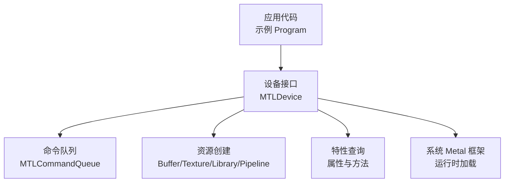
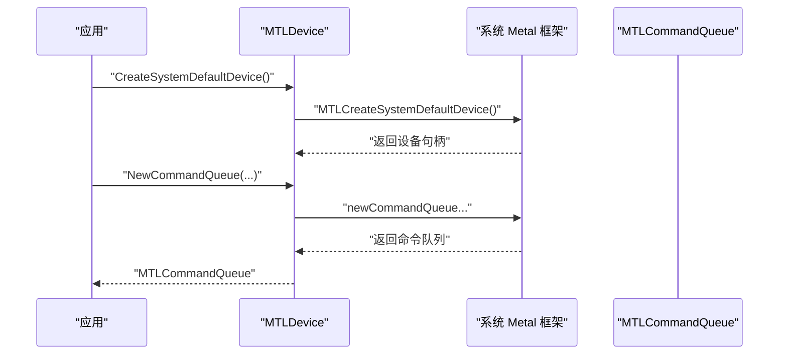
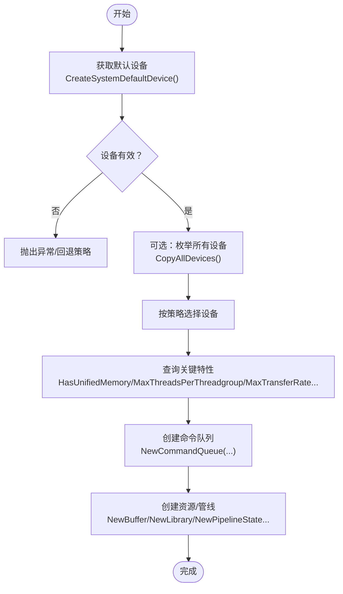
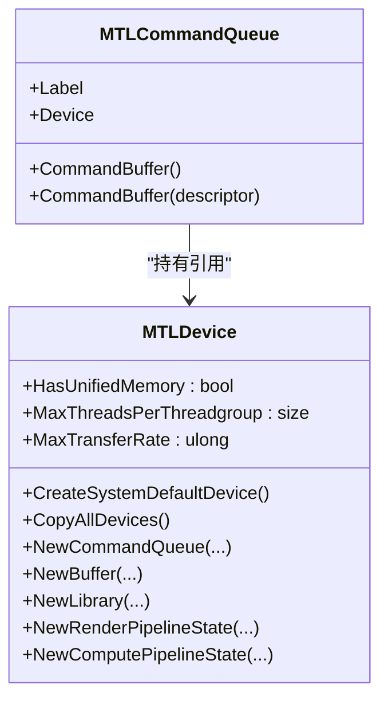

# 设备管理

<cite>
**本文引用的文件**
- [MTLDevice.cs](file://src/SharpMetal/Metal/MTLDevice.cs)
- [Program.cs](file://samples/SharpMetal.Sample/Program.cs)
- [MTLCommandQueue.cs](file://src/SharpMetal/Metal/MTLCommandQueue.cs)
- [README.md](file://README.md)
</cite>

## 目录
1. [简介](#简介)
2. [项目结构](#项目结构)
3. [核心组件](#核心组件)
4. [架构总览](#架构总览)
5. [详细组件分析](#详细组件分析)
6. [依赖关系分析](#依赖关系分析)
7. [性能考量](#性能考量)
8. [故障排查指南](#故障排查指南)
9. [结论](#结论)
10. [附录](#附录)

## 简介
本章节面向使用 SharpMetal 进行 Metal 设备管理的开发者，聚焦 MTLDevice 的核心能力：设备发现、特性查询与配置选项。文档将说明如何获取系统默认设备、枚举所有可用设备，并检查硬件特性与支持功能；解释统一内存架构、最大线程组大小、传输速率等关键指标的含义与使用场景；提供完整的初始化流程、特性检测逻辑与设备选择策略的参考路径；并给出性能优化建议与不同设备类型的适配方案。

## 项目结构
SharpMetal 在 src/SharpMetal/Metal 下提供对 Apple Metal 框架的底层绑定，其中 MTLDevice 是设备管理的入口。示例工程 samples/SharpMetal.Sample 展示了最小可用的设备初始化与共享缓冲区读写流程。

图表来源
- [MTLDevice.cs:306-319](file://src/SharpMetal/Metal/MTLDevice.cs#L306-L319)
- [MTLCommandQueue.cs:44-68](file://src/SharpMetal/Metal/MTLCommandQueue.cs#L44-L68)

章节来源
- [README.md:1-23](file://README.md#L1-L23)

## 核心组件
- MTLDevice：设备抽象，提供设备发现、特性查询、资源创建与管线构建能力。
- MTLCommandQueue：基于设备的命令队列，用于提交命令缓冲。
- 基础类型与结构体：如 MTLSize、MTLOrigin、MTLRegion 等，用于描述尺寸、区域与采样位置等。

章节来源
- [MTLDevice.cs:187-319](file://src/SharpMetal/Metal/MTLDevice.cs#L187-L319)
- [MTLCommandQueue.cs:44-68](file://src/SharpMetal/Metal/MTLCommandQueue.cs#L44-L68)
- [MTLTypes.cs:47-108](file://src/SharpMetal/Metal/MTLTypes.cs#L47-L108)

## 架构总览
下图展示从应用到系统 Metal 框架的设备访问路径，以及设备与命令队列的关系。

图表来源
- [MTLDevice.cs:306-339](file://src/SharpMetal/Metal/MTLDevice.cs#L306-L339)
- [MTLCommandQueue.cs:44-68](file://src/SharpMetal/Metal/MTLCommandQueue.cs#L44-L68)

## 详细组件分析

### 设备发现与枚举
- 获取系统默认设备：通过静态方法 CreateSystemDefaultDevice 调用系统 API 获取当前首选设备。若返回空指针，表示无可用 Metal 设备。
- 枚举所有设备：通过 CopyAllDevices 获取 NSArray，包含系统中所有可用设备对象，可进一步遍历筛选。

使用要点
- 在获取默认设备后应校验 NativePtr 是否为空，避免后续操作崩溃。
- 枚举设备时可根据名称、位置、是否内置等属性做选择策略。

章节来源
- [MTLDevice.cs:306-319](file://src/SharpMetal/Metal/MTLDevice.cs#L306-L319)
- [Program.cs:21-27](file://samples/SharpMetal.Sample/Program.cs#L21-L27)

### 特性查询与能力检测
MTLDevice 暴露大量只读属性与方法，用于判断硬件能力与限制，常见包括：
- 内存与架构
  - HasUnifiedMemory：是否采用统一内存架构，影响 CPU/GPU 数据共享策略。
  - RecommendedMaxWorkingSetSize：推荐工作集大小，指导内存占用上限。
  - Architecture.Name：架构名称，可用于平台/代际识别。
- 计算与并行
  - MaxThreadsPerThreadgroup：每个线程组的最大线程数，决定线程块划分上限。
  - MaxThreadgroupMemoryLength：线程组可使用的最大共享内存长度。
  - SupportsFamily / SupportsTextureSampleCount：GPU 家族与采样数支持。
- I/O 与带宽
  - MaxTransferRate：最大传输速率，评估带宽瓶颈。
  - Location / LocationNumber / PeerGroupID / PeerIndex / PeerCount：设备物理位置与多设备拓扑信息。
- 纹理与格式
  - ReadWriteTextureSupport：读写纹理支持等级。
  - Depth24Stencil8PixelFormatSupported：深度模板格式支持。
  - MinimumLinearTextureAlignmentForPixelFormat / MinimumTextureBufferAlignmentForPixelFormat：像素格式对齐要求。
- 渲染与着色器
  - Supports32BitFloatFiltering / Supports32BitMSAA / SupportsQueryTextureLOD / SupportsBCTextureCompression / SupportsPullModelInterpolation / SupportsShaderBarycentricCoordinates：各类渲染与采样能力。
  - RasterOrderGroupsSupported：光栅序分组支持。
  - ProgrammableSamplePositionsSupported：可编程采样点支持。
- 高级特性
  - SupportsRaytracing / SupportsFunctionPointers / SupportsDynamicLibraries / SupportsRenderDynamicLibraries / SupportsPlacementSparse / SupportsPrimitiveMotionBlur / SupportsVertexAmplificationCount：光线追踪、动态库、稀疏放置、运动模糊、顶点放大等。
  - ShouldMaximizeConcurrentCompilation / MaximumConcurrentCompilationTaskCount：编译并发控制。
  - CounterSets / SupportsCounterSampling：性能计数器支持。
  - QueryTimestampFrequency：时间戳频率，用于精确计时。

使用要点
- 在创建管线或分配资源前，先查询相关能力，避免在不支持的平台上失败。
- 对于跨平台/跨设备差异较大的特性，建议以“能力探测 + 降级策略”的方式组织代码。

章节来源
- [MTLDevice.cs:196-304](file://src/SharpMetal/Metal/MTLDevice.cs#L196-L304)
- [MTLDevice.cs:456-474](file://src/SharpMetal/Metal/MTLDevice.cs#L456-L474)
- [MTLDevice.cs:586-599](file://src/SharpMetal/Metal/MTLDevice.cs#L586-L599)
- [MTLDevice.cs:696-704](file://src/SharpMetal/Metal/MTLDevice.cs#L696-L704)

### 资源与管线创建
- 命令队列：NewCommandQueue 提供多种重载，可按需设置最大命令缓冲数量或描述符。
- 缓冲区：NewBuffer 支持固定长度、字节拷贝、稀疏页大小等多种方式。
- 纹理：NewTexture/NewSharedTexture 支持常规与共享纹理创建。
- 库与管线：NewDefaultLibrary/NewLibrary 加载 Metal 库；NewRenderPipelineState/NewComputePipelineState 创建渲染/计算管线。
- 其他：NewSamplerState、NewDepthStencilState、NewFence、NewEvent 等。

使用要点
- 根据设备能力选择合适的资源选项（如存储模式、对齐、采样数）。
- 对频繁创建的轻量对象（如命令缓冲）建议使用池化或复用策略。

章节来源
- [MTLDevice.cs:321-454](file://src/SharpMetal/Metal/MTLDevice.cs#L321-L454)
- [MTLCommandQueue.cs:44-68](file://src/SharpMetal/Metal/MTLCommandQueue.cs#L44-L68)

### 设备选择策略
- 默认设备优先：大多数应用直接使用 CreateSystemDefaultDevice。
- 多设备场景：通过 CopyAllDevices 枚举，结合 Location（内置/插槽/外部）、LowPower（低功耗）、Removable（可移除）等属性筛选目标设备。
- 能力导向：根据业务需求（如光线追踪、高倍率 MSAA、特定像素格式）过滤设备。
- 拓扑感知：PeerGroupID/PeerIndex/PeerCount 用于多 GPU 协同与数据传输优化。

章节来源
- [MTLDevice.cs:196-239](file://src/SharpMetal/Metal/MTLDevice.cs#L196-L239)
- [MTLDevice.cs:316-319](file://src/SharpMetal/Metal/MTLDevice.cs#L316-L319)

### 初始化流程与特性检测（参考路径）
以下流程图展示典型初始化与特性检测步骤，具体实现请参考对应行号。

图表来源
- [MTLDevice.cs:306-339](file://src/SharpMetal/Metal/MTLDevice.cs#L306-L339)
- [MTLDevice.cs:196-304](file://src/SharpMetal/Metal/MTLDevice.cs#L196-L304)

章节来源
- [Program.cs:21-45](file://samples/SharpMetal.Sample/Program.cs#L21-L45)
- [MTLDevice.cs:306-339](file://src/SharpMetal/Metal/MTLDevice.cs#L306-L339)

## 依赖关系分析
- MTLDevice 直接依赖 Objective-C 运行时与系统 Metal 框架，通过 LibraryImport 调用原生函数。
- MTLCommandQueue 依赖 MTLDevice，作为其子资源存在。
- 示例程序依赖 MTLDevice 与 ObjectiveCRuntime 进行资源释放。

图表来源
- [MTLDevice.cs:187-339](file://src/SharpMetal/Metal/MTLDevice.cs#L187-L339)
- [MTLCommandQueue.cs:44-68](file://src/SharpMetal/Metal/MTLCommandQueue.cs#L44-L68)

章节来源
- [MTLDevice.cs:187-339](file://src/SharpMetal/Metal/MTLDevice.cs#L187-L339)
- [MTLCommandQueue.cs:44-68](file://src/SharpMetal/Metal/MTLCommandQueue.cs#L44-L68)

## 性能考量
- 统一内存架构（HasUnifiedMemory）
  - 含义：CPU 与 GPU 共享同一内存空间，减少显式拷贝开销。
  - 使用场景：频繁 CPU-GPU 数据交换、低延迟同步。
  - 优化建议：利用共享内存模式，避免不必要的复制；合理设置资源存储模式。
- 最大线程组大小（MaxThreadsPerThreadgroup）
  - 含义：单线程组最多可包含的线程数，影响并行粒度与寄存器/共享内存压力。
  - 使用场景：计算内核线程块划分、内存合并访问优化。
  - 优化建议：根据算法访存模式调整线程组维度，避免超出限制导致调度退化。
- 最大传输速率（MaxTransferRate）
  - 含义：设备间或设备与主机间的理论带宽上限。
  - 使用场景：批量数据传输、纹理/缓冲区更新频率规划。
  - 优化建议：合并小写入为大块传输；使用异步命令队列与批处理。
- 编译与管线
  - ShouldMaximizeConcurrentCompilation / MaximumConcurrentCompilationTaskCount：在高负载下提高编译吞吐，但可能增加峰值内存。
  - 建议：启动阶段预编译常用管线，运行时按需增量编译。
- 计数与计时
  - CounterSets / SupportsCounterSampling / QueryTimestampFrequency：用于性能剖析与热点定位。
  - 建议：仅在调试或性能分析阶段启用，避免生产环境开销。

[本节为通用性能讨论，不直接分析具体文件]

## 故障排查指南
- 无可用设备
  - 现象：CreateSystemDefaultDevice 返回空指针。
  - 排查：确认运行平台（macOS/iOS/Mac Catalyst），检查系统 Metal 驱动与权限。
  - 参考路径：[Program.cs:16-27](file://samples/SharpMetal.Sample/Program.cs#L16-L27)
- 共享缓冲区分配失败
  - 现象：NewBuffer 返回空或 Contents 为空。
  - 排查：检查资源选项（如 ResourceStorageModeShared）与设备能力；确认内存充足。
  - 参考路径：[Program.cs:27-31](file://samples/SharpMetal.Sample/Program.cs#L27-L31)
- 特性不支持
  - 现象：创建管线或启用某特性失败。
  - 排查：提前查询 Supports* 系列方法与属性；准备降级路径。
  - 参考路径：[MTLDevice.cs:239-304](file://src/SharpMetal/Metal/MTLDevice.cs#L239-L304)
- 资源释放
  - 现象：内存泄漏或崩溃。
  - 排查：确保在 finally 中释放 NativePtr；遵循显式所有权模型。
  - 参考路径：[Program.cs:41-45](file://samples/SharpMetal.Sample/Program.cs#L41-L45)

章节来源
- [Program.cs:16-45](file://samples/SharpMetal.Sample/Program.cs#L16-L45)
- [MTLDevice.cs:239-304](file://src/SharpMetal/Metal/MTLDevice.cs#L239-L304)

## 结论
SharpMetal 的 MTLDevice 提供了完整的设备发现、特性查询与资源管理能力。通过 CreateSystemDefaultDevice 与 CopyAllDevices 可灵活选择设备；借助丰富的属性与方法可精准判断硬件能力，从而制定稳健的初始化流程与降级策略。结合统一内存、线程组大小、传输速率等关键指标，可在不同设备上实现高性能与良好兼容性。建议在开发中坚持“能力探测 + 策略选择 + 资源复用”的模式，以获得更稳定的表现。

## 附录
- 快速参考
  - 获取默认设备：CreateSystemDefaultDevice
  - 枚举设备：CopyAllDevices
  - 创建命令队列：NewCommandQueue
  - 创建缓冲区：NewBuffer
  - 加载库/管线：NewLibrary / NewRenderPipelineState / NewComputePipelineState
  - 关键特性：HasUnifiedMemory / MaxThreadsPerThreadgroup / MaxTransferRate / Supports* 系列

章节来源
- [MTLDevice.cs:306-454](file://src/SharpMetal/Metal/MTLDevice.cs#L306-L454)
- [Program.cs:21-45](file://samples/SharpMetal.Sample/Program.cs#L21-L45)