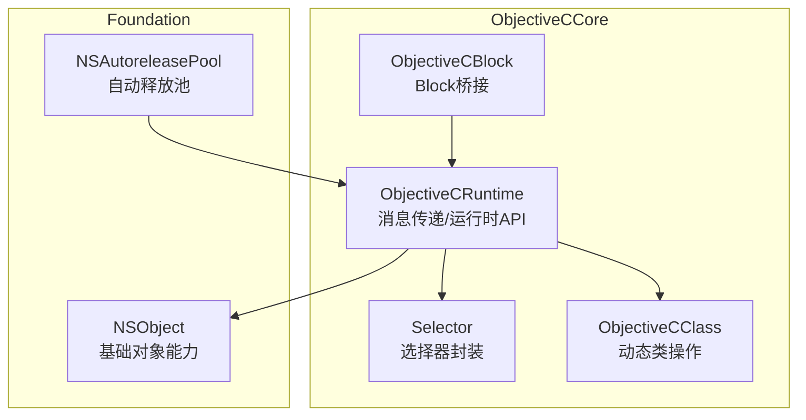
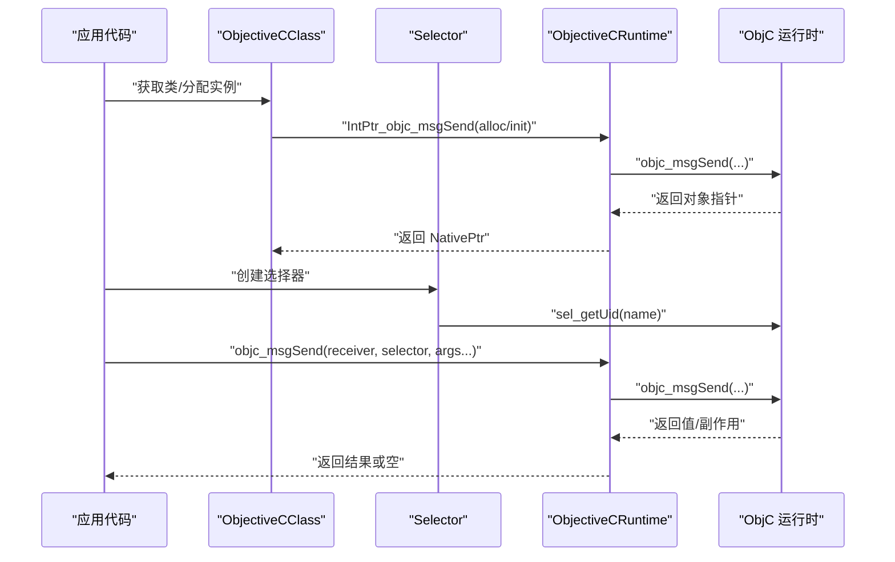
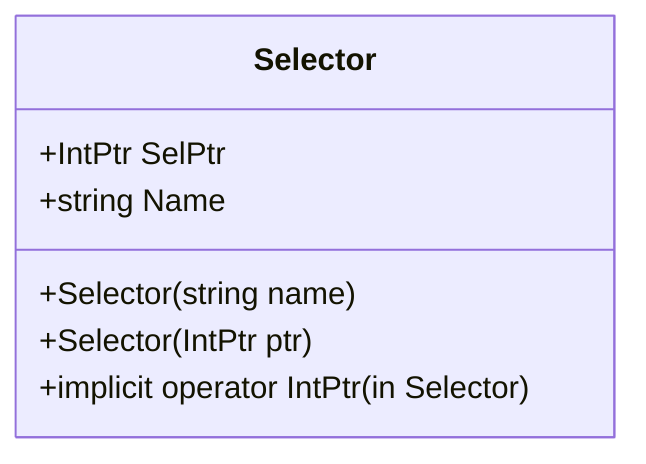
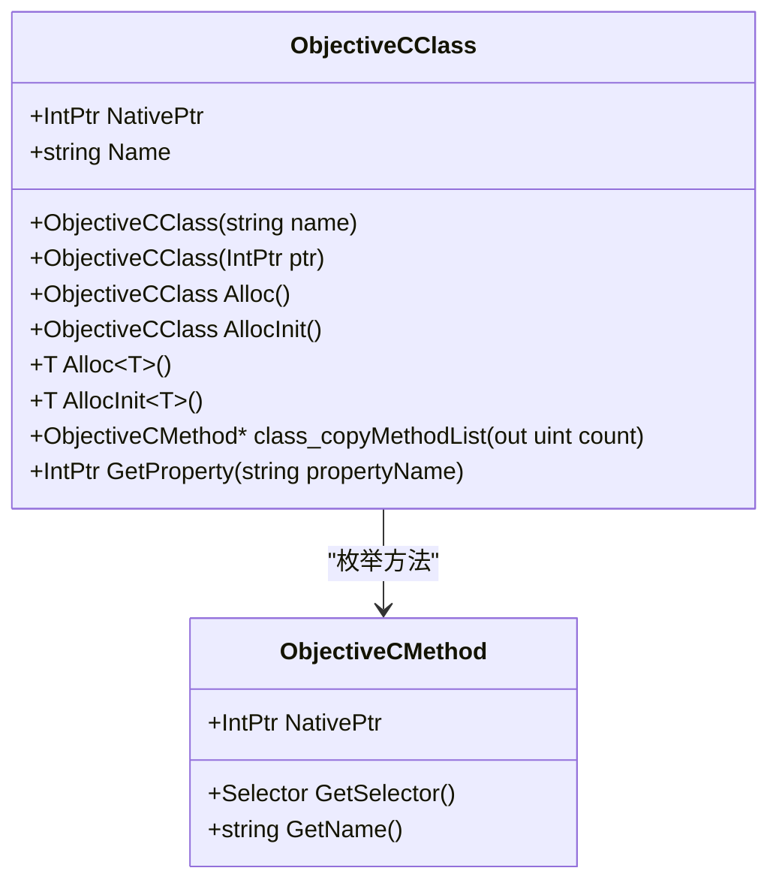
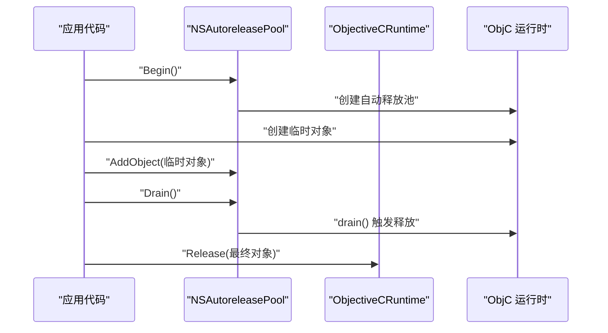
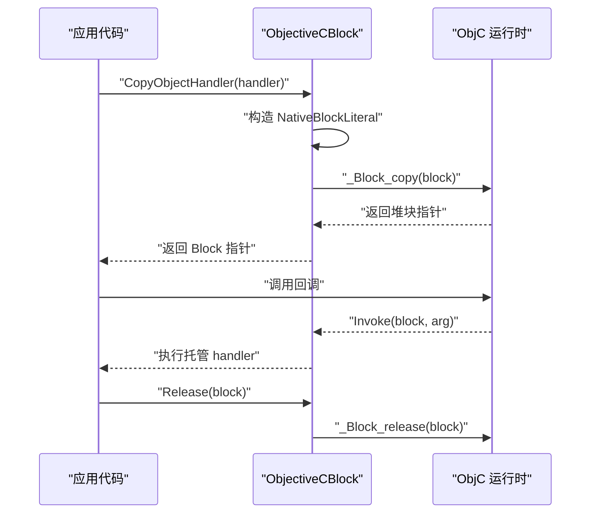
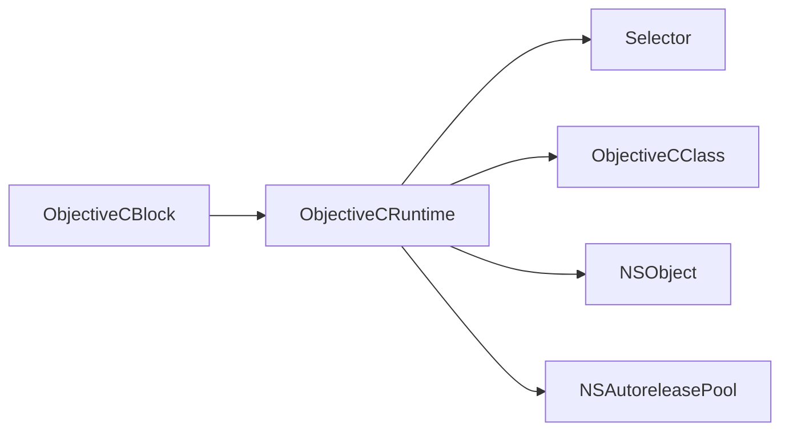

# Objective-C 运行时基础

<cite>
**本文引用的文件**
- [ObjectiveCRuntime.cs](file://src/SharpMetal/ObjectiveCCore/ObjectiveCRuntime.cs)
- [ObjectiveCClass.cs](file://src/SharpMetal/ObjectiveCCore/ObjectiveCClass.cs)
- [Selector.cs](file://src/SharpMetal/ObjectiveCCore/Selector.cs)
- [ObjectiveCBlock.cs](file://src/SharpMetal/ObjectiveCCore/ObjectiveCBlock.cs)
- [NSObject.cs](file://src/SharpMetal/Foundation/NSObject.cs)
- [NSAutoreleasePool.cs](file://src/SharpMetal/Foundation/NSAutoreleasePool.cs)
- [Program.cs](file://samples/SharpMetal.Sample/Program.cs)
</cite>

## 目录
1. [简介](#简介)
2. [项目结构](#项目结构)
3. [核心组件](#核心组件)
4. [架构总览](#架构总览)
5. [详细组件分析](#详细组件分析)
6. [依赖关系分析](#依赖关系分析)
7. [性能考量](#性能考量)
8. [故障排查指南](#故障排查指南)
9. [结论](#结论)
10. [附录](#附录)

## 简介
本文件面向需要在 C# 中安全、高效地调用 Objective-C 运行时的开发者，系统性阐述 SharpMetal 对 Objective-C 运行时（ObjC Runtime）的封装与使用方式。重点覆盖：
- 消息传递系统：objc_msgSend 函数族、参数类型转换与返回值处理
- 选择器管理：Selector 的创建与名称获取
- 动态类型系统：ObjectiveCClass 的动态类操作（获取类、分配实例、方法列表等）
- 内存管理：retain/release 计数与自动释放池 NSAutoreleasePool
- 实战示例：如何调用原生方法、处理不同类型参数和返回值
- 性能优化建议与常见陷阱规避

## 项目结构
SharpMetal 将 Objective-C 运行时相关能力集中在 ObjectiveCCore 命名空间下，并通过 Foundation 层提供常用对象与工具。关键文件职责如下：
- ObjectiveCRuntime.cs：底层 P/Invoke 声明，集中暴露 objc_msgSend 各种重载、内存管理与运行时查询 API
- Selector.cs：选择器的封装，支持从字符串创建并获取名称
- ObjectiveCClass.cs：动态类操作封装，包括获取类、分配实例、方法枚举等
- ObjectiveCBlock.cs：为异步回调构造最小化的 Objective-C Block，避免直接传托管委托指针导致崩溃
- NSObject.cs：基础对象能力（哈希、描述、相等性、响应检查等）
- NSAutoreleasePool.cs：自动释放池封装，便于在托管代码中管理 ObjC 对象的短期生命周期



图表来源
- [ObjectiveCRuntime.cs:33-839](file://src/SharpMetal/ObjectiveCCore/ObjectiveCRuntime.cs#L33-L839)
- [Selector.cs:5-43](file://src/SharpMetal/ObjectiveCCore/Selector.cs#L5-L43)
- [ObjectiveCClass.cs:18-87](file://src/SharpMetal/ObjectiveCCore/ObjectiveCClass.cs#L18-L87)
- [ObjectiveCBlock.cs:12-165](file://src/SharpMetal/ObjectiveCCore/ObjectiveCBlock.cs#L12-L165)
- [NSObject.cs:48-90](file://src/SharpMetal/Foundation/NSObject.cs#L48-L90)
- [NSAutoreleasePool.cs:5-39](file://src/SharpMetal/Foundation/NSAutoreleasePool.cs#L5-L39)

章节来源
- [ObjectiveCRuntime.cs:33-839](file://src/SharpMetal/ObjectiveCCore/ObjectiveCRuntime.cs#L33-L839)
- [Selector.cs:5-43](file://src/SharpMetal/ObjectiveCCore/Selector.cs#L5-L43)
- [ObjectiveCClass.cs:18-87](file://src/SharpMetal/ObjectiveCCore/ObjectiveCClass.cs#L18-L87)
- [ObjectiveCBlock.cs:12-165](file://src/SharpMetal/ObjectiveCCore/ObjectiveCBlock.cs#L12-L165)
- [NSObject.cs:48-90](file://src/SharpMetal/Foundation/NSObject.cs#L48-L90)
- [NSAutoreleasePool.cs:5-39](file://src/SharpMetal/Foundation/NSAutoreleasePool.cs#L5-L39)

## 核心组件
- 消息传递与类型转换
  - 通过大量 objc_msgSend 重载，按返回值与参数类型精确匹配原生签名，避免手动编组错误
  - 支持基本类型（bool/int/long/float/double/ulong/ushort/byte）、结构体（NSRect/CGSize/CGRect/MTLSize/NSRange 等）、指针与 ref 参数
  - 提供泛型重载以返回值类型为 struct 的场景，内部通过指针重解释实现零拷贝转换
- 选择器管理
  - Selector 封装 sel_getUid/sel_getName，支持从字符串创建选择器并获取其名称
- 动态类操作
  - ObjectiveCClass 封装 class_getName/class_copyMethodList/class_addMethod 等，支持获取类名、枚举方法、添加方法（需配合 SEL 与 IMP）
  - 提供 Alloc/AllocInit 及泛型版本，简化实例创建与初始化流程
- 内存管理
  - Retain/Release/GetRetainCount 直接映射到运行时
  - NSAutoreleasePool 封装 begin/drain/addObject，用于短生命周期对象的自动释放
- Block 桥接
  - ObjectiveCBlock 构造最小化 Block 字面量，包装托管 Action<IntPtr, IntPtr> 回调，避免 PAC 崩溃

章节来源
- [ObjectiveCRuntime.cs:118-839](file://src/SharpMetal/ObjectiveCCore/ObjectiveCRuntime.cs#L118-L839)
- [Selector.cs:5-43](file://src/SharpMetal/ObjectiveCCore/Selector.cs#L5-L43)
- [ObjectiveCClass.cs:18-87](file://src/SharpMetal/ObjectiveCCore/ObjectiveCClass.cs#L18-L87)
- [NSAutoreleasePool.cs:5-39](file://src/SharpMetal/Foundation/NSAutoreleasePool.cs#L5-L39)
- [ObjectiveCBlock.cs:12-165](file://src/SharpMetal/ObjectiveCCore/ObjectiveCBlock.cs#L12-L165)

## 架构总览
下图展示了从 C# 调用到 ObjC 运行时的整体路径：C# 层通过 ObjectiveCRuntime 的 P/Invoke 调用 objc_msgSend；Selector 负责选择器解析；ObjectiveCClass 提供类级操作；Foundation 层提供常用对象与自动释放池；ObjectiveCBlock 用于回调桥接。



图表来源
- [ObjectiveCClass.cs:54-77](file://src/SharpMetal/ObjectiveCCore/ObjectiveCClass.cs#L54-L77)
- [ObjectiveCRuntime.cs:118-839](file://src/SharpMetal/ObjectiveCCore/ObjectiveCRuntime.cs#L118-L839)
- [Selector.cs:20-39](file://src/SharpMetal/ObjectiveCCore/Selector.cs#L20-L39)

## 详细组件分析

### 消息传递系统（objc_msgSend 函数族）
- 设计要点
  - 针对每种返回值与参数组合提供独立重载，确保 ABI 正确匹配
  - 对于结构体返回值，使用 objc_msgSend_stret 或特定重载保证栈上返回语义
  - 支持 ref 参数与复杂结构体（如 NSRange、MTLSize、CGRect 等）
- 典型调用模式
  - 无参/单参/多参方法调用
  - 布尔、整型、浮点、指针、字符串等不同返回类型的处理
  - 通过泛型重载将返回的 IntPtr 安全转换为值类型结构体

```mermaid
flowchart TD
Start(["调用入口"]) --> Choose["根据返回值与参数选择重载"]
Choose --> Call["调用对应 objc_msgSend 重载"]
Call --> Return{"返回值类型?"}
Return --> |void| End(["结束"])
Return --> |struct| Cast["指针重解释为结构体"]
Return --> |pointer| End
Return --> |bool|int| End
Cast --> End
```

图表来源
- [ObjectiveCRuntime.cs:118-839](file://src/SharpMetal/ObjectiveCCore/ObjectiveCRuntime.cs#L118-L839)

章节来源
- [ObjectiveCRuntime.cs:118-839](file://src/SharpMetal/ObjectiveCCore/ObjectiveCRuntime.cs#L118-L839)

### 选择器管理（Selector）
- 功能
  - 从字符串创建选择器（sel_getUid），失败时输出诊断信息
  - 获取选择器名称（sel_getName），便于调试与日志
  - 隐式转换至 IntPtr，方便与运行时 API 互操作
- 使用场景
  - 作为 objc_msgSend 的目标方法标识
  - 与 respondsToSelector: 配合进行能力探测



图表来源
- [Selector.cs:5-43](file://src/SharpMetal/ObjectiveCCore/Selector.cs#L5-L43)

章节来源
- [Selector.cs:5-43](file://src/SharpMetal/ObjectiveCCore/Selector.cs#L5-L43)

### 动态类型系统（ObjectiveCClass）
- 功能
  - 通过类名获取 ObjectiveCClass（objc_getClass）
  - 分配实例（alloc）与初始化（init），并提供泛型版本
  - 枚举方法列表（class_copyMethodList），获取方法选择器与名称
  - 属性访问辅助（class_getProperty）
- 注意事项
  - 获取类失败时输出诊断信息
  - 方法列表需要后续释放（由运行时管理，注意不要重复释放）



图表来源
- [ObjectiveCClass.cs:7-87](file://src/SharpMetal/ObjectiveCCore/ObjectiveCClass.cs#L7-L87)

章节来源
- [ObjectiveCClass.cs:7-87](file://src/SharpMetal/ObjectiveCCore/ObjectiveCClass.cs#L7-L87)

### 内存管理机制
- retain/release 计数
  - 通过 Retain/Release/GetRetainCount 直接调用运行时，用于手动控制对象生命周期
  - 适用于非 ARC 环境或跨边界对象的生命周期管理
- 自动释放池
  - NSAutoreleasePool.Begin() 创建池，Drain() 触发释放，AddObject() 加入待释放对象
  - 适合短时任务内频繁创建临时对象，减少手动 release 负担
- 最佳实践
  - 在循环或高频路径中使用自动释放池，避免内存峰值
  - 明确所有权：谁创建谁释放，或使用池统一管理



图表来源
- [NSAutoreleasePool.cs:11-26](file://src/SharpMetal/Foundation/NSAutoreleasePool.cs#L11-L26)
- [ObjectiveCRuntime.cs:769-782](file://src/SharpMetal/ObjectiveCCore/ObjectiveCRuntime.cs#L769-L782)

章节来源
- [ObjectiveCRuntime.cs:769-782](file://src/SharpMetal/ObjectiveCCore/ObjectiveCRuntime.cs#L769-L782)
- [NSAutoreleasePool.cs:11-26](file://src/SharpMetal/Foundation/NSAutoreleasePool.cs#L11-L26)

### Block 桥接（ObjectiveCBlock）
- 背景
  - 直接将托管委托指针传给 ObjC 会导致 PAC 崩溃，必须构造合法的 Block
- 实现
  - 构造 NativeBlockLiteral，设置 isa、flags、invoke、descriptor、context
  - 使用 _Block_copy/_Block_release 管理 Block 生命周期
  - 通过 CopyHelper/DisposeHelper 管理 GCHandle，避免泄漏
- 使用
  - CopyObjectHandler(Action<IntPtr, IntPtr>) 生成可传递给 ObjC 的 Block 指针
  - Release(IntPtr) 释放 Block



图表来源
- [ObjectiveCBlock.cs:23-53](file://src/SharpMetal/ObjectiveCCore/ObjectiveCBlock.cs#L23-L53)
- [ObjectiveCBlock.cs:55-97](file://src/SharpMetal/ObjectiveCCore/ObjectiveCBlock.cs#L55-L97)
- [ObjectiveCBlock.cs:99-137](file://src/SharpMetal/ObjectiveCCore/ObjectiveCBlock.cs#L99-L137)

章节来源
- [ObjectiveCBlock.cs:23-53](file://src/SharpMetal/ObjectiveCCore/ObjectiveCBlock.cs#L23-L53)
- [ObjectiveCBlock.cs:55-97](file://src/SharpMetal/ObjectiveCCore/ObjectiveCBlock.cs#L55-L97)
- [ObjectiveCBlock.cs:99-137](file://src/SharpMetal/ObjectiveCCore/ObjectiveCBlock.cs#L99-L137)

### 基础对象能力（NSObject）
- 提供哈希、描述、相等性判断、类型检查与响应检查等方法
- 通过 objc_msgSend 调用对应选择器，统一封装底层差异

章节来源
- [NSObject.cs:48-90](file://src/SharpMetal/Foundation/NSObject.cs#L48-L90)

## 依赖关系分析
- ObjectiveCRuntime 是核心枢纽，被 Selector、ObjectiveCClass、NSObject、NSAutoreleasePool 等广泛依赖
- ObjectiveCClass 依赖 ObjectiveCRuntime 进行类与方法操作
- NSAutoreleasePool 依赖 ObjectiveCRuntime 进行 drain 与 release
- ObjectiveCBlock 依赖 libSystem.B.dylib 的 Block 运行时符号



图表来源
- [ObjectiveCRuntime.cs:33-839](file://src/SharpMetal/ObjectiveCCore/ObjectiveCRuntime.cs#L33-L839)
- [Selector.cs:5-43](file://src/SharpMetal/ObjectiveCCore/Selector.cs#L5-L43)
- [ObjectiveCClass.cs:18-87](file://src/SharpMetal/ObjectiveCCore/ObjectiveCClass.cs#L18-L87)
- [NSObject.cs:48-90](file://src/SharpMetal/Foundation/NSObject.cs#L48-L90)
- [NSAutoreleasePool.cs:5-39](file://src/SharpMetal/Foundation/NSAutoreleasePool.cs#L5-L39)
- [ObjectiveCBlock.cs:12-165](file://src/SharpMetal/ObjectiveCCore/ObjectiveCBlock.cs#L12-L165)

章节来源
- [ObjectiveCRuntime.cs:33-839](file://src/SharpMetal/ObjectiveCCore/ObjectiveCRuntime.cs#L33-L839)
- [Selector.cs:5-43](file://src/SharpMetal/ObjectiveCCore/Selector.cs#L5-L43)
- [ObjectiveCClass.cs:18-87](file://src/SharpMetal/ObjectiveCCore/ObjectiveCClass.cs#L18-L87)
- [NSObject.cs:48-90](file://src/SharpMetal/Foundation/NSObject.cs#L48-L90)
- [NSAutoreleasePool.cs:5-39](file://src/SharpMetal/Foundation/NSAutoreleasePool.cs#L5-L39)
- [ObjectiveCBlock.cs:12-165](file://src/SharpMetal/ObjectiveCCore/ObjectiveCBlock.cs#L12-L165)

## 性能考量
- 选择合适的 objc_msgSend 重载
  - 使用与目标方法签名匹配的精确重载，避免不必要的装箱/拆箱与指针转换
  - 对结构体返回值优先使用专用重载（如 MTLSize_objc_msgSend、CGRect_objc_msgSend）
- 减少选择器查找开销
  - 缓存 Selector 实例，避免重复创建
  - 对热点路径使用静态 Selector 常量
- 合理使用自动释放池
  - 在高频创建临时对象的路径中包裹 NSAutoreleasePool，降低内存抖动
- 避免 Block 泄漏
  - 每次 CopyObjectHandler 后务必在合适时机调用 Release
  - 确保 CopyHelper/DisposeHelper 正确管理 GCHandle
- 结构体 ABI 对齐
  - 确保自定义结构与原生布局一致，必要时使用固定大小与顺序字段

[本节为通用指导，不直接分析具体文件]

## 故障排查指南
- 选择器为空
  - 现象：调用前未成功创建 Selector，或 sel_getUid 返回空指针
  - 排查：检查字符串拼写与平台可用性；查看构造函数中的诊断输出
- 类获取失败
  - 现象：ObjectiveCClass 构造时无法找到类
  - 排查：确认类名正确且已加载；检查控制台输出
- 内存泄漏或崩溃
  - 现象：程序退出后内存增长或 PAC 崩溃
  - 排查：核对 retain/release 配对；确认自动释放池是否正确 Drain；Block 是否 Release
- 返回值类型不匹配
  - 现象：调用后数据错乱或崩溃
  - 排查：确认使用的 objc_msgSend 重载与目标方法签名一致；结构体布局与原生一致

章节来源
- [Selector.cs:20-39](file://src/SharpMetal/ObjectiveCCore/Selector.cs#L20-L39)
- [ObjectiveCClass.cs:30-40](file://src/SharpMetal/ObjectiveCCore/ObjectiveCClass.cs#L30-L40)
- [ObjectiveCBlock.cs:23-53](file://src/SharpMetal/ObjectiveCCore/ObjectiveCBlock.cs#L23-L53)
- [ObjectiveCRuntime.cs:769-782](file://src/SharpMetal/ObjectiveCCore/ObjectiveCRuntime.cs#L769-L782)

## 结论
SharpMetal 通过 ObjectiveCCore 提供了稳定、高效的 Objective-C 运行时封装，覆盖了消息传递、选择器管理、动态类操作、内存管理与 Block 桥接等关键能力。借助精确的 objc_msgSend 重载与自动释放池，开发者可以在 C# 中安全地调用原生 API 并获得接近原生的性能。遵循本文的最佳实践与排查指南，可有效避免常见陷阱并提升稳定性。

[本节为总结性内容，不直接分析具体文件]

## 附录
- 实用示例参考
  - 在示例程序中展示了对 Metal 设备与缓冲区的创建与释放，并在 finally 中调用 ObjectiveCRuntime.Release 确保资源回收
  - 路径：[Program.cs](file://samples/SharpMetal.Sample/Program.cs)

章节来源
- [Program.cs:21-45](file://samples/SharpMetal.Sample/Program.cs#L21-L45)