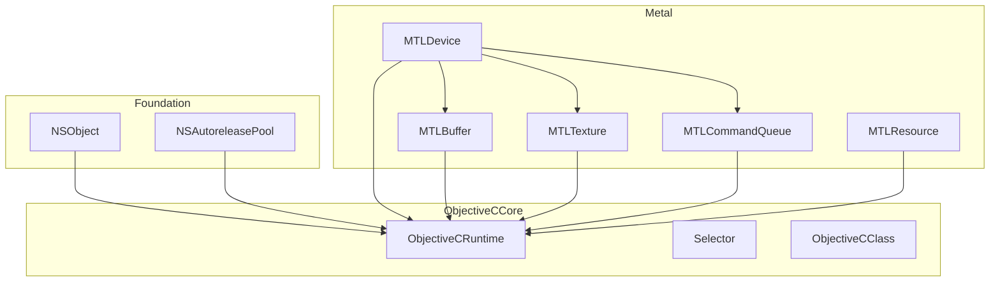
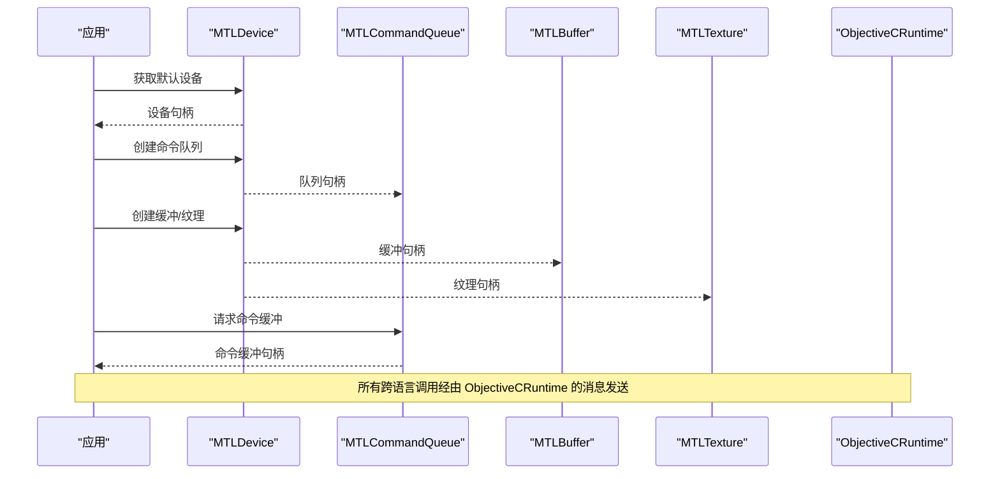
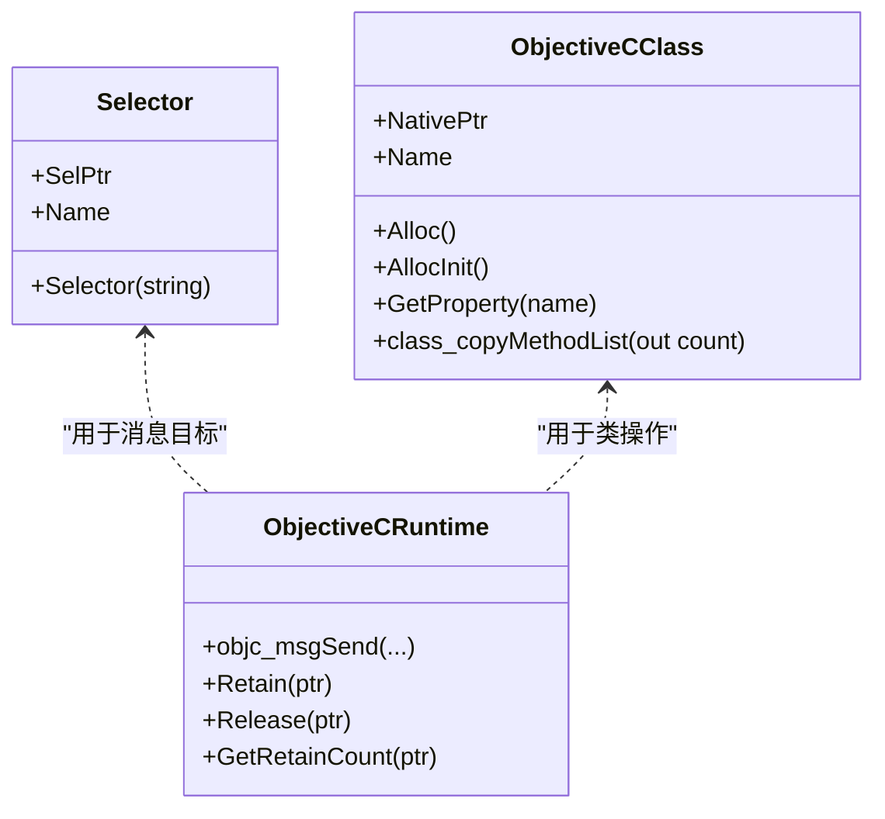
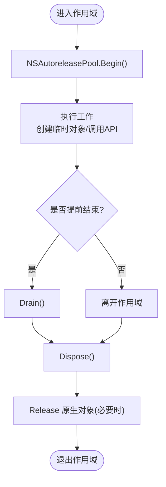
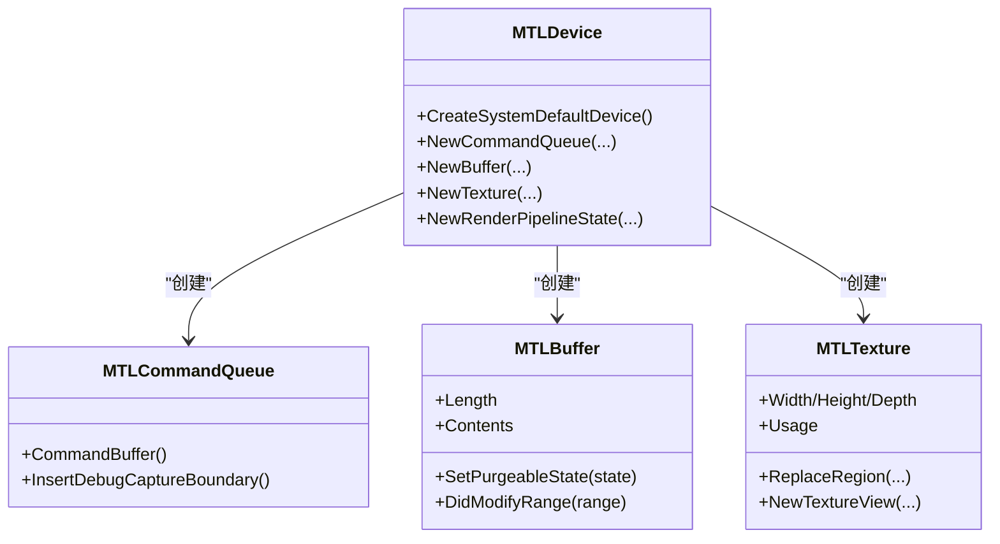
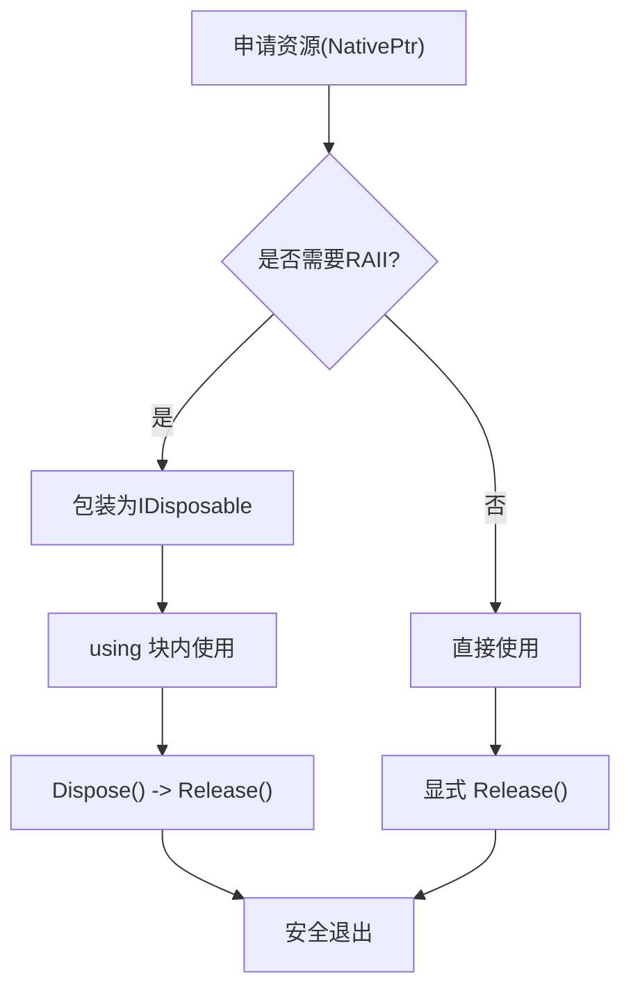
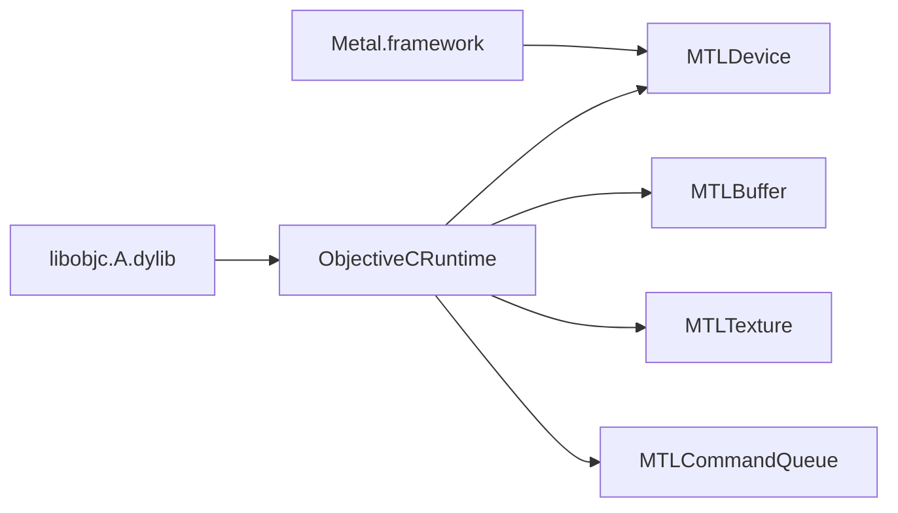

# 核心概念

<cite>
**本文引用的文件**
- [README.md](file://README.md)
- [DESIGN.md](file://DESIGN.md)
- [ObjectiveCRuntime.cs](file://src/SharpMetal/ObjectiveCCore/ObjectiveCRuntime.cs)
- [Selector.cs](file://src/SharpMetal/ObjectiveCCore/Selector.cs)
- [ObjectiveCClass.cs](file://src/SharpMetal/ObjectiveCCore/ObjectiveCClass.cs)
- [NSObject.cs](file://src/SharpMetal/Foundation/NSObject.cs)
- [NSAutoreleasePool.cs](file://src/SharpMetal/Foundation/NSAutoreleasePool.cs)
- [MTLDevice.cs](file://src/SharpMetal/Metal/MTLDevice.cs)
- [MTLBuffer.cs](file://src/SharpMetal/Metal/MTLBuffer.cs)
- [MTLTexture.cs](file://src/SharpMetal/Metal/MTLTexture.cs)
- [MTLCommandQueue.cs](file://src/SharpMetal/Metal/MTLCommandQueue.cs)
- [MTLResource.cs](file://src/SharpMetal/Metal/MTLResource.cs)
- [Program.cs](file://samples/SharpMetal.Sample/Program.cs)
</cite>

## 目录
1. [简介](#简介)
2. [项目结构](#项目结构)
3. [核心组件](#核心组件)
4. [架构总览](#架构总览)
5. [详细组件分析](#详细组件分析)
6. [依赖关系分析](#依赖关系分析)
7. [性能考量](#性能考量)
8. [故障排查指南](#故障排查指南)
9. [结论](#结论)
10. [附录：最佳实践与示例路径](#附录最佳实践与示例路径)

## 简介
本文件面向希望理解 SharpMetal 核心概念的开发者，聚焦以下主题：
- Objective-C 运行时机制、消息传递系统、选择器管理与动态类型
- Metal 图形 API 的基本概念：设备、缓冲区、纹理、命令队列与管线状态
- 显式原生资源管理与 RAII 模式在 SharpMetal 中的实现
- 托管对象与原生对象的关系、生命周期与内存安全保证
- 结合仓库代码的可视化图示与可追溯引用

## 项目结构
SharpMetal 将底层绑定分为三层：
- Foundation：基础集合与运行时辅助（如 NSAutoreleasePool）
- ObjectiveCCore：Objective-C 运行时桥接（消息发送、选择器、类访问）
- Metal：对 Apple Metal 框架的类型化封装（设备、缓冲、纹理、命令队列等）

图表来源
- [ObjectiveCRuntime.cs:33-800](file://src/SharpMetal/ObjectiveCCore/ObjectiveCRuntime.cs#L33-L800)
- [Selector.cs:5-43](file://src/SharpMetal/ObjectiveCCore/Selector.cs#L5-L43)
- [ObjectiveCClass.cs:18-87](file://src/SharpMetal/ObjectiveCCore/ObjectiveCClass.cs#L18-L87)
- [MTLDevice.cs:187-800](file://src/SharpMetal/Metal/MTLDevice.cs#L187-L800)
- [MTLBuffer.cs:6-113](file://src/SharpMetal/Metal/MTLBuffer.cs#L6-L113)
- [MTLTexture.cs:242-438](file://src/SharpMetal/Metal/MTLTexture.cs#L242-L438)
- [MTLCommandQueue.cs:44-107](file://src/SharpMetal/Metal/MTLCommandQueue.cs#L44-L107)
- [MTLResource.cs:63-119](file://src/SharpMetal/Metal/MTLResource.cs#L63-L119)

章节来源
- [README.md:1-23](file://README.md#L1-L23)
- [DESIGN.md:1-12](file://DESIGN.md#L1-L12)

## 核心组件
- Objective-C 运行时桥接层
  - 通过 LibraryImport 直接调用 libobjc.A.dylib，暴露 objc_msgSend 系列重载以支持不同参数签名与返回值类型
  - Selector 封装选择器，提供字符串到选择器的转换与名称读取
  - ObjectiveCClass 提供类名查找、属性与方法列表访问、分配与初始化
- Foundation 基元
  - NSObject 提供哈希、描述、相等性判断、响应能力检查等通用方法
  - NSAutoreleasePool 提供自动释放池的 begin/drain/dispose 语义
- Metal 资源与命令
  - MTLDevice 作为工厂与能力查询入口，创建命令队列、缓冲、纹理、管线等
  - MTLBuffer/MTLTexture/MTLResource 表示 GPU/CPU 共享或私有的资源，具备标签、缓存模式、存储模式、危险跟踪、可回收状态等
  - MTLCommandQueue 负责生成命令缓冲并插入调试边界、驻留集管理

章节来源
- [ObjectiveCRuntime.cs:33-800](file://src/SharpMetal/ObjectiveCCore/ObjectiveCRuntime.cs#L33-L800)
- [Selector.cs:5-43](file://src/SharpMetal/ObjectiveCCore/Selector.cs#L5-L43)
- [ObjectiveCClass.cs:18-87](file://src/SharpMetal/ObjectiveCCore/ObjectiveCClass.cs#L18-L87)
- [NSObject.cs:48-90](file://src/SharpMetal/Foundation/NSObject.cs#L48-L90)
- [NSAutoreleasePool.cs:5-39](file://src/SharpMetal/Foundation/NSAutoreleasePool.cs#L5-L39)
- [MTLDevice.cs:187-800](file://src/SharpMetal/Metal/MTLDevice.cs#L187-L800)
- [MTLBuffer.cs:6-113](file://src/SharpMetal/Metal/MTLBuffer.cs#L6-L113)
- [MTLTexture.cs:242-438](file://src/SharpMetal/Metal/MTLTexture.cs#L242-L438)
- [MTLCommandQueue.cs:44-107](file://src/SharpMetal/Metal/MTLCommandQueue.cs#L44-L107)
- [MTLResource.cs:63-119](file://src/SharpMetal/Metal/MTLResource.cs#L63-L119)

## 架构总览
SharpMetal 采用“托管结构体 + 原生指针”的模式：每个 Metal/Foundation 类型都是包含 NativePtr 的结构体，所有行为通过 ObjectiveCRuntime 的消息发送完成。资源由用户显式持有与释放，避免隐式 GC 带来的不确定性。

图表来源
- [MTLDevice.cs:305-339](file://src/SharpMetal/Metal/MTLDevice.cs#L305-L339)
- [MTLCommandQueue.cs:58-68](file://src/SharpMetal/Metal/MTLCommandQueue.cs#L58-L68)
- [ObjectiveCRuntime.cs:118-800](file://src/SharpMetal/ObjectiveCCore/ObjectiveCRuntime.cs#L118-L800)

## 详细组件分析

### Objective-C 运行时与消息传递
- 选择器管理
  - Selector 通过 sel_getUid 注册/获取选择器，支持从字符串构造与名称读取
- 消息发送
  - ObjectiveCRuntime 提供大量 objc_msgSend 重载，覆盖常见值类型、结构体、指针与布尔返回
  - 使用 LibraryImport 直接绑定 libobjc.A.dylib，避免额外中间层
- 动态类型
  - ObjectiveCClass 支持按名称获取类、分配与初始化、枚举方法列表、读取属性

图表来源
- [Selector.cs:5-43](file://src/SharpMetal/ObjectiveCCore/Selector.cs#L5-L43)
- [ObjectiveCClass.cs:18-87](file://src/SharpMetal/ObjectiveCCore/ObjectiveCClass.cs#L18-L87)
- [ObjectiveCRuntime.cs:33-800](file://src/SharpMetal/ObjectiveCCore/ObjectiveCRuntime.cs#L33-L800)

章节来源
- [ObjectiveCRuntime.cs:33-800](file://src/SharpMetal/ObjectiveCCore/ObjectiveCRuntime.cs#L33-L800)
- [Selector.cs:5-43](file://src/SharpMetal/ObjectiveCCore/Selector.cs#L5-L43)
- [ObjectiveCClass.cs:18-87](file://src/SharpMetal/ObjectiveCCore/ObjectiveCClass.cs#L18-L87)

### 托管对象与原生对象的生命周期
- 所有权模型
  - 所有 Metal/Foundation 类型均为轻量结构体，仅持有 NativePtr；不拥有 GC 追踪
  - 资源创建后由调用方负责释放（例如示例中在 finally 块中 Release）
- 自动释放池
  - NSAutoreleasePool 提供 Begin/Drain/Dispose 语义，适合短期作用域内的临时对象
- 安全约定
  - 访问属性前进行空指针与响应能力检查（如 RespondsToSelector）
  - 显式错误输出（如选择器或类获取失败时打印日志）

图表来源
- [NSAutoreleasePool.cs:5-39](file://src/SharpMetal/Foundation/NSAutoreleasePool.cs#L5-L39)
- [Program.cs:23-45](file://samples/SharpMetal.Sample/Program.cs#L23-L45)

章节来源
- [NSAutoreleasePool.cs:5-39](file://src/SharpMetal/Foundation/NSAutoreleasePool.cs#L5-L39)
- [Program.cs:23-45](file://samples/SharpMetal.Sample/Program.cs#L23-L45)

### Metal 设备、缓冲、纹理、命令队列与管线
- 设备（MTLDevice）
  - 能力查询：统一内存、特性支持、最大线程组大小等
  - 资源工厂：NewBuffer/NewTexture/NewCommandQueue/NewRenderPipelineState 等
- 缓冲（MTLBuffer）
  - 属性：长度、CPU/GPU 地址、缓存模式、存储模式、危险跟踪、堆偏移
  - 操作：内容读写、区域修改通知、可回收状态切换、视图创建
- 纹理（MTLTexture）
  - 描述符（MTLTextureDescriptor）：像素格式、尺寸、Mipmap、采样数、用途、压缩、Swizzle 等
  - 实例：数据交换（getBytes/replaceRegion）、视图创建、远程视图、共享句柄
- 命令队列（MTLCommandQueue）
  - 生成命令缓冲、插入调试捕获边界、驻留集管理
- 管线状态
  - 通过设备创建渲染/计算管线状态，配置着色器函数、描述符与选项

图表来源
- [MTLDevice.cs:305-449](file://src/SharpMetal/Metal/MTLDevice.cs#L305-L449)
- [MTLCommandQueue.cs:44-107](file://src/SharpMetal/Metal/MTLCommandQueue.cs#L44-L107)
- [MTLBuffer.cs:6-113](file://src/SharpMetal/Metal/MTLBuffer.cs#L6-L113)
- [MTLTexture.cs:75-240](file://src/SharpMetal/Metal/MTLTexture.cs#L75-L240)
- [MTLTexture.cs:242-438](file://src/SharpMetal/Metal/MTLTexture.cs#L242-L438)

章节来源
- [MTLDevice.cs:187-800](file://src/SharpMetal/Metal/MTLDevice.cs#L187-L800)
- [MTLBuffer.cs:6-113](file://src/SharpMetal/Metal/MTLBuffer.cs#L6-L113)
- [MTLTexture.cs:75-240](file://src/SharpMetal/Metal/MTLTexture.cs#L75-L240)
- [MTLTexture.cs:242-438](file://src/SharpMetal/Metal/MTLTexture.cs#L242-L438)
- [MTLCommandQueue.cs:44-107](file://src/SharpMetal/Metal/MTLCommandQueue.cs#L44-L107)

### 显式原生资源管理与 RAII 模式
- 显式所有权
  - 所有资源以 NativePtr 形式存在，需显式 Release；示例在 finally 中释放设备与缓冲
- RAII 风格封装建议
  - 为关键资源包装 IDisposable 结构体，在 Dispose 中调用 Release
  - 使用 using 语句确保异常路径下的释放
- 自动释放池配合
  - 对于短生命周期临时对象，使用 NSAutoreleasePool 包裹以减少手动计数

图表来源
- [Program.cs:23-45](file://samples/SharpMetal.Sample/Program.cs#L23-L45)
- [NSAutoreleasePool.cs:5-39](file://src/SharpMetal/Foundation/NSAutoreleasePool.cs#L5-L39)

章节来源
- [Program.cs:23-45](file://samples/SharpMetal.Sample/Program.cs#L23-L45)
- [NSAutoreleasePool.cs:5-39](file://src/SharpMetal/Foundation/NSAutoreleasePool.cs#L5-L39)

### 托管对象与原生对象关系与内存安全
- 映射关系
  - 每个托管结构体对应一个原生对象指针；无额外托管堆开销
- 安全性保障
  - 访问属性前先检查 NativePtr 是否为空
  - 对可选能力使用 RespondsToSelector 保护
  - 选择器/类获取失败时输出诊断信息
- 内存模型
  - 遵循 Objective-C 的 retain/release 语义；SharpMetal 暴露 Retain/Release 供上层控制

章节来源
- [NSObject.cs:48-90](file://src/SharpMetal/Foundation/NSObject.cs#L48-L90)
- [ObjectiveCRuntime.cs:769-782](file://src/SharpMetal/ObjectiveCCore/ObjectiveCRuntime.cs#L769-L782)
- [Selector.cs:20-30](file://src/SharpMetal/ObjectiveCCore/Selector.cs#L20-L30)

## 依赖关系分析
- 耦合关系
  - Foundation 与 ObjectiveCCore 被 Metal 广泛依赖
  - Metal 各资源类型均依赖 ObjectiveCRuntime 进行消息发送
- 外部依赖
  - libobjc.A.dylib：Objective-C 运行时
  - Metal.framework：图形 API 接口
- 潜在循环依赖
  - 当前结构为单向依赖，未见循环

图表来源
- [ObjectiveCRuntime.cs:33-800](file://src/SharpMetal/ObjectiveCCore/ObjectiveCRuntime.cs#L33-L800)
- [MTLDevice.cs:721-721](file://src/SharpMetal/Metal/MTLDevice.cs#L721-L721)

章节来源
- [ObjectiveCRuntime.cs:33-800](file://src/SharpMetal/ObjectiveCCore/ObjectiveCRuntime.cs#L33-L800)
- [MTLDevice.cs:721-721](file://src/SharpMetal/Metal/MTLDevice.cs#L721-L721)

## 性能考量
- 减少跨语言调用次数
  - 批量设置描述符后再创建资源，避免多次消息发送
- 合理使用存储模式
  - Shared/Managed/Private/Memoryless 根据访问模式选择，降低同步成本
- 危险跟踪与缓存模式
  - 开启 Tracked 有助于定位竞争，但带来开销；按需启用
- 纹理优化
  - 使用合适的 Usage、CompressionType、Swizzle 提升带宽利用率
- 命令队列与缓冲复用
  - 复用命令缓冲与资源，减少频繁分配

[本节为通用指导，不直接分析具体文件]

## 故障排查指南
- 平台限制
  - 非 Apple 平台会阻止原生 Metal 工作负载；示例中检测平台并给出提示
- 设备为空
  - 若 CreateSystemDefaultDevice 返回空指针，说明无可用 Metal 设备
- 缓冲分配失败
  - NewBuffer 返回空或 Contents 为空时，检查资源选项与平台能力
- 选择器/类获取失败
  - Selector 或 ObjectiveCClass 构造失败时会输出诊断信息
- 未释放资源
  - 确保在 finally 或 Dispose 中调用 Release，避免泄漏

章节来源
- [Program.cs:16-31](file://samples/SharpMetal.Sample/Program.cs#L16-L31)
- [Program.cs:41-45](file://samples/SharpMetal.Sample/Program.cs#L41-L45)
- [Selector.cs:20-30](file://src/SharpMetal/ObjectiveCCore/Selector.cs#L20-L30)
- [ObjectiveCClass.cs:30-40](file://src/SharpMetal/ObjectiveCCore/ObjectiveCClass.cs#L30-L40)

## 结论
SharpMetal 通过最小化的托管结构体与直接的 Objective-C 运行时绑定，提供了高效且可控的 Metal 访问方式。其显式所有权模型与 RAII 风格封装相结合，既保证了性能，又提升了内存安全性。借助清晰的设备-资源-命令流，开发者可以在 .NET 环境中构建高性能图形与计算任务。

[本节为总结，不直接分析具体文件]

## 附录：最佳实践与示例路径
- 示例程序
  - 设备与共享缓冲的创建、写入与读取流程见示例主程序
- 推荐做法
  - 使用 NSAutoreleasePool 包裹短时工作
  - 对所有资源使用 using/finally 确保释放
  - 在创建管线前校验设备能力
  - 合理设置纹理/缓冲的存储模式与缓存模式
  - 谨慎开启危险跟踪与日志

章节来源
- [Program.cs:23-45](file://samples/SharpMetal.Sample/Program.cs#L23-L45)
- [NSAutoreleasePool.cs:5-39](file://src/SharpMetal/Foundation/NSAutoreleasePool.cs#L5-L39)
- [MTLDevice.cs:305-449](file://src/SharpMetal/Metal/MTLDevice.cs#L305-L449)
- [MTLBuffer.cs:6-113](file://src/SharpMetal/Metal/MTLBuffer.cs#L6-L113)
- [MTLTexture.cs:75-240](file://src/SharpMetal/Metal/MTLTexture.cs#L75-L240)
- [MTLTexture.cs:242-438](file://src/SharpMetal/Metal/MTLTexture.cs#L242-L438)