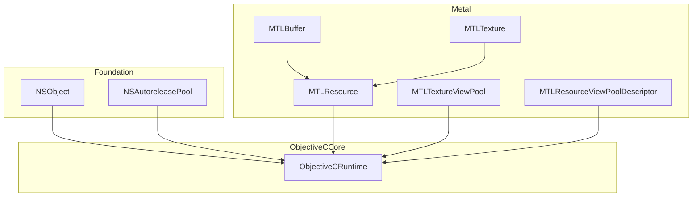
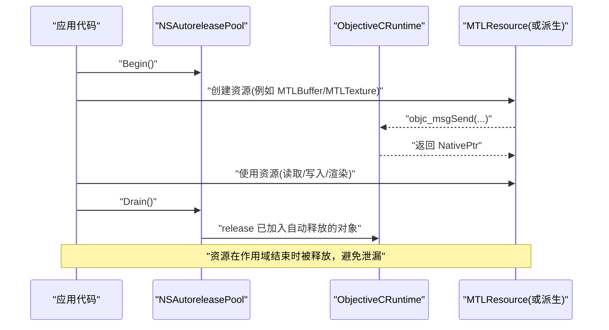
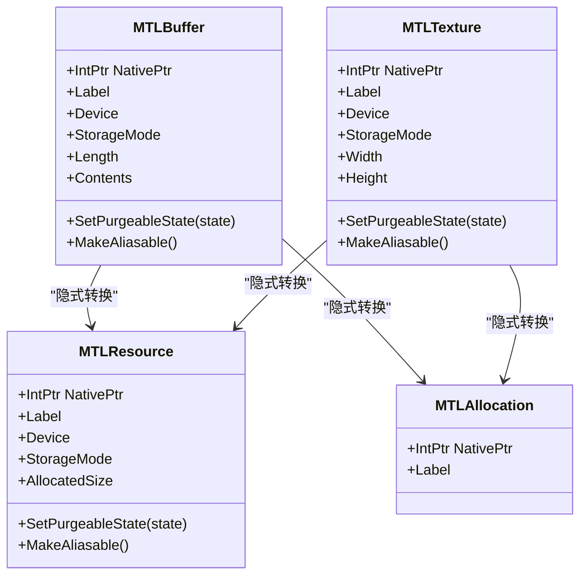
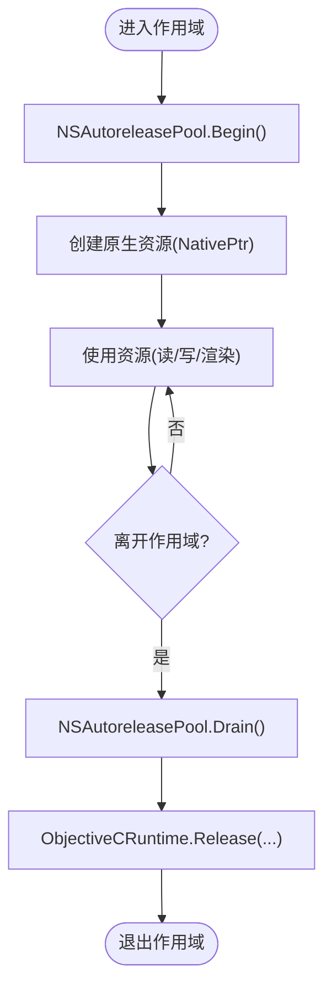
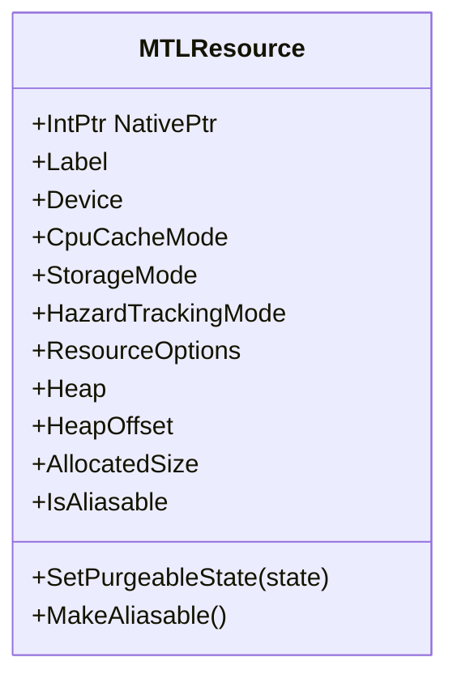
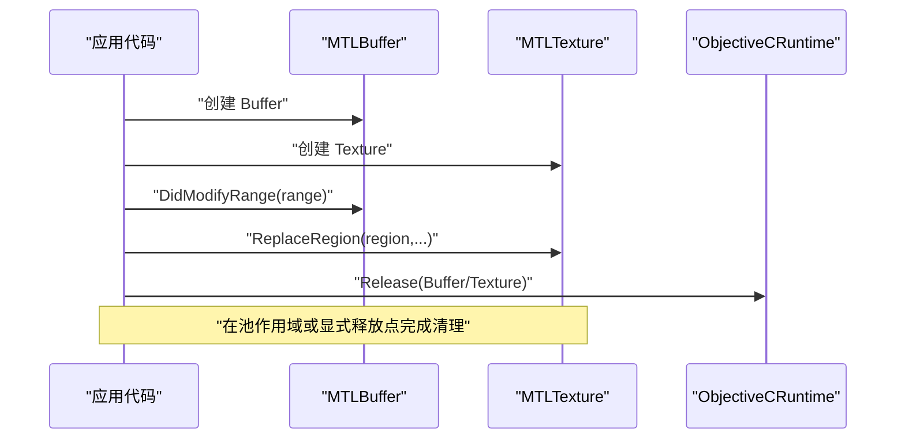
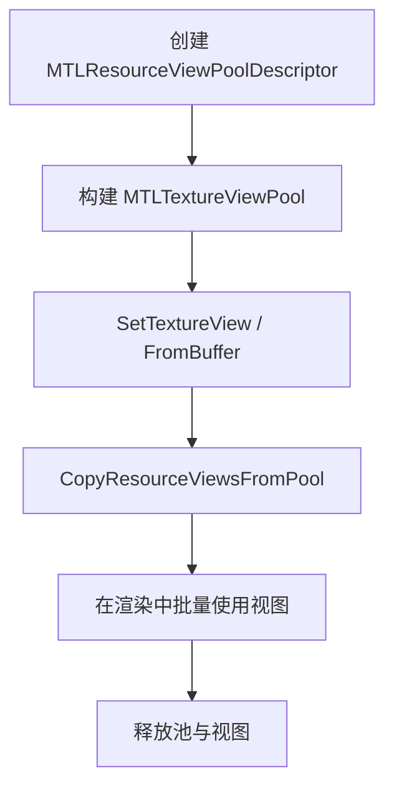
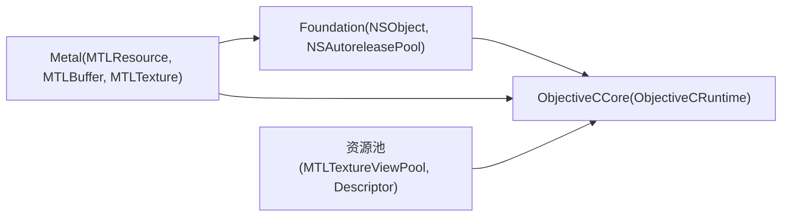

# 资源管理模式

<cite>
**本文引用的文件**
- [NSObject.cs](file://src/SharpMetal/Foundation/NSObject.cs)
- [NSAutoreleasePool.cs](file://src/SharpMetal/Foundation/NSAutoreleasePool.cs)
- [ObjectiveCRuntime.cs](file://src/SharpMetal/ObjectiveCCore/ObjectiveCRuntime.cs)
- [MTLResource.cs](file://src/SharpMetal/Metal/MTLResource.cs)
- [MTLAllocation.cs](file://src/SharpMetal/Metal/MTLAllocation.cs)
- [MTLBuffer.cs](file://src/SharpMetal/Metal/MTLBuffer.cs)
- [MTLTexture.cs](file://src/SharpMetal/Metal/MTLTexture.cs)
- [MTLTextureViewPool.cs](file://src/SharpMetal/Metal/MTLTextureViewPool.cs)
- [MTLResourceViewPoolDescriptor.cs](file://src/SharpMetal/Metal/MTLResourceViewPoolDescriptor.cs)
</cite>

## 目录
1. [简介](#简介)
2. [项目结构](#项目结构)
3. [核心组件](#核心组件)
4. [架构总览](#架构总览)
5. [详细组件分析](#详细组件分析)
6. [依赖关系分析](#依赖关系分析)
7. [性能考量](#性能考量)
8. [故障排查指南](#故障排查指南)
9. [结论](#结论)
10. [附录](#附录)

## 简介
本文件系统性阐述 SharpMetal 中的显式原生资源管理与 RAII（资源获取即初始化）模式。重点包括：
- 托管对象与原生对象之间的所有权关系，以及 NativePtr 的使用与生命周期管理
- NSObject 基类提供的资源管理能力（引用计数、自动释放、异常安全）
- MTLResource 统一资源抽象在不同资源类型间的一致性管理
- 内存对齐要求、资源池化与批量分配策略
- 正确的资源创建、使用与销毁模式示例路径
- 内存泄漏检测与资源使用监控的最佳实践

## 项目结构
SharpMetal 将资源管理分为三层：
- Foundation 层：提供 Objective-C 运行时桥接与基础对象模型（如 NSObject、NSAutoreleasePool）
- ObjectiveCCore 层：封装 Objective-C 消息发送、引用计数、框架加载等底层能力
- Metal 层：定义统一的资源抽象（MTLResource）及具体资源类型（如 MTLBuffer、MTLTexture），并提供资源池化工具（如 MTLTextureViewPool）

图表来源
- [NSObject.cs:48-90](file://src/SharpMetal/Foundation/NSObject.cs#L48-L90)
- [NSAutoreleasePool.cs:5-39](file://src/SharpMetal/Foundation/NSAutoreleasePool.cs#L5-L39)
- [ObjectiveCRuntime.cs:769-837](file://src/SharpMetal/ObjectiveCCore/ObjectiveCRuntime.cs#L769-L837)
- [MTLResource.cs:63-119](file://src/SharpMetal/Metal/MTLResource.cs#L63-L119)
- [MTLBuffer.cs:6-113](file://src/SharpMetal/Metal/MTLBuffer.cs#L6-L113)
- [MTLTexture.cs:242-438](file://src/SharpMetal/Metal/MTLTexture.cs#L242-L438)
- [MTLTextureViewPool.cs:6-50](file://src/SharpMetal/Metal/MTLTextureViewPool.cs#L6-L50)
- [MTLResourceViewPoolDescriptor.cs:6-33](file://src/SharpMetal/Metal/MTLResourceViewPoolDescriptor.cs#L6-L33)

章节来源
- [NSObject.cs:48-90](file://src/SharpMetal/Foundation/NSObject.cs#L48-L90)
- [NSAutoreleasePool.cs:5-39](file://src/SharpMetal/Foundation/NSAutoreleasePool.cs#L5-L39)
- [ObjectiveCRuntime.cs:769-837](file://src/SharpMetal/ObjectiveCCore/ObjectiveCRuntime.cs#L769-L837)
- [MTLResource.cs:63-119](file://src/SharpMetal/Metal/MTLResource.cs#L63-L119)
- [MTLBuffer.cs:6-113](file://src/SharpMetal/Metal/MTLBuffer.cs#L6-L113)
- [MTLTexture.cs:242-438](file://src/SharpMetal/Metal/MTLTexture.cs#L242-L438)
- [MTLTextureViewPool.cs:6-50](file://src/SharpMetal/Metal/MTLTextureViewPool.cs#L6-L50)
- [MTLResourceViewPoolDescriptor.cs:6-33](file://src/SharpMetal/Metal/MTLResourceViewPoolDescriptor.cs#L6-L33)

## 核心组件
- 原生指针与隐式转换：各资源类型以 struct 形式持有 IntPtr NativePtr，并实现到 IntPtr 的隐式转换，便于在托管与原生之间传递
- 统一资源抽象：MTLResource 暴露设备、缓存模式、存储模式、堆信息、分配大小、可别名化等通用属性与方法
- 引用计数与自动释放：通过 ObjectiveCRuntime 的 retain/release/retainCount 与 NSAutoreleasePool 的 Begin/Drain 机制协作
- 资源池化：MTLTextureViewPool 与 MTLResourceViewPoolDescriptor 提供批量视图创建与管理，减少重复开销

章节来源
- [MTLResource.cs:63-119](file://src/SharpMetal/Metal/MTLResource.cs#L63-L119)
- [MTLBuffer.cs:6-113](file://src/SharpMetal/Metal/MTLBuffer.cs#L6-L113)
- [MTLTexture.cs:242-438](file://src/SharpMetal/Metal/MTLTexture.cs#L242-L438)
- [ObjectiveCRuntime.cs:769-837](file://src/SharpMetal/ObjectiveCCore/ObjectiveCRuntime.cs#L769-L837)
- [NSAutoreleasePool.cs:5-39](file://src/SharpMetal/Foundation/NSAutoreleasePool.cs#L5-L39)
- [MTLTextureViewPool.cs:6-50](file://src/SharpMetal/Metal/MTLTextureViewPool.cs#L6-L50)
- [MTLResourceViewPoolDescriptor.cs:6-33](file://src/SharpMetal/Metal/MTLResourceViewPoolDescriptor.cs#L6-L33)

## 架构总览
下图展示了从托管代码到原生资源的调用链与资源生命周期关键点：

图表来源
- [NSAutoreleasePool.cs:11-26](file://src/SharpMetal/Foundation/NSAutoreleasePool.cs#L11-L26)
- [ObjectiveCRuntime.cs:769-837](file://src/SharpMetal/ObjectiveCCore/ObjectiveCRuntime.cs#L769-L837)
- [MTLBuffer.cs:6-113](file://src/SharpMetal/Metal/MTLBuffer.cs#L6-L113)
- [MTLTexture.cs:242-438](file://src/SharpMetal/Metal/MTLTexture.cs#L242-L438)

## 详细组件分析

### 原生指针与所有权模型（NativePtr）
- 所有资源类型均以 struct 形式包含 NativePtr，并通过隐式转换与 IntPtr 互通，确保跨边界传递零拷贝
- 资源类型同时支持转换为 MTLResource 与 MTLAllocation，以便统一查询分配信息与复用底层句柄
- 所有权由创建者负责：创建后需保证在合适的时机释放；若交由自动释放池管理，则需在池作用域内使用并在池销毁时释放

图表来源
- [MTLBuffer.cs:6-113](file://src/SharpMetal/Metal/MTLBuffer.cs#L6-L113)
- [MTLTexture.cs:242-438](file://src/SharpMetal/Metal/MTLTexture.cs#L242-L438)
- [MTLResource.cs:63-119](file://src/SharpMetal/Metal/MTLResource.cs#L63-L119)
- [MTLAllocation.cs:5-17](file://src/SharpMetal/Metal/MTLAllocation.cs#L5-L17)

章节来源
- [MTLBuffer.cs:6-113](file://src/SharpMetal/Metal/MTLBuffer.cs#L6-L113)
- [MTLTexture.cs:242-438](file://src/SharpMetal/Metal/MTLTexture.cs#L242-L438)
- [MTLResource.cs:63-119](file://src/SharpMetal/Metal/MTLResource.cs#L63-L119)
- [MTLAllocation.cs:5-17](file://src/SharpMetal/Metal/MTLAllocation.cs#L5-L17)

### NSObject 基类的资源管理功能
- 引用计数：通过 ObjectiveCRuntime.Retain/Release/GetRetainCount 对原生对象进行精确控制
- 自动释放：NSAutoreleasePool.Begin/Drain 提供 RAII 风格的自动释放范围，确保作用域内创建的对象在退出时被释放
- 异常安全：结合 using 语义（Dispose）与池作用域，即使发生异常也能保证释放路径执行

图表来源
- [NSAutoreleasePool.cs:11-26](file://src/SharpMetal/Foundation/NSAutoreleasePool.cs#L11-L26)
- [ObjectiveCRuntime.cs:769-837](file://src/SharpMetal/ObjectiveCCore/ObjectiveCRuntime.cs#L769-L837)

章节来源
- [NSObject.cs:48-90](file://src/SharpMetal/Foundation/NSObject.cs#L48-L90)
- [NSAutoreleasePool.cs:5-39](file://src/SharpMetal/Foundation/NSAutoreleasePool.cs#L5-L39)
- [ObjectiveCRuntime.cs:769-837](file://src/SharpMetal/ObjectiveCCore/ObjectiveCRuntime.cs#L769-L837)

### MTLResource 统一资源抽象
- 统一属性：设备、CPU 缓存模式、存储模式、危险跟踪模式、资源选项、堆信息、分配大小、是否可别名化
- 统一方法：设置可回收状态、标记为可别名化
- 一致性：所有资源类型（Buffer、Texture 等）均继承该抽象，确保一致的管理接口

图表来源
- [MTLResource.cs:63-119](file://src/SharpMetal/Metal/MTLResource.cs#L63-L119)

章节来源
- [MTLResource.cs:63-119](file://src/SharpMetal/Metal/MTLResource.cs#L63-L119)

### 资源类型：MTLBuffer 与 MTLTexture
- MTLBuffer：提供长度、内容访问、修改范围通知、GPU 地址、远程存储缓冲、调试标记等
- MTLTexture：提供维度、像素格式、采样数、压缩类型、稀疏纹理、共享句柄、视图创建、数据读写等
- 两者均支持 SetPurgeableState 与 MakeAliasable，体现统一的生命周期控制

图表来源
- [MTLBuffer.cs:6-113](file://src/SharpMetal/Metal/MTLBuffer.cs#L6-L113)
- [MTLTexture.cs:242-438](file://src/SharpMetal/Metal/MTLTexture.cs#L242-L438)
- [ObjectiveCRuntime.cs:769-837](file://src/SharpMetal/ObjectiveCCore/ObjectiveCRuntime.cs#L769-L837)

章节来源
- [MTLBuffer.cs:6-113](file://src/SharpMetal/Metal/MTLBuffer.cs#L6-L113)
- [MTLTexture.cs:242-438](file://src/SharpMetal/Metal/MTLTexture.cs#L242-L438)

### 资源池化与批量分配：MTLTextureViewPool
- 目的：批量创建和管理纹理视图，减少重复创建开销
- 关键操作：设置纹理视图、从缓冲区创建视图、从源池复制视图范围
- 描述符：MTLResourceViewPoolDescriptor 用于配置池大小与标签

图表来源
- [MTLTextureViewPool.cs:6-50](file://src/SharpMetal/Metal/MTLTextureViewPool.cs#L6-L50)
- [MTLResourceViewPoolDescriptor.cs:6-33](file://src/SharpMetal/Metal/MTLResourceViewPoolDescriptor.cs#L6-L33)

章节来源
- [MTLTextureViewPool.cs:6-50](file://src/SharpMetal/Metal/MTLTextureViewPool.cs#L6-L50)
- [MTLResourceViewPoolDescriptor.cs:6-33](file://src/SharpMetal/Metal/MTLResourceViewPoolDescriptor.cs#L6-L33)

### 内存对齐与资源布局
- 纹理与缓冲区的内存布局受像素格式、行字节数、切片与层级影响
- 通过 MTLTextureDescriptor 与相关 API 指定 Usage、CompressionType、Swizzle、SparsePageSize 等参数，确保对齐与访问效率
- 使用 ReplaceRegion/GetBytes 等方法时需正确计算 bytesPerRow 与 bytesPerImage，以避免越界与未对齐访问

章节来源
- [MTLTexture.cs:75-240](file://src/SharpMetal/Metal/MTLTexture.cs#L75-L240)
- [MTLTexture.cs:347-385](file://src/SharpMetal/Metal/MTLTexture.cs#L347-L385)

## 依赖关系分析
- Foundation 依赖 ObjectiveCCore：NSObject 与 NSAutoreleasePool 通过 ObjectiveCRuntime 进行消息发送与引用计数
- Metal 依赖 Foundation 与 ObjectiveCCore：MTLResource 及其派生类型通过 ObjectiveCRuntime 访问原生对象属性与方法
- 资源池化模块依赖 ObjectiveCCore：MTLTextureViewPool 通过 ObjectiveCRuntime 调用原生 API 管理视图集合

图表来源
- [NSObject.cs:48-90](file://src/SharpMetal/Foundation/NSObject.cs#L48-L90)
- [NSAutoreleasePool.cs:5-39](file://src/SharpMetal/Foundation/NSAutoreleasePool.cs#L5-L39)
- [ObjectiveCRuntime.cs:769-837](file://src/SharpMetal/ObjectiveCCore/ObjectiveCRuntime.cs#L769-L837)
- [MTLResource.cs:63-119](file://src/SharpMetal/Metal/MTLResource.cs#L63-L119)
- [MTLBuffer.cs:6-113](file://src/SharpMetal/Metal/MTLBuffer.cs#L6-L113)
- [MTLTexture.cs:242-438](file://src/SharpMetal/Metal/MTLTexture.cs#L242-L438)
- [MTLTextureViewPool.cs:6-50](file://src/SharpMetal/Metal/MTLTextureViewPool.cs#L6-L50)
- [MTLResourceViewPoolDescriptor.cs:6-33](file://src/SharpMetal/Metal/MTLResourceViewPoolDescriptor.cs#L6-L33)

章节来源
- [NSObject.cs:48-90](file://src/SharpMetal/Foundation/NSObject.cs#L48-L90)
- [NSAutoreleasePool.cs:5-39](file://src/SharpMetal/Foundation/NSAutoreleasePool.cs#L5-L39)
- [ObjectiveCRuntime.cs:769-837](file://src/SharpMetal/ObjectiveCCore/ObjectiveCRuntime.cs#L769-L837)
- [MTLResource.cs:63-119](file://src/SharpMetal/Metal/MTLResource.cs#L63-L119)
- [MTLBuffer.cs:6-113](file://src/SharpMetal/Metal/MTLBuffer.cs#L6-L113)
- [MTLTexture.cs:242-438](file://src/SharpMetal/Metal/MTLTexture.cs#L242-L438)
- [MTLTextureViewPool.cs:6-50](file://src/SharpMetal/Metal/MTLTextureViewPool.cs#L6-L50)
- [MTLResourceViewPoolDescriptor.cs:6-33](file://src/SharpMetal/Metal/MTLResourceViewPoolDescriptor.cs#L6-L33)

## 性能考量
- 使用 NSAutoreleasePool 包裹高频资源创建，减少频繁 retain/release 的开销
- 合理选择 StorageMode 与 CPU Cache Mode，平衡 CPU/GPU 访问效率
- 利用 MTLTextureViewPool 批量创建视图，降低重复分配与同步成本
- 谨慎使用 MakeAliasable 与 SetPurgeableState，避免不必要的状态切换与数据迁移
- 纹理数据更新时尽量使用 ReplaceRegion 并正确设置 bytesPerRow/bytesPerImage，减少拷贝与对齐开销

[本节为通用指导，不直接分析具体文件]

## 故障排查指南
- 内存泄漏检测
  - 使用 ObjectiveCRuntime.GetRetainCount 检查对象引用计数是否异常增长
  - 在 NSAutoreleasePool 作用域外创建的资源必须显式释放
  - 使用工具（如 Instruments）配合日志（Label）定位泄漏点
- 资源使用监控
  - 通过 MTLResource.AllocatedSize 与 MTLAllocation.Label 统计分配大小
  - 为关键资源设置 Label，便于在捕获器或调试器中识别
- 常见错误
  - 未调用 DidModifyRange 导致 CPU 写入未同步到 GPU
  - 纹理数据替换时 bytesPerRow 计算错误导致越界或错位
  - 池作用域提前结束导致自动释放对象被过早释放

章节来源
- [ObjectiveCRuntime.cs:769-837](file://src/SharpMetal/ObjectiveCCore/ObjectiveCRuntime.cs#L769-L837)
- [MTLBuffer.cs:60-63](file://src/SharpMetal/Metal/MTLBuffer.cs#L60-L63)
- [MTLTexture.cs:347-385](file://src/SharpMetal/Metal/MTLTexture.cs#L347-L385)
- [MTLResource.cs:92-99](file://src/SharpMetal/Metal/MTLResource.cs#L92-L99)
- [MTLAllocation.cs:11-14](file://src/SharpMetal/Metal/MTLAllocation.cs#L11-L14)

## 结论
SharpMetal 通过 NSObject 与 ObjectiveCRuntime 提供稳定的引用计数与自动释放机制，结合 MTLResource 的统一抽象，使不同资源类型具备一致的生命周期管理方式。借助 NSAutoreleasePool 的 RAII 风格与资源池化工具，开发者可以在保证异常安全的前提下高效管理原生资源。遵循本文的对齐、池化与监控最佳实践，可有效避免内存泄漏并提升整体性能。

[本节为总结性内容，不直接分析具体文件]

## 附录
- 正确的资源创建、使用与销毁模式（示例路径）
  - 使用 NSAutoreleasePool 包裹资源创建与作用域
    - 参考：[NSAutoreleasePool.cs:11-26](file://src/SharpMetal/Foundation/NSAutoreleasePool.cs#L11-L26)
  - 创建并管理 MTLBuffer
    - 参考：[MTLBuffer.cs:6-113](file://src/SharpMetal/Metal/MTLBuffer.cs#L6-L113)
  - 创建并管理 MTLTexture
    - 参考：[MTLTexture.cs:242-438](file://src/SharpMetal/Metal/MTLTexture.cs#L242-L438)
  - 统一资源查询与生命周期控制
    - 参考：[MTLResource.cs:63-119](file://src/SharpMetal/Metal/MTLResource.cs#L63-L119)
  - 资源池化批量视图管理
    - 参考：[MTLTextureViewPool.cs:6-50](file://src/SharpMetal/Metal/MTLTextureViewPool.cs#L6-L50)
    - 参考：[MTLResourceViewPoolDescriptor.cs:6-33](file://src/SharpMetal/Metal/MTLResourceViewPoolDescriptor.cs#L6-L33)
  - 手动引用计数与释放
    - 参考：[ObjectiveCRuntime.cs:769-837](file://src/SharpMetal/ObjectiveCCore/ObjectiveCRuntime.cs#L769-L837)

[本节为示例路径汇总，不直接分析具体文件]