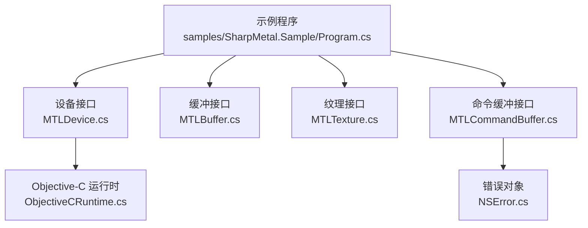
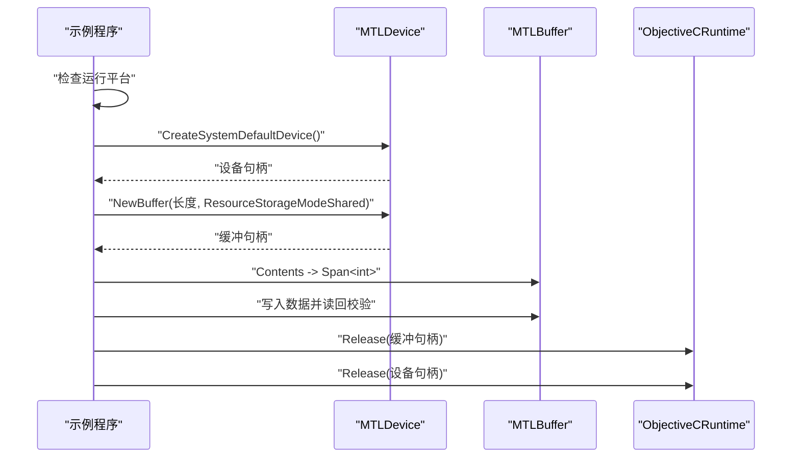
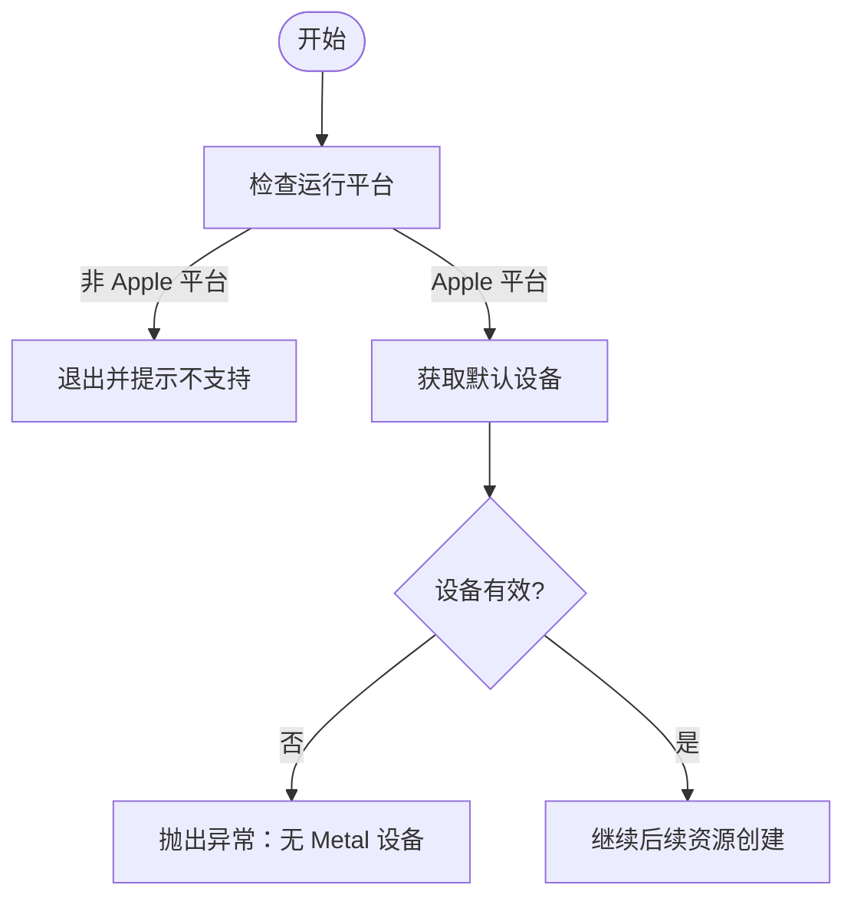
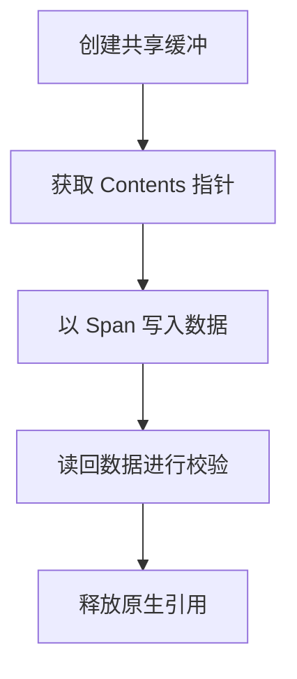
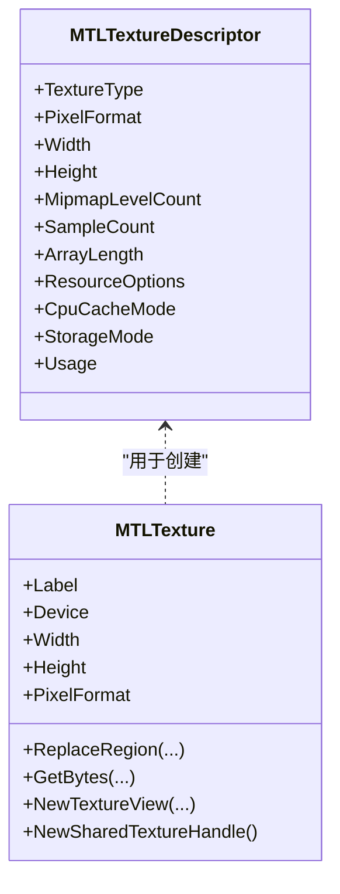
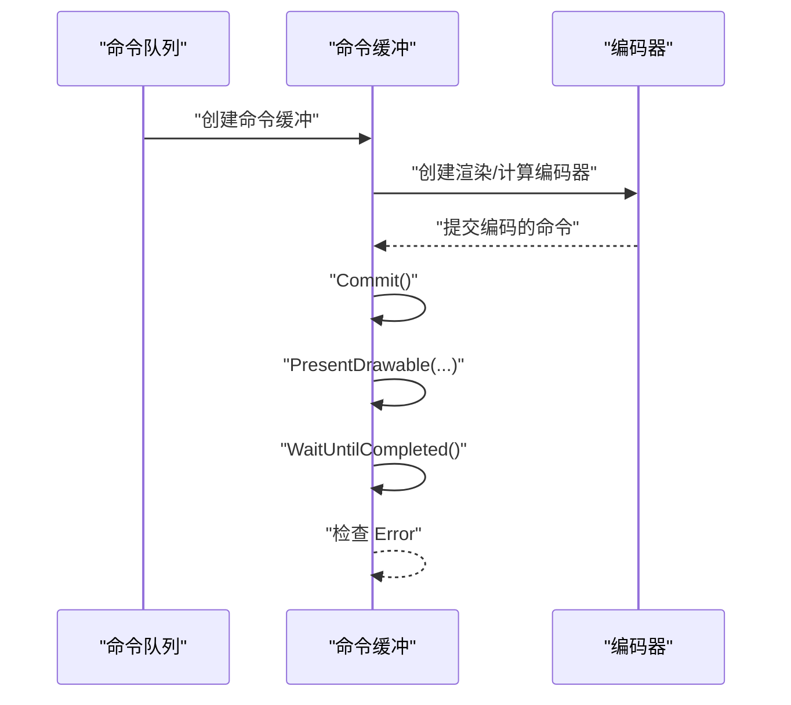
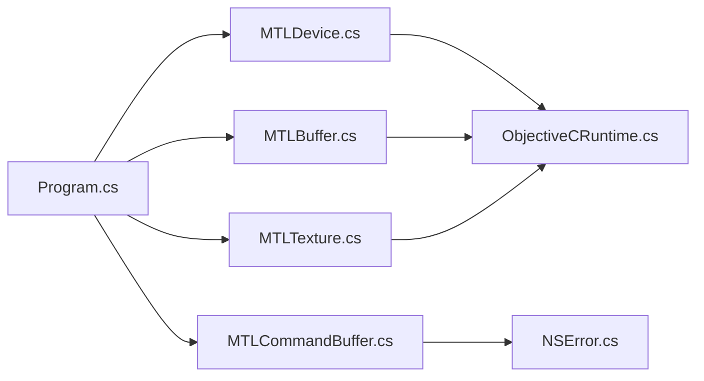
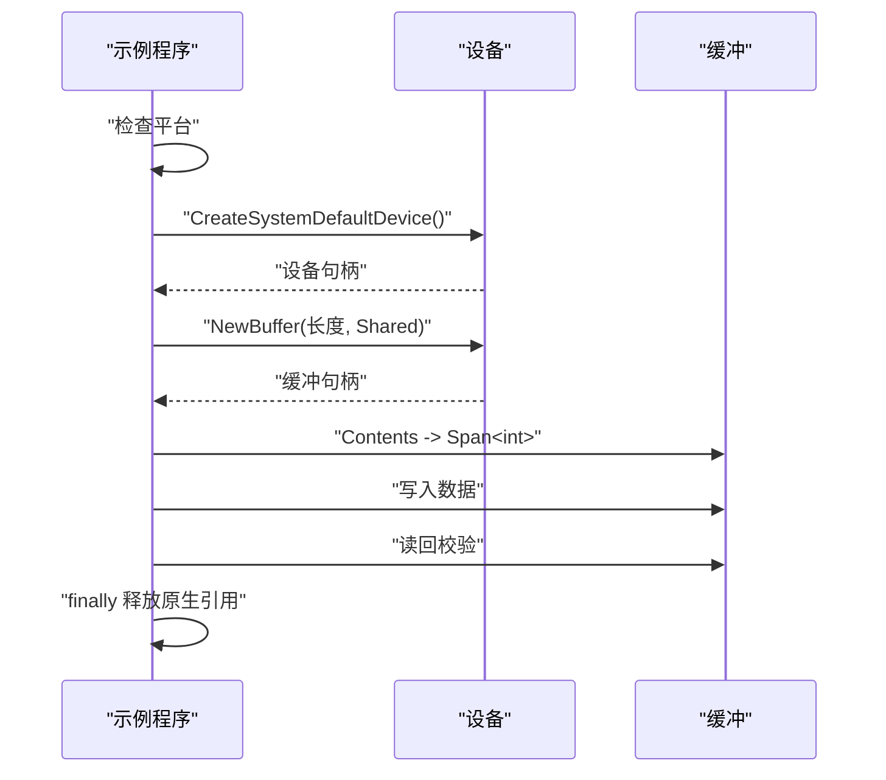
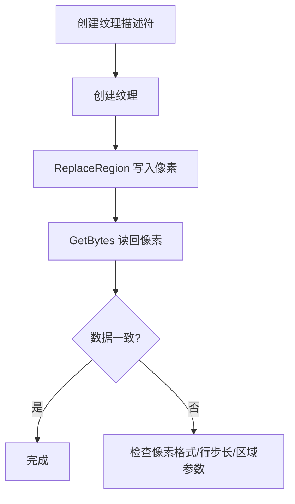
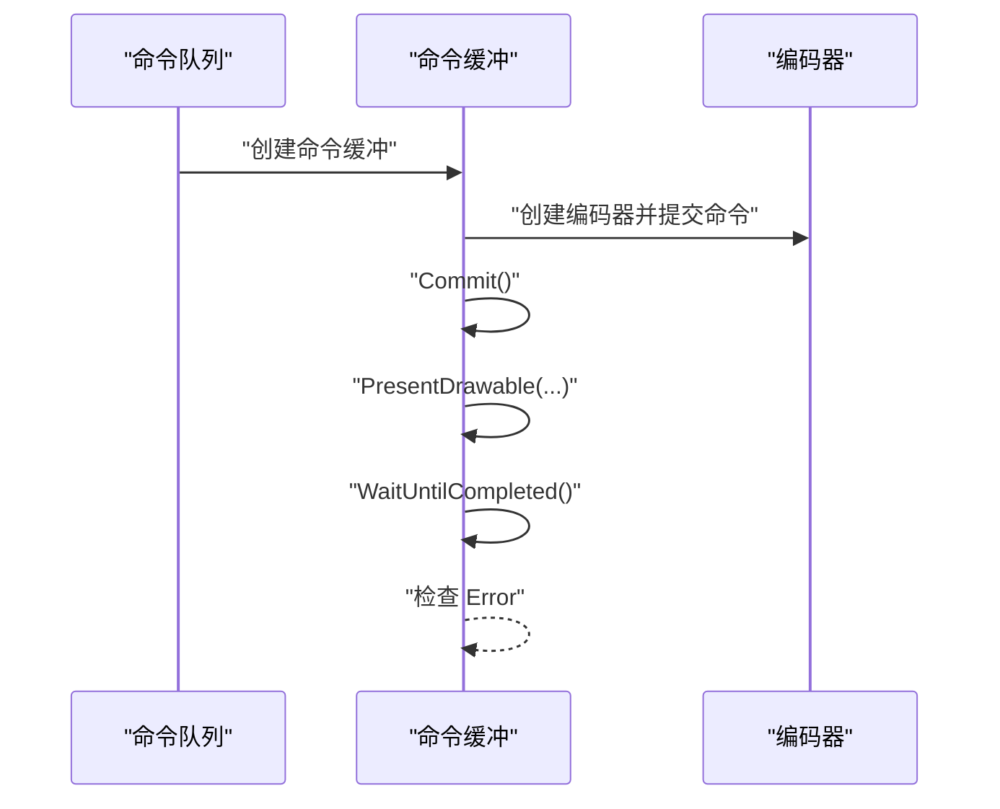

# 基础示例

<cite>
**本文引用的文件**
- [Program.cs](file://samples/SharpMetal.Sample/Program.cs)
- [README.md](file://README.md)
- [MTLDevice.cs](file://src/SharpMetal/Metal/MTLDevice.cs)
- [MTLBuffer.cs](file://src/SharpMetal/Metal/MTLBuffer.cs)
- [MTLTexture.cs](file://src/SharpMetal/Metal/MTLTexture.cs)
- [MTLCommandBuffer.cs](file://src/SharpMetal/Metal/MTLCommandBuffer.cs)
- [NSError.cs](file://src/SharpMetal/Foundation/NSError.cs)
- [ObjectiveCRuntime.cs](file://src/SharpMetal/ObjectiveCCore/ObjectiveCRuntime.cs)
</cite>

## 目录
1. [简介](#简介)
2. [项目结构](#项目结构)
3. [核心组件](#核心组件)
4. [架构总览](#架构总览)
5. [详细组件分析](#详细组件分析)
6. [依赖关系分析](#依赖关系分析)
7. [性能注意事项](#性能注意事项)
8. [故障排查指南](#故障排查指南)
9. [结论](#结论)
10. [附录：完整使用示例与输出](#附录完整使用示例与输出)

## 简介
本章节面向初次接触 SharpMetal 的开发者，提供设备发现、缓冲区创建与读写、纹理基本操作等核心功能的入门示例。文档基于仓库中的实际代码与类型定义，给出可运行的最小示例路径、关键步骤说明、资源管理与错误处理的最佳实践，并解释常见图形编程概念在 SharpMetal 中的对应实现方式。

## 项目结构
- samples/SharpMetal.Sample：包含可直接运行的最小示例程序，演示设备获取、共享缓冲区分配与读写验证。
- src/SharpMetal/Metal：Metal API 的 C# 绑定（设备、缓冲、纹理、命令缓冲等）。
- src/SharpMetal/Foundation：Foundation 基础类型（如 NSError）的绑定。
- src/SharpMetal/ObjectiveCCore：Objective-C 运行时桥接能力（消息发送、选择器等）。

图表来源
- [Program.cs:10-45](file://samples/SharpMetal.Sample/Program.cs#L10-L45)
- [MTLDevice.cs:305-379](file://src/SharpMetal/Metal/MTLDevice.cs#L305-L379)
- [MTLBuffer.cs:1-115](file://src/SharpMetal/Metal/MTLBuffer.cs#L1-L115)
- [MTLTexture.cs:75-200](file://src/SharpMetal/Metal/MTLTexture.cs#L75-L200)
- [MTLCommandBuffer.cs:116-200](file://src/SharpMetal/Metal/MTLCommandBuffer.cs#L116-L200)
- [ObjectiveCRuntime.cs:33-200](file://src/SharpMetal/ObjectiveCCore/ObjectiveCRuntime.cs#L33-L200)
- [NSError.cs:1-51](file://src/SharpMetal/Foundation/NSError.cs#L1-L51)

章节来源
- [README.md:1-23](file://README.md#L1-L23)

## 核心组件
- 设备（MTLDevice）：系统默认设备获取、设备能力查询、资源创建入口（缓冲、纹理、命令队列等）。
- 缓冲（MTLBuffer）：CPU/GPU 共享内存或 GPU 专用内存，支持直接读写、区域修改、从缓冲创建纹理视图等。
- 纹理（MTLTexture）：二维/立方体/数组等多维纹理，支持像素格式、采样、压缩、视口视图、数据替换与读取。
- 命令缓冲（MTLCommandBuffer）：提交渲染/计算命令、呈现 Drawable、等待完成、错误信息获取。
- 错误（NSError）：封装 Objective-C 侧的错误域、代码、用户信息与本地化描述。

章节来源
- [MTLDevice.cs:187-400](file://src/SharpMetal/Metal/MTLDevice.cs#L187-L400)
- [MTLBuffer.cs:1-115](file://src/SharpMetal/Metal/MTLBuffer.cs#L1-L115)
- [MTLTexture.cs:75-200](file://src/SharpMetal/Metal/MTLTexture.cs#L75-L200)
- [MTLCommandBuffer.cs:116-200](file://src/SharpMetal/Metal/MTLCommandBuffer.cs#L116-L200)
- [NSError.cs:1-51](file://src/SharpMetal/Foundation/NSError.cs#L1-L51)

## 架构总览
下图展示了示例程序的执行流程：平台检查 -> 获取默认设备 -> 创建共享缓冲 -> 写入并读回校验 -> 释放原生资源。

图表来源
- [Program.cs:10-45](file://samples/SharpMetal.Sample/Program.cs#L10-L45)
- [MTLDevice.cs:305-379](file://src/SharpMetal/Metal/MTLDevice.cs#L305-L379)
- [MTLBuffer.cs:40-68](file://src/SharpMetal/Metal/MTLBuffer.cs#L40-L68)
- [ObjectiveCRuntime.cs:33-200](file://src/SharpMetal/ObjectiveCCore/ObjectiveCRuntime.cs#L33-L200)

## 详细组件分析

### 设备发现与初始化
- 获取默认设备：通过静态方法创建系统默认设备；若返回空指针则视为无可用 Metal 设备。
- 设备能力：可通过设备属性判断是否统一内存、最大线程组大小、是否支持特定特性等。
- 多设备枚举：提供复制所有设备的接口，便于遍历与选择。

图表来源
- [Program.cs:10-27](file://samples/SharpMetal.Sample/Program.cs#L10-L27)
- [MTLDevice.cs:305-319](file://src/SharpMetal/Metal/MTLDevice.cs#L305-L319)

章节来源
- [Program.cs:10-27](file://samples/SharpMetal.Sample/Program.cs#L10-L27)
- [MTLDevice.cs:187-319](file://src/SharpMetal/Metal/MTLDevice.cs#L187-L319)

### 缓冲区创建与操作
- 创建共享缓冲：使用共享存储模式，使 CPU 与 GPU 均可访问同一块内存。
- 读写缓冲：通过 Contents 获取底层指针并以 Span<T> 进行高效读写。
- 生命周期管理：示例在 finally 中显式释放原生对象引用，避免泄漏。

图表来源
- [Program.cs:25-45](file://samples/SharpMetal.Sample/Program.cs#L25-L45)
- [MTLBuffer.cs:40-68](file://src/SharpMetal/Metal/MTLBuffer.cs#L40-L68)

章节来源
- [Program.cs:25-45](file://samples/SharpMetal.Sample/Program.cs#L25-L45)
- [MTLBuffer.cs:1-115](file://src/SharpMetal/Metal/MTLBuffer.cs#L1-L115)

### 纹理基本操作
- 创建纹理描述符：设置像素格式、宽高、mipmap、采样数、数组长度、存储模式、用途等。
- 创建纹理：通过设备或缓冲创建纹理对象。
- 数据交换：使用 ReplaceRegion 写入像素数据，GetBytes 读回像素数据。
- 视图与共享：可创建纹理视图或共享句柄用于跨进程/跨设备共享。

图表来源
- [MTLTexture.cs:75-200](file://src/SharpMetal/Metal/MTLTexture.cs#L75-L200)
- [MTLTexture.cs:242-385](file://src/SharpMetal/Metal/MTLTexture.cs#L242-L385)

章节来源
- [MTLTexture.cs:75-200](file://src/SharpMetal/Metal/MTLTexture.cs#L75-L200)
- [MTLTexture.cs:242-385](file://src/SharpMetal/Metal/MTLTexture.cs#L242-L385)

### 命令缓冲与呈现（概念性流程）
- 创建命令缓冲：从命令队列获取命令缓冲。
- 编码命令：根据任务类型创建渲染或计算编码器并提交命令。
- 提交与呈现：提交命令缓冲，必要时呈现 Drawable。
- 同步与错误：等待完成并检查错误信息。

图表来源
- [MTLCommandBuffer.cs:116-200](file://src/SharpMetal/Metal/MTLCommandBuffer.cs#L116-L200)

章节来源
- [MTLCommandBuffer.cs:116-200](file://src/SharpMetal/Metal/MTLCommandBuffer.cs#L116-L200)

## 依赖关系分析
- 示例程序依赖设备、缓冲、纹理与命令缓冲等核心类型。
- 设备与缓冲、纹理、命令缓冲均通过 Objective-C 运行时进行消息发送。
- 错误对象 NSError 用于封装底层错误信息。

图表来源
- [Program.cs:10-45](file://samples/SharpMetal.Sample/Program.cs#L10-L45)
- [MTLDevice.cs:305-379](file://src/SharpMetal/Metal/MTLDevice.cs#L305-L379)
- [MTLBuffer.cs:1-115](file://src/SharpMetal/Metal/MTLBuffer.cs#L1-L115)
- [MTLTexture.cs:75-200](file://src/SharpMetal/Metal/MTLTexture.cs#L75-L200)
- [MTLCommandBuffer.cs:116-200](file://src/SharpMetal/Metal/MTLCommandBuffer.cs#L116-L200)
- [ObjectiveCRuntime.cs:33-200](file://src/SharpMetal/ObjectiveCCore/ObjectiveCRuntime.cs#L33-L200)
- [NSError.cs:1-51](file://src/SharpMetal/Foundation/NSError.cs#L1-L51)

章节来源
- [Program.cs:10-45](file://samples/SharpMetal.Sample/Program.cs#L10-L45)
- [MTLDevice.cs:305-379](file://src/SharpMetal/Metal/MTLDevice.cs#L305-L379)
- [MTLBuffer.cs:1-115](file://src/SharpMetal/Metal/MTLBuffer.cs#L1-L115)
- [MTLTexture.cs:75-200](file://src/SharpMetal/Metal/MTLTexture.cs#L75-L200)
- [MTLCommandBuffer.cs:116-200](file://src/SharpMetal/Metal/MTLCommandBuffer.cs#L116-L200)
- [ObjectiveCRuntime.cs:33-200](file://src/SharpMetal/ObjectiveCCore/ObjectiveCRuntime.cs#L33-L200)
- [NSError.cs:1-51](file://src/SharpMetal/Foundation/NSError.cs#L1-L51)

## 性能注意事项
- 优先使用共享存储模式进行 CPU/GPU 数据交换，减少不必要的拷贝。
- 合理设置纹理用途与存储模式，避免过度优化导致 CPU 访问变慢。
- 批量写入纹理区域，减少频繁的小范围替换调用。
- 使用命令缓冲批量化提交命令，降低调度开销。
- 在 finally 中及时释放原生引用，避免内存泄漏。

[本节为通用指导，不直接分析具体文件]

## 故障排查指南
- 平台限制：在非 Apple 平台将阻止原生 Metal 工作负载，需确保在 macOS/iOS/macCatalyst 上运行。
- 设备为空：若无可用 Metal 设备，应抛出明确异常并终止后续流程。
- 缓冲分配失败：检查长度、资源选项与存储模式是否正确。
- 数据不一致：写回校验失败时，检查字节对齐、行步长与区域参数。
- 命令缓冲错误：提交后检查状态与错误对象，定位编码器执行问题。

章节来源
- [Program.cs:10-45](file://samples/SharpMetal.Sample/Program.cs#L10-L45)
- [MTLCommandBuffer.cs:116-200](file://src/SharpMetal/Metal/MTLCommandBuffer.cs#L116-L200)
- [NSError.cs:1-51](file://src/SharpMetal/Foundation/NSError.cs#L1-L51)

## 结论
通过本指南，你可以快速掌握 SharpMetal 的设备发现、缓冲与纹理的基本用法，理解资源管理与错误处理的正确方式。建议在实际项目中结合命令缓冲与编码器完成更复杂的渲染与计算任务，并持续优化数据布局与内存访问模式。

[本节为总结，不直接分析具体文件]

## 附录：完整使用示例与输出

### 示例一：设备发现与共享缓冲读写
- 目标：验证设备可用性与共享缓冲读写一致性。
- 关键点：
  - 平台检查：仅在 Apple 平台运行。
  - 获取默认设备：若为空则抛出异常。
  - 创建共享缓冲：使用共享存储模式。
  - 写入与读回：通过 Contents 与 Span<T> 进行高效读写。
  - 资源释放：finally 中释放原生引用。

图表来源
- [Program.cs:10-45](file://samples/SharpMetal.Sample/Program.cs#L10-L45)
- [MTLDevice.cs:305-379](file://src/SharpMetal/Metal/MTLDevice.cs#L305-L379)
- [MTLBuffer.cs:40-68](file://src/SharpMetal/Metal/MTLBuffer.cs#L40-L68)

章节来源
- [Program.cs:10-45](file://samples/SharpMetal.Sample/Program.cs#L10-L45)
- [MTLDevice.cs:305-379](file://src/SharpMetal/Metal/MTLDevice.cs#L305-L379)
- [MTLBuffer.cs:40-68](file://src/SharpMetal/Metal/MTLBuffer.cs#L40-L68)

预期输出
- 成功：控制台打印“Metal device and shared-buffer read/write passed; native owners disposed.”
- 失败：抛出相应异常（如平台不支持、设备为空、缓冲分配失败、数据不一致）。

### 示例二：纹理创建与数据交换
- 目标：创建二维纹理，写入像素数据并读回校验。
- 关键点：
  - 构造纹理描述符：设置像素格式、宽高、mipmap、用途等。
  - 创建纹理：通过设备或缓冲创建。
  - 写入像素：使用 ReplaceRegion 指定区域与行步长。
  - 读回像素：使用 GetBytes 读取指定区域。
  - 视图与共享：根据需要创建纹理视图或共享句柄。

图表来源
- [MTLTexture.cs:75-200](file://src/SharpMetal/Metal/MTLTexture.cs#L75-L200)
- [MTLTexture.cs:347-365](file://src/SharpMetal/Metal/MTLTexture.cs#L347-L365)

章节来源
- [MTLTexture.cs:75-200](file://src/SharpMetal/Metal/MTLTexture.cs#L75-L200)
- [MTLTexture.cs:347-365](file://src/SharpMetal/Metal/MTLTexture.cs#L347-L365)

预期输出
- 成功：纹理数据写入与读回一致，无异常。
- 失败：抛出异常或数据不一致，需检查参数与内存布局。

### 示例三：命令缓冲与呈现（概念性）
- 目标：展示命令缓冲的创建、提交、呈现与等待完成流程。
- 关键点：
  - 从命令队列创建命令缓冲。
  - 创建渲染/计算编码器并提交命令。
  - 提交命令缓冲并呈现 Drawable。
  - 等待完成并检查错误。

图表来源
- [MTLCommandBuffer.cs:116-200](file://src/SharpMetal/Metal/MTLCommandBuffer.cs#L116-L200)

章节来源
- [MTLCommandBuffer.cs:116-200](file://src/SharpMetal/Metal/MTLCommandBuffer.cs#L116-L200)

预期输出
- 成功：命令执行完成，无错误。
- 失败：检查命令缓冲状态与错误对象，定位问题。