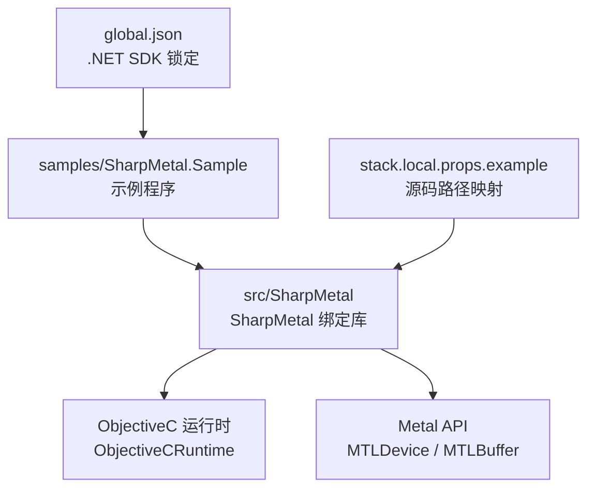
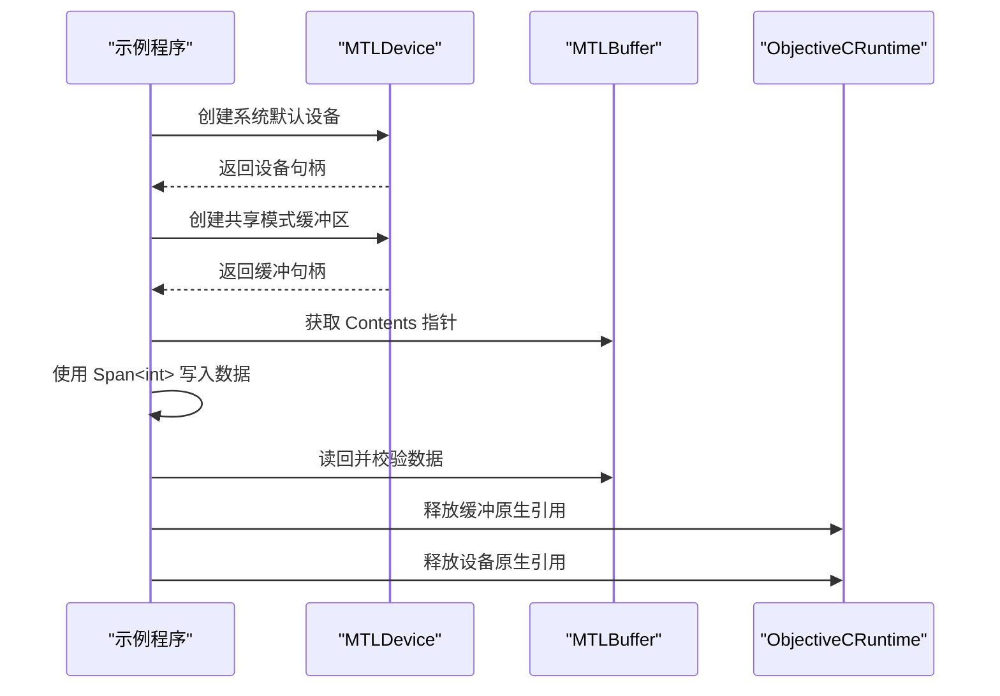
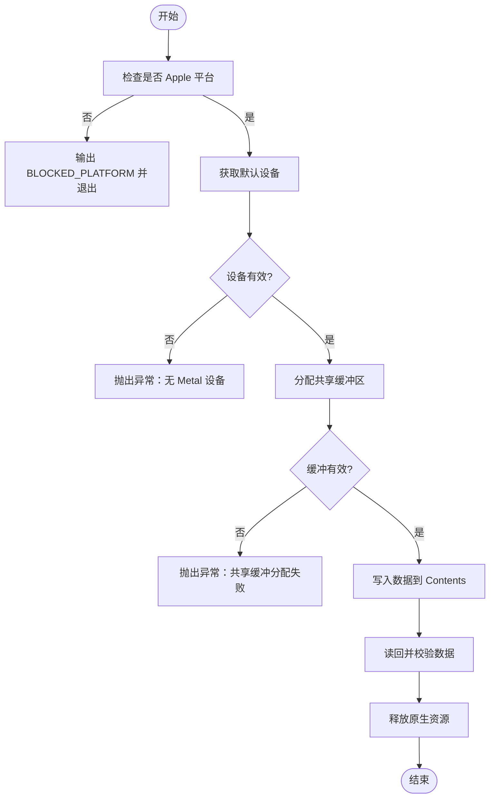
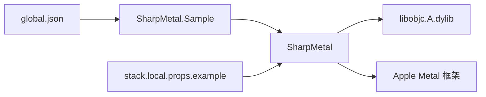

# 快速开始

<cite>
**本文引用的文件**
- [README.md](file://README.md)
- [DESIGN.md](file://DESIGN.md)
- [global.json](file://global.json)
- [docs/VERIFICATION.md](file://docs/VERIFICATION.md)
- [stack.local.props.example](file://stack.local.props.example)
- [src/SharpMetal/SharpMetal.csproj](file://src/SharpMetal/SharpMetal.csproj)
- [samples/SharpMetal.Sample/SharpMetal.Sample.csproj](file://samples/SharpMetal.Sample/SharpMetal.Sample.csproj)
- [samples/SharpMetal.Sample/Program.cs](file://samples/SharpMetal.Sample/Program.cs)
- [src/SharpMetal/Metal/MTLDevice.cs](file://src/SharpMetal/Metal/MTLDevice.cs)
- [src/SharpMetal/Metal/MTLBuffer.cs](file://src/SharpMetal/Metal/MTLBuffer.cs)
- [src/SharpMetal/ObjectiveCCore/ObjectiveCRuntime.cs](file://src/SharpMetal/ObjectiveCCore/ObjectiveCRuntime.cs)
</cite>

## 目录
1. [简介](#简介)
2. [项目结构](#项目结构)
3. [核心组件](#核心组件)
4. [架构总览](#架构总览)
5. [详细组件分析](#详细组件分析)
6. [依赖关系分析](#依赖关系分析)
7. [性能注意事项](#性能注意事项)
8. [故障排除指南](#故障排除指南)
9. [结论](#结论)
10. [附录](#附录)

## 简介
本指南面向初次接触 SharpMetal 的开发者，目标是帮助你：
- 安装并配置 .NET 与 Apple 宿主环境
- 以“源码模式”或“包模式”构建与运行示例
- 创建第一个 Metal 应用程序：发现设备、分配共享内存缓冲区、读写验证
- 理解资源所有权与释放的基本流程
- 排查常见问题（平台限制、ABI 不匹配、原生资源未释放等）

SharpMetal 提供对 Objective-C 运行时和 Apple Metal 的低层绑定，强调显式原生资源所有权；托管侧布局检查可移植，但原生执行需要 Apple 宿主系统框架。

**章节来源**
- [README.md:1-10](file://README.md#L1-L10)
- [DESIGN.md:1-12](file://DESIGN.md#L1-L12)

## 项目结构
仓库采用分层组织：
- src/SharpMetal：运行时绑定库（Foundation、Metal、MetalFX、QuartzCore、ObjectiveCCore）
- samples/SharpMetal.Sample：可运行的最小示例工程
- docs：设计说明与验证脚本
- eng：本地验证自动化脚本
- global.json：锁定 .NET SDK 版本
- stack.local.props.example：源码模式下的路径映射模板

**图表来源**
- [samples/SharpMetal.Sample/SharpMetal.Sample.csproj:1-6](file://samples/SharpMetal.Sample/SharpMetal.Sample.csproj#L1-L6)
- [src/SharpMetal/SharpMetal.csproj:1-47](file://src/SharpMetal/SharpMetal.csproj#L1-L47)
- [global.json:1-8](file://global.json#L1-L8)
- [stack.local.props.example:1-12](file://stack.local.props.example#L1-L12)

**章节来源**
- [README.md:12-16](file://README.md#L12-L16)
- [global.json:1-8](file://global.json#L1-L8)

## 核心组件
- MTLDevice：表示 Metal 设备，用于获取默认设备、查询能力、创建资源等
- MTLBuffer：GPU/CPU 共享或独占存储的缓冲对象，支持直接访问 Contents 指针进行读写
- ObjectiveCRuntime：封装 libobjc 调用，负责消息发送、选择器注册、内存释放等
- 示例 Program：演示设备发现、共享缓冲区分配、写入读取校验、显式释放

这些组件共同构成一个最小可用的 Metal 工作流：发现设备 → 分配共享内存 → 通过托管 Span 写入数据 → 读回校验 → 释放原生资源。

**章节来源**
- [src/SharpMetal/Metal/MTLDevice.cs:187-200](file://src/SharpMetal/Metal/MTLDevice.cs#L187-L200)
- [src/SharpMetal/Metal/MTLBuffer.cs:1-115](file://src/SharpMetal/Metal/MTLBuffer.cs#L1-L115)
- [src/SharpMetal/ObjectiveCCore/ObjectiveCRuntime.cs:33-200](file://src/SharpMetal/ObjectiveCCore/ObjectiveCRuntime.cs#L33-L200)
- [samples/SharpMetal.Sample/Program.cs:10-46](file://samples/SharpMetal.Sample/Program.cs#L10-L46)

## 架构总览
下图展示了从应用入口到 Metal 设备的调用链，以及资源生命周期管理的关键点。

**图表来源**
- [samples/SharpMetal.Sample/Program.cs:21-45](file://samples/SharpMetal.Sample/Program.cs#L21-L45)
- [src/SharpMetal/Metal/MTLDevice.cs:187-200](file://src/SharpMetal/Metal/MTLDevice.cs#L187-L200)
- [src/SharpMetal/Metal/MTLBuffer.cs:40-49](file://src/SharpMetal/Metal/MTLBuffer.cs#L40-L49)
- [src/SharpMetal/ObjectiveCCore/ObjectiveCRuntime.cs:53-57](file://src/SharpMetal/ObjectiveCCore/ObjectiveCRuntime.cs#L53-L57)

## 详细组件分析

### 环境设置与构建
- 安装 .NET SDK：由 global.json 指定版本，确保使用匹配的 SDK
- 源码模式：复制 stack.local.props.example 为 stack.local.props，并调整依赖路径（适用于多仓库协作）
- 包模式：通过 StackReferenceMode=Package 并使用包含产品版本的 NuGet 源
- 构建与运行：参考 docs/VERIFICATION.md 中的命令，先构建库，再运行示例

注意：
- 托管 ABI 可在 Windows 上验证通过，但原生 Metal 执行需要 Apple 宿主
- 示例在非 Apple 平台会明确返回“BLOCKED_PLATFORM”，这是预期行为

**章节来源**
- [global.json:1-8](file://global.json#L1-L8)
- [stack.local.props.example:1-12](file://stack.local.props.example#L1-L12)
- [docs/VERIFICATION.md:1-33](file://docs/VERIFICATION.md#L1-L33)
- [samples/SharpMetal.Sample/Program.cs:16-20](file://samples/SharpMetal.Sample/Program.cs#L16-L20)

### 创建第一个 Metal 应用程序
步骤概览：
1. 引入命名空间：SharpMetal.Metal、SharpMetal.ObjectiveCCore
2. 检查平台：非 Apple 平台直接退出并提示需要 Apple 宿主
3. 获取默认设备：MTLDevice.CreateSystemDefaultDevice()
4. 分配共享缓冲区：device.NewBuffer(长度, MTLResourceOptions.ResourceStorageModeShared)
5. 写入数据：通过 buffer.Contents 指针构造 Span<int> 并填充
6. 读回校验：遍历 Span 验证值
7. 释放资源：使用 ObjectiveCRuntime.Release 释放缓冲和设备

关键要点：
- 显式释放：示例在 finally 块中释放原生引用，避免泄漏
- 共享模式：便于 CPU 与 GPU 之间共享内存，适合简单读写场景
- 错误处理：设备为空或缓冲分配失败时抛出异常

**章节来源**
- [samples/SharpMetal.Sample/Program.cs:10-46](file://samples/SharpMetal.Sample/Program.cs#L10-L46)
- [src/SharpMetal/Metal/MTLBuffer.cs:40-49](file://src/SharpMetal/Metal/MTLBuffer.cs#L40-L49)
- [src/SharpMetal/ObjectiveCCore/ObjectiveCRuntime.cs:53-57](file://src/SharpMetal/ObjectiveCCore/ObjectiveCRuntime.cs#L53-L57)

### 设备发现与内存分配
- 设备发现：通过 CreateSystemDefaultDevice 获取默认 Metal 设备
- 内存分配：NewBuffer 支持多种存储模式，示例使用 ResourceStorageModeShared
- 缓冲属性：Length、Contents、StorageMode、ResourceOptions 等可用于调试与验证
- 资源类型转换：MTLBuffer 可隐式转换为 MTLResource、MTLAllocation，便于复用

**图表来源**
- [samples/SharpMetal.Sample/Program.cs:16-45](file://samples/SharpMetal.Sample/Program.cs#L16-L45)
- [src/SharpMetal/Metal/MTLBuffer.cs:40-49](file://src/SharpMetal/Metal/MTLBuffer.cs#L40-L49)

**章节来源**
- [src/SharpMetal/Metal/MTLDevice.cs:187-200](file://src/SharpMetal/Metal/MTLDevice.cs#L187-L200)
- [src/SharpMetal/Metal/MTLBuffer.cs:1-115](file://src/SharpMetal/Metal/MTLBuffer.cs#L1-L115)

### 基本使用示例（逐步说明）
- 引入命名空间后，首先进行平台检查，确保在 Apple 宿主上运行
- 创建默认设备并验证 NativePtr 非空
- 分配共享缓冲区，验证 NativePtr 与 Contents 均非空
- 使用 Span<int> 写入连续整数序列，并逐元素校验
- 在 finally 中释放缓冲与设备的原生引用，避免内存泄漏

注意：
- 不要手动 GC 托管对象来替代原生释放
- 共享缓冲区的 Contents 仅在 CPU 可访问模式下安全使用
- 若需 GPU 独占或合并缓存策略，请根据需求选择其他存储模式

**章节来源**
- [samples/SharpMetal.Sample/Program.cs:10-46](file://samples/SharpMetal.Sample/Program.cs#L10-L46)
- [src/SharpMetal/Metal/MTLBuffer.cs:40-49](file://src/SharpMetal/Metal/MTLBuffer.cs#L40-L49)

## 依赖关系分析
- 示例工程依赖 SharpMetal 库（源码或包两种模式）
- SharpMetal 库依赖 ObjectiveC 运行时与 Apple 系统框架
- 构建产物隔离于 artifacts/，锁文件按 Source/Package 模式区分

**图表来源**
- [samples/SharpMetal.Sample/SharpMetal.Sample.csproj:1-6](file://samples/SharpMetal.Sample/SharpMetal.Sample.csproj#L1-L6)
- [src/SharpMetal/SharpMetal.csproj:1-47](file://src/SharpMetal/SharpMetal.csproj#L1-L47)
- [global.json:1-8](file://global.json#L1-L8)
- [stack.local.props.example:1-12](file://stack.local.props.example#L1-L12)

**章节来源**
- [docs/VERIFICATION.md:1-33](file://docs/VERIFICATION.md#L1-L33)
- [README.md:12-16](file://README.md#L12-L16)

## 性能注意事项
- 共享缓冲区适合 CPU/GPU 简单读写；高频更新建议评估存储模式与同步策略
- 避免频繁分配/释放缓冲；尽量复用或批量操作
- 使用合适的 StorageMode（如 Shared、Private、Managed）以减少拷贝与同步开销
- 在 macOS/iOS 设备上，优先利用硬件特性（如统一内存模型）优化带宽

[本节为通用指导，不直接分析具体文件]

## 故障排除指南
常见问题与解决方案：
- 平台限制：在非 Apple 平台运行会返回“BLOCKED_PLATFORM”。请在 macOS/iOS/Mac Catalyst 上运行原生部分
- ABI 不匹配：示例会校验 MTLSize 大小，若不匹配则抛出异常。请确认目标平台与 SDK 一致
- 设备为空：CreateSystemDefaultDevice 返回空指针表示无可用 Metal 设备。检查系统是否支持 Metal
- 缓冲分配失败：NewBuffer 返回空或 Contents 为空。检查内存大小与存储模式是否合法
- 资源泄漏：务必在 finally 中释放原生引用。示例使用 ObjectiveCRuntime.Release 释放缓冲与设备
- 包模式还原失败：确保使用正确的 NuGet 源与锁文件；参考 docs/VERIFICATION.md 的命令

**章节来源**
- [samples/SharpMetal.Sample/Program.cs:12-20](file://samples/SharpMetal.Sample/Program.cs#L12-L20)
- [samples/SharpMetal.Sample/Program.cs:21-45](file://samples/SharpMetal.Sample/Program.cs#L21-L45)
- [docs/VERIFICATION.md:1-33](file://docs/VERIFICATION.md#L1-L33)

## 结论
通过本指南，你已了解如何：
- 配置 .NET 与 Apple 宿主环境
- 以源码或包模式构建 SharpMetal
- 创建首个 Metal 应用并完成设备发现与共享内存分配
- 正确释放原生资源以避免泄漏
- 排查常见平台与 ABI 问题

建议在熟悉基础后，进一步探索纹理、渲染管线与计算着色器等高级主题。

[本节为总结性内容，不直接分析具体文件]

## 附录
- 构建与验证命令：参考 docs/VERIFICATION.md
- 源码路径映射：复制 stack.local.props.example 并调整依赖根路径
- 目标框架与平台：net10.0，支持 x64/ARM64

**章节来源**
- [docs/VERIFICATION.md:1-33](file://docs/VERIFICATION.md#L1-L33)
- [stack.local.props.example:1-12](file://stack.local.props.example#L1-L12)
- [src/SharpMetal/SharpMetal.csproj:1-12](file://src/SharpMetal/SharpMetal.csproj#L1-L12)