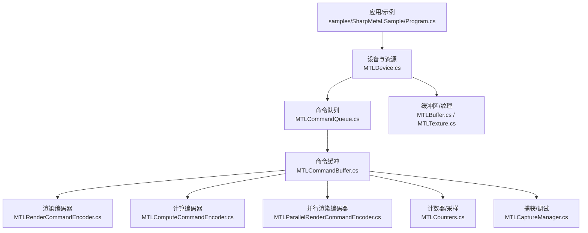
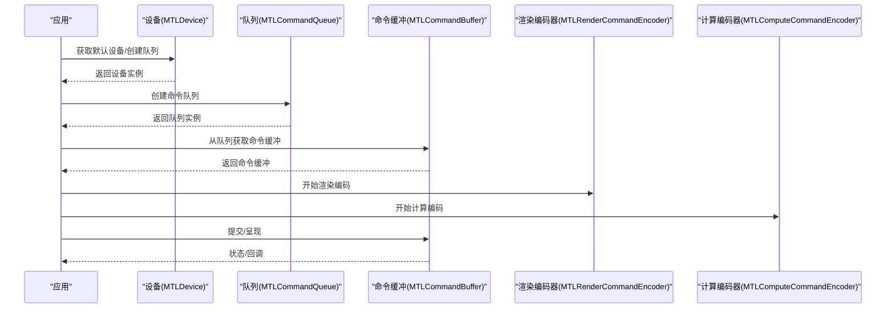
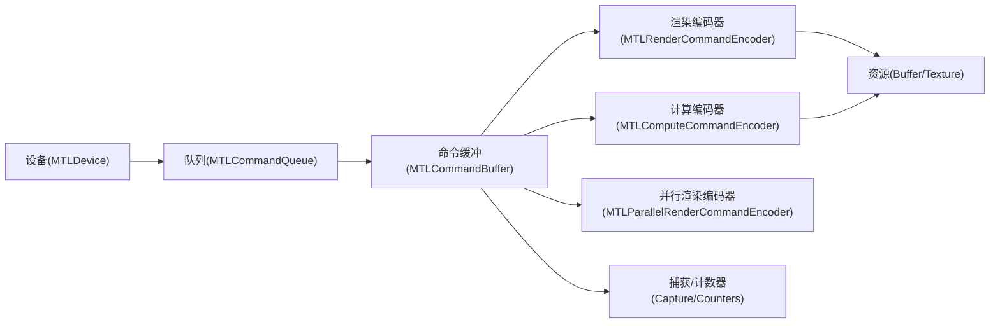

# GPU利用率优化

<cite>
**本文引用的文件**
- [README.md](file://README.md)
- [DESIGN.md](file://DESIGN.md)
- [MTLDevice.cs](file://src/SharpMetal/Metal/MTLDevice.cs)
- [MTLCommandQueue.cs](file://src/SharpMetal/Metal/MTLCommandQueue.cs)
- [MTLCommandBuffer.cs](file://src/SharpMetal/Metal/MTLCommandBuffer.cs)
- [MTLRenderCommandEncoder.cs](file://src/SharpMetal/Metal/MTLRenderCommandEncoder.cs)
- [MTLComputeCommandEncoder.cs](file://src/SharpMetal/Metal/MTLComputeCommandEncoder.cs)
- [MTLBuffer.cs](file://src/SharpMetal/Metal/MTLBuffer.cs)
- [MTLTexture.cs](file://src/SharpMetal/Metal/MTLTexture.cs)
- [MTLCaptureManager.cs](file://src/SharpMetal/Metal/MTLCaptureManager.cs)
- [MTLCounters.cs](file://src/SharpMetal/Metal/MTLCounters.cs)
- [MTLParallelRenderCommandEncoder.cs](file://src/SharpMetal/Metal/MTLParallelRenderCommandEncoder.cs)
- [Program.cs](file://samples/SharpMetal.Sample/Program.cs)
</cite>

## 目录
1. [简介](#简介)
2. [项目结构](#项目结构)
3. [核心组件](#核心组件)
4. [架构总览](#架构总览)
5. [详细组件分析](#详细组件分析)
6. [依赖关系分析](#依赖关系分析)
7. [性能考量与优化策略](#性能考量与优化策略)
8. [故障排查指南](#故障排查指南)
9. [结论](#结论)
10. [附录](#附录)

## 简介
本文件面向使用 SharpMetal（.NET 对 Apple Metal 的低层绑定）的开发者，提供提升 GPU 利用率的综合优化策略。内容覆盖设备特性查询、队列与命令缓冲管理、命令编码优化、多线程渲染、异步处理、流水线并行、资源池化、以及性能分析与调试技巧。所有建议均基于仓库中实际暴露的 API 能力进行归纳与组织，便于在真实工程中落地。

## 项目结构
SharpMetal 将运行时绑定代码集中在 src/SharpMetal/Metal 下，按 Metal 子系统划分；示例位于 samples/SharpMetal.Sample；设计约束与构建说明见根目录文档。

图表来源
- [Program.cs:21-45](file://samples/SharpMetal.Sample/Program.cs#L21-L45)
- [MTLDevice.cs:305-339](file://src/SharpMetal/Metal/MTLDevice.cs#L305-L339)
- [MTLCommandQueue.cs:44-107](file://src/SharpMetal/Metal/MTLCommandQueue.cs#L44-L107)
- [MTLCommandBuffer.cs:116-319](file://src/SharpMetal/Metal/MTLCommandBuffer.cs#L116-L319)
- [MTLRenderCommandEncoder.cs:126-800](file://src/SharpMetal/Metal/MTLRenderCommandEncoder.cs#L126-L800)
- [MTLComputeCommandEncoder.cs:20-296](file://src/SharpMetal/Metal/MTLComputeCommandEncoder.cs#L20-L296)
- [MTLParallelRenderCommandEncoder.cs:6-90](file://src/SharpMetal/Metal/MTLParallelRenderCommandEncoder.cs#L6-L90)
- [MTLBuffer.cs:6-113](file://src/SharpMetal/Metal/MTLBuffer.cs#L6-L113)
- [MTLTexture.cs:75-438](file://src/SharpMetal/Metal/MTLTexture.cs#L75-L438)
- [MTLCounters.cs:69-135](file://src/SharpMetal/Metal/MTLCounters.cs#L69-L135)
- [MTLCaptureManager.cs:58-134](file://src/SharpMetal/Metal/MTLCaptureManager.cs#L58-L134)

章节来源
- [README.md:12-16](file://README.md#L12-L16)
- [DESIGN.md:1-12](file://DESIGN.md#L1-L12)

## 核心组件
- 设备（MTLDevice）：提供设备能力查询、资源创建、命令队列创建、计数器等高级能力入口。
- 命令队列（MTLCommandQueue）：承载命令缓冲的生命周期管理与提交。
- 命令缓冲（MTLCommandBuffer）：封装一次或多次 GPU 工作负载的提交单元，支持回调、时间戳、事件同步等。
- 渲染/计算编码器（MTLRenderCommandEncoder / MTLComputeCommandEncoder）：具体绘制、着色、计算任务编码。
- 并行渲染编码器（MTLParallelRenderCommandEncoder）：在同一命令缓冲内并行编码多个渲染子通道。
- 资源（MTLBuffer / MTLTexture）：GPU/CPU 共享内存、纹理格式与访问模式配置。
- 性能分析（MTLCaptureManager / MTLCounters）：捕获帧、统计阶段利用率、采样计数器。

章节来源
- [MTLDevice.cs:187-339](file://src/SharpMetal/Metal/MTLDevice.cs#L187-L339)
- [MTLCommandQueue.cs:44-107](file://src/SharpMetal/Metal/MTLCommandQueue.cs#L44-L107)
- [MTLCommandBuffer.cs:116-319](file://src/SharpMetal/Metal/MTLCommandBuffer.cs#L116-L319)
- [MTLRenderCommandEncoder.cs:126-800](file://src/SharpMetal/Metal/MTLRenderCommandEncoder.cs#L126-L800)
- [MTLComputeCommandEncoder.cs:20-296](file://src/SharpMetal/Metal/MTLComputeCommandEncoder.cs#L20-L296)
- [MTLParallelRenderCommandEncoder.cs:6-90](file://src/SharpMetal/Metal/MTLParallelRenderCommandEncoder.cs#L6-L90)
- [MTLBuffer.cs:6-113](file://src/SharpMetal/Metal/MTLBuffer.cs#L6-L113)
- [MTLTexture.cs:75-438](file://src/SharpMetal/Metal/MTLTexture.cs#L75-L438)
- [MTLCaptureManager.cs:58-134](file://src/SharpMetal/Metal/MTLCaptureManager.cs#L58-L134)
- [MTLCounters.cs:69-135](file://src/SharpMetal/Metal/MTLCounters.cs#L69-L135)

## 架构总览
下图展示从设备到命令缓冲再到编码器的典型调用链，体现“设备→队列→缓冲→编码器”的层次化执行模型。

图表来源
- [MTLDevice.cs:305-339](file://src/SharpMetal/Metal/MTLDevice.cs#L305-L339)
- [MTLCommandQueue.cs:44-107](file://src/SharpMetal/Metal/MTLCommandQueue.cs#L44-L107)
- [MTLCommandBuffer.cs:116-319](file://src/SharpMetal/Metal/MTLCommandBuffer.cs#L116-L319)
- [MTLRenderCommandEncoder.cs:126-800](file://src/SharpMetal/Metal/MTLRenderCommandEncoder.cs#L126-L800)
- [MTLComputeCommandEncoder.cs:20-296](file://src/SharpMetal/Metal/MTLComputeCommandEncoder.cs#L20-L296)

## 详细组件分析

### 设备特性查询与参数调优（MTLDevice）
- 线程组上限与内存限制：通过最大线程组大小、最大线程组内存长度等属性指导 dispatch 尺寸与共享内存分配。
- 功能开关：如是否支持统一内存、读写纹理等级、MSAA、BCTexture压缩、拉取式插值、函数指针、光线追踪等，用于条件编译或运行时分支选择。
- 并发编译：可开启最大化并发编译以提升管线构建吞吐。
- 资源对齐与堆：提供 Heap 相关尺寸与对齐查询，利于自定义内存池与批量分配。
- 间接命令缓冲：支持创建间接命令缓冲以批量化绘制/计算调用。
- 计数器与时间戳：支持计数器采样与时间戳频率查询，辅助性能剖析。

优化要点
- 根据 MaxThreadsPerThreadgroup 与 MaxThreadgroupMemoryLength 调整线程组规模与共享内存占用。
- 依据 ReadWriteTextureTier、Supports* 系列能力选择更高效的算法路径。
- 使用 ShouldMaximizeConcurrentCompilation 与 MaximumConcurrentCompilationTaskCount 提高管线构建效率。
- 借助 Heap 尺寸与对齐信息实现资源池化，减少碎片与分配开销。

章节来源
- [MTLDevice.cs:187-339](file://src/SharpMetal/Metal/MTLDevice.cs#L187-L339)
- [MTLDevice.cs:456-700](file://src/SharpMetal/Metal/MTLDevice.cs#L456-L700)

### 队列管理与命令缓冲生命周期（MTLCommandQueue / MTLCommandBuffer）
- 队列描述符：可设置标签、日志状态、最大命令缓冲数，控制资源上限与调试输出。
- 命令缓冲：支持保留引用、错误选项、标签、GPU/CPU 时间戳、状态查询、回调（调度/完成）、等待完成、事件信号/等待、并行渲染编码器、资源状态编码器、加速结构编码器、调试分组等。
- 呈现：支持延迟呈现与最小持续时间呈现，配合显示刷新优化。

优化要点
- 为不同用途创建独立队列并设置合理的 MaxCommandBufferCount，避免阻塞。
- 使用 RetainedReferences/ErrorOptions 精细控制生命周期与错误传播。
- 使用 AddScheduledHandler/AddCompletedHandler 实现异步流水线，避免 CPU 空闲。
- 使用 PresentDrawableAtTime/PresentDrawableAfterMinimumDuration 降低掉帧与撕裂。

章节来源
- [MTLCommandQueue.cs:6-107](file://src/SharpMetal/Metal/MTLCommandQueue.cs#L6-L107)
- [MTLCommandBuffer.cs:59-319](file://src/SharpMetal/Metal/MTLCommandBuffer.cs#L59-L319)

### 渲染编码优化（MTLRenderCommandEncoder）
- 管线与状态：设置渲染管线、深度模板、视口、裁剪、剔除、填充模式、可见性结果等。
- 资源绑定：顶点/片段/对象/网格/瓦片阶段的 Buffer、Texture、Sampler 批量设置接口，减少重复绑定。
- 绘制调用：直接绘制、索引绘制、间接绘制、Patch 绘制、Mesh 绘制等，支持大批量合并。
- 资源使用声明：UseResource/UseResources 显式声明资源使用阶段，帮助驱动优化数据流。
- 内存屏障：MemoryBarrier 精确控制读写顺序，避免不必要的全局屏障。
- 并行渲染：结合 ParallelRenderCommandEncoder 拆分多目标/多 pass 的编码。

优化要点
- 批量设置 Buffer/Texture/Sampler，减少 API 调用次数。
- 合理设置 StoreAction/StoreActionOptions，避免不必要的写回。
- 使用 UseResources 标注资源使用阶段，减少隐式转换与同步。
- 使用 ExecuteCommandsInBuffer 复用预编码命令，降低每帧开销。
- 使用 MemoryBarrier 精准控制依赖，避免过度同步。

章节来源
- [MTLRenderCommandEncoder.cs:126-800](file://src/SharpMetal/Metal/MTLRenderCommandEncoder.cs#L126-L800)
- [MTLParallelRenderCommandEncoder.cs:6-90](file://src/SharpMetal/Metal/MTLParallelRenderCommandEncoder.cs#L6-L90)

### 计算编码优化（MTLComputeCommandEncoder）
- 管线与资源：设置计算管线、字节/Buffer/Texture/Sampler、图像块尺寸、阶段输入区域等。
- 调度：DispatchThreadgroups/DispatchThreads 支持直接/间接调度，灵活映射工作负载。
- 同步与屏障：UpdateFence/WaitForFence、MemoryBarrier 控制跨阶段依赖。
- 执行复用：ExecuteCommandsInBuffer 复用预编码计算命令。

优化要点
- 根据硬件 MaxThreadsPerThreadgroup 与共享内存限制调整线程组规模。
- 使用间接调度与 StageInRegion 间接参数，减少 CPU 侧循环与命令生成。
- 使用 Fence/Event 实现细粒度同步，避免全局等待。
- 使用 MemoryBarrier 仅对必要资源加屏障，降低同步成本。

章节来源
- [MTLComputeCommandEncoder.cs:20-296](file://src/SharpMetal/Metal/MTLComputeCommandEncoder.cs#L20-L296)

### 资源池化与内存布局（MTLBuffer / MTLTexture）
- 缓冲区：支持 CPU/GPU 存储模式、缓存模式、危险跟踪、堆偏移、别名化、远程视图、可丢弃状态等。
- 纹理：支持多种类型、像素格式、Mipmap、采样、数组、共享句柄、稀疏纹理、压缩、Swizzle、视图等。

优化要点
- 选择合适的 StorageMode/CpuCacheMode/HazardTrackingMode，平衡 CPU/GPU 访问效率。
- 使用 MakeAliasable 与堆分配实现资源池化，减少频繁分配/释放。
- 使用 TextureView 与 Swizzle 减少数据重排与拷贝。
- 使用 ReplaceRegion/GetBytes 高效更新/读取小块数据，避免整图重建。

章节来源
- [MTLBuffer.cs:6-113](file://src/SharpMetal/Metal/MTLBuffer.cs#L6-L113)
- [MTLTexture.cs:75-438](file://src/SharpMetal/Metal/MTLTexture.cs#L75-L438)

### 多线程渲染与并行编码
- 并行渲染编码器：在同一命令缓冲内并行编码多个渲染子通道，充分利用多核 CPU 生成命令。
- 命令缓冲回调：AddScheduledHandler/AddCompletedHandler 实现异步流水线，CPU 可在 GPU 执行时继续准备下一帧。

优化要点
- 将不同渲染目标或 pass 拆分到并行编码器，减少主线程瓶颈。
- 使用回调链实现帧间重叠：准备帧 N+1 的同时，GPU 执行帧 N。

章节来源
- [MTLParallelRenderCommandEncoder.cs:6-90](file://src/SharpMetal/Metal/MTLParallelRenderCommandEncoder.cs#L6-L90)
- [MTLCommandBuffer.cs:185-193](file://src/SharpMetal/Metal/MTLCommandBuffer.cs#L185-L193)

### 异步处理与事件同步
- 事件：EncodeWaitForEventvalue/EncodeSignalEvent 实现跨命令缓冲/队列的轻量同步。
- 栅栏：UpdateFence/WaitForFence 在渲染/计算阶段内部同步。
- 等待：WaitUntilScheduled/WaitUntilCompleted 用于调试或关键路径同步。

优化要点
- 用 Event/Fence 替代全局等待，降低流水线停顿。
- 仅在必要时使用 WaitUntil*，避免阻塞 CPU。

章节来源
- [MTLCommandBuffer.cs:235-243](file://src/SharpMetal/Metal/MTLCommandBuffer.cs#L235-L243)
- [MTLRenderCommandEncoder.cs:593-601](file://src/SharpMetal/Metal/MTLRenderCommandEncoder.cs#L593-L601)
- [MTLComputeCommandEncoder.cs:195-203](file://src/SharpMetal/Metal/MTLComputeCommandEncoder.cs#L195-L203)

### 性能分析与调试技巧
- 捕获：MTLCaptureManager 支持设备/队列/作用域级别捕获，输出至开发者工具或 GPU Trace 文档。
- 计数器：MTLCounterSampleBufferDescriptor/MTLCounterSampleBuffer 支持阶段利用率、时间戳、统计指标采样与解析。
- 调试分组：PushDebugGroup/PopDebugGroup/InsertDebugSignpost 标记关键段，便于定位热点。

优化要点
- 在关键帧启用捕获，分析 GPU 阶段利用率与瓶颈。
- 使用计数器采样评估顶点/片段/渲染目标阶段占用，针对性优化。
- 使用调试分组与标志位，快速定位低效路径。

章节来源
- [MTLCaptureManager.cs:58-134](file://src/SharpMetal/Metal/MTLCaptureManager.cs#L58-L134)
- [MTLCounters.cs:69-135](file://src/SharpMetal/Metal/MTLCounters.cs#L69-L135)
- [MTLCommandBuffer.cs:270-278](file://src/SharpMetal/Metal/MTLCommandBuffer.cs#L270-L278)
- [MTLRenderCommandEncoder.cs:153-166](file://src/SharpMetal/Metal/MTLRenderCommandEncoder.cs#L153-L166)
- [MTLComputeCommandEncoder.cs:43-56](file://src/SharpMetal/Metal/MTLComputeCommandEncoder.cs#L43-L56)

## 依赖关系分析
- 设备是资源与队列的工厂，命令缓冲由队列创建，编码器依附于命令缓冲。
- 渲染/计算编码器依赖资源（Buffer/Texture），并通过 UseResources/MemoryBarrier 声明依赖关系。
- 并行渲染编码器作为渲染编码器的扩展，提升 CPU 端命令生成并行度。
- 捕获与计数器依赖设备/队列/命令缓冲的能力，贯穿整个执行链路。

图表来源
- [MTLDevice.cs:305-339](file://src/SharpMetal/Metal/MTLDevice.cs#L305-L339)
- [MTLCommandQueue.cs:44-107](file://src/SharpMetal/Metal/MTLCommandQueue.cs#L44-L107)
- [MTLCommandBuffer.cs:116-319](file://src/SharpMetal/Metal/MTLCommandBuffer.cs#L116-L319)
- [MTLRenderCommandEncoder.cs:126-800](file://src/SharpMetal/Metal/MTLRenderCommandEncoder.cs#L126-L800)
- [MTLComputeCommandEncoder.cs:20-296](file://src/SharpMetal/Metal/MTLComputeCommandEncoder.cs#L20-L296)
- [MTLParallelRenderCommandEncoder.cs:6-90](file://src/SharpMetal/Metal/MTLParallelRenderCommandEncoder.cs#L6-L90)
- [MTLCaptureManager.cs:58-134](file://src/SharpMetal/Metal/MTLCaptureManager.cs#L58-L134)
- [MTLCounters.cs:69-135](file://src/SharpMetal/Metal/MTLCounters.cs#L69-L135)

## 性能考量与优化策略
- 设备特性适配
  - 查询 MaxThreadsPerThreadgroup、MaxThreadgroupMemoryLength、Supported* 能力，动态调整线程组规模、共享内存与算法路径。
  - 启用 ShouldMaximizeConcurrentCompilation 与合适的 MaximumConcurrentCompilationTaskCount 提升管线构建吞吐。
- 队列与命令缓冲
  - 为不同任务创建独立队列，设置合理的 MaxCommandBufferCount，避免队列拥塞。
  - 使用 RetainedReferences/ErrorOptions 控制生命周期与错误传播，减少意外释放。
  - 使用 AddScheduledHandler/AddCompletedHandler 实现帧间重叠与异步流水线。
- 渲染编码
  - 批量设置 Buffer/Texture/Sampler，减少 API 调用。
  - 使用 UseResources 明确资源使用阶段，减少隐式同步。
  - 使用 ExecuteCommandsInBuffer 复用命令，降低每帧开销。
  - 使用 MemoryBarrier 精准控制依赖，避免全局屏障。
- 计算编码
  - 根据硬件限制调整线程组规模与共享内存。
  - 使用间接调度与 StageInRegion 间接参数减少 CPU 循环。
  - 使用 Fence/Event 实现细粒度同步。
- 资源池化
  - 使用 MakeAliasable 与堆分配实现 Buffer/Texture 池化，减少分配/释放。
  - 使用 TextureView 与 Swizzle 减少数据重排。
- 多线程与并行
  - 使用 ParallelRenderCommandEncoder 拆分多 pass/多目标编码。
  - 使用命令缓冲回调实现 CPU 与 GPU 重叠。
- 呈现与同步
  - 使用 PresentDrawableAtTime/PresentDrawableAfterMinimumDuration 降低掉帧与撕裂。
  - 使用 EncodeWaitForEventvalue/EncodeSignalEvent 实现轻量同步。
- 性能分析
  - 使用 MTLCaptureManager 捕获帧，分析 GPU 阶段利用率。
  - 使用 MTLCounters 采样阶段利用率、时间戳、统计指标，定位瓶颈。
  - 使用 PushDebugGroup/PopDebugGroup/InsertDebugSignpost 标记关键段。

[本节为通用优化指导，不直接分析具体文件]

## 故障排查指南
- 常见错误与状态
  - 命令缓冲错误枚举包含内部错误、超时、缺页、黑名单、权限、内存不足、无效资源、无显存、设备移除、栈溢出等，结合 ErrorOptions 可细化诊断。
  - 命令缓冲状态包括未入队、已入队、已提交、已调度、已完成、错误，可用于判断执行进度。
- 调试手段
  - 使用 PushDebugGroup/PopDebugGroup/InsertDebugSignpost 标记关键段。
  - 使用 MTLCaptureManager 启动捕获，输出至开发者工具或 GPU Trace。
  - 使用 MTLCounters 采样阶段利用率与时间戳，解析结果定位瓶颈。
- 同步问题
  - 检查是否误用 WaitUntilScheduled/WaitUntilCompleted 导致 CPU 阻塞。
  - 优先使用 Fence/Event 进行细粒度同步，避免全局等待。

章节来源
- [MTLCommandBuffer.cs:9-48](file://src/SharpMetal/Metal/MTLCommandBuffer.cs#L9-L48)
- [MTLCommandBuffer.cs:146-193](file://src/SharpMetal/Metal/MTLCommandBuffer.cs#L146-L193)
- [MTLCaptureManager.cs:58-134](file://src/SharpMetal/Metal/MTLCaptureManager.cs#L58-L134)
- [MTLCounters.cs:69-135](file://src/SharpMetal/Metal/MTLCounters.cs#L69-L135)

## 结论
通过系统性地利用 SharpMetal 暴露的设备能力、队列与命令缓冲机制、编码器优化、资源池化、多线程与并行编码、异步与事件同步，以及捕获与计数器分析，可以在真实工程中显著提升 GPU 利用率与整体吞吐。建议在开发早期即建立性能基线，持续使用捕获与计数器验证优化效果，并根据设备特性动态调整参数，确保在不同硬件上获得稳定高性能。

[本节为总结性内容，不直接分析具体文件]

## 附录
- 示例参考：samples/SharpMetal.Sample/Program.cs 展示了设备获取、共享缓冲区分配与读写的基本流程，可作为集成起点。
- 构建与运行：遵循 README 与 DESIGN 中的构建与平台要求，确保在 Apple 主机上运行。

章节来源
- [Program.cs:21-45](file://samples/SharpMetal.Sample/Program.cs#L21-L45)
- [README.md:5-16](file://README.md#L5-L16)
- [DESIGN.md:1-12](file://DESIGN.md#L1-L12)