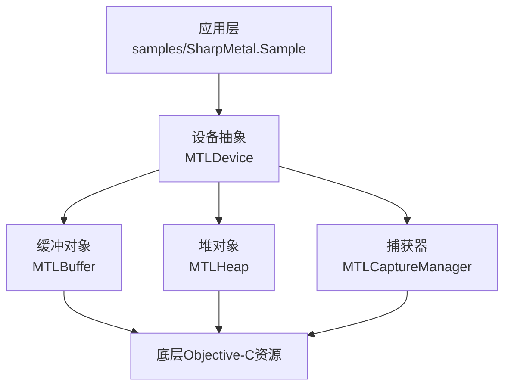
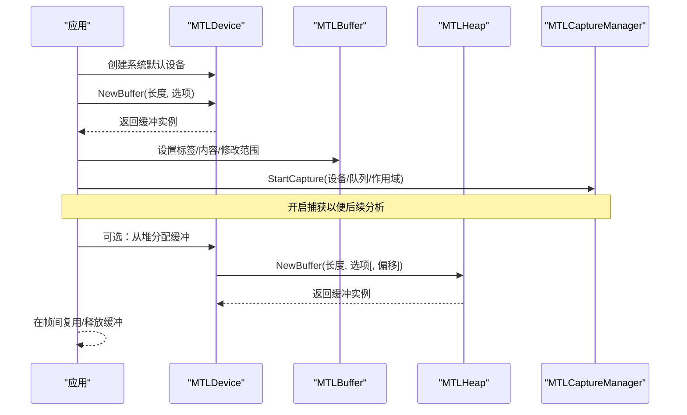
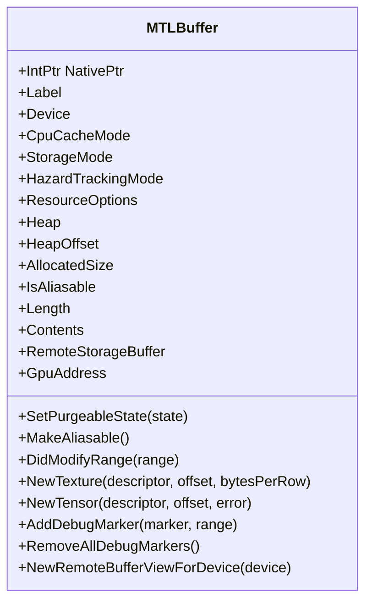
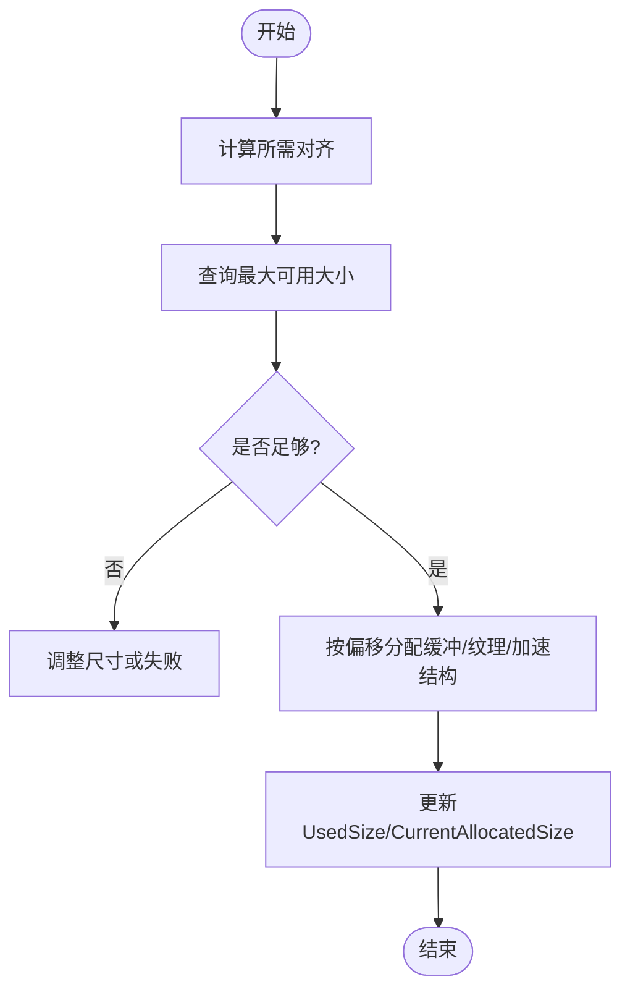
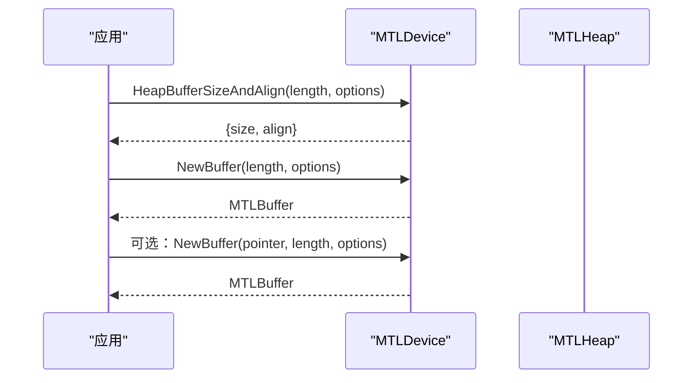
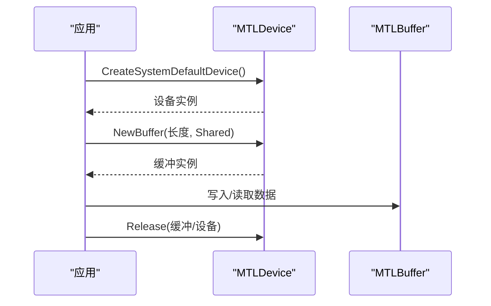
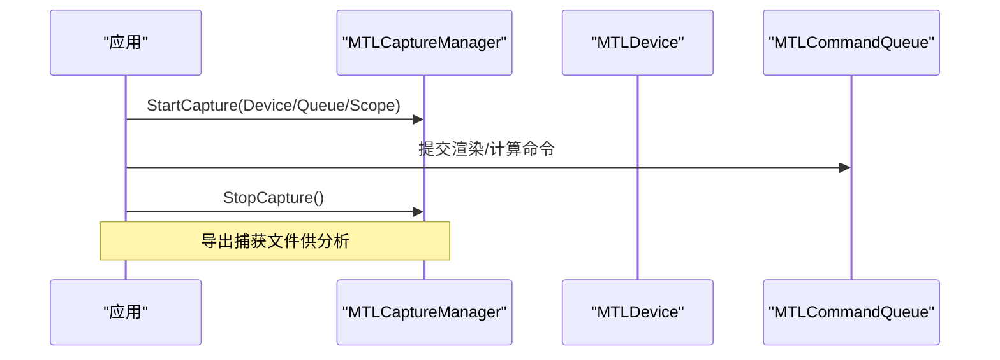
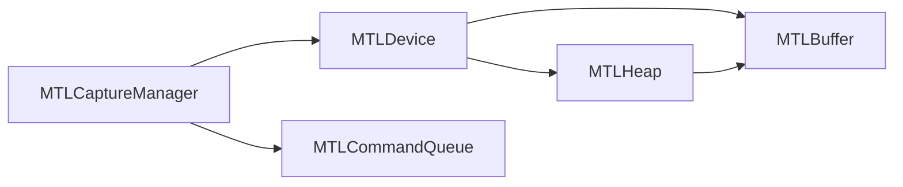

# 内存优化技术

<cite>
**本文引用的文件**
- [MTLBuffer.cs](file://src/SharpMetal/Metal/MTLBuffer.cs)
- [MTLHeap.cs](file://src/SharpMetal/Metal/MTLHeap.cs)
- [MTLAllocation.cs](file://src/SharpMetal/Metal/MTLAllocation.cs)
- [MTLDevice.cs](file://src/SharpMetal/Metal/MTLDevice.cs)
- [MTLCaptureManager.cs](file://src/SharpMetal/Metal/MTLCaptureManager.cs)
- [Program.cs](file://samples/SharpMetal.Sample/Program.cs)
</cite>

## 目录
1. [简介](#简介)
2. [项目结构](#项目结构)
3. [核心组件](#核心组件)
4. [架构总览](#架构总览)
5. [详细组件分析](#详细组件分析)
6. [依赖关系分析](#依赖关系分析)
7. [性能考虑](#性能考虑)
8. [故障排查指南](#故障排查指南)
9. [结论](#结论)
10. [附录](#附录)

## 简介
本指南聚焦于 SharpMetal 中 GPU 内存优化的实践，围绕 MTLBuffer 的内存管理模式展开，涵盖存储模式选择、CPU 缓存模式配置、堆内存分配策略、内存对齐、缓冲区复用与垃圾回收优化等主题。同时提供生命周期管理最佳实践与内存使用监控分析方法，帮助开发者避免内存泄漏与性能瓶颈。

## 项目结构
- 运行时绑定位于 src/SharpMetal/Metal，包含 Metal 框架的核心类型封装（如设备、缓冲、堆、捕获器等）。
- 示例工程 samples/SharpMetal.Sample 展示了如何在 .NET 环境下创建设备并分配共享模式的缓冲，演示了基本生命周期管理。
- 设计文档 README.md 与 DESIGN.md 说明了平台约束、构建与运行前提（需要 Apple 宿主环境）。

图表来源
- [Program.cs:21-44](file://samples/SharpMetal.Sample/Program.cs#L21-L44)
- [MTLDevice.cs:356-369](file://src/SharpMetal/Metal/MTLDevice.cs#L356-L369)
- [MTLHeap.cs:124-147](file://src/SharpMetal/Metal/MTLHeap.cs#L124-L147)
- [MTLCaptureManager.cs:74-117](file://src/SharpMetal/Metal/MTLCaptureManager.cs#L74-L117)

章节来源
- [README.md:1-23](file://README.md#L1-L23)
- [DESIGN.md:1-12](file://DESIGN.md#L1-L12)

## 核心组件
- MTLBuffer：GPU/CPU 共享或独占缓冲的抽象，暴露存储模式、CPU 缓存模式、长度、内容指针、可别名化能力、清理状态等关键属性与方法。
- MTLHeap：统一内存池，支持按对齐分配缓冲、纹理、加速结构等，便于集中管理与复用。
- MTLDevice：系统默认设备获取、缓冲与堆创建、对齐查询、特性探测等入口。
- MTLCaptureManager：Metal 捕获与分析工具集成，用于性能分析与问题定位。

章节来源
- [MTLBuffer.cs:18-49](file://src/SharpMetal/Metal/MTLBuffer.cs#L18-L49)
- [MTLHeap.cs:13-147](file://src/SharpMetal/Metal/MTLHeap.cs#L13-L147)
- [MTLDevice.cs:305-369](file://src/SharpMetal/Metal/MTLDevice.cs#L305-L369)
- [MTLCaptureManager.cs:58-117](file://src/SharpMetal/Metal/MTLCaptureManager.cs#L58-L117)

## 架构总览
下图展示从应用到 Metal 资源的调用链与内存路径：应用通过设备创建缓冲或从堆分配；缓冲可被 CPU 写入并通过共享模式同步至 GPU；捕获器可用于记录执行轨迹与内存访问以辅助分析。

图表来源
- [Program.cs:21-44](file://samples/SharpMetal.Sample/Program.cs#L21-L44)
- [MTLDevice.cs:356-369](file://src/SharpMetal/Metal/MTLDevice.cs#L356-L369)
- [MTLHeap.cs:124-147](file://src/SharpMetal/Metal/MTLHeap.cs#L124-L147)
- [MTLCaptureManager.cs:74-117](file://src/SharpMetal/Metal/MTLCaptureManager.cs#L74-L117)

## 详细组件分析

### MTLBuffer 内存管理模式
- 存储模式与 CPU 缓存模式
  - 通过 StorageMode 与 CpuCacheMode 控制数据驻留位置与缓存行为，影响 CPU/GPU 访问效率与一致性。
- 内容访问与修改通知
  - Contents 提供 CPU 可读写的原生指针；DidModifyRange 用于告知驱动已修改的区域，减少不必要的同步开销。
- 可别名化与视图
  - MakeAliasable 允许将缓冲作为其他资源（如纹理）的别名视图，提升复用率；NewTexture/NewTensor 可从缓冲派生视图。
- 清理与远程视图
  - SetPurgeableState 支持按需清理；RemoteStorageBuffer/NewRemoteBufferViewForDevice 用于跨设备/进程场景。

图表来源
- [MTLBuffer.cs:18-88](file://src/SharpMetal/Metal/MTLBuffer.cs#L18-L88)

章节来源
- [MTLBuffer.cs:18-88](file://src/SharpMetal/Metal/MTLBuffer.cs#L18-L88)

### MTLHeap 堆内存分配策略
- 描述符与类型
  - MTLHeapDescriptor 配置 Size、StorageMode、CpuCacheMode、SparsePageSize、HazardTrackingMode、ResourceOptions、Type 等。
  - MTLHeapType 支持 Automatic、Placement、Sparse，适配不同内存布局与稀疏需求。
- 分配与查询
  - MaxAvailableSize(alignment) 查询可用空间；NewBuffer/NewTexture/NewAccelerationStructure 支持带偏移的分配，便于细粒度复用。
- 统计信息
  - UsedSize、CurrentAllocatedSize 可用于监控堆占用趋势。

图表来源
- [MTLHeap.cs:21-63](file://src/SharpMetal/Metal/MTLHeap.cs#L21-L63)
- [MTLHeap.cs:119-147](file://src/SharpMetal/Metal/MTLHeap.cs#L119-L147)

章节来源
- [MTLHeap.cs:13-147](file://src/SharpMetal/Metal/MTLHeap.cs#L13-L147)

### MTLDevice 对齐与缓冲创建
- 对齐查询
  - HeapBufferSizeAndAlign(length, options) 返回缓冲在堆中的 size 与 align，确保正确对齐以避免未定义行为。
- 缓冲创建
  - NewBuffer(length, options) 与 NewBuffer(pointer, length, options) 支持托管/非托管数据导入；placement sparse 版本支持稀疏页大小。
- 特性探测
  - SupportsPlacementSparse、MaxBufferLength 等用于决定分配策略与上限。

图表来源
- [MTLDevice.cs:346-369](file://src/SharpMetal/Metal/MTLDevice.cs#L346-L369)

章节来源
- [MTLDevice.cs:346-369](file://src/SharpMetal/Metal/MTLDevice.cs#L346-L369)

### 生命周期管理与示例
- 示例流程
  - 创建系统默认设备，分配共享模式缓冲，写入并读取验证，最后显式释放原生资源。
- 关键点
  - 使用 ResourceStorageModeShared 便于 CPU/GPU 共享访问；Contents 提供直接读写；finally 块确保释放。

图表来源
- [Program.cs:21-44](file://samples/SharpMetal.Sample/Program.cs#L21-L44)

章节来源
- [Program.cs:21-44](file://samples/SharpMetal.Sample/Program.cs#L21-L44)

### 内存监控与分析工具
- 捕获器
  - MTLCaptureManager 支持基于设备、命令队列或作用域的捕获；StartCapture/StopCapture 控制录制；SupportsDestination 检查目标能力。
- 用途
  - 结合 Xcode Instruments 或 Metal Frame Debugger，分析 GPU 工作负载、内存带宽、同步点与潜在瓶颈。

图表来源
- [MTLCaptureManager.cs:74-117](file://src/SharpMetal/Metal/MTLCaptureManager.cs#L74-L117)

章节来源
- [MTLCaptureManager.cs:58-117](file://src/SharpMetal/Metal/MTLCaptureManager.cs#L58-L117)

## 依赖关系分析
- 组件耦合
  - MTLBuffer 依赖 MTLDevice 进行创建，也可由 MTLHeap 分配；两者均通过 ObjectiveCRuntime 与底层 Metal 交互。
  - MTLCaptureManager 独立于具体资源类型，但通常与设备/队列配合使用。
- 外部依赖
  - 所有原生资源最终指向 Apple 的 Metal 框架；需要在 Apple 宿主环境中运行。

图表来源
- [MTLDevice.cs:356-369](file://src/SharpMetal/Metal/MTLDevice.cs#L356-L369)
- [MTLHeap.cs:124-147](file://src/SharpMetal/Metal/MTLHeap.cs#L124-L147)
- [MTLCaptureManager.cs:74-117](file://src/SharpMetal/Metal/MTLCaptureManager.cs#L74-L117)

章节来源
- [MTLDevice.cs:356-369](file://src/SharpMetal/Metal/MTLDevice.cs#L356-L369)
- [MTLHeap.cs:124-147](file://src/SharpMetal/Metal/MTLHeap.cs#L124-L147)
- [MTLCaptureManager.cs:74-117](file://src/SharpMetal/Metal/MTLCaptureManager.cs#L74-L117)

## 性能考虑
- 存储模式选择
  - 频繁 CPU/GPU 交替访问建议使用共享模式；仅 GPU 写入且无需回读可使用私有模式以减少拷贝。
- CPU 缓存模式
  - 根据访问频率选择缓存策略，降低不必要的数据迁移与一致性开销。
- 堆分配与对齐
  - 使用 HeapBufferSizeAndAlign 获取精确对齐要求，避免碎片与未对齐导致的性能退化。
- 缓冲区复用
  - 优先在堆中按偏移分配，减少频繁创建/销毁；利用 IsAliasable 与 NewTexture/NewTensor 实现视图复用。
- 清理与惰性加载
  - 对暂不使用的资源使用 SetPurgeableState 进行清理，降低常驻内存压力。
- 捕获与分析
  - 使用 MTLCaptureManager 捕获关键帧，结合工具分析带宽、同步点与热点。

[本节为通用指导，不直接分析具体文件]

## 故障排查指南
- 常见问题
  - 共享缓冲分配失败：检查设备是否存在、参数是否合法、系统资源是否充足。
  - 数据不一致：确认 DidModifyRange 是否正确标记修改区域；避免在 GPU 使用中直接写 Contents。
  - 对齐错误：使用 HeapBufferSizeAndAlign 获取对齐值，确保缓冲边界满足要求。
  - 捕获失败：检查 SupportsDestination 与当前平台能力；确保在 Apple 宿主环境运行。
- 建议步骤
  - 启用捕获并导出日志；逐步缩小问题范围；对比不同存储/缓存模式下的表现。

章节来源
- [Program.cs:21-44](file://samples/SharpMetal.Sample/Program.cs#L21-L44)
- [MTLCaptureManager.cs:74-117](file://src/SharpMetal/Metal/MTLCaptureManager.cs#L74-L117)

## 结论
通过合理选择存储模式与 CPU 缓存模式、利用堆进行集中分配与复用、严格遵循对齐与生命周期管理，并结合捕获工具进行分析，可以在 SharpMetal 中实现高效稳定的 GPU 内存使用。建议在项目中建立统一的缓冲池与视图管理机制，持续监控内存占用与性能指标，及时优化瓶颈。

[本节为总结性内容，不直接分析具体文件]

## 附录
- 代码片段路径参考
  - 设备与缓冲创建：[MTLDevice.cs:356-369](file://src/SharpMetal/Metal/MTLDevice.cs#L356-L369)
  - 堆分配与对齐：[MTLHeap.cs:119-147](file://src/SharpMetal/Metal/MTLHeap.cs#L119-L147)
  - 缓冲属性与方法：[MTLBuffer.cs:18-88](file://src/SharpMetal/Metal/MTLBuffer.cs#L18-L88)
  - 示例生命周期：[Program.cs:21-44](file://samples/SharpMetal.Sample/Program.cs#L21-L44)
  - 捕获器使用：[MTLCaptureManager.cs:74-117](file://src/SharpMetal/Metal/MTLCaptureManager.cs#L74-L117)

[本节为索引与导航，不直接分析具体文件]