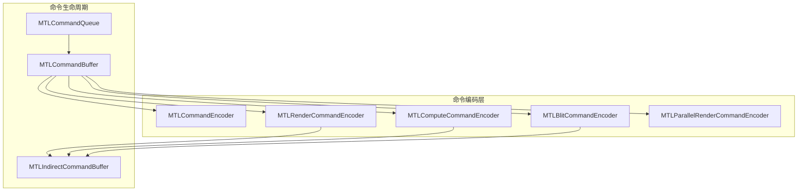
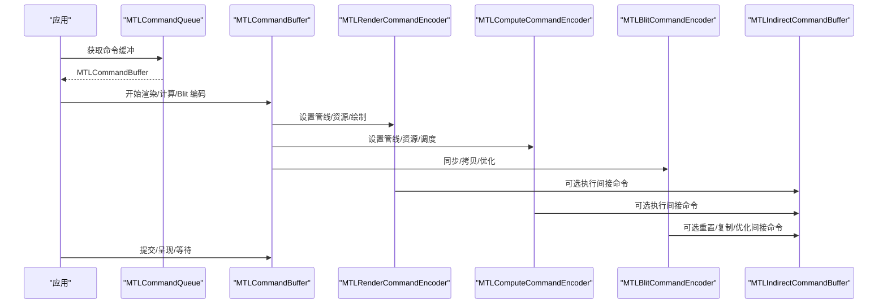
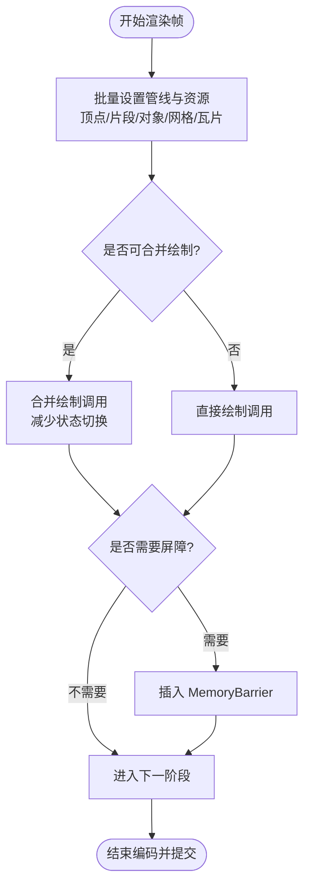
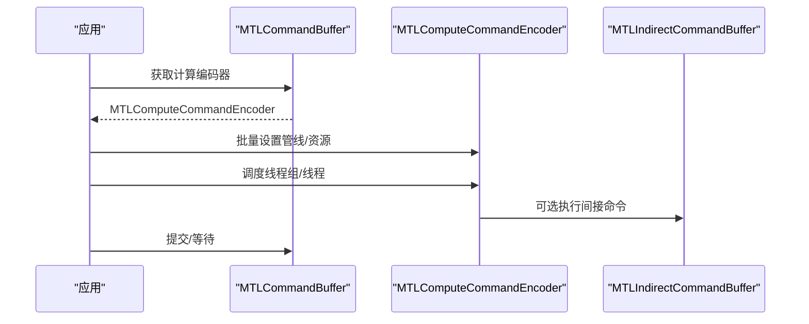
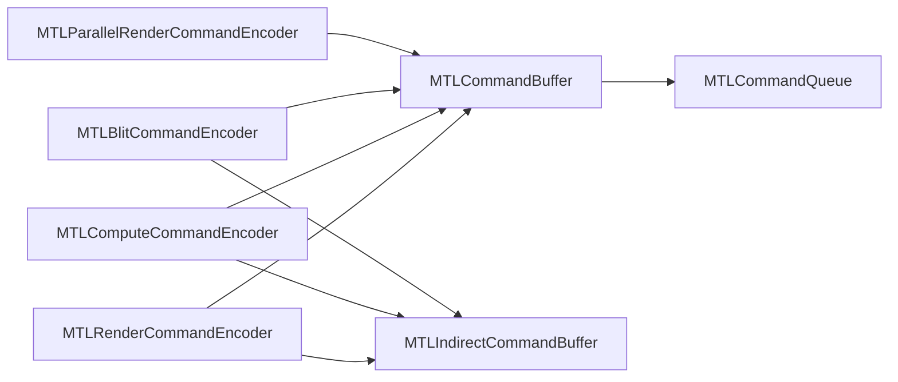

# 命令编码优化

<cite>
**本文引用的文件**
- [MTLCommandEncoder.cs](file://src/SharpMetal/Metal/MTLCommandEncoder.cs)
- [MTLRenderCommandEncoder.cs](file://src/SharpMetal/Metal/MTLRenderCommandEncoder.cs)
- [MTLComputeCommandEncoder.cs](file://src/SharpMetal/Metal/MTLComputeCommandEncoder.cs)
- [MTLBlitCommandEncoder.cs](file://src/SharpMetal/Metal/MTLBlitCommandEncoder.cs)
- [MTLParallelRenderCommandEncoder.cs](file://src/SharpMetal/Metal/MTLParallelRenderCommandEncoder.cs)
- [MTLCommandBuffer.cs](file://src/SharpMetal/Metal/MTLCommandBuffer.cs)
- [MTLIndirectCommandBuffer.cs](file://src/SharpMetal/Metal/MTLIndirectCommandBuffer.cs)
- [MTLCommandQueue.cs](file://src/SharpMetal/Metal/MTLCommandQueue.cs)
- [Program.cs](file://samples/SharpMetal.Sample/Program.cs)
</cite>

## 目录
1. [简介](#简介)
2. [项目结构](#项目结构)
3. [核心组件](#核心组件)
4. [架构总览](#架构总览)
5. [详细组件分析](#详细组件分析)
6. [依赖关系分析](#依赖关系分析)
7. [性能考量与优化策略](#性能考量与优化策略)
8. [故障排查指南](#故障排查指南)
9. [结论](#结论)
10. [附录：基准测试建议](#附录：基准测试建议)

## 简介
本文件聚焦于 SharpMetal 中命令编码的性能优化技巧，围绕 MTLCommandEncoder 的使用模式展开，涵盖批量操作、状态切换最小化、并行命令执行等策略。重点说明渲染命令与计算命令的优化方法，展示如何减少命令编码器创建开销、提高 GPU 利用率，并给出可操作的基准测试建议与对比思路。

## 项目结构
SharpMetal 在 Metal 层提供了完整的命令编码 API 封装，包括通用命令编码器、渲染/计算/Blit 专用编码器、并行渲染编码器、命令缓冲与队列、间接命令缓冲等。这些类型共同构成“CPU 构建命令 -> 提交到 GPU”的完整链路。

图表来源
- [MTLCommandEncoder.cs:20-61](file://src/SharpMetal/Metal/MTLCommandEncoder.cs#L20-L61)
- [MTLRenderCommandEncoder.cs:126-166](file://src/SharpMetal/Metal/MTLRenderCommandEncoder.cs#L126-L166)
- [MTLComputeCommandEncoder.cs:20-58](file://src/SharpMetal/Metal/MTLComputeCommandEncoder.cs#L20-L58)
- [MTLBlitCommandEncoder.cs:14-50](file://src/SharpMetal/Metal/MTLBlitCommandEncoder.cs#L14-L50)
- [MTLParallelRenderCommandEncoder.cs:6-44](file://src/SharpMetal/Metal/MTLParallelRenderCommandEncoder.cs#L6-L44)
- [MTLCommandBuffer.cs:116-268](file://src/SharpMetal/Metal/MTLCommandBuffer.cs#L116-L268)
- [MTLCommandQueue.cs:44-109](file://src/SharpMetal/Metal/MTLCommandQueue.cs#L44-L109)
- [MTLIndirectCommandBuffer.cs:135-219](file://src/SharpMetal/Metal/MTLIndirectCommandBuffer.cs#L135-L219)

章节来源
- [MTLCommandEncoder.cs:20-61](file://src/SharpMetal/Metal/MTLCommandEncoder.cs#L20-L61)
- [MTLCommandBuffer.cs:116-268](file://src/SharpMetal/Metal/MTLCommandBuffer.cs#L116-L268)
- [MTLCommandQueue.cs:44-109](file://src/SharpMetal/Metal/MTLCommandQueue.cs#L44-L109)

## 核心组件
- 通用命令编码器（MTLCommandEncoder）：提供标签、调试分组、结束编码等基础能力，是所有具体编码器的基类语义。
- 渲染命令编码器（MTLRenderCommandEncoder）：负责设置管线、顶点/片段/对象/网格/瓦片阶段资源绑定、绘制调用、视口/裁剪、深度模板、可见性结果、内存屏障、计数器采样、执行间接命令等。
- 计算命令编码器（MTLComputeCommandEncoder）：负责设置计算管线、资源绑定、线程组/线程调度、阶段区域、栅栏、内存屏障、计数器采样、执行间接命令等。
- Blit 命令编码器（MTLBlitCommandEncoder）：用于同步、拷贝、填充、生成 mipmaps、优化纹理内容、重置/复制/优化间接命令缓冲、计数器采样与解析。
- 并行渲染命令编码器（MTLParallelRenderCommandEncoder）：提供并行渲染子通道，支持在多线程下并发设置存储动作等，最终通过 RenderCommandEncoder 完成实际绘制。
- 命令缓冲（MTLCommandBuffer）：承载一组命令，支持提交、呈现、等待、回调、获取各类编码器、事件信号/等待、资源驻留集等。
- 间接命令缓冲（MTLIndirectCommandBuffer）：预录制可重放命令序列，支持继承管线/缓冲区、最大绑定数配置、指令类型集合、动态属性步长、光线追踪支持等。
- 命令队列（MTLCommandQueue）：管理命令缓冲的生命周期与调度，支持日志、最大缓冲数量、驻留集管理等。

章节来源
- [MTLCommandEncoder.cs:20-61](file://src/SharpMetal/Metal/MTLCommandEncoder.cs#L20-L61)
- [MTLRenderCommandEncoder.cs:126-800](file://src/SharpMetal/Metal/MTLRenderCommandEncoder.cs#L126-L800)
- [MTLComputeCommandEncoder.cs:20-298](file://src/SharpMetal/Metal/MTLComputeCommandEncoder.cs#L20-L298)
- [MTLBlitCommandEncoder.cs:14-217](file://src/SharpMetal/Metal/MTLBlitCommandEncoder.cs#L14-L217)
- [MTLParallelRenderCommandEncoder.cs:6-92](file://src/SharpMetal/Metal/MTLParallelRenderCommandEncoder.cs#L6-L92)
- [MTLCommandBuffer.cs:116-321](file://src/SharpMetal/Metal/MTLCommandBuffer.cs#L116-L321)
- [MTLIndirectCommandBuffer.cs:26-219](file://src/SharpMetal/Metal/MTLIndirectCommandBuffer.cs#L26-L219)
- [MTLCommandQueue.cs:44-109](file://src/SharpMetal/Metal/MTLCommandQueue.cs#L44-L109)

## 架构总览
下图展示了从 CPU 端构建命令到 GPU 执行的典型流程，以及关键优化点的位置。

图表来源
- [MTLCommandBuffer.cs:195-268](file://src/SharpMetal/Metal/MTLCommandBuffer.cs#L195-L268)
- [MTLRenderCommandEncoder.cs:168-800](file://src/SharpMetal/Metal/MTLRenderCommandEncoder.cs#L168-L800)
- [MTLComputeCommandEncoder.cs:60-298](file://src/SharpMetal/Metal/MTLComputeCommandEncoder.cs#L60-L298)
- [MTLBlitCommandEncoder.cs:52-217](file://src/SharpMetal/Metal/MTLBlitCommandEncoder.cs#L52-L217)
- [MTLIndirectCommandBuffer.cs:135-219](file://src/SharpMetal/Metal/MTLIndirectCommandBuffer.cs#L135-L219)

## 详细组件分析

### 渲染命令编码器（MTLRenderCommandEncoder）优化要点
- 批量绘制与状态合并
  - 使用批量接口减少状态切换：例如批量设置顶点/片段/对象/网格/瓦片阶段的缓冲区、纹理、采样器、函数表等，避免频繁单条 set 调用。
  - 利用间接命令缓冲（ExecuteCommandsInBuffer）将多帧或多对象的绘制命令预录制并重放，显著降低每帧 CPU 侧状态设置与调用开销。
- 视图/裁剪/填充模式批处理
  - 使用 SetViewports/SetScissorRects/TriangleFillMode 等批量接口，减少逐项设置带来的状态切换。
- 资源使用声明与屏障
  - 使用 UseResource/UseResources 显式声明资源使用意图与阶段，帮助驱动进行更优的资源布局与访问优化。
  - 合理使用 MemoryBarrier 控制读写顺序，避免不必要的同步；仅在必要时插入屏障。
- 可见性与计数
  - 使用 VisibilityResultMode 与 SampleCountersInBuffer 进行可见性统计与性能计数器采样，辅助定位瓶颈。
- 并行渲染
  - 通过 ParallelRenderCommandEncoder 在多线程下并行设置存储动作等，减少主线程阻塞。

图表来源
- [MTLRenderCommandEncoder.cs:168-800](file://src/SharpMetal/Metal/MTLRenderCommandEncoder.cs#L168-L800)
- [MTLCommandBuffer.cs:195-268](file://src/SharpMetal/Metal/MTLCommandBuffer.cs#L195-L268)

章节来源
- [MTLRenderCommandEncoder.cs:168-800](file://src/SharpMetal/Metal/MTLRenderCommandEncoder.cs#L168-L800)
- [MTLParallelRenderCommandEncoder.cs:46-92](file://src/SharpMetal/Metal/MTLParallelRenderCommandEncoder.cs#L46-L92)

### 计算命令编码器（MTLComputeCommandEncoder）优化要点
- 批量资源绑定
  - 使用 SetBuffers/SetTextures/SetSamplerStates 的批量接口，减少多次 set 调用的开销。
- 线程组织与调度
  - 合理选择 DispatchThreadgroups/DispatchThreads，结合 StageInRegion 或间接参数，实现细粒度或粗粒度的任务划分。
- 内存与同步
  - 使用 MemoryBarrier 控制资源访问顺序，避免过度同步；仅在数据依赖处插入屏障。
- 间接命令与重放
  - 通过 ExecuteCommandsInBuffer 重放预录制的计算命令，降低每帧 CPU 负担。
- 计数器与诊断
  - 使用 SampleCountersInBuffer 采集性能指标，辅助优化线程组大小与内存访问模式。

图表来源
- [MTLComputeCommandEncoder.cs:60-298](file://src/SharpMetal/Metal/MTLComputeCommandEncoder.cs#L60-L298)
- [MTLCommandBuffer.cs:200-223](file://src/SharpMetal/Metal/MTLCommandBuffer.cs#L200-L223)
- [MTLIndirectCommandBuffer.cs:135-219](file://src/SharpMetal/Metal/MTLIndirectCommandBuffer.cs#L135-L219)

章节来源
- [MTLComputeCommandEncoder.cs:60-298](file://src/SharpMetal/Metal/MTLComputeCommandEncoder.cs#L60-L298)

### Blit 命令编码器（MTLBlitCommandEncoder）优化要点
- 同步与拷贝
  - 使用 SynchronizeResource/SynchronizeTexture 精确同步，避免全局同步。
  - 使用 CopyFromTexture/CopyFromBuffer 等批量拷贝接口，减少多次小拷贝的开销。
- 纹理优化
  - 使用 OptimizeContentsForGPUAccess/OptimizeContentsForCPUAccess 在访问前优化纹理布局，提升带宽利用率。
- 间接命令缓冲优化
  - 使用 ResetCommandsInBuffer/CopyIndirectCommandBuffer/OptimizeIndirectCommandBuffer 维护高效的重放命令序列。
- 计数器采样与解析
  - 使用 SampleCountersInBuffer/ResolveCounters 收集并解析性能计数器，指导优化方向。

章节来源
- [MTLBlitCommandEncoder.cs:52-217](file://src/SharpMetal/Metal/MTLBlitCommandEncoder.cs#L52-L217)

### 并行渲染命令编码器（MTLParallelRenderCommandEncoder）优化要点
- 多线程并行设置存储动作
  - 在多线程环境下，通过 ParallelRenderCommandEncoder 并行设置颜色/深度/模板存储动作，减少主线程竞争。
- 与 RenderCommandEncoder 协作
  - 通过 RenderCommandEncoder 属性获取子通道编码器，完成实际的绘制与状态设置。

章节来源
- [MTLParallelRenderCommandEncoder.cs:18-92](file://src/SharpMetal/Metal/MTLParallelRenderCommandEncoder.cs#L18-L92)

### 命令缓冲与队列（MTLCommandBuffer / MTLCommandQueue）优化要点
- 命令缓冲复用
  - 尽量复用命令缓冲，减少创建销毁开销；通过 WaitUntilScheduled/WaitUntilCompleted 控制生命周期。
- 呈现与时间控制
  - 使用 PresentDrawable/PresentDrawableAtTime/PresentDrawableAfterMinimumDuration 控制呈现时机，降低卡顿。
- 事件与回调
  - 使用 EncodeWaitForEvent/EncodeSignalEvent 与 AddScheduledHandler/AddCompletedHandler 实现异步流水线。
- 队列配置
  - 通过 MaxCommandBufferCount 调整队列容量，平衡内存占用与吞吐。

章节来源
- [MTLCommandBuffer.cs:150-268](file://src/SharpMetal/Metal/MTLCommandBuffer.cs#L150-L268)
- [MTLCommandQueue.cs:58-109](file://src/SharpMetal/Metal/MTLCommandQueue.cs#L58-L109)

### 间接命令缓冲（MTLIndirectCommandBuffer）优化要点
- 预录制与重放
  - 将重复的绘制/计算命令预录制到间接命令缓冲，运行时通过 ExecuteCommandsInBuffer 重放，极大降低 CPU 侧状态设置与调用次数。
- 继承与绑定上限
  - 通过 InheritPipelineState/InheritBuffers 与 MaxVertexBufferBindCount/MaxFragmentBufferBindCount/MaxKernelBufferBindCount 等配置，减少运行时绑定成本。
- 指令类型与特性
  - 根据需求启用 Draw/DrawIndexed/ConcurrentDispatch/DrawMeshThreadgroups 等指令类型，并开启 SupportDynamicAttributeStride/SupportRayTracing 以适配高级用法。

章节来源
- [MTLIndirectCommandBuffer.cs:26-219](file://src/SharpMetal/Metal/MTLIndirectCommandBuffer.cs#L26-L219)

## 依赖关系分析
- 耦合与内聚
  - 各编码器均依赖 ObjectiveCRuntime 进行消息转发，保持与原生 Metal API 的一致性。
  - 命令缓冲集中管理编码器创建与生命周期，提高内聚性。
- 外部依赖
  - Foundation/QuartzCore/ObjectiveCCore 提供基础类型与运行时支持。
- 潜在循环依赖
  - 当前结构为单向依赖（编码器 -> 命令缓冲 -> 队列），未见循环引用。

图表来源
- [MTLRenderCommandEncoder.cs:126-800](file://src/SharpMetal/Metal/MTLRenderCommandEncoder.cs#L126-L800)
- [MTLComputeCommandEncoder.cs:20-298](file://src/SharpMetal/Metal/MTLComputeCommandEncoder.cs#L20-L298)
- [MTLBlitCommandEncoder.cs:14-217](file://src/SharpMetal/Metal/MTLBlitCommandEncoder.cs#L14-L217)
- [MTLParallelRenderCommandEncoder.cs:6-92](file://src/SharpMetal/Metal/MTLParallelRenderCommandEncoder.cs#L6-L92)
- [MTLCommandBuffer.cs:116-321](file://src/SharpMetal/Metal/MTLCommandBuffer.cs#L116-L321)
- [MTLCommandQueue.cs:44-109](file://src/SharpMetal/Metal/MTLCommandQueue.cs#L44-L109)
- [MTLIndirectCommandBuffer.cs:135-219](file://src/SharpMetal/Metal/MTLIndirectCommandBuffer.cs#L135-L219)

## 性能考量与优化策略
- 批量操作
  - 优先使用批量接口（如 SetVertexBuffers/SetFragmentBuffers/SetBuffers/SetTextures/SetSamplerStates 等）减少状态切换次数。
  - 对大量相似绘制调用，采用间接命令缓冲预录制并重放，降低每帧 CPU 开销。
- 状态切换最小化
  - 将相同管线/资源绑定的绘制调用合并，减少 SetRenderPipelineState/SetDepthStencilState 等频繁切换。
  - 使用 UseResource/UseResources 明确资源使用阶段，避免隐式同步导致的额外开销。
- 并行命令执行
  - 使用 MTLDispatchType.Concurrent 创建并发计算编码器，充分利用多核。
  - 通过 ParallelRenderCommandEncoder 在多线程下并行设置存储动作，减少主线程瓶颈。
- 减少命令编码器创建开销
  - 复用命令缓冲与编码器实例，避免每帧频繁创建销毁。
  - 使用 CommandBufferWithUnretainedReferences 减少引用计数开销（谨慎使用）。
- 提高 GPU 利用率
  - 合理设置线程组大小与网格维度，避免过小的任务粒度导致调度开销。
  - 使用 OptimizeContentsForGPUAccess/OptimizeContentsForCPUAccess 优化纹理布局，提升带宽效率。
- 同步与屏障
  - 仅在数据依赖处插入 MemoryBarrier，避免过度同步。
  - 使用 Fence/Event 进行细粒度同步，减少全局等待。
- 计数器与诊断
  - 使用 SampleCountersInBuffer/ResolveCounters 采集性能指标，定位瓶颈。
  - 使用 DebugSignpost/PushDebugGroup/PopDebugGroup 标记关键路径，便于工具分析。

[本节为通用性能指导，不直接分析具体文件]

## 故障排查指南
- 命令缓冲错误选项
  - 通过 ErrorOptions 与 EncoderExecutionStatus 获取编码器执行状态，定位失败原因。
- 常见错误码
  - 参考 MTLCommandBufferError 枚举（如 Internal/Timeout/PageFault/OutOfMemory 等）进行问题分类。
- 调试与日志
  - 使用 PushDebugGroup/PopDebugGroup 与 InsertDebugSignpost 标记关键步骤，配合系统工具分析。
- 资源访问问题
  - 检查 UseResource/UseResources 是否正确声明资源使用与阶段，避免未定义行为。
- 同步问题
  - 检查 MemoryBarrier/Fence/Event 的使用位置，确保数据依赖正确表达。

章节来源
- [MTLCommandBuffer.cs:9-48](file://src/SharpMetal/Metal/MTLCommandBuffer.cs#L9-L48)
- [MTLCommandBuffer.cs:128-148](file://src/SharpMetal/Metal/MTLCommandBuffer.cs#L128-L148)
- [MTLCommandEncoder.cs:39-52](file://src/SharpMetal/Metal/MTLCommandEncoder.cs#L39-L52)

## 结论
SharpMetal 的命令编码层提供了丰富的批量接口、并行能力与间接命令重放机制。通过合理组织渲染与计算命令、最小化状态切换、利用并行与间接命令缓冲、精准同步与计数器诊断，可以显著降低 CPU 开销、提高 GPU 利用率。建议在项目中建立统一的命令编码规范与基准测试流程，持续评估优化效果。

[本节为总结性内容，不直接分析具体文件]

## 附录：基准测试建议
- 测试目标
  - 对比不同批量策略（单条 set vs 批量 set）、不同同步策略（无屏障 vs 必要屏障）、不同并行模式（串行 vs 并发计算、并行渲染）下的帧时间与 GPU 利用率。
- 测试场景
  - 渲染：大量相似绘制调用合并 vs 分散；间接命令缓冲重放 vs 实时设置。
  - 计算：线程组大小变化对吞吐的影响；StageInRegion 与间接参数的效果。
  - Blit：纹理拷贝批量 vs 单次；OptimizeContentsForGPUAccess 前后的带宽差异。
- 数据采集
  - 使用 SampleCountersInBuffer/ResolveCounters 采集 GPU 指标。
  - 使用 KernelStartTime/KernelEndTime/GPUStartTime/GPUEndTime 测量端到端耗时。
- 示例参考
  - 可基于 samples/SharpMetal.Sample/Program.cs 中的设备与缓冲初始化流程，扩展为包含命令编码与提交的完整基准用例。

章节来源
- [Program.cs:21-45](file://samples/SharpMetal.Sample/Program.cs#L21-L45)
- [MTLCommandBuffer.cs:136-148](file://src/SharpMetal/Metal/MTLCommandBuffer.cs#L136-L148)
- [MTLBlitCommandEncoder.cs:137-179](file://src/SharpMetal/Metal/MTLBlitCommandEncoder.cs#L137-L179)