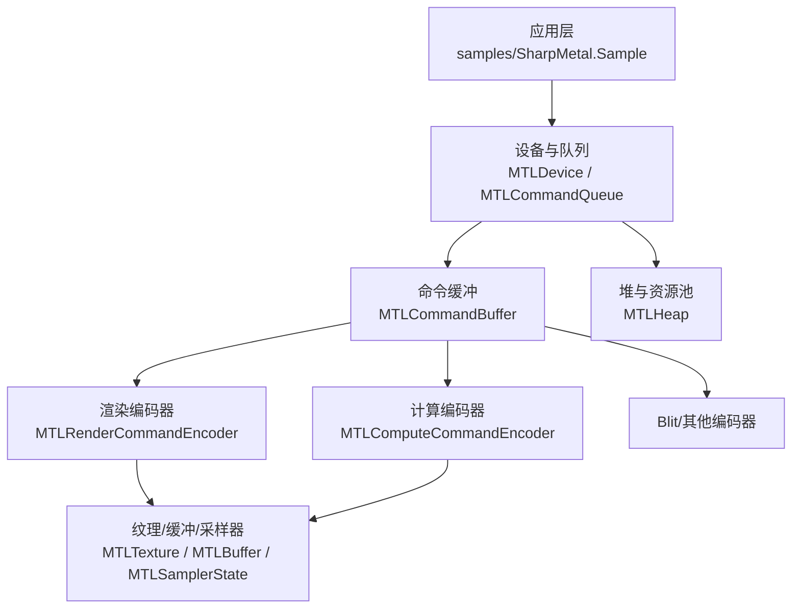
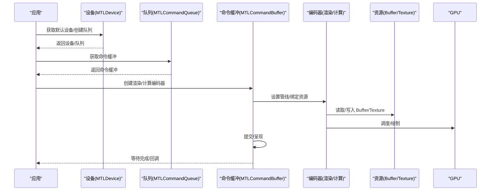
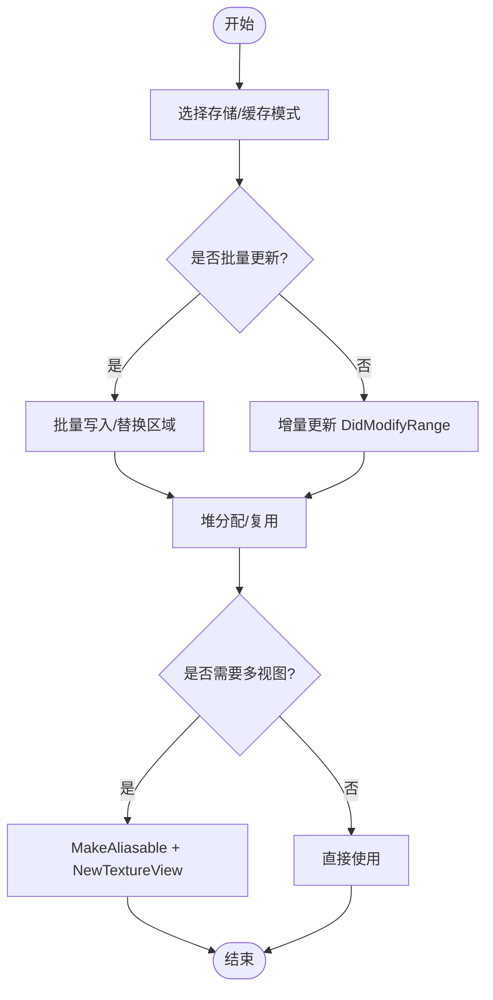
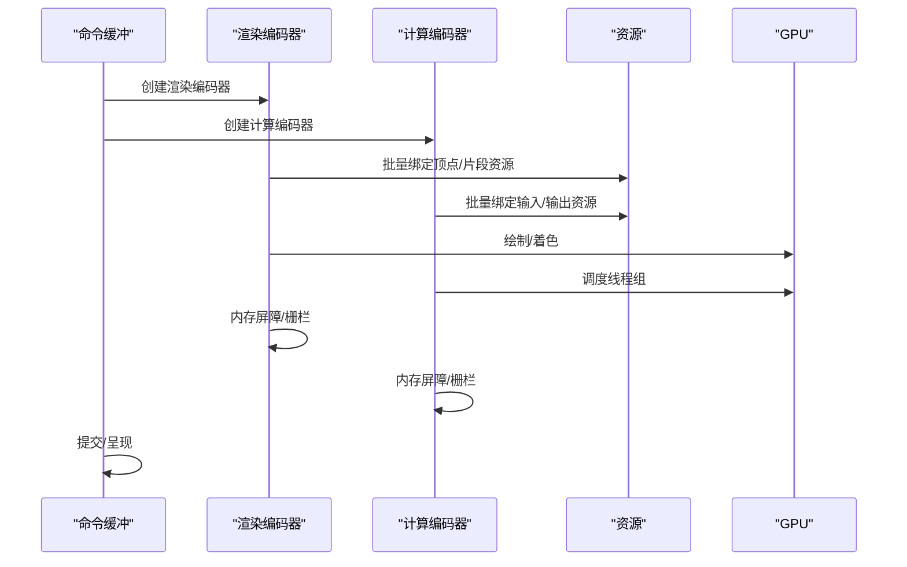
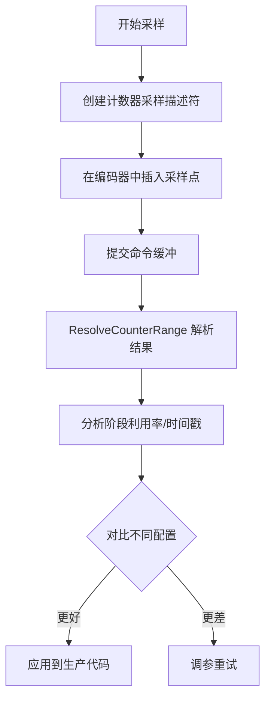
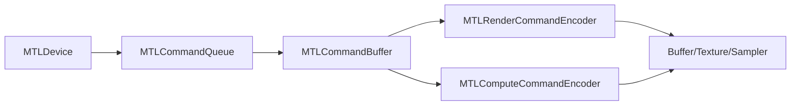

# 性能优化示例

<cite>
**本文引用的文件**
- [README.md](file://README.md)
- [DESIGN.md](file://DESIGN.md)
- [Program.cs](file://samples/SharpMetal.Sample/Program.cs)
- [MTLDevice.cs](file://src/SharpMetal/Metal/MTLDevice.cs)
- [MTLCommandQueue.cs](file://src/SharpMetal/Metal/MTLCommandQueue.cs)
- [MTLCommandBuffer.cs](file://src/SharpMetal/Metal/MTLCommandBuffer.cs)
- [MTLComputeCommandEncoder.cs](file://src/SharpMetal/Metal/MTLComputeCommandEncoder.cs)
- [MTLRenderCommandEncoder.cs](file://src/SharpMetal/Metal/MTLRenderCommandEncoder.cs)
- [MTLBuffer.cs](file://src/SharpMetal/Metal/MTLBuffer.cs)
- [MTLTexture.cs](file://src/SharpMetal/Metal/MTLTexture.cs)
- [MTLHeap.cs](file://src/SharpMetal/Metal/MTLHeap.cs)
- [MTLCounters.cs](file://src/SharpMetal/Metal/MTLCounters.cs)
</cite>

## 目录
1. [简介](#简介)
2. [项目结构](#项目结构)
3. [核心组件](#核心组件)
4. [架构总览](#架构总览)
5. [详细组件分析](#详细组件分析)
6. [依赖关系分析](#依赖关系分析)
7. [性能注意事项](#性能注意事项)
8. [故障排查指南](#故障排查指南)
9. [结论](#结论)
10. [附录](#附录)

## 简介
本文件聚焦于在 SharpMetal 中实现高性能 Metal 工作负载的实践与最佳实践，覆盖内存管理、命令编码、GPU 利用率提升、性能分析与基准测试方法，以及跨平台（macOS/iOS/macCatalyst）的兼容性考量。内容基于仓库中的实际 API 暴露能力进行总结，并给出可操作的优化路径与可视化流程图。

## 项目结构
- src/SharpMetal/Metal：Metal 低层绑定（设备、命令队列、命令缓冲、编码器、资源等）。
- samples/SharpMetal.Sample：最小可运行示例，演示设备获取、共享缓冲区读写与基本生命周期管理。
- docs/：设计说明与验证流程。
- eng/：验证脚本。

图表来源
- [MTLDevice.cs:326-339](file://src/SharpMetal/Metal/MTLDevice.cs#L326-L339)
- [MTLCommandQueue.cs:58-68](file://src/SharpMetal/Metal/MTLCommandQueue.cs#L58-L68)
- [MTLCommandBuffer.cs:195-223](file://src/SharpMetal/Metal/MTLCommandBuffer.cs#L195-L223)
- [MTLRenderCommandEncoder.cs:168-171](file://src/SharpMetal/Metal/MTLRenderCommandEncoder.cs#L168-L171)
- [MTLComputeCommandEncoder.cs:60-63](file://src/SharpMetal/Metal/MTLComputeCommandEncoder.cs#L60-L63)
- [MTLHeap.cs:124-132](file://src/SharpMetal/Metal/MTLHeap.cs#L124-L132)

章节来源
- [README.md:12-16](file://README.md#L12-L16)
- [DESIGN.md:1-12](file://DESIGN.md#L1-L12)

## 核心组件
- 设备（MTLDevice）：提供系统默认设备、命令队列创建、资源创建、特性查询（如统一内存、最大线程组大小、计数器等）。
- 命令队列（MTLCommandQueue）：用于从队列获取命令缓冲，支持调试捕获边界与驻留集管理。
- 命令缓冲（MTLCommandBuffer）：承载渲染/计算/Blit 等编码器，支持提交、呈现、等待完成、时间戳、日志与错误选项。
- 编码器（MTLRenderCommandEncoder / MTLComputeCommandEncoder）：设置管线状态、绑定资源、执行绘制或调度、内存屏障、间接命令执行、计数器采样。
- 资源（MTLBuffer / MTLTexture / MTLHeap）：统一管理 GPU/CPU 可见性、存储模式、缓存模式、压缩、稀疏页、别名化、替换区域、视图等。
- 计数器（MTLCounterSampleBuffer）：采集阶段利用率、时间戳、统计信息，用于性能剖析。

章节来源
- [MTLDevice.cs:187-339](file://src/SharpMetal/Metal/MTLDevice.cs#L187-L339)
- [MTLCommandQueue.cs:44-108](file://src/SharpMetal/Metal/MTLCommandQueue.cs#L44-L108)
- [MTLCommandBuffer.cs:116-223](file://src/SharpMetal/Metal/MTLCommandBuffer.cs#L116-L223)
- [MTLComputeCommandEncoder.cs:20-298](file://src/SharpMetal/Metal/MTLComputeCommandEncoder.cs#L20-L298)
- [MTLRenderCommandEncoder.cs:126-800](file://src/SharpMetal/Metal/MTLRenderCommandEncoder.cs#L126-L800)
- [MTLBuffer.cs:6-113](file://src/SharpMetal/Metal/MTLBuffer.cs#L6-L113)
- [MTLTexture.cs:75-438](file://src/SharpMetal/Metal/MTLTexture.cs#L75-L438)
- [MTLHeap.cs:13-192](file://src/SharpMetal/Metal/MTLHeap.cs#L13-L192)
- [MTLCounters.cs:69-135](file://src/SharpMetal/Metal/MTLCounters.cs#L69-L135)

## 架构总览
下图展示典型帧内从应用到 GPU 的执行流，包括命令缓冲、编码器、资源绑定与呈现。

图表来源
- [MTLDevice.cs:326-339](file://src/SharpMetal/Metal/MTLDevice.cs#L326-L339)
- [MTLCommandQueue.cs:58-68](file://src/SharpMetal/Metal/MTLCommandQueue.cs#L58-L68)
- [MTLCommandBuffer.cs:195-223](file://src/SharpMetal/Metal/MTLCommandBuffer.cs#L195-L223)
- [MTLRenderCommandEncoder.cs:168-171](file://src/SharpMetal/Metal/MTLRenderCommandEncoder.cs#L168-L171)
- [MTLComputeCommandEncoder.cs:60-63](file://src/SharpMetal/Metal/MTLComputeCommandEncoder.cs#L60-L63)

## 详细组件分析

### 内存管理优化（Buffer/Texture/Heap）
- 存储模式与缓存模式
  - 使用共享存储模式便于 CPU/GPU 互访；对仅 GPU 写入的资源启用 GPU 优化内容以减少拷贝。
  - 为频繁读写的 Buffer/Texture 选择合适的 CPU 缓存模式，避免不必要的写回与同步。
- 批量更新与局部替换
  - 使用 ReplaceRegion 对纹理进行小块更新，减少整图传输开销。
  - 使用 DidModifyRange 通知驱动数据变更范围，降低同步成本。
- 堆分配与复用
  - 通过 Heap 集中分配 Buffer/Texture/AccelerationStructure，减少碎片并提高重用率。
  - 利用 MaxAvailableSize 与对齐策略规划布局。
- 别名与视图
  - 使资源可别名化后，以不同视角（像素格式、层级、切片）复用同一底层存储。
  - 使用 NewTextureView 创建轻量级视图，避免重复分配。

图表来源
- [MTLBuffer.cs:26-44](file://src/SharpMetal/Metal/MTLBuffer.cs#L26-L44)
- [MTLBuffer.cs:50-63](file://src/SharpMetal/Metal/MTLBuffer.cs#L50-L63)
- [MTLTexture.cs:131-183](file://src/SharpMetal/Metal/MTLTexture.cs#L131-L183)
- [MTLTexture.cs:337-385](file://src/SharpMetal/Metal/MTLTexture.cs#L337-L385)
- [MTLHeap.cs:119-167](file://src/SharpMetal/Metal/MTLHeap.cs#L119-L167)

章节来源
- [MTLBuffer.cs:6-113](file://src/SharpMetal/Metal/MTLBuffer.cs#L6-L113)
- [MTLTexture.cs:75-438](file://src/SharpMetal/Metal/MTLTexture.cs#L75-L438)
- [MTLHeap.cs:13-192](file://src/SharpMetal/Metal/MTLHeap.cs#L13-L192)

### 命令编码优化（Compute/Render）
- 编码器复用与批处理
  - 尽量复用命令缓冲与编码器，减少创建/销毁开销。
  - 使用 ExecuteCommandsInBuffer 执行预编码的间接命令，降低每帧编码成本。
- 资源绑定批量设置
  - 使用 SetBuffers/SetTextures/SamplerStates 的数组版本批量绑定，减少调用次数。
- 内存屏障与显式同步
  - 在读写切换处插入 MemoryBarrier，精确控制依赖，避免过度同步。
- 并行渲染
  - 使用 ParallelRenderCommandEncoder 拆分渲染任务，提升多核利用率。
- 事件与栅栏
  - 使用 EncodeWaitForEvent/EncodeSignalEvent 与 Fence 协调异步流水线。

图表来源
- [MTLComputeCommandEncoder.cs:95-103](file://src/SharpMetal/Metal/MTLComputeCommandEncoder.cs#L95-L103)
- [MTLComputeCommandEncoder.cs:130-158](file://src/SharpMetal/Metal/MTLComputeCommandEncoder.cs#L130-L158)
- [MTLComputeCommandEncoder.cs:205-247](file://src/SharpMetal/Metal/MTLComputeCommandEncoder.cs#L205-L247)
- [MTLRenderCommandEncoder.cs:178-221](file://src/SharpMetal/Metal/MTLRenderCommandEncoder.cs#L178-L221)
- [MTLRenderCommandEncoder.cs:303-346](file://src/SharpMetal/Metal/MTLRenderCommandEncoder.cs#L303-L346)
- [MTLRenderCommandEncoder.cs:718-776](file://src/SharpMetal/Metal/MTLRenderCommandEncoder.cs#L718-L776)
- [MTLCommandBuffer.cs:195-223](file://src/SharpMetal/Metal/MTLCommandBuffer.cs#L195-L223)

章节来源
- [MTLComputeCommandEncoder.cs:20-298](file://src/SharpMetal/Metal/MTLComputeCommandEncoder.cs#L20-L298)
- [MTLRenderCommandEncoder.cs:126-800](file://src/SharpMetal/Metal/MTLRenderCommandEncoder.cs#L126-L800)
- [MTLCommandBuffer.cs:195-223](file://src/SharpMetal/Metal/MTLCommandBuffer.cs#L195-L223)

### GPU 利用率提升
- 合理划分线程组与线程数
  - 依据设备 MaxThreadsPerThreadgroup 与硬件特性调整 DispatchThreadgroups/DispatchThreads。
- 减少状态切换
  - 合并绘制批次，按管线/资源分组，降低切换开销。
- 使用间接命令与并行编码器
  - 将大量绘制/调度离线编码，运行时执行，提升吞吐。
- 资源驻留与优先级
  - 使用驻留集（ResidencySet）管理热点资源常驻，减少换入换出。

章节来源
- [MTLDevice.cs:206-207](file://src/SharpMetal/Metal/MTLDevice.cs#L206-L207)
- [MTLComputeCommandEncoder.cs:180-193](file://src/SharpMetal/Metal/MTLComputeCommandEncoder.cs#L180-L193)
- [MTLCommandBuffer.cs:225-233](file://src/SharpMetal/Metal/MTLCommandBuffer.cs#L225-L233)

### 性能分析与基准测试
- 计数器采样
  - 使用 CounterSampleBufferDescriptor 配置采样集与样本数，在编码器中插入 SampleCountersInBuffer，随后 ResolveCounterRange 解析结果。
- 时间戳
  - 使用 CommandBuffer 的 KernelStartTime/GPUEndTime 或设备时间戳频率进行端到端耗时测量。
- 调试标记与分组
  - 使用 PushDebugGroup/PopDebugGroup 与 InsertDebugSignpost 标注关键阶段，便于 Instruments/Metal Frame Debugger 定位瓶颈。
- 基准测试建议
  - 固定输入规模，预热后多次迭代取中位数；对比不同参数（线程组大小、存储模式、屏障粒度）下的吞吐与时延。

图表来源
- [MTLCounters.cs:69-135](file://src/SharpMetal/Metal/MTLCounters.cs#L69-L135)
- [MTLComputeCommandEncoder.cs:245-247](file://src/SharpMetal/Metal/MTLComputeCommandEncoder.cs#L245-L247)
- [MTLRenderCommandEncoder.cs:778-781](file://src/SharpMetal/Metal/MTLRenderCommandEncoder.cs#L778-L781)
- [MTLCommandBuffer.cs:136-144](file://src/SharpMetal/Metal/MTLCommandBuffer.cs#L136-L144)

章节来源
- [MTLCounters.cs:69-135](file://src/SharpMetal/Metal/MTLCounters.cs#L69-L135)
- [MTLCommandBuffer.cs:136-144](file://src/SharpMetal/Metal/MTLCommandBuffer.cs#L136-L144)

### 不同硬件平台的优化策略与兼容性
- 平台检测
  - 示例程序在非 Apple 平台直接退出，避免无效尝试。
- 设备能力探测
  - 通过 SupportsFamily、Supports* 系列属性判断功能可用性（如 MSAA、BCTextureCompression、Raytracing 等），动态降级或启用高级特性。
- 统一内存与带宽
  - 在统一内存设备上优先使用共享存储模式；在高带宽设备上考虑更大块传输与更少同步。
- 线程组上限
  - 根据 MaxThreadsPerThreadgroup 与推荐工作集大小调整调度粒度。

章节来源
- [Program.cs:16-20](file://samples/SharpMetal.Sample/Program.cs#L16-L20)
- [MTLDevice.cs:239-303](file://src/SharpMetal/Metal/MTLDevice.cs#L239-L303)

## 依赖关系分析
- 组件耦合
  - 命令缓冲依赖设备与队列；编码器依赖命令缓冲；渲染/计算编码器依赖资源（Buffer/Texture/Sampler）。
- 外部依赖
  - 通过 ObjectiveCRuntime 调用 Metal 框架；示例程序依赖系统默认设备。
- 潜在循环
  - 当前绑定层为单向依赖，未见循环引用。

图表来源
- [MTLDevice.cs:326-339](file://src/SharpMetal/Metal/MTLDevice.cs#L326-L339)
- [MTLCommandQueue.cs:58-68](file://src/SharpMetal/Metal/MTLCommandQueue.cs#L58-L68)
- [MTLCommandBuffer.cs:195-223](file://src/SharpMetal/Metal/MTLCommandBuffer.cs#L195-L223)
- [MTLRenderCommandEncoder.cs:168-171](file://src/SharpMetal/Metal/MTLRenderCommandEncoder.cs#L168-L171)
- [MTLComputeCommandEncoder.cs:60-63](file://src/SharpMetal/Metal/MTLComputeCommandEncoder.cs#L60-L63)

章节来源
- [MTLDevice.cs:326-339](file://src/SharpMetal/Metal/MTLDevice.cs#L326-L339)
- [MTLCommandQueue.cs:58-68](file://src/SharpMetal/Metal/MTLCommandQueue.cs#L58-L68)
- [MTLCommandBuffer.cs:195-223](file://src/SharpMetal/Metal/MTLCommandBuffer.cs#L195-L223)

## 性能注意事项
- 资源生命周期
  - 明确所有权与释放，避免过早释放或泄漏；示例中在 finally 中释放原生对象。
- 同步最小化
  - 仅在必要时插入屏障；使用细粒度范围更新与只写区域减少同步。
- 批量化
  - 批量绑定资源、批量绘制/调度，减少 API 调用与状态切换。
- 存储与缓存
  - 根据访问模式选择 StorageMode/CpuCacheMode；对频繁读写的资源启用 GPU 优化内容。
- 堆与复用
  - 使用堆集中分配与复用，减少碎片与分配开销。
- 计数器与时间戳
  - 在生产环境谨慎开启计数器采样，避免影响性能；仅在分析阶段启用。

章节来源
- [Program.cs:21-45](file://samples/SharpMetal.Sample/Program.cs#L21-L45)
- [MTLBuffer.cs:50-63](file://src/SharpMetal/Metal/MTLBuffer.cs#L50-L63)
- [MTLTexture.cs:337-385](file://src/SharpMetal/Metal/MTLTexture.cs#L337-L385)
- [MTLHeap.cs:119-167](file://src/SharpMetal/Metal/MTLHeap.cs#L119-L167)
- [MTLCounters.cs:69-135](file://src/SharpMetal/Metal/MTLCounters.cs#L69-L135)

## 故障排查指南
- 常见错误
  - 设备为空或无 Metal 设备：检查平台与权限。
  - 共享缓冲区分配失败：检查长度、选项与内存压力。
  - 命令缓冲错误：查看 ErrorOptions 与 EncoderExecutionStatus，结合日志定位。
- 诊断手段
  - 使用 PushDebugGroup/InsertDebugSignpost 标注阶段。
  - 使用 CommandBuffer 的 Logs/Error 与计数器采样结果辅助定位。
  - 使用 Instruments/Metal Frame Debugger 观察 GPU 阶段利用率与时间线。

章节来源
- [Program.cs:21-45](file://samples/SharpMetal.Sample/Program.cs#L21-L45)
- [MTLCommandBuffer.cs:126-148](file://src/SharpMetal/Metal/MTLCommandBuffer.cs#L126-L148)
- [MTLCommandBuffer.cs:270-278](file://src/SharpMetal/Metal/MTLCommandBuffer.cs#L270-L278)
- [MTLComputeCommandEncoder.cs:43-56](file://src/SharpMetal/Metal/MTLComputeCommandEncoder.cs#L43-L56)
- [MTLRenderCommandEncoder.cs:153-166](file://src/SharpMetal/Metal/MTLRenderCommandEncoder.cs#L153-L166)

## 结论
通过在 SharpMetal 中合理使用存储/缓存模式、堆分配、批量绑定、间接命令、内存屏障与计数器采样，可以显著提升 GPU 利用率与整体吞吐。结合平台能力探测与调试工具，可在不同硬件上获得稳定且高效的性能表现。建议在开发周期中持续进行基准测试与回归验证，确保优化收益不被后续改动抵消。

## 附录
- 快速上手
  - 参考示例程序获取默认设备、创建共享缓冲区并进行读写校验，作为性能优化的起点。
- 构建与验证
  - 遵循仓库文档进行构建、测试与打包；在不同平台（macOS/iOS/macCatalyst）下验证行为一致性。

章节来源
- [Program.cs:16-45](file://samples/SharpMetal.Sample/Program.cs#L16-L45)
- [README.md:5-16](file://README.md#L5-L16)
- [DESIGN.md:1-12](file://DESIGN.md#L1-L12)