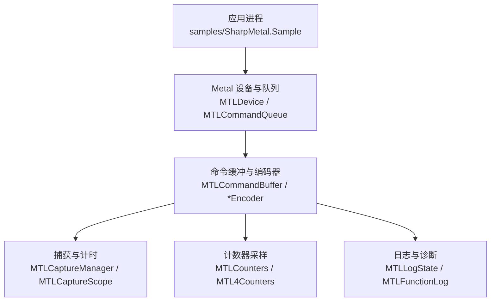
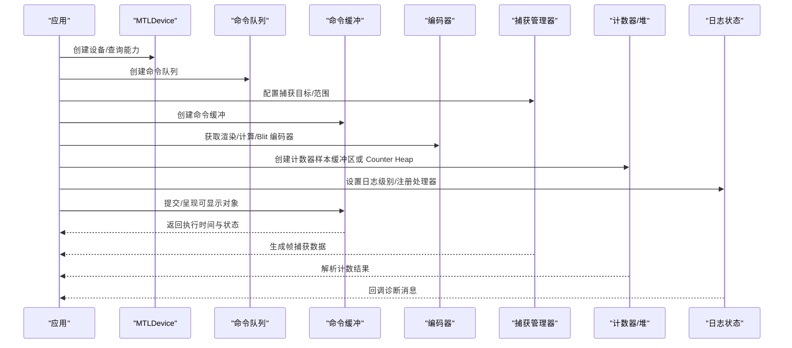
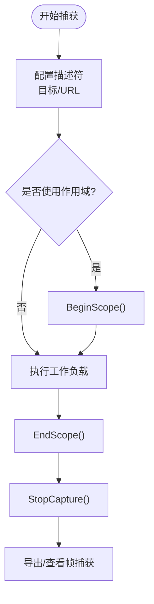
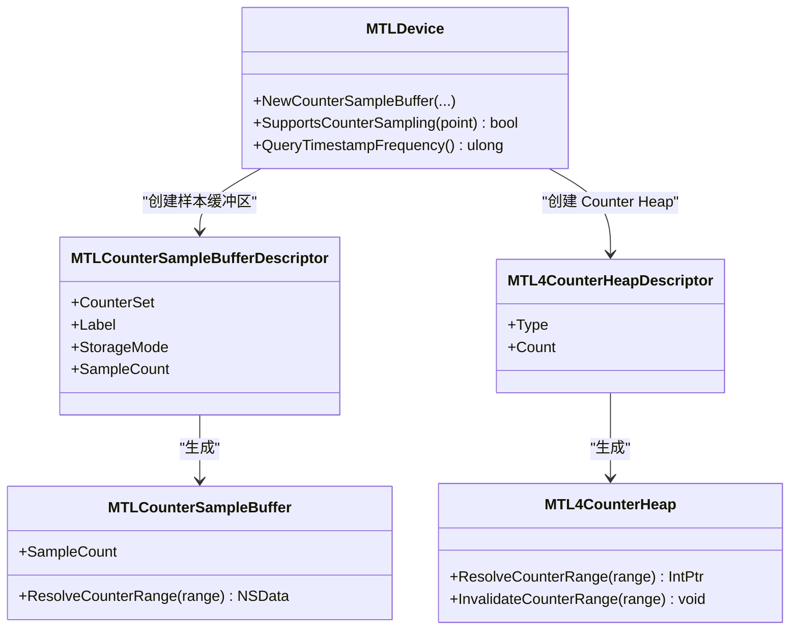
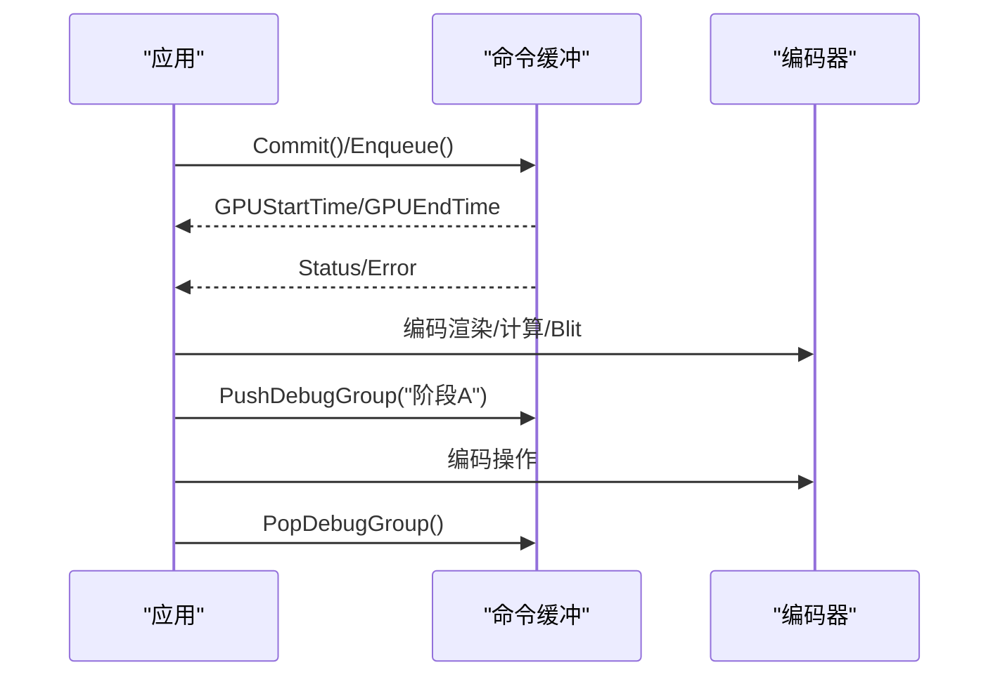
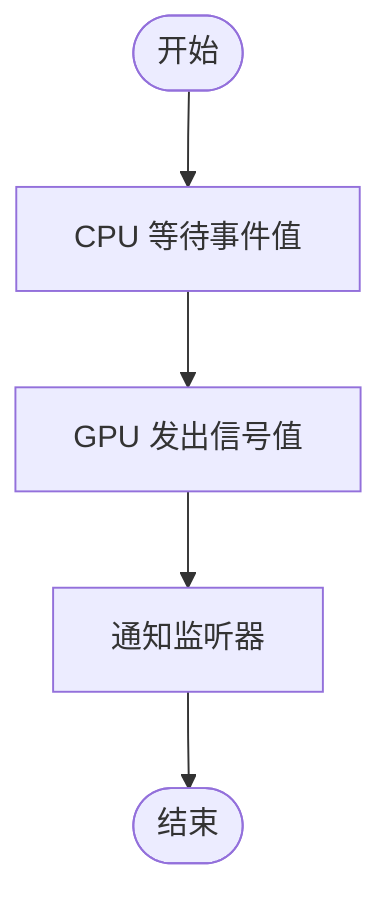
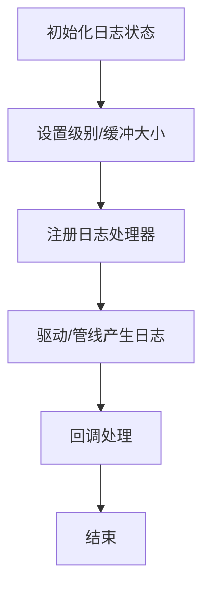
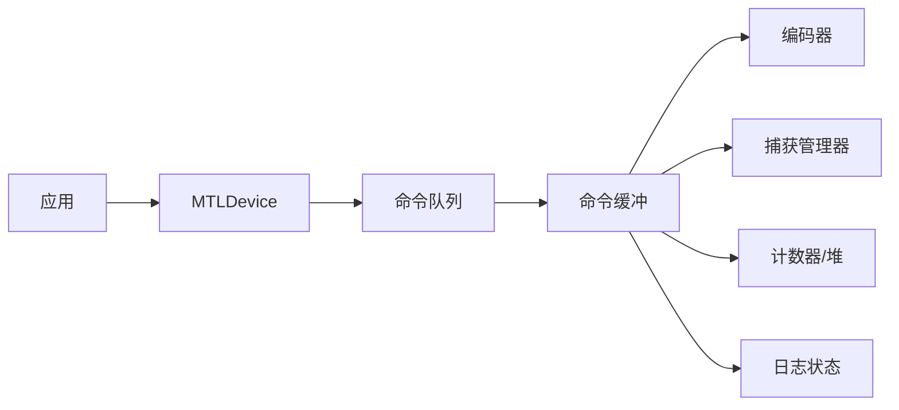

# 性能分析工具

<cite>
**本文引用的文件**
- [README.md](file://README.md)
- [DESIGN.md](file://DESIGN.md)
- [Program.cs](file://samples/SharpMetal.Sample/Program.cs)
- [MTLCaptureManager.cs](file://src/SharpMetal/Metal/MTLCaptureManager.cs)
- [MTLCaptureScope.cs](file://src/SharpMetal/Metal/MTLCaptureScope.cs)
- [MTLCounters.cs](file://src/SharpMetal/Metal/MTLCounters.cs)
- [MTL4Counters.cs](file://src/SharpMetal/Metal/MTL4Counters.cs)
- [MTLCommandBuffer.cs](file://src/SharpMetal/Metal/MTLCommandBuffer.cs)
- [MTLDevice.cs](file://src/SharpMetal/Metal/MTLDevice.cs)
- [MTLEvent.cs](file://src/SharpMetal/Metal/MTLEvent.cs)
- [MTLLogState.cs](file://src/SharpMetal/Metal/MTLLogState.cs)
</cite>

## 目录
1. [简介](#简介)
2. [项目结构](#项目结构)
3. [核心组件](#核心组件)
4. [架构总览](#架构总览)
5. [详细组件分析](#详细组件分析)
6. [依赖关系分析](#依赖关系分析)
7. [性能注意事项](#性能注意事项)
8. [故障排查指南](#故障排查指南)
9. [结论](#结论)
10. [附录](#附录)

## 简介
本指南面向使用 SharpMetal 进行 Metal 图形与计算管线开发的工程师，聚焦于在 Apple 平台上进行性能分析与调试的完整流程。内容涵盖：
- Xcode Instruments 集成与帧捕获（GPU Frame Capture）
- Metal 计数器采样（Counter Sampling）与时间戳测量
- 命令缓冲生命周期与执行时序观测
- 常见性能瓶颈定位方法与优化建议
- 基于仓库内 API 的实际调试案例与前后对比思路

本指南严格依据仓库中提供的 Metal 绑定实现进行说明，确保所有技术细节与可用能力均能在代码中找到对应入口。

## 项目结构
SharpMetal 提供对 Foundation、Metal、MetalFX 与 QuartzCore 的低层绑定，运行时需 Apple 宿主环境。示例工程位于 samples/SharpMetal.Sample，用于验证设备与共享缓冲读写等基础能力；核心 Metal 绑定位于 src/SharpMetal/Metal。

图表来源
- [Program.cs:1-49](file://samples/SharpMetal.Sample/Program.cs#L1-L49)
- [MTLDevice.cs:305-339](file://src/SharpMetal/Metal/MTLDevice.cs#L305-L339)
- [MTLCommandBuffer.cs:150-223](file://src/SharpMetal/Metal/MTLCommandBuffer.cs#L150-L223)
- [MTLCaptureManager.cs:74-117](file://src/SharpMetal/Metal/MTLCaptureManager.cs#L74-L117)
- [MTLCounters.cs:69-136](file://src/SharpMetal/Metal/MTLCounters.cs#L69-L136)
- [MTL4Counters.cs:25-89](file://src/SharpMetal/Metal/MTL4Counters.cs#L25-L89)
- [MTLLogState.cs:20-85](file://src/SharpMetal/Metal/MTLLogState.cs#L20-L85)

章节来源
- [README.md:1-23](file://README.md#L1-L23)
- [DESIGN.md:1-12](file://DESIGN.md#L1-L12)

## 核心组件
- 捕获子系统：通过 MTLCaptureManager 与 MTLCaptureScope 控制 GPU 帧捕获范围与目标输出，支持开发者工具与 GPU Trace 文档两种目的地。
- 计数器子系统：通过 MTLCounters（传统计数器样本缓冲区）与 MTL4Counters（新一代 Counter Heap）采集 GPU 阶段利用率、调用统计与时间戳。
- 命令缓冲与执行时序：MTLCommandBuffer 暴露 CPU/GPU 起止时间、状态、错误信息以及编码器的调试分组与日志。
- 设备能力查询：MTLDevice 提供计数器采样点支持、时间戳频率、资源能力等关键指标，用于选择合适的数据采集策略。
- 事件同步：MTLEvent/MTLSharedEvent 可用于跨线程或跨进程同步，辅助精确的时间段划分与等待。
- 日志系统：MTLLogState 允许注册日志处理器并设置级别与缓冲大小，便于收集驱动与管线构建阶段的诊断信息。

章节来源
- [MTLCaptureManager.cs:6-136](file://src/SharpMetal/Metal/MTLCaptureManager.cs#L6-L136)
- [MTLCaptureScope.cs:7-41](file://src/SharpMetal/Metal/MTLCaptureScope.cs#L7-L41)
- [MTLCounters.cs:7-136](file://src/SharpMetal/Metal/MTLCounters.cs#L7-L136)
- [MTL4Counters.cs:7-89](file://src/SharpMetal/Metal/MTL4Counters.cs#L7-L89)
- [MTLCommandBuffer.cs:9-321](file://src/SharpMetal/Metal/MTLCommandBuffer.cs#L9-L321)
- [MTLDevice.cs:85-303](file://src/SharpMetal/Metal/MTLDevice.cs#L85-L303)
- [MTLEvent.cs:6-108](file://src/SharpMetal/Metal/MTLEvent.cs#L6-L108)
- [MTLLogState.cs:7-85](file://src/SharpMetal/Metal/MTLLogState.cs#L7-L85)

## 架构总览
下图展示了从应用启动到 GPU 执行与数据采集的关键路径，包括捕获、命令提交、计数器采样与日志记录。

图表来源
- [MTLDevice.cs:305-339](file://src/SharpMetal/Metal/MTLDevice.cs#L305-L339)
- [MTLCaptureManager.cs:74-117](file://src/SharpMetal/Metal/MTLCaptureManager.cs#L74-L117)
- [MTLCommandBuffer.cs:150-223](file://src/SharpMetal/Metal/MTLCommandBuffer.cs#L150-L223)
- [MTLCounters.cs:69-136](file://src/SharpMetal/Metal/MTLCounters.cs#L69-L136)
- [MTL4Counters.cs:25-89](file://src/SharpMetal/Metal/MTL4Counters.cs#L25-L89)
- [MTLLogState.cs:20-85](file://src/SharpMetal/Metal/MTLLogState.cs#L20-L85)

## 详细组件分析

### 捕获子系统（Xcode Instruments 与 GPU 帧捕获）
- 使用 MTLCaptureManager 的共享实例，通过 StartCapture 指定捕获范围（设备、命令队列或作用域），StopCapture 结束捕获。
- MTLCaptureDescriptor 可配置输出目标（开发者工具或 GPU Trace 文档）与输出 URL。
- MTLCaptureScope 提供 BeginScope/EndScope 以标记细粒度捕获区间，并可设置 Label 便于在 Instruments 中识别。

图表来源
- [MTLCaptureManager.cs:20-136](file://src/SharpMetal/Metal/MTLCaptureManager.cs#L20-L136)
- [MTLCaptureScope.cs:7-41](file://src/SharpMetal/Metal/MTLCaptureScope.cs#L7-L41)

章节来源
- [MTLCaptureManager.cs:6-136](file://src/SharpMetal/Metal/MTLCaptureManager.cs#L6-L136)
- [MTLCaptureScope.cs:7-41](file://src/SharpMetal/Metal/MTLCaptureScope.cs#L7-L41)

### 计数器采样（GPU 性能计数器）
- 传统方式：使用 MTLCounterSampleBufferDescriptor 指定计数器集、标签、存储模式与采样次数，通过设备创建样本缓冲区并在命令缓冲中采样。
- 新式方式：使用 MTL4CounterHeapDescriptor 创建 Counter Heap（类型包含时间戳），并通过 ResolveCounterRange 读取结果。
- 设备能力：通过 SupportsCounterSampling 查询支持的采样点（如绘制边界、调度边界等），通过 QueryTimestampFrequency 获取时间戳频率。

图表来源
- [MTLDevice.cs:571-703](file://src/SharpMetal/Metal/MTLDevice.cs#L571-L703)
- [MTLCounters.cs:69-136](file://src/SharpMetal/Metal/MTLCounters.cs#L69-L136)
- [MTL4Counters.cs:25-89](file://src/SharpMetal/Metal/MTL4Counters.cs#L25-L89)

章节来源
- [MTLCounters.cs:7-136](file://src/SharpMetal/Metal/MTLCounters.cs#L7-L136)
- [MTL4Counters.cs:7-89](file://src/SharpMetal/Metal/MTL4Counters.cs#L7-L89)
- [MTLDevice.cs:571-703](file://src/SharpMetal/Metal/MTLDevice.cs#L571-L703)

### 命令缓冲与执行时序
- MTLCommandBuffer 提供 KernelStartTime/KernelEndTime、GPUStartTime/GPUEndTime 等属性，用于衡量 CPU 侧与 GPU 侧的执行窗口。
- 可通过 Status/Error 判断执行状态与错误原因（如超时、内存不足、设备移除等）。
- PushDebugGroup/PopDebugGroup 可在 Instruments 中标注逻辑块，便于定位热点。

图表来源
- [MTLCommandBuffer.cs:116-223](file://src/SharpMetal/Metal/MTLCommandBuffer.cs#L116-L223)
- [MTLCommandBuffer.cs:270-278](file://src/SharpMetal/Metal/MTLCommandBuffer.cs#L270-L278)

章节来源
- [MTLCommandBuffer.cs:9-321](file://src/SharpMetal/Metal/MTLCommandBuffer.cs#L9-L321)

### 事件与同步（跨线程/跨进程）
- MTLEvent/MTLSharedEvent 可用于等待特定信号值，或在达到阈值时通知监听器，适合精细划分性能时间段与协调多端执行。
- 结合命令缓冲中的 EncodeWait/EncodeSignalEvent，可实现 CPU-GPU 或 GPU-GPU 的同步点。

图表来源
- [MTLEvent.cs:6-108](file://src/SharpMetal/Metal/MTLEvent.cs#L6-L108)
- [MTLCommandBuffer.cs:235-243](file://src/SharpMetal/Metal/MTLCommandBuffer.cs#L235-L243)

章节来源
- [MTLEvent.cs:6-108](file://src/SharpMetal/Metal/MTLEvent.cs#L6-L108)
- [MTLCommandBuffer.cs:235-243](file://src/SharpMetal/Metal/MTLCommandBuffer.cs#L235-L243)

### 日志与诊断
- MTLLogStateDescriptor 可设置日志级别与缓冲大小，MTLLogState 支持添加日志处理器，接收子系统、分类、级别与消息。
- 在管线编译、函数加载或驱动异常时，日志有助于快速定位问题。

图表来源
- [MTLLogState.cs:20-85](file://src/SharpMetal/Metal/MTLLogState.cs#L20-L85)

章节来源
- [MTLLogState.cs:7-85](file://src/SharpMetal/Metal/MTLLogState.cs#L7-L85)

## 依赖关系分析
- 应用层依赖 MTLDevice 创建队列与资源，依赖 MTLCommandBuffer 组织编码与提交。
- 捕获子系统依赖 MTLCaptureManager/MTLCaptureScope，与命令缓冲生命周期配合。
- 计数器子系统依赖设备能力查询与样本缓冲区/Counter Heap，与命令缓冲的采样点配合。
- 日志子系统独立于渲染/计算路径，但可与命令缓冲的调试分组协同提升可读性。

图表来源
- [MTLDevice.cs:305-339](file://src/SharpMetal/Metal/MTLDevice.cs#L305-L339)
- [MTLCommandBuffer.cs:150-223](file://src/SharpMetal/Metal/MTLCommandBuffer.cs#L150-L223)
- [MTLCaptureManager.cs:74-117](file://src/SharpMetal/Metal/MTLCaptureManager.cs#L74-L117)
- [MTLCounters.cs:69-136](file://src/SharpMetal/Metal/MTLCounters.cs#L69-L136)
- [MTL4Counters.cs:25-89](file://src/SharpMetal/Metal/MTL4Counters.cs#L25-L89)
- [MTLLogState.cs:20-85](file://src/SharpMetal/Metal/MTLLogState.cs#L20-L85)

章节来源
- [MTLDevice.cs:305-339](file://src/SharpMetal/Metal/MTLDevice.cs#L305-L339)
- [MTLCommandBuffer.cs:150-223](file://src/SharpMetal/Metal/MTLCommandBuffer.cs#L150-L223)

## 性能注意事项
- 合理划分捕获范围：使用 MTLCaptureScope 将热点片段包裹起来，避免全帧捕获带来的开销与噪音。
- 选择合适的计数器采样点：根据瓶颈假设选择 AtDrawBoundary/AtDispatchBoundary 等，减少无关数据。
- 利用时间戳与命令缓冲时序：比较 CPU 与 GPU 起止时间，识别 CPU 准备与 GPU 执行的瓶颈。
- 关注设备能力：通过 SupportsCounterSampling 与 QueryTimestampFrequency 决定采样策略与精度。
- 合理使用日志：仅在诊断阶段开启较高等级日志，避免影响性能。

[本节为通用指导，不直接分析具体文件]

## 故障排查指南
- 无 Metal 设备：检查平台与宿主环境，示例程序在非 Apple 平台会阻止原生工作负载。
- 共享缓冲分配失败：确认资源选项与内存模式，必要时降低尺寸或调整存储模式。
- 命令缓冲错误：读取 Error 与 Status，常见错误包括超时、内存不足、设备移除等。
- 计数器采样失败：确认设备支持相应采样点，检查样本缓冲区/Counter Heap 创建与范围解析。
- 捕获未生效：确认捕获目标与范围，确保在正确的作用域内开始/结束捕获。

章节来源
- [Program.cs:10-45](file://samples/SharpMetal.Sample/Program.cs#L10-L45)
- [MTLCommandBuffer.cs:19-48](file://src/SharpMetal/Metal/MTLCommandBuffer.cs#L19-L48)
- [MTLDevice.cs:571-703](file://src/SharpMetal/Metal/MTLDevice.cs#L571-L703)
- [MTLCaptureManager.cs:74-117](file://src/SharpMetal/Metal/MTLCaptureManager.cs#L74-L117)

## 结论
SharpMetal 提供了完整的 Metal 性能分析与调试能力：通过捕获子系统获取帧级可视化数据，借助计数器与时间戳量化 GPU 行为，结合命令缓冲时序与日志系统进行根因定位。建议在开发早期即建立“捕获+计数器+日志”的闭环，持续迭代优化，以获得稳定且可复现的性能改进。

[本节为总结，不直接分析具体文件]

## 附录
- 实战调试案例（基于仓库 API 的流程化步骤）
  - 场景：渲染阶段片元着色器占用过高
    - 步骤：
      - 使用 MTLCaptureScope 包裹疑似热点帧，设置 Label 标识。
      - 通过设备查询支持的计数器采样点，创建计数器样本缓冲区或 Counter Heap。
      - 在命令缓冲中插入采样点，提交后读取结果，分析阶段利用率与调用统计。
      - 使用 PushDebugGroup 标注不同渲染通道，结合 Instruments 定位热点。
      - 若发现带宽瓶颈，调整纹理格式与采样模式；若发现计算瓶颈，优化线程组大小与内存访问模式。
  - 前后对比思路：
    - 捕获同一场景的前后两版帧数据，对比 GPU 时间线与计数器变化。
    - 记录命令缓冲的 GPU 起止时间与错误状态，确保对比条件一致。
    - 使用日志处理器输出关键路径耗时，辅助回归验证。

[本节为概念性指导，不直接分析具体文件]