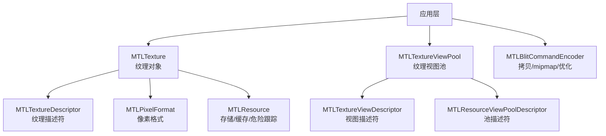
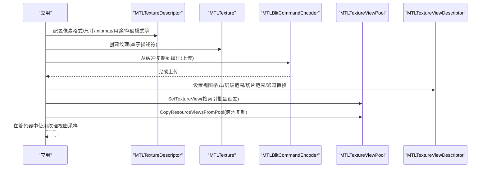
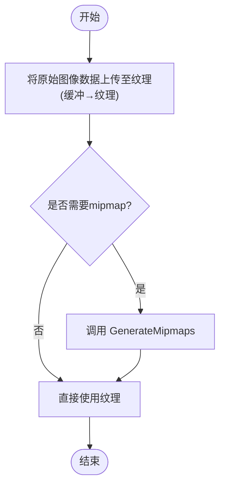
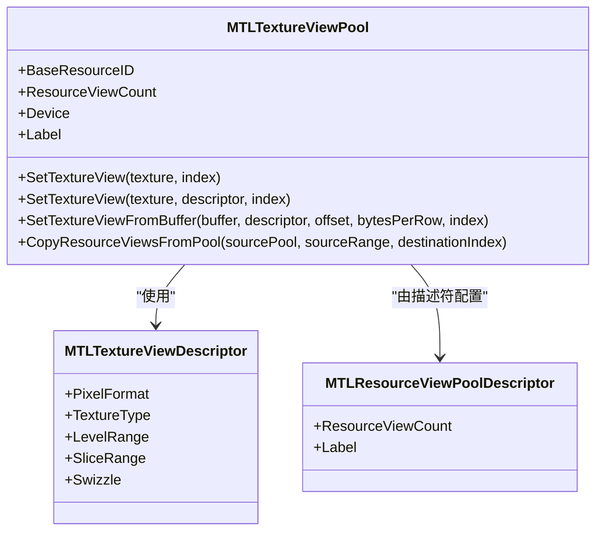
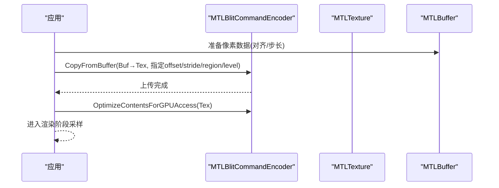
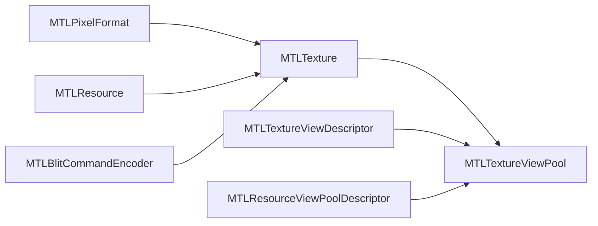

# 纹理优化技术

<cite>
**本文引用的文件**
- [MTLTexture.cs](file://src/SharpMetal/Metal/MTLTexture.cs)
- [MTLPixelFormat.cs](file://src/SharpMetal/Metal/MTLPixelFormat.cs)
- [MTLBlitCommandEncoder.cs](file://src/SharpMetal/Metal/MTLBlitCommandEncoder.cs)
- [MTLTextureViewPool.cs](file://src/SharpMetal/Metal/MTLTextureViewPool.cs)
- [MTLResourceViewPoolDescriptor.cs](file://src/SharpMetal/Metal/MTLResourceViewPoolDescriptor.cs)
- [MTLTextureViewDescriptor.cs](file://src/SharpMetal/Metal/MTLTextureViewDescriptor.cs)
- [MTLResource.cs](file://src/SharpMetal/Metal/MTLResource.cs)
</cite>

## 目录
1. [简介](#简介)
2. [项目结构](#项目结构)
3. [核心组件](#核心组件)
4. [架构总览](#架构总览)
5. [详细组件分析](#详细组件分析)
6. [依赖关系分析](#依赖关系分析)
7. [性能考量](#性能考量)
8. [故障排查指南](#故障排查指南)
9. [结论](#结论)
10. [附录](#附录)

## 简介
本文件聚焦于 SharpMetal 中纹理处理的性能优化方法，围绕以下主题展开：
- 纹理格式选择与压缩技术
- Mipmap 生成与使用
- 纹理视图池管理
- 减少纹理上传开销
- 优化纹理采样性能
- 高效的纹理数据管理
- 不同场景下的最佳实践与性能对比思路

内容基于仓库中的 Metal 绑定实现进行梳理，并结合 Metal API 的通用优化原则给出可操作的实践建议。

## 项目结构
与纹理优化直接相关的核心类型集中在 src/SharpMetal/Metal 目录下：
- 纹理定义与描述符：MTLTexture、MTLTextureDescriptor
- 像素格式枚举：MTLPixelFormat（含多种压缩格式）
- 命令编码与传输：MTLBlitCommandEncoder（复制、mipmap 生成、内容优化）
- 纹理视图与池：MTLTextureViewPool、MTLTextureViewDescriptor、MTLResourceViewPoolDescriptor
- 资源基类与存储模式：MTLResource（存储模式、缓存模式、危险跟踪等）

图表来源
- [MTLTexture.cs:75-240](file://src/SharpMetal/Metal/MTLTexture.cs#L75-L240)
- [MTLPixelFormat.cs:3-144](file://src/SharpMetal/Metal/MTLPixelFormat.cs#L3-L144)
- [MTLBlitCommandEncoder.cs:62-155](file://src/SharpMetal/Metal/MTLBlitCommandEncoder.cs#L62-L155)
- [MTLTextureViewPool.cs:6-50](file://src/SharpMetal/Metal/MTLTextureViewPool.cs#L6-L50)
- [MTLTextureViewDescriptor.cs:6-59](file://src/SharpMetal/Metal/MTLTextureViewDescriptor.cs#L6-L59)
- [MTLResourceViewPoolDescriptor.cs:6-35](file://src/SharpMetal/Metal/MTLResourceViewPoolDescriptor.cs#L6-L35)
- [MTLResource.cs:14-48](file://src/SharpMetal/Metal/MTLResource.cs#L14-L48)

章节来源
- [MTLTexture.cs:75-240](file://src/SharpMetal/Metal/MTLTexture.cs#L75-L240)
- [MTLPixelFormat.cs:3-144](file://src/SharpMetal/Metal/MTLPixelFormat.cs#L3-L144)
- [MTLBlitCommandEncoder.cs:62-155](file://src/SharpMetal/Metal/MTLBlitCommandEncoder.cs#L62-L155)
- [MTLTextureViewPool.cs:6-50](file://src/SharpMetal/Metal/MTLTextureViewPool.cs#L6-L50)
- [MTLTextureViewDescriptor.cs:6-59](file://src/SharpMetal/Metal/MTLTextureViewDescriptor.cs#L6-L59)
- [MTLResourceViewPoolDescriptor.cs:6-35](file://src/SharpMetal/Metal/MTLResourceViewPoolDescriptor.cs#L6-L35)
- [MTLResource.cs:14-48](file://src/SharpMetal/Metal/MTLResource.cs#L14-L48)

## 核心组件
- 纹理与描述符
  - MTLTexture：纹理实例，提供尺寸、层级、采样数、数组长度、用途、压缩类型、共享句柄、视图创建、字节读写等能力。
  - MTLTextureDescriptor：创建纹理时的配置项，包括类型、像素格式、宽高深、mipmap 层级数、采样数、数组长度、资源选项、CPU 缓存模式、存储模式、危险跟踪模式、用途、GPU 优化内容开关、压缩类型、通道置换、稀疏页大小等。
- 像素格式
  - MTLPixelFormat：包含大量标准与压缩格式，如 RGBA8/BGRA8、RGB10A2、BC1-7、PVRTC、EAC/ETC2、ASTC（LDR/HDR）、深度/模板格式等。
- 命令编码器
  - MTLBlitCommandEncoder：提供纹理/缓冲互拷、从缓冲到纹理上传、mipmap 生成、同步、访问计数、内容优化（GPU/CPU 访问方向）等方法。
- 纹理视图与池
  - MTLTextureViewDescriptor：定义视图的像素格式、纹理类型、层级范围、切片范围、通道置换。
  - MTLTextureViewPool：纹理视图池，支持批量设置视图、从缓冲构造视图、跨池复制视图集合。
  - MTLResourceViewPoolDescriptor：池容量与标签等描述信息。
- 资源基类
  - MTLResource：统一抽象了 CPU 缓存模式、存储模式、危险跟踪模式、资源选项、堆偏移、分配大小、别名化、可回收状态等。

章节来源
- [MTLTexture.cs:75-240](file://src/SharpMetal/Metal/MTLTexture.cs#L75-L240)
- [MTLTexture.cs:242-438](file://src/SharpMetal/Metal/MTLTexture.cs#L242-L438)
- [MTLPixelFormat.cs:3-144](file://src/SharpMetal/Metal/MTLPixelFormat.cs#L3-L144)
- [MTLBlitCommandEncoder.cs:62-155](file://src/SharpMetal/Metal/MTLBlitCommandEncoder.cs#L62-L155)
- [MTLTextureViewPool.cs:6-50](file://src/SharpMetal/Metal/MTLTextureViewPool.cs#L6-L50)
- [MTLTextureViewDescriptor.cs:6-59](file://src/SharpMetal/Metal/MTLTextureViewDescriptor.cs#L6-L59)
- [MTLResourceViewPoolDescriptor.cs:6-35](file://src/SharpMetal/Metal/MTLResourceViewPoolDescriptor.cs#L6-L35)
- [MTLResource.cs:14-48](file://src/SharpMetal/Metal/MTLResource.cs#L14-L48)

## 架构总览
下图展示了纹理从“创建—上传—视图复用—采样”的关键路径，以及与命令编码器的交互。

图表来源
- [MTLTexture.cs:75-240](file://src/SharpMetal/Metal/MTLTexture.cs#L75-L240)
- [MTLBlitCommandEncoder.cs:62-90](file://src/SharpMetal/Metal/MTLBlitCommandEncoder.cs#L62-L90)
- [MTLTextureViewPool.cs:20-38](file://src/SharpMetal/Metal/MTLTextureViewPool.cs#L20-L38)
- [MTLTextureViewDescriptor.cs:14-42](file://src/SharpMetal/Metal/MTLTextureViewDescriptor.cs#L14-L42)

## 详细组件分析

### 纹理格式选择与压缩技术
- 关键枚举
  - MTLPixelFormat 提供了丰富的标准与压缩格式，覆盖 LDR/HDR、常规 RGBA/BGRA、深度/模板、以及平台压缩格式（BCx、PVRTC、EAC/ETC2、ASTC）。
- 选择策略
  - 目标平台优先：iOS/macOS 常用 ASTC；PC 常用 BC1-7；Android 常用 ETC2/EAC。
  - 质量与体积权衡：HDR 场景考虑 RGB10A2/RG11B10Float/ASTC HDR；普通贴图可用 RGBA8/BGRA8；需要更小体积时选对应压缩格式。
  - 用途匹配：渲染目标通常用 BGRA8UnormsRGB；只读采样可用压缩格式；深度/模板使用专用格式。
- 相关能力
  - MTLTextureDescriptor 支持设置 PixelFormat、MipmapLevelCount、Usage、CompressionType 等，以适配不同格式与用途。
  - MTLTexture 暴露 CompressionType、AllowGPUOptimizedContents 等属性，便于运行时判断与优化。

章节来源
- [MTLPixelFormat.cs:3-144](file://src/SharpMetal/Metal/MTLPixelFormat.cs#L3-L144)
- [MTLTexture.cs:75-240](file://src/SharpMetal/Metal/MTLTexture.cs#L75-L240)
- [MTLTexture.cs:242-438](file://src/SharpMetal/Metal/MTLTexture.cs#L242-L438)

### Mipmap 生成与使用
- 生成方式
  - 通过 MTLBlitCommandEncoder.GenerateMipmaps 对已上传的纹理生成完整 mipmap 链。
- 使用建议
  - 为静态或低频更新纹理启用 mipmap，减少采样时的缓存未命中与带宽压力。
  - 合理设置 MTLTextureDescriptor.MipmapLevelCount，避免多余层级。
- 流程示意

图表来源
- [MTLBlitCommandEncoder.cs:87-90](file://src/SharpMetal/Metal/MTLBlitCommandEncoder.cs#L87-L90)
- [MTLTexture.cs:75-240](file://src/SharpMetal/Metal/MTLTexture.cs#L75-L240)

章节来源
- [MTLBlitCommandEncoder.cs:87-90](file://src/SharpMetal/Metal/MTLBlitCommandEncoder.cs#L87-L90)
- [MTLTexture.cs:75-240](file://src/SharpMetal/Metal/MTLTexture.cs#L75-L240)

### 纹理视图池管理
- 视图描述
  - MTLTextureViewDescriptor 允许指定视图的像素格式、纹理类型、层级范围、切片范围、通道置换，从而在不复制数据的情况下改变采样语义。
- 池化优势
  - MTLTextureViewPool 支持批量设置视图、从缓冲构造视图、跨池复制视图集合，减少每帧重复创建视图对象的开销。
- 典型用法
  - 预分配池容量（MTLResourceViewPoolDescriptor.ResourceViewCount），在渲染前 SetTextureView 填充视图槽位，必要时 CopyResourceViewsFromPool 复用已有视图集合。

图表来源
- [MTLTextureViewDescriptor.cs:6-59](file://src/SharpMetal/Metal/MTLTextureViewDescriptor.cs#L6-L59)
- [MTLTextureViewPool.cs:6-50](file://src/SharpMetal/Metal/MTLTextureViewPool.cs#L6-L50)
- [MTLResourceViewPoolDescriptor.cs:6-35](file://src/SharpMetal/Metal/MTLResourceViewPoolDescriptor.cs#L6-L35)

章节来源
- [MTLTextureViewDescriptor.cs:6-59](file://src/SharpMetal/Metal/MTLTextureViewDescriptor.cs#L6-L59)
- [MTLTextureViewPool.cs:6-50](file://src/SharpMetal/Metal/MTLTextureViewPool.cs#L6-L50)
- [MTLResourceViewPoolDescriptor.cs:6-35](file://src/SharpMetal/Metal/MTLResourceViewPoolDescriptor.cs#L6-L35)

### 减少纹理上传开销
- 上传路径
  - 通过 MTLBlitCommandEncoder.CopyFromBuffer 将 CPU 缓冲数据复制到 GPU 纹理，支持指定源偏移、行字节数、图像字节数、目标层级/切片/原点等。
- 优化手段
  - 批量化上传：合并多张纹理或同一纹理的多层级上传，减少命令提交次数。
  - 对齐与步长：正确设置 bytesPerRow/bytesPerImage，避免额外填充导致的带宽浪费。
  - 复用缓冲：尽量复用 CPU 侧缓冲，减少内存分配与拷贝。
  - 选择性更新：仅替换需要的 region/level/slice，降低带宽占用。
- 相关接口
  - ReplaceRegion/GetBytes 可在纹理上局部更新或读取数据。
  - OptimizeContentsForGPUAccess/OptimizeContentsForCPUAccess 在切换访问方向前调用，提升后续访问效率。

图表来源
- [MTLBlitCommandEncoder.cs:67-75](file://src/SharpMetal/Metal/MTLBlitCommandEncoder.cs#L67-L75)
- [MTLBlitCommandEncoder.cs:137-155](file://src/SharpMetal/Metal/MTLBlitCommandEncoder.cs#L137-L155)
- [MTLTexture.cs:347-365](file://src/SharpMetal/Metal/MTLTexture.cs#L347-L365)

章节来源
- [MTLBlitCommandEncoder.cs:67-75](file://src/SharpMetal/Metal/MTLBlitCommandEncoder.cs#L67-L75)
- [MTLBlitCommandEncoder.cs:137-155](file://src/SharpMetal/Metal/MTLBlitCommandEncoder.cs#L137-L155)
- [MTLTexture.cs:347-365](file://src/SharpMetal/Metal/MTLTexture.cs#L347-L365)

### 优化纹理采样性能
- 格式与用途
  - 根据用途选择合适的像素格式（例如渲染目标用 sRGB 版本，只读采样用压缩格式）。
  - 通过 Usage 明确纹理用途（ShaderRead/RenderTarget/PixelFormatView 等），帮助驱动优化内部布局。
- 存储与缓存
  - 通过 MTLResource.StorageMode 与 ResourceOptions 控制存储模式（Shared/Managed/Private/Memoryless）与 CPU 缓存模式（DefaultCache/WriteCombined），减少不必要的同步与缓存抖动。
- 视图与通道置换
  - 使用 MTLTextureViewDescriptor 的 LevelRange/SliceRange 限制可见层级与切片，减少采样复杂度；Swizzle 可在不转换数据的情况下调整通道顺序。
- 相关能力
  - MTLTexture.AllowGPUOptimizedContents 开启 GPU 优化布局；MTLTexture.CompressionType 指示压缩类型；MTLTexture.Swizzle 提供通道置换。

章节来源
- [MTLTexture.cs:75-240](file://src/SharpMetal/Metal/MTLTexture.cs#L75-L240)
- [MTLTexture.cs:242-438](file://src/SharpMetal/Metal/MTLTexture.cs#L242-L438)
- [MTLResource.cs:14-48](file://src/SharpMetal/Metal/MTLResource.cs#L14-L48)
- [MTLTextureViewDescriptor.cs:14-42](file://src/SharpMetal/Metal/MTLTextureViewDescriptor.cs#L14-L42)

### 高效纹理数据管理
- 生命周期与回收
  - 使用 MTLResource.SetPurgeableState 管理可回收状态，结合设备内存压力动态释放非活跃纹理。
- 别名与共享
  - 通过 MakeAliasable 与 IsAliasable 控制别名化，配合 RootResource/ParentTexture 管理父子纹理关系，减少冗余副本。
- 远程视图
  - NewRemoteTextureViewForDevice 用于跨设备共享纹理视图，适合多设备或多进程场景。
- 池化复用
  - 借助 MTLTextureViewPool 批量管理与复用视图，避免频繁创建销毁带来的开销。

章节来源
- [MTLResource.cs:96-104](file://src/SharpMetal/Metal/MTLResource.cs#L96-L104)
- [MTLTexture.cs:242-438](file://src/SharpMetal/Metal/MTLTexture.cs#L242-L438)
- [MTLTextureViewPool.cs:20-38](file://src/SharpMetal/Metal/MTLTextureViewPool.cs#L20-L38)

## 依赖关系分析
- 组件耦合
  - MTLTexture 依赖 MTLPixelFormat 确定数据布局；依赖 MTLResource 的存储/缓存/危险跟踪配置。
  - MTLBlitCommandEncoder 与 MTLTexture 协作完成上传、mipmap 生成与内容优化。
  - MTLTextureViewPool 依赖 MTLTextureViewDescriptor 与 MTLResourceViewPoolDescriptor 进行视图与池的配置与管理。
- 外部集成点
  - 通过 ObjectiveC 运行时桥接到 Metal 原生 API，所有方法最终映射到对应的 selector 调用。

图表来源
- [MTLPixelFormat.cs:3-144](file://src/SharpMetal/Metal/MTLPixelFormat.cs#L3-L144)
- [MTLTexture.cs:75-240](file://src/SharpMetal/Metal/MTLTexture.cs#L75-L240)
- [MTLTextureViewPool.cs:6-50](file://src/SharpMetal/Metal/MTLTextureViewPool.cs#L6-L50)
- [MTLTextureViewDescriptor.cs:6-59](file://src/SharpMetal/Metal/MTLTextureViewDescriptor.cs#L6-L59)
- [MTLResourceViewPoolDescriptor.cs:6-35](file://src/SharpMetal/Metal/MTLResourceViewPoolDescriptor.cs#L6-L35)
- [MTLBlitCommandEncoder.cs:62-155](file://src/SharpMetal/Metal/MTLBlitCommandEncoder.cs#L62-L155)
- [MTLResource.cs:14-48](file://src/SharpMetal/Metal/MTLResource.cs#L14-L48)

章节来源
- [MTLPixelFormat.cs:3-144](file://src/SharpMetal/Metal/MTLPixelFormat.cs#L3-L144)
- [MTLTexture.cs:75-240](file://src/SharpMetal/Metal/MTLTexture.cs#L75-L240)
- [MTLTextureViewPool.cs:6-50](file://src/SharpMetal/Metal/MTLTextureViewPool.cs#L6-L50)
- [MTLTextureViewDescriptor.cs:6-59](file://src/SharpMetal/Metal/MTLTextureViewDescriptor.cs#L6-L59)
- [MTLResourceViewPoolDescriptor.cs:6-35](file://src/SharpMetal/Metal/MTLResourceViewPoolDescriptor.cs#L6-L35)
- [MTLBlitCommandEncoder.cs:62-155](file://src/SharpMetal/Metal/MTLBlitCommandEncoder.cs#L62-L155)
- [MTLResource.cs:14-48](file://src/SharpMetal/Metal/MTLResource.cs#L14-L48)

## 性能考量
- 纹理格式选择
  - 优先使用平台原生压缩格式以降低显存占用与带宽压力；HDR 场景选用合适的 HDR 格式。
  - 渲染目标与采样用途分别选择最优格式，避免运行时格式转换。
- 压缩与 mipmap
  - 为静态或低频更新纹理启用 mipmap，减少采样缓存未命中；按需生成并裁剪层级范围。
- 上传优化
  - 对齐 bytesPerRow/bytesPerImage，减少填充；批量上传与区域更新；在切换访问方向前调用内容优化方法。
- 视图池
  - 预分配池容量并在帧内复用视图；跨池复制视图集合以减少重复构建。
- 存储与缓存
  - 根据访问模式选择存储模式与 CPU 缓存模式；合理使用危险跟踪模式平衡正确性与性能。
- 采样优化
  - 通过视图的 LevelRange/SliceRange 限制可见范围；利用 Swizzle 避免通道重排；确保 Usage 与实际使用一致。

[本节为通用性能指导，不直接分析具体代码文件]

## 故障排查指南
- 上传后采样异常
  - 检查是否正确调用 OptimizeContentsForGPUAccess 后再进行采样；确认 bytesPerRow/bytesPerImage 与数据布局一致。
- 颜色或通道错误
  - 核对像素格式是否与着色器期望一致；必要时使用 Swizzle 调整通道顺序。
- 性能回退
  - 检查是否启用了不必要的 mipmap；确认 Usage 与真实用途匹配；评估是否应改用压缩格式。
- 内存压力
  - 使用 SetPurgeableState 管理可回收状态；监控 AllocatedSize 与 ResourceViewCount，及时释放闲置资源。

章节来源
- [MTLBlitCommandEncoder.cs:137-155](file://src/SharpMetal/Metal/MTLBlitCommandEncoder.cs#L137-L155)
- [MTLTexture.cs:347-365](file://src/SharpMetal/Metal/MTLTexture.cs#L347-L365)
- [MTLTextureViewDescriptor.cs:14-42](file://src/SharpMetal/Metal/MTLTextureViewDescriptor.cs#L14-L42)
- [MTLResource.cs:96-104](file://src/SharpMetal/Metal/MTLResource.cs#L96-L104)

## 结论
SharpMetal 在纹理处理方面提供了完整的底层能力：灵活的像素格式与压缩支持、高效的 mipmap 生成、完善的视图池管理、以及细粒度的上传与内容优化接口。通过合理选择格式、启用 mipmap、使用视图池、优化上传路径与存储/缓存策略，可以显著降低纹理上传开销、提升采样性能并实现高效的纹理数据管理。在不同场景下，应依据平台特性、数据用途与更新频率制定具体的优化方案，并通过测量与回归验证效果。

[本节为总结性内容，不直接分析具体代码文件]

## 附录
- 常见格式参考
  - 标准 LDR：RGBA8Unorm、BGRA8UnormsRGB
  - HDR：RGB10A2Unorm、RG11B10Float、ASTC HDR
  - 压缩：BC1-7、PVRTC、EAC/ETC2、ASTC（LDR/HDR）
  - 深度/模板：Depth16Unorm、Depth32Float、Stencil8、Depth24UnormStencil8、Depth32FloatStencil8
- 关键接口速查
  - 纹理描述：MTLTextureDescriptor（类型/格式/尺寸/mipmap/用途/存储/压缩/置换）
  - 纹理操作：MTLTexture（视图创建/字节读写/共享/远程视图）
  - 命令编码：MTLBlitCommandEncoder（上传/复制/mipmap/优化/同步）
  - 视图池：MTLTextureViewPool（批量设置/从缓冲构造/跨池复制）
  - 资源基类：MTLResource（存储/缓存/危险跟踪/可回收/别名化）

[本节为参考资料，不直接分析具体代码文件]