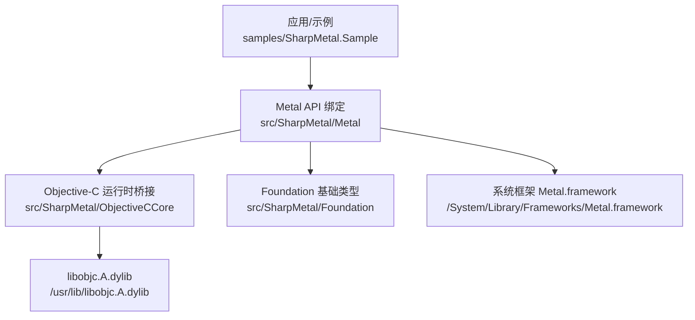
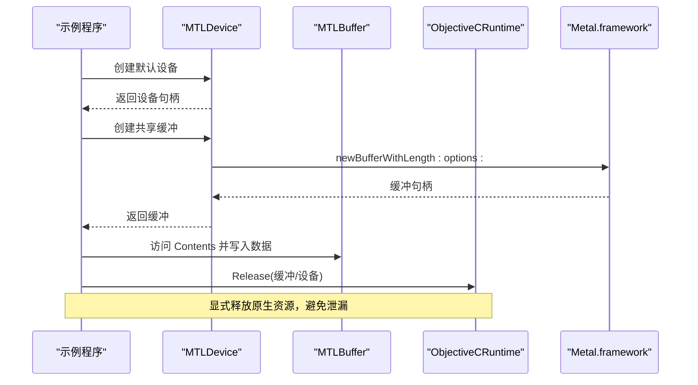
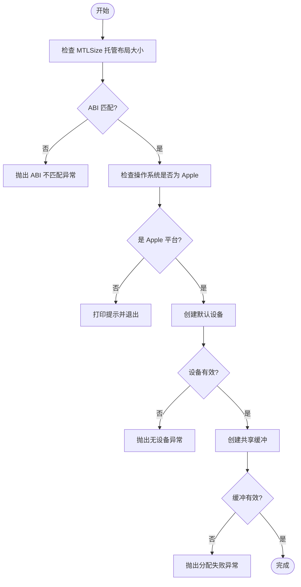
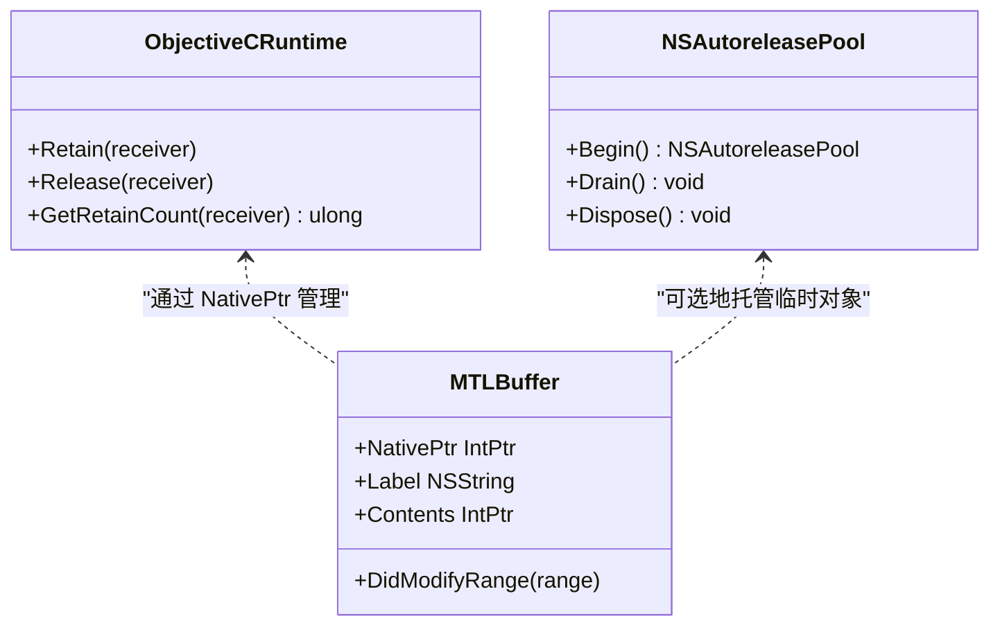
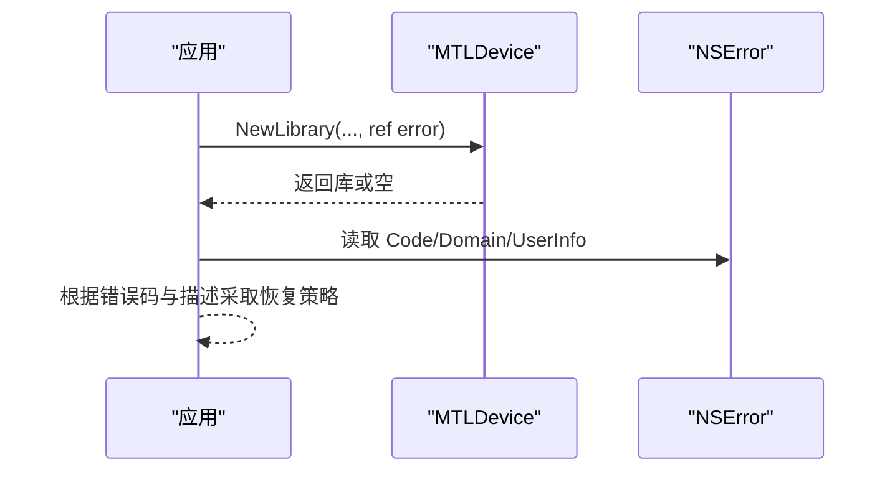
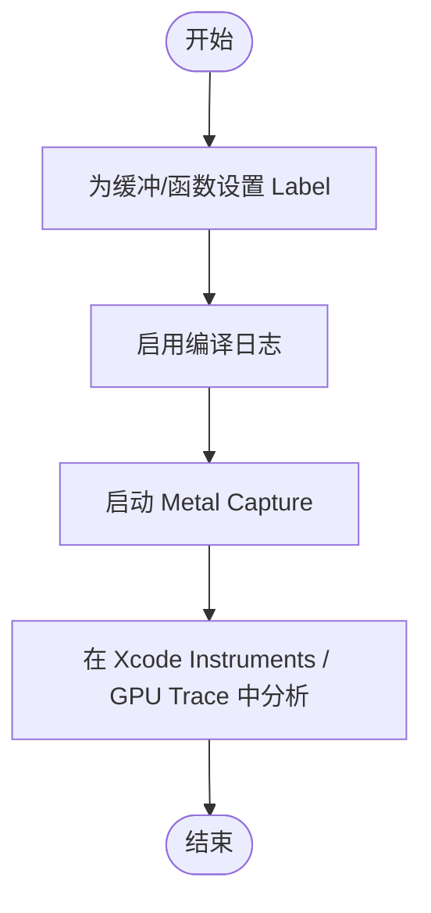
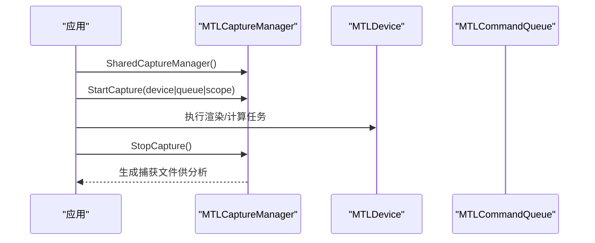
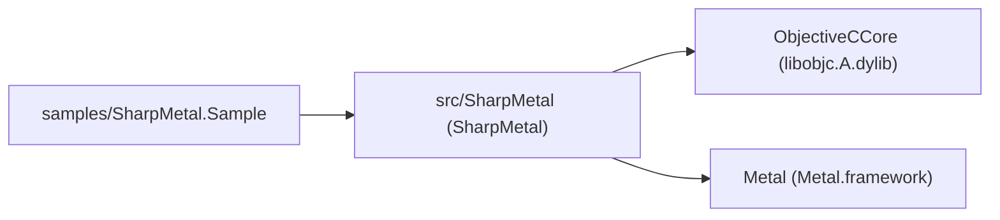

# 故障排除指南

<cite>
**本文引用的文件**
- [README.md](file://README.md)
- [DESIGN.md](file://DESIGN.md)
- [SharpMetal.csproj](file://src/SharpMetal/SharpMetal.csproj)
- [Program.cs](file://samples/SharpMetal.Sample/Program.cs)
- [ObjectiveCRuntime.cs](file://src/SharpMetal/ObjectiveCCore/ObjectiveCRuntime.cs)
- [MTLDevice.cs](file://src/SharpMetal/Metal/MTLDevice.cs)
- [NSError.cs](file://src/SharpMetal/Foundation/NSError.cs)
- [NSAutoreleasePool.cs](file://src/SharpMetal/Foundation/NSAutoreleasePool.cs)
- [MTLBuffer.cs](file://src/SharpMetal/Metal/MTLBuffer.cs)
- [MTLCaptureManager.cs](file://src/SharpMetal/Metal/MTLCaptureManager.cs)
- [MTLLibrary.cs](file://src/SharpMetal/Metal/MTLLibrary.cs)
</cite>

## 目录
1. [简介](#简介)
2. [项目结构](#项目结构)
3. [核心组件](#核心组件)
4. [架构总览](#架构总览)
5. [详细组件分析](#详细组件分析)
6. [依赖关系分析](#依赖关系分析)
7. [性能注意事项](#性能注意事项)
8. [故障排除指南](#故障排除指南)
9. [结论](#结论)
10. [附录](#附录)

## 简介
本指南面向使用 SharpMetal 进行跨平台（Apple 主机）图形与计算开发的工程师，聚焦常见问题的诊断与修复：平台兼容性检查、内存泄漏检测、性能问题定位、错误信息解读、调试技巧、日志记录方法与性能分析工具使用。内容基于仓库中的实际代码与示例，提供可操作的排查步骤与最佳实践。

## 项目结构
- src/SharpMetal：运行时绑定库，包含 Foundation、Metal、MetalFX、QuartzCore、ObjectiveCCore 等模块。
- samples/SharpMetal.Sample：最小可运行示例，演示设备获取、共享缓冲区读写与资源释放。
- docs/VERIFICATION.md：构建、测试与打包的权威说明（参考 README）。
- DESIGN.md：产品边界、目标框架、依赖模式与输出路径约定。

图表来源
- [Program.cs:1-49](file://samples/SharpMetal.Sample/Program.cs#L1-L49)
- [MTLDevice.cs:305-319](file://src/SharpMetal/Metal/MTLDevice.cs#L305-L319)
- [ObjectiveCRuntime.cs:33-57](file://src/SharpMetal/ObjectiveCCore/ObjectiveCRuntime.cs#L33-L57)

章节来源
- [README.md:1-23](file://README.md#L1-L23)
- [DESIGN.md:1-12](file://DESIGN.md#L1-L12)

## 核心组件
- MTLDevice：设备抽象，负责创建命令队列、缓冲、纹理、管线状态、动态库、归档等。
- ObjectiveCRuntime：底层消息发送、选择器、保留/释放、类型转换等。
- NSError：错误对象封装，便于从 Metal/Foundation 调用中获取域、代码、用户信息与本地化描述。
- NSAutoreleasePool：自动释放池，用于管理临时对象的释放时机。
- MTLCaptureManager：Metal Capture 控制，支持 GPU 捕获与可视化分析。
- MTLLibrary/MTLCompileOptions：着色器库加载与编译选项，含日志开关等。
- MTLBuffer：GPU/CPU 共享或独占缓冲，提供标签、长度、内容指针、修改范围通知等。

章节来源
- [MTLDevice.cs:187-319](file://src/SharpMetal/Metal/MTLDevice.cs#L187-L319)
- [ObjectiveCRuntime.cs:769-782](file://src/SharpMetal/ObjectiveCCore/ObjectiveCRuntime.cs#L769-L782)
- [NSError.cs:5-49](file://src/SharpMetal/Foundation/NSError.cs#L5-L49)
- [NSAutoreleasePool.cs:5-39](file://src/SharpMetal/Foundation/NSAutoreleasePool.cs#L5-L39)
- [MTLCaptureManager.cs:58-134](file://src/SharpMetal/Metal/MTLCaptureManager.cs#L58-L134)
- [MTLLibrary.cs:221-345](file://src/SharpMetal/Metal/MTLLibrary.cs#L221-L345)
- [MTLBuffer.cs:6-113](file://src/SharpMetal/Metal/MTLBuffer.cs#L6-L113)

## 架构总览
下图展示从示例程序到系统 Metal 的调用链，以及错误与捕获机制的集成点。

图表来源
- [Program.cs:21-45](file://samples/SharpMetal.Sample/Program.cs#L21-L45)
- [MTLDevice.cs:356-359](file://src/SharpMetal/Metal/MTLDevice.cs#L356-L359)
- [ObjectiveCRuntime.cs:774-777](file://src/SharpMetal/ObjectiveCCore/ObjectiveCRuntime.cs#L774-L777)

## 详细组件分析

### 平台兼容性检查
- 在示例程序中，先校验托管 ABI 大小，再判断是否处于 Apple 平台；非 Apple 平台直接退出，避免调用系统框架导致崩溃。
- 若设备为空或缓冲分配失败，抛出明确异常，便于快速定位。

图表来源
- [Program.cs:12-31](file://samples/SharpMetal.Sample/Program.cs#L12-L31)

章节来源
- [Program.cs:12-31](file://samples/SharpMetal.Sample/Program.cs#L12-L31)

### 内存管理与泄漏检测
- 所有原生对象需显式释放。示例在 finally 块中对设备和缓冲调用释放，确保即使异常也能回收。
- ObjectiveCRuntime 暴露 Retain/Release/GetRetainCount，可用于追踪引用计数变化。
- 对于大量临时对象，可使用 NSAutoreleasePool 包裹短生命周期代码块，减少手动释放负担。

图表来源
- [ObjectiveCRuntime.cs:769-782](file://src/SharpMetal/ObjectiveCCore/ObjectiveCRuntime.cs#L769-L782)
- [NSAutoreleasePool.cs:5-39](file://src/SharpMetal/Foundation/NSAutoreleasePool.cs#L5-L39)
- [MTLBuffer.cs:6-113](file://src/SharpMetal/Metal/MTLBuffer.cs#L6-L113)

章节来源
- [Program.cs:41-45](file://samples/SharpMetal.Sample/Program.cs#L41-L45)
- [ObjectiveCRuntime.cs:769-782](file://src/SharpMetal/ObjectiveCCore/ObjectiveCRuntime.cs#L769-L782)
- [NSAutoreleasePool.cs:11-26](file://src/SharpMetal/Foundation/NSAutoreleasePool.cs#L11-L26)

### 错误信息解读与处理
- NSError 封装了域、代码、用户信息与本地化描述，适用于 Metal 和 Foundation 方法返回的错误。
- 许多 Metal API 提供带 error 参数的重载，调用后应检查 NSError 以获取详细信息。

图表来源
- [MTLDevice.cs:411-419](file://src/SharpMetal/Metal/MTLDevice.cs#L411-L419)
- [NSError.cs:13-25](file://src/SharpMetal/Foundation/NSError.cs#L13-L25)

章节来源
- [NSError.cs:5-49](file://src/SharpMetal/Foundation/NSError.cs#L5-L49)

### 调试与日志记录
- 为缓冲、函数等关键对象设置 Label，有助于在 Metal 调试器中识别资源。
- 可在编译选项中开启日志，辅助定位着色器编译与链接问题。

图表来源
- [MTLBuffer.cs:18-22](file://src/SharpMetal/Metal/MTLBuffer.cs#L18-L22)
- [MTLLibrary.cs:311-315](file://src/SharpMetal/Metal/MTLLibrary.cs#L311-L315)
- [MTLCaptureManager.cs:74-117](file://src/SharpMetal/Metal/MTLCaptureManager.cs#L74-L117)

章节来源
- [MTLBuffer.cs:18-22](file://src/SharpMetal/Metal/MTLBuffer.cs#L18-L22)
- [MTLLibrary.cs:311-315](file://src/SharpMetal/Metal/MTLLibrary.cs#L311-L315)
- [MTLCaptureManager.cs:74-117](file://src/SharpMetal/Metal/MTLCaptureManager.cs#L74-L117)

### 性能分析与捕获
- 使用 MTLCaptureManager 对设备或命令队列进行捕获，结合 Xcode Instruments/GPU Trace 分析 GPU 工作负载、同步瓶颈与内存带宽。
- 可通过 MTLCompileOptions 调整数学模式、优化级别与语言版本，平衡精度与性能。

图表来源
- [MTLCaptureManager.cs:74-117](file://src/SharpMetal/Metal/MTLCaptureManager.cs#L74-L117)

章节来源
- [MTLCaptureManager.cs:74-117](file://src/SharpMetal/Metal/MTLCaptureManager.cs#L74-L117)
- [MTLLibrary.cs:221-345](file://src/SharpMetal/Metal/MTLLibrary.cs#L221-L345)

## 依赖关系分析
- 示例程序依赖 SharpMetal.Metal 与 SharpMetal.ObjectiveCCore。
- Metal 绑定通过 LibraryImport 直接链接系统 Metal.framework。
- Objective-C 运行时通过 libobjc.A.dylib 实现消息发送与对象生命周期管理。

图表来源
- [Program.cs:1-4](file://samples/SharpMetal.Sample/Program.cs#L1-L4)
- [MTLDevice.cs:305-319](file://src/SharpMetal/Metal/MTLDevice.cs#L305-L319)
- [ObjectiveCRuntime.cs:33-57](file://src/SharpMetal/ObjectiveCCore/ObjectiveCRuntime.cs#L33-L57)

章节来源
- [SharpMetal.csproj:1-47](file://src/SharpMetal/SharpMetal.csproj#L1-L47)
- [DESIGN.md:1-12](file://DESIGN.md#L1-L12)

## 性能注意事项
- 合理选择存储模式与缓存模式，避免不必要的 CPU-GPU 同步。
- 使用共享缓冲时，注意 DidModifyRange 通知以告知驱动数据更新区域。
- 利用 MTLCompileOptions 的 MathMode、OptimizationLevel、LanguageVersion 等参数调优。
- 通过 Metal Capture 分析绘制/计算阶段耗时、内存带宽与同步开销。

章节来源
- [MTLBuffer.cs:26-32](file://src/SharpMetal/Metal/MTLBuffer.cs#L26-L32)
- [MTLBuffer.cs:60-63](file://src/SharpMetal/Metal/MTLBuffer.cs#L60-L63)
- [MTLLibrary.cs:239-291](file://src/SharpMetal/Metal/MTLLibrary.cs#L239-L291)

## 故障排除指南

### 平台兼容性问题
- 症状：在非 Apple 平台运行崩溃或无法加载 Metal.framework。
- 排查：
  - 确认示例程序的平台检查逻辑已生效。
  - 检查目标平台与 SDK 配置（x64/ARM64）。
- 修复：
  - 仅在 Apple 主机上执行 Metal 相关代码。
  - 如需跨平台开发，将 Metal 调用置于条件分支内。

章节来源
- [Program.cs:16-20](file://samples/SharpMetal.Sample/Program.cs#L16-L20)
- [SharpMetal.csproj:1-12](file://src/SharpMetal/SharpMetal.csproj#L1-L12)

### 设备与资源初始化失败
- 症状：设备为空或缓冲分配失败。
- 排查：
  - 检查 CreateSystemDefaultDevice 返回值。
  - 检查缓冲创建参数（长度、选项）。
- 修复：
  - 增加错误分支与日志，记录失败原因。
  - 根据设备能力选择合适的资源选项。

章节来源
- [Program.cs:25-31](file://samples/SharpMetal.Sample/Program.cs#L25-L31)
- [MTLDevice.cs:356-359](file://src/SharpMetal/Metal/MTLDevice.cs#L356-L359)

### 内存泄漏与引用计数异常
- 症状：进程内存持续增长或崩溃于释放阶段。
- 排查：
  - 使用 ObjectiveCRuntime.GetRetainCount 跟踪对象引用计数。
  - 确认每个原生对象都有对应的 Release。
  - 对短期对象使用 NSAutoreleasePool。
- 修复：
  - 在 finally 或 using 中释放资源。
  - 避免持有全局强引用。

章节来源
- [Program.cs:41-45](file://samples/SharpMetal.Sample/Program.cs#L41-L45)
- [ObjectiveCRuntime.cs:769-782](file://src/SharpMetal/ObjectiveCCore/ObjectiveCRuntime.cs#L769-L782)
- [NSAutoreleasePool.cs:11-26](file://src/SharpMetal/Foundation/NSAutoreleasePool.cs#L11-L26)

### 着色器编译与链接错误
- 症状：NewFunction/NewLibrary 返回错误。
- 排查：
  - 检查 NSError 的 Domain、Code、LocalizedDescription。
  - 启用编译日志查看具体错误行与警告。
- 修复：
  - 修正着色器语法或常量定义。
  - 调整编译选项（MathMode、LanguageVersion、OptimizationLevel）。

章节来源
- [MTLLibrary.cs:311-315](file://src/SharpMetal/Metal/MTLLibrary.cs#L311-L315)
- [NSError.cs:13-25](file://src/SharpMetal/Foundation/NSError.cs#L13-L25)

### 性能瓶颈定位
- 症状：帧率下降、GPU 占用高或内存带宽不足。
- 排查：
  - 使用 Metal Capture 捕获一帧或多帧，分析 GPU 时间线。
  - 关注同步点（呈现、读回）、过大的纹理/缓冲拷贝。
- 修复：
  - 减少不必要的同步，合并绘制调用。
  - 优化纹理格式与采样方式，降低带宽压力。
  - 调整线程组大小与并行度。

章节来源
- [MTLCaptureManager.cs:74-117](file://src/SharpMetal/Metal/MTLCaptureManager.cs#L74-L117)

### 调试技巧与日志方法
- 技巧：
  - 为关键对象设置 Label，便于在调试器中识别。
  - 在关键路径添加断点与日志输出。
- 日志：
  - 启用编译日志，捕获着色器编译过程。
  - 使用 NSError 的本地化描述输出可读信息。

章节来源
- [MTLBuffer.cs:18-22](file://src/SharpMetal/Metal/MTLBuffer.cs#L18-L22)
- [MTLLibrary.cs:311-315](file://src/SharpMetal/Metal/MTLLibrary.cs#L311-L315)
- [NSError.cs:13-25](file://src/SharpMetal/Foundation/NSError.cs#L13-L25)

### 跨平台开发与部署问题
- 问题：在非 Apple 环境尝试加载 Metal.framework 或调用系统 API。
- 解决：
  - 严格使用平台检查，隔离 Metal 调用。
  - 在 CI/CD 中仅对 Apple 平台执行 Metal 相关测试。
  - 使用 Package/Source 模式管理依赖，避免隐式降级。

章节来源
- [DESIGN.md:5-11](file://DESIGN.md#L5-L11)
- [Program.cs:16-20](file://samples/SharpMetal.Sample/Program.cs#L16-L20)

## 结论
SharpMetal 提供了对 Apple Metal 与 Objective-C 运行时的低层绑定。通过严格的平台检查、显式资源管理、完善的错误处理与强大的捕获分析能力，开发者可以高效定位并修复常见问题。建议在生产环境中启用 Metal Capture 与编译日志，持续监控性能与稳定性。

## 附录
- 构建与验证：参考 docs/VERIFICATION.md 与 README 中的命令。
- 目标框架与平台：net10.0，支持 x64/ARM64。
- 依赖模式：Source 与 Package 模式分离，锁定文件受控提交。

章节来源
- [README.md:5-16](file://README.md#L5-L16)
- [SharpMetal.csproj:1-12](file://src/SharpMetal/SharpMetal.csproj#L1-L12)
- [DESIGN.md:5-11](file://DESIGN.md#L5-L11)