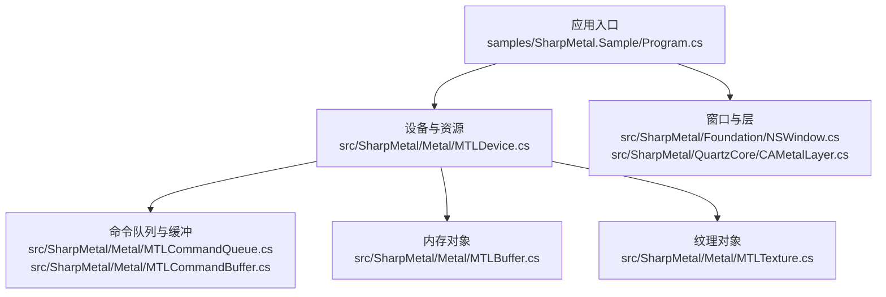
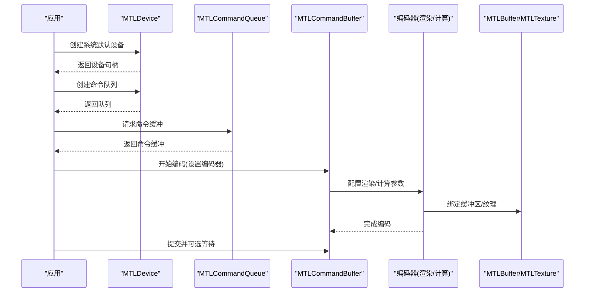
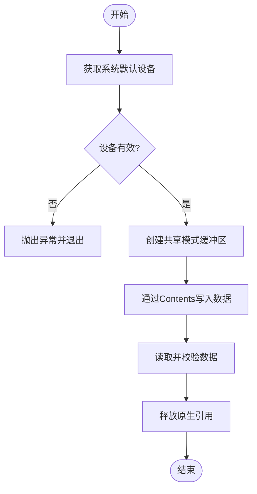
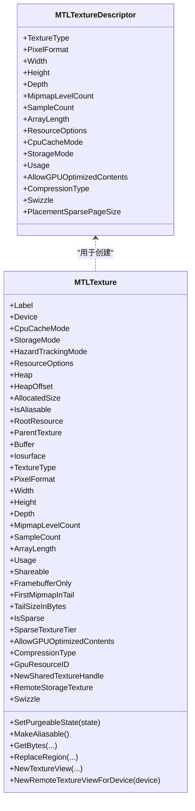
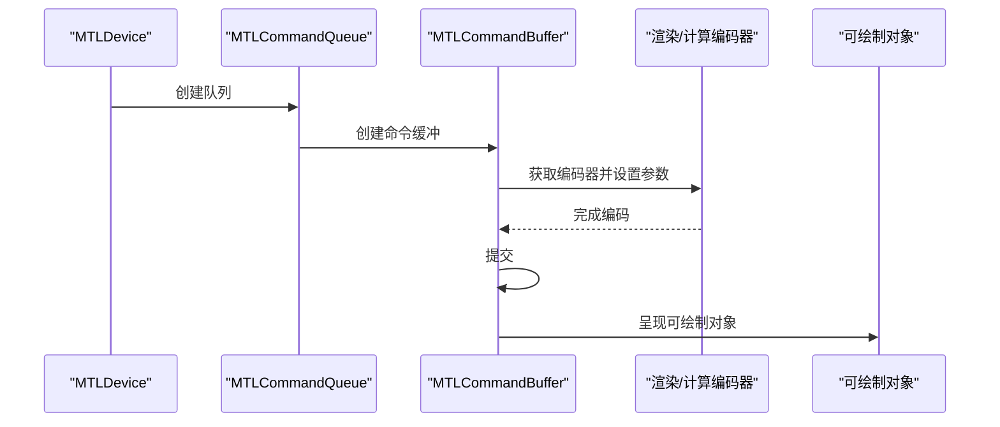
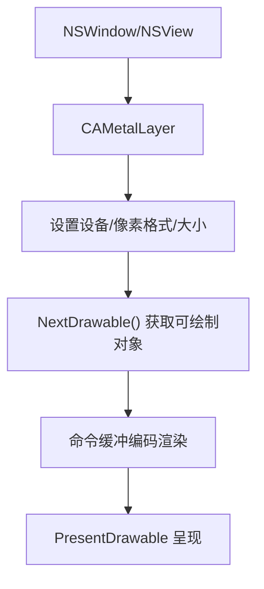
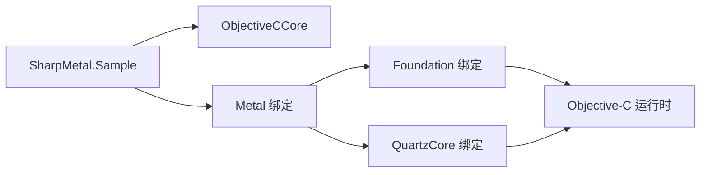

# 示例和教程

<cite>
**本文引用的文件**
- [README.md](file://README.md)
- [DESIGN.md](file://DESIGN.md)
- [Program.cs](file://samples/SharpMetal.Sample/Program.cs)
- [MTLDevice.cs](file://src/SharpMetal/Metal/MTLDevice.cs)
- [MTLBuffer.cs](file://src/SharpMetal/Metal/MTLBuffer.cs)
- [MTLTexture.cs](file://src/SharpMetal/Metal/MTLTexture.cs)
- [MTLCommandQueue.cs](file://src/SharpMetal/Metal/MTLCommandQueue.cs)
- [MTLCommandBuffer.cs](file://src/SharpMetal/Metal/MTLCommandBuffer.cs)
- [NSWindow.cs](file://src/SharpMetal/Foundation/NSWindow.cs)
- [CAMetalLayer.cs](file://src/SharpMetal/QuartzCore/CAMetalLayer.cs)
</cite>

## 目录
1. [简介](#简介)
2. [项目结构](#项目结构)
3. [核心组件](#核心组件)
4. [架构总览](#架构总览)
5. [详细组件分析](#详细组件分析)
6. [依赖关系分析](#依赖关系分析)
7. [性能注意事项](#性能注意事项)
8. [故障排查指南](#故障排查指南)
9. [结论](#结论)
10. [附录：从入门到进阶的完整学习路径与可运行示例](#附录从入门到进阶的完整学习路径与可运行示例)

## 简介
本教程面向希望在 .NET 10 上使用 SharpMetal 进行 Metal 图形与计算编程的开发者。内容覆盖从基础设备与内存管理，到渲染管线、命令缓冲、纹理与缓冲区操作，再到性能调优与常见问题解决方案。所有示例均基于仓库中的实际代码结构与 API 设计，确保准确性与实用性。

## 项目结构
- src/SharpMetal：运行时绑定（Foundation、Metal、MetalFX、QuartzCore、ObjectiveCCore）
- samples/SharpMetal.Sample：可运行的最小示例，演示设备获取、共享缓冲区读写
- docs/：设计与验证说明
- eng/：自动化验证脚本

图表来源
- [Program.cs:1-49](file://samples/SharpMetal.Sample/Program.cs#L1-L49)
- [MTLDevice.cs:187-359](file://src/SharpMetal/Metal/MTLDevice.cs#L187-L359)
- [MTLCommandQueue.cs:44-109](file://src/SharpMetal/Metal/MTLCommandQueue.cs#L44-L109)
- [MTLCommandBuffer.cs:116-200](file://src/SharpMetal/Metal/MTLCommandBuffer.cs#L116-L200)
- [MTLBuffer.cs:6-115](file://src/SharpMetal/Metal/MTLBuffer.cs#L6-L115)
- [MTLTexture.cs:75-440](file://src/SharpMetal/Metal/MTLTexture.cs#L75-L440)
- [NSWindow.cs:8-56](file://src/SharpMetal/Foundation/NSWindow.cs#L8-L56)
- [CAMetalLayer.cs:7-136](file://src/SharpMetal/QuartzCore/CAMetalLayer.cs#L7-L136)

章节来源
- [README.md:1-23](file://README.md#L1-L23)
- [DESIGN.md:1-12](file://DESIGN.md#L1-L12)

## 核心组件
- MTLDevice：系统默认设备创建、能力查询、资源与管线创建入口
- MTLBuffer：GPU/CPU 共享或专用存储的线性内存块，支持直接访问与视图转换
- MTLTexture：二维/三维/立方体等纹理，支持像素格式、采样、压缩、稀疏等高级特性
- MTLCommandQueue / MTLCommandBuffer：命令提交与执行单元，负责编码渲染/计算/拷贝等操作
- NSWindow / CAMetalLayer：窗口与金属层，提供绘制目标与可呈现的可绘制对象

章节来源
- [MTLDevice.cs:187-359](file://src/SharpMetal/Metal/MTLDevice.cs#L187-L359)
- [MTLBuffer.cs:6-115](file://src/SharpMetal/Metal/MTLBuffer.cs#L6-L115)
- [MTLTexture.cs:75-440](file://src/SharpMetal/Metal/MTLTexture.cs#L75-L440)
- [MTLCommandQueue.cs:44-109](file://src/SharpMetal/Metal/MTLCommandQueue.cs#L44-L109)
- [MTLCommandBuffer.cs:116-200](file://src/SharpMetal/Metal/MTLCommandBuffer.cs#L116-L200)
- [NSWindow.cs:8-56](file://src/SharpMetal/Foundation/NSWindow.cs#L8-L56)
- [CAMetalLayer.cs:7-136](file://src/SharpMetal/QuartzCore/CAMetalLayer.cs#L7-L136)

## 架构总览
下图展示了从应用入口到 Metal 设备的典型调用链，以及资源与命令的交互关系。

图表来源
- [MTLDevice.cs:305-339](file://src/SharpMetal/Metal/MTLDevice.cs#L305-L339)
- [MTLCommandQueue.cs:58-68](file://src/SharpMetal/Metal/MTLCommandQueue.cs#L58-L68)
- [MTLCommandBuffer.cs:150-200](file://src/SharpMetal/Metal/MTLCommandBuffer.cs#L150-L200)
- [MTLBuffer.cs:18-49](file://src/SharpMetal/Metal/MTLBuffer.cs#L18-L49)
- [MTLTexture.cs:253-335](file://src/SharpMetal/Metal/MTLTexture.cs#L253-L335)

## 详细组件分析

### 设备与资源生命周期（MTLDevice 与 MTLBuffer）
- 设备创建：通过系统默认设备接口获取设备实例
- 缓冲区创建：使用设备创建共享存储模式的缓冲区，便于 CPU/GPU 双向访问
- 数据写入：通过 Contents 指针以 Span<T> 形式写入数据
- 数据校验：读取回写数据进行一致性检查
- 资源释放：在 finally 中显式释放原生引用，避免泄漏

图表来源
- [Program.cs:10-45](file://samples/SharpMetal.Sample/Program.cs#L10-L45)
- [MTLDevice.cs:305-359](file://src/SharpMetal/Metal/MTLDevice.cs#L305-L359)
- [MTLBuffer.cs:18-49](file://src/SharpMetal/Metal/MTLBuffer.cs#L18-L49)

章节来源
- [Program.cs:10-45](file://samples/SharpMetal.Sample/Program.cs#L10-L45)
- [MTLDevice.cs:305-359](file://src/SharpMetal/Metal/MTLDevice.cs#L305-L359)
- [MTLBuffer.cs:18-49](file://src/SharpMetal/Metal/MTLBuffer.cs#L18-L49)

### 纹理与描述符（MTLTextureDescriptor 与 MTLTexture）
- 描述符构造：使用静态工厂方法创建不同维度的纹理描述符（如 2D、Cube、Buffer）
- 属性配置：像素格式、尺寸、Mipmap、采样数、数组长度、缓存模式、存储模式、使用标志等
- 纹理创建：通过设备创建纹理实例
- 数据交换：GetBytes/ReplaceRegion 用于 CPU 与 GPU 之间的像素数据同步
- 视图与共享：NewTextureView/NewSharedTextureHandle 支持多视角与跨进程共享

图表来源
- [MTLTexture.cs:75-240](file://src/SharpMetal/Metal/MTLTexture.cs#L75-L240)
- [MTLTexture.cs:242-440](file://src/SharpMetal/Metal/MTLTexture.cs#L242-L440)

章节来源
- [MTLTexture.cs:75-240](file://src/SharpMetal/Metal/MTLTexture.cs#L75-L240)
- [MTLTexture.cs:242-440](file://src/SharpMetal/Metal/MTLTexture.cs#L242-L440)

### 命令队列与命令缓冲（MTLCommandQueue 与 MTLCommandBuffer）
- 队列创建：通过设备创建命令队列，可配置最大缓冲数量与日志状态
- 缓冲创建：从队列获取命令缓冲，支持描述符配置（保留引用、错误选项、日志）
- 编码器获取：在缓冲上创建渲染/计算/拷贝等编码器
- 提交与呈现：提交命令缓冲，可选择等待调度或完成；对可绘制对象进行呈现

图表来源
- [MTLDevice.cs:326-339](file://src/SharpMetal/Metal/MTLDevice.cs#L326-L339)
- [MTLCommandQueue.cs:58-68](file://src/SharpMetal/Metal/MTLCommandQueue.cs#L58-L68)
- [MTLCommandBuffer.cs:150-200](file://src/SharpMetal/Metal/MTLCommandBuffer.cs#L150-L200)

章节来源
- [MTLCommandQueue.cs:44-109](file://src/SharpMetal/Metal/MTLCommandQueue.cs#L44-L109)
- [MTLCommandBuffer.cs:59-200](file://src/SharpMetal/Metal/MTLCommandBuffer.cs#L59-L200)

### 窗口与金属层（NSWindow 与 CAMetalLayer）
- 窗口视图：NSView 提供 WantsLayer、Layer、Frame 等属性，用于集成 QuartzCore 层
- 金属层：CAMetalLayer 关联设备、像素格式、帧缓冲模式、可绘制大小、显示同步、最大可绘制数量等
- 可绘制对象：NextDrawable 获取下一帧可绘制对象，配合命令缓冲进行呈现

图表来源
- [NSWindow.cs:8-56](file://src/SharpMetal/Foundation/NSWindow.cs#L8-L56)
- [CAMetalLayer.cs:17-87](file://src/SharpMetal/QuartzCore/CAMetalLayer.cs#L17-L87)
- [MTLCommandBuffer.cs:160-173](file://src/SharpMetal/Metal/MTLCommandBuffer.cs#L160-L173)

章节来源
- [NSWindow.cs:8-56](file://src/SharpMetal/Foundation/NSWindow.cs#L8-L56)
- [CAMetalLayer.cs:17-87](file://src/SharpMetal/QuartzCore/CAMetalLayer.cs#L17-L87)
- [MTLCommandBuffer.cs:160-173](file://src/SharpMetal/Metal/MTLCommandBuffer.cs#L160-L173)

## 依赖关系分析
- 平台要求：必须在 Apple 主机上运行（macOS/iOS/Mac Catalyst），非 Apple 平台将阻止原生 Metal 工作负载
- 运行时依赖：通过 ObjectiveCRuntime 进行消息发送与类型桥接；Foundation/QuartzCore 提供 UI 与层支持
- 资源所有权：原生资源需显式释放，避免内存泄漏；示例在 finally 中释放设备与缓冲区

图表来源
- [Program.cs:1-49](file://samples/SharpMetal.Sample/Program.cs#L1-L49)
- [MTLDevice.cs:1-4](file://src/SharpMetal/Metal/MTLDevice.cs#L1-L4)
- [NSWindow.cs:1-5](file://src/SharpMetal/Foundation/NSWindow.cs#L1-L5)
- [CAMetalLayer.cs:1-4](file://src/SharpMetal/QuartzCore/CAMetalLayer.cs#L1-L4)

章节来源
- [Program.cs:10-45](file://samples/SharpMetal.Sample/Program.cs#L10-L45)
- [DESIGN.md:1-12](file://DESIGN.md#L1-L12)

## 性能注意事项
- 存储模式选择：共享模式适合 CPU/GPU 频繁交替访问；专用模式减少拷贝但需注意同步
- 纹理使用标志：根据读写需求设置 Usage，避免不必要的重排与拷贝
- 命令缓冲批处理：合并多次编码以减少提交开销；合理使用间接命令缓冲
- 显示同步与可绘制数量：合理设置 DisplaySyncEnabled 与 MaximumDrawableCount，避免过度等待或丢帧
- 资源复用：重用命令队列、管线状态与纹理视图，降低创建成本
- 稀疏纹理与分块：大纹理场景考虑稀疏纹理与 tile 渲染以降低内存占用

[本节为通用指导，不直接分析具体文件]

## 故障排查指南
- 平台限制：在非 Apple 平台会阻止原生 Metal 工作负载，需切换到 macOS/iOS/Mac Catalyst
- 设备为空：若设备句柄为空，检查系统是否支持 Metal 及驱动状态
- 缓冲区分配失败：确认资源选项与长度对齐；必要时调整存储模式或堆大小
- 数据不一致：检查 DidModifyRange 调用时机与范围；确保 CPU/GPU 同步正确
- 命令缓冲错误：查看 Error 与状态码，定位编码器执行阶段问题
- 原生资源泄漏：确保在 finally 中释放所有原生引用

章节来源
- [Program.cs:10-45](file://samples/SharpMetal.Sample/Program.cs#L10-L45)
- [MTLCommandBuffer.cs:146-193](file://src/SharpMetal/Metal/MTLCommandBuffer.cs#L146-L193)
- [MTLBuffer.cs:50-63](file://src/SharpMetal/Metal/MTLBuffer.cs#L50-L63)

## 结论
SharpMetal 提供了低层次的 .NET 绑定，使开发者能够在 Apple 平台上高效使用 Metal。通过理解设备、资源、命令与窗口的协作关系，结合合理的性能策略与错误处理，可以构建稳定高效的图形与计算应用。建议从最小示例入手，逐步扩展至复杂渲染与计算任务。

[本节为总结性内容，不直接分析具体文件]

## 附录：从入门到进阶的完整学习路径与可运行示例

### 入门：设备与共享缓冲区读写
- 目标：验证设备可用性与共享缓冲区的基本读写
- 步骤：
  - 检查平台是否为 Apple 主机
  - 创建系统默认设备
  - 创建共享模式缓冲区并写入数据
  - 读取并校验数据
  - 释放原生引用
- 参考实现路径
  - [Program.cs:10-45](file://samples/SharpMetal.Sample/Program.cs#L10-L45)
  - [MTLDevice.cs:305-359](file://src/SharpMetal/Metal/MTLDevice.cs#L305-L359)
  - [MTLBuffer.cs:18-49](file://src/SharpMetal/Metal/MTLBuffer.cs#L18-L49)

### 进阶：纹理创建与像素数据交换
- 目标：掌握纹理描述符与数据交换
- 步骤：
  - 使用静态工厂创建纹理描述符（2D/Cube/Buffer）
  - 配置像素格式、尺寸、Mipmap、采样数、使用标志
  - 通过设备创建纹理
  - 使用 GetBytes/ReplaceRegion 进行像素数据同步
  - 创建纹理视图与共享句柄
- 参考实现路径
  - [MTLTexture.cs:75-240](file://src/SharpMetal/Metal/MTLTexture.cs#L75-L240)
  - [MTLTexture.cs:242-440](file://src/SharpMetal/Metal/MTLTexture.cs#L242-L440)

### 进阶：命令缓冲与渲染/计算编码
- 目标：理解命令队列与缓冲的生命周期与编码流程
- 步骤：
  - 从设备创建命令队列
  - 从队列获取命令缓冲
  - 在缓冲上创建渲染/计算编码器并设置参数
  - 提交命令缓冲并等待完成
- 参考实现路径
  - [MTLDevice.cs:326-339](file://src/SharpMetal/Metal/MTLDevice.cs#L326-L339)
  - [MTLCommandQueue.cs:58-68](file://src/SharpMetal/Metal/MTLCommandQueue.cs#L58-L68)
  - [MTLCommandBuffer.cs:150-200](file://src/SharpMetal/Metal/MTLCommandBuffer.cs#L150-L200)

### 高级：窗口与金属层集成
- 目标：将渲染输出到窗口
- 步骤：
  - 配置 NSView 的 Layer 为 CAMetalLayer
  - 设置 CAMetalLayer 的设备、像素格式、可绘制大小
  - 每帧获取 NextDrawable 并进行渲染
  - 提交命令缓冲并呈现可绘制对象
- 参考实现路径
  - [NSWindow.cs:8-56](file://src/SharpMetal/Foundation/NSWindow.cs#L8-L56)
  - [CAMetalLayer.cs:17-87](file://src/SharpMetal/QuartzCore/CAMetalLayer.cs#L17-L87)
  - [MTLCommandBuffer.cs:160-173](file://src/SharpMetal/Metal/MTLCommandBuffer.cs#L160-L173)

### 最佳实践与常见问题
- 资源所有权：始终显式释放原生引用，避免泄漏
- 平台检测：在启动时检测平台并给出明确提示
- 错误处理：捕获并记录 NSError，定位问题阶段
- 性能优化：合理选择存储模式与使用标志，减少不必要的数据拷贝
- 调试技巧：使用 Label 与 Debug Marker 标记资源与区域，便于诊断

章节来源
- [Program.cs:10-45](file://samples/SharpMetal.Sample/Program.cs#L10-L45)
- [MTLCommandBuffer.cs:146-193](file://src/SharpMetal/Metal/MTLCommandBuffer.cs#L146-L193)
- [MTLBuffer.cs:75-83](file://src/SharpMetal/Metal/MTLBuffer.cs#L75-L83)