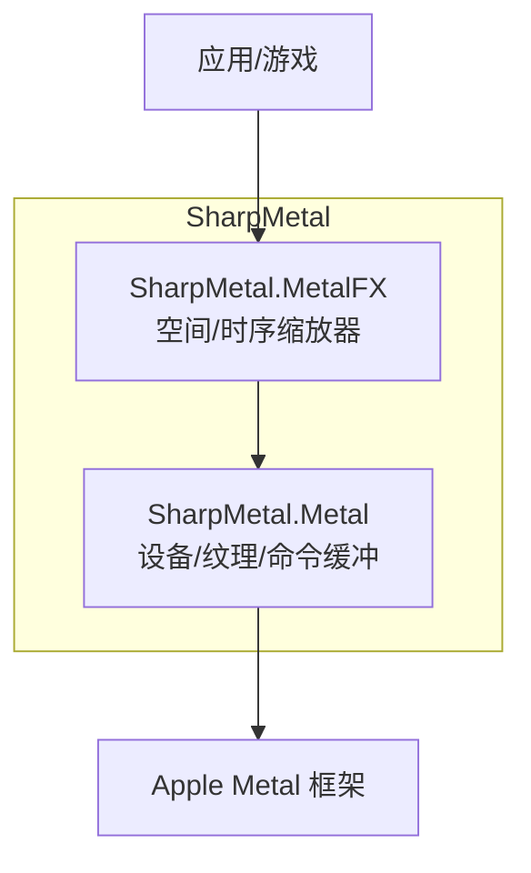
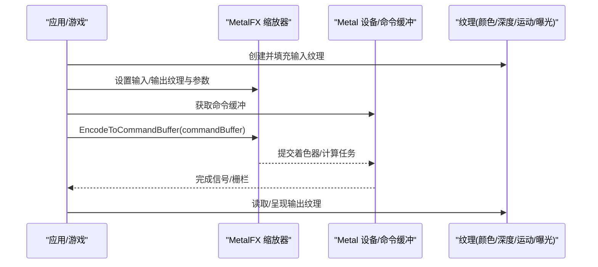
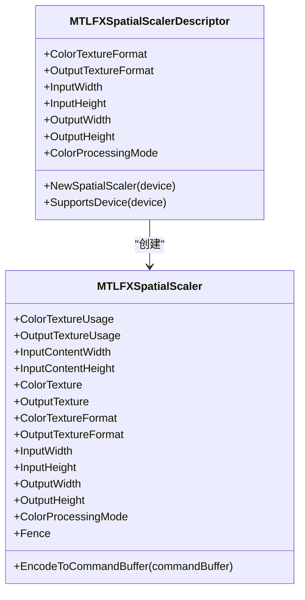
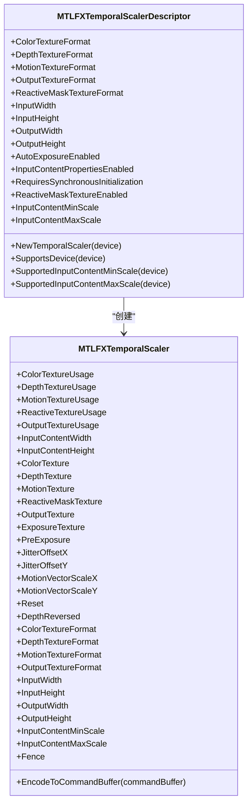
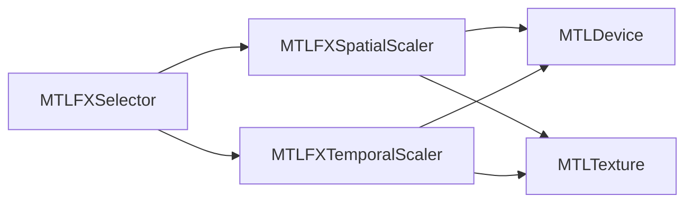
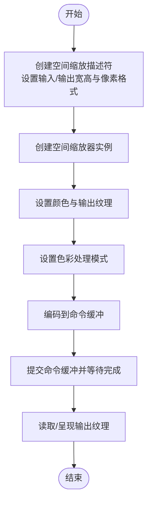
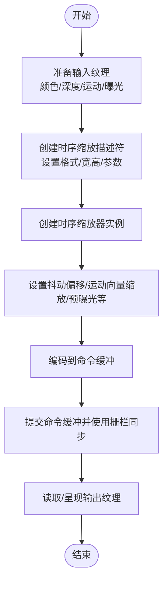

# MetalFX图像处理示例

<cite>
**本文引用的文件**
- [MTLFXCommon.cs](file://src/SharpMetal/MetalFX/MTLFXCommon.cs)
- [MTLFXSpatialScaler.cs](file://src/SharpMetal/MetalFX/MTLFXSpatialScaler.cs)
- [MTLFXTemporalScaler.cs](file://src/SharpMetal/MetalFX/MTLFXTemporalScaler.cs)
- [MTLDevice.cs](file://src/SharpMetal/Metal/MTLDevice.cs)
- [MTLPixelFormat.cs](file://src/SharpMetal/Metal/MTLPixelFormat.cs)
- [MTLTexture.cs](file://src/SharpMetal/Metal/MTLTexture.cs)
- [Program.cs](file://samples/SharpMetal.Sample/Program.cs)
- [README.md](file://README.md)
</cite>

## 目录
1. [简介](#简介)
2. [项目结构](#项目结构)
3. [核心组件](#核心组件)
4. [架构总览](#架构总览)
5. [详细组件分析](#详细组件分析)
6. [依赖关系分析](#依赖关系分析)
7. [性能与质量调优](#性能与质量调优)
8. [故障排查指南](#故障排查指南)
9. [结论](#结论)
10. [附录：工作流与集成要点](#附录工作流与集成要点)

## 简介
本示例文档面向在 .NET 环境下使用 SharpMetal 的开发者，聚焦于 MetalFX 的空间缩放与时序插值能力，覆盖超分辨率、运动估计、帧插值等常见图像增强场景。文档基于仓库中已实现的 MetalFX 绑定（空间/时序缩放器）以及底层 Metal 类型（设备、纹理、像素格式），给出从输入输出缓冲区管理到实时渲染管线集成的完整流程，并提供性能与质量设置的实践建议。

## 项目结构
该仓库提供对 Apple 原生 Metal 与 MetalFX 的低层绑定，包含 Foundation、Metal、MetalFX、QuartzCore 等模块；示例工程位于 samples 目录，用于验证平台与基础资源创建。

**图示来源**
- [MTLFXSpatialScaler.cs:63-66](file://src/SharpMetal/MetalFX/MTLFXSpatialScaler.cs#L63-L66)
- [MTLFXTemporalScaler.cs:104-107](file://src/SharpMetal/MetalFX/MTLFXTemporalScaler.cs#L104-L107)
- [MTLDevice.cs:187-200](file://src/SharpMetal/Metal/MTLDevice.cs#L187-L200)

**章节来源**
- [README.md:1-23](file://README.md#L1-L23)
- [Program.cs:10-45](file://samples/SharpMetal.Sample/Program.cs#L10-L45)

## 核心组件
- 空间缩放器（MTLFXSpatialScaler）：负责单帧空间域缩放，支持感知/线性/HDR 色彩处理模式，可配置输入/输出尺寸与像素格式，并编码至命令缓冲执行。
- 时序缩放器（MTLFXTemporalScaler）：在空间缩放基础上引入时序信息（深度、运动矢量、曝光、抖动偏移等），实现帧间稳定与高质量插值/重建。
- 公共选择器集合（MTLFXSelector）：封装 Objective-C 方法名，供空间/时序缩放器通过消息调用 MetalFX 原生 API。
- 底层 Metal 类型：设备（MTLDevice）、纹理（MTLTexture）、像素格式（MTLPixelFormat）等，作为输入/输出缓冲与资源载体。

**章节来源**
- [MTLFXSpatialScaler.cs:6-167](file://src/SharpMetal/MetalFX/MTLFXSpatialScaler.cs#L6-L167)
- [MTLFXTemporalScaler.cs:6-314](file://src/SharpMetal/MetalFX/MTLFXTemporalScaler.cs#L6-L314)
- [MTLFXCommon.cs:6-83](file://src/SharpMetal/MetalFX/MTLFXCommon.cs#L6-L83)
- [MTLDevice.cs:187-200](file://src/SharpMetal/Metal/MTLDevice.cs#L187-L200)
- [MTLTexture.cs:75-200](file://src/SharpMetal/Metal/MTLTexture.cs#L75-L200)
- [MTLPixelFormat.cs:1-147](file://src/SharpMetal/Metal/MTLPixelFormat.cs#L1-L147)

## 架构总览
下图展示了从应用侧准备输入纹理，到调用空间/时序缩放器编码命令，再到输出纹理呈现或进一步处理的典型数据流。

**图示来源**
- [MTLFXSpatialScaler.cs:159-162](file://src/SharpMetal/MetalFX/MTLFXSpatialScaler.cs#L159-L162)
- [MTLFXTemporalScaler.cs:306-309](file://src/SharpMetal/MetalFX/MTLFXTemporalScaler.cs#L306-L309)
- [MTLTexture.cs:75-200](file://src/SharpMetal/Metal/MTLTexture.cs#L75-L200)

## 详细组件分析

### 空间缩放器（MTLFXSpatialScaler）
- 描述符（Descriptor）：配置输入/输出宽高、颜色与输出像素格式、色彩处理模式，并创建具体缩放器实例。
- 运行时属性：可读的颜色/输出纹理及其用法、内容区域宽高、输入/输出宽高、色彩处理模式、栅栏同步点。
- 关键操作：将缩放任务编码到命令缓冲，由 GPU 异步执行。

**图示来源**
- [MTLFXSpatialScaler.cs:13-76](file://src/SharpMetal/MetalFX/MTLFXSpatialScaler.cs#L13-L76)
- [MTLFXSpatialScaler.cs:78-167](file://src/SharpMetal/MetalFX/MTLFXSpatialScaler.cs#L78-L167)

**章节来源**
- [MTLFXSpatialScaler.cs:6-167](file://src/SharpMetal/MetalFX/MTLFXSpatialScaler.cs#L6-L167)

### 时序缩放器（MTLFXTemporalScaler）
- 描述符（Descriptor）：配置颜色/深度/运动/输出/响应掩码纹理格式，输入/输出宽高，自动曝光、输入内容比例范围、是否需要同步初始化、响应掩码开关等。
- 运行时属性：各纹理的使用方式与格式、内容区域宽高、抖动偏移、运动向量缩放、预曝光、重置标志、深度方向、栅栏同步点。
- 关键操作：将时序重建/插值任务编码到命令缓冲，结合深度与运动矢量进行帧间融合。

**图示来源**
- [MTLFXTemporalScaler.cs:6-127](file://src/SharpMetal/MetalFX/MTLFXTemporalScaler.cs#L6-L127)
- [MTLFXTemporalScaler.cs:129-314](file://src/SharpMetal/MetalFX/MTLFXTemporalScaler.cs#L129-L314)

**章节来源**
- [MTLFXTemporalScaler.cs:6-314](file://src/SharpMetal/MetalFX/MTLFXTemporalScaler.cs#L6-L314)

### 公共选择器（MTLFXSelector）
- 集中声明所有需要调用的 Objective-C 选择器（如 set/reset、encodeToCommandBuffer、纹理属性访问器等），确保空间/时序缩放器以统一方式与 MetalFX 原生对象交互。

**章节来源**
- [MTLFXCommon.cs:6-83](file://src/SharpMetal/MetalFX/MTLFXCommon.cs#L6-L83)

### 纹理与像素格式
- 纹理描述符（MTLTextureDescriptor）：定义纹理类型、像素格式、宽高、采样数、存储模式、CPU/GPU 缓存策略、用途等，是创建输入/输出缓冲的基础。
- 像素格式（MTLPixelFormat）：涵盖 LDR/HDR、压缩、深度/模板等多种格式，需根据管线阶段与 MetalFX 需求选择合适格式。

**章节来源**
- [MTLTexture.cs:75-200](file://src/SharpMetal/Metal/MTLTexture.cs#L75-L200)
- [MTLPixelFormat.cs:1-147](file://src/SharpMetal/Metal/MTLPixelFormat.cs#L1-L147)

## 依赖关系分析
- 空间/时序缩放器依赖 Metal 设备与纹理系统，通过描述符创建实例，并在每帧将任务编码到命令缓冲。
- 选择器层屏蔽了 Objective-C 消息细节，使上层代码保持强类型与可维护性。
- 示例程序演示了设备获取与共享缓冲读写，可作为扩展为纹理与缩放器的起点。

**图示来源**
- [MTLFXCommon.cs:6-83](file://src/SharpMetal/MetalFX/MTLFXCommon.cs#L6-L83)
- [MTLFXSpatialScaler.cs:63-66](file://src/SharpMetal/MetalFX/MTLFXSpatialScaler.cs#L63-L66)
- [MTLFXTemporalScaler.cs:104-107](file://src/SharpMetal/MetalFX/MTLFXTemporalScaler.cs#L104-L107)
- [MTLDevice.cs:187-200](file://src/SharpMetal/Metal/MTLDevice.cs#L187-L200)
- [MTLTexture.cs:75-200](file://src/SharpMetal/Metal/MTLTexture.cs#L75-L200)

**章节来源**
- [Program.cs:10-45](file://samples/SharpMetal.Sample/Program.cs#L10-L45)

## 性能与质量调优
- 色彩处理模式（空间）：根据内容选择感知/线性/HDR 模式，HDR 路径通常更准确但开销更高。
- 像素格式选择：
  - 颜色通道：LDR 可用 BGRA8Unorm/RGBA8Unorm；HDR 建议使用浮点类格式（如 RGBA16Float/RG16Float）。
  - 深度：Depth16Unorm/Depth32Float 取决于精度需求与带宽。
  - 运动矢量：RG16Float 或 RG32Float 可平衡精度与带宽。
- 纹理用途（Usage）：合理设置 ShaderRead/ShaderWrite/RenderTarget/PixelFormatView，避免不必要的拷贝与状态切换。
- 内存与带宽：
  - 尽量复用纹理与命令缓冲，减少每帧分配。
  - 使用合适的存储模式（GPU 优化 vs CPU 共享）以降低跨域拷贝。
- 时序参数：
  - 抖动偏移（JitterOffsetX/Y）有助于抑制重影与闪烁。
  - 运动向量缩放（MotionVectorScaleX/Y）应与渲染分辨率匹配。
  - 预曝光（PreExposure）与自动曝光（AutoExposureEnabled）配合曝光纹理可改善动态范围过渡。
- 同步：
  - 使用 Fence 或命令缓冲完成回调协调多通道流水线，避免读后写冲突。
- 质量与性能权衡：
  - 降低输出分辨率或使用较低精度的中间格式可提升吞吐。
  - 关闭不需要的特性（如响应掩码）可减少额外纹理与计算。

[本节为通用指导，不直接分析具体文件]

## 故障排查指南
- 平台限制：示例程序在非 Apple 平台会阻止原生 Metal 工作负载，需在 macOS/iOS/macCatalyst 上运行。
- 设备与资源：
  - 确保设备非空且纹理/缓冲分配成功。
  - 检查像素格式与纹理用途是否与管线阶段匹配。
- 参数一致性：
  - 输入/输出宽高、内容区域宽高需与纹理实际尺寸一致。
  - 时序模式下深度方向（DepthReversed）需与实际渲染一致。
- 同步问题：
  - 未正确设置 Fence 或命令缓冲完成可能导致读取到未就绪数据。
- 调试建议：
  - 逐步启用功能（先空间缩放，再叠加时序），定位问题来源。
  - 使用不同像素格式与用途组合，排除格式不支持或误用。

**章节来源**
- [Program.cs:10-45](file://samples/SharpMetal.Sample/Program.cs#L10-L45)

## 结论
SharpMetal 提供的 MetalFX 绑定覆盖了空间与时序两类核心缩放能力，结合 Metal 的纹理与命令缓冲体系，可在游戏与应用中实现高质量的超分辨率、运动估计与帧插值效果。通过合理的像素格式选择、纹理用途配置、时序参数调优与同步策略，可以在保证画质的同时获得稳定的实时性能。

[本节为总结性内容，不直接分析具体文件]

## 附录：工作流与集成要点

### 空间缩放工作流（超分辨率/降采样）

**图示来源**
- [MTLFXSpatialScaler.cs:13-76](file://src/SharpMetal/MetalFX/MTLFXSpatialScaler.cs#L13-L76)
- [MTLFXSpatialScaler.cs:78-167](file://src/SharpMetal/MetalFX/MTLFXSpatialScaler.cs#L78-L167)

### 时序插值工作流（帧插值/重建）

**图示来源**
- [MTLFXTemporalScaler.cs:6-127](file://src/SharpMetal/MetalFX/MTLFXTemporalScaler.cs#L6-L127)
- [MTLFXTemporalScaler.cs:129-314](file://src/SharpMetal/MetalFX/MTLFXTemporalScaler.cs#L129-L314)

### 纹理与像素格式选择参考
- 颜色：BGRA8Unorm/RGBA8Unorm（LDR），RGBA16Float/RG16Float（HDR）
- 深度：Depth16Unorm/Depth32Float
- 运动矢量：RG16Float/RG32Float
- 用途：ShaderRead/ShaderWrite/RenderTarget/PixelFormatView（按阶段设置）

**章节来源**
- [MTLPixelFormat.cs:1-147](file://src/SharpMetal/Metal/MTLPixelFormat.cs#L1-L147)
- [MTLTexture.cs:75-200](file://src/SharpMetal/Metal/MTLTexture.cs#L75-L200)