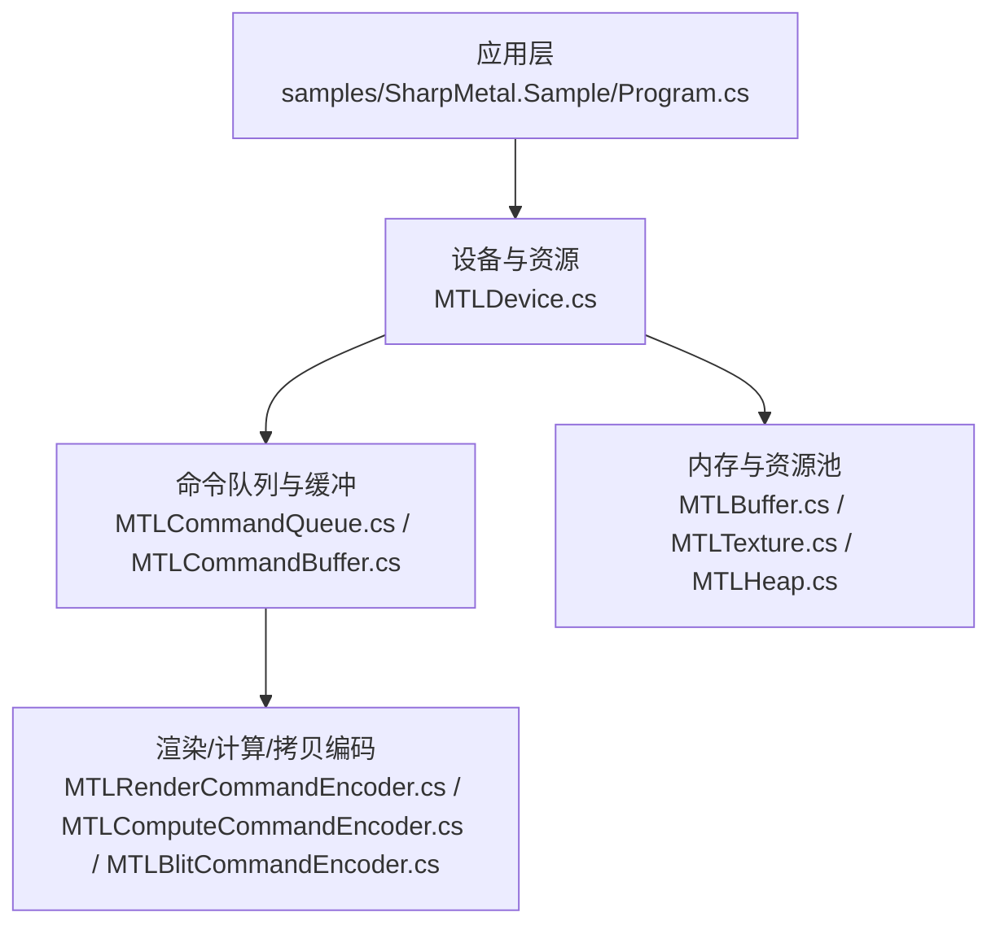
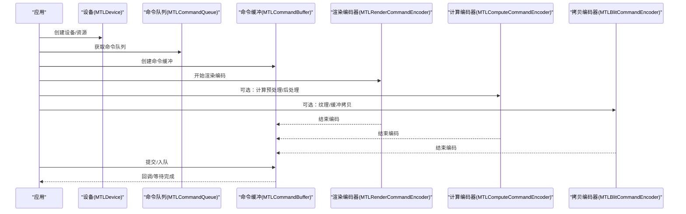
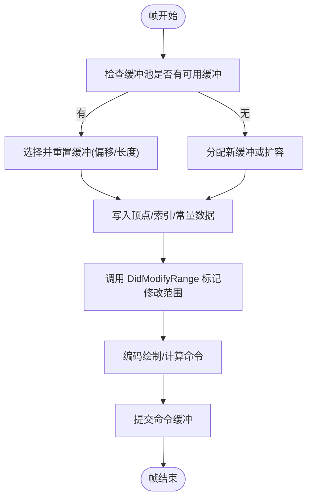
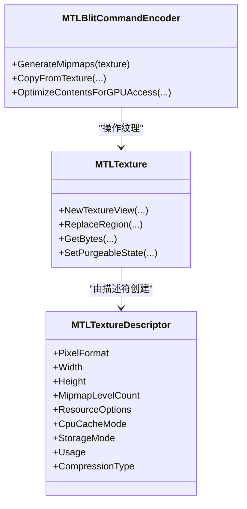
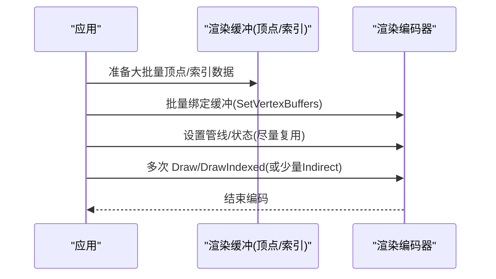
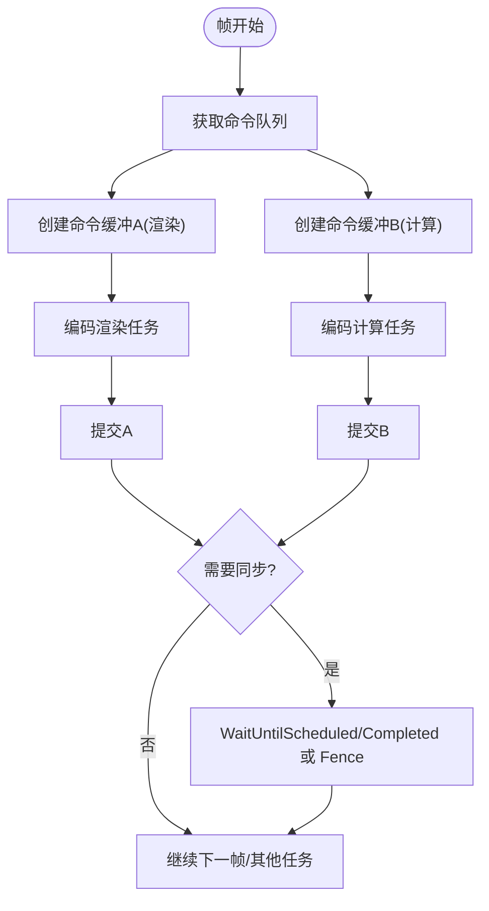
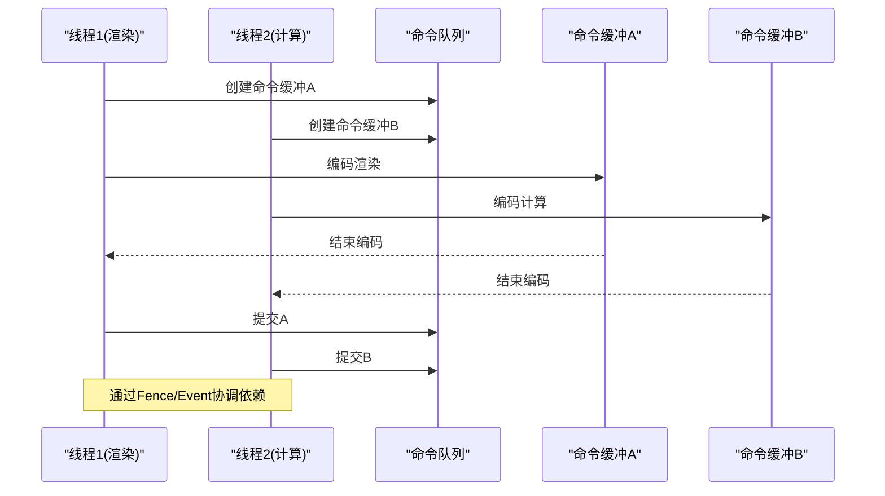
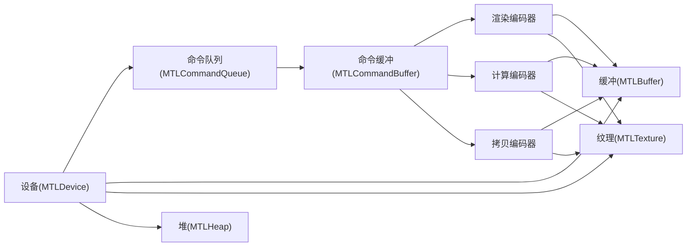

# 性能优化示例

<cite>
**本文引用的文件**
- [README.md](file://README.md)
- [DESIGN.md](file://DESIGN.md)
- [Program.cs](file://samples/SharpMetal.Sample/Program.cs)
- [MTLDevice.cs](file://src/SharpMetal/Metal/MTLDevice.cs)
- [MTLCommandQueue.cs](file://src/SharpMetal/Metal/MTLCommandQueue.cs)
- [MTLCommandBuffer.cs](file://src/SharpMetal/Metal/MTLCommandBuffer.cs)
- [MTLRenderCommandEncoder.cs](file://src/SharpMetal/Metal/MTLRenderCommandEncoder.cs)
- [MTLComputeCommandEncoder.cs](file://src/SharpMetal/Metal/MTLComputeCommandEncoder.cs)
- [MTLBlitCommandEncoder.cs](file://src/SharpMetal/Metal/MTLBlitCommandEncoder.cs)
- [MTLBuffer.cs](file://src/SharpMetal/Metal/MTLBuffer.cs)
- [MTLTexture.cs](file://src/SharpMetal/Metal/MTLTexture.cs)
- [MTLHeap.cs](file://src/SharpMetal/Metal/MTLHeap.cs)
</cite>

## 目录
1. [简介](#简介)
2. [项目结构](#项目结构)
3. [核心组件](#核心组件)
4. [架构总览](#架构总览)
5. [详细组件分析](#详细组件分析)
6. [依赖关系分析](#依赖关系分析)
7. [性能考量与优化策略](#性能考量与优化策略)
8. [故障排查指南](#故障排查指南)
9. [结论](#结论)
10. [附录](#附录)

## 简介
本文件面向使用 SharpMetal 进行 Metal 渲染的应用开发者，聚焦于高性能渲染实践：缓冲区重用、纹理压缩、批处理渲染、命令队列优化、CPU-GPU 同步控制、内存管理与泄漏防护、多线程渲染模式，以及性能分析与瓶颈定位方法。文档基于仓库中的实际类型与方法，提供可操作的优化路径与可视化流程图，帮助读者在真实项目中落地性能提升。

## 项目结构
- src/SharpMetal/Metal：Metal API 的 .NET 绑定（设备、命令队列、命令缓冲、编码器、资源等）
- samples/SharpMetal.Sample：最小可运行示例，演示设备获取、共享缓冲区分配与读写验证
- docs/：设计说明与验证流程
- eng/：自动化验证脚本

图表来源
- [Program.cs:21-45](file://samples/SharpMetal.Sample/Program.cs#L21-L45)
- [MTLDevice.cs:306-339](file://src/SharpMetal/Metal/MTLDevice.cs#L306-L339)
- [MTLCommandQueue.cs:44-107](file://src/SharpMetal/Metal/MTLCommandQueue.cs#L44-L107)
- [MTLCommandBuffer.cs:116-200](file://src/SharpMetal/Metal/MTLCommandBuffer.cs#L116-L200)
- [MTLRenderCommandEncoder.cs:126-200](file://src/SharpMetal/Metal/MTLRenderCommandEncoder.cs#L126-L200)
- [MTLComputeCommandEncoder.cs:20-200](file://src/SharpMetal/Metal/MTLComputeCommandEncoder.cs#L20-L200)
- [MTLBlitCommandEncoder.cs:14-200](file://src/SharpMetal/Metal/MTLBlitCommandEncoder.cs#L14-L200)
- [MTLBuffer.cs:6-113](file://src/SharpMetal/Metal/MTLBuffer.cs#L6-L113)
- [MTLTexture.cs:75-438](file://src/SharpMetal/Metal/MTLTexture.cs#L75-L438)
- [MTLHeap.cs:13-193](file://src/SharpMetal/Metal/MTLHeap.cs#L13-L193)

章节来源
- [README.md:1-23](file://README.md#L1-L23)
- [DESIGN.md:1-12](file://DESIGN.md#L1-L12)

## 核心组件
- 设备与资源创建：通过设备接口创建命令队列、缓冲区、纹理、堆等关键资源
- 命令系统：命令队列持有命令缓冲；命令缓冲承载渲染/计算/拷贝编码任务
- 编码器：渲染、计算、拷贝三类编码器分别负责绘制、并行计算与数据搬运
- 内存管理：缓冲区、纹理、堆提供生命周期与内存布局控制能力

章节来源
- [MTLDevice.cs:306-339](file://src/SharpMetal/Metal/MTLDevice.cs#L306-L339)
- [MTLCommandQueue.cs:44-107](file://src/SharpMetal/Metal/MTLCommandQueue.cs#L44-L107)
- [MTLCommandBuffer.cs:116-200](file://src/SharpMetal/Metal/MTLCommandBuffer.cs#L116-L200)
- [MTLRenderCommandEncoder.cs:126-200](file://src/SharpMetal/Metal/MTLRenderCommandEncoder.cs#L126-L200)
- [MTLComputeCommandEncoder.cs:20-200](file://src/SharpMetal/Metal/MTLComputeCommandEncoder.cs#L20-L200)
- [MTLBlitCommandEncoder.cs:14-200](file://src/SharpMetal/Metal/MTLBlitCommandEncoder.cs#L14-L200)
- [MTLBuffer.cs:6-113](file://src/SharpMetal/Metal/MTLBuffer.cs#L6-L113)
- [MTLTexture.cs:75-438](file://src/SharpMetal/Metal/MTLTexture.cs#L75-L438)
- [MTLHeap.cs:13-193](file://src/SharpMetal/Metal/MTLHeap.cs#L13-L193)

## 架构总览
下图展示从应用到 GPU 的典型执行路径，包括资源创建、命令编码、提交与呈现的关键节点。

图表来源
- [MTLDevice.cs:306-339](file://src/SharpMetal/Metal/MTLDevice.cs#L306-L339)
- [MTLCommandQueue.cs:44-107](file://src/SharpMetal/Metal/MTLCommandQueue.cs#L44-L107)
- [MTLCommandBuffer.cs:116-200](file://src/SharpMetal/Metal/MTLCommandBuffer.cs#L116-L200)
- [MTLRenderCommandEncoder.cs:126-200](file://src/SharpMetal/Metal/MTLRenderCommandEncoder.cs#L126-L200)
- [MTLComputeCommandEncoder.cs:20-200](file://src/SharpMetal/Metal/MTLComputeCommandEncoder.cs#L20-L200)
- [MTLBlitCommandEncoder.cs:14-200](file://src/SharpMetal/Metal/MTLBlitCommandEncoder.cs#L14-L200)

## 详细组件分析

### 缓冲区重用与内存管理
- 目标：减少频繁分配/释放带来的开销与碎片化，降低 CPU-GPU 同步成本
- 关键点
  - 使用固定大小的环形缓冲或双/三缓冲池，按帧复用
  - 利用 DidModifyRange 通知驱动更新范围，避免整块无效复制
  - 通过 Heap 集中管理同生命周期资源，便于批量回收
  - 对只读常量数据使用合适的存储模式与缓存模式，减少不必要迁移

图表来源
- [MTLBuffer.cs:60-63](file://src/SharpMetal/Metal/MTLBuffer.cs#L60-L63)
- [MTLHeap.cs:124-147](file://src/SharpMetal/Metal/MTLHeap.cs#L124-L147)
- [MTLCommandBuffer.cs:150-158](file://src/SharpMetal/Metal/MTLCommandBuffer.cs#L150-L158)

章节来源
- [MTLBuffer.cs:6-113](file://src/SharpMetal/Metal/MTLBuffer.cs#L6-L113)
- [MTLHeap.cs:13-193](file://src/SharpMetal/Metal/MTLHeap.cs#L13-L193)
- [MTLCommandBuffer.cs:116-200](file://src/SharpMetal/Metal/MTLCommandBuffer.cs#L116-L200)

### 纹理压缩与视图复用
- 目标：降低显存占用与带宽压力，提高采样效率
- 关键点
  - 根据平台能力选择压缩格式（如 BC 压缩支持检测）
  - 使用 TextureDescriptor 设置 Usage、StorageMode、CompressionType 等
  - 通过 NewTextureView 复用底层纹理数据，仅改变视角/通道重排
  - 使用 Blit 生成 mipmap 或在必要时进行格式转换

图表来源
- [MTLTexture.cs:75-239](file://src/SharpMetal/Metal/MTLTexture.cs#L75-L239)
- [MTLTexture.cs:242-438](file://src/SharpMetal/Metal/MTLTexture.cs#L242-L438)
- [MTLBlitCommandEncoder.cs:87-155](file://src/SharpMetal/Metal/MTLBlitCommandEncoder.cs#L87-L155)
- [MTLDevice.cs:253-253](file://src/SharpMetal/Metal/MTLDevice.cs#L253-L253)

章节来源
- [MTLTexture.cs:75-438](file://src/SharpMetal/Metal/MTLTexture.cs#L75-L438)
- [MTLBlitCommandEncoder.cs:14-200](file://src/SharpMetal/Metal/MTLBlitCommandEncoder.cs#L14-L200)
- [MTLDevice.cs:253-253](file://src/SharpMetal/Metal/MTLDevice.cs#L253-L253)

### 批处理渲染与间接命令
- 目标：减少 CPU 侧调用次数，合并绘制批次，降低状态切换
- 关键点
  - 将多对象/多实例的顶点/索引数据打包进少量大缓冲
  - 使用 SetVertexBuffers/SetIndexBuffer 批量绑定
  - 结合 Indirect Command Buffer 实现 GPU 端动态批处理（如需）
  - 合理设置视口/裁剪矩形，避免过度覆盖

图表来源
- [MTLRenderCommandEncoder.cs:173-200](file://src/SharpMetal/Metal/MTLRenderCommandEncoder.cs#L173-L200)
- [MTLDevice.cs:506-509](file://src/SharpMetal/Metal/MTLDevice.cs#L506-L509)

章节来源
- [MTLRenderCommandEncoder.cs:126-200](file://src/SharpMetal/Metal/MTLRenderCommandEncoder.cs#L126-L200)
- [MTLDevice.cs:506-509](file://src/SharpMetal/Metal/MTLDevice.cs#L506-L509)

### 命令队列与 CPU-GPU 同步优化
- 目标：最大化并行度，减少不必要的阻塞
- 关键点
  - 为不同工作负载创建独立队列（渲染/计算/拷贝），避免相互阻塞
  - 使用 RetainedReferences 与错误选项控制命令缓冲行为
  - 通过 WaitUntilScheduled/WaitUntilCompleted 仅在必要时同步
  - 使用 Fence/Event 进行细粒度依赖，而非全局屏障

图表来源
- [MTLCommandQueue.cs:44-107](file://src/SharpMetal/Metal/MTLCommandQueue.cs#L44-L107)
- [MTLCommandBuffer.cs:59-95](file://src/SharpMetal/Metal/MTLCommandBuffer.cs#L59-L95)
- [MTLCommandBuffer.cs:150-183](file://src/SharpMetal/Metal/MTLCommandBuffer.cs#L150-L183)

章节来源
- [MTLCommandQueue.cs:44-107](file://src/SharpMetal/Metal/MTLCommandQueue.cs#L44-L107)
- [MTLCommandBuffer.cs:59-183](file://src/SharpMetal/Metal/MTLCommandBuffer.cs#L59-L183)

### 多线程渲染模式与注意事项
- 目标：利用多核 CPU 并行编码命令，缩短每帧 CPU 时间
- 关键点
  - 每个线程创建独立的命令缓冲与编码器，避免共享可变状态
  - 将不同阶段（预计算、渲染、后处理）拆分到不同队列
  - 使用事件/Fence 协调跨线程依赖，避免锁竞争
  - 注意对象所有权与释放，防止跨线程误用

图表来源
- [MTLCommandQueue.cs:44-107](file://src/SharpMetal/Metal/MTLCommandQueue.cs#L44-L107)
- [MTLCommandBuffer.cs:116-200](file://src/SharpMetal/Metal/MTLCommandBuffer.cs#L116-L200)

章节来源
- [MTLCommandQueue.cs:44-107](file://src/SharpMetal/Metal/MTLCommandQueue.cs#L44-L107)
- [MTLCommandBuffer.cs:116-200](file://src/SharpMetal/Metal/MTLCommandBuffer.cs#L116-L200)

### 性能分析与瓶颈识别
- 工具与指标
  - 使用命令缓冲日志与调试标记辅助定位问题
  - 借助计数器采样与时间戳测量 GPU/CPU 耗时
  - 观察命令缓冲状态与错误信息，快速发现异常
- 常见瓶颈
  - 过多状态切换与批次分裂
  - 频繁的缓冲/纹理分配与格式转换
  - 不必要的 CPU-GPU 同步点
  - 未优化的纹理访问模式与带宽热点

章节来源
- [MTLCommandBuffer.cs:116-183](file://src/SharpMetal/Metal/MTLCommandBuffer.cs#L116-L183)
- [MTLRenderCommandEncoder.cs:153-166](file://src/SharpMetal/Metal/MTLRenderCommandEncoder.cs#L153-L166)
- [MTLComputeCommandEncoder.cs:43-56](file://src/SharpMetal/Metal/MTLComputeCommandEncoder.cs#L43-L56)
- [MTLBlitCommandEncoder.cs:172-180](file://src/SharpMetal/Metal/MTLBlitCommandEncoder.cs#L172-L180)

## 依赖关系分析
- 组件耦合
  - 设备是所有资源的根入口，命令队列与资源均依赖设备
  - 命令缓冲聚合多个编码器，编码器依赖资源（缓冲/纹理/管线）
  - 堆用于集中管理缓冲/纹理的生命周期，降低碎片化
- 外部依赖
  - Objective-C 运行时桥接，所有方法通过消息发送调用系统框架
  - 平台能力探测（如压缩格式、特性开关）影响优化策略

图表来源
- [MTLDevice.cs:306-339](file://src/SharpMetal/Metal/MTLDevice.cs#L306-L339)
- [MTLCommandQueue.cs:44-107](file://src/SharpMetal/Metal/MTLCommandQueue.cs#L44-L107)
- [MTLCommandBuffer.cs:116-200](file://src/SharpMetal/Metal/MTLCommandBuffer.cs#L116-L200)
- [MTLRenderCommandEncoder.cs:126-200](file://src/SharpMetal/Metal/MTLRenderCommandEncoder.cs#L126-L200)
- [MTLComputeCommandEncoder.cs:20-200](file://src/SharpMetal/Metal/MTLComputeCommandEncoder.cs#L20-L200)
- [MTLBlitCommandEncoder.cs:14-200](file://src/SharpMetal/Metal/MTLBlitCommandEncoder.cs#L14-L200)
- [MTLBuffer.cs:6-113](file://src/SharpMetal/Metal/MTLBuffer.cs#L6-L113)
- [MTLTexture.cs:75-438](file://src/SharpMetal/Metal/MTLTexture.cs#L75-L438)
- [MTLHeap.cs:13-193](file://src/SharpMetal/Metal/MTLHeap.cs#L13-L193)

章节来源
- [MTLDevice.cs:306-339](file://src/SharpMetal/Metal/MTLDevice.cs#L306-L339)
- [MTLCommandQueue.cs:44-107](file://src/SharpMetal/Metal/MTLCommandQueue.cs#L44-L107)
- [MTLCommandBuffer.cs:116-200](file://src/SharpMetal/Metal/MTLCommandBuffer.cs#L116-L200)
- [MTLRenderCommandEncoder.cs:126-200](file://src/SharpMetal/Metal/MTLRenderCommandEncoder.cs#L126-L200)
- [MTLComputeCommandEncoder.cs:20-200](file://src/SharpMetal/Metal/MTLComputeCommandEncoder.cs#L20-L200)
- [MTLBlitCommandEncoder.cs:14-200](file://src/SharpMetal/Metal/MTLBlitCommandEncoder.cs#L14-L200)
- [MTLBuffer.cs:6-113](file://src/SharpMetal/Metal/MTLBuffer.cs#L6-L113)
- [MTLTexture.cs:75-438](file://src/SharpMetal/Metal/MTLTexture.cs#L75-L438)
- [MTLHeap.cs:13-193](file://src/SharpMetal/Metal/MTLHeap.cs#L13-L193)

## 性能考量与优化策略
- 缓冲区重用
  - 采用环形缓冲/双缓冲，按帧重置偏移与长度
  - 使用 DidModifyRange 精确通知修改区域，减少带宽浪费
  - 通过堆集中分配，统一生命周期管理
- 纹理压缩与视图
  - 根据设备能力启用压缩格式，减少显存占用
  - 使用纹理视图复用底层数据，避免重复拷贝
  - 合理使用 mipmap 与内容优化指令
- 批处理渲染
  - 合并绘制批次，减少状态切换
  - 使用间接命令缓冲实现 GPU 端动态批处理
- 命令队列与同步
  - 分离渲染/计算/拷贝队列，提升并行度
  - 仅在必要时同步，优先使用 Fence/Event 细粒度依赖
- 内存管理最佳实践
  - 明确对象所有权，及时释放原生资源
  - 使用合适的存储模式与缓存模式，避免不必要的数据迁移
  - 监控当前分配大小与已用空间，预防内存泄漏
- 多线程渲染
  - 每个线程独立命令缓冲与编码器
  - 通过事件/Fence 协调跨线程依赖，避免锁竞争
- 性能分析与基准
  - 使用调试标记、日志与计数器采样定位热点
  - 记录关键路径耗时，建立回归基线，持续评估优化效果

[本节为通用指导，不直接分析具体文件]

## 故障排查指南
- 常见问题
  - 命令缓冲错误：检查状态与错误码，定位失败阶段
  - 资源访问冲突：确认读写顺序与同步点，避免数据竞争
  - 性能回退：检查是否频繁分配/释放、过多同步点、未压缩纹理
- 诊断步骤
  - 添加调试标记与分组，缩小问题范围
  - 使用计数器采样与时间戳对比 CPU/GPU 耗时
  - 逐步关闭优化项（如压缩、mipmap）复现问题

章节来源
- [MTLCommandBuffer.cs:116-183](file://src/SharpMetal/Metal/MTLCommandBuffer.cs#L116-L183)
- [MTLRenderCommandEncoder.cs:153-166](file://src/SharpMetal/Metal/MTLRenderCommandEncoder.cs#L153-L166)
- [MTLComputeCommandEncoder.cs:43-56](file://src/SharpMetal/Metal/MTLComputeCommandEncoder.cs#L43-L56)
- [MTLBlitCommandEncoder.cs:172-180](file://src/SharpMetal/Metal/MTLBlitCommandEncoder.cs#L172-L180)

## 结论
通过缓冲区重用、纹理压缩、批处理渲染、命令队列优化与精细同步控制，可在 SharpMetal 应用中显著降低 CPU-GPU 同步开销与内存压力。结合多线程渲染与性能分析工具，能够系统化地识别瓶颈并持续改进。建议在工程中建立性能基线与回归测试，确保优化成果稳定可靠。

[本节为总结性内容，不直接分析具体文件]

## 附录
- 快速参考
  - 设备能力探测：压缩格式、特性开关
  - 资源创建：缓冲、纹理、堆
  - 命令系统：队列、缓冲、编码器
  - 内存管理：DidModifyRange、SetPurgeableState、堆管理
- 示例路径
  - 最小示例：[Program.cs:21-45](file://samples/SharpMetal.Sample/Program.cs#L21-L45)

章节来源
- [Program.cs:21-45](file://samples/SharpMetal.Sample/Program.cs#L21-L45)
- [MTLDevice.cs:253-253](file://src/SharpMetal/Metal/MTLDevice.cs#L253-L253)
- [MTLBuffer.cs:60-63](file://src/SharpMetal/Metal/MTLBuffer.cs#L60-L63)
- [MTLTexture.cs:337-345](file://src/SharpMetal/Metal/MTLTexture.cs#L337-L345)
- [MTLHeap.cs:124-147](file://src/SharpMetal/Metal/MTLHeap.cs#L124-L147)