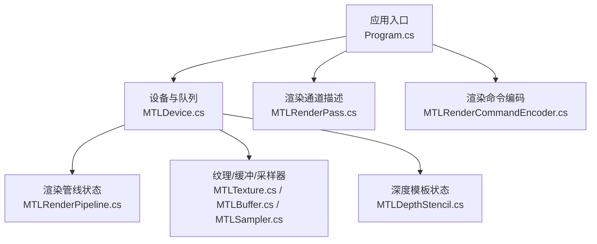
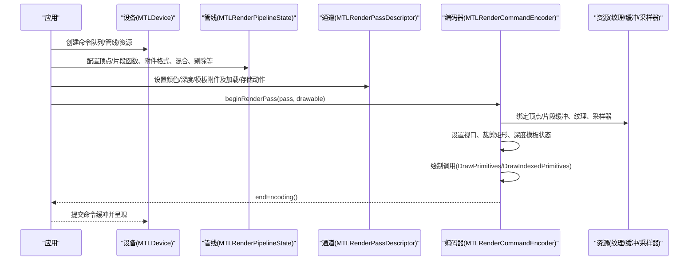
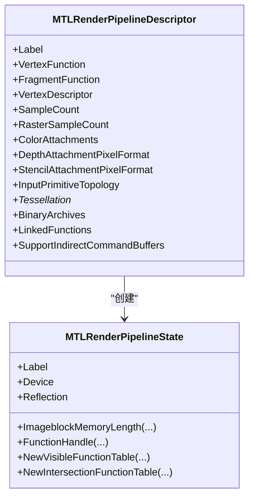
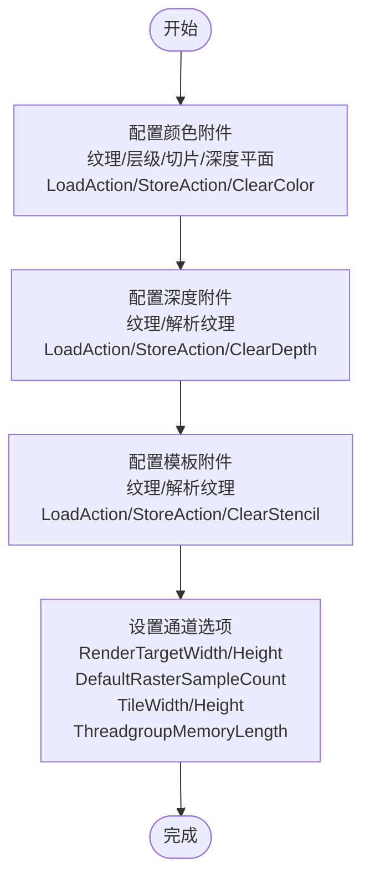
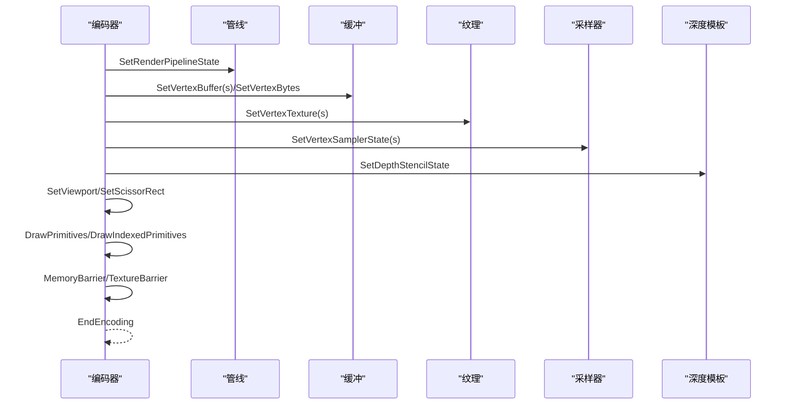
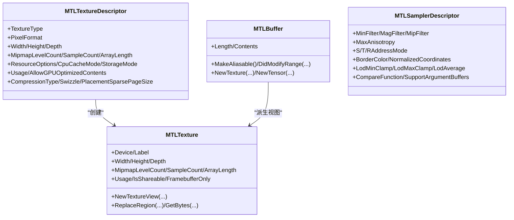
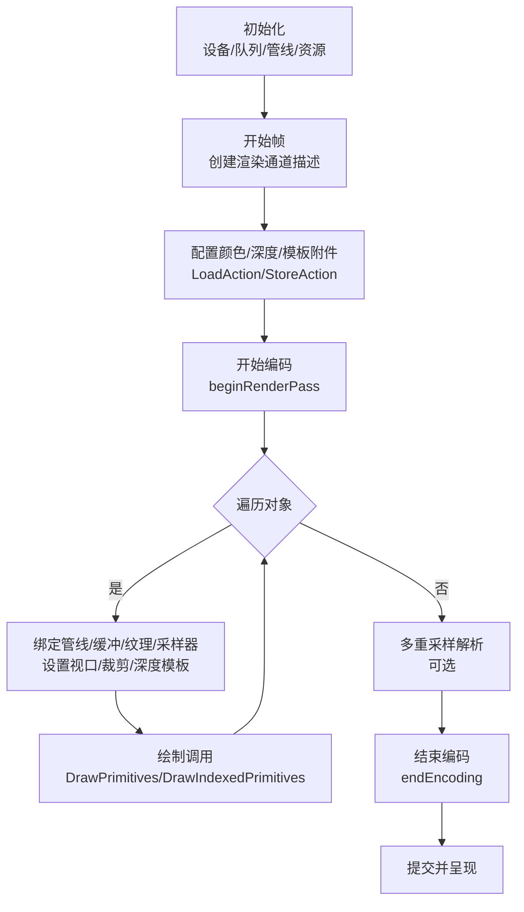
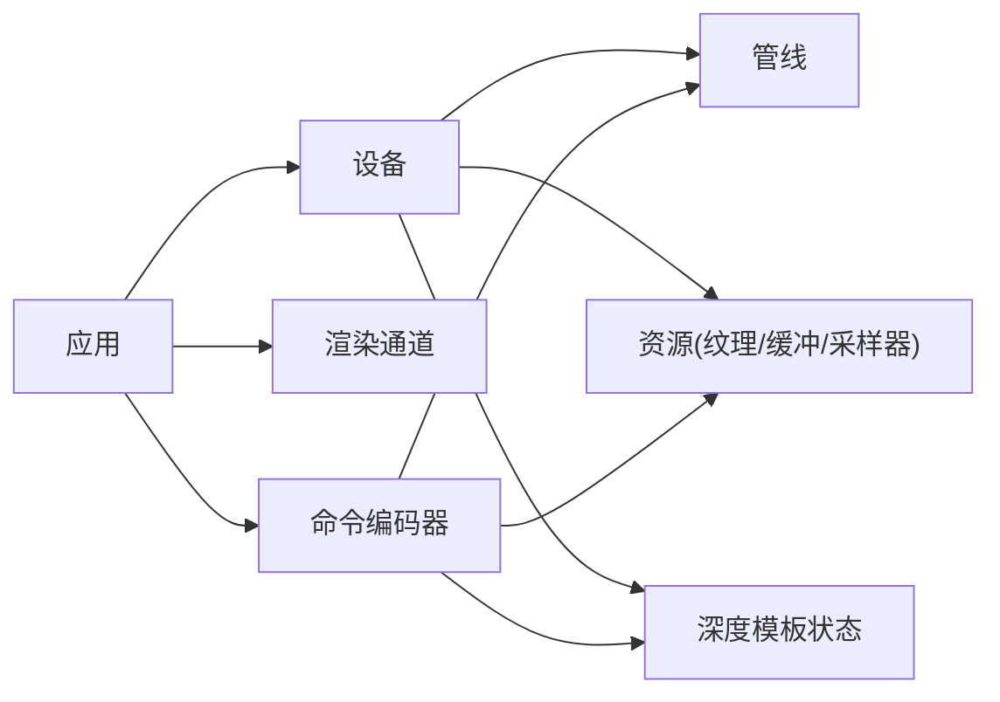

# 渲染管线示例

<cite>
**本文引用的文件**
- [README.md](file://README.md)
- [Program.cs](file://samples/SharpMetal.Sample/Program.cs)
- [MTLDevice.cs](file://src/SharpMetal/Metal/MTLDevice.cs)
- [MTLRenderPipeline.cs](file://src/SharpMetal/Metal/MTLRenderPipeline.cs)
- [MTLRenderCommandEncoder.cs](file://src/SharpMetal/Metal/MTLRenderCommandEncoder.cs)
- [MTLRenderPass.cs](file://src/SharpMetal/Metal/MTLRenderPass.cs)
- [MTLTexture.cs](file://src/SharpMetal/Metal/MTLTexture.cs)
- [MTLBuffer.cs](file://src/SharpMetal/Metal/MTLBuffer.cs)
- [MTLDepthStencil.cs](file://src/SharpMetal/Metal/MTLDepthStencil.cs)
- [MTLSampler.cs](file://src/SharpMetal/Metal/MTLSampler.cs)
</cite>

## 目录
1. [简介](#简介)
2. [项目结构](#项目结构)
3. [核心组件](#核心组件)
4. [架构总览](#架构总览)
5. [详细组件分析](#详细组件分析)
6. [依赖关系分析](#依赖关系分析)
7. [性能考虑](#性能考虑)
8. [故障排查指南](#故障排查指南)
9. [结论](#结论)
10. [附录](#附录)

## 简介
本示例文档面向希望在 .NET 环境下使用 SharpMetal 构建完整 Metal 渲染管线的开发者。内容涵盖：
- 顶点着色器与片段着色器的配置与绑定
- 渲染通道（Render Pass）的创建与使用
- 渲染命令编码的最佳实践
- 复杂场景渲染循环（多对象、纹理映射、光照计算等）
- 性能优化技巧与内存管理策略
- 多渲染目标、深度缓冲与模板测试的处理

本仓库提供对 Metal 框架的低层 Objective-C 绑定，包含 Foundation、Metal、MetalFX 与 QuartzCore 的托管封装，原生资源具备显式所有权，托管布局检查可移植，但需要在 Apple 主机上执行以调用系统框架。

**章节来源**
- [README.md:1-23](file://README.md#L1-L23)

## 项目结构
- src/SharpMetal/Metal：核心 Metal API 绑定（设备、管线、命令编码器、纹理、缓冲、深度模板、采样器等）
- samples/SharpMetal.Sample：最小可运行示例，展示设备获取与共享缓冲读写
- docs/eng：验证与工程脚本
- README：仓库说明与入门指引

**图表来源**
- [Program.cs:1-49](file://samples/SharpMetal.Sample/Program.cs#L1-L49)
- [MTLDevice.cs:326-439](file://src/SharpMetal/Metal/MTLDevice.cs#L326-L439)
- [MTLRenderPipeline.cs:208-492](file://src/SharpMetal/Metal/MTLRenderPipeline.cs#L208-L492)
- [MTLRenderPass.cs:636-762](file://src/SharpMetal/Metal/MTLRenderPass.cs#L636-L762)
- [MTLRenderCommandEncoder.cs:126-800](file://src/SharpMetal/Metal/MTLRenderCommandEncoder.cs#L126-L800)
- [MTLTexture.cs:75-240](file://src/SharpMetal/Metal/MTLTexture.cs#L75-L240)
- [MTLBuffer.cs:6-113](file://src/SharpMetal/Metal/MTLBuffer.cs#L6-L113)
- [MTLDepthStencil.cs:91-163](file://src/SharpMetal/Metal/MTLDepthStencil.cs#L91-L163)
- [MTLSampler.cs:37-186](file://src/SharpMetal/Metal/MTLSampler.cs#L37-L186)

**章节来源**
- [README.md:12-16](file://README.md#L12-L16)
- [Program.cs:1-49](file://samples/SharpMetal.Sample/Program.cs#L1-L49)

## 核心组件
- 设备（MTLDevice）：创建命令队列、管线状态、纹理、缓冲、采样器、深度模板状态等
- 渲染管线（MTLRenderPipelineState）：组合顶点/片段函数、顶点描述、颜色/深度/模板附件格式、混合、剔除、细分等
- 渲染通道（MTLRenderPassDescriptor）：定义颜色/深度/模板附件的加载/存储动作、多重采样解析、视口/瓦片尺寸等
- 渲染命令编码器（MTLRenderCommandEncoder）：设置管线、缓冲区、纹理、采样器、视口、裁剪矩形、绘制调用、内存屏障等
- 资源（MTLTexture/MTLBuffer/MTLSampler）：纹理类型、像素格式、使用标志；缓冲长度、内容访问；采样器过滤、寻址模式、LOD 控制
- 深度模板（MTLDepthStencilState）：深度比较函数、写入使能、前后脸模板操作与掩码

**章节来源**
- [MTLDevice.cs:326-439](file://src/SharpMetal/Metal/MTLDevice.cs#L326-L439)
- [MTLRenderPipeline.cs:208-492](file://src/SharpMetal/Metal/MTLRenderPipeline.cs#L208-L492)
- [MTLRenderPass.cs:636-762](file://src/SharpMetal/Metal/MTLRenderPass.cs#L636-L762)
- [MTLRenderCommandEncoder.cs:126-800](file://src/SharpMetal/Metal/MTLRenderCommandEncoder.cs#L126-L800)
- [MTLTexture.cs:75-240](file://src/SharpMetal/Metal/MTLTexture.cs#L75-L240)
- [MTLBuffer.cs:6-113](file://src/SharpMetal/Metal/MTLBuffer.cs#L6-L113)
- [MTLSampler.cs:37-186](file://src/SharpMetal/Metal/MTLSampler.cs#L37-L186)
- [MTLDepthStencil.cs:91-163](file://src/SharpMetal/Metal/MTLDepthStencil.cs#L91-L163)

## 架构总览
下图展示了从应用入口到 GPU 绘制的典型流程：设备初始化、管线状态创建、渲染通道描述、命令编码器设置与绘制调用。

**图表来源**
- [MTLDevice.cs:326-439](file://src/SharpMetal/Metal/MTLDevice.cs#L326-L439)
- [MTLRenderPipeline.cs:208-492](file://src/SharpMetal/Metal/MTLRenderPipeline.cs#L208-L492)
- [MTLRenderPass.cs:636-762](file://src/SharpMetal/Metal/MTLRenderPass.cs#L636-L762)
- [MTLRenderCommandEncoder.cs:126-800](file://src/SharpMetal/Metal/MTLRenderCommandEncoder.cs#L126-L800)

## 详细组件分析

### 渲染管线状态（MTLRenderPipelineState）
- 通过 MTLRenderPipelineDescriptor 配置：
  - 顶点函数与片段函数
  - 顶点描述（顶点属性布局）
  - 颜色附件数组（像素格式、混合使能、源/目标因子、运算、写入掩码）
  - 深度/模板附件像素格式
  - 输入图元拓扑、细分相关参数
  - 预加载库、链接函数、二进制归档支持
  - 最大线程组大小、图像块内存长度等能力查询
- 最终由设备创建为不可变的 MTLRenderPipelineState，用于后续重复使用

**图表来源**
- [MTLRenderPipeline.cs:208-492](file://src/SharpMetal/Metal/MTLRenderPipeline.cs#L208-L492)
- [MTLRenderPipeline.cs:530-629](file://src/SharpMetal/Metal/MTLRenderPipeline.cs#L530-L629)

**章节来源**
- [MTLRenderPipeline.cs:208-492](file://src/SharpMetal/Metal/MTLRenderPipeline.cs#L208-L492)
- [MTLRenderPipeline.cs:530-629](file://src/SharpMetal/Metal/MTLRenderPipeline.cs#L530-L629)

### 渲染通道（MTLRenderPassDescriptor）
- 颜色附件：纹理、层级/切片/深度平面、解析纹理、加载/存储动作、清除颜色
- 深度附件：纹理、解析纹理、加载/存储动作、清除深度、多重采样深度解析过滤器
- 模板附件：纹理、解析纹理、加载/存储动作、清除模板值、多重采样模板解析过滤器
- 其他：可见性结果缓冲、渲染目标数组长度、图像块样本长度、线程组内存长度、瓦片宽高、默认多重采样计数、渲染目标宽高、栅格化速率图、样本位置

**图表来源**
- [MTLRenderPass.cs:60-158](file://src/SharpMetal/Metal/MTLRenderPass.cs#L60-L158)
- [MTLRenderPass.cs:160-270](file://src/SharpMetal/Metal/MTLRenderPass.cs#L160-L270)
- [MTLRenderPass.cs:272-390](file://src/SharpMetal/Metal/MTLRenderPass.cs#L272-L390)
- [MTLRenderPass.cs:392-510](file://src/SharpMetal/Metal/MTLRenderPass.cs#L392-L510)
- [MTLRenderPass.cs:636-762](file://src/SharpMetal/Metal/MTLRenderPass.cs#L636-L762)

**章节来源**
- [MTLRenderPass.cs:60-158](file://src/SharpMetal/Metal/MTLRenderPass.cs#L60-L158)
- [MTLRenderPass.cs:160-270](file://src/SharpMetal/Metal/MTLRenderPass.cs#L160-L270)
- [MTLRenderPass.cs:272-390](file://src/SharpMetal/Metal/MTLRenderPass.cs#L272-L390)
- [MTLRenderPass.cs:392-510](file://src/SharpMetal/Metal/MTLRenderPass.cs#L392-L510)
- [MTLRenderPass.cs:636-762](file://src/SharpMetal/Metal/MTLRenderPass.cs#L636-L762)

### 渲染命令编码器（MTLRenderCommandEncoder）
- 设置管线状态、顶点/片段/对象/网格/瓦片阶段的缓冲、纹理、采样器、可见性表、加速结构
- 设置视口、裁剪矩形、正面绕序、剔除模式、深度裁剪模式、深度偏置、三角形填充模式
- 设置混合颜色、深度模板状态、模板参考值
- 绘制调用：DrawPrimitives、DrawIndexedPrimitives、DrawPatches、DrawMeshThreads/Threadgroups
- 内存同步：TextureBarrier、MemoryBarrier、UseResource(s)、UseHeap(s)
- 间接命令：ExecuteCommandsInBuffer
- 计数器采样：SampleCountersInBuffer

**图表来源**
- [MTLRenderCommandEncoder.cs:126-800](file://src/SharpMetal/Metal/MTLRenderCommandEncoder.cs#L126-L800)

**章节来源**
- [MTLRenderCommandEncoder.cs:126-800](file://src/SharpMetal/Metal/MTLRenderCommandEncoder.cs#L126-L800)

### 资源：纹理、缓冲、采样器
- 纹理（MTLTexture/MTLTextureDescriptor）：类型、像素格式、宽高深、mipmap、样本数、数组长度、资源选项、CPU缓存模式、存储模式、使用标志、压缩类型、Swizzle、稀疏页大小、视图创建、区域替换、字节读取
- 缓冲（MTLBuffer）：长度、内容指针、是否可别名、修改范围通知、派生纹理/张量、调试标记、远程视图
- 采样器（MTLSampler/MTLSamplerDescriptor）：过滤模式、各向异性、寻址模式、边框色、归一化坐标、LOD 限制、比较函数、参数缓冲支持

**图表来源**
- [MTLTexture.cs:75-240](file://src/SharpMetal/Metal/MTLTexture.cs#L75-L240)
- [MTLTexture.cs:242-438](file://src/SharpMetal/Metal/MTLTexture.cs#L242-L438)
- [MTLBuffer.cs:6-113](file://src/SharpMetal/Metal/MTLBuffer.cs#L6-L113)
- [MTLSampler.cs:37-186](file://src/SharpMetal/Metal/MTLSampler.cs#L37-L186)

**章节来源**
- [MTLTexture.cs:75-240](file://src/SharpMetal/Metal/MTLTexture.cs#L75-L240)
- [MTLTexture.cs:242-438](file://src/SharpMetal/Metal/MTLTexture.cs#L242-L438)
- [MTLBuffer.cs:6-113](file://src/SharpMetal/Metal/MTLBuffer.cs#L6-L113)
- [MTLSampler.cs:37-186](file://src/SharpMetal/Metal/MTLSampler.cs#L37-L186)

### 深度与模板（MTLDepthStencilState）
- 深度比较函数、深度写入使能
- 前/后脸模板比较函数、失败/深度失败/通过时的操作、读写掩码
- 通过设备创建状态并在编码器中设置

**章节来源**
- [MTLDepthStencil.cs:91-163](file://src/SharpMetal/Metal/MTLDepthStencil.cs#L91-L163)

### 复杂渲染循环示例（概念流程）
以下流程图展示一个典型的多对象渲染循环，包括管线与通道准备、逐对象绘制、多重采样解析与呈现。

[此图为概念流程，不直接映射具体代码文件]

## 依赖关系分析
- 应用入口依赖设备接口进行资源与管线创建
- 渲染管线依赖顶点/片段函数与顶点描述
- 渲染通道依赖纹理附件与加载/存储动作
- 命令编码器依赖管线、资源与状态（视口、裁剪、深度模板）
- 资源之间可通过派生视图或共享句柄关联

**图表来源**
- [Program.cs:1-49](file://samples/SharpMetal.Sample/Program.cs#L1-L49)
- [MTLDevice.cs:326-439](file://src/SharpMetal/Metal/MTLDevice.cs#L326-L439)
- [MTLRenderPipeline.cs:208-492](file://src/SharpMetal/Metal/MTLRenderPipeline.cs#L208-L492)
- [MTLRenderPass.cs:636-762](file://src/SharpMetal/Metal/MTLRenderPass.cs#L636-L762)
- [MTLRenderCommandEncoder.cs:126-800](file://src/SharpMetal/Metal/MTLRenderCommandEncoder.cs#L126-L800)

**章节来源**
- [Program.cs:1-49](file://samples/SharpMetal.Sample/Program.cs#L1-L49)
- [MTLDevice.cs:326-439](file://src/SharpMetal/Metal/MTLDevice.cs#L326-L439)
- [MTLRenderPipeline.cs:208-492](file://src/SharpMetal/Metal/MTLRenderPipeline.cs#L208-L492)
- [MTLRenderPass.cs:636-762](file://src/SharpMetal/Metal/MTLRenderPass.cs#L636-L762)
- [MTLRenderCommandEncoder.cs:126-800](file://src/SharpMetal/Metal/MTLRenderCommandEncoder.cs#L126-L800)

## 性能考虑
- 管线复用：尽量在启动时创建并缓存 MTLRenderPipelineState，避免每帧重建
- 资源批处理：合并顶点/索引缓冲，减少绑定切换；使用批量设置方法（如 SetVertexBuffers/SetFragmentTextures）
- 纹理优化：选择合适的像素格式与使用标志；启用 mipmap；必要时使用纹理压缩；合理设置 LOD 限制
- 多重采样：仅在需要时使用；利用通道解析将 MSAA 纹理解析到单样本目标
- 内存管理：使用 UseResource/UseHeaps 明确资源生命周期；合理使用 DidModifyRange 通知 CPU 侧更新；避免频繁分配
- 指令效率：使用间接命令缓冲减少 CPU 开销；合理使用内存屏障避免不必要的同步
- 设备能力：查询支持的特性（如 32 位浮点滤波、MSAA、BCTexture 压缩、Raytracing 等），按能力选择路径

[本节为通用指导，不直接分析具体文件]

## 故障排查指南
- 平台限制：示例程序在非 Apple 平台会阻止原生 Metal 工作负载，需确保在 macOS/iOS/macCatalyst 上运行
- ABI 校验：示例中对 MTLSize 的托管大小进行检查，若不一致将抛出异常
- 设备与缓冲：设备为空或共享缓冲分配失败时应提前返回并释放资源
- 资源释放：在 finally 块中释放设备与缓冲的原生指针，避免泄漏

**章节来源**
- [Program.cs:10-45](file://samples/SharpMetal.Sample/Program.cs#L10-L45)

## 结论
通过 SharpMetal 提供的低层绑定，可以在 .NET 应用中实现完整的 Metal 渲染管线。关键在于：
- 正确配置渲染管线状态（顶点/片段函数、顶点描述、附件格式、混合、剔除等）
- 精确设置渲染通道（颜色/深度/模板附件的加载与存储动作、多重采样解析）
- 高效编码渲染命令（资源绑定、视口/裁剪、绘制调用、内存屏障）
- 结合设备能力与资源特性进行性能优化与内存管理

[本节为总结，不直接分析具体文件]

## 附录
- 快速参考：
  - 设备：创建命令队列、管线、纹理、缓冲、采样器、深度模板状态
  - 管线：配置顶点/片段函数、附件、混合、剔除、细分
  - 通道：颜色/深度/模板附件、加载/存储动作、解析、瓦片/线程组内存
  - 编码器：设置管线、资源、视口/裁剪、绘制、内存同步
  - 资源：纹理类型/格式/使用；缓冲长度/内容；采样器过滤/寻址/LOD
  - 深度模板：深度比较、写入、模板操作与掩码

[本节为补充信息，不直接分析具体文件]