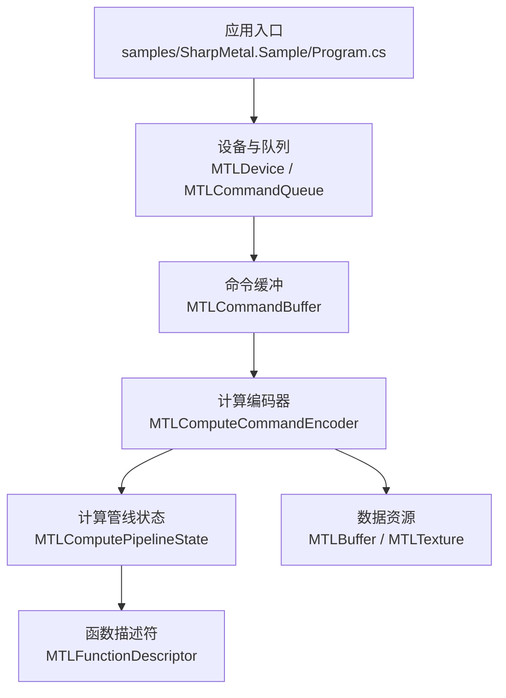
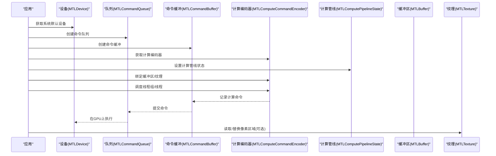
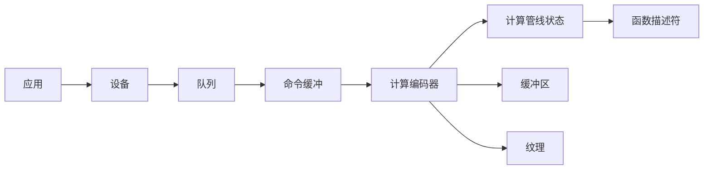

# 计算管线示例

<cite>
**本文引用的文件**
- [README.md](file://README.md)
- [DESIGN.md](file://DESIGN.md)
- [Program.cs](file://samples/SharpMetal.Sample/Program.cs)
- [MTLDevice.cs](file://src/SharpMetal/Metal/MTLDevice.cs)
- [MTLCommandQueue.cs](file://src/SharpMetal/Metal/MTLCommandQueue.cs)
- [MTLCommandBuffer.cs](file://src/SharpMetal/Metal/MTLCommandBuffer.cs)
- [MTLComputeCommandEncoder.cs](file://src/SharpMetal/Metal/MTLComputeCommandEncoder.cs)
- [MTLComputePipeline.cs](file://src/SharpMetal/Metal/MTLComputePipeline.cs)
- [MTLBuffer.cs](file://src/SharpMetal/Metal/MTLBuffer.cs)
- [MTLTexture.cs](file://src/SharpMetal/Metal/MTLTexture.cs)
- [MTLFunctionDescriptor.cs](file://src/SharpMetal/Metal/MTLFunctionDescriptor.cs)
</cite>

## 目录
1. [简介](#简介)
2. [项目结构](#项目结构)
3. [核心组件](#核心组件)
4. [架构总览](#架构总览)
5. [详细组件分析](#详细组件分析)
6. [依赖关系分析](#依赖关系分析)
7. [性能考量](#性能考量)
8. [故障排查指南](#故障排查指南)
9. [结论](#结论)
10. [附录](#附录)

## 简介
本文件面向希望在 .NET 环境下使用 Metal 进行 GPU 并行计算的开发者，提供“计算管线”的高级示例与最佳实践。内容涵盖：
- 计算着色器的组织方式、线程组配置与调度策略
- 缓冲区与纹理的创建、绑定与数据传输
- 将计算结果无缝集成到渲染管线（例如将计算输出作为渲染输入）
- 性能分析与调试技巧（计时、计数器、日志与错误处理）

本仓库提供了对 Metal 的低层 Objective-C 绑定，使您可以在 .NET 中直接调用 Metal API，构建高性能的计算任务。

## 项目结构
- src/SharpMetal：包含 Metal、Foundation、ObjectiveCCore、QuartzCore 等运行时绑定
- samples/SharpMetal.Sample：可运行的最小示例，演示设备获取、共享缓冲区的分配与读写
- docs/：设计说明与验证文档
- eng/：自动化验证脚本

图表来源
- [Program.cs:10-45](file://samples/SharpMetal.Sample/Program.cs#L10-L45)
- [MTLDevice.cs:305-339](file://src/SharpMetal/Metal/MTLDevice.cs#L305-L339)
- [MTLCommandBuffer.cs:150-223](file://src/SharpMetal/Metal/MTLCommandBuffer.cs#L150-L223)
- [MTLComputeCommandEncoder.cs:60-193](file://src/SharpMetal/Metal/MTLComputeCommandEncoder.cs#L60-L193)
- [MTLComputePipeline.cs:151-235](file://src/SharpMetal/Metal/MTLComputePipeline.cs#L151-L235)
- [MTLFunctionDescriptor.cs:14-66](file://src/SharpMetal/Metal/MTLFunctionDescriptor.cs#L14-L66)

章节来源
- [README.md:1-23](file://README.md#L1-L23)
- [DESIGN.md:1-12](file://DESIGN.md#L1-L12)

## 核心组件
- 设备与队列
  - 通过设备创建默认设备与命令队列，用于提交并执行命令
- 命令缓冲与编码器
  - 命令缓冲封装一组命令；计算编码器负责设置管线、绑定资源、调度线程组
- 计算管线状态
  - 由函数或描述符编译生成，包含线程执行宽度、最大线程数等信息
- 数据资源
  - 缓冲区（MTLBuffer）用于通用数据；纹理（MTLTexture）用于图像/体数据
- 函数描述符
  - 指定要调用的函数名、常量值、选项等

章节来源
- [MTLDevice.cs:305-339](file://src/SharpMetal/Metal/MTLDevice.cs#L305-L339)
- [MTLCommandQueue.cs:44-109](file://src/SharpMetal/Metal/MTLCommandQueue.cs#L44-L109)
- [MTLCommandBuffer.cs:116-223](file://src/SharpMetal/Metal/MTLCommandBuffer.cs#L116-L223)
- [MTLComputeCommandEncoder.cs:20-193](file://src/SharpMetal/Metal/MTLComputeCommandEncoder.cs#L20-L193)
- [MTLComputePipeline.cs:151-235](file://src/SharpMetal/Metal/MTLComputePipeline.cs#L151-L235)
- [MTLBuffer.cs:6-115](file://src/SharpMetal/Metal/MTLBuffer.cs#L6-L115)
- [MTLTexture.cs:75-439](file://src/SharpMetal/Metal/MTLTexture.cs#L75-L439)
- [MTLFunctionDescriptor.cs:14-66](file://src/SharpMetal/Metal/MTLFunctionDescriptor.cs#L14-L66)

## 架构总览
下图展示了一个典型的“计算+渲染”工作流：从设备初始化、创建资源、编码计算命令、提交执行，到将计算结果用于渲染。

图表来源
- [MTLDevice.cs:305-339](file://src/SharpMetal/Metal/MTLDevice.cs#L305-L339)
- [MTLCommandQueue.cs:44-109](file://src/SharpMetal/Metal/MTLCommandQueue.cs#L44-L109)
- [MTLCommandBuffer.cs:150-223](file://src/SharpMetal/Metal/MTLCommandBuffer.cs#L150-L223)
- [MTLComputeCommandEncoder.cs:60-193](file://src/SharpMetal/Metal/MTLComputeCommandEncoder.cs#L60-L193)
- [MTLComputePipeline.cs:151-235](file://src/SharpMetal/Metal/MTLComputePipeline.cs#L151-L235)
- [MTLBuffer.cs:6-115](file://src/SharpMetal/Metal/MTLBuffer.cs#L6-L115)
- [MTLTexture.cs:347-385](file://src/SharpMetal/Metal/MTLTexture.cs#L347-L385)

## 详细组件分析

### 设备与命令队列
- 设备提供能力查询、资源创建、管线状态创建等入口
- 命令队列用于排队命令缓冲，支持并发与优先级控制（通过描述符）

关键要点
- 使用默认设备创建队列
- 队列可配置最大命令缓冲数量
- 支持日志与驻留集管理

章节来源
- [MTLDevice.cs:305-339](file://src/SharpMetal/Metal/MTLDevice.cs#L305-L339)
- [MTLCommandQueue.cs:44-109](file://src/SharpMetal/Metal/MTLCommandQueue.cs#L44-L109)

### 命令缓冲与计算编码器
- 命令缓冲是命令的容器，支持渲染、计算、拷贝等多种编码器
- 计算编码器负责：
  - 设置计算管线状态
  - 绑定缓冲区、纹理、采样器、可见函数表等
  - 调度线程组/线程（直接或通过间接缓冲）
  - 插入内存屏障、栅栏、事件信号/等待
  - 执行间接命令缓冲中的命令范围

关键要点
- 使用 ComputeCommandEncoder 获取编码器
- 通过 SetComputePipelineState 绑定管线状态
- 使用 DispatchThreadgroups/DispatchThreads 调度
- 使用 MemoryBarrier/UpdateFence/WaitForFence 同步
- 使用 ExecuteCommandsInBuffer 批量执行预编码命令

章节来源
- [MTLCommandBuffer.cs:150-223](file://src/SharpMetal/Metal/MTLCommandBuffer.cs#L150-L223)
- [MTLComputeCommandEncoder.cs:60-248](file://src/SharpMetal/Metal/MTLComputeCommandEncoder.cs#L60-L248)

### 计算管线状态与函数描述符
- 计算管线状态可由函数或描述符创建，暴露线程执行宽度、最大线程数、静态线程组内存长度等
- 函数描述符用于选择具体函数名、常量值、编译选项、二进制归档等

关键要点
- 使用 NewComputePipelineState 创建管线状态
- 使用 FunctionHandleWithName 或 FunctionHandle 获取函数句柄
- 通过 MTLFunctionDescriptor 配置常量与选项

章节来源
- [MTLComputePipeline.cs:151-235](file://src/SharpMetal/Metal/MTLComputePipeline.cs#L151-L235)
- [MTLFunctionDescriptor.cs:14-66](file://src/SharpMetal/Metal/MTLFunctionDescriptor.cs#L14-L66)

### 缓冲区管理与数据传输
- 缓冲区用于存储任意字节数据，支持 CPU/GPU 共享访问模式
- 纹理用于图像/体数据，支持多种类型、格式、压缩、稀疏页等

关键要点
- 使用 NewBuffer 创建缓冲区，选择合适的存储模式（如共享）
- 通过 Contents 直接读写共享缓冲区
- 使用 DidModifyRange 通知驱动写入范围
- 使用 NewTexture/ReplaceRegion/GetBytes 进行像素数据的读写
- 使用 TextureView 在不同格式/层级/切片间复用视图

章节来源
- [MTLBuffer.cs:6-115](file://src/SharpMetal/Metal/MTLBuffer.cs#L6-L115)
- [MTLTexture.cs:75-439](file://src/SharpMetal/Metal/MTLTexture.cs#L75-L439)

### 线程组配置与调度
- 线程组大小受设备限制，可通过 MaxThreadsPerThreadgroup 查询
- 调度方式：
  - 直接调度：DispatchThreadgroups/DispatchThreads
  - 间接调度：通过间接缓冲与 MTLDispatchThreadgroupsIndirectArguments
- 阶段输入区域：SetStageInRegion 可用于特定纹理处理的块级调度

关键要点
- 合理划分线程组大小以匹配硬件执行宽度
- 使用间接调度实现动态批处理
- 使用 StageInRegion 优化纹理分块处理

章节来源
- [MTLComputeCommandEncoder.cs:170-193](file://src/SharpMetal/Metal/MTLComputeCommandEncoder.cs#L170-L193)
- [MTLDevice.cs:206-207](file://src/SharpMetal/Metal/MTLDevice.cs#L206-L207)

### 与渲染管线的集成
- 计算结果可以写入纹理或缓冲区，随后在渲染阶段作为输入
- 纹理可作为渲染目标或采样源；缓冲区可作为顶点/索引或常量数据
- 使用资源状态命令编码器或内存屏障确保一致性

关键要点
- 计算后如需渲染，需保证资源状态正确（读/写/渲染目标）
- 使用 MemoryBarrier 或 ResourceStatePass 进行显式同步
- 将计算输出的纹理绑定为渲染阶段的采样器或颜色附件

章节来源
- [MTLComputeCommandEncoder.cs:235-248](file://src/SharpMetal/Metal/MTLComputeCommandEncoder.cs#L235-L248)
- [MTLTexture.cs:347-385](file://src/SharpMetal/Metal/MTLTexture.cs#L347-L385)

### 实际计算场景示例（思路与步骤）
- 图像处理算法（如卷积、色彩空间转换）
  - 将输入图像放入纹理，计算着色器按像素/块处理，输出到新纹理
  - 使用 ReplaceRegion/GetBytes 进行CPU-GPU数据交换
- 物理模拟（如粒子系统）
  - 使用缓冲区存储粒子位置/速度，计算着色器更新状态
  - 渲染阶段将缓冲区作为顶点数据绘制
- 数据转换（如排序、规约）
  - 使用缓冲区存储原始数据，计算着色器执行并行变换
  - 通过间接调度实现不同规模的数据批处理

[本节为概念性指导，不直接分析具体代码文件]

## 依赖关系分析
- 应用入口依赖设备与队列
- 命令缓冲依赖队列，编码器依赖命令缓冲
- 编码器依赖管线状态与资源（缓冲区/纹理）
- 管线状态依赖函数描述符或函数句柄

图表来源
- [Program.cs:10-45](file://samples/SharpMetal.Sample/Program.cs#L10-L45)
- [MTLDevice.cs:305-339](file://src/SharpMetal/Metal/MTLDevice.cs#L305-L339)
- [MTLCommandQueue.cs:44-109](file://src/SharpMetal/Metal/MTLCommandQueue.cs#L44-L109)
- [MTLCommandBuffer.cs:150-223](file://src/SharpMetal/Metal/MTLCommandBuffer.cs#L150-L223)
- [MTLComputeCommandEncoder.cs:60-193](file://src/SharpMetal/Metal/MTLComputeCommandEncoder.cs#L60-L193)
- [MTLComputePipeline.cs:151-235](file://src/SharpMetal/Metal/MTLComputePipeline.cs#L151-L235)
- [MTLFunctionDescriptor.cs:14-66](file://src/SharpMetal/Metal/MTLFunctionDescriptor.cs#L14-L66)

章节来源
- [Program.cs:10-45](file://samples/SharpMetal.Sample/Program.cs#L10-L45)
- [MTLDevice.cs:305-339](file://src/SharpMetal/Metal/MTLDevice.cs#L305-L339)
- [MTLCommandBuffer.cs:150-223](file://src/SharpMetal/Metal/MTLCommandBuffer.cs#L150-L223)
- [MTLComputeCommandEncoder.cs:60-193](file://src/SharpMetal/Metal/MTLComputeCommandEncoder.cs#L60-L193)
- [MTLComputePipeline.cs:151-235](file://src/SharpMetal/Metal/MTLComputePipeline.cs#L151-L235)
- [MTLFunctionDescriptor.cs:14-66](file://src/SharpMetal/Metal/MTLFunctionDescriptor.cs#L14-L66)

## 性能考量
- 线程组大小与执行宽度
  - 尽量使线程组大小为执行宽度的整数倍，提升吞吐
- 内存访问模式
  - 合并访问、避免bank冲突、合理使用共享内存（线程组内）
- 数据传输
  - 减少CPU-GPU拷贝，优先使用共享缓冲区或纹理
  - 使用 ReplaceRegion/GetBytes 时对齐行步长与图像步长
- 调度策略
  - 使用间接调度实现动态批处理，降低CPU开销
- 同步与屏障
  - 仅在必要时使用内存屏障/栅栏，避免过度同步
- 计数与计时
  - 使用命令缓冲的时间戳属性与计数器采样点评估性能

[本节提供通用指导，不直接分析具体代码文件]

## 故障排查指南
- 平台检查
  - 非Apple主机将阻止原生Metal负载运行
- 设备与资源创建失败
  - 检查设备指针是否为空、缓冲区/纹理是否成功分配
- 缓冲区读写不一致
  - 确认共享模式下数据可见性与修改范围通知
- 命令执行错误
  - 检查命令缓冲状态与错误信息，必要时启用日志与捕获边界
- 同步问题
  - 使用 UpdateFence/WaitForFence 或 MemoryBarrier 确保顺序
- 调试标记
  - 使用 PushDebugGroup/PopDebugGroup 与 InsertDebugSignpost 定位问题

章节来源
- [Program.cs:10-45](file://samples/SharpMetal.Sample/Program.cs#L10-L45)
- [MTLCommandBuffer.cs:146-193](file://src/SharpMetal/Metal/MTLCommandBuffer.cs#L146-L193)
- [MTLComputeCommandEncoder.cs:38-56](file://src/SharpMetal/Metal/MTLComputeCommandEncoder.cs#L38-L56)
- [MTLBuffer.cs:60-63](file://src/SharpMetal/Metal/MTLBuffer.cs#L60-L63)

## 结论
通过 SharpMetal 提供的 Metal 绑定，您可以在 .NET 中高效地构建 GPU 计算管线。关键在于：
- 正确组织线程组与调度策略
- 合理管理缓冲区与纹理，减少不必要的数据传输
- 使用同步原语确保计算与渲染的一致性
- 借助计时、计数器与日志进行性能分析与问题定位

结合本仓库的示例与API，您可以快速实现图像处理、物理模拟、数据转换等常见计算场景，并将结果无缝集成到渲染流程中。

## 附录
- 参考路径
  - 示例入口：[Program.cs](file://samples/SharpMetal.Sample/Program.cs)
  - 设备与队列：[MTLDevice.cs](file://src/SharpMetal/Metal/MTLDevice.cs), [MTLCommandQueue.cs](file://src/SharpMetal/Metal/MTLCommandQueue.cs)
  - 命令缓冲与编码器：[MTLCommandBuffer.cs](file://src/SharpMetal/Metal/MTLCommandBuffer.cs), [MTLComputeCommandEncoder.cs](file://src/SharpMetal/Metal/MTLComputeCommandEncoder.cs)
  - 管线与函数：[MTLComputePipeline.cs](file://src/SharpMetal/Metal/MTLComputePipeline.cs), [MTLFunctionDescriptor.cs](file://src/SharpMetal/Metal/MTLFunctionDescriptor.cs)
  - 资源：[MTLBuffer.cs](file://src/SharpMetal/Metal/MTLBuffer.cs), [MTLTexture.cs](file://src/SharpMetal/Metal/MTLTexture.cs)