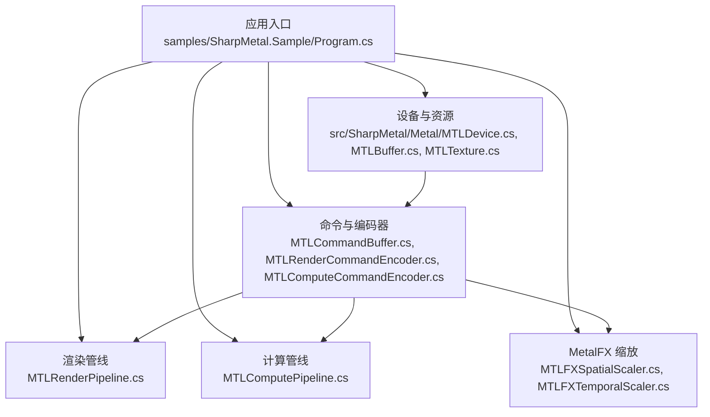
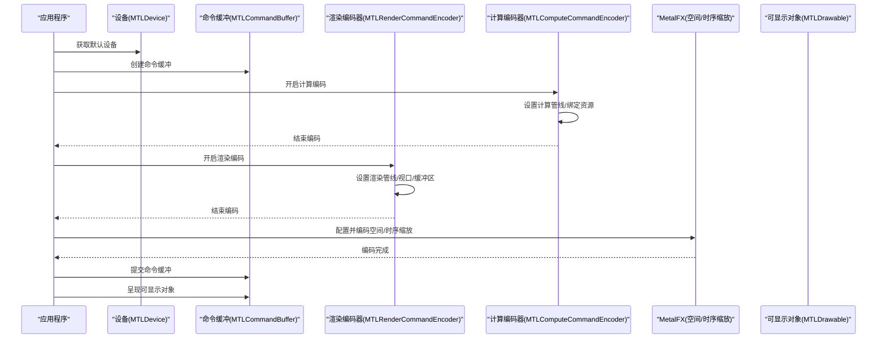
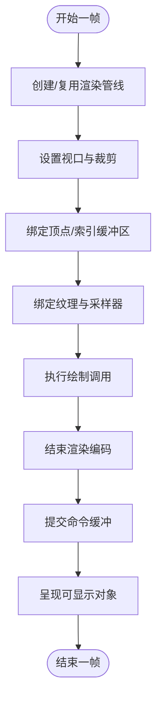
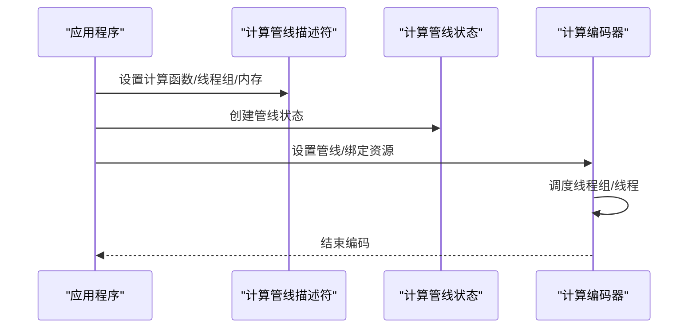
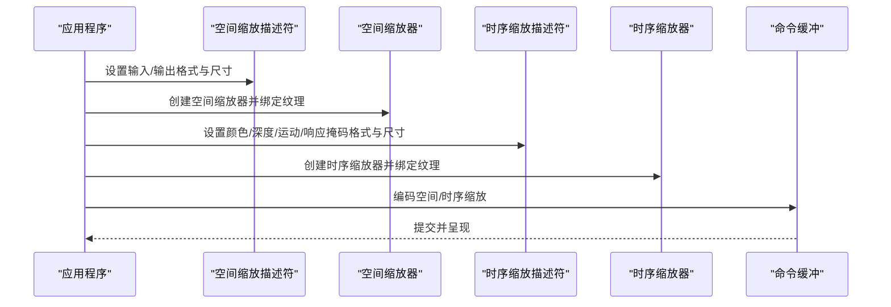
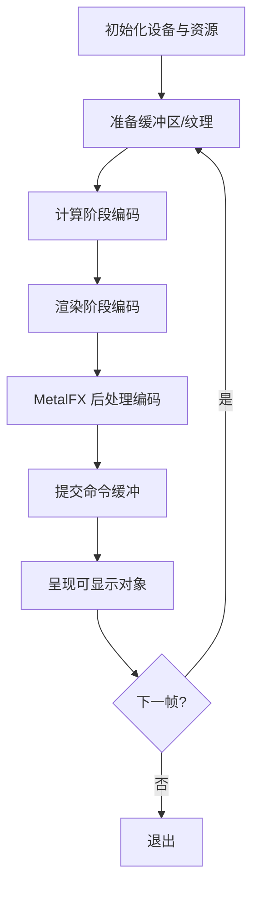
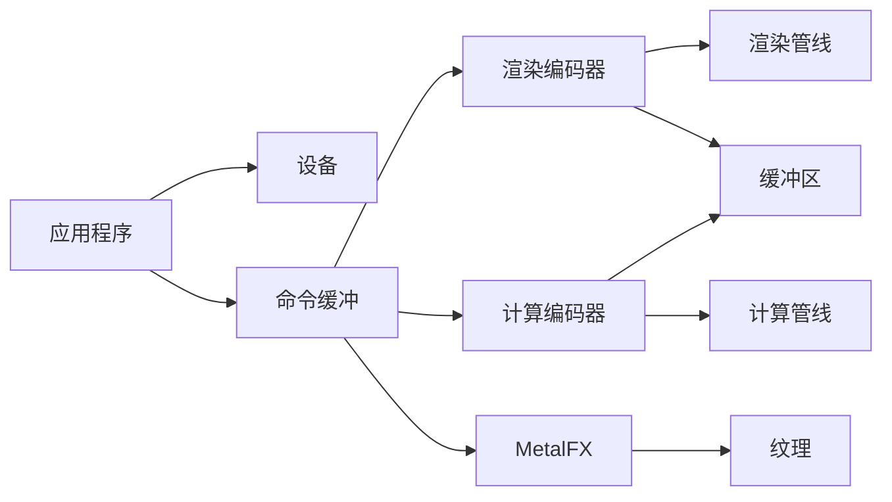

# 高级示例

<cite>
**本文引用的文件**
- [README.md](file://README.md)
- [DESIGN.md](file://DESIGN.md)
- [Program.cs](file://samples/SharpMetal.Sample/Program.cs)
- [MTLDevice.cs](file://src/SharpMetal/Metal/MTLDevice.cs)
- [MTLRenderPipeline.cs](file://src/SharpMetal/Metal/MTLRenderPipeline.cs)
- [MTLComputePipeline.cs](file://src/SharpMetal/Metal/MTLComputePipeline.cs)
- [MTLCommandBuffer.cs](file://src/SharpMetal/Metal/MTLCommandBuffer.cs)
- [MTLRenderCommandEncoder.cs](file://src/SharpMetal/Metal/MTLRenderCommandEncoder.cs)
- [MTLComputeCommandEncoder.cs](file://src/SharpMetal/Metal/MTLComputeCommandEncoder.cs)
- [MTLBuffer.cs](file://src/SharpMetal/Metal/MTLBuffer.cs)
- [MTLTexture.cs](file://src/SharpMetal/Metal/MTLTexture.cs)
- [MTLFXSpatialScaler.cs](file://src/SharpMetal/MetalFX/MTLFXSpatialScaler.cs)
- [MTLFXTemporalScaler.cs](file://src/SharpMetal/MetalFX/MTLFXTemporalScaler.cs)
</cite>

## 目录
1. [简介](#简介)
2. [项目结构](#项目结构)
3. [核心组件](#核心组件)
4. [架构总览](#架构总览)
5. [详细组件分析](#详细组件分析)
6. [依赖关系分析](#依赖关系分析)
7. [性能考虑](#性能考虑)
8. [故障排查指南](#故障排查指南)
9. [结论](#结论)
10. [附录](#附录)

## 简介
本章节面向希望在 .NET 环境下使用 Metal 与 MetalFX 的高级用户，提供渲染管线配置、计算管线使用、MetalFX 图像缩放（空间与时序）等复杂场景的完整实现思路与最佳实践。文档基于仓库中的绑定层与示例代码，给出从设备初始化、资源创建、命令编码到提交呈现的端到端流程，并总结性能优化技巧与常见问题的定位方法。

## 项目结构
仓库采用分层组织：
- src/SharpMetal：包含 Foundation、ObjectiveCCore、Metal、MetalFX、QuartzCore 等子系统绑定
- samples/SharpMetal.Sample：可运行的最小示例，演示设备与共享缓冲区的生命周期管理
- docs/：设计说明与验证流程
- eng/：自动化验证脚本

图表来源
- [Program.cs:1-49](file://samples/SharpMetal.Sample/Program.cs#L1-L49)
- [MTLDevice.cs:187-200](file://src/SharpMetal/Metal/MTLDevice.cs#L187-L200)
- [MTLBuffer.cs:1-115](file://src/SharpMetal/Metal/MTLBuffer.cs#L1-L115)
- [MTLTexture.cs:75-200](file://src/SharpMetal/Metal/MTLTexture.cs#L75-L200)
- [MTLCommandBuffer.cs:116-200](file://src/SharpMetal/Metal/MTLCommandBuffer.cs#L116-L200)
- [MTLRenderCommandEncoder.cs:126-200](file://src/SharpMetal/Metal/MTLRenderCommandEncoder.cs#L126-L200)
- [MTLComputeCommandEncoder.cs:20-200](file://src/SharpMetal/Metal/MTLComputeCommandEncoder.cs#L20-L200)
- [MTLRenderPipeline.cs:87-200](file://src/SharpMetal/Metal/MTLRenderPipeline.cs#L87-L200)
- [MTLComputePipeline.cs:25-200](file://src/SharpMetal/Metal/MTLComputePipeline.cs#L25-L200)
- [MTLFXSpatialScaler.cs:13-167](file://src/SharpMetal/MetalFX/MTLFXSpatialScaler.cs#L13-L167)
- [MTLFXTemporalScaler.cs:6-314](file://src/SharpMetal/MetalFX/MTLFXTemporalScaler.cs#L6-L314)

章节来源
- [README.md:1-23](file://README.md#L1-L23)
- [DESIGN.md:1-12](file://DESIGN.md#L1-L12)

## 核心组件
- 设备与资源
  - 设备获取与平台检查：通过默认设备接口获取 GPU 能力，并在非 Apple 平台进行快速失败
  - 缓冲区与纹理：支持共享存储模式、GPU 地址访问、内存对齐与压缩类型等
- 命令与编码器
  - 命令缓冲：支持延迟提交、回调、状态查询、日志与错误选项
  - 渲染编码器：设置管线、视口、裁剪、顶点/片段数据绑定、绘制调用
  - 计算编码器：设置管线、线程组、缓冲区/纹理绑定、间接调度
- 管线
  - 渲染管线：颜色附件混合、写入掩码、阶段输入输出描述符、反射信息
  - 计算管线：线程组大小、静态线程组内存、函数句柄、二进制归档与链接函数
- MetalFX
  - 空间缩放：输入/输出纹理格式、内容尺寸、处理模式、命令缓冲编码
  - 时序缩放：颜色/深度/运动/响应掩码纹理、抖动偏移、曝光、重置标志、命令缓冲编码

章节来源
- [Program.cs:10-45](file://samples/SharpMetal.Sample/Program.cs#L10-L45)
- [MTLDevice.cs:187-200](file://src/SharpMetal/Metal/MTLDevice.cs#L187-L200)
- [MTLBuffer.cs:18-115](file://src/SharpMetal/Metal/MTLBuffer.cs#L18-L115)
- [MTLTexture.cs:75-200](file://src/SharpMetal/Metal/MTLTexture.cs#L75-L200)
- [MTLCommandBuffer.cs:59-200](file://src/SharpMetal/Metal/MTLCommandBuffer.cs#L59-L200)
- [MTLRenderCommandEncoder.cs:126-200](file://src/SharpMetal/Metal/MTLRenderCommandEncoder.cs#L126-L200)
- [MTLComputeCommandEncoder.cs:20-200](file://src/SharpMetal/Metal/MTLComputeCommandEncoder.cs#L20-L200)
- [MTLRenderPipeline.cs:87-200](file://src/SharpMetal/Metal/MTLRenderPipeline.cs#L87-L200)
- [MTLComputePipeline.cs:25-200](file://src/SharpMetal/Metal/MTLComputePipeline.cs#L25-L200)
- [MTLFXSpatialScaler.cs:13-167](file://src/SharpMetal/MetalFX/MTLFXSpatialScaler.cs#L13-L167)
- [MTLFXTemporalScaler.cs:6-314](file://src/SharpMetal/MetalFX/MTLFXTemporalScaler.cs#L6-L314)

## 架构总览
下图展示了一个典型的高性能渲染循环：在单帧内完成渲染与计算任务，并通过 MetalFX 进行图像缩放后呈现。

图表来源
- [MTLDevice.cs:187-200](file://src/SharpMetal/Metal/MTLDevice.cs#L187-L200)
- [MTLCommandBuffer.cs:116-200](file://src/SharpMetal/Metal/MTLCommandBuffer.cs#L116-L200)
- [MTLRenderCommandEncoder.cs:126-200](file://src/SharpMetal/Metal/MTLRenderCommandEncoder.cs#L126-L200)
- [MTLComputeCommandEncoder.cs:20-200](file://src/SharpMetal/Metal/MTLComputeCommandEncoder.cs#L20-L200)
- [MTLFXSpatialScaler.cs:63-167](file://src/SharpMetal/MetalFX/MTLFXSpatialScaler.cs#L63-L167)
- [MTLFXTemporalScaler.cs:104-314](file://src/SharpMetal/MetalFX/MTLFXTemporalScaler.cs#L104-L314)

## 详细组件分析

### 渲染管线配置与绘制流程
- 关键步骤
  - 创建或复用渲染管线状态，配置颜色附件像素格式、混合与写入掩码
  - 在每帧中设置视口、裁剪矩形、顶点/片段缓冲区与纹理
  - 执行绘制调用并提交命令缓冲，最后呈现可显示对象
- 复杂度与优化
  - 管线状态应跨帧复用，避免频繁重建
  - 合理设置 Usage 与 StorageMode，减少 CPU/GPU 同步开销
  - 使用间接绘制与批处理降低绘制调用次数

图表来源
- [MTLRenderPipeline.cs:87-200](file://src/SharpMetal/Metal/MTLRenderPipeline.cs#L87-L200)
- [MTLRenderCommandEncoder.cs:126-200](file://src/SharpMetal/Metal/MTLRenderCommandEncoder.cs#L126-L200)
- [MTLCommandBuffer.cs:150-200](file://src/SharpMetal/Metal/MTLCommandBuffer.cs#L150-L200)

章节来源
- [MTLRenderPipeline.cs:87-200](file://src/SharpMetal/Metal/MTLRenderPipeline.cs#L87-L200)
- [MTLRenderCommandEncoder.cs:126-200](file://src/SharpMetal/Metal/MTLRenderCommandEncoder.cs#L126-L200)
- [MTLCommandBuffer.cs:150-200](file://src/SharpMetal/Metal/MTLCommandBuffer.cs#L150-L200)

### 计算管线与数据处理
- 关键步骤
  - 配置计算管线描述符：指定计算函数、线程组大小、静态线程组内存
  - 在命令缓冲中设置计算管线、绑定缓冲区/纹理、执行线程组调度
  - 可使用间接参数与 Fence 实现异步与流水线化
- 复杂度与优化
  - 将数据局部性好的块分配给线程组，提升缓存命中率
  - 利用共享内存与寄存器减少全局内存访问
  - 使用二进制归档与预加载库减少启动时编译开销

图表来源
- [MTLComputePipeline.cs:25-200](file://src/SharpMetal/Metal/MTLComputePipeline.cs#L25-L200)
- [MTLComputeCommandEncoder.cs:20-200](file://src/SharpMetal/Metal/MTLComputeCommandEncoder.cs#L20-L200)

章节来源
- [MTLComputePipeline.cs:25-200](file://src/SharpMetal/Metal/MTLComputePipeline.cs#L25-L200)
- [MTLComputeCommandEncoder.cs:20-200](file://src/SharpMetal/Metal/MTLComputeCommandEncoder.cs#L20-L200)

### MetalFX 图像处理（空间与时序缩放）
- 空间缩放
  - 配置输入/输出纹理格式与尺寸，选择颜色处理模式（感知/线性/HDR）
  - 将输入/输出纹理绑定到缩放器，编码到命令缓冲
- 时序缩放
  - 额外需要深度、运动向量、响应掩码与曝光纹理
  - 支持抖动偏移、自动曝光、重置标志与深度方向设置
  - 同样通过命令缓冲编码执行
- 复杂度与优化
  - 确保纹理 Usage 与格式匹配缩放器要求
  - 多帧复用缩放器实例，减少创建与编译成本
  - 结合渲染与计算阶段，形成完整的渲染-后处理流水线

图表来源
- [MTLFXSpatialScaler.cs:13-167](file://src/SharpMetal/MetalFX/MTLFXSpatialScaler.cs#L13-L167)
- [MTLFXTemporalScaler.cs:6-314](file://src/SharpMetal/MetalFX/MTLFXTemporalScaler.cs#L6-L314)
- [MTLCommandBuffer.cs:150-200](file://src/SharpMetal/Metal/MTLCommandBuffer.cs#L150-L200)

章节来源
- [MTLFXSpatialScaler.cs:13-167](file://src/SharpMetal/MetalFX/MTLFXSpatialScaler.cs#L13-L167)
- [MTLFXTemporalScaler.cs:6-314](file://src/SharpMetal/MetalFX/MTLFXTemporalScaler.cs#L6-L314)

### 完整渲染循环实现要点
- 设备与平台检查
  - 在非 Apple 平台快速失败，避免无效工作
- 资源准备
  - 创建共享缓冲区并进行读写验证，确保内存布局正确
- 命令编码
  - 先计算后渲染，或使用并行编码器提高吞吐
  - 将 MetalFX 作为后处理阶段嵌入渲染循环
- 提交与呈现
  - 提交命令缓冲并呈现可显示对象，必要时使用时间控制

图表来源
- [Program.cs:10-45](file://samples/SharpMetal.Sample/Program.cs#L10-L45)
- [MTLCommandBuffer.cs:150-200](file://src/SharpMetal/Metal/MTLCommandBuffer.cs#L150-L200)
- [MTLRenderCommandEncoder.cs:126-200](file://src/SharpMetal/Metal/MTLRenderCommandEncoder.cs#L126-L200)
- [MTLComputeCommandEncoder.cs:20-200](file://src/SharpMetal/Metal/MTLComputeCommandEncoder.cs#L20-L200)
- [MTLFXSpatialScaler.cs:63-167](file://src/SharpMetal/MetalFX/MTLFXSpatialScaler.cs#L63-L167)
- [MTLFXTemporalScaler.cs:104-314](file://src/SharpMetal/MetalFX/MTLFXTemporalScaler.cs#L104-L314)

章节来源
- [Program.cs:10-45](file://samples/SharpMetal.Sample/Program.cs#L10-L45)
- [MTLCommandBuffer.cs:150-200](file://src/SharpMetal/Metal/MTLCommandBuffer.cs#L150-L200)

## 依赖关系分析
- 模块耦合
  - 应用入口依赖设备、命令缓冲与编码器
  - 渲染与计算编码器依赖管线状态与资源（缓冲区/纹理）
  - MetalFX 依赖纹理格式与使用方式，需与渲染/计算阶段协调
- 外部依赖
  - Objective-C 运行时用于消息发送与原生对象管理
  - QuartzCore 提供可显示对象与图层相关能力

图表来源
- [Program.cs:10-45](file://samples/SharpMetal.Sample/Program.cs#L10-L45)
- [MTLDevice.cs:187-200](file://src/SharpMetal/Metal/MTLDevice.cs#L187-L200)
- [MTLCommandBuffer.cs:116-200](file://src/SharpMetal/Metal/MTLCommandBuffer.cs#L116-L200)
- [MTLRenderCommandEncoder.cs:126-200](file://src/SharpMetal/Metal/MTLRenderCommandEncoder.cs#L126-L200)
- [MTLComputeCommandEncoder.cs:20-200](file://src/SharpMetal/Metal/MTLComputeCommandEncoder.cs#L20-L200)
- [MTLRenderPipeline.cs:87-200](file://src/SharpMetal/Metal/MTLRenderPipeline.cs#L87-L200)
- [MTLComputePipeline.cs:25-200](file://src/SharpMetal/Metal/MTLComputePipeline.cs#L25-L200)
- [MTLBuffer.cs:18-115](file://src/SharpMetal/Metal/MTLBuffer.cs#L18-L115)
- [MTLTexture.cs:75-200](file://src/SharpMetal/Metal/MTLTexture.cs#L75-L200)
- [MTLFXSpatialScaler.cs:13-167](file://src/SharpMetal/MetalFX/MTLFXSpatialScaler.cs#L13-L167)
- [MTLFXTemporalScaler.cs:6-314](file://src/SharpMetal/MetalFX/MTLFXTemporalScaler.cs#L6-L314)

章节来源
- [DESIGN.md:1-12](file://DESIGN.md#L1-L12)

## 性能考虑
- 资源管理
  - 使用合适的 StorageMode 与 Usage，避免不必要的 CPU/GPU 同步
  - 复用缓冲区与纹理，减少分配与释放频率
- 管线优化
  - 预构建管线状态与着色器库，启用二进制归档与预加载
  - 合并绘制调用，使用间接绘制与实例化渲染
- 计算优化
  - 合理划分线程组与线程数，充分利用本地内存
  - 使用 Fence 与异步回调实现流水线并行
- MetalFX 优化
  - 选择合适的颜色处理模式（感知/线性/HDR），匹配 HDR 管线
  - 复用缩放器实例，减少每帧创建开销
  - 确保纹理格式与尺寸符合缩放器要求，避免隐式转换

[本节为通用指导，不直接分析具体文件]

## 故障排查指南
- 平台限制
  - 在非 Apple 平台会快速失败，确认运行环境与目标平台
- 资源分配失败
  - 检查缓冲区与纹理的容量、格式与使用方式是否合法
  - 关注返回的错误信息与日志状态
- 命令执行错误
  - 使用命令缓冲的错误选项与日志容器，定位编码器错误状态
  - 检查渲染/计算编码器的绑定顺序与参数合法性
- MetalFX 问题
  - 校验输入/输出纹理格式与尺寸，确保与缩放器描述一致
  - 检查抖动偏移、曝光与重置标志的设置是否符合预期

章节来源
- [Program.cs:10-45](file://samples/SharpMetal.Sample/Program.cs#L10-L45)
- [MTLCommandBuffer.cs:59-200](file://src/SharpMetal/Metal/MTLCommandBuffer.cs#L59-L200)
- [MTLRenderCommandEncoder.cs:126-200](file://src/SharpMetal/Metal/MTLRenderCommandEncoder.cs#L126-L200)
- [MTLComputeCommandEncoder.cs:20-200](file://src/SharpMetal/Metal/MTLComputeCommandEncoder.cs#L20-L200)
- [MTLFXSpatialScaler.cs:13-167](file://src/SharpMetal/MetalFX/MTLFXSpatialScaler.cs#L13-L167)
- [MTLFXTemporalScaler.cs:6-314](file://src/SharpMetal/MetalFX/MTLFXTemporalScaler.cs#L6-L314)

## 结论
通过 SharpMetal 的绑定层，可以在 .NET 环境中高效地使用 Metal 与 MetalFX 完成复杂的图形与数据处理任务。遵循资源复用、管线预构建、命令并行与 MetalFX 后处理的组合策略，能够显著提升渲染性能与稳定性。建议在项目中建立清晰的渲染循环抽象，将设备、资源、命令与后处理解耦，便于扩展与维护。

[本节为总结性内容，不直接分析具体文件]

## 附录
- 参考路径
  - 示例程序入口：[Program.cs:10-45](file://samples/SharpMetal.Sample/Program.cs#L10-L45)
  - 设备与资源：[MTLDevice.cs:187-200](file://src/SharpMetal/Metal/MTLDevice.cs#L187-L200)、[MTLBuffer.cs:18-115](file://src/SharpMetal/Metal/MTLBuffer.cs#L18-L115)、[MTLTexture.cs:75-200](file://src/SharpMetal/Metal/MTLTexture.cs#L75-L200)
  - 命令与编码器：[MTLCommandBuffer.cs:116-200](file://src/SharpMetal/Metal/MTLCommandBuffer.cs#L116-L200)、[MTLRenderCommandEncoder.cs:126-200](file://src/SharpMetal/Metal/MTLRenderCommandEncoder.cs#L126-L200)、[MTLComputeCommandEncoder.cs:20-200](file://src/SharpMetal/Metal/MTLComputeCommandEncoder.cs#L20-L200)
  - 管线：[MTLRenderPipeline.cs:87-200](file://src/SharpMetal/Metal/MTLRenderPipeline.cs#L87-L200)、[MTLComputePipeline.cs:25-200](file://src/SharpMetal/Metal/MTLComputePipeline.cs#L25-L200)
  - MetalFX：[MTLFXSpatialScaler.cs:13-167](file://src/SharpMetal/MetalFX/MTLFXSpatialScaler.cs#L13-L167)、[MTLFXTemporalScaler.cs:6-314](file://src/SharpMetal/MetalFX/MTLFXTemporalScaler.cs#L6-L314)

[本节为参考列表，不直接分析具体文件]