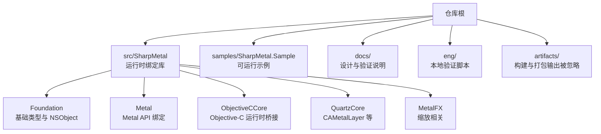
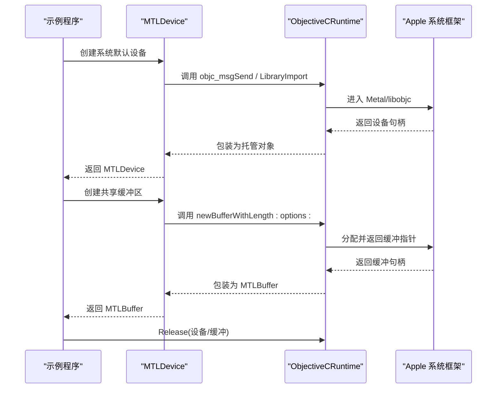
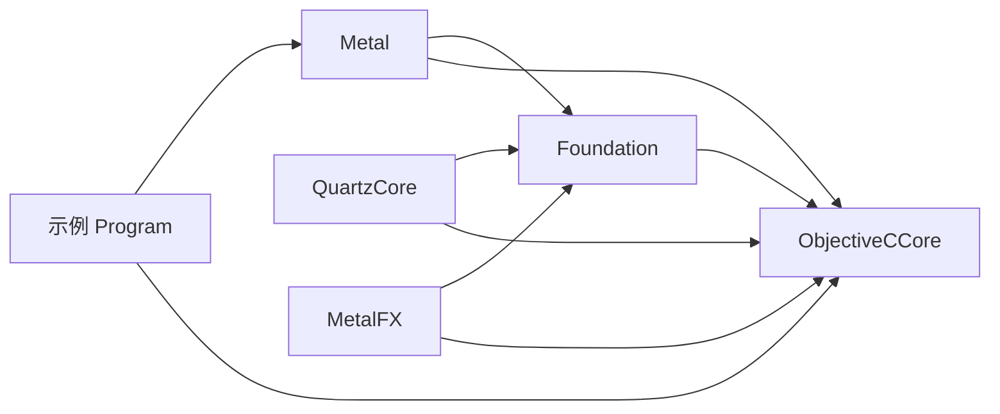

# 代码规范

<cite>
**本文引用的文件**
- [README.md](file://README.md)
- [DESIGN.md](file://DESIGN.md)
- [AGENTS.md](file://AGENTS.md)
- [SharpMetal.csproj](file://src/SharpMetal/SharpMetal.csproj)
- [Directory.Build.props](file://Directory.Build.props)
- [Directory.Build.targets](file://Directory.Build.targets)
- [NSObject.cs](file://src/SharpMetal/Foundation/NSObject.cs)
- [MTLDevice.cs](file://src/SharpMetal/Metal/MTLDevice.cs)
- [ObjectiveCRuntime.cs](file://src/SharpMetal/ObjectiveCCore/ObjectiveCRuntime.cs)
- [Program.cs](file://samples/SharpMetal.Sample/Program.cs)
- [VERIFICATION.md](file://docs/VERIFICATION.md)
</cite>

## 目录
1. [简介](#简介)
2. [项目结构](#项目结构)
3. [核心组件](#核心组件)
4. [架构总览](#架构总览)
5. [详细组件分析](#详细组件分析)
6. [依赖关系分析](#依赖关系分析)
7. [性能考量](#性能考量)
8. [故障排查指南](#故障排查指南)
9. [结论](#结论)
10. [附录](#附录)

## 简介
本规范面向 SharpMetal 项目的 C# 编码约定、架构原则、代码组织、审查清单与质量标准，以及许可证与第三方依赖管理规范。目标是在保持原生 ABI 一致性与所有权管理的前提下，提供清晰、可维护、可验证的实现路径。

## 项目结构
仓库采用“源码在 src、示例在 samples、文档在 docs、工程脚本在 eng”的分层布局。构建产物与中间输出统一隔离到 artifacts 下，避免污染工作区。根级 Directory.Build.props/targets 集中定义全局 MSBuild 行为、包锁定模式、输出路径与 Source/Package 模式校验。产品边界与贡献规则由 DESIGN.md 与 AGENTS.md 明确。

图表来源
- [Directory.Build.props:1-25](file://Directory.Build.props#L1-L25)
- [SharpMetal.csproj:1-47](file://src/SharpMetal/SharpMetal.csproj#L1-L47)

章节来源
- [README.md:12-16](file://README.md#L12-L16)
- [DESIGN.md:1-12](file://DESIGN.md#L1-L12)
- [Directory.Build.props:1-25](file://Directory.Build.props#L1-L25)

## 核心组件
- Foundation：封装 Objective-C 基础类型与 NSObject 语义，提供字符串、错误、集合等基础能力。
- Metal：对 Apple Metal 系统框架进行低层绑定，暴露设备、命令队列、缓冲区、纹理、管线状态等对象。
- ObjectiveCCore：通过 LibraryImport 直接调用 libobjc.A.dylib，实现消息发送、类查找、选择器注册、内存管理等底层能力。
- QuartzCore：桥接 CAMetalLayer/CAMetalDrawable，用于显示与绘制集成。
- MetalFX：MetalFX 缩放能力的绑定。

这些组件共同构成“托管侧类型 + 原生 ABI 映射 + 显式所有权管理”的绑定层。

章节来源
- [NSObject.cs:1-92](file://src/SharpMetal/Foundation/NSObject.cs#L1-L92)
- [MTLDevice.cs:1-800](file://src/SharpMetal/Metal/MTLDevice.cs#L1-L800)
- [ObjectiveCRuntime.cs:1-800](file://src/SharpMetal/ObjectiveCCore/ObjectiveCRuntime.cs#L1-L800)

## 架构总览
SharpMetal 遵循“产品边界清晰、原生 ABI 严格对齐、所有权显式管理”的原则。托管层不隐藏平台差异，不支持的能力以明确的标记或失败表达；所有原生资源的生命周期由调用方显式控制，避免隐式释放或引用计数漂移。

图表来源
- [MTLDevice.cs:305-319](file://src/SharpMetal/Metal/MTLDevice.cs#L305-L319)
- [ObjectiveCRuntime.cs:33-141](file://src/SharpMetal/ObjectiveCCore/ObjectiveCRuntime.cs#L33-L141)
- [Program.cs:21-45](file://samples/SharpMetal.Sample/Program.cs#L21-L45)

## 详细组件分析

### 编码约定与风格
- 命名规范
  - 字段使用 m_PascalCase 前缀表示实例字段。
  - 静态字段使用 s_PascalCase 前缀表示静态字段。
  - 方法、属性、类型使用标准 PascalCase。
- 缩进格式
  - 统一使用四空格缩进。
- 大括号风格
  - 使用 Allman braces（左大括号独占一行）。
- 生成/原生绑定
  - 生成或原生绑定的代码保留其声明的约定，不强制改写。

以上约定在项目贡献指南中明确，并在 Foundation 与 Metal 的源文件中体现为一致的字段前缀与块级结构。

章节来源
- [AGENTS.md:15-16](file://AGENTS.md#L15-L16)
- [NSObject.cs:1-92](file://src/SharpMetal/Foundation/NSObject.cs#L1-L92)
- [MTLDevice.cs:1-200](file://src/SharpMetal/Metal/MTLDevice.cs#L1-L200)

### 产品边界与原生 ABI 保持
- 产品边界
  - 运行时基线为 .NET 10；编译器生成器保留各自 netstandard 目标。
  - 公共原生操作必须执行平台与所有权边界检查，禁止降级能力或兼容实现掩盖不支持的执行环境。
- ABI 对齐
  - 示例程序在启动时校验关键结构体大小，确保托管布局与原生 ABI 一致。
  - 所有与 Objective-C 交互的类型与方法签名需与原生保持一致。
- 所有权管理
  - 所有原生资源通过显式 retain/release 管理生命周期；示例在 finally 中释放设备与缓冲。

章节来源
- [DESIGN.md:5-11](file://DESIGN.md#L5-L11)
- [Program.cs:12-19](file://samples/SharpMetal.Sample/Program.cs#L12-L19)
- [Program.cs:21-45](file://samples/SharpMetal.Sample/Program.cs#L21-L45)
- [ObjectiveCRuntime.cs:769-782](file://src/SharpMetal/ObjectiveCCore/ObjectiveCRuntime.cs#L769-L782)

### 代码组织原则
- 单一实现路径
  - 每个功能仅有一条实现路径，避免多重分支导致维护成本上升。
- 禁止遗留别名与兼容性垫片
  - 不引入别名、转发程序集、兼容垫片或静默依赖回退；缺失依赖应直接失败。
- 构建与依赖模式
  - Source 与 Package 模式图级生效；本地路径仅存在于忽略的 stack.local.props。
  - NuGet 锁文件按模式与 RID 隔离，提交已审阅的锁文件，恢复时使用 RestoreLockedMode。

章节来源
- [AGENTS.md:15-19](file://AGENTS.md#L15-L19)
- [DESIGN.md:5-11](file://DESIGN.md#L5-L11)
- [Directory.Build.targets:27-37](file://Directory.Build.targets#L27-L37)
- [Directory.Build.props:17-22](file://Directory.Build.props#L17-L22)

### 代码审查检查清单与质量标准
- 结构与风格
  - 是否遵循 m_/s_ 字段前缀、四空格缩进、Allman 大括号。
  - 是否保持单一实现路径，无别名、转发、兼容垫片。
- 边界与 ABI
  - 是否显式检查平台与能力支持；未支持能力是否以明确标记或失败表达。
  - 是否保持原生 ABI 一致（结构体大小、布局、调用约定）。
- 所有权与生命周期
  - 是否显式管理 retain/release；是否在 finally 或确定时机释放。
- 构建与依赖
  - 是否使用正确的 StackReferenceMode；锁文件是否匹配且已审阅。
  - 是否避免将开发者路径提交到仓库。
- 测试与证据
  - 是否覆盖错误、取消与生命周期路径；必要时标注 UNVERIFIED/BLOCKED_PLATFORM。
  - 是否更新 README/设计/验证文档以反映契约变化。

章节来源
- [AGENTS.md:15-19](file://AGENTS.md#L15-L19)
- [DESIGN.md:5-11](file://DESIGN.md#L5-L11)
- [VERIFICATION.md:57-64](file://docs/VERIFICATION.md#L57-L64)

### 许可证要求与第三方依赖管理
- 许可证
  - 第一方代码与包元数据使用 MPL-2.0；保留 LICENSE、来源归属与第三方许可通知。
  - 提取记录与继承通知保存在 docs/provenance。
- 第三方依赖
  - 使用 packages.<StackReferenceMode>.<RID-or-portable>.lock.json 隔离 Source/Package 模式。
  - 恢复时使用 RestoreLockedMode；新 RID 需要独立锁文件与匹配主机验证。
  - 本地开发路径仅存在于忽略的 stack.local.props；模板变更需同步更新。

章节来源
- [README.md:18-22](file://README.md#L18-L22)
- [AGENTS.md:19-19](file://AGENTS.md#L19-L19)
- [DESIGN.md:5-11](file://DESIGN.md#L5-L11)
- [VERIFICATION.md:100-103](file://docs/VERIFICATION.md#L100-L103)

## 依赖关系分析
SharpMetal 的核心依赖关系如下：
- Foundation 依赖 ObjectiveCCore 以访问基础运行时能力。
- Metal 依赖 Foundation 与 ObjectiveCCore，直接调用 Metal 系统框架。
- QuartzCore 与 MetalFX 作为扩展能力，依赖 Foundation 与 ObjectiveCCore。
- 示例程序依赖 Metal 与 ObjectiveCCore，演示设备创建与缓冲读写。

图表来源
- [NSObject.cs:1-3](file://src/SharpMetal/Foundation/NSObject.cs#L1-L3)
- [MTLDevice.cs:1-3](file://src/SharpMetal/Metal/MTLDevice.cs#L1-L3)
- [ObjectiveCRuntime.cs:1-4](file://src/SharpMetal/ObjectiveCCore/ObjectiveCRuntime.cs#L1-L4)
- [Program.cs:1-4](file://samples/SharpMetal.Sample/Program.cs#L1-L4)

章节来源
- [NSObject.cs:1-92](file://src/SharpMetal/Foundation/NSObject.cs#L1-L92)
- [MTLDevice.cs:1-800](file://src/SharpMetal/Metal/MTLDevice.cs#L1-L800)
- [ObjectiveCRuntime.cs:1-800](file://src/SharpMetal/ObjectiveCCore/ObjectiveCRuntime.cs#L1-L800)
- [Program.cs:1-49](file://samples/SharpMetal.Sample/Program.cs#L1-L49)

## 性能考量
- 避免不必要的装箱与复制：尽量使用 in 参数与只读结构体传递。
- 减少跨边界调用次数：批量设置参数、复用描述符与编码器。
- 合理管理原生资源：及时释放不再使用的设备、缓冲与纹理，避免内存泄漏。
- 利用共享缓冲与零拷贝策略：在托管与原生之间共享内存，减少数据搬运。
- 谨慎使用动态库与编译任务：按需启用，避免不必要的开销。

[本节为通用指导，不直接分析具体文件]

## 故障排查指南
- 平台限制
  - 非 Apple 主机将返回 BLOCKED_PLATFORM；需在 macOS/iOS/MacCatalyst 上运行原生部分。
- ABI 不匹配
  - 若托管结构体大小与原生不一致，将抛出异常；需检查目标平台与 SDK 配置。
- 资源释放
  - 忘记释放设备或缓冲会导致原生资源泄漏；确保在 finally 中调用 Release。
- 依赖模式冲突
  - Source 模式下不应存在同名 Package 引用；否则构建会报错。
- 锁文件不一致
  - 切换 Source/Package 模式后需重新生成并审阅锁文件；CI 使用 RestoreLockedMode。

章节来源
- [Program.cs:12-19](file://samples/SharpMetal.Sample/Program.cs#L12-L19)
- [Program.cs:21-45](file://samples/SharpMetal.Sample/Program.cs#L21-L45)
- [Directory.Build.targets:27-37](file://Directory.Build.targets#L27-L37)
- [VERIFICATION.md:57-64](file://docs/VERIFICATION.md#L57-L64)

## 结论
SharpMetal 通过严格的编码约定、清晰的架构边界、显式的原生所有权管理与可验证的构建流程，提供了稳定可靠的 Apple 平台绑定。遵循本规范有助于降低维护成本、提升代码质量，并确保在不同环境与模式下的一致性。

[本节为总结性内容，不直接分析具体文件]

## 附录
- 快速开始
  - 安装 .NET 10 SDK；复制 stack.local.props.example 并调整路径；参考 docs/VERIFICATION.md 执行构建、测试与打包。
- 构建与验证
  - 使用 eng/Verify.ps1 执行本地验证；Source/Package 模式分别生成独立锁文件与证据。
- 许可证与合规
  - 保留 MPL-2.0 文本与第三方通知；更新 README/设计/验证文档以反映契约变化。

章节来源
- [README.md:5-10](file://README.md#L5-L10)
- [VERIFICATION.md:9-28](file://docs/VERIFICATION.md#L9-L28)
- [VERIFICATION.md:72-99](file://docs/VERIFICATION.md#L72-L99)