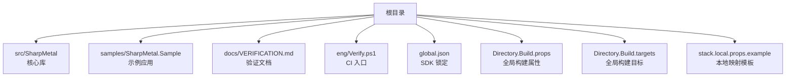
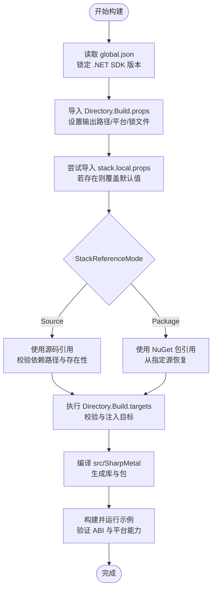
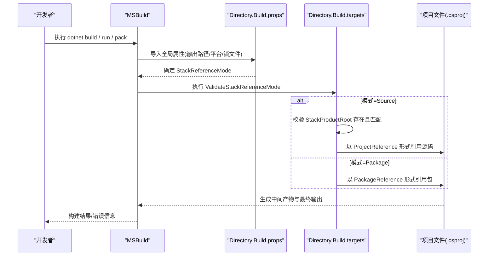
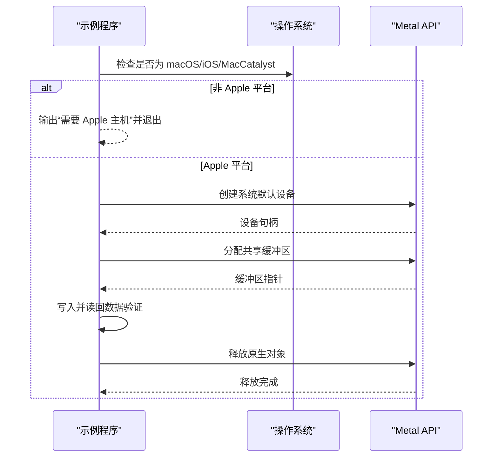
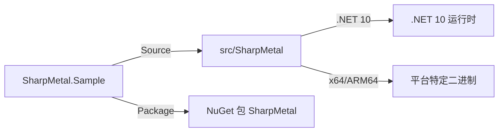

# 开发环境设置

<cite>
**本文引用的文件**
- [global.json](file://global.json)
- [README.md](file://README.md)
- [Directory.Build.props](file://Directory.Build.props)
- [Directory.Build.targets](file://Directory.Build.targets)
- [SharpMetal.product.props](file://SharpMetal.product.props)
- [stack.local.props.example](file://stack.local.props.example)
- [stack.local.props](file://stack.local.props)
- [src/SharpMetal/SharpMetal.csproj](file://src/SharpMetal/SharpMetal.csproj)
- [samples/SharpMetal.Sample/SharpMetal.Sample.csproj](file://samples/SharpMetal.Sample/SharpMetal.Sample.csproj)
- [samples/SharpMetal.Sample/Program.cs](file://samples/SharpMetal.Sample/Program.cs)
- [docs/VERIFICATION.md](file://docs/VERIFICATION.md)
</cite>

## 目录
1. [简介](#简介)
2. [项目结构](#项目结构)
3. [核心组件](#核心组件)
4. [架构总览](#架构总览)
5. [详细组件分析](#详细组件分析)
6. [依赖关系分析](#依赖关系分析)
7. [性能注意事项](#性能注意事项)
8. [故障排查指南](#故障排查指南)
9. [结论](#结论)
10. [附录](#附录)

## 简介
本指南面向新贡献者，帮助你在本地快速搭建可工作的 SharpMetal 开发环境。内容涵盖：
- 所需 .NET SDK 版本与 Apple 平台工具
- 关键配置文件的作用说明（global.json、Directory.Build.props、stack.local.props.example）
- 完整的本地搭建步骤（含路径配置与平台特定设置）
- 环境验证方法
- 常见问题排查与解决方案

## 项目结构
仓库采用分层组织方式：
- src/SharpMetal：核心绑定库（Objective-C/Metal/MetalFX/QuartzCore）
- samples/SharpMetal.Sample：可运行的示例程序，用于验证构建与运行
- docs/VERIFICATION.md：权威构建、测试、打包与平台相关命令
- eng/Verify.ps1：产品本地 CI 入口脚本
- 根级 MSBuild 属性/目标：统一构建行为与产物输出路径

**图示来源**
- [README.md:12-16](file://README.md#L12-L16)
- [global.json:1-8](file://global.json#L1-L8)
- [Directory.Build.props:1-25](file://Directory.Build.props#L1-L25)

**章节来源**
- [README.md:12-16](file://README.md#L12-L16)

## 核心组件
- global.json：锁定 .NET SDK 版本与回滚策略，确保团队一致的工具链。
- Directory.Build.props：集中定义输出路径、包还原锁文件位置、默认配置/平台、以及 StackReferenceMode 等关键属性。
- Directory.Build.targets：在构建早期校验 StackReferenceMode，并传递必要的 MSBuild 属性给项目引用；在 Source 模式下引入跨项目目标。
- stack.local.props.example：提供本地源模式下的依赖仓库路径映射模板（如 SharpMath、SharpGPU 等），需复制为 stack.local.props 并填写实际路径。
- SharpMetal.product.props：声明产品名称，便于上层统一消费。
- src/SharpMetal/SharpMetal.csproj：目标框架 net10.0，支持 x64/ARM64，启用不安全代码，版本来自 StackPackageVersion。
- samples/SharpMetal.Sample/SharpMetal.Sample.csproj：根据 StackReferenceMode 引用源码或 NuGet 包。
- samples/SharpMetal.Sample/Program.cs：示例程序，非 Apple 平台会报告“需要 Apple 主机”，Apple 平台下演示设备创建与共享缓冲区读写。

**章节来源**
- [global.json:1-8](file://global.json#L1-L8)
- [Directory.Build.props:1-25](file://Directory.Build.props#L1-L25)
- [Directory.Build.targets:1-40](file://Directory.Build.targets#L1-L40)
- [stack.local.props.example:1-12](file://stack.local.props.example#L1-L12)
- [SharpMetal.product.props:1-2](file://SharpMetal.product.props#L1-L2)
- [src/SharpMetal/SharpMetal.csproj:1-47](file://src/SharpMetal/SharpMetal.csproj#L1-L47)
- [samples/SharpMetal.Sample/SharpMetal.Sample.csproj:1-6](file://samples/SharpMetal.Sample/SharpMetal.Sample.csproj#L1-L6)
- [samples/SharpMetal.Sample/Program.cs:1-49](file://samples/SharpMetal.Sample/Program.cs#L1-L49)

## 架构总览
下图展示了构建时各配置文件如何协作，决定使用源码还是包模式，以及输出路径和依赖解析。

**图示来源**
- [global.json:1-8](file://global.json#L1-L8)
- [Directory.Build.props:1-25](file://Directory.Build.props#L1-L25)
- [Directory.Build.targets:27-39](file://Directory.Build.targets#L27-L39)
- [stack.local.props.example:1-12](file://stack.local.props.example#L1-L12)
- [samples/SharpMetal.Sample/SharpMetal.Sample.csproj:1-6](file://samples/SharpMetal.Sample/SharpMetal.Sample.csproj#L1-L6)

## 详细组件分析

### 构建与依赖解析流程（源码 vs 包）
该流程描述了 MSBuild 在构建时如何根据模式选择依赖来源，并在 Source 模式下进行严格校验。

**图示来源**
- [Directory.Build.props:1-25](file://Directory.Build.props#L1-L25)
- [Directory.Build.targets:27-39](file://Directory.Build.targets#L27-L39)
- [samples/SharpMetal.Sample/SharpMetal.Sample.csproj:1-6](file://samples/SharpMetal.Sample/SharpMetal.Sample.csproj#L1-L6)

### 示例程序运行流程（平台检测与资源管理）
示例程序在非 Apple 平台直接返回“需要 Apple 主机”；在 Apple 平台下创建 Metal 设备、分配共享缓冲区并进行读写验证，最后释放原生资源。

**图示来源**
- [samples/SharpMetal.Sample/Program.cs:10-46](file://samples/SharpMetal.Sample/Program.cs#L10-L46)

### 构建产物与输出路径
- 输出根目录：artifacts/bin/<项目名>/<模式>/<平台>/<RID>/
- 中间目录：artifacts/obj/<项目名>/<模式>/<平台>/<RID>/<配置>/
- 包还原锁文件：packages.<模式>.<RID或portable>.lock.json
- 这些由 Directory.Build.props 统一设定，保证多项目、多 RID 的隔离与可重现。

**章节来源**
- [Directory.Build.props:15-22](file://Directory.Build.props#L15-L22)

## 依赖关系分析
- 运行时目标：net10.0，平台限定 x64/ARM64
- 源码模式：通过 ProjectReference 引用同仓库其他子项目（如 SharpGPU），要求对应的 Root 路径已正确配置
- 包模式：通过 PackageReference 引用 NuGet 包，版本由 StackPackageVersion 控制
- 示例项目根据模式动态切换引用方式

**图示来源**
- [src/SharpMetal/SharpMetal.csproj:1-47](file://src/SharpMetal/SharpMetal.csproj#L1-L47)
- [samples/SharpMetal.Sample/SharpMetal.Sample.csproj:1-6](file://samples/SharpMetal.Sample/SharpMetal.Sample.csproj#L1-L6)

**章节来源**
- [src/SharpMetal/SharpMetal.csproj:1-47](file://src/SharpMetal/SharpMetal.csproj#L1-L47)
- [samples/SharpMetal.Sample/SharpMetal.Sample.csproj:1-6](file://samples/SharpMetal.Sample/SharpMetal.Sample.csproj#L1-L6)

## 性能注意事项
- 使用 Release 配置以获得优化后的二进制
- 在 Source 模式下避免不必要的包还原冲突
- 合理选择 RID（如 x64 或 ARM64）以减少无关平台的构建开销
- 利用锁文件（RestorePackagesWithLockFile=true）提升还原稳定性与速度

[本节为通用指导，不直接分析具体文件]

## 故障排查指南
- 无法找到 .NET SDK 或版本不匹配
  - 现象：构建失败或提示 SDK 版本不符
  - 原因：未安装 global.json 指定的 SDK 版本
  - 解决：安装匹配的 .NET SDK 版本（由 global.json 锁定）
  - 参考：[global.json:1-8](file://global.json#L1-L8)

- StackReferenceMode 配置错误
  - 现象：构建时报错要求 Source 或 Package
  - 原因：未设置或设置了非法值
  - 解决：在命令行或 stack.local.props 中设置为 Source 或 Package
  - 参考：[Directory.Build.targets:27-29](file://Directory.Build.targets#L27-L29)

- Source 模式下缺少依赖仓库映射
  - 现象：报错提示缺失 StackProductRoot 或找不到对应 product.props
  - 原因：未复制或未正确配置 stack.local.props
  - 解决：复制 stack.local.props.example 为 stack.local.props，并填写正确的依赖仓库路径
  - 参考：[stack.local.props.example:1-12](file://stack.local.props.example#L1-L12)、[Directory.Build.targets:30-32](file://Directory.Build.targets#L30-L32)

- 示例在非 Apple 平台运行
  - 现象：输出“需要 Apple 主机”
  - 原因：Metal 原生功能仅在 Apple 平台可用
  - 解决：在 macOS/iOS/MacCatalyst 上运行以验证原生能力；Windows/Linux 仅能验证托管 ABI
  - 参考：[samples/SharpMetal.Sample/Program.cs:16-20](file://samples/SharpMetal.Sample/Program.cs#L16-L20)

- 包模式无法恢复包
  - 现象：NuGet 还原失败或找不到包
  - 原因：未提供显式包源或未使用隔离缓存
  - 解决：按验证文档中的参数传入包源与缓存路径，或使用本地生成的包源
  - 参考：[docs/VERIFICATION.md:39-51](file://docs/VERIFICATION.md#L39-L51)

- 构建输出与证据目录被清理
  - 现象：历史 artifacts/ 不存在
  - 原因：仓库策略删除了历史产物与缓存
  - 解决：重新构建并运行验证命令，将新的 artifacts/ 视为本次构建证据
  - 参考：[docs/VERIFICATION.md:3-8](file://docs/VERIFICATION.md#L3-L8)

**章节来源**
- [global.json:1-8](file://global.json#L1-L8)
- [Directory.Build.targets:27-32](file://Directory.Build.targets#L27-L32)
- [stack.local.props.example:1-12](file://stack.local.props.example#L1-L12)
- [samples/SharpMetal.Sample/Program.cs:16-20](file://samples/SharpMetal.Sample/Program.cs#L16-L20)
- [docs/VERIFICATION.md:3-8](file://docs/VERIFICATION.md#L3-L8)
- [docs/VERIFICATION.md:39-51](file://docs/VERIFICATION.md#L39-L51)

## 结论
通过遵循本指南，你可以：
- 安装并锁定正确的 .NET SDK
- 正确配置源码或包模式
- 在 Apple 平台上验证 Metal 原生能力，或在非 Apple 平台验证托管 ABI
- 使用统一的构建属性与输出路径，提高可重现性与团队协作效率

## 附录

### 本地环境搭建步骤（推荐顺序）
1. 安装 .NET SDK
   - 安装由 global.json 锁定的 .NET SDK 版本
   - 参考：[global.json:1-8](file://global.json#L1-L8)

2. 准备本地映射文件
   - 复制 stack.local.props.example 为 stack.local.props
   - 如需源码模式，填写相邻仓库的实际路径（如 SharpMath、SharpGPU 等）
   - 参考：[stack.local.props.example:1-12](file://stack.local.props.example#L1-L12)

3. 选择构建模式
   - 源码模式：StackReferenceMode=Source（适合修改上游依赖）
   - 包模式：StackReferenceMode=Package（适合消费发布产物）
   - 参考：[Directory.Build.props:9-10](file://Directory.Build.props#L9-L10)、[Directory.Build.targets:27-29](file://Directory.Build.targets#L27-L29)

4. 构建核心库
   - 使用 Debug/Release 与目标平台（x64/ARM64）
   - 参考：[docs/VERIFICATION.md:23-27](file://docs/VERIFICATION.md#L23-L27)

5. 运行示例程序
   - 非 Apple 平台：应输出托管 ABI 通过，并提示需要 Apple 主机
   - Apple 平台：应能创建设备并读写共享缓冲区
   - 参考：[samples/SharpMetal.Sample/Program.cs:16-46](file://samples/SharpMetal.Sample/Program.cs#L16-L46)

6. 打包与验证
   - 使用验证文档中的命令进行打包与隔离缓存验证
   - 参考：[docs/VERIFICATION.md:23-55](file://docs/VERIFICATION.md#L23-L55)

**章节来源**
- [global.json:1-8](file://global.json#L1-L8)
- [stack.local.props.example:1-12](file://stack.local.props.example#L1-L12)
- [Directory.Build.props:9-10](file://Directory.Build.props#L9-L10)
- [Directory.Build.targets:27-29](file://Directory.Build.targets#L27-L29)
- [docs/VERIFICATION.md:23-55](file://docs/VERIFICATION.md#L23-L55)
- [samples/SharpMetal.Sample/Program.cs:16-46](file://samples/SharpMetal.Sample/Program.cs#L16-L46)