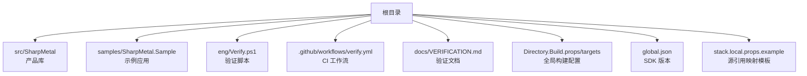
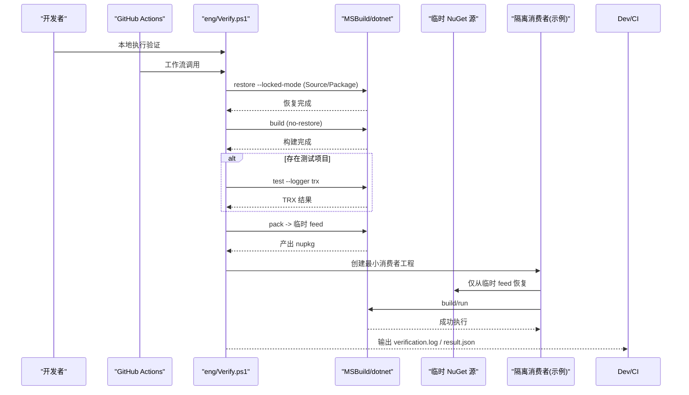
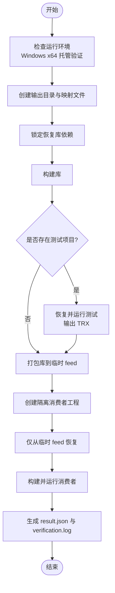
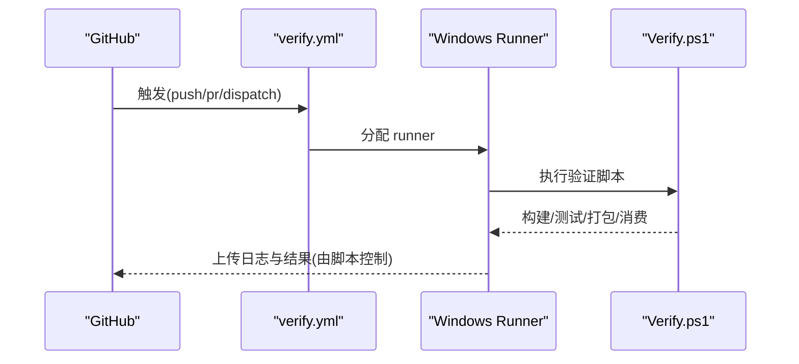
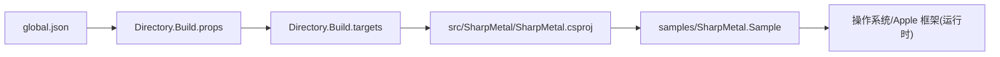

# 构建和测试流程

<cite>
**本文引用的文件**
- [README.md](file://README.md)
- [global.json](file://global.json)
- [Directory.Build.props](file://Directory.Build.props)
- [Directory.Build.targets](file://Directory.Build.targets)
- [SharpMetal.product.props](file://SharpMetal.product.props)
- [stack.local.props.example](file://stack.local.props.example)
- [eng/Verify.ps1](file://eng/Verify.ps1)
- [.github/workflows/verify.yml](file://.github/workflows/verify.yml)
- [docs/VERIFICATION.md](file://docs/VERIFICATION.md)
- [src/SharpMetal/SharpMetal.csproj](file://src/SharpMetal/SharpMetal.csproj)
- [samples/SharpMetal.Sample/SharpMetal.Sample.csproj](file://samples/SharpMetal.Sample/SharpMetal.Sample.csproj)
- [samples/SharpMetal.Sample/Program.cs](file://samples/SharpMetal.Sample/Program.cs)
</cite>

## 目录
1. [简介](#简介)
2. [项目结构](#项目结构)
3. [核心组件](#核心组件)
4. [架构总览](#架构总览)
5. [详细组件分析](#详细组件分析)
6. [依赖关系分析](#依赖关系分析)
7. [性能考虑](#性能考虑)
8. [故障排除指南](#故障排除指南)
9. [结论](#结论)
10. [附录](#附录)

## 简介
本文件聚焦 SharpMetal 项目的构建与测试流程，覆盖构建系统工作原理、自定义 MSBuild 目标、验证脚本使用、CI/CD 流水线触发条件、本地与 CI 的常用命令、输出解读以及常见问题排查。同时提供如何添加新测试用例与验证步骤的指导。

## 项目结构
仓库采用分层组织：
- src/SharpMetal：产品库（.NET 10 绑定），定义平台与打包元数据
- samples/SharpMetal.Sample：示例程序，用于验证托管 ABI 与在 Apple 主机上的 Metal 能力
- eng/Verify.ps1：本地与 CI 的统一验证入口
- .github/workflows/verify.yml：GitHub Actions 工作流，执行 Windows 托管与包验证
- docs/VERIFICATION.md：权威构建、测试、打包与平台验证说明
- Directory.Build.props/targets：全局 MSBuild 属性与目标，统一产物路径、锁定模式、Source/Package 引用模式校验等
- global.json：固定 .NET SDK 版本
- stack.local.props.example：源引用模式下的依赖映射模板

**章节来源**
- [README.md:1-23](file://README.md#L1-L23)
- [global.json:1-8](file://global.json#L1-L8)
- [Directory.Build.props:1-25](file://Directory.Build.props#L1-L25)
- [Directory.Build.targets:1-40](file://Directory.Build.targets#L1-L40)
- [docs/VERIFICATION.md:1-103](file://docs/VERIFICATION.md#L1-L103)

## 核心组件
- 构建系统与全局属性
  - 通过 Directory.Build.props 统一设置输出目录、中间目录、锁定还原、默认 Configuration/Platform、RID 推导、NuGet 锁文件路径等
  - 通过 Directory.Build.targets 实现 Source/Package 引用模式校验、传递额外属性到项目引用、导入外部 targets（如 SharpGPU）
- 验证脚本
  - eng/Verify.ps1 封装 restore/build/test/pack 与隔离消费者验证，生成 verification.log 与 result.json
- CI 工作流
  - .github/workflows/verify.yml 在 Windows 上以 Debug/Release 矩阵运行验证脚本
- 示例与产品
  - src/SharpMetal/SharpMetal.csproj 定义库、目标框架、平台、包元数据
  - samples/SharpMetal.Sample 根据 StackReferenceMode 切换为 ProjectReference 或 PackageReference
  - Program.cs 进行托管 ABI 检查与非 Apple 平台的显式边界提示

**章节来源**
- [Directory.Build.props:1-25](file://Directory.Build.props#L1-L25)
- [Directory.Build.targets:1-40](file://Directory.Build.targets#L1-L40)
- [eng/Verify.ps1:1-67](file://eng/Verify.ps1#L1-L67)
- [.github/workflows/verify.yml:1-26](file://.github/workflows/verify.yml#L1-L26)
- [src/SharpMetal/SharpMetal.csproj:1-47](file://src/SharpMetal/SharpMetal.csproj#L1-L47)
- [samples/SharpMetal.Sample/SharpMetal.Sample.csproj:1-6](file://samples/SharpMetal.Sample/SharpMetal.Sample.csproj#L1-L6)
- [samples/SharpMetal.Sample/Program.cs:1-49](file://samples/SharpMetal.Sample/Program.cs#L1-L49)

## 架构总览
下图展示了从 CI 触发到本地验证的端到端流程，包括 Source/Package 模式、锁定还原、构建、可选测试、打包与隔离消费者验证。

**图表来源**
- [.github/workflows/verify.yml:1-26](file://.github/workflows/verify.yml#L1-L26)
- [eng/Verify.ps1:1-67](file://eng/Verify.ps1#L1-L67)
- [Directory.Build.props:1-25](file://Directory.Build.props#L1-L25)
- [Directory.Build.targets:1-40](file://Directory.Build.targets#L1-L40)

## 详细组件分析

### 构建系统工作原理与自定义目标
- 全局属性与产物布局
  - 通过 Directory.Build.props 统一 BaseOutputPath/BaseIntermediateOutputPath，将产物放入 artifacts/bin/...，中间产物放入 artifacts/obj/...
  - 启用 RestorePackagesWithLockFile，并基于 StackReferenceMode 与 RID 选择 packages.<Mode>.<RID>.lock.json
  - 默认 Configuration=Debug，Platform=AnyCPU；当指定 RuntimeIdentifier 时，输出 RID 使用该值
- Source/Package 引用模式校验
  - Directory.Build.targets 中的 ValidateStackReferenceMode 在构建前校验：
    - StackReferenceMode 必须为 Source 或 Package
    - 若声明了 StackProduct 的项目引用，则必须在 Source 模式下且存在对应 checkout 与 product.props
    - 禁止在 Source 模式下引入冲突的包
- 项目引用属性透传
  - PreserveStackProductProjectReferenceConfiguration 确保 Solution 构建时保留 Configuration/Platform 等关键属性
- 外部 targets 导入
  - 在 Source 模式下尝试导入 SharpGPU 的 buildTransitive targets

**章节来源**
- [Directory.Build.props:1-25](file://Directory.Build.props#L1-L25)
- [Directory.Build.targets:1-40](file://Directory.Build.targets#L1-L40)

### 验证脚本（eng/Verify.ps1）详解
- 输入参数
  - Configuration：Debug 或 Release
  - OutputRoot：证据输出根目录（不存在才允许创建）
- 主要步骤
  - 初始化空 mapping 文件与属性，强制 Source 模式、x64、禁用静态图评估、单进程、关闭并行
  - 对 src/SharpMetal/SharpMetal.csproj 执行 locked restore 与 build
  - 若存在 tests/SharpMetal.Tests/SharpMetal.Tests.csproj，则执行 restore、test（TRX 输出到 results）
  - 对库执行 pack，产出到 output/feed
  - 构造隔离消费者：复制 samples/SharpMetal.Sample/Program.cs，生成最小 csproj 与 NuGet.Config，仅指向临时 feed，恢复并构建
  - 校验消费者不依赖任何 project 类型库
  - 切换到临时目录运行生成的二进制
  - 输出 result.json（包含 package SHA-256、状态）与 verification.log
- 平台限制
  - 脚本限定 Windows x64 托管验证；原生 Metal 需要 Apple 主机

**图表来源**
- [eng/Verify.ps1:1-67](file://eng/Verify.ps1#L1-L67)

**章节来源**
- [eng/Verify.ps1:1-67](file://eng/Verify.ps1#L1-L67)

### CI/CD 流水线与触发条件
- 触发事件
  - push、pull_request、workflow_dispatch
- 执行环境
  - windows-latest，超时 20 分钟
- 矩阵
  - Configuration: Debug, Release
- 步骤
  - 检出代码
  - 使用 global.json 安装 .NET SDK
  - 调用 ./eng/Verify.ps1 传入 Configuration 与 OutputRoot

**图表来源**
- [.github/workflows/verify.yml:1-26](file://.github/workflows/verify.yml#L1-L26)
- [eng/Verify.ps1:1-67](file://eng/Verify.ps1#L1-L67)

**章节来源**
- [.github/workflows/verify.yml:1-26](file://.github/workflows/verify.yml#L1-L26)

### 平台验证与示例行为
- 示例程序行为
  - 非 Apple 平台：打印“Managed ABI passed”并返回，明确标注原生 Metal 需要 Apple 主机
  - Apple 平台：尝试创建设备、分配共享缓冲区、读写回读，验证托管 ABI 与资源生命周期
- 平台策略
  - 构建系统支持 x64 与 ARM64 平台
  - 验证脚本与当前 CI 限定 Windows 托管验证；Apple 原生需在匹配主机上执行

**章节来源**
- [samples/SharpMetal.Sample/Program.cs:1-49](file://samples/SharpMetal.Sample/Program.cs#L1-L49)
- [src/SharpMetal/SharpMetal.csproj:1-47](file://src/SharpMetal/SharpMetal.csproj#L1-L47)
- [eng/Verify.ps1:1-67](file://eng/Verify.ps1#L1-L67)

### 如何添加新的测试用例与验证步骤
- 新增单元测试
  - 在 tests/SharpMetal.Tests 下新建测试项目（若不存在可参考现有模式），并在 eng/Verify.ps1 中检测该路径后自动恢复与运行
  - 建议输出 TRX 以便 CI 收集
- 新增集成/平台验证
  - 可在验证脚本中添加新的 dotnet run 步骤，针对特定平台或依赖
  - 注意保持 OutputRoot 唯一性与幂等性（脚本会拒绝已存在的证据目录）
- 新增 Source/Package 模式验证
  - 利用 Directory.Build.targets 的校验逻辑，确保新增项目引用正确声明 StackProduct/StackRoot
  - 如需引入外部 targets（如 SharpGPU），确保 Source 模式下路径有效

**章节来源**
- [eng/Verify.ps1:1-67](file://eng/Verify.ps1#L1-L67)
- [Directory.Build.targets:1-40](file://Directory.Build.targets#L1-L40)

## 依赖关系分析
- 构建期依赖
  - global.json 固定 .NET SDK 版本
  - Directory.Build.props/targets 提供全局属性与目标，影响所有子项目
  - SharpMetal.product.props 定义产品名称
- 运行时依赖
  - 示例程序依赖 SharpMetal 库
  - 在非 Apple 平台仅验证托管 ABI；原生 Metal 依赖 Apple 系统框架
- 包与源引用模式
  - StackReferenceMode=Source：使用本地源码映射（需 stack.local.props）
  - StackReferenceMode=Package：使用 NuGet 包（需提供 feed）

**图表来源**
- [global.json:1-8](file://global.json#L1-L8)
- [Directory.Build.props:1-25](file://Directory.Build.props#L1-L25)
- [Directory.Build.targets:1-40](file://Directory.Build.targets#L1-L40)
- [src/SharpMetal/SharpMetal.csproj:1-47](file://src/SharpMetal/SharpMetal.csproj#L1-L47)
- [samples/SharpMetal.Sample/SharpMetal.Sample.csproj:1-6](file://samples/SharpMetal.Sample/SharpMetal.Sample.csproj#L1-L6)

**章节来源**
- [global.json:1-8](file://global.json#L1-L8)
- [Directory.Build.props:1-25](file://Directory.Build.props#L1-L25)
- [Directory.Build.targets:1-40](file://Directory.Build.targets#L1-L40)
- [src/SharpMetal/SharpMetal.csproj:1-47](file://src/SharpMetal/SharpMetal.csproj#L1-L47)
- [samples/SharpMetal.Sample/SharpMetal.Sample.csproj:1-6](file://samples/SharpMetal.Sample/SharpMetal.Sample.csproj#L1-L6)

## 性能考虑
- 使用 --locked-mode 与独立的 lock 文件避免网络波动与缓存污染
- 使用 -m:1 与 -nr:false 降低并发干扰，便于定位问题
- 隔离消费者使用独立 NuGet.Config 与包缓存，避免与全局缓存互相影响
- 产物与中间目录集中在 artifacts/，便于清理与复用

[本节为通用指导，无需具体文件引用]

## 故障排除指南
- 常见错误与处理
  - “Evidence directory already exists”：删除已有 OutputRoot 或更换路径
  - “This gate qualifies Windows x64...”：在非 Windows 环境无法运行该脚本；请在 Windows 上执行或使用匹配的宿主门
  - “StackReferenceMode must be Source or Package”：检查是否设置了正确的 StackReferenceMode
  - “Missing source checkout mapping...”：在 Source 模式下需配置 stack.local.props 并指向有效的依赖仓库
  - “Source repository identity mismatch...”：确认 StackRoot 与 product.props 一致
  - “Missing source project...”：确保项目引用路径正确且存在
  - “Stack source/package conflict...”：Source 模式下禁止引入冲突包
  - “Isolated package consumer unexpectedly contains source project dependencies.”：检查消费者工程是否正确仅引用临时 feed
- 日志与结果
  - verification.log：完整命令与输出
  - result.json：包含配置、状态与包哈希
  - results/*.trx：测试报告（若存在测试项目）
- 平台相关
  - 非 Apple 平台仅能验证托管 ABI；原生 Metal 需要在 macOS/iOS/Mac Catalyst 上运行
  - 若出现 ABI 不匹配，检查目标平台与编译选项（x64/ARM64）

**章节来源**
- [eng/Verify.ps1:1-67](file://eng/Verify.ps1#L1-L67)
- [Directory.Build.targets:1-40](file://Directory.Build.targets#L1-L40)
- [samples/SharpMetal.Sample/Program.cs:1-49](file://samples/SharpMetal.Sample/Program.cs#L1-L49)

## 结论
本项目通过统一的 MSBuild 全局配置与验证脚本，实现了 Source/Package 双模式的构建与验证，并在 CI 中以 Windows 托管与包验证为主。示例程序清晰区分托管 ABI 与原生 Metal 的平台边界。遵循本文提供的命令与排错指引，可高效完成本地与 CI 的构建、测试与发布准备。

[本节为总结，无需具体文件引用]

## 附录

### 常用命令速查
- 本地构建（Source 模式）
  - 参考 docs/VERIFICATION.md 中的 Source 模式命令，设置 StackReferenceMode=Source、StackProductRoot、StackLocalProps 等
- 本地构建（Package 模式）
  - 参考 docs/VERIFICATION.md 中的 Package 模式命令，设置 StackReferenceMode=Package 与包缓存/源
- 运行示例
  - 参考 docs/VERIFICATION.md 中的 run 命令，结合 Platform=x64 与相应模式参数
- 打包
  - 参考 docs/VERIFICATION.md 中的 pack 命令，输出到指定目录
- 自动化验证
  - 本地：./eng/Verify.ps1 -Configuration <Debug|Release> -OutputRoot <路径>
  - CI：push/pull_request/workflow_dispatch 触发 .github/workflows/verify.yml

**章节来源**
- [docs/VERIFICATION.md:1-103](file://docs/VERIFICATION.md#L1-L103)
- [eng/Verify.ps1:1-67](file://eng/Verify.ps1#L1-L67)
- [.github/workflows/verify.yml:1-26](file://.github/workflows/verify.yml#L1-L26)

### 验证输出解读
- verification.log：记录每一步 dotnet 命令与其输出，用于复现与定位问题
- result.json：包含 product、configuration、managedBuildAndPackageConsumer 状态、nativeMetal 说明与 packageSha256
- results/*.trx：测试报告，可在本地或 CI 中查看失败用例详情

**章节来源**
- [eng/Verify.ps1:1-67](file://eng/Verify.ps1#L1-L67)