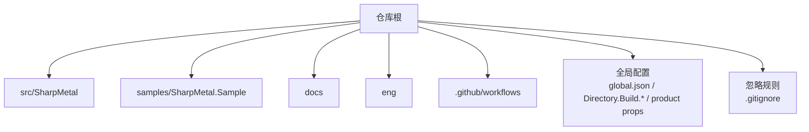
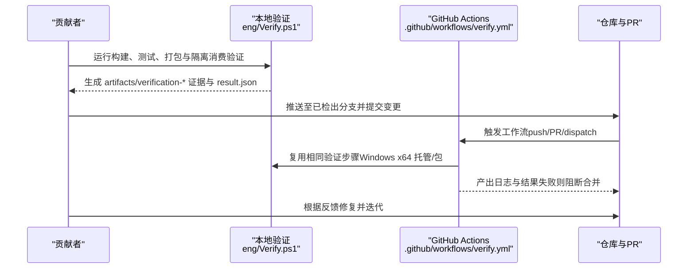
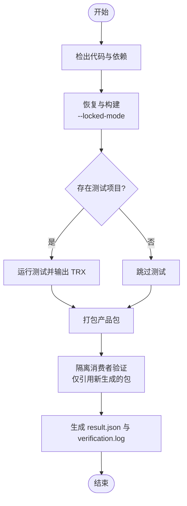

# 贡献工作流程

<cite>
**本文引用的文件**
- [README.md](file://README.md)
- [AGENTS.md](file://AGENTS.md)
- [DESIGN.md](file://DESIGN.md)
- [docs/VERIFICATION.md](file://docs/VERIFICATION.md)
- [.github/workflows/verify.yml](file://.github/workflows/verify.yml)
- [eng/Verify.ps1](file://eng/Verify.ps1)
- [.gitignore](file://.gitignore)
- [global.json](file://global.json)
- [stack.local.props.example](file://stack.local.props.example)
</cite>

## 目录
1. [简介](#简介)
2. [项目结构](#项目结构)
3. [核心组件](#核心组件)
4. [架构总览](#架构总览)
5. [详细组件分析](#详细组件分析)
6. [依赖关系分析](#依赖关系分析)
7. [性能与构建注意事项](#性能与构建注意事项)
8. [故障排查指南](#故障排查指南)
9. [结论](#结论)
10. [附录](#附录)

## 简介
本文件为 SharpMetal 仓库的贡献者提供从问题发现到代码合并的完整工作流程说明。内容涵盖分支策略、提交规范、代码审查与合并标准、问题报告与功能请求流程、工程洁净度要求、Git 历史管理与发布流程，以及社区行为准则与沟通渠道。所有规则均以仓库现有文档与自动化脚本为依据，确保贡献过程可验证、可追溯、可维护。

## 项目结构
SharpMetal 采用分层与按领域组织的方式：
- src：运行时绑定与产品源码（Foundation、Metal、MetalFX、ObjectiveCCore、QuartzCore）
- samples：可运行示例（SharpMetal.Sample）
- docs：设计、验证与溯源信息
- eng：本地与 CI 验证入口
- .github/workflows：CI 工作流
- 根级配置：global.json、Directory.Build.*、product props、忽略规则等

**图表来源**
- [README.md:12-16](file://README.md#L12-L16)
- [DESIGN.md:1-12](file://DESIGN.md#L1-L12)

**章节来源**
- [README.md:12-16](file://README.md#L12-L16)
- [DESIGN.md:1-12](file://DESIGN.md#L1-L12)

## 核心组件
- 贡献权威来源
  - 产品架构与设计边界由 DESIGN.md 定义
  - 构建、测试、打包与平台验证命令以 docs/VERIFICATION.md 为准
  - 贡献者行为规范与工程洁净度原则见 AGENTS.md
- 自动化验证
  - GitHub Actions 在 push/pull_request/dispatch 时执行 Windows x64 托管与包验证
  - 本地验证入口为 eng/Verify.ps1，输出证据目录并生成 result.json 与 verification.log
- 构建与依赖
  - global.json 锁定 .NET SDK 版本
  - 通过 stack.local.props.example 管理本地源路径映射；该文件不提交开发者绝对路径
  - NuGet 锁文件按 Source/Package 模式隔离，使用 RestoreLockedMode 保证可重复性

**章节来源**
- [AGENTS.md:1-33](file://AGENTS.md#L1-L33)
- [DESIGN.md:1-12](file://DESIGN.md#L1-L12)
- [docs/VERIFICATION.md:1-103](file://docs/VERIFICATION.md#L1-L103)
- [.github/workflows/verify.yml:1-26](file://.github/workflows/verify.yml#L1-L26)
- [eng/Verify.ps1:1-67](file://eng/Verify.ps1#L1-L67)
- [global.json:1-8](file://global.json#L1-L8)
- [stack.local.props.example:1-12](file://stack.local.props.example#L1-L12)

## 架构总览
下图展示贡献者在本地完成改动后，如何通过本地验证与 CI 门禁形成闭环，最终进入代码审查与合并。

**图表来源**
- [eng/Verify.ps1:1-67](file://eng/Verify.ps1#L1-L67)
- [.github/workflows/verify.yml:1-26](file://.github/workflows/verify.yml#L1-L26)
- [docs/VERIFICATION.md:72-91](file://docs/VERIFICATION.md#L72-L91)

## 详细组件分析

### 分支策略与提交规范
- 分支策略
  - 在已检出的分支上工作，通常为 main。除非获得明确授权，否则不要创建新分支、PR 或远程仓库。
  - 保持未提交的无关工作不被覆盖或丢失。
- 提交规范
  - 遵循 AGENTS.md 中的实现约定（命名、缩进、字段命名风格等），保持单一实现路径，避免引入兼容层或别名。
  - 对不可用平台的执行路径标注 TODO(UNVERIFIED) 或 BLOCKED_PLATFORM，并在文档中记录。
  - 仅提交源码、已审阅的锁定文件和可移植配置模板；将机器相关路径放入被忽略的本地配置。
- 工程洁净度
  - 清理应消除真实冗余；已有结果通过核验就应收口，不为追求形式上的“完美”制造新问题。
  - 产物必须有生命周期；优先使用工程忽略目录；确需写到外部临时位置时记录路径并在结束时收敛。
  - 忽略规则也是工程接口；同时验证“生成物不会上传”和“源码、模板、必要资产不会被误屏蔽”。

**章节来源**
- [AGENTS.md:3-8](file://AGENTS.md#L3-L8)
- [AGENTS.md:13-19](file://AGENTS.md#L13-L19)
- [AGENTS.md:21-33](file://AGENTS.md#L21-L33)

### 代码审查流程与合并标准
- 审查依据
  - 设计边界与公共 API 约束以 DESIGN.md 为准；构建与验证命令以 docs/VERIFICATION.md 为准。
  - 任何行为变化需使用当前构建/测试/运行证据进行验证，包括错误、取消与生命周期路径。
- 合并标准
  - 本地验证必须通过（eng/Verify.ps1 成功）。
  - CI 门禁（Windows x64 托管与包验证）必须通过。
  - 不得改写 Git 历史或丢弃源码溯源；保留许可证、署名与第三方声明。
  - 若涉及平台差异，需在文档中标明当前状态（如 Apple 主机限制）。

**章节来源**
- [AGENTS.md:3-8](file://AGENTS.md#L3-L8)
- [AGENTS.md:13-19](file://AGENTS.md#L13-L19)
- [docs/VERIFICATION.md:72-91](file://docs/VERIFICATION.md#L72-L91)

### 问题报告与功能请求流程
- 问题报告
  - 在提交前，先复现并收集证据：运行 docs/VERIFICATION.md 中的命令，保留 verification.log、result.json、TRX 测试结果与隔离消费者输出。
  - 明确平台与环境（SDK 版本、RID、Source/Package 模式、是否使用本地 feed）。
- 功能请求
  - 基于 DESIGN.md 的产品边界评估影响范围；如需新增公共 API 或改变 ABI，需额外说明兼容性影响与迁移方案。
  - 更新 README/DESIGN/VERIFICATION 中与契约相关的部分。

**章节来源**
- [docs/VERIFICATION.md:1-103](file://docs/VERIFICATION.md#L1-L103)
- [DESIGN.md:1-12](file://DESIGN.md#L1-L12)

### 工程洁净度：清理构建产物、缓存与临时文件
- 需要忽略与清理的内容
  - 构建与测试输出：artifacts、bin/obj、TestResults、*.trx、*.binlog、*.nupkg、*.snupkg、*.dmp、*.log、coverage/
  - 本地依赖映射与临时目录：stack.local.props、.ci-dependencies、.verification、.extraction-source、.history-*
  - 编辑器状态与机密：.vs/.idea/.cursor/*.user/*.suo/*.DotSettings.user/.env*
  - OS 临时文件：.DS_Store、Thumbs.db、Desktop.ini、*.tmp、*.temp
- 清理原则
  - 删除以已核实的范围为单位；先核对绝对路径边界、重解析点、Git 状态、使用中的文件及保留项。
  - 历史与发布须内容完整；不得用不完整推送、空占位文件或改写历史掩盖缺失内容。
  - 验证与改动相称；完成后停止扩散，不反复跑同一矩阵，也不为验证清理重新制造整批大产物。

**章节来源**
- [.gitignore:1-39](file://.gitignore#L1-L39)
- [AGENTS.md:21-33](file://AGENTS.md#L21-L33)

### Git 历史管理与发布流程
- 历史管理
  - 禁止改写 Git 历史或在清理过程中丢弃源码溯源。
  - 保留许可证、署名、既有 Git 历史及所需 LFS 对象。
- 发布流程
  - 发布前应核对远端名称、可见性、分支、提交 SHA 和关键文件完整性。
  - 当前 CI 仅产出本地包与证据，不上传或发布包；正式发布需另行授权与流程。

**章节来源**
- [AGENTS.md:3-8](file://AGENTS.md#L3-L8)
- [AGENTS.md:31-32](file://AGENTS.md#L31-L32)
- [docs/VERIFICATION.md:72-91](file://docs/VERIFICATION.md#L72-L91)

### 社区行为准则与沟通渠道
- 行为准则
  - 尊重他人工作，遵守许可与署名要求；保持透明与可追溯。
  - 在变更影响契约时同步更新 README/DESIGN/VERIFICATION。
- 沟通渠道
  - 通过仓库的 PR 与工作流评论进行沟通；必要时在 issue 中附上证据与复现步骤。
  - 对于平台相关问题，明确标注平台限制与阻塞原因。

**章节来源**
- [AGENTS.md:13-19](file://AGENTS.md#L13-L19)
- [README.md:18-22](file://README.md#L18-L22)

## 依赖关系分析
- 构建与验证链路
  - 工作流调用 eng/Verify.ps1，后者依次执行 restore/build/test/pack 与隔离消费者验证。
  - 使用 --locked-mode 与模式隔离的 NuGet 锁文件，确保可重复构建。
- 平台与宿主
  - 托管绑定可在 Windows 上验证；原生 Metal 执行需要匹配的 Apple 主机与系统框架。
  - 非 Apple 平台标记为 BLOCKED_PLATFORM 或 TODO(UNVERIFIED)。

**图表来源**
- [eng/Verify.ps1:14-66](file://eng/Verify.ps1#L14-L66)
- [docs/VERIFICATION.md:72-91](file://docs/VERIFICATION.md#L72-L91)

**章节来源**
- [eng/Verify.ps1:1-67](file://eng/Verify.ps1#L1-L67)
- [docs/VERIFICATION.md:72-91](file://docs/VERIFICATION.md#L72-L91)

## 性能与构建注意事项
- 使用固定 SDK 版本（global.json）以避免环境漂移。
- 使用 --no-restore 与 --locked-mode 减少网络与解析开销，提高可重复性。
- 隔离消费者验证能尽早暴露依赖污染问题。
- 合理设置并行与禁用静态图评估（脚本中已配置），平衡速度与稳定性。

**章节来源**
- [global.json:1-8](file://global.json#L1-L8)
- [eng/Verify.ps1:25-30](file://eng/Verify.ps1#L25-L30)
- [docs/VERIFICATION.md:100-103](file://docs/VERIFICATION.md#L100-L103)

## 故障排查指南
- 常见问题定位
  - 检查 verification.log 与 result.json 获取失败上下文。
  - 确认 StackReferenceMode、Platform、StackProductRoot、StackLocalProps 参数正确。
  - 确认 NuGet 锁文件与 Source/Package 模式匹配，避免混用。
- 平台限制
  - 在 Windows 上只能验证托管与包；原生 Metal 需要 Apple 主机。
  - 对未验证平台标注 BLOCKED_PLATFORM 或 TODO(UNVERIFIED)，并在文档中说明。
- 清理与重建
  - 清理 artifacts、bin/obj、TestResults、*.trx、*.log 等；必要时重建隔离消费者与包缓存。
  - 确保忽略规则生效，避免误提交敏感或临时文件。

**章节来源**
- [docs/VERIFICATION.md:72-91](file://docs/VERIFICATION.md#L72-L91)
- [eng/Verify.ps1:20-66](file://eng/Verify.ps1#L20-L66)
- [.gitignore:1-39](file://.gitignore#L1-L39)

## 结论
SharpMetal 的贡献流程以明确的权威文档与自动化验证为核心：在已检出分支上工作，遵循实现与洁净度规范，通过本地与 CI 双重验证后再进入审查与合并。平台限制与不可用路径需显式标注，历史与发布需保持完整与可追溯。按照本流程，贡献者可高效、安全地推进从问题发现到代码合并的全流程。

## 附录
- 快速开始
  - 安装 global.json 指定的 .NET SDK。
  - 复制 stack.local.props.example 为 stack.local.props 并调整依赖路径。
  - 运行 docs/VERIFICATION.md 中的命令完成构建、测试、打包与示例运行。
- 常用命令
  - 本地验证：./eng/Verify.ps1 -Configuration Debug|Release -OutputRoot <路径>
  - 构建与打包：dotnet build/pack src/SharpMetal/SharpMetal.csproj -c Release -p:Platform=x64 ...
  - 运行示例：dotnet run --project samples/SharpMetal.Sample/SharpMetal.Sample.csproj -c Release -p:Platform=x64 ...

**章节来源**
- [README.md:5-11](file://README.md#L5-L11)
- [docs/VERIFICATION.md:13-28](file://docs/VERIFICATION.md#L13-L28)
- [docs/VERIFICATION.md:81-84](file://docs/VERIFICATION.md#L81-L84)