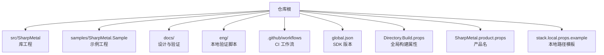
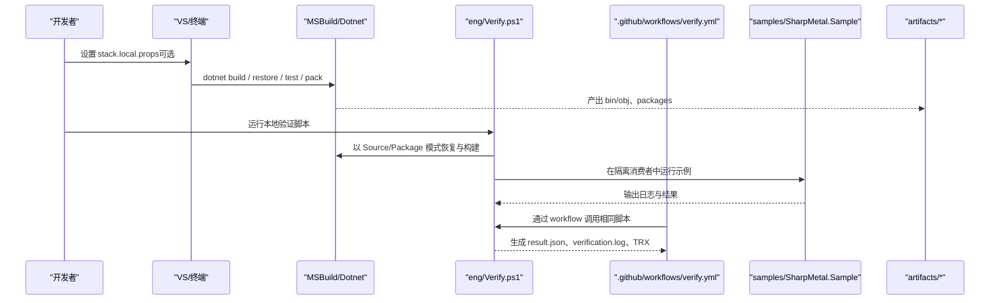
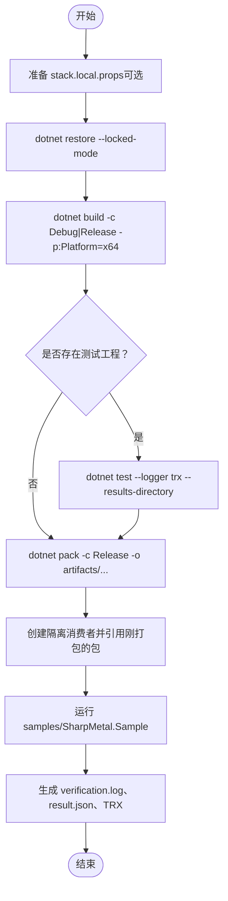
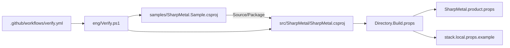

# 贡献指南

<cite>
**本文引用的文件**
- [README.md](file://README.md)
- [AGENTS.md](file://AGENTS.md)
- [DESIGN.md](file://DESIGN.md)
- [global.json](file://global.json)
- [Directory.Build.props](file://Directory.Build.props)
- [SharpMetal.product.props](file://SharpMetal.product.props)
- [docs/VERIFICATION.md](file://docs/VERIFICATION.md)
- [eng/Verify.ps1](file://eng/Verify.ps1)
- [.github/workflows/verify.yml](file://.github/workflows/verify.yml)
- [src/SharpMetal/SharpMetal.csproj](file://src/SharpMetal/SharpMetal.csproj)
- [samples/SharpMetal.Sample/SharpMetal.Sample.csproj](file://samples/SharpMetal.Sample/SharpMetal.Sample.csproj)
- [stack.local.props.example](file://stack.local.props.example)
</cite>

## 目录
1. [简介](#简介)
2. [项目结构](#项目结构)
3. [核心组件](#核心组件)
4. [架构总览](#架构总览)
5. [详细组件分析](#详细组件分析)
6. [依赖关系分析](#依赖关系分析)
7. [性能与构建注意事项](#性能与构建注意事项)
8. [故障排查指南](#故障排查指南)
9. [结论](#结论)
10. [附录：快速上手清单](#附录快速上手清单)

## 简介
本贡献指南面向希望参与 SharpMetal 项目的开发者，目标是帮助新贡献者快速完成开发环境搭建、理解项目结构与开发流程、遵循代码规范与提交标准、编写和验证测试、报告问题与提出功能请求，并了解代码审查标准与社区行为准则。

SharpMetal 提供 .NET 10 下的 Objective-C 与 Metal 绑定（包含 Foundation、Metal、MetalFX、QuartzCore），原生资源采用显式所有权管理；托管布局检查可移植，原生执行需要 Apple 主机与系统框架。仓库根目录的 README、设计文档与验证说明是权威来源。

**章节来源**
- [README.md:1-23](file://README.md#L1-L23)

## 项目结构
- src/：运行时与绑定源码（Foundation、Metal、MetalFX、ObjectiveCCore、QuartzCore）
- samples/：可运行示例（SharpMetal.Sample）
- docs/：设计与验证说明（含 VERIFICATION.md 与 provenance）
- eng/：本地验证脚本（Verify.ps1）
- .github/workflows：CI 工作流（Windows 托管与打包验证）
- 根级 MSBuild 配置：global.json、Directory.Build.props、SharpMetal.product.props、stack.local.props.example

**图表来源**
- [README.md:12-16](file://README.md#L12-L16)
- [global.json:1-8](file://global.json#L1-L8)
- [Directory.Build.props:1-25](file://Directory.Build.props#L1-L25)
- [SharpMetal.product.props:1-2](file://SharpMetal.product.props#L1-L2)
- [docs/VERIFICATION.md:1-12](file://docs/VERIFICATION.md#L1-L12)

**章节来源**
- [README.md:12-16](file://README.md#L12-L16)
- [DESIGN.md:1-12](file://DESIGN.md#L1-L12)

## 核心组件
- 库工程：src/SharpMetal/SharpMetal.csproj，目标 net10.0，支持 x64/ARM64，启用不安全块，生成 NuGet 包元数据
- 示例工程：samples/SharpMetal.Sample/SharpMetal.Sample.csproj，根据 StackReferenceMode 引用源码或包
- 构建与产物隔离：Directory.Build.props 统一输出路径到 artifacts/bin 与 artifacts/obj，锁定 NuGet 还原模式
- 本地依赖映射：stack.local.props.example 提供可共享的源路径模板，避免提交开发者绝对路径
- 验证与 CI：docs/VERIFICATION.md 定义权威命令；eng/Verify.ps1 封装 Windows 托管与包验证；.github/workflows/verify.yml 在 GitHub Actions 上执行

**章节来源**
- [src/SharpMetal/SharpMetal.csproj:1-47](file://src/SharpMetal/SharpMetal.csproj#L1-L47)
- [samples/SharpMetal.Sample/SharpMetal.Sample.csproj:1-6](file://samples/SharpMetal.Sample/SharpMetal.Sample.csproj#L1-L6)
- [Directory.Build.props:1-25](file://Directory.Build.props#L1-L25)
- [docs/VERIFICATION.md:1-12](file://docs/VERIFICATION.md#L1-L12)
- [eng/Verify.ps1:1-67](file://eng/Verify.ps1#L1-L67)
- [.github/workflows/verify.yml:1-26](file://.github/workflows/verify.yml#L1-L26)

## 架构总览
下图展示了从开发者到构建、测试、打包与示例运行的整体流程，以及 CI 如何复用同一套验证脚本。

**图表来源**
- [docs/VERIFICATION.md:13-55](file://docs/VERIFICATION.md#L13-L55)
- [eng/Verify.ps1:23-64](file://eng/Verify.ps1#L23-L64)
- [.github/workflows/verify.yml:17-25](file://.github/workflows/verify.yml#L17-L25)

## 详细组件分析

### 开发环境与工具链
- SDK 版本：由 global.json 指定 .NET 10 SDK，禁止预发行版
- 平台与配置：默认 Debug/AnyCPU，可通过 Platform/RuntimeIdentifier 控制；输出路径隔离到 artifacts
- 依赖模式：StackReferenceMode=Source 或 Package，影响整个依赖图；锁文件按模式与 RID/portable 区分
- 本地路径：使用 stack.local.props.example 作为模板，勿提交开发者绝对路径

**章节来源**
- [global.json:1-8](file://global.json#L1-L8)
- [Directory.Build.props:8-22](file://Directory.Build.props#L8-L22)
- [docs/VERIFICATION.md:1-12](file://docs/VERIFICATION.md#L1-L12)

### 构建、测试与打包流程
- 权威命令：见 docs/VERIFICATION.md，包含 Source 与 Package 两种模式的构建、运行示例与打包
- 本地自动化：eng/Verify.ps1 在 Windows x64 上执行受控验证，生成证据目录、日志与结果 JSON
- CI 集成：.github/workflows/verify.yml 在 push/pull_request/dispatch 时运行相同脚本，矩阵化 Debug/Release

**图表来源**
- [docs/VERIFICATION.md:13-55](file://docs/VERIFICATION.md#L13-L55)
- [eng/Verify.ps1:23-64](file://eng/Verify.ps1#L23-L64)

**章节来源**
- [docs/VERIFICATION.md:13-103](file://docs/VERIFICATION.md#L13-L103)
- [eng/Verify.ps1:1-67](file://eng/Verify.ps1#L1-L67)
- [.github/workflows/verify.yml:1-26](file://.github/workflows/verify.yml#L1-L26)

### 代码规范与风格
- 命名与格式：手写 C# 使用 block 命名空间、Allman 大括号、四空格缩进；字段 m_PascalCase，静态字段 s_PascalCase
- 生成/绑定代码：保留其原有约定
- 单一实现路径：不引入遗留别名、转发程序集、兼容垫片或静默依赖回退
- 许可证与归属：第一方代码与包元数据使用 MPL-2.0；保留 LICENSE、来源与第三方许可声明
- 平台边界：保留 Apple 平台检查、原生 ABI 与显式 retain/release 所有权；不支持的平台需明确标记 BLOCKED_PLATFORM 或 TODO(UNVERIFIED)

**章节来源**
- [AGENTS.md:9-19](file://AGENTS.md#L9-L19)

### 提交标准与变更范围
- 分支与发布：在工作区当前分支（通常 main）上工作；未经明确授权不得创建分支、PR、远程或发布
- 历史与溯源：不重写 Git 历史，不清理导致丢失来源的工作；保留许可证、署名与必要 LFS 对象
- 清理原则：删除以已核实的范围为单位；忽略规则也是工程接口；产物必须有生命周期；文档保存结论与依据
- 验证与改动相称：记录实际失败与明确保留项；除非输入变化或出现新证据，不反复跑同一矩阵

**章节来源**
- [AGENTS.md:3-8](file://AGENTS.md#L3-L8)
- [AGENTS.md:21-33](file://AGENTS.md#L21-L33)

### 测试编写指南与验证流程
- 测试位置：自有测试位于 tests 目录（若存在）；当前 Metal 无测试工程，仅记录托管 ABI 与示例验证
- 本地验证：使用 eng/Verify.ps1 在 Windows x64 上执行，生成 TRX 结果与日志
- 跨平台：Apple 原生能力需在匹配主机上验证；Linux/Android/iOS 原生资格为 TODO(UNVERIFIED)
- 证据保留：结果与日志位于 artifacts/verification-* 或脚本指定的输出根目录；不要将旧证据当作当前验证

**章节来源**
- [docs/VERIFICATION.md:57-64](file://docs/VERIFICATION.md#L57-L64)
- [docs/VERIFICATION.md:72-98](file://docs/VERIFICATION.md#L72-L98)
- [eng/Verify.ps1:31-37](file://eng/Verify.ps1#L31-L37)

### 问题报告与功能请求
- 建议包含：复现步骤、期望行为、实际行为、平台与 SDK 信息、构建/运行命令、相关日志与证据路径
- 平台差异：注明是否 Apple 主机、RID、Configuration/Platform
- 证据：优先提供 eng/Verify.ps1 生成的 verification.log、result.json 与 TRX 路径

[本节为通用指导，无需特定文件来源]

### 代码审查标准与最佳实践
- 架构边界：遵循 DESIGN.md 的产品边界；不隐藏不支持的能力或降级实现
- 依赖与锁定：Source/Package 模式独立；NuGet 锁文件按模式与 RID/portable 维护；新增 RID 需配套锁与匹配主机验证
- 输出隔离：产物与中间文件隔离于 artifacts；不污染工作树
- 许可证合规：保持 MPL-2.0 与第三方许可信息完整
- 最小变更：只修改必要内容；删除冗余与失效入口；更新 README/设计/验证中与契约相关的部分

**章节来源**
- [DESIGN.md:1-12](file://DESIGN.md#L1-L12)
- [AGENTS.md:9-19](file://AGENTS.md#L9-L19)
- [Directory.Build.props:17-22](file://Directory.Build.props#L17-L22)

### 社区行为准则与沟通渠道
- 行为准则：遵循仓库行为准则（如 CONTRIBUTING/CODE_OF_CONDUCT，若存在）；尊重协作与透明原则
- 沟通渠道：通过 Issues 与 Pull Requests 进行问题反馈与讨论；在 PR 描述中引用相关任务或文档
- 语言与礼仪：使用清晰、客观的语言；避免人身攻击与无关争论

[本节为通用指导，无需特定文件来源]

## 依赖关系分析
- 工程依赖：示例工程根据 StackReferenceMode 引用源码或包；库工程定义版本、包元数据与许可证文件
- 构建属性：Directory.Build.props 导入产品属性与本地 props，统一输出路径、锁定还原、排除中间目录
- CI 与工作流：GitHub Actions 使用 setup-dotnet 读取 global.json，调用 eng/Verify.ps1 完成构建、测试与打包

**图表来源**
- [samples/SharpMetal.Sample/SharpMetal.Sample.csproj:1-6](file://samples/SharpMetal.Sample/SharpMetal.Sample.csproj#L1-L6)
- [src/SharpMetal/SharpMetal.csproj:1-47](file://src/SharpMetal/SharpMetal.csproj#L1-L47)
- [Directory.Build.props:1-25](file://Directory.Build.props#L1-L25)
- [SharpMetal.product.props:1-2](file://SharpMetal.product.props#L1-L2)
- [stack.local.props.example](file://stack.local.props.example)
- [.github/workflows/verify.yml:17-25](file://.github/workflows/verify.yml#L17-L25)
- [eng/Verify.ps1:23-64](file://eng/Verify.ps1#L23-L64)

**章节来源**
- [src/SharpMetal/SharpMetal.csproj:1-47](file://src/SharpMetal/SharpMetal.csproj#L1-L47)
- [samples/SharpMetal.Sample/SharpMetal.Sample.csproj:1-6](file://samples/SharpMetal.Sample/SharpMetal.Sample.csproj#L1-L6)
- [Directory.Build.props:1-25](file://Directory.Build.props#L1-L25)
- [.github/workflows/verify.yml:1-26](file://.github/workflows/verify.yml#L1-L26)
- [eng/Verify.ps1:1-67](file://eng/Verify.ps1#L1-L67)

## 性能与构建注意事项
- 使用锁定还原：--locked-mode 与 RestoreLockedMode=true 确保可重复构建
- 隔离缓存：使用独立的 NuGet 缓存与输出目录，避免污染
- 并行与并发：脚本中禁用并行（-m:1, -nr:false）以保证可重现性
- 平台限制：Metal 原生执行需要 Apple 主机；Windows 仅验证托管与打包
- 产物管理：artifacts 下产物应被忽略；仅提交源码、锁文件与可移植模板

**章节来源**
- [docs/VERIFICATION.md:72-98](file://docs/VERIFICATION.md#L72-L98)
- [eng/Verify.ps1:23-27](file://eng/Verify.ps1#L23-L27)
- [Directory.Build.props:17-22](file://Directory.Build.props#L17-L22)

## 故障排查指南
- 无法还原或锁定失败：确认 StackReferenceMode 与对应 lock 文件存在；追加 --locked-mode；检查网络与源配置
- 平台不匹配：Apple 原生能力需在 macOS 主机验证；Windows 仅托管验证
- 示例运行失败：检查 INFINITYSTACK_SHARPMETAL_ROOT 等环境变量；确认依赖路径与 feed 正确
- 证据冲突：脚本拒绝已有证据目录；更换 OutputRoot 或删除旧目录后重试
- 包消费异常：隔离消费者不应包含项目依赖；检查 Consumer.csproj 与 NuGet.Config 中的 source/fallback

**章节来源**
- [docs/VERIFICATION.md:1-12](file://docs/VERIFICATION.md#L1-L12)
- [docs/VERIFICATION.md:57-64](file://docs/VERIFICATION.md#L57-L64)
- [eng/Verify.ps1:8-13](file://eng/Verify.ps1#L8-L13)
- [eng/Verify.ps1:44-59](file://eng/Verify.ps1#L44-L59)

## 结论
SharpMetal 提供了清晰的构建、验证与打包流程，并通过脚本与 CI 保证一致性。贡献者应遵循 AGENTS.md 的行为与工程洁净度原则，依据 DESIGN.md 维护产品边界，使用 docs/VERIFICATION.md 的命令进行本地与 CI 验证。通过严格锁定依赖、隔离产物与保留证据，可显著提升可维护性与可追溯性。

[本节为总结性内容，无需特定文件来源]

## 附录：快速上手清单
- 安装 .NET 10 SDK（由 global.json 指定）
- 复制 stack.local.props.example 为 stack.local.props，并按需调整路径
- 使用 docs/VERIFICATION.md 中的命令构建、运行示例与打包
- 使用 eng/Verify.ps1 在 Windows x64 上执行本地验证
- 提交前运行 git diff --check，确保无警告与错误
- 如需 Apple 原生验证，请在匹配主机上执行并补充证据

**章节来源**
- [global.json:1-8](file://global.json#L1-L8)
- [README.md:5-11](file://README.md#L5-L11)
- [docs/VERIFICATION.md:13-55](file://docs/VERIFICATION.md#L13-L55)
- [eng/Verify.ps1:1-67](file://eng/Verify.ps1#L1-L67)